import Guide from '@/components/Guide.astro';
import Knowledge from '@/components/Knowledge.astro';
import Example from '@/components/Example.astro';
import Analysis from '@/components/Analysis.astro';
import Solution from '@/components/Solution.astro';
import Variant from '@/components/Variant.astro';
import Note from '@/components/Note.astro';
import Block from '@/components/Block.astro';
import Method from '@/components/Method.astro';
import Exercise from '@/components/Exercise.astro';
import Algorithm from '@/components/Algorithm.astro';

## 9.3 本地搜索启发式

我们应对 NP 完整性的下一个策略受到进化的启发（毕竟，这是世界上经过最好测试的优化程序）——通过引入小突变、尝试它们并在效果良好时保留它们的渐进过程。这种范例称为本地搜索，可以应用于任何优化任务。以下是它如何寻找最小化问题。

<Algorithm>
让我们成为任何初始解决方案
而 s 附近有一些解 $s'$
    其中 $	ext{cost}(s') < 	ext{cost}(s)$：
        将 s 替换为 $s'$
返回
</Algorithm>

在每次迭代中，当前的解决方案都会被其附近的一个更接近的解决方案所取代。这种邻域结构是我们强加给问题的东西，也是局部搜索的核心设计决策。作为说明，让我们回顾一下旅行商问题。

## 9.3.1 再次旅行推销员

假设我们有 n 个城市之间的所有点间距离，给出搜索空间 (n 1)！不同的旅行。什么是好的邻里概念？

最明显的概念是，如果两个旅行只有几个边缘不同，则认为它们很接近。它们不能仅在一条边上有所不同（您明白为什么吗？），因此我们将考虑两条边的差异。我们将旅行 s 的 2-change 邻域定义为可以通过删除 s 的两条边然后放入另外两条边获得的旅行集。以下是本地移动的示例：

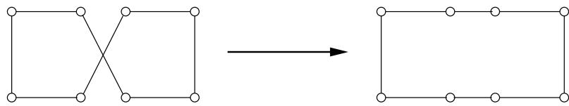

我们现在有一个明确定义的本地搜索程序。它在我们的两个算法标准下表现如何——它的总体运行时间是多少，它是否总是返回最佳解决方案？

令人尴尬的是，这些问题都没有一个令人满意的答案。每次迭代肯定很快，因为一次游览只有 $O ( n ^ { 2 } )$ 个邻居。然而，尚不清楚需要多少次迭代：例如，是否可能有指数数量的迭代。同样，关于最终的游览，我们可以轻松地说的是它是局部最优的，也就是说，它优于其紧邻的游览。更远的地方可能有更好的解决方案。例如，下图显示了一个可能的最终答案，但显然不是最优的；局部动作的范围太有限，无法对其进行改进。

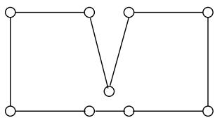

为了克服这个问题，我们可以尝试更慷慨的邻域，例如 3-change，由最多三个边缘不同的旅行组成。事实上，前面的坏情况已经得到解决：

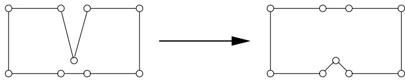

但也有一个缺点，即邻域的大小变为 $O ( n ^ { 3 } )$ ，使得每次迭代的成本更高。此外，可能仍然存在次优的局部最小值，尽管比以前少了。为了避免这些，我们必须进行 4 次更改或更高。以这种方式，效率和质量常常成为本地搜索中相互竞争的考虑因素。效率要求可以快速搜索邻域，但较小的邻域可能会增加低质量局部最优的丰富度。适当的折衷方案通常是通过实验确定的。

图 9.7 (a) 九个美国城市。 (b) 本地搜索，从随机巡视开始，并使用 3-change。旅行商之旅经过三步走后才找到。

(一)

威奇托

塔尔萨

小石城

埃尔帕索

达拉斯

休斯顿

圣安东尼奥  
(二)  
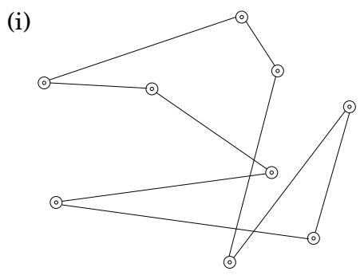

(二)  
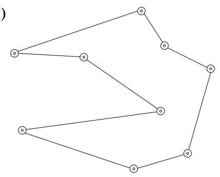

(三)  
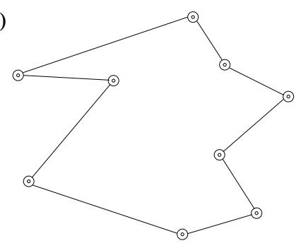

（四）  
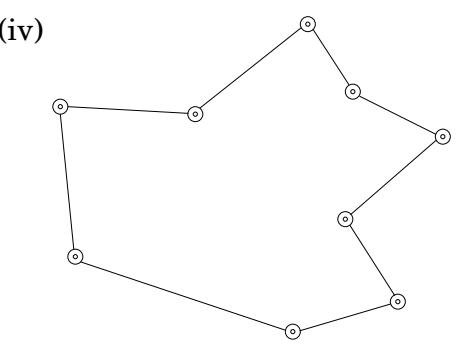

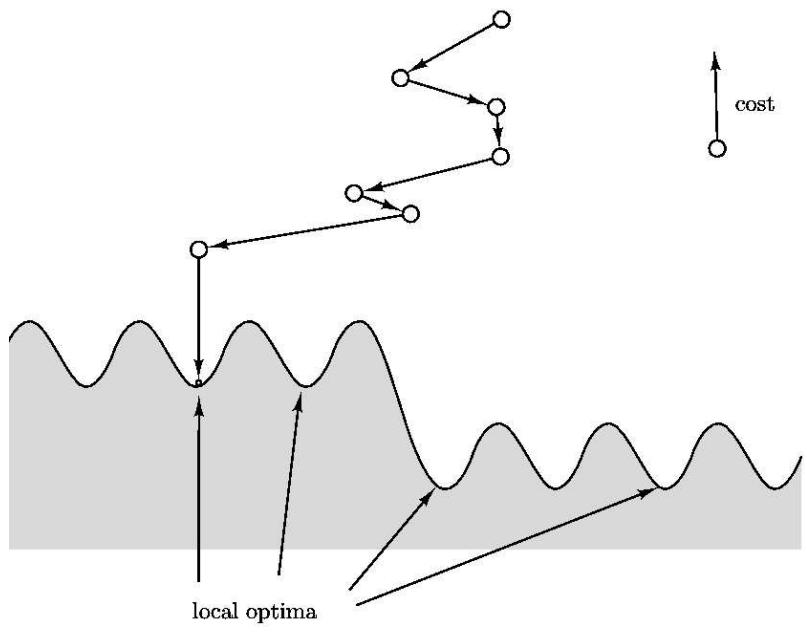

图 9.7 显示了本地搜索工作的具体示例。图 9.8 是对本地搜索的更抽象、更程式化的描述。这些解决方案挤满了非阴影区域，当我们向下移动时，成本会降低。从初始解开始，算法逐渐下坡，直到达到局部最优。

一般来说，搜索空间可能充满了局部最优，其中一些可能质量很差。希望通过明智地选择邻域结构，大多数局部最优将是合理的。无论这是现实还是仅仅是错误的信念，局部搜索算法在广泛的优化问题上表现最好，这是一个经验事实。让我们看另一个这样的例子。

## 9.3.2 图划分

图划分问题出现在多种应用中，从电路布局到程序分析再到图像分割。我们在第 8 章中看到了它的一个特例，平衡剪切。

图分区

输入：具有非负边权重的无向图 $G \ : = \ : ( V , E )$；实数 $\alpha \in ( 0 , 1 / 2 ]$

输出：将顶点分为两组 A 和 B，每组大小至少为 $\alpha | V |$

目标：最小化切割容量（A、B）。

图 9.9 显示了一个示例，其中图有 16 个节点，所有边权重均为 0 或 1，最优解的成本为 0。取消对 A 和 B 大小的限制

图 9.9 GRAPH PARTITIONING 的实例，具有 $\alpha = 1 / 2$ 的最佳分区 切口一侧的顶点呈阴影。

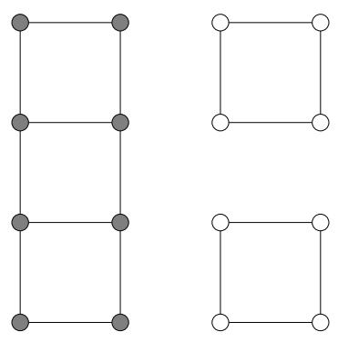

将给出 MINIMUM CUT 问题，我们知道可以使用流程技术有效解决该问题。然而，目前的变体是 NP 困难的。在设计局部搜索算法时，关注特殊情况 $\alpha = 1 / 2$ 将非常方便，其中A和B被迫包含恰好一半的顶点。明显丧失通用性纯粹是装饰性的，因为图分区简化为这种特殊情况。

我们需要为我们的问题决定一个邻域结构，并且有一个明显的方法可以做到这一点。让 $( A , B )$ 和 $| A | = | B |$ 成为候选解；我们将其邻居定义为通过交换切线中的一对顶点可获得的所有解，即 $( A - \{ a \} + \{ b \} , B - \{ b \} + \{ a \} )$ 形式的所有解，其中 $a \in A$ 和 $b \in B$ 。以下是本地移动的示例：

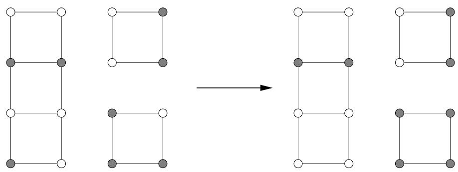

我们现在已经有了一个合理的本地搜索程序，我们就可以到此为止了。但就所产生的解决方案的质量而言，仍有很大的改进空间。搜索空间包括一些与全局解决方案相距甚远的局部最优值。这是一个成本为 2 的项目。

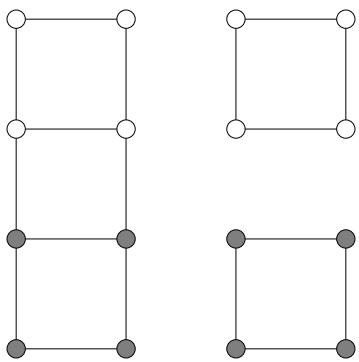  
对于这种次优解决方案可以做什么？我们可以扩大邻域大小以允许一次进行两次交换，但这个特殊的坏实例仍然会顽固地抵制。相反，让我们看看其他一些改进本地搜索过程的通用方案。

## 9.3.3 处理局部最优

## 随机化和重新开始

随机化可以成为本地搜索中的宝贵盟友。它通常以两种方式使用：选择随机初始解，例如随机图分区；并在有多个可用时选择本地移动。

当存在许多局部最优时，随机化是确保至少有一定概率获得正确局部最优的一种方法。然后，本地搜索可以重复多次，每次调用时使用不同的随机种子，并返回最佳解决方案。如果在任何给定运行中达到良好局部最优的概率为 $p ,$，则在 $O ( 1 / p )$ 运行中可能会找到这样的解决方案（回想一下练习 1.34）。

图 9.10 显示了图分区的一个小实例，以及解的搜索空间。总共有 $\binom { 8 } { 4 } = 7 0$ 种可能的状态，但由于每个状态都有一个相同的双胞胎，其中切口的左侧和右侧翻转，因此实际上只有 35 种解决方案。在图中，为了便于阅读，它们被分为七组。有五个局部最优解，其中四个是不好的，成本为 2，一个是好的，成本为 0。如果本地搜索从随机解开始，并且在每一步中选择一个成本较低的随机邻居，那么搜索最终得到不好解决方案的可能性最多是好的四倍。因此只需要少量的重复。

## 模拟退火

在图 9.10 的示例中，每次运行局部搜索都有合理的机会找到全局最优值。这并不总是正确的。随着问题规模的增大，坏局部最优与好局部最优的比率通常会增加，有时甚至达到指数级大的程度。在这种情况下，简单地重复几次本地搜索是无效的。

另一种不同的攻击途径是偶尔允许实际上增加成本的举动，希望它们能够将搜索带出死胡同。例如，这在图 9.10 的不良局部最优情况下非常有用。模拟退火方法通过引入温度的概念 $T .$ 重新定义了局部搜索

<Algorithm>
重复
    在 s 的邻域中随机选择一个解 $s'$
    如果 $\Delta = \text{cost}(s') - \text{cost}(s)$ 为负数：
        将 s 替换为 $s'$
    其他：
        将 s 替换为 $s'$，概率为 $e^{-\Delta/T}$
</Algorithm>

如果 T 为零，这与我们之前的本地搜索相同。但如果 T 很大，那么偶尔会接受增加成本的举措。应该使用什么值的T？

图 9.10 具有八个节点的图的搜索空间。该空间包含 35 个解决方案，为了清晰起见，它们被分为七组。显示了每个示例。有五个局部最优。

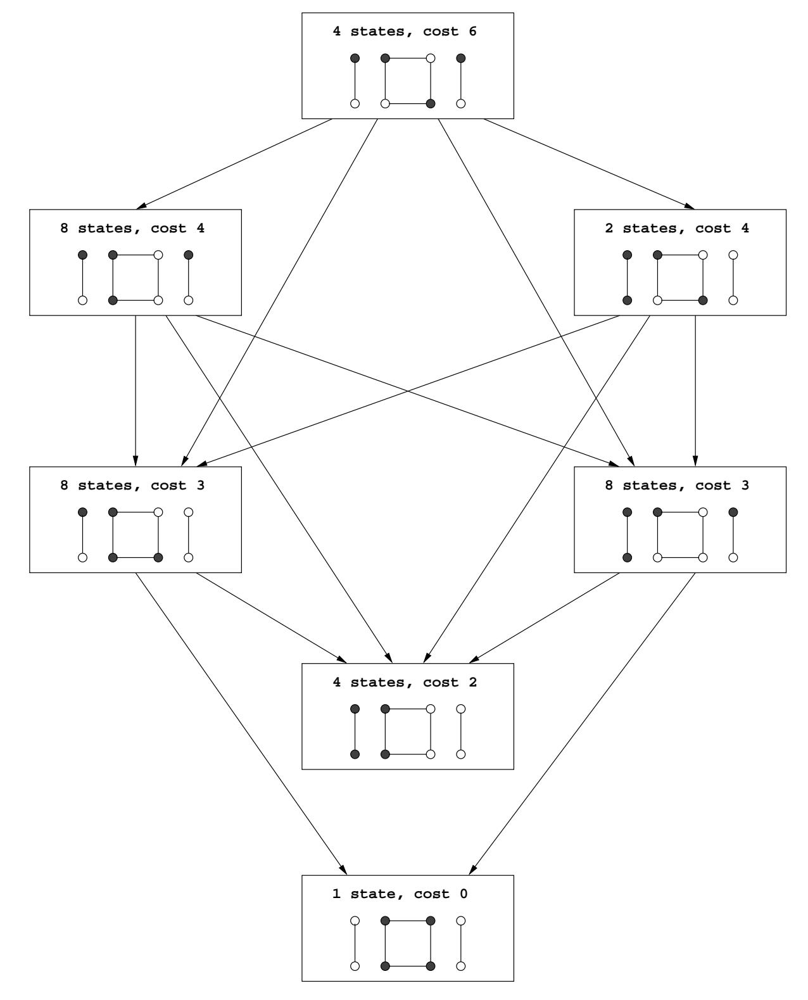

图 9.11 模拟退火。  
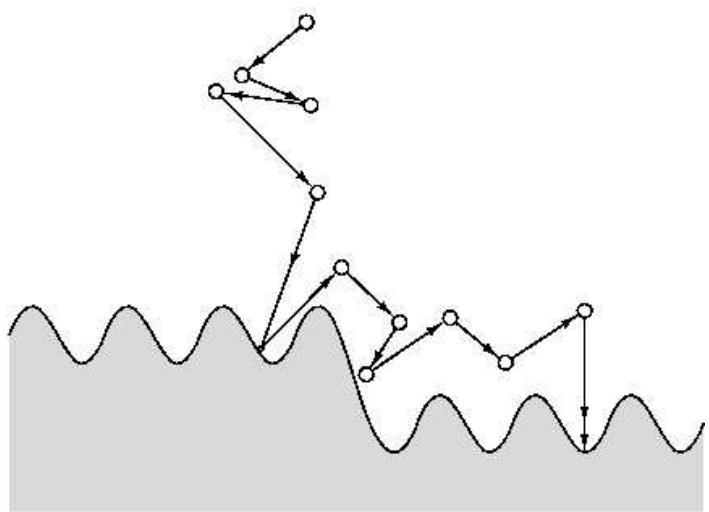

诀窍是从 T 大开始，然后逐渐将其减小到零。因此，最初，本地搜索可以相当自由地徘徊，仅稍微偏爱低成本解决方案。随着时间的推移，这种偏好变得更强，系统主要坚持搜索空间的低成本区域，偶尔会偏离该区域以逃避局部最优。最终，当温度进一步下降时，系统收敛到一个解。图 9.11 示意性地显示了该过程。

模拟退火的灵感来自于结晶物理学。当物质要结晶时，它开始处于液态，其颗粒处于相对不受约束的运动。然后它慢慢冷却，当这种情况发生时，粒子逐渐进入更规则的结构。这种规律性变得越来越明显，直到最终形成晶格。

模拟退火的好处是以巨大的成本为代价的：由于温度的变化和最初的运动自由度，在收敛之前需要更多的局部运动。此外，选择一个好的降低温度的时间表（称为退火时间表）是一门艺术。但在许多情况下，当解决方案的质量显着提高时，这种权衡是值得的。