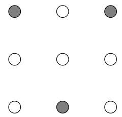
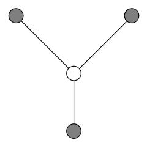

import Guide from '@/components/Guide.astro';
import Knowledge from '@/components/Knowledge.astro';
import Example from '@/components/Example.astro';
import Analysis from '@/components/Analysis.astro';
import Solution from '@/components/Solution.astro';
import Variant from '@/components/Variant.astro';
import Note from '@/components/Note.astro';
import Block from '@/components/Block.astro';
import Method from '@/components/Method.astro';
import Exercise from '@/components/Exercise.astro';
import Algorithm from '@/components/Algorithm.astro';

## 第 9 章练习

<Exercise title="Exercise 9.1">

在SAT的回溯算法中，假设我们总是选择一个具有尽可能小的子句的子问题（CNF公式）；我们沿着这个小子句中出现的变量展开它。证明这是一种特殊情况下的多项式时间算法，其中输入公式仅包含带有两个文字的子句（即，它是 2SAT 的实例）。

</Exercise>

<Exercise title="Exercise 9.2">

从固定顶点 s 设计用于 RUDRATA PATH 问题的回溯算法。要完全指定这样的算法，您必须定义：

(a) 什么是子问题？

(b) 如何选择子问题。

(c) 如何扩展子问题。

简要论证为什么你的选择是合理的。

</Exercise>

<Exercise title="Exercise 9.3">

为 SET COVER 问题设计一个分支定界算法。这需要决定：

(a) 什么是子问题？

(b) 如何选择子问题进行扩展？

(c) 如何扩展子问题？

(d) 适当的下限是多少？

您认为您的上述选择对于问题的典型实例有效吗？为什么？

</Exercise>

<Exercise title="Exercise 9.4">

给定一个无向图 $G = ( V , E )$，其中每个节点的度为 $\leq d ,$，展示如何有效地找到一个独立集，其大小至少为最大独立集的 $1 / ( d + 1 )$ 倍。

</Exercise>

<Exercise title="Exercise 9.5">

局部搜索最小生成树。考虑加权、连通、无向图的所有生成树（不仅仅是最小生成树）的集合 $G = ( V , E )$

回想一下第 5.1 节，将边 e 添加到生成树 $T$ 会创建一个唯一的循环，随后从该循环中删除任何其他边 $e ^ { \prime } \neq e$ 会返回一个不同的生成树 $T ^ { \prime }$ 。我们会说 T 和 $\overline { { T ^ { \prime } } }$ 通过单边交换 $( e , e ^ { \prime } )$ 不同，并且它们是邻居。

(a) 表明可以通过执行一系列边交换，即从一个邻居移动到另一个邻居，从任何生成树 $T$ 移动到任何其他生成树 $T ^ { \prime }$。最多需要多少次边缘交换？

(b) 证明 $\mathrm { i f } T ^ { \prime }$ 是一个MST，那么可以选择这些交换，使得沿途遇到的生成树的成本不增加。换句话说，如果遇到的生成树的序列是

$$
T = T _ {0} \rightarrow T _ {1} \rightarrow T _ {2} \rightarrow \dots \rightarrow T _ {k} = T ^ {\prime},
$$

那么所有 $i < k ,$ 的成本为 $( T _ { i + 1 } ) \leq \mathsf { c o s t } ( T _ { i } )$

(c) 考虑以下局部搜索算法，该算法以无向图 G 作为输入。

<Algorithm>
令 $T$ 为 $G$ 的任意生成树
而边交换 $(e, e')$ 会减少 $	ext{cost}(T)$：
    $T \leftarrow T + e - e'$
返回 $T$
</Algorithm>

证明这个过程总是返回最小生成树。最多需要多少次迭代？

</Exercise>

<Exercise title="Exercise 9.6">

在 MINIMUM STEINER TREE 问题中，输入包括： 一个完整的图 $G = ( V , E )$，所有节点对之间的距离为 $d _ { u v }$；以及一组独特的终端节点 $V ^ { \prime } \subseteq V$ 目标是找到包含顶点 $V ^ { \prime } .$ 的最小成本树。该树可能包含也可能不包含 $V - V ^ { \prime }$ 中的节点

假设输入中的距离是一个度量（回想一下第 277 页的定义）。证明可以通过忽略非终端节点并简单地返回 $V ^ { \prime }$ 上的最小生成树来获得 MINIMUM STEINER TREE 的高效比率 2 近似算法。 （提示：回想一下我们的 TSP 近似算法。）

</Exercise>

<Exercise title="Exercise 9.7">

在 MULTIWAY CUT 问题中，输入是无向图 $G = ( V , E )$ 和一组终端节点 $s _ { 1 } , s _ { 2 } , \ldots , s _ { k } \in V$ 。目标是找到 E 中的最小边集，将其删除后，所有终端都会处于不同的组件中。

(a) 证明当 $k = 2 .$ 时，这个问题可以在多项式时间内精确求解

(b) 对于 $k = 3 .$ 情况，给出比率至多为2的近似算法

(c) 设计多路切割的局部搜索算法。

</Exercise>

<Exercise title="Exercise 9.8">

在 MAX SAT 问题中，我们得到了一组子句，我们希望找到一个满足尽可能多的子句的作业。

(a) 表明如果这个问题可以在多项式时间内解决，那么 SAT 也可以。

(b) 这是一个非常幼稚的算法。

$$
\begin{array}{l} \text {for each variable:} \\ \text {set its value to either 0 or 1 by flipping a coin} \end{array}
$$

假设输入有 m 个子句，其中第 j 个子句有 $k _ { j }$ 文字。证明这个简单算法满足的子句的预期数量是

$$
\sum_ {j = 1} ^ {m} \left(1 - \frac {1}{2 ^ {k _ {j}}}\right) \geq \frac {m}{2}.
$$

换句话说，这是期望的 2 近似值！如果子句都包含 k 个文字，那么这个近似因子会提高到 $1 + 1 / ( 2 ^ { k } - 1 )$ 1

(c) 你能让这个算法具有确定性吗？ （提示：不要为每个变量掷硬币，而是选择满足大多数尚未满足的子句的值。最终满足哪些子句？）

</Exercise>

<Exercise title="Exercise 9.9">

在最大割问题中，我们给出一个无向图 $G = ( V , E )$，每条边的权重为 $w ( e )$，我们希望将顶点分为两个集合S和 $V - S$，以便两个集合之间的边的总权重尽可能大。

对于每个 $S \subseteq V$，将 $w ( S )$ 定义为所有边 $\{ u , v \}$ 上所有 $w ( e )$ 的总和，使得 $| S \cap \{ u , v \} | = 1$ 显然，MAX CUT是关于在所有边上最大化 $w ( S )$ V 的子集。

考虑以下 MAX CUT 局部搜索算法：

<Algorithm>
从任意 $S \subseteq V$ 开始
而有一个子集 $S' \subseteq V$ 使得
    $||S'| - |S|| = 1$ 和 $w(S') > w(S)$ 执行以下操作：
    设置 $S = S'$
</Algorithm>

(a) 表明这是比率为 2 的 MAX CUT 的近似算法。

(b) 但这是多项式时间算法吗？

</Exercise>

<Exercise title="Exercise 9.10">

当局部搜索算法总是产生最优解时，我们称其为精确的。例如，问题9.5中介绍的最小生成树问题的局部搜索算法是精确的。另一个例子，单纯形可以被认为是线性规划的精确局部搜索算法。

(a) 表明 TSP 的 2 变化局部搜索算法并不精确。

(b) 重复 n 次本地搜索算法，其中 n 是城市数量。

(c) 表明 (n 1) 变化局部搜索算法是精确的。

(d) 如果 A 是一个优化问题，则将 A-IMPROVMENT 定义为以下搜索问题：给定 A 的实例 x 和 A 的解 s，找到具有更好成本的 x 的另一个解（或报告不存在，因此 s 是最优的）。例如，在 TSP IMPROVMENT 中，我们得到一个距离矩阵和一个游览，并要求我们找到更好的游览。事实证明，TSP改进是NP完全的，SET COVER改进也是NP完全的。 （你能证明这一点吗？）

(e) 如果循环的每次执行都需要多项式时间，则我们说局部搜索算法具有多项式迭代。例如，上面定义的 TSP 的 (n 1) 变化局部搜索算法的明显实现没有多项式迭代。表明，除非 P = NP，否则不存在针对 TSP 和 SET COVER 问题的具有多项式迭代的精确局部搜索算法。

</Exercise>