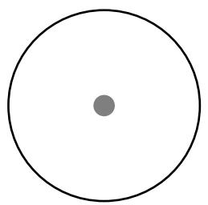
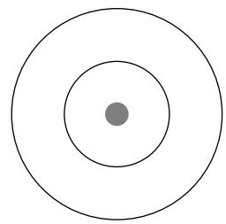
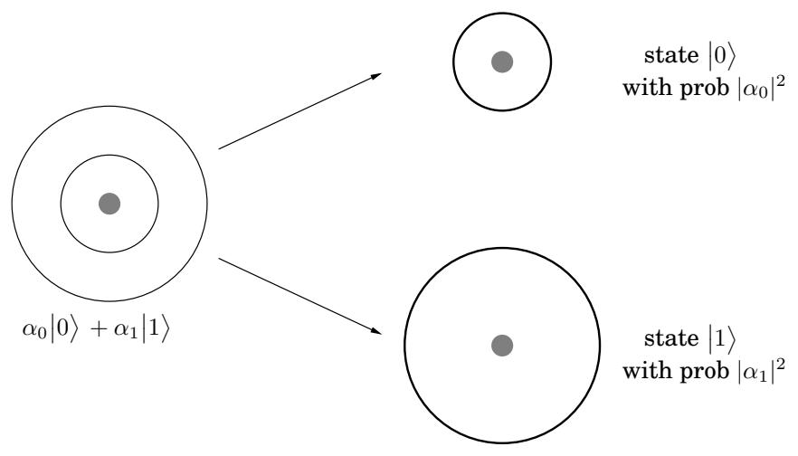
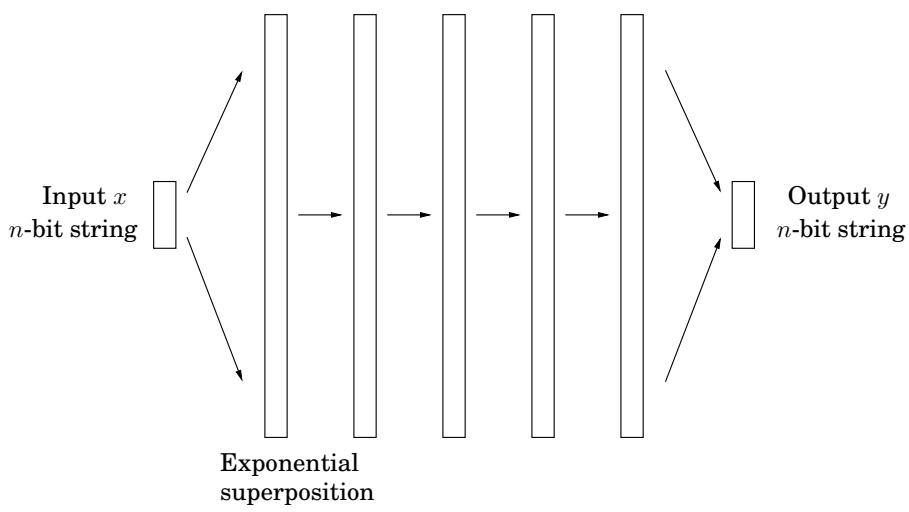

import Guide from '@/components/Guide.astro';
import Knowledge from '@/components/Knowledge.astro';
import Example from '@/components/Example.astro';
import Analysis from '@/components/Analysis.astro';
import Solution from '@/components/Solution.astro';
import Variant from '@/components/Variant.astro';
import Note from '@/components/Note.astro';
import Block from '@/components/Block.astro';
import Method from '@/components/Method.astro';
import Exercise from '@/components/Exercise.astro';

## 第 10 章：量子算法

本书从世界上最古老、使用最广泛的算法（数字加法和乘法）和一个古老的难题（因子分解）开始。在最后一章中，情况发生了逆转：我们提出了一种最新的算法——它是一种有效的因式分解算法！

当然，有一个问题：该算法需要量子计算机来执行。

量子物理学是一种美丽而神秘的理论，它在基本粒子的层面上描述了微观的自然。九十年代的重大发现之一是量子计算机（基于量子物理原理的计算机）与根据更熟悉的经典物理原理运行的计算机截然不同。令人惊讶的是，它们的功能可以呈指数级增长：正如我们将看到的，量子计算机可以在多项式时间内解决因式分解！因此，在拥有量子计算机的世界中，目前保护互联网上商业交易的系统（基于 RSA 密码系统）将不再安全。

## 10.1 量子位、叠加和测量

在本节中，我们将介绍理解量子计算机如何工作所必需的量子物理学的基本特征。1

在普通计算机芯片中，位在物理上由电线上的低电压和高电压表示。但还有许多其他方式可以存储比特，例如以氢原子的状态。该原子中的单个电子可以处于基态（最低能量配置），也可以处于激发态（高能量配置）。我们可以使用这两种状态分别对位值 0 和 1 进行编码。

现在让我们介绍一些量子物理符号。我们用 0 表示电子的基态，因为它编码位值 0 ，同样用 1 表示激发态。这是经典物理学中电子的两种可能状态。量子物理学的许多最违反直觉的方面都源于叠加原理，该原理指出，如果

图 10.1 电子可以处于基态或激发态。在量子物理学中使用的狄拉克符号中，它们被表示为 0 和 1 。但叠加原理表明，事实上，电子处于这两者的线性组合状态：$\alpha _ { 0 } | 0 \rangle + \alpha _ { 1 } | 1 \rangle$ 如果 α 是概率，非负实数加 1，那么这将立即有意义。但叠加原理坚持认为它们可以是任意复数，只要它们的范数的平方加起来为 1！

基态0  

量子系统可以处于两种状态之一，那么它也可以处于这两种状态的任意线性叠加。例如，电子的状态很可能是 $\textstyle { \frac { 1 } { \sqrt { 2 } } } | 0 \rangle + { \frac { 1 } { \sqrt { 2 } } } | 1 \rangle$ 或 ${ \scriptstyle { \frac { 1 } { \sqrt { 2 } } } } \left| 0 \right. \ - \ { \scriptstyle { \frac { 1 } { \sqrt { 2 } } } } \left| 1 \right.$ ；或无限数量的其他形式的组合 $\alpha _ { 0 } | 0 \rangle + \alpha _ { 1 } | 1 \rangle$ 。系数 $\alpha _ { 0 }$ 称为状态 $| 0 \rangle$ 的振幅，与 $\alpha _ { 1 }$ 类似。而且，如果事情还不够奇怪的话，α 可以是复数，只要它们被标准化即可 $| \alpha _ { 0 } | ^ { 2 } + | \alpha _ { 1 } | ^ { 2 } = 1$ 。例如，${ \scriptstyle { \frac { 1 } { \sqrt { 5 } } } } | 0 \rangle + { \scriptstyle { \frac { 2 i } { \sqrt { 5 } } } } | 1 \rangle$（其中i是虚数单位，$\sqrt { - 1 } )$ 是一个完全有效的量子态！这样的叠加，$\alpha _ { 0 } | 0 \rangle + \alpha _ { 1 } | 1 \rangle$，是量子计算机中编码信息的基本单位（图10.1）。它被称为量子比特（发音为“cubit”）。

叠加态的整个概念表明，电子并不确定自己是处于基态还是激发态，而振幅 $\alpha _ { 0 }$ 是其向基态倾斜的量度。继续沿着这个思路，很容易将 $\alpha _ { 0 }$ 视为电子处于基态的概率。但是我们如何理解 $\alpha _ { 0 }$ 可能是负数，甚至更糟糕的是虚数这一事实呢？这是量子物理学最神秘的方面之一，它似乎超出了我们对物理世界的直觉。

然而，这种线性叠加是电子的私人世界。为了了解电子的状态，我们必须进行测量，当我们这样做时，我们会得到一位信息 - 0 或 1。如果电子的状态是 $\alpha _ { 0 } | 0 \rangle + \alpha _ { 1 } | 1 \rangle$ ，那么测量结果为 0，概率为 $| \alpha _ { 0 } | ^ { 2 }$，为 1，概率为 $| \dot { \alpha } _ { 1 } | ^ { 2 }$（幸运的是，我们进行了归一化，所以 $| \alpha _ { 0 } | ^ { 2 } + | \alpha _ { 1 } | ^ { 2 } = 1 )$ 。此外，测量行为会导致系统改变其状态：如果测量结果为 0，则系统的新状态为 0（基态），如果结果为 1，则新状态为 1（激发态）。测量会干扰系统并迫使系统选择（在这种情况下为基态或激发态），这是另一种没有经典模拟的奇怪现象。

叠加原理不仅适用于我们刚刚描述的 2 能级系统，而且普遍适用于 k 能级系统。例如，实际上氢原子中的电子可以处于许多能级中的一个，从基态开始，第一激发态，

图 10.2 叠加的测量具有迫使系统决定特定状态的效果，其概率由幅度确定。

第二激发态，依此类推。因此，我们可以考虑一个由基态和第一个 $k - 1$ 激发态组成的 k 级系统，我们可以用 $\left| 0 \right. , \left| 1 \right. , \left| 2 \right. , \ldots , \left| k - 1 \right.$ 表示它们。然后叠加原理可以说系统的一般量子态是 $\alpha _ { 0 } \big | 0 \big \rangle + \alpha _ { 1 } \big | 1 \big \rangle + \dots + \alpha _ { k - 1 } \big | k - 1 \big \rangle$ ，其中 $\begin{array} { r } { \sum _ { j = 0 } ^ { k - 1 } | \alpha _ { j } | ^ { 2 } = 1 } \end{array}$ 。测量系统的状态现在将显示 0 到 $\dot { k } - 1$ 之间的数字，并且结果 $j$ 将以概率 $| \alpha _ { j } | ^ { 2 }$ 发生。和以前一样，测量会干扰系统，新的状态实际上会变成 $| j \rangle$ 或第j个激发态。

我们如何编码n位信息？我们可以选择氢原子的 $k = 2 ^ { n }$ 能级。但更有希望的选择是使用 n 个量子位。

让我们首先考虑两个量子位的情况，即两个氢原子的电子状态。由于每个电子可以处于基态或激发态，在经典物理学中，两个电子总共有四种可能的状态：00、01、10 或 11，因此适合存储 2 位信息。但在量子物理学中，叠加原理告诉我们，两个电子的量子态是四种经典态的线性组合，

$$
\left| \boldsymbol {\alpha} \right\rangle = \alpha_ {0 0} \left| 0 0 \right\rangle + \alpha_ {0 1} \left| 0 1 \right\rangle + \alpha_ {1 0} \left| 1 0 \right\rangle + \alpha_ {1 1} \left| 1 1 \right\rangle ,
$$

标准化，以便 $\begin{array} { r } { \sum _ { x \in \{ 0 , 1 \} ^ { 2 } } | \alpha _ { x } | ^ { 2 } = 1 . ^ { 2 } } \end{array}$ 测量系统状态现在可以揭示 2 位信息，以及结果的概率 $x \ \in \ \{ 0 , 1 \} ^ { 2 } \ \mathrm { i s } \ | \alpha _ { x } | ^ { 2 }$ 。而且，和之前一样，如果测量结果是 $j k ,$ ，那么系统的新状态就是 $\left| j k \right. : { \mathrm { i f ~ } } j k = 1 0 .$ ，例如，第一个电子处于激发态，第二个电子处于基态。

这里出现了一个有趣的问题：如果我们进行部分测量怎么办？例如，如果我们只测量第一个量子位，结果为 0 的概率是多少？这很简单。它与我们测量两个量子位时的情况完全相同，即，

<Knowledge title="Box: Entanglement">

假设我们有两个量子位，第一个处于状态 $\alpha _ { 0 } | 0 \rangle + \alpha _ { 1 } | 1 \rangle$ ，第二个处于状态 $\beta _ { 0 } | 0 \rangle + \beta _ { 1 } | 1 \rangle$ 。两个量子位的联合状态是什么？答案是，两者的（张量）乘积：$\dot { \alpha } _ { 0 } \beta _ { 0 } | 0 0 \rangle + \alpha _ { 0 } \beta _ { 1 } | 0 1 \rangle + \alpha _ { 1 } \beta _ { 0 } | 1 0 \rangle + \alpha _ { 1 } \beta _ { 1 } | 1 1 \rangle$

给定两个量子位的任意状态，我们可以用这种方式指定每个单独量子位的状态吗？不，一般来说，两个量子位是纠缠的，不能分解为各个量子位的状态。例如，考虑状态 $\textstyle { \left| { \psi } \right. } = { \frac { 1 } { \sqrt { 2 } } } { \left| { 0 0 } \right. } + { \overline { { \frac { 1 } { \sqrt { 2 } } } } } { \left| { 1 1 } \right. }$ ，它是著名的贝尔状态之一。它不能分解为两个单独量子位的状态（参见练习 10.1）。纠缠是量子力学最神秘的方面之一，也是量子计算力量的最终来源。

Pr $\{ { \mathrm { 1 s t ~ b i t ~ } } = 0 \} = { \mathrm { P r } } \{ 0 0 \} + { \mathrm { P r } } \{ 0 1 \} = | \alpha _ { 0 0 } | ^ { 2 } + | \alpha _ { 0 1 } | ^ { 2 }$ 。很好，但是这个部分测量对系统状态的干扰有多大？

答案很优雅。如果测量第一个量子位的结果为0，则将 $\left| \alpha \right.$ 中所有与该结果不一致的项（即第一位为1）划掉，得到新的叠加。当然，振幅的平方和不再是1，所以我们必须重新归一化。在我们的示例中，这个新状态将是

$$
\left| \boldsymbol {\alpha} _ {\mathrm{new}} \right\rangle = \frac {\alpha_ {0 0}}{\sqrt {\left| \alpha_ {0 0} \right| ^ {2} + \left| \alpha_ {0 1} \right| ^ {2}}} \left| 0 0 \right\rangle + \frac {\alpha_ {0 1}}{\sqrt {\left| \alpha_ {0 0} \right| ^ {2} + \left| \alpha_ {0 1} \right| ^ {2}}} \left| 0 1 \right\rangle .
$$

最后，让我们考虑 n 个氢原子的一般情况。将 n 视为相当少量的原子，例如 $n = 5 0 0$ 。传统上，500 个电子的状态可以以显而易见的方式存储 500 位信息。但这 500 个量子位的量子态是所有 $2 ^ { 5 0 0 }$ 可能的经典态的线性叠加：

$$
\sum_ {x \in \{0, 1 \} ^ {n}} \alpha_ {x} | x \rangle .
$$

就好像大自然的侧面有 $2 ^ { 5 0 0 }$ 纸片，每张纸片上都写有 $\mathbf { i t } ,$，只是为了记录这个由 500 个氢原子组成的系统的状态！此外，在每一个时刻，随着系统状态随时间的演变，大自然就好像划掉每张纸上的复数，并用新值替换它。

让我们考虑一下完成这一切所付出的努力。数字 $2 ^ { 5 0 0 }$ 比宇宙中基本粒子数量的估计要大得多。那么，大自然将这些信息存储在哪里呢？几百个原子组成的微观量子系统如何包含比我们在整个经典宇宙中所能存储的更多的信息？当然，这是一个关于大自然为了保持一个微小系统及时进化而付出的努力的最夸张的理论。

这种现象是量子计算的基本动机。毕竟，如果大自然在量子层面上如此奢侈，为什么我们要把我们的计算机建立在经典物理学的基础上呢？为什么不利用在量子层面上花费的大量努力呢？

但有一个根本问题：这种指数级大的线性叠加是电子的私人世界。测量系统仅揭示 n 位信息。和之前一样，结果是特定 500 位字符串 x 的概率是 $| \alpha _ { x } | ^ { 2 }$ 。测量后的新状态就是 $| x \rangle$

图 10.3 量子算法以 n 个“经典”位作为输入，操纵它们以创建 2n 个可能状态的叠加，操纵这个指数大的叠加以获得最终的量子结果，然后测量结果以获得（具有适当的概率分布）n 个输出位。对于中间阶段，有一些初等运算算作一步，但可以操纵叠加的所有指数级振幅。

</Knowledge>