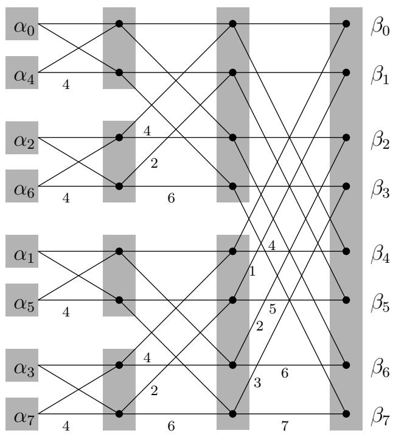

import Guide from '@/components/Guide.astro';
import Knowledge from '@/components/Knowledge.astro';
import Example from '@/components/Example.astro';
import Analysis from '@/components/Analysis.astro';
import Solution from '@/components/Solution.astro';
import Variant from '@/components/Variant.astro';
import Note from '@/components/Note.astro';
import Block from '@/components/Block.astro';
import Method from '@/components/Method.astro';
import Exercise from '@/components/Exercise.astro';

## 10.3 量子傅立叶变换

回想一下第 2 章中的快速傅立叶变换 (FFT)。它以 M 维复值向量 α 作为输入（其中 M 是 2 的幂，例如 $M = 2 ^ { m } )$ ），并输出 M 维复值向量 $\beta \colon$

$$
\left[ \begin{array}{c} \beta_ {0} \\ \beta_ {1} \\ \beta_ {2} \\ \vdots \\ \beta_ {M - 1} \end{array} \right] = \frac {1}{\sqrt {M}} \left[ \begin{array}{c c c c c} 1 & 1 & 1 & \dots & 1 \\ 1 & \omega & \omega^ {2} & \dots & \omega^ {M - 1} \\ 1 & \omega^ {2} & \omega^ {4} & \dots & \omega^ {2 (M - 1)} \\ & \vdots & & & \\ 1 & \omega^ {j} & \omega^ {2 j} & \dots & \omega^ {(M - 1) j} \\ & \vdots & & & \\ 1 & \omega^ {(M - 1)} & \omega^ {2 (M - 1)} & \dots & \omega^ {(M - 1) (M - 1)} \end{array} \right] \left[ \begin{array}{c} \alpha_ {0} \\ \alpha_ {1} \\ \alpha_ {2} \\ \vdots \\ \alpha_ {M - 1} \end{array} \right],
$$

其中 $\omega$ 是复数 M 次单位根（$\sqrt { M }$ 的额外因子是新的，其作用是确保如果 $| \alpha _ { i } | ^ { 2 }$ 加起来等于 1，那么 $| \beta _ { i } | ^ { 2 } )$ 也等于 1）。尽管前面的方程表明 $O ( M ^ { 2 } )$ 算法，经典的 FFT 仅需 $O ( M \log M )$ 步即可执行此计算，正是这种加速对使数字信号处理实际上变得可行产生了深远的影响，我们现在将看到量子计算机可以在 $O ( \log ^ { 2 } M )$ 时间内实现指数级更快的 FFT！

但是等等，任何算法所花费的时间怎么可能小于 M（输入的长度）呢？关键是我们可以将输入编码为仅 $m = \log M$ 量子位的叠加：毕竟，这种叠加由 $2 ^ { m }$ 幅度值组成。在我们之前介绍的符号中，我们将叠加写为 $\begin{array} { r } { \dot { | \alpha \rangle } = \sum _ { j = 0 } ^ { M - 1 } \alpha _ { j } \dot { | j \rangle } } \end{array}$，其中 $\alpha _ { i }$ 是自然方式对应于数字i的m位二进制串的幅度。这就提出了一个重要的

图 10.4 第 2 章中的经典 FFT 电路。M 位的输入向量按 m = log M 级的序列进行处理。

要点：$| j \rangle$ 符号实际上只是编写向量的另一种方式，其中向量的每个条目的索引都明确地写在特殊的括号符号中。

从该输入叠加 α 开始，量子傅立叶变换 (QFT) 在 m = log M 级中对其进行适当操作。在每个阶段，叠加都会发展，以便它在经典 FFT 的同一阶段对中间结果进行编码（其电路，其中 m = log M 阶段，从图 10.4 中的第 2 章中复制）。正如我们将在第 10.5 节中看到的，这可以通过每级 m 个量子操作来实现。最终，经过 m 个这样的阶段和 $m ^ { 2 } = \log ^ { 2 } M$ 初等运算，我们获得了与 QFT 所需输出相对应的叠加 β。

到目前为止，我们只考虑了 QFT 的好消息：它惊人的速度。现在是时候阅读细则了。经典的FFT算法实际上输出M个复数 $\beta _ { 0 } , \dots , \beta _ { M - 1 }$。相比之下，QFT 只准备了一个叠加 $\begin{array} { r } { | \beta \rangle = \sum _ { i = 0 } ^ { M - 1 } \bar { \beta } | j \rangle } \end{array}$ 而且，正如我们之前看到的，这些振幅是这个量子系统“私人世界”的一部分。

因此，获得这个结果的唯一方法就是测量它！测量系统的状态仅产生 m = log M 经典位：具体来说，输出是索引 j，概率为 $| \beta _ { j } | ^ { 2 }$

因此，将该算法称为量子傅里叶采样而不是 QFT 会更准确。此外，即使我们在本节中将注意力限制在 $M = 2 ^ { m }$ 的情况下，该算法也可以针对任意的M值来实现，并且可以总结如下：

输入： m = log M 量子位的叠加，$\begin{array} { r } { | \alpha \rangle = \sum _ { j = 0 } ^ { M - 1 } \alpha _ { j } | j \rangle } \end{array}$

方法：使用 $O ( m ^ { 2 } ) = O ( \log ^ { 2 } M )$ 量子运算进行量子FFT，得到叠加 $\begin{array} { r } { \mathinner { | { \bar { \beta } } \rangle } = \dot { \sum } _ { j = 0 } ^ { M - 1 } \beta _ { j } \mathinner { | { j } \rangle } } \end{array}$

输出：随机 m 位数 $j$ （即 $0 \leq j \leq M - 1 )$ ，来自概率分布 $P r [ j ] = | \beta _ { j } | ^ { 2 }$

量子傅立叶采样基本上是一种快速了解经典 FFT 输出的快速方法，只需检测答案向量的较大分量之一。事实上，我们甚至看不到该组件的值——我们只看到它的索引。我们如何利用如此微薄的信息呢？在 FFT 的哪些应用中，仅大部件的索引就足够了？这就是我们接下来要探讨的。