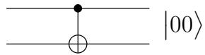
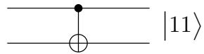
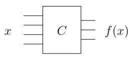
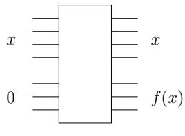
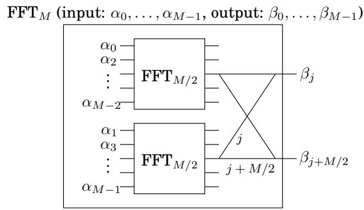
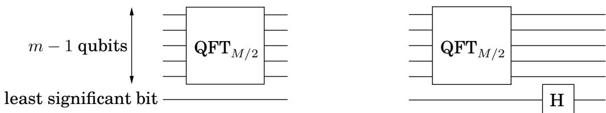

import Guide from '@/components/Guide.astro';
import Knowledge from '@/components/Knowledge.astro';
import Example from '@/components/Example.astro';
import Analysis from '@/components/Analysis.astro';
import Solution from '@/components/Solution.astro';
import Variant from '@/components/Variant.astro';
import Note from '@/components/Note.astro';
import Block from '@/components/Block.astro';
import Method from '@/components/Method.astro';
import Exercise from '@/components/Exercise.astro';

## 10.5 量子电路

因此，量子计算机执行傅立叶变换的速度比经典计算机快得多。但这些计算机实际上是什么样子的呢？量子电路是由什么组成的？它到底是如何如此快速地计算傅里叶变换的？

## 10.5.1 基本量子门

基本量子运算类似于经典电路中的与门或非门等基本门。它在单个量子位或两个量子位上运行。最重要的例子之一是哈达玛门，用 H 表示，它在单个量子位上运行。在输入 $\left| 0 \right.$ 时，它输出 $\begin{array} { r } { { \bf H } ( | 0 \rangle ) = \frac { 1 } { \sqrt { 2 } } | 0 \rangle ^ { \smile } + \frac { 1 } { \sqrt { 2 } } | 1 \rangle } \end{array}$ 。对于输入 $\begin{array} { r } { { \bf \nabla } \big | 1 \big > \overline { { \bf \nabla } } \mathbf { H } ( | 1 \rangle ) = \frac { 1 } { \sqrt { 2 } } \big | 0 \big > ^ { - } - \frac { \hat { 1 } } { \sqrt { 2 } } \big | 1 \big > } \end{array}$ 在图片中：

$$
\left| \right. 0 \left. \right\rangle - \boxed {\mathbf {H}} \rightarrow \frac {1}{\sqrt {2}} \left| \right. 0 \left. \right\rangle + \frac {1}{\sqrt {2}} \left| \right. 1 \left. \right\rangle \quad \left| \right. 1 \left. \right\rangle - \boxed {\mathbf {H}} \rightarrow \frac {1}{\sqrt {2}} \left| \right. 0 \left. \right\rangle - \frac {1}{\sqrt {2}} \left| \right. 1 \left. \right\rangle
$$

请注意，无论哪种情况，测量所得的量子位都会以 $1 / 2$ 的概率产生 0，以 $1 / 2$ 的概率产生 1。但是，如果哈达玛门的输入是任意叠加 $\alpha _ { 0 } | 0 \rangle + \alpha _ { 1 } | 1 \rangle \ ?$，会发生什么？由量子物理学的线性决定的答案是叠加 $\begin{array} { r } { \alpha _ { 0 } \dot { H ( } | 0 \rangle \ : ) \dot { + } \alpha _ { 1 } H ( | 1 \rangle \ : ) = \frac { \alpha _ { 0 } + \alpha _ { 1 } } { \sqrt { 2 } } | 0 \rangle \ : + \frac { \alpha _ { 0 } - \alpha _ { 1 } } { \sqrt { 2 } } | 1 \rangle } \end{array}$。因此，如果我们将哈达玛门应用于哈达玛门的输出，它会将量子位恢复到其原始状态！

另一个基本门是受控非门或 CNOT。它对两个量子位进行操作，第一个充当控制量子位，第二个充当目标量子位。当且仅当第一个量子位为 1 时，CNOT 门才会翻转第二位。因此 $\mathrm { C N O T } ( \left| 0 0 \right. ) = \left| 0 0 \right.$ 和 $\mathrm { C N O T } ( \left| 1 0 \right. ) = \left| 1 1 \right.$

00  

10

另一种基本门，即受控相位门，将在下面描述 QFT 量子电路的小节中进行描述。

现在让我们考虑以下问题：假设我们在 n 个量子位上有一个量子态，$\begin{array} { r } { | \alpha \rangle = \sum _ { x \in \{ 0 , 1 \} ^ { n } } \alpha _ { x } | x \rangle } \end{array}$。如果我们仅将 Hadamard 门应用于第一个量子位，那么这些 $2 ^ { n }$ 幅度中有多少会发生变化？令人惊讶的答案是——全部！新的叠加变为 $\begin{array} { r } { \big | \beta \big \rangle } \end{array} = \sum _ { x \in \{ 0 , 1 \} ^ { n } } \beta _ { x } \big | x \big \rangle$ ，其中 $\begin{array} { r } { \bar { \beta _ { 0 y } } ~ = ~ \frac { \alpha _ { 0 y } + \alpha _ { 1 y } } { \sqrt { 2 } } } \end{array}$ 和 $\beta _ { 1 y } ~ = ~ \frac { \alpha _ { 0 y } - \alpha _ { 1 y } } { \sqrt { 2 } }$ 。更仔细地观察结果，第一个量子位上的量子操作分别处理每个 $n - 1$ 位后缀 y。因此，振幅对 $\alpha _ { 0 y }$ 和 $\alpha _ { 1 y }$ 转换为 $( \alpha _ { 0 y } + \alpha _ { 1 y } ) / \sqrt { 2 }$ 和 $( \alpha _ { 0 y } - \alpha _ { 1 y } ) / \sqrt { 2 } .$。这正是使我们的量子傅里叶变换指数加速的特征。

## 10.5.2 量子电路的两种基本类型

量子电路采用一定数量的 n 个量子位作为输入，并输出相同数量的量子位。在图中，这 n 个量子位由从左到右的 n 根电线承载。量子电路包括将一系列基本量子门（上述类型）应用于单个量子位和量子位对。

在较高的层面上，我们在量子算法的设计中使用了量子电路的两个基本功能：

量子傅里叶变换 这些量子电路以某种状态 $\left| \alpha \right.$ 的 n 个量子位作为输入，并输出将 $\mathrm { \bf Q } \mathrm { \bf F T }$ 应用于 $\left| \alpha \right.$ 所得的状态 $| \beta \rangle$

经典函数考虑一个具有 n 个输入位和 m 个输出位的函数 f，并假设我们有一个输出 $f ( x )$ 的经典电路。然后是一个量子电路，输入由用 $m \ 0 ^ { \bullet } ,$ 填充的 n 位字符串 x 组成，输出 x 和 $f ( x )$

  
经典电路

  
量子电路

现在，该量子电路的输入可以是 n 位字符串 $x , \Sigma _ { x } \left| x , 0 ^ { k } \right.$ 的叠加，在这种情况下，输出必须是 $\textstyle \sum _ { x } { \left| x , f ( x ) \right. }$ 。练习 10.7 探讨了用基本量子门构建此类电路。

了解如此高层次的量子电路足以理解本章的其余部分。因此，任何不想深入研究这些细节的人都可以安全地跳过有关 QFT 量子电路的下一小节。

## 10.5.3 量子傅立叶变换电路

在这里，我们重现了该图（来自第 2.6.4 节），显示了 M 向量的经典 FFT 电路如何由两个用于 $( M / 2 )$ 向量的 FFT 电路组成，后跟一些简单的门。

让我们看看如何在量子系统上模拟这一点。输入现在编码为 $m = \log M$ 量子位的 $2 ^ { m }$ 幅度。因此，如上图所示，输入分解为偶数和奇数，显然是由其中一个量子位（最不重要的量子位）决定的。我们如何分离偶数和奇数输入并应用递归电路来计算每一半的 $F F T _ { M / 2 }$？答案很引人注目：只需将量子电路 $Q F T _ { M / 2 }$ 应用于剩余的 $m - 1$ 量子位即可。这样做的效果是将 $Q F T _ { M / 2 }$ 应用于 x0 形式的所有 m 位字符串（其中有 $M / 2 )$ ），并分别应用于 x1 形式的所有 $m { \cdot } \mathrm { b i t }$ 字符串的叠加。因此，这两个递归经典电路可以通过单个量子电路来模拟 - 当我们放松递归！

现在让我们考虑递归调用 $F F T _ { M / 2 } \mathrm { : }$ 后经典 FFT 电路中的门，导线将 j 与 $M / 2 + j ,$ 配对，并暂时忽略应用于第 $( M / 2 + j )$ 导线内容的相位，我们必须将这两个量相加和相减以获得第 j 和分别输出 $( M / 2 + j )$。量子电路如何实现这M个经典门的结果？简单：只需在第一个量子位上执行 Hadamard 门即可！回想一下前面的讨论（第 10.5.1 节），对于剩余 $m - 1$ 量子位 x 的每种可能配置，这会将字符串 0x 和 1x 配对。从二进制翻译，这意味着我们将 x 和 $M / 2 { + } x$ 配对。此外，Hadamard 门的结果是，对于每个这样的对，幅度都被和与差所取代（分别由 $1 / \sqrt { 2 } )$ 标准化。到目前为止，QFT 几乎不需要门！

对于每个 $j$，必须应用于第 $( M / 2 + j )$）线的相位需要更多的工作。请注意，仅当第一个量子位为 1 时，才必须应用 $\omega ^ { j }$ 的相位。现在，如果 j 由 $m - 1$ 位 $j _ { 1 } \ldots j _ { m - 1 }$ 表示，则 $\omega ^ { j } = \Pi _ { l = 1 } ^ { \ ' m - 1 } \omega ^ { 2 ^ { j } l }$ 因此，可以通过申请第 l 个来应用 $\omega ^ { j }$ 相位如果第 l 个量子位是 1 并且第一个量子位是 1，则连接（对于每个 l）$\omega ^ { 2 ^ { l } }$ 的相位。此任务可以通过另一个双量子位量子门（条件相位门）来完成。它保持两个量子位不变，除非它们都为 1，在这种情况下，它应用指定的相位因子。

QFT 电路现已指定。量子门的数量由公式 $S ( m ) = S ( m - 1 ) \ – O ( m )$ 给出，计算结果为 $S ( m ) = O ( m ^ { 2 } )$ 。因此，大小为 $M = 2 ^ { m }$ 输入的 QFT 需要 $O ( m ^ { 2 } ) = O ( \log ^ { 2 } M )$ 量子操作。