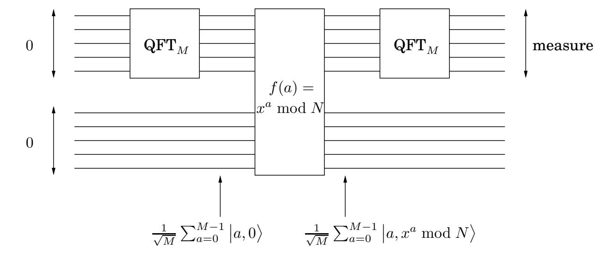

import Guide from '@/components/Guide.astro';
import Knowledge from '@/components/Knowledge.astro';
import Example from '@/components/Example.astro';
import Analysis from '@/components/Analysis.astro';
import Solution from '@/components/Solution.astro';
import Variant from '@/components/Variant.astro';
import Note from '@/components/Note.astro';
import Block from '@/components/Block.astro';
import Method from '@/components/Method.astro';
import Exercise from '@/components/Exercise.astro';

## 10.7 因式分解的量子算法

我们现在可以将因子分解的量子算法的所有部分放在一起（见图 10.6）。由于我们可以在多项式时间内测试输入是否是素数或素数幂，因此我们假设我们已经这样做了，并且输入是具有至少两个不同素数因子的奇合数。

输入：奇复合整数 N。

输出：N 的因子。

1.在 $1 \leq x \leq N - 1$ 范围内均匀随机选择x

2. 设 M 为接近 N 的 2 次幂（由于我们无法在这里深入的原因，最好选择 $M \approx N ^ { 2 } )$ 。

3. 重复 s = 2 log N 次：

(a) 从两个量子寄存器开始，最初都是 0，第一个足够大，可以存储模 M 的数字，第二个足以存储模 N 的数字。

图 10.6 量子分解。  

(b) 使用周期函数 $f ( a ) \equiv x ^ { a }$ mod N 创建长度为 M 的周期叠加 $\left| \alpha \right.$，如下所示（详细信息请参见方框）：

岛将 $\mathbf { Q F T }$ 应用于第一个寄存器以获得叠加 $\textstyle \sum _ { a = 0 } ^ { M - 1 } { \frac { 1 } { \sqrt { M } } } { \big | } a , 0 \rangle$

二.使用量子电路计算 $f ( a ) \ : = \ : x ^ { a }$ mod N，得到叠加 $\textstyle \sum _ { a = 0 } ^ { M - 1 } { \frac { 1 } { \sqrt { M } } } { \dot { | a , x ^ { a } } }$ mod $N \rangle$

三.测量第二个寄存器。现在，第一个寄存器包含周期性叠加 $\begin{array} { r } { \left| \alpha \right. = \sum _ { j = 0 } ^ { M / r - 1 } \sqrt { \frac { r } { M } } \big | j r + k \big \rangle } \end{array}$，其中 k 是 0 到 $r - 1$ 之间的随机偏移（回想一下，r 是 x 模 N 的阶数）。

(c) 对叠加 $\left| \alpha \right.$ 进行傅里叶采样以获得0到 $M - 1$ 之间的索引

令 $g$ 为结果索引 $j _ { 1 } , \dots , j _ { s }$ 的 gcd

4. 如果 $M / g$ 是偶数，则计算 $\operatorname* { g c d } ( N , x ^ { M / 2 g } + 1 )$，如果它是 $N ;$ 的非平凡因子，则输出它，否则返回步骤1。

从之前的引理中，我们知道该方法至少适用于 $x ,$ 的一半选择，因此在找到因子之前整个过程平均只需重复几次。

但是这个算法有一个与数字 M 有关的方面仍然很不清楚：M，我们的 FFT 的大小，必须是 2 的幂。为了使我们的周期检测想法发挥作用，周期必须整除 M，因此它也应该是 2 的幂。但是我们例子中的周期是 $x ,$ 的量级，绝对不是 2 的幂！

无论如何，这一切都有效的原因如下：量子傅立叶变换可以检测周期向量的周期，即使 $i f$ 它不整除M。但是推导并不像周期整除 $M ,$ 的情况那么干净，所以我们不会进一步讨论这一点。

令 n = log N 为输入 N 的位数。算法的运行时间由步骤 3 的 2 log $N = O ( n )$ 重复次数决定。由于模幂需要

$O ( n ^ { 3 } )$ 步骤（如我们在第 1.2.2 节中看到的），并且量子傅里叶变换需要 $O ( n ^ { 2 } )$ 步骤，量子分解算法的总运行时间为 $O ( n ^ { 3 } \log { n } )$ 1

<Knowledge title="Box: Quantum physics meets computation">

在计算机科学的早期，人们想知道是否有比由基本门组成的电路组成的计算机更强大的计算机。但自七十年代以来，这个问题被认为已经得到很好的解决。在硅上实现冯诺依曼架构的计算机是明显的赢家，并且人们广泛认为任何其他实现计算机的方式在多项式上都与它们等效。也就是说，任何计算机上的 T 步计算最多需要另一台计算机上 T 步中的某个多项式。这个基本原理被称为扩展的丘奇-图灵命题。量子计算机违反了这一基本论点，因此对我们关于计算机的一些最基本的假设提出了质疑。

量子计算机可以建造吗？这是让世界各地许多物理学家和计算机科学家研究团队忙碌的挑战。主要问题是量子叠加非常脆弱，需要保护其免受环境的任何无意测量。进展是有的，但速度非常缓慢：迄今为止，报道的最雄心勃勃的量子计算是使用核磁共振 (NMR) 将数字 15 分解为因子 3 和因子 5。即使在这个实验中，量子分解算法的实际实现程度也存在疑问。就我们物理操纵量子位和实现量子计算机的能力而言，未来十年有望真正令人兴奋。

但还有另一种可能性：如果所有这些实现量子计算机的努力都失败了怎么办？这会更有趣，因为它将指出量子物理学的一些基本缺陷，而量子物理学是一个世纪以来一直没有受到挑战的理论。

量子计算的动机既是试图澄清量子物理学的神秘本质，也是试图创造新颖的超强计算机。

</Knowledge>