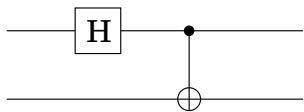
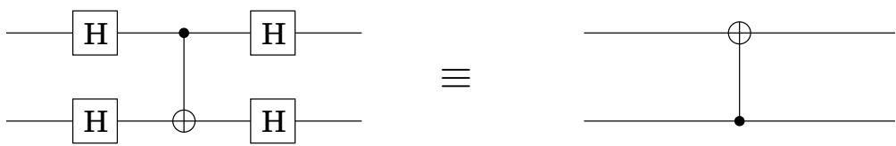

import Guide from '@/components/Guide.astro';
import Knowledge from '@/components/Knowledge.astro';
import Example from '@/components/Example.astro';
import Analysis from '@/components/Analysis.astro';
import Solution from '@/components/Solution.astro';
import Variant from '@/components/Variant.astro';
import Note from '@/components/Note.astro';
import Block from '@/components/Block.astro';
import Method from '@/components/Method.astro';
import Exercise from '@/components/Exercise.astro';

## 第 10 章练习

<Exercise title="Exercise 10.1">

$\textstyle { \left| { \psi } \right. } \ = \ { \frac { 1 } { \sqrt { 2 } } } { \left| { 0 0 } \right. } \ + \ { \frac { 1 } { \sqrt { 2 } } } { \left| { 1 1 } \right. }$ 是著名的“贝尔态”之一，这是两个量子位的高度纠缠态。在这个问题中，我们研究了它的一些奇怪的特性。

(a) 假设这个贝尔状态可以分解为两个量子位的（张量）乘积（回想一下第 298 页上的框），第一个量子位处于状态 $\alpha _ { 0 } | 0 \rangle + \alpha _ { 1 } | 1 \rangle$，第二个量子位处于状态 $\beta _ { 0 } | 0 \rangle + \beta _ { 1 } | 1 \rangle$ 写出四个方程，其幅度为 $\alpha _ { 0 } , \alpha _ { 1 } , \beta _ { 0 }$ ，并且 $\beta _ { 1 }$ 必须满足。得出贝尔态不能如此分解的结论。

(b) 测量 $| \psi \rangle \ ?$ 的第一个量子位的结果是什么

(c) 测量第一个量子位后测量第二个量子位的结果是什么？

(d) 如果处于状态 $\left| \psi \right.$ 的两个量子位彼此相距很远，你能明白为什么 (c) 的答案令人惊讶吗？

</Exercise>

<Exercise title="Exercise 10.2">

证明以下量子电路在输入 00 上准备贝尔态 $\begin{array} { r } { { \left| { \psi } \right. } = \frac { 1 } { \sqrt { 2 } } { \left| { 0 0 } \right. } + \frac { 1 } { \sqrt { 2 } } { \left| { 1 1 } \right. } } \end{array}$ ：将 Hadamard 门应用于第一个量子位，然后应用 CNOT，其中第一个量子位作为控制，第二个量子位作为目标。

电路在输入 10、01 和 11 上输出什么？这些是贝尔基础状态的其余部分。

</Exercise>

<Exercise title="Exercise 10.3">

均匀叠加 $\begin{array} { r } { \frac { 1 } { \sqrt { M } } \sum _ { j = 0 } ^ { M - 1 } \left| j \right. \ ? } \end{array}$ 的量子傅里叶变换模M是多少

</Exercise>

<Exercise title="Exercise 10.4">

$\vert j \rangle \ ?$ 的 QFT 模 M 是多少

</Exercise>

<Exercise title="Exercise 10.5">

卷积乘法。假设我们将叠加态 $\begin{array} { r } { | \alpha \rangle \ = \ \sum _ { j } \alpha _ { j } | j \rangle } \end{array}$ 移动 l 以获得叠加态 $\begin{array} { r } { \left| \alpha ^ { \prime } \right. = \sum _ { j } \alpha _ { j } \left| j + l \right. } \end{array}$ 。如果 $\left| \alpha \right.$ 的 QFT 为 $| \beta \rangle$ ，则表明 $\alpha ^ { \prime }$ 的 QFT 为 $\beta ^ { \prime }$ ，其中 $\beta _ { j } ^ { \prime } = \beta _ { j } \omega ^ { l j }$ 。结论是，如果 $\begin{array} { r } { \left| \alpha ^ { \prime } \right. = \sum _ { j = 0 } ^ { M / k - 1 } \sqrt { \frac { k } { M } } \left| j k + l \right. } \end{array}$ ，则 $\begin{array} { r } { \left| \beta ^ { \prime } \right. = \frac { 1 } { \sqrt { k } } \sum _ { j = 0 } ^ { k - 1 } \omega ^ { l j M / k } \big | j M / k \big \rangle } \end{array}$

</Exercise>

<Exercise title="Exercise 10.6">

证明如果将 Hadamard 门应用于 CNOT 门的输入和输出，结果是控制量子位和目标量子位已切换的 CNOT 门：

</Exercise>

<Exercise title="Exercise 10.7">

受控交换 (C-SWAP) 门将 3 个量子位作为输入，当且仅当第一个量子位为 1 时交换第二个和第三个。

(a) 证明每个 NOT、CNOT 和 C-SWAP 门都是它们自己的逆门。

(b) 展示如何使用 C-SWAP 门实现 AND 门，即，您将向 C-SWAP 门提供什么输入 $a , b ,$ c，以便其中一个输出为 $a \wedge b ?$

(c) 如何仅使用这三个门来实现扇出？也就是说，在输入 a 和 0 上，输出 a 和 a。

(d) 因此得出结论，对于任何经典电路 C，都存在一个仅使用 NOT 和 C-SWAP 门的等效量子电路 $Q$，其意义如下：如果 C 在输入 $x ,$ 上输出 y，则 $Q$ 在输入上输出 $\left| x , y , z \right.$ $| x , 0 , 0 \rangle$ 。 （这里 z 是计算过程中生成的一些垃圾位）。

(e) 现在证明有一个量子电路 $Q ^ { - 1 }$ 在输入 $\left| x , y , z \right.$ 上输出 $| x , 0 , 0 \rangle$

(f) 证明存在一个由 NOT、CNOT 和 C-SWAP 门组成的量子电路 $Q ^ { \prime }$，在输入 $| x , 0 , 0 \rangle$ 上输出 $| x , y , 0 \rangle$

</Exercise>

<Exercise title="Exercise 10.8">

在这个问题中，我们将证明，如果 $N = p q$ 是两个奇素数的乘积，并且如果 $x$ 在 0 和 $N - 1$ 之间均匀随机选择，使得 $\operatorname* { g c d } ( x , N ) = 1$ ，那么概率至少为 $3 / 8 _ { ! }$ ， x mod N 的阶 r 是偶数，而且 $x ^ { r / 2 }$ 是 1 mod N 的非平凡平方根。

(a) 令 $p$ 为奇素数，令 x 为模 $p .$ 的均匀随机数，表明 x mod p 的阶为偶数，概率至少为 $1 / 2$ 。 （提示：使用费马小定理（第 1.3 节）。）

(b) 使用中国余数定理（练习 1.37）证明，x mod N 的阶数 r 是偶数，概率至少为 $3 / 4$ 。

(c) 如果r是偶数，证明 $x ^ { r / 2 } \equiv \pm 1$ 至多是 $1 / 2$ 的概率

</Exercise>