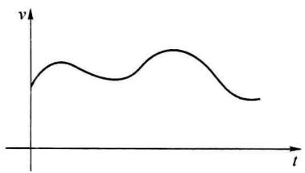
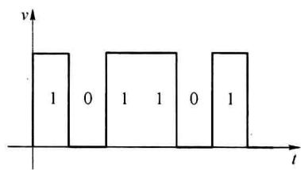
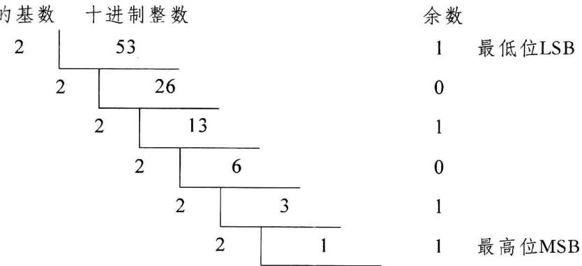

import Guide from '@/components/Guide.astro';
import Knowledge from '@/components/Knowledge.astro';
import Example from '@/components/Example.astro';
import Analysis from '@/components/Analysis.astro';
import Solution from '@/components/Solution.astro';
import Variant from '@/components/Variant.astro';
import Note from '@/components/Note.astro';
import Block from '@/components/Block.astro';
import Method from '@/components/Method.astro';
import Exercise from '@/components/Exercise.astro';

## 第1章 数字技术基础

本章主要介绍数字技术的基础知识,包括数字电路中常用的计数制、逻辑代数的基础理论、逻辑函数的表示及其简化方法等内容。

自然界中的许多物理量(如距离、温度、压力、亮度、流量等)在时间和数值上都是连续变化的,这些物理量在一定范围内可在任意时间点上取得任意精度的实数,我们称这类物理量为模拟量。为了将这些物理量进行分析、传输、显示,工程上通常转换成电压或电流来模拟、处理这些实际的物理量,对应的电压或电流称为模拟信号,例如正弦变化的交流信号,它在某一瞬间的值可以是一个数值区间内的任何值。处理模拟信号的电路被称为模拟电路(analog circuit)。模拟电路主要研究输出与输入信号之间幅度、相位、阻抗、失真等方面的内容。一般情况下,模拟电路中所使用的电子器件要求工作在线性区。这类电路包括放大电路、模拟运算电路、滤波电路、钳位电路等。

另外一类信号,它们只在特定的时间点上取得特定的数值,每次数值的增减变化都是某一个最小单位的整数倍(如果是二进制信号,在数值上只有0和1),也就是在时间上和数值上都是离散的,这一类信号叫做数字信号。数字信号可以用来表示某些物理量,也可以仅仅表示数字信号输入和输出之间的逻辑关系。处理数字信号的电路称为数字电路(digital circuit)。二进制数字电路中,常使用高电平(1电平)和低电平(0电平)来表示电路的状态,每个0或1称为一个比特(bit),是数据传输、处理和存储的最小单位。数字电路主要研究输出与输入信号之间的逻辑关系,包括各种逻辑运算、时延、抗干扰能力、带负载能力等方面内容。一般情况下,数字电路中所使用的电子器件工作在非线性区,即工作于开关状态。这类电路包括地址译码器、计数器、寄存器等。

图 1.0.1 给出了模拟信号与数字信号的示意图。

  

(a)模拟信号

  

(b)数字信号  

图 1.0.1 模拟信号与数字信号

除模拟电路与数字电路外,还有一类电路称为数模混合电路,该类电路中既包含了模拟电路,也包含了数字电路,如电压比较器、多谐振荡器、限幅器、数模和模数转换器等。

## 1.1.1 数制

数制是进位记数制的简称, 是用一组固定的符号和统一的规则来表示数值的方法。现在常用的计数制有二进制、八进制、十进制、十六进制。每一种记数制所使用的数码个数称为基数, 如二进制的基数为 2, 十进制基数为 10。在表示数值的大小时, 通常需要使用从低位到高位的多位数码表示, 各个数码处于数码组合不同位置时所代表的数值不同, 即数码在不同位置对应有不同的权值。表 1.1.1 是十进制数对应的二进制、八进制和十六进制数。表 1.1.2 给出的是二进制各位对应的权值。

表 1.1.1 十进制对应的二进制、八进制、十六进制数

<table><tr><td>十进制</td><td>二进制</td><td>八进制</td><td>十六进制</td><td>十进制</td><td>二进制</td><td>八进制</td><td>十六进制</td><td>十进制</td><td>二进制</td><td>八进制</td><td>十六进制</td></tr><tr><td>0</td><td>0000</td><td>0</td><td>0</td><td>6</td><td>0110</td><td>6</td><td>6</td><td>12</td><td>1100</td><td>14</td><td>C</td></tr><tr><td>1</td><td>0001</td><td>1</td><td>1</td><td>7</td><td>0111</td><td>7</td><td>7·</td><td>13</td><td>1101</td><td>15</td><td>D</td></tr><tr><td>2</td><td>0010</td><td>2</td><td>2</td><td>8</td><td>1000</td><td>10</td><td>8</td><td>14</td><td>1110</td><td>16</td><td>E</td></tr><tr><td>3</td><td>0011</td><td>3</td><td>3</td><td>9</td><td>1001</td><td>11</td><td>9</td><td>15</td><td>1111</td><td>17</td><td>F</td></tr><tr><td>4</td><td>0100</td><td>4</td><td>4</td><td>10</td><td>1010</td><td>12</td><td>A</td><td>16</td><td>10000</td><td>20</td><td>10</td></tr><tr><td>5</td><td>0101</td><td>5</td><td>5</td><td>11</td><td>1011</td><td>13</td><td>B</td><td></td><td></td><td></td><td></td></tr></table>

表 1.1.2 二进制各位的权值

<table><tr><td>二进制位数</td><td>权</td><td>十进制表示</td><td>二进制位数</td><td>权</td><td>十进制表示</td><td>二进制位数</td><td>权</td><td>十进制表示</td></tr><tr><td>13</td><td> $2^{12}$ </td><td>4096</td><td>7</td><td> $2^6$ </td><td>64</td><td>1</td><td> $2^0$ </td><td>1</td></tr><tr><td>12</td><td> $2^{11}$ </td><td>2048</td><td>6</td><td> $2^5$ </td><td>32</td><td>-1</td><td> $2^{-1}$ </td><td>0.5</td></tr><tr><td>11</td><td> $2^{10}$ </td><td>1024</td><td>5</td><td> $2^4$ </td><td>16</td><td>-2</td><td> $2^{-2}$ </td><td>0.25</td></tr><tr><td>10</td><td> $2^9$ </td><td>512</td><td>4</td><td> $2^3$ </td><td>8</td><td>-3</td><td> $2^{-3}$ </td><td>0.125</td></tr><tr><td>9</td><td> $2^8$ </td><td>256</td><td>3</td><td> $2^2$ </td><td>4</td><td>-4</td><td> $2^{-4}$ </td><td>0.0625</td></tr><tr><td>8</td><td> $2^7$ </td><td>128</td><td>2</td><td> $2^1$ </td><td>2</td><td>-5</td><td> $2^{-5}$ </td><td>0.03125</td></tr></table>

任何进制数都可以按权展开求和,从而得到十进制数的对应数值。将一个整数位为 n 位、小数位为 m 位的 R 进制数 N 按权展开的表示式为

$$

\begin{array}{r l} (N) _ {R} & = (k _ {n - 1} \times R ^ {n - 1} + k _ {n - 2} \times R ^ {n - 2} + \dots + k _ {1} \times R ^ {1} + k _ {0} \times R ^ {0} + \\ & \quad k _ {- 1} \times R ^ {- 1} + k _ {- 2} \times R ^ {- 2} + \dots + k _ {- m} \times R ^ {- m}) _ {1 0} \\ & = (\sum_ {i = - m} ^ {n - 1} k _ {i} \times R ^ {i}) _ {1 0} \end{array}\tag{1.1.1}

$$

式(1.1.1)中 $(N)_R$ 为 $R$ 进制的数 $N$ ， $\left(\sum_{i = -m}^{n - 1}k_i\times R^i\right)_{10}$ 表示展开求和后对应的十进制

数,括号外的下角标表示进制(基数)。

以一个十进制数 8921 为例,8、9、2、1 称为系数,每个系数所处的位置不同,则对应的权值不同。其运算规律为逢十进一,借一当十。将其按权值展开可以表示为

$$

(8 9 2 1) _ {1 0} = (8 \times 1 0 ^ {3} + 9 \times 1 0 ^ {2} + 2 \times 1 0 ^ {1} + 1 \times 1 0 ^ {0}) _ {1 0}

$$

若将二进制数 $(11011.011)_{2}$ 按权展开,得到十进制数为

$$

\begin{array}{r l} (1 1 0 1 1. 0 1 1) _ {2} & = (1 \times 2 ^ {4} + 1 \times 2 ^ {3} + 0 \times 2 ^ {2} + 1 \times 2 ^ {1} + 1 \times 2 ^ {0} + 0 \times 2 ^ {- 1} + 1 \times 2 ^ {- 2} + 1 \times 2 ^ {- 3}) _ {1 0} \\ & = (1 6 + 8 + 0 + 2 + 1 + 0 + 0. 2 5 + 0. 1 2 5) _ {1 0} \\ & = (2 7. 3 7 5) _ {1 0} \end{array}

$$

## 1.1.2 不同数制间的转换

### 1. 十进制与非十进制之间的转换

(1) 非十进制数转换为十进制数

非十进制数转换为十进制数仅需按式(1.1.1)，将每位数码作为系数乘以权值并求和即可。

<Example title="例 1.1.1">
将 $(12\mathrm{AF.B4})_{16}$ 转换成十进制数。

<Solution title="解">
$$

\begin{array}{r l} (1 2 \mathrm{AF.B4}) _ {1 6} & = (1 \times 1 6 ^ {3} + 2 \times 1 6 ^ {2} + 1 0 \times 1 6 ^ {1} + 1 5 \times 1 6 ^ {0} + 1 1 \times 1 6 ^ {- 1} + 4 \times 1 6 ^ {- 2}) _ {1 0} \\ & = (4   0 9 6 + 5 1 2 + 1 6 0 + 1 5 + 0.   6 8 7   5 + 0.   0 1 5   6 2 5) _ {1 0} \\ & = (4   7 8 3.   7 0 3   1 2 5) _ {1 0} \end{array}

$$

(2) 十进制数转换为非十进制数

十进制数转换为非十进制数时需要将整数和小数分别处理。

① 整数部分的转换

整数部分的转换采用基数连除法。方法是用十进制整数除以目的数制的基数，第一次相除所得的余数为目的数的最低位，得到的商再除以该基数，所得的余数为目的数的次低位，依此类推，直到商为0，最后所得的余数为目的数的最高位。
</Solution>
</Example>

<Example title="例 1.1.2">
将 $(53)_{10}$ 转换成二进制数。

<Solution title="解">
目的基数 十进制整数

经过多次除以基数2，得到转换结果为 $(53)_{10} = (110101)_2$ 。这里需要强调的是最先得到的余数为最低位。
</Solution>
</Example>

<Example title="例 1.1.3">
将 $(53)_{10}$ 转换成八进制数。

<Solution title="解">
<table><tr><td>目的基数</td><td>十进制整数</td><td>余数</td></tr><tr><td>8</td><td>53</td><td>5 低位</td></tr><tr><td></td><td>6</td><td>6 高位</td></tr><tr><td></td><td>0</td><td></td></tr></table>

转换结果为 $(53)_{10}=(65)_{8}$ 。
</Solution>
</Example>

## ② 小数部分的转换

小数部分的转换是采用基数连乘法。方法是用该十进制小数乘以目的数制的基数，第1次相乘结果的整数部分为目的数制小数的最高位，去除整数后剩余的小数部分再乘以基数，所得结果的整数部分为目的数制小数的次高位，依此类推，直到小数部分为0或达到精度要求为止。

<Example title="例 1.1.4">
将十进制小数 $(0.6875)_{10}$ 转换成二进制数,精度到小数点后6位。

为表示该二进制数的精度到小数点后6位，可在最低位后增加两个“0”。所以转换结果为 $(0.6875)_{10} = (0.101100)_2$ 。
</Example>

<Example title="例 1.1.5">
将十进制小数 $(0.687)_{10}$ 转换成二进制数,精度到小数点后4位。

$$

\begin{array}{r l r l} {\text {解:}} & {0. 6 8 7 \times 2 = 1. 3 7 4} & {1} & {\text {最高位}} \\ & {0. 3 7 4 \times 2 = 0. 7 4 8} & {0} \\ & {0. 7 4 8 \times 2 = 1. 4 9 6} & {1} \\ & {0. 4 9 6 \times 2 = 0. 9 9 2} & {0} & {\text {最低位(已经到达所要精度,无须再继续转换)}} \end{array}

$$

转换结果为 $(0.687)_{10}\approx(0.1010)_{2}$ 。最后的0应该保留，以表示精确到小数点后第4位。
</Example>

### 2. 二进制与八进制和十六进制之间的转换

八进制的基数是2的3次幂，十六进制的基数是2的4次幂，因此二进制与八进制和十六进制间的互换非常容易。二进制要转换为八进制时，只需要将其以小数点为中心，向两边按每3位分成一组，不足3位时补0，再把每3位二进制数对应的八进制数码写出即可。同样，二进制要转换为十六进制时，只需要将其以小数点为中心，向两边按每4位分成一组，不足4位时补0，再把每4位二进制数对应的十六进制数码写出即可。反过来，八进制和十六进制转换为二进制时，只需写出对应的二进制码即可。下面用4个例子说明二进制与八进制以及二进制与十六进制之间的转换方法。

<Example title="例 1.1.6">
将 $(11101.1101)_{2}$ 转换成八进制数。

<Solution title="解">
二进制数=011 101.110 100
八进制数=3 5.6 4

转换结果为 $(11101.1101)_{2}=(35.64)_{8}$ 。
</Solution>
</Example>

<Example title="例 1.1.7">
将 $(234.567)_{8}$ 转换成二进制。

<Solution title="解">
八进制数 = 2 3 4 .5 6 7

二进制数 $= 010$ 011 100.101 110 111

转换结果为 $(234.567)_{8} = (10011100.101110111)_{2}$ 。
</Solution>
</Example>

<Example title="例 1.1.8">
将 $(11101.1101)_{2}$ 转换成十六进制数。

<Solution title="解">
二进制数=0001 1101.1101

十六进制数 $= 1$ D. D

转换结果为 $(11101.1101)_{2}=(1D.D)_{16}$ 。
</Solution>
</Example>

<Example title="例 1.1.9">
将 $(AF.26)_{16}$ 转换成二进制数。

<Solution title="解">
十六进制数= A F . 2 6

二进制数 $= 1010$ 1111.0010 0110

转换结果为 $(AF.26)_{16}=(10101111.0010011)_{2}$ 。
</Solution>
</Example>

## 1.1.3 二进制编码

二进制编码是用特定的二进制数码来表示自然数、符号、状态等各类信息的过程。不同的二进制数码可以表示数的大小，也可以表示符号、状态的不同。当表示符号或状态时，数码没有大小含义，例如可以给每个参加运动会的运动员一个二进制数码，用于在计算机系统中相关信息的识别和处理。

### 1. 二进制编码

二进制编码可以有很多种编码方式,这里主要介绍自然二进制编码和格雷码。4位二进制码的编码方式如表1.1.3所示。

表 1.1.3 两种 4 位二进制编码表

<table><tr><td>十进制数</td><td>自然二进制码</td><td>二进制格雷码</td><td>十进制数</td><td>自然二进制码</td><td>二进制格雷码</td></tr><tr><td>0</td><td>0000</td><td>0000</td><td>8</td><td>1000</td><td>1100</td></tr><tr><td>1</td><td>0001</td><td>0001</td><td>9</td><td>1001</td><td>1101</td></tr><tr><td>2</td><td>0010</td><td>0011</td><td>10</td><td>1010</td><td>1111</td></tr><tr><td>3</td><td>0011</td><td>0010</td><td>11</td><td>1011</td><td>1110</td></tr><tr><td>4</td><td>0100</td><td>0110</td><td>12</td><td>1100</td><td>1010</td></tr><tr><td>5</td><td>0101</td><td>0111</td><td>13</td><td>1101</td><td>1011</td></tr><tr><td>6</td><td>0110</td><td>0101</td><td>14</td><td>1110</td><td>1001</td></tr><tr><td>7</td><td>0111</td><td>0100</td><td>15</td><td>1111</td><td>1000</td></tr></table>

自然二进制编码 0000～1111 可以用来表示十进制数的 0～15，也可以用来表示 16 种其他状态信息。自然二进制编码是一种有权编码，各个位置上的权值是固定的，由高到低分别为 8、4、2、1，所以也称自然二进制码为 8421 码，对于 8421 码或其他有权码，可以通过其权值和系数计算出对应的十进制数。

二进制循环码(简称循环码)是无权码,也就是没有固定的权值,其编码方案有很多种,其特点是任何相邻的两个码组(包括首尾两个码组)仅有一位码不同,因此循环码又叫单位距离码。二进制格雷码(Gray Code)是循环码的一种,鉴于它的编码特点,格雷码又称为反射二进制码。在后面的学习中可以看到,使用循环码(包括格雷码)时,在码组顺序变化时可以有效地减少逻辑错误,所以二进制格雷码属于可靠性编码,是错误最小化的编码方式之一。观察二进制格雷码的最后一位,可将其分为4个一组,顺序为01 10,01 10,……从中间分开后折叠对称;倒数第二位分为8个一组时的顺序为0011 1100,0011 1100,……同样,倒数第三位的顺序为00001111 11110000,……这一特性称为折叠反射特性,利用其折叠反射性很容易获得对应的编码。

### 2. 二-十进制编码

我们非常熟悉的是十进制数，在计算机中，有多种4位二进制数码来表示十进制数的0～9，通常将这些4位二进制数码称为二十进制编码或简称BCD(Binary Coded Decimal)码。几种常用的BCD编码如表1.1.4所示。

表 1.1.4 常见的 BCD 编码

<table><tr><td>十进制码</td><td>8421BCD 码</td><td>2421BCD 码</td><td>余 3BCD 码</td><td>格雷 BCD 码</td><td>余 3 格雷 BCD 码</td></tr><tr><td>0</td><td>0000</td><td>0000</td><td>0011</td><td>0000</td><td>0010</td></tr><tr><td>1</td><td>0001</td><td>0001</td><td>0100</td><td>0001</td><td>0110</td></tr><tr><td>2</td><td>0010</td><td>0010</td><td>0101</td><td>0011</td><td>0111</td></tr><tr><td>3</td><td>0011</td><td>0011</td><td>0110</td><td>0010</td><td>0101</td></tr><tr><td>4</td><td>0100</td><td>0100</td><td>0111</td><td>0110</td><td>0100</td></tr><tr><td>5</td><td>0101</td><td>1011</td><td>1000</td><td>0111</td><td>1100</td></tr><tr><td>6</td><td>0110</td><td>1100</td><td>1001</td><td>0101</td><td>1101</td></tr><tr><td>7</td><td>0111</td><td>1101</td><td>1010</td><td>0100</td><td>1111</td></tr><tr><td>8</td><td>1000</td><td>1110</td><td>1011</td><td>1100</td><td>1110</td></tr><tr><td>9</td><td>1001</td><td>1111</td><td>1100</td><td>1000</td><td>1010</td></tr></table>

### (1) 8421BCD 码

8421BCD码是最常用的二-十进制编码。它是用4位自然二进制码中的前10个，即0000～1001来表示十进制的0～9。4位二进制代码权值由高到低分别为8、4、2、1，所以8421BCD码是一种有权码。以十进制数76为例，其8421BCD码为 $(76)_{10}=(01110110)_{8421BCD}$ 。

### (2) 2421BCD 码(简称 2421 码)

2421 码的最高位权值为 2，其他位的权值与 8421BCD 码相同，其权值由高到低分别为 2、4、2、1。特点是 0 和 9、1 和 8、2 和 7、3 和 6、4 和 5 互为反码。十进制数 76 的 2421 码为 $(76)_{10} = (11011100)_{2421}$ 。

### (3) 余 3BCD 码(简称余 3 码)

余3码是去掉4位自然二进制码的前3组编码，从第4组开始顺序选用10组编码，或者说是由8421BCD码加上0011(3)形成的，因此称为余3码。特点是将两个余3码表示的十进制数相加时，能正确产生进位信号，但对不含进位位的“和”必须修正。修正的方法是：如果有进位，则结果加3；如果无进位，则结果减3。与2421码相似，余3码的0和9、1和8、2和7、3和6、4和5也互为反码。十进制数76的余3码为 $(76)_{10} = (10101001)_{\text{余} 3\text{码}}$ 。

### (4) 格雷 BCD 码

格雷 BCD 码是选用 4 位二进制格雷码的前 9 个编码, 再选用 1000 作为第 10 个编码构成。挑选 1000 的目的是使该编码的首尾编码仍具有单位距离特性(任意两个相邻的编码之

间仅有一位不同）。格雷 BCD 码是无权码。

(5) 余 3 格雷 BCD 码(简称余 3 格雷码)

余 3 格雷码是选用 4 位二进制格雷码的第 4 到第 13 个编码构成的 BCD 码。余 3 格雷码也是无权码。
