import Guide from '@/components/Guide.astro';
import Knowledge from '@/components/Knowledge.astro';
import Example from '@/components/Example.astro';
import Analysis from '@/components/Analysis.astro';
import Solution from '@/components/Solution.astro';
import Variant from '@/components/Variant.astro';
import Note from '@/components/Note.astro';
import Block from '@/components/Block.astro';
import Method from '@/components/Method.astro';
import Exercise from '@/components/Exercise.astro';

逻辑代数(Logic Algebra)是用来处理逻辑运算的代数,是分析和设计逻辑电路的数学基础。逻辑代数是由英国科学家乔治·布尔在1849年创立的,故又称布尔代数(Boolean Algebra)。本节主要介绍逻辑代数的基本运算和公式,逻辑代数的表示和其简化的方法。

## 1.2.1 逻辑变量与逻辑运算

### 1. 逻辑变量和常量

二元逻辑代数中有两个逻辑常量,即逻辑 0 和逻辑 1。对于逻辑变量可以有两个取值 (0 和 1)。本书的逻辑代数主要是指二元逻辑。

在这里，0 和 1 是表示事物矛盾双方的符号。例如，命题的真假，信号的有无，电位的高低等。所以逻辑 0 和逻辑 1 本身没有数值大小的意义。

### 2. 基本逻辑运算

基本逻辑运算只有与(and)、或(or)、非(not)3种，任何复杂的运算都可由这3种基本逻辑运算来实现。

逻辑门(Logic Gate)是构成逻辑电路的基本组件,实现与逻辑运算的逻辑门称为与门,还有对应或运算和非运算的或门和非门等。

### (1) 与逻辑运算

与逻辑运算的定义为: 当且仅当决定事件发生的条件全部具备时, 该事件发生。与逻辑运算也称为逻辑乘。

图 1.2.1(a) 用电路表达了与运算的逻辑关系, 只有两个开关都闭合(两个条件都具备), 指示灯才会亮(事件发生)。

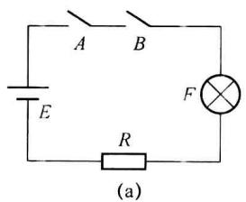

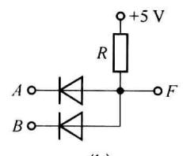

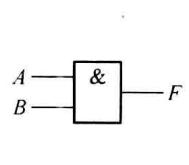  

图1.2.1 与逻辑

表 1.2.1 与逻辑真值表

<table><tr><td>A</td><td>B</td><td>F</td></tr><tr><td>0</td><td>0</td><td>0</td></tr><tr><td>0</td><td>1</td><td>0</td></tr><tr><td>1</td><td>0</td><td>0</td></tr><tr><td>1</td><td>1</td><td>1</td></tr></table>

与逻辑关系可以用输入逻辑变量的各种取值组合和对应输出函数值关系的表格形式表示。这种反映输入变量和输出函数值关系的表格称为函数的真值表。真值表中条件(输入)具备用“1”表示,条件不具备用“0”表示,事件(输出)发生用“1”表示,事件不发生用“0”表示。

表 1.2.1 为与逻辑的真值表, 表中 A、B 为输入变量, F 为输出变量。从与逻辑的真值表可以看到, 只有 A 和 B 都为“1”时, 输出为“1”。

与逻辑可用式(1.2.1)逻辑表达式表示,式中的“·”都表示逻辑乘,也可以省去。

$$

F (A, B) = A \cdot B = A B\tag{1.2.1}

$$

利用二极管的单向导电性很容易得到逻辑与的关系,由二极管构成的与门电路如图1.2.1(b)所示。设二极管为理想二极管,定义输入和输出(A、B和F)为高电平(+5V)是逻辑“1”,低电平(0V)是逻辑“0”。当输入信号中,有一个或一个以上为低电平0V时,输出F就被钳制在低电平0V左右(设二极管为理想二极管,导通时的压降为0V)。只有A、B均为高电平5V时,两个二极管输入均截止,输出F为5V,实现与逻辑功能。

在进行逻辑电路的分析和设计时,多用逻辑图来描述电路的逻辑功能。逻辑图中使用“与门”代表与逻辑运算。与门的符号如图 1.2.1(c) 所示。

### (2) 或逻辑运算

或逻辑运算的定义为: 当决定事件发生的多个条件中有一个或一个以上具备时, 该事件发生。或逻辑运算又称为逻辑加。

图 1.2.2(a) 用电路表达了或运算的逻辑关系, 当两个开关有任意一个或两个都闭合, 指示灯就会亮。

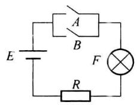  

(a)

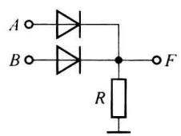  

(b)

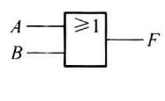  

(c)

表 1.2.2 或逻辑真值表

<table><tr><td>A</td><td>B</td><td>F</td></tr><tr><td>0</td><td>0</td><td>0</td></tr><tr><td>0</td><td>1</td><td>1</td></tr><tr><td>1</td><td>0</td><td>1</td></tr><tr><td>1</td><td>1</td><td>1</td></tr></table>

图1.2.2 或逻辑

或逻辑运算关系可以用表 1.2.2 所示的真值表表示。真值表中“1”和“0”的定义同与逻辑。A 和 B 中只要有一个为“1”，或两个都是“1”，输出为“1”。

或逻辑可用式(1.2.2)逻辑表达式表示。式中“+”表示或逻辑(逻辑加)。

$$

F (A, B) = A + B\tag{1.2.2}

$$

用二极管构成的或门逻辑电路如图 1.2.2(b) 所示。输入信号中，只要有一个或一个以上为高电平 5 V 时，相应的二极管导通，输出 F 就为高电平 5 V。只有 A、B 均为低电平 0 V 时，两个二极管均截止，输出 F 为低电平 0 V，从而实现或逻辑功能。

逻辑图中使用“或门”代表或逻辑运算。或门的符号如图1.2.2(c)所示。

### (3) 非逻辑运算

非逻辑运算的定义为:决定事件发生的条件只有一个,当条件具备时,事件不发生,条件不具备时,事件发生。非运算又称为“反相”运算或称逻辑反。

图 1.2.3(a) 用电路表达了非运算的逻辑关系, 当开关闭合, 指示灯不亮, 开关断开, 指示灯亮。

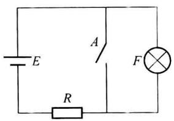  

(a)

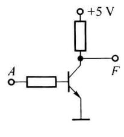  

(b)

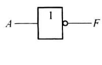  

(c)

表 1.2.3 非逻辑真值表

<table><tr><td>A</td><td>F</td></tr><tr><td>0</td><td>1</td></tr><tr><td>1</td><td>0</td></tr></table>

图1.2.3 非逻辑

非逻辑运算关系可以用表 1.2.3 所示的真值表表示。真值表中“1”和“0”的定义同与逻辑。当输入取值为“1”时，输出为“0”。

非逻辑可用式(1.2.3)逻辑表达式表示。式中“-”表示非逻辑。

$$

F = \overline {{{A}}}\tag{1.2.3}

$$

用三极管构成的非门逻辑电路如图 1.2.3(b) 所示。当输入为高电平时，三极管饱和，输出为低电平；当输入为低电平时，三极管截止，输出为高电平。

逻辑图中使用“非门”代表非逻辑运算。非门的符号如图 1.2.3(c) 所示。

上面提到的与门和或门都有两个输入端,当有多个输入信号时,与门的逻辑表达式可以写为 $F(A,B,C\cdots)=ABC\cdots$ ; 或门的逻辑表达式可以写为 $F(A,B,C\cdots)=A+B+C+\cdots$ 。逻辑符号增加对应的输入端即可。

## 1.2.2 复合逻辑运算

虽然基本逻辑运算只有与、或、非3种，但实际应用中很多情况下将两种或3种基本逻辑运算结合，实现复合逻辑运算，这些复合运算对应的逻辑电路为复合逻辑门。

### 1. 与非逻辑运算(与非门)

与非逻辑运算就是实现先“与”再实现“非”的逻辑运算。其逻辑函数表达式可表示为

$$

F (A, B) = \overline {{{{A B}}}}\tag{1.2.4}

$$

图 1.2.4 所示为与非门的逻辑符号。根据符号, 可以理解为在输出端的“小圆圈”前实现的是 A 和 B 的与逻辑运算, “小圆圈”表示实现逻辑非运算。表 1.2.4 为与非逻辑的真值表。

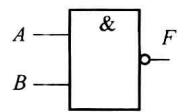  

图1.2.4 与非门

表 1.2.4 与非逻辑的真值表

<table><tr><td>A</td><td>B</td><td>F</td></tr><tr><td>0</td><td>0</td><td>1</td></tr><tr><td>0</td><td>1</td><td>1</td></tr><tr><td>1</td><td>0</td><td>1</td></tr><tr><td>1</td><td>1</td><td>0</td></tr></table>

### 2. 或非逻辑运算(或非门)

或非逻辑运算是实现先“或”再实现“非”的逻辑运算。其函数表达式可表示为

$$

F (A, B) = \overline {{{{A + B}}}}\tag{1.2.5}

$$

图 1.2.5 所示为或非门的逻辑符号。或非门的真值表如表 1.2.5 所示。

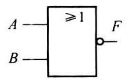  

图1.2.5 或非门

表 1.2.5 或非逻辑真值表

<table><tr><td>A</td><td>B</td><td>F</td></tr><tr><td>0</td><td>0</td><td>1</td></tr><tr><td>0</td><td>1</td><td>0</td></tr><tr><td>1</td><td>0</td><td>0</td></tr><tr><td>1</td><td>1</td><td>0</td></tr></table>

### 3. 与或非逻辑运算(与或非门)

与或非逻辑运算是先实现“与”，与的结果进行“或”运算，最后进行“非”运算的逻辑运算。其函数表达式为

$$

F (A, B, C, D) = \overline {{{{A B + C D}}}}\tag{1.2.6}

$$

图 1.2.6 所示为与或非门的逻辑符号。该与或非门先实现信号 A 和 B 相与、C 和 D 相与，相与的结果进行或运算，最后实现非运算。与或非逻辑的真值表如表 1.2.6 所示。

表 1.2.6 与或非逻辑真值表  

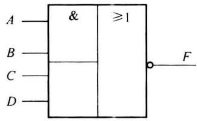  

图1.2.6 与或非门

<table><tr><td>A</td><td>B</td><td>C</td><td>D</td><td>F</td><td>A</td><td>B</td><td>C</td><td>D</td><td>F</td></tr><tr><td>0</td><td>0</td><td>0</td><td>0</td><td>1</td><td>1</td><td>0</td><td>0</td><td>0</td><td>1</td></tr><tr><td>0</td><td>0</td><td>0</td><td>1</td><td>1</td><td>1</td><td>0</td><td>0</td><td>1</td><td>1</td></tr><tr><td>0</td><td>0</td><td>1</td><td>0</td><td>1</td><td>1</td><td>0</td><td>1</td><td>0</td><td>1</td></tr><tr><td>0</td><td>0</td><td>1</td><td>1</td><td>0</td><td>1</td><td>0</td><td>1</td><td>1</td><td>0</td></tr><tr><td>0</td><td>1</td><td>0</td><td>0</td><td>1</td><td>1</td><td>1</td><td>0</td><td>0</td><td>0</td></tr><tr><td>0</td><td>1</td><td>0</td><td>1</td><td>1</td><td>1</td><td>1</td><td>0</td><td>1</td><td>0</td></tr><tr><td>0</td><td>1</td><td>1</td><td>0</td><td>1</td><td>1</td><td>1</td><td>1</td><td>0</td><td>0</td></tr><tr><td>0</td><td>1</td><td>1</td><td>1</td><td>0</td><td>1</td><td>1</td><td>1</td><td>1</td><td>0</td></tr></table>

### 4. 异或逻辑运算(异或门)

异或逻辑运算是将两路输入进行比较,两路输入不相同时事件为真;两路输入相同时事件为假。异或对应的逻辑表达式为

$$

F (A, B) = \overline {{{A}}} B + A \overline {{{B}}} = A \oplus B\tag{1.2.7}

$$

图 1.2.7 为异或门逻辑符号, 真值表如表 1.2.7 所示。

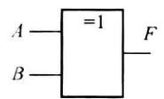  

图1.2.7 异或门

表 1.2.7 异或逻辑真值表

<table><tr><td>A</td><td>B</td><td>F</td></tr><tr><td>0</td><td>0</td><td>0</td></tr><tr><td>0</td><td>1</td><td>1</td></tr><tr><td>1</td><td>0</td><td>1</td></tr><tr><td>1</td><td>1</td><td>0</td></tr></table>

### 5. 同或逻辑运算(同或门)

同或逻辑运算是将两路输入进行比较,相同时事件为真;不同时事件为假。其逻辑表达式为

$$

F (A, B) = \overline {{{A}}} \cdot \overline {{{B}}} + A \cdot B = A \odot B\tag{1.2.8}

$$

图 1.2.8 所示为同或门的逻辑符号, 真值表如表 1.2.8 所示。

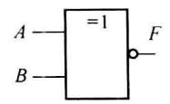  

图1.2.8 同或门

表 1.2.8 同或逻辑真值表

<table><tr><td>A</td><td>B</td><td>F</td></tr><tr><td>0</td><td>0</td><td>1</td></tr><tr><td>0</td><td>1</td><td>0</td></tr><tr><td>1</td><td>0</td><td>0</td></tr><tr><td>1</td><td>1</td><td>1</td></tr></table>

异或运算和同或运算经常用来进行奇偶校验,如逻辑函数 $F(A,B,C,D)=A\oplus B\oplus C\oplus D$ , 当 4 个输入中有奇数个 1 时,其异或运算的结果为 1,否则为 0。

### 6. 门电路的符号

以上所给出的逻辑门符号均为国标符号, 图 1.2.9 列出了与曾用符号的对照关系, 以供大家在学习和应用时参考。

国标符号

曾用符号

国外曾用符号

与门

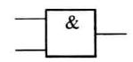

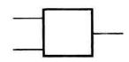

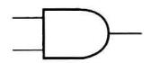

或门

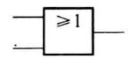

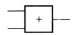

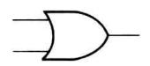

非门

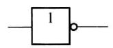

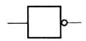

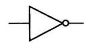

与非门

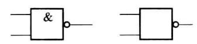

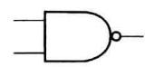

或非门

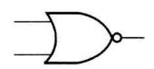

与或非门

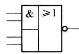

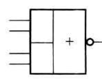

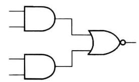

异或门

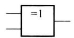

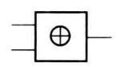

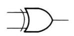

同或门

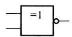

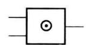

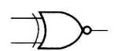  

图1.2.9 常用逻辑门符号对照

## 1.2.3 逻辑代数的基本定律和基本规则

### 1. 逻辑代数的基本定律

与普通代数一样,逻辑代数作为一门完整的代数学,有其基本的运算公式和运算定理。表1.2.9给出了逻辑代数的基本定律,这些定律也称为布尔恒等式。这些基本定律可以通过真值表进行验证。

表 1.2.9 逻辑代数的基本定律

<table><tr><td>1</td><td>交换律</td><td> $A + B = B + A$ </td><td> $A \cdot B = B \cdot A$ </td></tr><tr><td>2</td><td>结合律</td><td> $A + (B + C) = (A + B) + C$ </td><td> $A \cdot (B \cdot C) = (A \cdot B) \cdot C$ </td></tr><tr><td>3</td><td>分配律</td><td> $A(B + C) = A \cdot B + A \cdot C$ </td><td> $A + B \cdot C = (A + B)(A + C)$ </td></tr><tr><td>4</td><td>吸收律</td><td> $A + A \cdot B = A$ </td><td> $A \cdot (A + B) = A$ </td></tr><tr><td>5</td><td>0-1律</td><td> $A + 1 = 1$  $A + 0 = A$ </td><td> $A \cdot 0 = 0$  $A \cdot 1 = A$ </td></tr><tr><td>6</td><td>互补律</td><td> $A + \overline{A} = 1$ </td><td> $A \cdot \overline{A} = 0$ </td></tr><tr><td>7</td><td>重叠律</td><td> $A + A = A$ </td><td> $A \cdot A = A$ </td></tr><tr><td>8</td><td>对合律(还原律)</td><td> $\overline{\overline{A}} = A$ </td><td></td></tr><tr><td>9</td><td>反演律(摩根定理)</td><td> $\overline{A + B} = \overline{A} \cdot \overline{B}$ </td><td> $\overline{A \cdot B} = \overline{A} + \overline{B}$ </td></tr></table>

从以上基本定律看,逻辑代数的运算规则和普通代数运算规则有许多相似的地方,但也有不同之处。如分配律的两个表达式中,乘对加的分配律与普通代数一样,而加对乘的分配律则不符合普通代数规则,对此需要特别予以注意。

<Example title="例 1.2.1">
求证反演率第一条 $\overline{A+\overline{B}}=\overline{A}\cdot\overline{B}$ 。

<Solution title="证明">
分别列出等式两边表达式的真值表(如表 1.2.10 所示)。

表 1.2.10 例 1.2.1 的真值表

<table><tr><td>A</td><td>B</td><td> $\overline{A+B}$ </td></tr><tr><td>0</td><td>0</td><td>1</td></tr><tr><td>0</td><td>1</td><td>0</td></tr><tr><td>1</td><td>0</td><td>0</td></tr><tr><td>1</td><td>1</td><td>0</td></tr></table>

(b)

<table><tr><td>A</td><td>B</td><td> $\overline{A} \cdot \overline{B}$ </td></tr><tr><td>0</td><td>0</td><td>1</td></tr><tr><td>0</td><td>1</td><td>0</td></tr><tr><td>1</td><td>0</td><td>0</td></tr><tr><td>1</td><td>1</td><td>0</td></tr></table>

从两个真值表可以看到,在所有输入变量组合下,输出对应相等,故等式成立。
</Solution>
</Example>

### 2. 逻辑代数运算的基本规则

逻辑代数运算有 3 条基本规则。

(1) 代入规则

任何一个含有变量 X 的逻辑等式中, 如果将等式中所有出现 X 的位置都用一个逻辑表达式 F 替代, 则等式依然成立。这个规则称为代入规则(也称为代入定理)。

由于逻辑变量 $X$ 只有0和1两种取值， $X$ 为0或 $X$ 为1等式都成立。而逻辑表达式的取值也是0和1两种，无论表达式是0还是1，代入等式，等式依然成立。

利用代入规则很容易将基本定律从两变量等式扩展为多变量等式。

<Example title="例 1.2.2">
已知反演律 $\overline{A+B}=\overline{A}\cdot\overline{B}$ ，将其扩展到3个变量。

<Solution title="解">
设函数表达式为 $F(B,C)=B+C$ , 用该表达式代替等式中的 B, 则有:

$$

\overline {{{{A + (B + C)}}}} = \overline {{{{A}}}} \cdot \overline {{{{B + C}}}}

$$

$$

\overline {{{A + B + C}}} = \overline {{{A}}} \cdot \overline {{{B}}} \cdot \overline {{{C}}}

$$
</Solution>
</Example>

### (2) 反演规则

对于一个逻辑表达式 F，如果将 F 中的所有“·”变为“+”，“+”变为“·”，“1”变为“0”，“0”变为“1”，原变量变反变量，反变量变原变量，运算顺序保持不变，即可得到原表达式的反（非）表达式 $\overline{F}$ 。这个规律叫做反演规则，也称反演定理。

<Example title="例 1.2.3">
若 $F(A,B,C,D)=\overline{(A+B)}\cdot(\overline{C}+\overline{D})$ ，利用反演规则求 $\overline{F}$ 。

<Solution title="解">
$$

\overline {{{F}}} (A, B, C, D) = \overline {{(\overline {{{A}}} \cdot \overline {{{B}}})}} + (C \cdot D)

$$

利用反演规则很容易求得一个表达式的反,但需要特别注意的是,不能在运用规则时破坏原表达式的运算次序。
</Solution>
</Example>

### (3) 对偶规则

将逻辑表达式 F 中的所有“·”变为“+”，“+”变为“·”，“1”变为“0”，“0”变为“1”，得到一个新的逻辑表达式 $F'$ 。 $F'$ 即称为 F 的对偶式。

<Example title="例 1.2.4">
若 $F(A,B,C,D)=A\cdot\overline{B}+C\cdot\overline{D}$ ，利用对偶规则求 $F'$ 。

<Solution title="解">
$$

F ^ {\prime} (A, B, C, D) = (A + \overline {{{B}}}) \cdot (C + \overline {{{D}}})

$$

反演规则和对偶规则的区别是后者对变量不做取反操作。另外，如果两个函数相等，则对应的对偶式也相等。由表1.2.9给出的基本定律中(第8条除外)，每一条定律中的两对都可以由对偶规则得到。
</Solution>
</Example>

## 1.2.4 逻辑代数的常用公式

在进行逻辑运算时会用到以下给出的一些常用公式。运用逻辑代数的基本定律和规则可以加以证明。

(1) $A \cdot B + A \cdot \overline{B} = A$

(2) $A + \overline{A} \cdot B = A + B$

(3) $A \cdot B + \overline{A} \cdot C + B \cdot C = A \cdot B + \overline{A} \cdot C$

(4) $(A + B) \cdot (\overline{A} + C) = A \cdot C + \overline{A} \cdot B$

(5) $\overline{A \cdot \overline{B} + \overline{A} \cdot B} = A \cdot B + \overline{A} \cdot \overline{B}$

<Example title="例 1.2.5">
求证 $A \cdot B + \overline{A} \cdot C + B \cdot C = A \cdot B + \overline{A} \cdot C$ 。

$$

\begin{array}{r l r} {\text {证明:}} & {A \cdot B + \overline {{{A}}} \cdot C + B \cdot C} \\ & {= A B + \overline {{{A}}} C + (A + \overline {{{A}}}) B C} & {\mathrm{(运用了互补率和0-1率)}} \\ & {= A B + A B C + \overline {{{A}}} C + \overline {{{A}}} B C} & {\mathrm{(运用了分配率)}} \\ & {= A B (1 + C) + \overline {{{A}}} C (1 + B)} & {\mathrm{(运用了分配率)}} \\ & {= A B + \overline {{{A}}} C} & {\mathrm{(运用了0-1率)}} \end{array}

$$
</Example>

## 1.2.5 正逻辑与负逻辑

在数字逻辑电路中,通常高电平用逻辑“1”表示,低电平用逻辑“0”表示。这种表示方式称为正逻辑;如果高电平用逻辑“0”表示,低电平用逻辑“1”表示,则称为负逻辑。本书不作特别说明的话,即为正逻辑。

对于正逻辑的或门， $F=A+B$ ，其真值表如表1.2.11(a)所示，其中低电平用逻辑“0”表示，高电平用逻辑“1”表示。若将表1.2.11(a)中的低电平用逻辑“1”表示，高电平用逻辑“0”表示，则得到表1.2.11(b)。可以看出用正逻辑表示的“或”逻辑，在负逻辑表示下，其输出与输入之间的逻辑关系变为“与”逻辑，即对应的负逻辑表达式为 $\bar{F}(A,B)=\bar{A}\cdot\bar{B}$ ，变量上面带的“非”符号代表取负逻辑。可见对同一个电路，用正逻辑或者负逻辑来表示其输出与输入之间的逻辑关系时，表示为不同的逻辑关系。

表 1.2.11 $F = A + B$ 的正、负逻辑真值表  

(a)

<table><tr><td colspan="2">A B (电平)</td><td colspan="2">A B (逻辑)</td><td>F (电平)</td><td>F (逻辑)</td></tr><tr><td>L</td><td>L</td><td>0</td><td>0</td><td>L</td><td>0</td></tr><tr><td>L</td><td>H</td><td>0</td><td>1</td><td>H</td><td>1</td></tr><tr><td>H</td><td>L</td><td>1</td><td>0</td><td>H</td><td>1</td></tr><tr><td>H</td><td>H</td><td>1</td><td>1</td><td>H</td><td>1</td></tr></table>

(b)

<table><tr><td colspan="2">A B(电平)</td><td colspan="2">A B(逻辑)</td><td>F(电平)</td><td>F(逻辑)</td></tr><tr><td>L</td><td>L</td><td>1</td><td>1</td><td>L</td><td>1</td></tr><tr><td>L</td><td>H</td><td>1</td><td>0</td><td>H</td><td>0</td></tr><tr><td>H</td><td>L</td><td>0</td><td>1</td><td>H</td><td>0</td></tr><tr><td>H</td><td>H</td><td>0</td><td>0</td><td>H</td><td>0</td></tr></table>

负逻辑对应的逻辑门的符号如图 1.2.10 所示，在各输入门中都带有小圈。

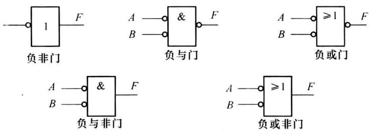  

图1.2.10 负逻辑符号

图 1.2.10 中的负与门, 可以按符号图所示写出其负逻辑表达式为 $\overline{F} = \overline{A} \overline{B}$ , 根据摩根定律得到对应正逻辑表达式为 $F = A + B$ , 即负逻辑的与门为正逻辑的或门。同样, 对于负逻辑的与非门, 其负逻辑表达式为 $\overline{F} = \overline{A} \overline{B}$ , 可以化为 $F = \overline{A} \overline{B} = \overline{A + B}$ , 即负逻辑的与非门为正逻辑的或非门。

使用正逻辑和负逻辑得到的逻辑关系不同(如负逻辑的与门对应正逻辑的或门)，但描述的是同一事物。实际上当把负逻辑转换为正逻辑表示时，直接根据负逻辑的符号，写出正逻辑的表达式即可。仍以负与非门为例，根据其符号，输入信号是 A 和 B，信号经过“小圆圈”后得到的是 $\overline{A}$ 和 $\overline{B}$ 。输出为 F，可以直接得到 $F = \overline{A} \cdot \overline{B} = \overline{A + B}$ 。
