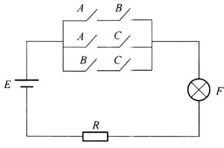
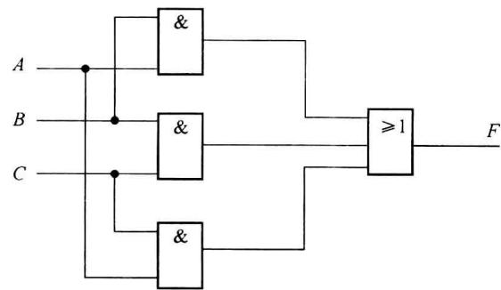
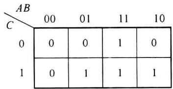

import Guide from '@/components/Guide.astro';
import Knowledge from '@/components/Knowledge.astro';
import Example from '@/components/Example.astro';
import Analysis from '@/components/Analysis.astro';
import Solution from '@/components/Solution.astro';
import Variant from '@/components/Variant.astro';
import Note from '@/components/Note.astro';
import Block from '@/components/Block.astro';
import Method from '@/components/Method.astro';
import Exercise from '@/components/Exercise.astro';

## 1.3.1 逻辑函数

在数字系统中逻辑函数分为两个大类。一类称为组合逻辑函数，特点是函数的输出仅与当前的输入有关，当输入变量的取值确定后，输出的取值也随之确定。另一类称为时序逻辑函数，特点是函数的输出不仅与当前的输入有关，还与过去的输入以及初始状态有关，即电路中含有记忆单元。

本小节主要介绍如何用组合逻辑函数描述一件具体事物的因果关系。关于时序逻辑函数和时序逻辑电路，将在第4章开始介绍。

以我们常见到的举重比赛中3人判决为例, 判决是根据少数服从多数的原则进行, 只要有两名或两名以上的裁判判决成功, 即认为运动员试举成功。举重裁判电路可用图1.3.1表示, 设A、B、C为3名裁判控制的开关, 以开关闭合表示该裁判判决成功, 开关断开表示该裁判判决失败。以指示灯F亮表示成功, 指示灯不亮表示失败。从电路可以分析出, 只要任意两裁判判决成功, 就会有一条通路导通, 使指示灯亮, 例如A和B裁判判决成功, C裁判判决失败, 则电路中最上方的通路的两个开关闭合, 指示灯点亮。

  

图1.3.1 裁判电路

实际上图 1.3.1 所示的电路, 可用一个逻辑函数来表示, 这个逻辑函数描述输出 F 与输入 A、B、C 之间的逻辑关系。

## 1.3.2 逻辑函数的表示方法

对于同一个逻辑函数的表示方法主要有 4 种: 真值表、逻辑表达式(或称逻辑函数)、逻辑图和卡诺图。下面分别进行介绍。

### 1. 真值表

真值表是表征逻辑事件输入和输出之间全部可能状态的表格,即将输入信号所有的取值组合与对应的输出结果通过表格的方式全部列出。我们已经使用真值表描述过各种门电路。图1.3.1的裁判电路的真值表如表1.3.1所示。从真值表可以看出,只有A、B、C变量组合中有两个1或3个都是1时,输出F为1。所以表1.3.1描述了判决电路的逻辑关系。

表 1.3.1 判决电路真值表

<table><tr><td>A</td><td>B</td><td>C</td><td>F</td></tr><tr><td>0</td><td>0</td><td>0</td><td>0</td></tr><tr><td>0</td><td>0</td><td>1</td><td>0</td></tr><tr><td>0</td><td>1</td><td>0</td><td>0</td></tr><tr><td>0</td><td>1</td><td>1</td><td>1</td></tr><tr><td>1</td><td>0</td><td>0</td><td>0</td></tr><tr><td>1</td><td>0</td><td>1</td><td>1</td></tr><tr><td>1</td><td>1</td><td>0</td><td>1</td></tr><tr><td>1</td><td>1</td><td>1</td><td>1</td></tr></table>

### 2. 逻辑表达式

逻辑表达式是用逻辑运算符关联和描述输出与输入变量之间逻辑关系的表达式。当有了真值表后，很容易直接写出对应的逻辑表达式，只需将真值表中输出为1的输入变量组合的乘积项“相或”即可。输入组合中如果变量为1则取原变量，变量为0则取反变量。如对应真值表1.3.1，可以用式(1.3.1)所示的逻辑表达式描述：

$$

F (A, B, C) = \overline {{{A}}} B C + A \overline {{{B}}} C + A B \overline {{{C}}} + A B C\tag{1.3.1}

$$

式(1.3.1)表示当A、B、C分别为011、101、110和111时，F=1，其他变量组合时F=0。除了式(1.3.1)外还有多个函数表达式描述这个判决电路。如式(1.3.1)还可以简化为 $F(A,B,C)=BC+AC+AB$ 。逻辑表达式的简化将在1.4节中详细介绍。

### 3. 逻辑图

逻辑图是将逻辑运算关系用逻辑图形符号描述的一种方法。有了逻辑表达式,可以使用对应的逻辑符号画出逻辑图。图 1.3.1 所示判决电路的逻辑图如图 1.3.2 所示。

  

图1.3.2 判决电路的逻辑图

### 4. 卡诺图

卡诺图是逻辑函数的一种图形化表示方式。可以看成是真值表的变形(另一种表示方法)。表1.3.1所示真值表对应的卡诺图如图1.3.3所示。在1.4节中将详细介绍卡诺图的构成及使用方法。

  

图1.3.3 判决电路的卡诺图

## 1.3.3 逻辑函数的两种标准表达式

### 1. 最小项及最小项表达式

（1）最小项：在有 n 个逻辑变量的逻辑函数中，若某个乘积项 m 包含了所有 n 个逻辑变量，而且这 n 个变量均以原变量或反变量的形式只出现一次，则称这个乘积项 m 为该组变量的最小项。在变量组合中，当变量取值为“0”时，最小项中对应变量取反变量；变量取值为“1”时，最小项中的对应变量取原变量。一个函数有 n 个变量，对应共有 $2^{n}$ 个最小项。例如一个 3 变量函数，其变量组合分别为 000、001、010、…、110、111，共 8 组，对应的最小项分别为 $\overline{A}\overline{B}\overline{C}$ 、 $\overline{A}\overline{B}C$ 、 $\overline{A}B\overline{C}$ 、…、 $AB\overline{C}$ 、ABC，共 8 个最小项。表 1.3.2 所示是 3 个逻辑变量 A，B, C (A 为最高位) 构成 $2^{3}=8$ 个最小项。最小项也可以用 m 表示，其中 $m_{0}$ 、 $m_{1}$ 、…、 $m_{7}$ 中 m 的下角标对应 ABC 的十进制值，如 $m_{0}$ 对应 ABC 为 000(0) 的组合， $m_{5}$ 对应 ABC 为 101(5) 组合。

表 1.3.2 3 个逻辑变量的最小项

<table><tr><td>A</td><td>B</td><td>C</td><td>最小项</td><td>m</td></tr><tr><td>0</td><td>0</td><td>0</td><td> $\overline{A}\overline{B}\overline{C}$ </td><td> $m_0$ </td></tr><tr><td>0</td><td>0</td><td>1</td><td> $\overline{A}\overline{B}C$ </td><td> $m_1$ </td></tr><tr><td>0</td><td>1</td><td>0</td><td> $\overline{A}B\overline{C}$ </td><td> $m_2$ </td></tr><tr><td>0</td><td>1</td><td>1</td><td> $\overline{A}BC$ </td><td> $m_3$ </td></tr><tr><td>1</td><td>0</td><td>0</td><td> $A\overline{B}\overline{C}$ </td><td> $m_4$ </td></tr><tr><td>1</td><td>0</td><td>1</td><td> $A\overline{B}C$ </td><td> $m_5$ </td></tr><tr><td>1</td><td>1</td><td>0</td><td> $A B\overline{C}$ </td><td> $m_6$ </td></tr><tr><td>1</td><td>1</td><td>1</td><td> $A B C$ </td><td> $m_7$ </td></tr></table>

(2) 最小项的性质：

① 对于任意一组变量取值, 只有一个最小项的值为 1, 其他为 0;

② 任意两个不同的最小项之积必为 0，即 $m_{i} \cdot m_{j} = 0 (i \neq j)$ ;

③ n 个变量的所有最小项之和必为 1，即 $\sum_{i=0}^{2^{n}-1}m_{i}=1$ 。

（3）最小项表达式:如果一个逻辑函数均由最小项组成,即用最小项之和的形式表示,则该逻辑函数称为最小项之和表达式,简称最小项表达式。任何一个逻辑函数均可表示为唯一的一组最小项之和表达式,也称它为标准“与或”表达式。

<Example title="例 1.3.1">
将 $F(A,B,C)=\overline{A}B+BC+A\overline{B}\overline{C}$ 化为标准“与或”表达式。

<Solution title="解">
$$

\begin{array}{r l} \overline {{{A}}} B + B C + A \overline {{{B}}} \overline {{{C}}} & = \overline {{{A}}} B (C + \overline {{{C}}}) + (A + \overline {{{A}}}) B C + A \overline {{{B}}} \overline {{{C}}} \\ & = \overline {{{A}}} B C + \overline {{{A}}} B \overline {{{C}}} + A B C + A \overline {{{B}}} \overline {{{C}}} \\ & = m _ {3} + m _ {2} + m _ {7} + m _ {4} \\ & = \sum m (2, 3, 4, 7) \end{array}

$$

在例 1.3.1 给出的函数表达式 $F(A,B,C)=\overline{A}B+BC+A\overline{B}\overline{C}$ 中， $\overline{A}B$ 和 BC 这两个与项没有包含所有变量，因此不是最小项，而 $A\overline{B}\overline{C}$ 是最小项。可以利用 0-1 率和重叠率，将非最小项中缺少的变量补齐，使表达式成为最小项表达式（标准与或表达式）。
</Solution>
</Example>

### 2. 最大项及最大项表达式

（1）最大项：在有 $n$ 个逻辑变量的逻辑函数中，若某个或项 $M$ 包含了所有 $n$ 个逻辑变量，而且这 $n$ 个变量均以原变量或反变量的形式只出现一次，则称这个或项 $M$ 为该组变量的最大项。在变量组合中，当变量取值为“0”时，最大项中对应变量取原变量；变量取值为“1”时，最大项中的对应变量取反变量。一个函数有 $n$ 个变量，对应共有 $2^{n}$ 个最大项。例如一个3变量函数，其变量组合分别为000、001、010、…、110、111，共8组，对应的最大项分别为 $A + B + C, A + B + \overline{C}, A + \overline{B} + C, \cdots, \overline{A} + \overline{B} + C, \overline{A} + \overline{B} + \overline{C}$ ，共8个最大项。表1.3.3所示是3个逻辑变量 $A, B, C (A$ 为最高位)构成 $2^{3} = 8$ 个最大项。类似最小项，最大项也可以用 $M$ 表示。表1.3.3所示是3个逻辑变量 $A, B, C (A$ 为最高位)构成的8个最大项。

表 1.3.3 3 个逻辑变量的最大项

<table><tr><td>A</td><td>B</td><td>C</td><td>最大项</td><td>M</td></tr><tr><td>0</td><td>0</td><td>0</td><td> $A + B + C$ </td><td> $M_0$ </td></tr><tr><td>0</td><td>0</td><td>1</td><td> $A + B + \overline{C}$ </td><td> $M_1$ </td></tr><tr><td>0</td><td>1</td><td>0</td><td> $A + \overline{B} + C$ </td><td> $M_2$ </td></tr><tr><td>0</td><td>1</td><td>1</td><td> $A + \overline{B} + \overline{C}$ </td><td> $M_3$ </td></tr><tr><td>1</td><td>0</td><td>0</td><td> $\overline{A} + B + C$ </td><td> $M_4$ </td></tr><tr><td>1</td><td>0</td><td>1</td><td> $\overline{A} + B + \overline{C}$ </td><td> $M_5$ </td></tr><tr><td>1</td><td>1</td><td>0</td><td> $\overline{A} + \overline{B} + C$ </td><td> $M_6$ </td></tr><tr><td>1</td><td>1</td><td>1</td><td> $\overline{A} + \overline{B} + \overline{C}$ </td><td> $M_7$ </td></tr></table>

(2) 最大项的性质：

① 对于任意一组变量取值, 只有一个最大项的值为 0, 其他为 1;

② 任意两个不同的最大项之和必为 1, 即 $M_{i} + M_{j} = 1 (i \neq j)$ ;

③ n 个变量的所有 $2^{n}$ 个最大项之积必为 0，即 $\prod_{i=0}^{2^{n}-1} M_{i} = 0$ 。

（3）最大项表达式:如果一个逻辑函数均由最大项组成,即用最大项之积的形式表示,则该逻辑函数称为最大项之积表达式,简称最大项表达式。任何一个逻辑函数均可表示为唯一的一组最大项之积表达式,也称它为标准“或与”表达式。

<Example title="例 1.3.2">
将 $F(A,B,C)=(A+B)\cdot(\overline{A}+B+C)$ 化为标准“或与”表达式。

<Solution title="解">
$$

\begin{array}{r l} F (A, B, C) & = (A + B) \cdot (\overline {{{A}}} + B + C) \\ & = (A + B + C \cdot \overline {{{C}}}) \cdot (\overline {{{A}}} + B + C) \\ & = (A + B + C) \cdot (A + B + \overline {{{C}}}) \cdot (\overline {{{A}}} + B + C) \\ & = M _ {0} \cdot M _ {1} \cdot M _ {4} \\ & = \prod M (0, 1, 4) \end{array}

$$

在例 1.3.2 给出的函数表达式 $F(A,B,C)=(A+B)\cdot(\overline{A}+B+C)$ 中，或项 $(A+B)$ 没有包含所有变量，因此不是最大项， $(\overline{A}+B+C)$ 是最大项。可以利用 0-1 率和重叠率，将非最大项中缺少的变量补齐，使表达式成为最大项表达式（标准或与表达式）。

3. 最大项和最小项之间的关系

(1) $m_{i}$ 和 $M_{i}$ 互补，即 $M_{i} = \overline{m_{i}}, m_{i} = \overline{M_{i}}$ 。例如：

$$

\overline {{m _ {0}}} = \overline {{A}} \overline {{B}} \overline {{C}} = A + B + C = M _ {0}

$$

（2）以 $m$ 个最小项之和表示的一个有 $n$ 个变量的函数 $F$ ，其反函数 $\overline{F}$ 可用 $M$ 个最大项之积表示。这 $M$ 个最大项的编号与 $m$ 个最小项的编号完全相同。
</Solution>
</Example>

<Example title="例 1.3.3">
求 $F(A,B,C)=\sum m(2,3,4,7)$ 的反函数 $\overline{F}$ 。

<Solution title="解">
$$

\begin{array}{r l} \overline {{F}} (A, B, C) & = \overline {{m _ {2} + m _ {3} + m _ {4} + m _ {7}}} \\ & = \overline {{M _ {2} + M _ {3} + M _ {4} + M _ {7}}} \\ & = M _ {2} \cdot M _ {3} \cdot M _ {4} \cdot M _ {7} \\ & = \prod M (2, 3, 4, 7) \end{array}

$$
</Solution>
</Example>
