import Guide from '@/components/Guide.astro';
import Knowledge from '@/components/Knowledge.astro';
import Example from '@/components/Example.astro';
import Analysis from '@/components/Analysis.astro';
import Solution from '@/components/Solution.astro';
import Variant from '@/components/Variant.astro';
import Note from '@/components/Note.astro';
import Block from '@/components/Block.astro';
import Method from '@/components/Method.astro';
import Exercise from '@/components/Exercise.astro';

同一个事物可以有多种函数表达形式,如可以用最小项表达式描述,也可以用最大项表达式描述,还可以用更加简洁的表达式描述。逻辑功能相同,但表达形式有繁有简,对应实现的逻辑电路也不相同,也会有简有繁。一般情况下,逻辑表达式越简单,所设计出的逻辑电路就越简单,也越经济、可靠。因此需要掌握逻辑函数简化的技巧。

在函数的各种表达式中，“与或”表达式和“或与”表达式是最基本的表达式。本节主要介绍如何将一个逻辑函数简化为最简与或表达式和最简或与表达式。

逻辑函数的简化有代数法、卡诺图法、Q-M 法等，本书介绍前两种简化方法。代数法的简化主要介绍如何获得最简与或式，利用对偶规则很容易得到或与表达式。

当一个函数简化为最简与或式时,应该满足如下要求:

(1) 与项的个数最少(即使用与门的个数最少)。

（2）与项中所包含的变量个数最少（即每个与门的输入端最少，所有门的输入端的总数最少）。

## 1.4.1 代数简化法

用代数法简化逻辑函数,就是反复运用逻辑代数的基本定律、基本规则和常用公式,消去表达式中的多余项和多余变量。这一过程需要熟练运用前面给出的基本规则和常用公式，在很多情况下还需要依靠经验和技巧。代数法简化逻辑函数主要方法有以下几种。

### 1. 合并项法

利用公式 $AB + A \overline{B} = A (B + \overline{B}) = A$ 将两项合并。当然由代入规则可知，A 和 B 都可以是任意复杂的逻辑函数式。

<Example title="例 1.4.1">
简化函数 $F(A,B,C)=A(BC+\overline{B}\overline{C})+A(B\overline{C}+\overline{B}C)$ 。

<Solution title="解">
方法一：

方法二：

$$

\begin{array}{r l} & A (B C + \overline {{B}}   \overline {{C}}) + A (B   \overline {{C}} + \overline {{B}} C) \\ & = A B C + A   \overline {{B}}   \overline {{C}} + A B   \overline {{C}} + A   \overline {{B}} C \\ & = A B (C + \overline {{C}}) + A   \overline {{B}} (\overline {{C}} + C) \\ & = A B + A   \overline {{B}} \\ & = A \\ & A (B C + \overline {{B}}   \overline {{C}}) + A (B   \overline {{C}} + \overline {{B}} C) \\ & = A (\overline {{B \oplus C}}) + A (B \oplus C) \\ & = A \end{array}

$$
</Solution>
</Example>

### 2. 吸收法

利用公式 $A + AB = A$ 和 $AB + \overline{A}C + BC = AB + \overline{A}C$ 消去多余项。

<Example title="例 1.4.2">
简化函数 $F(A,B,C,D)=AC+A\overline{B}CD+ABC+\overline{C}D+ABD$ 。

$$

\begin{array}{r l} {\text {解:}} & {A C + A \overline {{{B}}} C D + A B C + \overline {{{C}}} D + A B D} \\ & {= A C (1 + \overline {{{B}}} D + B) + \overline {{{C}}} D + A B D + A D \quad (A D \text {为根据} A C + \overline {{{C}}} D \text {的增加项})} \\ & {= A C + \overline {{{C}}} D + A D (1 + B)} \\ & {= A C + \overline {{{C}}} D + A D} \\ & {= A C + \overline {{{C}}} D} \end{array}

$$

从例 1.4.2 可以得到推论, 对于常用公式 $AB + \overline{A}C + BC = AB + \overline{A}C$ 可扩展为

$$

A B + \overline {{A}} C + B C [ f (D, E, \dots) ] = A B + \overline {{A}} C

$$
</Example>

### 3. 消因子法

利用公式 $A + \overline{A}B = A + B$ 消去多余因子。

<Example title="例 1.4.3">
化简 $AB + \overline{A}C + \overline{B}C$ 。

<Solution title="解">
$$

\begin{array}{r l} A B + \overline {{{A}}} C + \overline {{{B}}} C & = A B + (\overline {{{A}}} + \overline {{{B}}}) C \\ & = A B + \overline {{{A}}} \overline {{{B}}} C \\ & = A B + C \end{array}

$$
</Solution>
</Example>

### 4. 配项法

为了求得最简结果,可将某一乘积项乘以 $(A+\overline{A})$ ,将一项展开为两项,或利用 $AB+\overline{A}C=AB+\overline{A}C+BC$ 增加BC项,再与其他乘积项进行合并化简,以达到最简表达式的目的。

<Example title="例 1.4.4">
简化函数 $F(A,B,C)=A\overline{B}+B\overline{C}+\overline{B}C+\overline{A}B$ 。

<Solution title="解">
$$

\begin{array}{r l} & A \overline {{B}} + B \overline {{C}} + \overline {{B}} C + \overline {{A}} B \\ & = A \overline {{B}} + B \overline {{C}} + \overline {{B}} C (A + \overline {{A}}) + \overline {{A}} B (C + \overline {{C}}) \\ & = A \overline {{B}} + B \overline {{C}} + A \overline {{B}} C + \overline {{A}} \overline {{B}} C + \overline {{A}} B C + \overline {{A}} B \overline {{C}} \\ & = A \overline {{B}} + B \overline {{C}} + \overline {{A}} C \end{array}

$$

在代数法化简过程中,一般是综合以上几种方法灵活加以应用。
</Solution>

<Solution title="解">
$$

\begin{array}{r l} & {\text {   简化函数   } Y = A D + A \overline {{D}} + A B + \overline {{A}} C + B D + A C E F + \overline {{B}} E F + D E F G.} \\ & {\qquad A D + A \overline {{D}} + A B + \overline {{A}} C + B D + A C E F + \overline {{B}} E F + D E F G} \\ & {\qquad = A + A B + \overline {{A}} C + A C E F + B D + \overline {{B}} E F (\text {   合并和吸收   })} \\ & {\qquad = A + \overline {{A}} C + B D + \overline {{B}} E F (\text {   吸收   })} \\ & {\qquad = A + C + B D + \overline {{B}} E F (\text {   消去   })} \end{array}

$$

若需要将一个或与表达式简化为最简的或与式, 可通过两次求对偶获得。即将原始的与或式求其对偶式, 得到一个与或式, 对该与或式进行简化。将简化的结果再次求其对偶式, 从而得到所需要的最简或与式。
</Solution>
</Example>

<Example title="例 1.4.6">
简化函数 $Y=A(A+B)(\overline{A}+C)(B+D)(\overline{A}+C+E+F)(\overline{B}+F)(D+E+F)$ 为最简或与式。

<Solution title="解">
首先将或与表达式通过对偶规则变为与或表达式。

$$

\begin{array}{r l} Y ^ {\prime} & = A + A B + \overline {{{A}}} C + B D + \overline {{{A}}} C E F + \overline {{{B}}} F + D E F \\ & = A + \overline {{{A}}} C (1 + E F) + B D + \overline {{{B}}} F \\ & = A + \overline {{{A}}} C + B D + \overline {{{B}}} F \\ & = A + C + B D + \overline {{{B}}} F \end{array}

$$

再次求对偶式：

$$

Y = Y ^ {\prime \prime} = A C (B + D) (\overline {{{B}}} + F)

$$

从以上几个例子可以看出,代数法简化的优点是不受变量多少的限制,缺点是需要一定的经验和技巧,判断简化的结果是否为最简式有一定的难度。在变量不是很多的情况下,采用下面的卡诺图法来对逻辑表达式进行简化可以有效解决这些问题。
</Solution>
</Example>

## 1.4.2 卡诺图化简

### 1. 卡诺图的构成

卡诺图是真值表的图形化表示方法,它把函数的变量分为两组进行纵横排列,变量的取值方式按照循环码的规则进行组合排列,n个变量组成 $2^{n}$ 个方格,每个方格对应一个变量组合的最小项(或最大项)。这种表示方式最早是由美国工程师卡诺(Karnaugh)提出,所以就将这种图形称为卡诺图。图1.4.1给出了二变量、三变量、四变量和五变量的卡诺图,图中小方格内标出的是变量组合对应的最小项(最大项相同),变量A为最高位。

由图 1.4.1 给出的卡诺图可以看出, 卡诺图具有如下特点:

（1）对于卡诺图中任意一个最小项与其几何位置相邻的最小项之间，仅有一个变量值不同，即具有逻辑相邻性。如四变量卡诺图中的 $m_{5}$ 和 $m_{13}$ ，变量取值为0101和1101，只有“A”的值不同，其他取值对应相同，我们称这两个最小项互为相邻项。

（2）纵、横坐标中，以某一变量0、1取值作为分界线，其折叠对称位置上的两个最小项也互为相邻，它们之间也只有一个变量取值不同。例如四变量卡诺图中，以变量A的0、1作为分界（左边两列 $A = 0$ ，右边两列 $A = 1$ )， $m_{11}$ 和 $m_3$ 也是互为相邻项，它们之间只有变量A取值不同。在五变量的卡诺图中，以变量A的0、1作为分界（左边四列 $A = 0$ ，右边四列 $A = 1$ )，对称位置上 $m_5$ 和 $m_{21}, m_{19}$ 和 $m_3$ 等都是互为相邻项。在五变量的卡诺图中，若以变量 B 的 0、1 作为分界时，对应变量组合分为两组（000、001、011、010 和 100、101、111、110）。有两条分界线。这两条分界线两边对称位置的最小项也是互为相邻的，如 $m_{19}$ 和 $m_{27}$ 、 $m_{11}$ 和 $m_{3}$ 等。

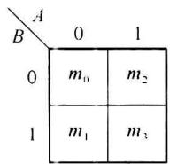  

(a) 二变量卡诺图

<table><tr><td>C\AB</td><td>00</td><td>01</td><td>11</td><td>10</td></tr><tr><td>0</td><td> $m_{0}$ </td><td> $m_{2}$ </td><td> $m_{6}$ </td><td> $m_{4}$ </td></tr><tr><td>1</td><td> $m_{1}$ </td><td> $m_{3}$ </td><td> $m_{7}$ </td><td> $m_{5}$ </td></tr></table>

(b)三变量卡诺图

<table><tr><td>CD\AB</td><td>00</td><td>01</td><td>11</td><td>10</td></tr><tr><td>00</td><td> $m_{0}$ </td><td> $m_{4}$ </td><td> $m_{12}$ </td><td> $m_{8}$ </td></tr><tr><td>01</td><td> $m_{1}$ </td><td> $m_{5}$ </td><td> $m_{13}$ </td><td> $m_{0}$ </td></tr><tr><td>11</td><td> $m_{3}$ </td><td> $m_{7}$ </td><td> $m_{15}$ </td><td> $m_{11}$ </td></tr><tr><td>10</td><td> $m_{2}$ </td><td> $m_{6}$ </td><td> $m_{14}$ </td><td> $m_{10}$ </td></tr></table>

(c) 四变量卡诺图

<table><tr><td>DE\ABC</td><td>000</td><td>001</td><td>011</td><td>010</td><td>110</td><td>111</td><td>101</td><td>100</td></tr><tr><td>00</td><td> $m_{0}$ </td><td> $m_{4}$ </td><td> $m_{12}$ </td><td> $m_{8}$ </td><td> $m_{24}$ </td><td> $m_{28}$ </td><td> $m_{20}$ </td><td> $m_{16}$ </td></tr><tr><td>01</td><td> $m_{1}$ </td><td> $m_{5}$ </td><td> $m_{13}$ </td><td> $m_{9}$ </td><td> $m_{25}$ </td><td> $m_{29}$ </td><td> $m_{21}$ </td><td> $m_{17}$ </td></tr><tr><td>11</td><td> $m_{3}$ </td><td> $m_{7}$ </td><td> $m_{15}$ </td><td> $m_{11}$ </td><td> $m_{27}$ </td><td> $m_{31}$ </td><td> $m_{23}$ </td><td> $m_{19}$ </td></tr><tr><td>10</td><td> $m_{2}$ </td><td> $m_{6}$ </td><td> $m_{14}$ </td><td> $m_{10}$ </td><td> $m_{26}$ </td><td> $m_{30}$ </td><td> $m_{22}$ </td><td> $m_{18}$ </td></tr></table>

(d)五变量卡诺图  

图1.4.1 卡诺图

(3) n 变量的卡诺图包含了 $2^{n}$ 个最小项(或最大项)。

（4）n 变量卡诺图中任意一个最小项（或最大项），与其相邻的最小项（或最大项）有 n 个。以五变量卡诺图中最小项 $m_{2}$ 为例，与它相邻的最小项有： $m_{3}$ 、 $m_{6}$ 、 $m_{0}$ 、 $m_{10}$ 、 $m_{18}$ 。

### 2. 逻辑函数的卡诺图表示方法

（1）将最小项表达式用卡诺图表示:如果一个逻辑函数是最小项之和形式,只需将表达式中的每个最小项在对应的卡诺图的小格内填1即可,其余位置填0。

<Example title="例 1.4.7">
将函数 $F(A,B,C) = \sum m(3,5,6,7)$ 用卡诺图表示。

<Solution title="解">
将最小项 $m_{3}$ 、 $m_{5}$ 、 $m_{6}$ 、 $m_{7}$ 在卡诺图对应的位置填入 1, 其余最小项位置填 0。得到的卡诺图如图 1.4.2 所示。

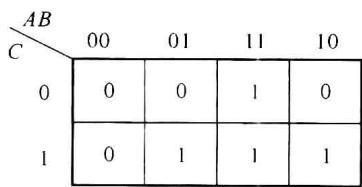  

图1.4.2 例1.4.7的卡诺图

(2) 将最大项表达式用卡诺图表示: 如果一个逻辑函数是最大项之积形式, 只需将表达式中的每个最大项在对应的卡诺图的小格内填 0 即可, 其余位置填 1。
</Solution>
</Example>

<Example title="例 1.4.8">
将函数 $F(A,B,C)=\prod M(0,1,2,4)$ 用卡诺图表示。

<Solution title="解">
将最大项 $M_{0}$ 、 $M_{1}$ 、 $M_{2}$ 、 $M_{7}$ 在卡诺图对应的位置填入 0，其余最小项位置填 1。得到的卡诺图仍如图 1.4.2 所示，这是由于函数 $F(A, B, C) = \sum m(3, 5, 6, 7)$ 和 $F(A, B, C) = \prod M(0, 1, 2, 4)$ 描述的是同一个逻辑问题。

(3) 将与或逻辑表达式(即非最小项表达式)用卡诺图表示。

方法一: 将逻辑函数变换成最小项表达式再填卡诺图。
</Solution>
</Example>

<Example title="例 1.4.9">
将函数 $F(A,B,C,D)=AB\overline{C}+\overline{A}BD+AC$ 用卡诺图表示。

<Solution title="解">
先利用 0-1 率和分配率将函数变为最小项表达式, 然后填入卡诺图, 如图 1.4.3 所示。

$$

\begin{array}{r l} F (A, B, C, D) & = A B \overline {{C}} + \overline {{A}} B D + A C \\ & = A B \overline {{C}} \overline {{D}} + A B \overline {{C}} D + \overline {{A}} B \overline {{C}} D + \overline {{A}} B C D + A \overline {{B}} C \overline {{D}} + A \overline {{B}} C D + A B C \overline {{D}} + A B C D \\ & = \sum m (5, 7, 1 0, 1 1, 1 2, 1 3, 1 4, 1 5) \end{array}

$$

方法二:根据 $A=A\overline{B}+AB$ ，直接将与项填入卡诺图。

观察例 1.4.9 将一个与或式变为标准与或式的过程, 当某个“与项”缺少一个变量时, 可以展开为两个最小项(如 $AB\overline{C}=AB\overline{C}(D+\overline{D})=AB\overline{C}D+AB\overline{C}\overline{D}$ ); 当某个“与项”缺少两个变量时, 可以展开为 4 个最小项(如 $AC=AC(B+\overline{B})(D+\overline{D})=ABCD+A\overline{B}CD+ABC\overline{D}+A\overline{B}C\overline{D}$ )。实际上, 如果乘积项没有包含全部变量, 根据 $A=A\overline{B}+AB$ 可以推知, 无论所缺变量取值为 1 或 0, 只要乘积项现有变量因子能满足使该乘积项为 1 的条件, 该乘积项便为 1。因此, 只需在满足现有变量因子的小方格内填入 1 即可, 当某个与项缺少一个变量, 对应卡诺图有两个小方格为 1, 当某个与项缺少两个变量, 对应卡诺图有 4 个小方格为 1。

将函数 $F(A, B, C, D) = AB\overline{C} + \overline{A}BD + AC$ 直接用卡诺图表示的填入方法如图1.4.4所示。

<table><tr><td>CD\AB</td><td>00</td><td>01</td><td>11</td><td>10</td></tr><tr><td>00</td><td>0</td><td>0</td><td>1</td><td>0</td></tr><tr><td>01</td><td>0</td><td>1</td><td>1</td><td>0</td></tr><tr><td>11</td><td>0</td><td>1</td><td>1</td><td>1</td></tr><tr><td>10</td><td>0</td><td>0</td><td>1</td><td>1</td></tr></table>

图1.4.3 例1.4.9的卡诺图

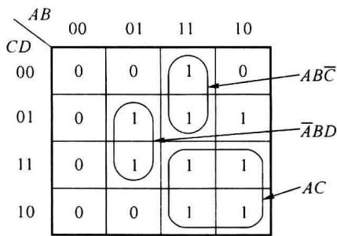  

图1.4.4 例1.4.9直接得到的卡诺图

（4）将或与逻辑表达式(即非最大项表达式)用卡诺图表示。需要注意的是,或项中,0用原变量表示,1用反变量表示,并且一个最大项在卡诺图中对应的位置应填入0。
</Solution>
</Example>

<Example title="例 1.4.10">
将函数 $F(A,B,C)=B(A+C)$ 用卡诺图表示。

<Solution title="解">
函数中 B 是一个或项, 缺少变量 A 和 C, 因此对应卡诺图中的 4 个 0; $A + C$ 也是一个或项, 对应卡诺图中两个 0。函数的卡诺图如图 1.4.5 所示。

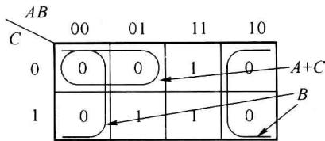  

图1.4.5 例1.4.10的卡诺图

在图 1.4.5 中, 最大项 $(A+B+C)$ 被使用了两次。根据重叠率 AA=A(或 A+A=A), 任意一个最大项(或最小项)都可以使用多次。
</Solution>
</Example>

### 3. 用卡诺图合并最小项的规则

用卡诺图化简逻辑函数的依据是使用吸收律 $AB + A \overline{B} = A$ 或 $(A + B)(A + \overline{B}) = A$ 进行简化。以与或表达式为例，如果一个变量分别以原变量和反变量的形式出现在两个乘积项中，而这两个乘积项的其余部分完全相同，那么，这两个乘积项可以合并为一项，它由相同部分的变量组成。卡诺图中任意两个输出为 1 的相邻项（只有一个变量不同）都可以使用吸收率进行简化。实际上这种简化也是我们前面提到的将一个非最小项的与项填入卡诺图的逆操作。

以图1.4.6(a)给出的逻辑函数卡诺图为例，图中 $m_0$ 和 $m_2$ 是两个函数值同为1的相邻项，将它们组成一个合并项， $m_0 + m_2 = \overline{A} \overline{B} \overline{C} \overline{D} + \overline{A} \overline{B} C \overline{D} = \overline{A} \overline{B} \overline{D}$ ，消去了两项中取值有0又有1的变量 $C$ 。同理， $m_8$ 和 $m_{10}$ 也可以组成合并项， $m_8 + m_{10} = A \overline{B} \overline{C} \overline{D} + A \overline{B} C \overline{D} = A \overline{B} \overline{D}$ 。由这两个合并项的合并结果 $\overline{A} \overline{B} \overline{D}$ 和 $A \overline{B} \overline{D}$ 可以看到，这两个与项依然可以合并，即 $m_0 + m_2 + m_8 + m_{10} = \overline{B} \overline{D}$ ，如图1.4.6(b)所示。卡诺图中 $m_0$ 和 $m_1$ 相邻，可以简化为 $\overline{A} \overline{B} \overline{C}$ ， $m_{13}$ 不与任何最小项相邻，无法合并。最终的合并结果如图1.4.6(c)所示。

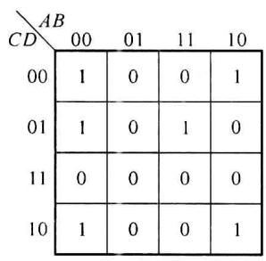  

(a)

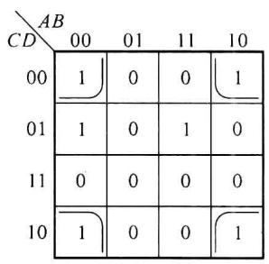  

(b)

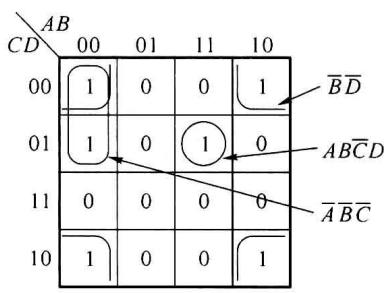  

(c)  

图 1.4.6 使用卡诺图简化函数

由以上分析可见, 当有输出均为 1 的 $2^{i}$ 个最小项 (或输出均为 0 的 $2^{i}$ 个最大项) 形成方形阵列或矩形阵列的相邻项, 可以消去 $i$ 个变量, 形成一个简化的 “与” 项 (或简化的 “或” 项)。需要注意的是, 由于变量使用循环码排列方式, 卡诺图中每行 (或每列) 首尾的两个最小项也是相邻项。另外, 根据重叠率 $A + A = A$ , 最小项 $m_{0}$ 使用了两次。

### 4. 卡诺图法简化逻辑函数为最简与或式的步骤

(1) 将需要简化的逻辑函数变为卡诺图的表示形式(或称填入卡诺图)。

(2) 使用圈“1”的方法合并最小项。合并的原则有以下几点:

① 以最大的方形或矩形圈将相邻的1格圈出(不能含0)，圈的格数必须为 $2^{i}(i=1,2$ ，

3,4 $\cdots$ )。

② 所有的 1 格必须圈到,且圈的个数应最少,保证乘积项最少。

③ 1 格可以重复圈用。

④ 如果某一个合并圈中所有 1 均被其他合并圈圈过, 则该圈为冗余圈, 可以去掉。

（3）每个圈对应一个合并项，将所有的合并项相或即可得到最简的与或式。

<Example title="例 1.4.11">
简化 $F(A,B,C,D) = \sum m(0,2,5,6,7,9,10,14,15)$ 为最简与或式。

<Solution title="解">
先将函数的最小项填入卡诺图。然后从只有一种圈法的1小格开始进行最小项的合并,直到所有的1格被圈住为止。卡诺图和合并圈如图1.4.7所示。函数化简的结果是各简化的乘积项之和,即: $F(A,B,C,D)=A\overline{B}\overline{C}D+\overline{A}\overline{B}\overline{D}+\overline{A}BD+C\overline{D}+BC$ 。
</Solution>
</Example>

<Example title="例 1.4.12">
简化 $F(A,B,C,D) = \sum m(3,4,5,7,9,13,14,15)$ 为最简与或式。

<Solution title="解">
先将函数的最小项填入卡诺图。然后从只有一种圈法的1小格开始进行最小项的合并,直到所有的1格被圈住为止。卡诺图及合并圈如图1.4.8所示。图中的虚线所圈的1均被其他小圈覆盖,为冗余圈。得到简化后的最简与或式为: $F(A,B,C,D)=\overline{A}CD+\overline{A}B\overline{C}+A\overline{C}D+ABC$ 。

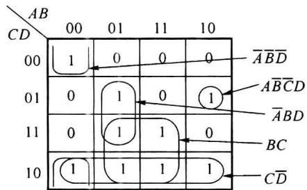  

图1.4.7 例1.4.11卡诺图简化

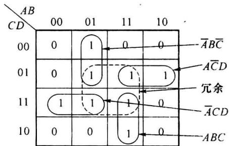  

图1.4.8 例1.4.12卡诺图简化
</Solution>
</Example>

<Example title="例 1.4.13">
简化 $F(A,B,C,D) = \sum m(0,2,3,5,7,8,10,11,13)$ 为最简或与式。

<Solution title="解">
作出函数 F 的卡诺图,因为是要求获得最简或与式,应圈 0 格进行简化。卡诺图如图 1.4.9 所示。

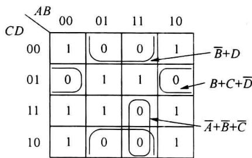  

图1.4.9 例1.4.13的卡诺图

简化后的函数为 $F(A,B,C,D)=(B+C+\overline{D})(\overline{A}+\overline{B}+\overline{C})(\overline{B}+D)$ 。
</Solution>
</Example>

<Example title="例 1.4.14">
简化函数 $F(A, B, C, D, E) = \sum m(4, 5, 6, 7, 13, 15, 20, 21, 22, 23, 25, 27, 29, 31)$ 为最简与或式。

<Solution title="解">
五变量函数的简化稍微有些难度,主要注意最高位分别为0和1的分界线两侧折叠对称位置也是相邻项。卡诺图如图1.4.10所示。

<table><tr><td>DE\ABC</td><td>000</td><td>001</td><td>011</td><td>010</td><td>110</td><td>111</td><td>101</td><td>100</td></tr><tr><td>00</td><td>0</td><td>1</td><td>0</td><td>0</td><td>0</td><td>0</td><td>1</td><td>0</td></tr><tr><td>01</td><td>0</td><td>1</td><td>1</td><td>0</td><td>1</td><td>1</td><td>1</td><td>0</td></tr><tr><td>11</td><td>0</td><td>1</td><td>1</td><td>0</td><td>1</td><td>1</td><td>1</td><td>0</td></tr><tr><td>10</td><td>0</td><td>1</td><td>0</td><td>0</td><td>0</td><td>0</td><td>1</td><td>0</td></tr></table>

图1.4.10 例1.4.14的卡诺图

简化后的函数为 $F(A,B,C,D,E)=\overline{B}C+CE+ABE$ 。

利用卡诺图法简化函数的主要优点是简便、直观，容易掌握，适合变量个数不大于5时使用。
</Solution>
</Example>

## 1.4.3 具有任意项和约束项的逻辑函数及其简化

任意项:一个 n 变量的函数不一定都与 $2^{n}$ 个最小项都有关,有时候函数仅与其中的一部分有关,与另一部分无关。例如 8421BCD 码只用了 4 位二进制码的前 10 个编码(最小项),后面的 6 个最小项不会出现。也就是说,无论这 6 个最小项的值是 0 还是 1,都不用关注。这样的最小项称为任意项。有任意项的逻辑函数也称为非完全描述逻辑函数。对于一个 8421BCD 码是否大于等于 5 的判决逻辑(大于等于 5 时 F=1,否则 F=0),增加了任意项 ( $\sum\varphi(m_{i})$ 表示任意项)后的表示方式为

$$

F (A, B, C, D) = \sum m (5, 6, 7, 8, 9) + \sum \varphi (1 0, 1 1, 1 2, 1 3, 1 4, 1 5)

$$

约束项: 在逻辑函数中, 有些最小项的出现会导致逻辑错误, 必须用约束条件加以约束, 使其在逻辑函数中出现时, 通过约束条件使其为 0。这样的最小项称为约束项, 描述约束项的表达式称为约束条件。例如, 用变量 A、B、C 分别表示体育比赛中某人获得冠军与否、亚军与否、季军与否, 若获得其中之一表示成功 (F=1), 什么都没有获得表示失败 (F=0)。对于某一个人只能成为冠、亚、季军其中之一或什么都没获得, 即在任何时候 3 个变量只能有一个变量为 1。A、B、C 3 个变量取值只可能出现 000(没有奖牌)、001(季军)、010(亚军)、100(冠军)4 种组合, 而不应出现 011、101、110、1114 种组合(约束项)。不应出现的最小项用约束条件表示为: $\overline{A}BC + A\overline{B}C + AB\overline{C} + ABC = 0$ 。整个逻辑函数可以写成:

$$

\left\{ \begin{array}{l} F (A, B, C) = A   \overline {{B}}   \overline {{C}} + \overline {{A}} B   \overline {{C}} + \overline {{A}}   \overline {{B}} C \\ \overline {{A}} B C + A   \overline {{B}} C + A B   \overline {{C}} + A B C = 0 \quad (\text { 约束条件 }) \end{array} \right.

$$

任意项和约束项统称为无关项。由于任意项是不会出现的最小项，约束项通过约束条件保证其值为0，因此将任意项和约束项写入逻辑函数不会影响函数的逻辑关系。在函数的真值表和卡诺图中任意项和约束项常用“×”或“φ”表示（本书主要使用“×”表示任意项或约束项）。利用任意项和约束项简化函数时，可以得到更为简单的函数表达式。

<Example title="例 1.4.15">
简化函数 $F(A,B,C,D)=\sum m(5,6,7,8,9)+\sum \varphi(10,11,12,13,14,15)$ 为最简与或式。

<Solution title="解">
先将逻辑函数用卡诺图表示, × 表示任意项。

如果不使用任意项对函数进行简化,其简化方法如图1.4.11(a)所示,简化后的逻辑表达式为 $F(A,B,C,D)=A\overline{B}\overline{C}+\overline{A}BD+\overline{A}BC$ 。由表达式可见,若用逻辑电路实现该函数,需要使用3个3输入端的与门和一个3输入端的或门。

如果使用任意项对函数进行简化,其简化方法如图 1.4.11(b) 所示,被圈入的任意项 × (对应的最小项) 被作为 1 使用,未被圈入的任意项 × 被作为 0 使用。简化后的逻辑表达式为 $F(A,B,C,D)=A+BD+BC$ 。可见表达式更为简单,若用逻辑电路实现该函数,需要使用两个 2 输入端的与门(单个变量 A 不需要与门)和一个 3 输入端的或门。

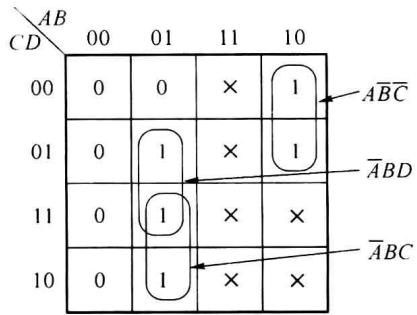  

(a)

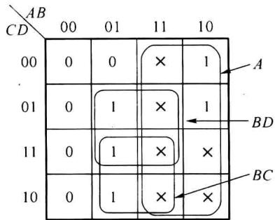  

(b)  

图1.4.11 例1.4.15的卡诺图
</Solution>
</Example>

<Example title="例 1.4.16">
简化以下具有约束条件的函数为最简与或式。

$$

\left\{ \begin{array}{l} F (A, B, C) = A   \overline {{B}}   \overline {{C}} + \overline {{A}} B   \overline {{C}} + \overline {{A}}   \overline {{B}} C \\ \overline {{A}} B C + A   \overline {{B}} C + A B   \overline {{C}} + A B C = 0 \quad (\text { 约束条件 }) \end{array} \right.

$$

<Solution title="解">
先将逻辑函数和约束条件用卡诺图表示,在对应约束条件的最小项位置用×表示。

如果不使用约束项对函数进行简化,其简化方法如图 1.4.12(a) 所示,由图可见,该函数已经是最简函数。用逻辑电路实现该函数时,需要使用 3 个 3 输入端的与门和 1 个 3 输入端的或门。

如果使用约束项对函数进行简化,其简化方法如图 1.4.12(b) 所示,简化后的逻辑函数为: $F(A,B,C)=A+B+C$ , 若用逻辑电路实现该函数, 只需使用 1 个 3 输入端的或门即可。

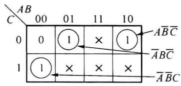  

(a)

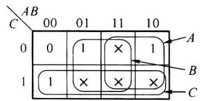  

(b)  

图1.4.12 例1.4.16的卡诺图

需要再次强调的是,简化后的表达式 $F(A,B,C)=A+B+C$ 中包含了约束条件中对应的 4 个约束项,但有约束条件保证,这 4 个约束项始终为 0。所以,对于有约束条件的函数表达式,其函数表达式与约束条件必须同时给出。
</Solution>
</Example>

<Example title="例 1.4.16">
简化后完整的逻辑表达式为

$$

\left\{ \begin{array}{l l} F (A, B, C) = A + B + C \\ \overline {{A}} B C + A   \overline {{B}} C + A B   \overline {{C}} + A B C = 0 & (\text { 约束条件 }) \end{array} \right.

$$
</Example>
