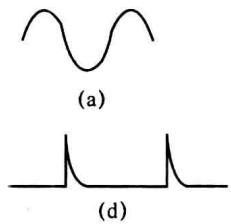
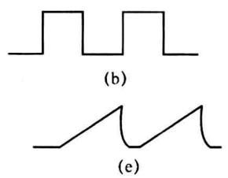
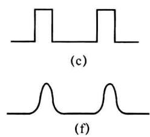
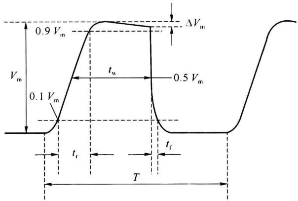

import Guide from '@/components/Guide.astro';
import Knowledge from '@/components/Knowledge.astro';
import Example from '@/components/Example.astro';
import Analysis from '@/components/Analysis.astro';
import Solution from '@/components/Solution.astro';
import Variant from '@/components/Variant.astro';
import Note from '@/components/Note.astro';
import Block from '@/components/Block.astro';
import Method from '@/components/Method.astro';
import Exercise from '@/components/Exercise.astro';

## 第10章 脉冲波形的产生与变换

脉冲波形的产生与变换电路是电子技术中广泛使用的两类电路,波形产生电路是通过电路的自激,在无外加输入信号的作用下,能自动产生一定频率和幅度交流信号的电路;波形变换电路是能把输入信号波形变换成指定波形的电路。

本章从波形的基础知识开始,讨论施密特触发器、单稳态触发器和多谐振荡器及其应用。

信号的波形通常分为正弦波和非正弦波两大类。凡是按正弦规律变化的波形都称为正弦波，凡是按非正弦规律变化的波形都称为非正弦波或脉冲波。图10.1.1给出了一些常见的波形，其中图10.1.1(a)是按正弦规律变化的波形，属于正弦波，图10.1.1(b)～(f)是按非正弦规律变化的波形，属于脉冲波。这些波形都是时间的函数，正弦波幅值的变化是连续的，脉冲波幅值的变化有突变点，有缓慢变化的部分和快速变化的部分。

  

图 10.1.1 常用信号波形

在数字系统中,最常见的脉冲波是矩形脉冲波(如矩形波、方波)。理想矩形脉冲波的突变部分是瞬时的,即瞬间完成高、低电平的跳变。但实际的矩形脉冲波无论从低电平跳变到高电平,还是从高电平跳变到低电平,都不是瞬时的,都需要一定的过渡时间。图 10.1.2 给出了矩形脉冲波的实际波形,其参数描述如下。

脉冲幅度 $V_{m}$ : 指脉冲高、低电平之差, 它反映了脉冲信号的最大变化幅度。

上升时间 $t_{r}$ : 脉冲上升沿从 $0.1V_{m}$ 上升到 $0.9V_{m}$ 所需要的时间。

下降时间 $t_{f}$ : 脉冲下降沿从 $0.9V_{m}$ . 下降到 $0.1V_{m}$ 所需要的时间。

脉冲周期 T: 脉冲波形上相邻两个对应点之间的时间间隔, 它的倒数称为信号的频率。

平均脉宽 $t_{w}$ : 脉冲上升沿 $0.5V_{m}$ 处和下降沿 $0.5V_{m}$ 处的时间间隔。 $t_{w}$ 是脉冲信号的持.

续时间， $T-t_{w}$ 则称为脉冲休止期。

占空比 q: 平均脉宽 $t_{w}$ 和脉冲周期 T 的比值, 即 $q = t_{w} / T$ , 方波的占空比为 50%。顶部倾斜: 如图 10.1.2 所示的 $\Delta V_{m}$ 之值。

  

图10.1.2 实际的矩形脉冲波形

频谱分析表明,矩形脉冲波的上升沿和下降沿变化速度快,集中了信号的高频成分;顶部和底部变化速度慢,集中了信号的低频成分。将脉冲信号加至放大电路的输入端,若输出信号波形的边沿很陡,说明放大电路能够放大快速变化的信号,有很高的上限截止频率;若输出信号的顶部和底部很平,说明放大电路能放大缓慢变化的信号,有很低的下限截止频率。
