import Guide from '@/components/Guide.astro';
import Knowledge from '@/components/Knowledge.astro';
import Example from '@/components/Example.astro';
import Analysis from '@/components/Analysis.astro';
import Solution from '@/components/Solution.astro';
import Variant from '@/components/Variant.astro';
import Note from '@/components/Note.astro';
import Block from '@/components/Block.astro';
import Method from '@/components/Method.astro';
import Exercise from '@/components/Exercise.astro';

施密特触发器(Schmitt Trigger)是脉冲波形变换中经常使用的一种电路,它可以将边沿变坏的矩形脉冲重新整形为边沿陡峭的矩形脉冲,还可以去掉叠加在矩形脉冲上的噪声。施密特触发器有两个不同的阈值电平压,通常用 $V_{T+}$ 和 $V_{T-}$ 表示。在输入信号上升和下降的过程中,引起电路发生状态转换(输出电压变化)的阈值电平是不一样的。

在模拟电路中,曾讨论过由集成运算放大器构成的施密特触发器(带正反馈的滞回比较器),这里将介绍数字技术中常用的施密特触发器。

## 10.2.1 用门电路组成施密特触发器

由两级 CMOS 反相器组成的施密特触发器如图 10.2.1(a) 所示, 图 10.2.1(b) 为其逻辑符号。电路中两个 CMOS 反相器串联在一起, 输出电压 $v_{0}$ 通过分压电阻 $R_{1}, R_{2}$ 反馈到输入端, 其中 $R_{1} < R_{2}$ 。

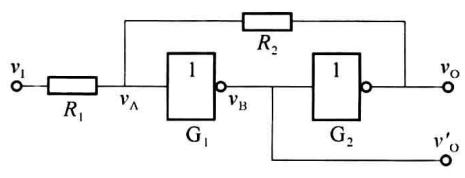  

(a) 电路结构

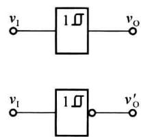  

(b) 逻辑符号  

图 10.2.1 由 CMOS 门电路组成施密特触发器

由图 10.2.1(a) 可知，门 $G_{1}$ 的输入电平 $v_{A}$ 决定电路的状态，根据叠加原理，有

$$

v _ {\mathrm{A}} = \frac {R _ {2}}{R _ {1} + R _ {2}} v _ {\mathrm{I}} + \frac {R _ {1}}{R _ {1} + R _ {2}} v _ {\mathrm{O}}\tag{10.2.1}

$$

假设 CMOS 反相器的阈值电压 $V_{th} \approx V_{DD}/2$ ，输入信号 $v_{I}$ 为三角波，如图 10.2.2 所示。当输入信号 $v_{I} = 0$ 时，门 $G_{1}$ 截止， $v_{B} = V_{OH}$ ；门 $G_{2}$ 导通， $v_{O} = V_{OL} \approx 0 \, V$ 。这是施密特触发器的第 1 种稳定工作状态，此时 $v_{A} \approx 0 \, V$ 。

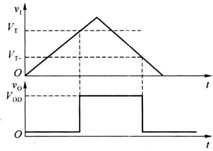  

图 10.2.2 施密特触发器的工作波形

当输入信号 $v_{I}$ 从 0 V 开始增加时，只要 $v_{A} < V_{th}$ ，输出 $v_{O} = V_{OL} \approx 0 V$ 保持不变。

当 $v_{I}$ 上升到使 $v_{A}=V_{th}$ 时，电路开始发生状态转换， $v_{I}$ 的值即为输入信号上升时的阈值电压，称为正向阈值电压或上限触发电平，记为 $V_{T+}$ 。由

$$

\begin{array}{r l} v _ {\mathrm{A}} = V _ {\mathrm{th}} & = \frac {R _ {2}}{R _ {1} + R _ {2}} \cdot v _ {\mathrm{I}} + \frac {R _ {1}}{R _ {1} + R _ {2}} \cdot v _ {\mathrm{O}} \\ & = \frac {R _ {2}}{R _ {1} + R _ {2}} \cdot V _ {\mathrm{T+}} + \frac {R _ {1}}{R _ {1} + R _ {2}} \cdot 0 \\ & = \frac {R _ {2}}{R _ {1} + R _ {2}} \cdot V _ {\mathrm{T+}} \end{array}

$$

得

$$

V _ {\mathrm{T+}} = (1 + \frac {R _ {1}}{R _ {2}}) V _ {\mathrm{th}}\tag{10.2.2}

$$

此时随着 $v_{A}$ 的上升， $v_{B}$ 开始下降， $v_{O}$ 开始上升，电路的状态很快转换为 $v_{O}=V_{OH}\approx V_{DD}$ ，正反馈过程如下：

$$

\begin{array}{c}v _ {\mathrm{A}} \uparrow \rightarrow v _ {\mathrm{B}} \downarrow \rightarrow v _ {\mathrm{O}} \uparrow\\\uparrow\end{array}

$$

当 $v_{A} > V_{th}$ 时，电路的状态稳定在 $v_{O} \approx V_{DD}$ 不变，这是施密特触发器的第 2 种稳定工作状态。

输入信号 $v_{I}$ 继续上升, 达到最大值后开始下降, 当 $v_{A}=V_{th}$ 电路再次发生状态转换, 此时 $v_{I}$ 的值即为输入信号下降时的阈值电压, 称为负向阈值电压或下限触发电平, 记为 $V_{T-}$ 。由

$$

\begin{array}{r l} v _ {\mathrm{A}} = V _ {\mathrm{th}} & = \frac {R _ {2}}{R _ {1} + R _ {2}} \cdot v _ {\mathrm{I}} + \frac {R _ {1}}{R _ {1} + R _ {2}} \cdot v _ {\mathrm{O}} \\ & = \frac {R _ {2}}{R _ {1} + R _ {2}} \cdot V _ {\mathrm{T-}} + \frac {R _ {1}}{R _ {1} + R _ {2}} \cdot V _ {\mathrm{DD}} \\ & = \frac {R _ {2}}{R _ {1} + R _ {2}} \cdot V _ {\mathrm{T-}} + \frac {R _ {1}}{R _ {1} + R _ {2}} \cdot 2 V _ {\mathrm{th}} \end{array}

$$

得

$$

V _ {\mathrm{T-}} = (1 - \frac {R _ {1}}{R _ {2}}) V _ {\mathrm{th}}\tag{10.2.3}

$$

此时随着 $v_{A}$ 的下降， $v_{B}$ 开始上升， $v_{O}$ 开始下降，电路的状态很快转换为 $v_{O}=V_{OL}\approx0\ V$ ，正反馈过程如下：

$$

\begin{array}{c}v _ {\mathrm{A}} \downarrow \rightarrow v _ {\mathrm{B}} \uparrow \rightarrow v _ {\mathrm{O}} \downarrow\\\uparrow\end{array}

$$

当 $v_{1}<V_{T-}$ 时，电路的状态稳定在 $v_{0}\approx0\ V$ ，施密特触发器回到第1种稳定工作状态。由于触发器内部存在正反馈过程，电路状态转换速度很快，使输出电压波形的边沿变得很陡峭。

施密特触发器的正向阈值电压 $V_{T+}$ 和负向阈值电压 $V_{T-}$ 之差值称为回差电压 $\Delta V_{T}$ ，即

$$

\Delta V _ {\mathrm{T}} = V _ {\mathrm{T+}} - V _ {\mathrm{T-}} = 2 \frac {R _ {1}}{R _ {2}} V _ {\mathrm{th}}\tag{10.2.4}

$$

由式(10.2.4)可见,当电源电压一定时,回差电压 $\Delta V_{T}$ 与 $R_{1}/R_{2}$ 成正比,改变 $R_{1}$ 和 $R_{2}$ 的值可以调整回差电压的大小,但 $R_{1}$ 必须小于 $R_{2}$ ,否则电路将进入自锁状态,不能正常工作。

根据式(10.2.2)和式(10.2.3)画出的电压传输特性曲线如图10.2.3(a)所示，因 $v_{0}$ 和 $v_{1}$ 的高、低电平是同相的，所以也把这种形式的电压传输特性称为同相输出的施密特触发器特性。如果以图10.2.1(a)的 $v_{0}^{\prime}$ 作为输出端，则得到的电压传输特性如图10.2.3(b)所示，类似地，这种形式的电压传输特性称为反向输出的施密特触发器特性。

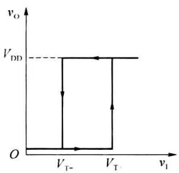  

(a)

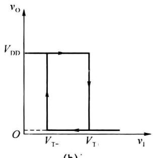  

(b)  

图 10.2.3 施密特触发器的传输特性曲线

<Example title="例 10.2.1">
在图 10.2.1(a) 所示的电路中，假定 CMOS 反相器的阈值电压 $V_{th} \approx V_{DD}/2$ ，如果要求 $V_{T+} = 7.5 \, V, \Delta V_{T} = 5 \, V$ ，试求 $R_{1}/R_{2}$ 和 $V_{DD}$ 的值。

<Solution title="解">
由式(10.2.2)和式(10.2.4)得

$$

\left\{ \begin{array}{l} V _ {\mathrm{T+}} = (1 + \frac {R _ {1}}{R _ {2}}) V _ {\mathrm{th}} = 7. 5 \mathrm{V} \\ \Delta V _ {\mathrm{T}} = \frac {2 R _ {1}}{R _ {2}} V _ {\mathrm{th}} = 5 \mathrm{V} \end{array} \right.\tag{10.2.5}

$$

从式(10.2.5)可以解出 $R_{1}/R_{2}=0.5,V_{th}=5\ V$ ，因此 $V_{DD}=2V_{th}=10\ V$ 。

使用TTL门电路组成施密特触发器时，经常采用图10.2.4(a)所示的电路，其中 $\mathbf{G}_1$ 为两输入与非门， $\mathbf{G}_2$ 为反相器。因电阻 $R_{1}$ 和 $R_{2}$ 的数值相对较小，电路中接入二极管VD，防止当 $v_{\mathrm{O}} = V_{\mathrm{OH}}$ 时门 $\mathbf{G}_2$ 的负载电流过大。

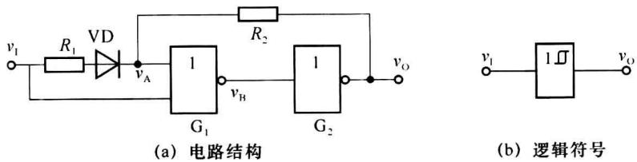  

图 10.2.4 门电路组成施密特触发器

假定输入信号 $v_{1}$ 依然是图 10.2.2 所示的三角波。当输入信号从 0 V 开始增加时，只要 $v_{A} < V_{th}$ ，则 $G_{1}$ 截止， $G_{2}$ 导通，输出电压 $v_{O} = V_{OL} = 0 V$ 保持不变。当 $v_{I}$ 上升到使 $v_{A} = V_{th}$ 时，电路开始发生状态转换，由于 $G_{1}, G_{2}$ 间存在着正反馈，电路迅速转换为 $G_{1}$ 导通、 $G_{2}$ 截止，使 $v_{O} = V_{OH}$ 。此时对应的输入电平就是 $V_{T+}$ 。由

$$

\begin{array}{r l} v _ {\mathrm{A}} & = V _ {\mathrm{th}} \\ & = \frac {R _ {2}}{R _ {1} + R _ {2}} \cdot (v _ {\mathrm{I}} - V _ {\mathrm{D}}) + \frac {R _ {1}}{R _ {1} + R _ {2}} \cdot v _ {\mathrm{O}} \\ & = \frac {R _ {2}}{R _ {1} + R _ {2}} \cdot (V _ {\mathrm{T+}} - V _ {\mathrm{D}}) + \frac {R _ {1}}{R _ {1} + R _ {2}} \cdot 0 \\ & = \frac {R _ {2}}{R _ {1} + R _ {2}} \cdot (V _ {\mathrm{T+}} - V _ {\mathrm{D}}) \end{array}

$$

得

$$

V _ {\mathrm{T+}} = \frac {R _ {1} + R _ {2}}{R _ {2}} V _ {\mathrm{th}} + V _ {\mathrm{D}}\tag{10.2.6}

$$

其中， $V_{D}$ 为二极管的正向导通压降， $V_{th}$ 为门电路的阈值电压。

输入信号 $v_{1}$ 继续上升，至最大值后开始下降，当 $v_{1}$ 降至 $V_{th}$ 时，电路再次发生状态转换，在正反馈的作用下，电路迅速返回 $v_{0}=V_{OL}$ 的状态。因此，输入信号下降时的转换电平 $V_{T-}=V_{th}$ ，回差电压 $\Delta V_{T}=\frac{R_{1}}{R_{2}}V_{th}+V_{D}$ 。
</Solution>
</Example>

## 10.2.2 集成施密特触发器

图 10.2.5(a) 是具有与非功能的 TTL 集成施密特触发器 7413 的内部电路图, 其逻辑符号如图 10.2.5(b) 所示。7413 实际上是双 4 输入与非门, 由于内部施密特电路的作用, 使其电压传输特性呈反向输出的施密特触发器特性, 所以常称为具有与非功能的 TTL 集成施密特触发器。

7413 由二极管与门、施密特电路、电平偏移电路和输出电路等几部分组成。二极管 $VD_{1} \sim VD_{4}$ 实现逻辑与功能。施密特电路由两个晶体管 $VT_{1}$ 、 $VT_{2}$ 和 3 个电阻 $R_{2} \sim R_{4}$ 组成，其中电阻 $R_{4}$ 为 $VT_{1}$ 和 $VT_{2}$ 的公共发射极电阻。电平偏移电路的作用是保证输出逻辑关系正确。

当有一个输入端为低电平时， $v_{1}^{\prime}$ 为低电平，使 $VT_{1}$ 截止， $VT_{2}$ 导通。由于 $VT_{2}$ 导通时施密特电路输出的低电平较高（约为 1.9 V），若直接将 $v_{0}^{\prime}$ 与 $VT_{4}$ 的基极相连，将无法使 $VT_{4}$ 截止，所以必须在 $v_{0}^{\prime}$ 与 $VT_{4}$ 的基极之间加入电平偏移电路，使 $v_{0}^{\prime} \approx 1.9 V$ 时电平偏移电路的输出仅为 0.5 V 左右，保证 $VT_{4}$ 能可靠地截止， $VT_{6}$ 导通， $v_{0}$ 输出高电平。输出电路采用推挽输出结构，其作用是降低输出电阻，提高电路的驱动能力。

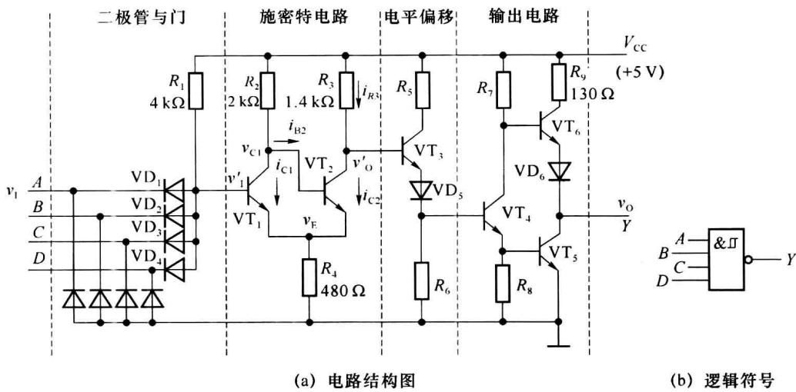  

图 10.2.5 具有与非功能的 TTL 集成施密特触发器

设晶体管发射结的导通压降和二极管的正向导通压降均为 0.7 V。输入信号 $v_{1}$ 为三角波，由 7413 的端 A 输入，其他 3 个输入端均悬空。

输入信号 $v_{1}$ 从 0V 开始增加，在 $v_{BE1}=v_{I}^{\prime}-v_{E}<0.7V$ 期间， $VT_{1}$ 截止， $VT_{2}$ 饱和导通， $v_{O}^{\prime}$ 为低电平， $v_{O}=V_{OH}$ 。若 $v_{I}^{\prime}$ 逐渐升高使 $v_{BE1}>0.7V$ 时， $VT_{1}$ 开始进入导通状态，并引起如下正反馈过程：

$$

v _ {\mathrm{I}} ^ {\prime} \uparrow \rightarrow i _ {\mathrm{C1}} \uparrow \rightarrow v _ {\mathrm{C1}} \downarrow \rightarrow i _ {\mathrm{C2}} \downarrow \rightarrow v _ {\mathrm{E}} \downarrow \rightarrow v _ {\mathrm{BE1}} \uparrow

$$

从而使 $VT_{1}$ 迅速饱和导通， $VT_{2}$ 截止， $v_{0}^{\prime}$ 变为高电平， $v_{0}=V_{OL}$ 。

$v_{I}$ 上升至最大值后开始下降， $v_{I}^{\prime}$ 也从高电平开始下降， $v_{BE1}$ 随之降低。当 $v_{BE1}$ 降到只有 0.7 V 左右时，晶体管 $VT_{1}$ 的集电极电流 $i_{C1}$ 开始减小，于是又引发另一个正反馈过程：

$$

v _ {1} ^ {\prime} \downarrow \rightarrow i _ {\mathrm{C} 1} \downarrow \rightarrow v _ {\mathrm{C} 1} \uparrow \rightarrow i _ {\mathrm{C} 2} \uparrow \rightarrow v _ {\mathrm{E}} \uparrow \rightarrow v _ {\mathrm{BE} 1} \downarrow

$$

从而使电路迅速转为 $VT_{1}$ 截止， $VT_{2}$ 饱和导通， $v_{0}^{\prime}$ 变为低电平， $v_{0}=V_{OH}$ 。

由于 $R_{2}>R_{3}$ ， $VT_{1}$ 饱和导通时的 $v_{E}$ 值低于 $VT_{2}$ 饱和导通时的 $v_{E}$ 值。因此， $v_{1}^{\prime}$ 的正向阈值电压 ( $VT_{1}$ 由截止变为导通的输入电压) $V_{T+}^{\prime}$ 必然高于 $v_{1}^{\prime}$ 的负向阈值电压 ( $VT_{1}$ 由导通变为截止的输入电压) $V_{T-}^{\prime}$ ，使电路具有施密特触发特性。若以 $V_{T+}$ 、 $V_{T-}$ 分别表示与 $V_{T+}^{\prime}$ 、 $V_{T-}^{\prime}$ 对应的输入端电压，则 $V_{T+}$ 同样也一定高于 $V_{T-}$ 。

先求 $v_{1}^{\prime}$ 的正向阈值电压 $V_{T+}^{\prime}$ 。由图 10.2.5(a) 可以写出 $VT_{1}$ 截止， $VT_{2}$ 饱和导通时施密特电路的方程：

$$

\left\{ \begin{array}{l} i _ {\mathrm{B2}} R _ {2} + V _ {\mathrm{BE2(Sat)}} + (i _ {\mathrm{B2}} + i _ {\mathrm{C2}}) R _ {4} = V _ {\mathrm{CC}} \\ i _ {\mathrm{R3}} R _ {3} + V _ {\mathrm{CE2(Sat)}} + (i _ {\mathrm{B2}} + i _ {\mathrm{C2}}) R _ {4} = V _ {\mathrm{CC}} \end{array} \right.\tag{10.2.7}

$$

其中， $V_{\mathrm{BE2(Sat)}}$ 、 $V_{\mathrm{CE2(Sat)}}$ 分别表示 $VT_{2}$ 饱和导通时发射结和集电结的电压降。假定 $i_{R3} \approx i_{C2}$ ，则由式(10.2.7)可得

$$

i _ {\mathrm{B2}} = \frac {(V _ {\mathrm{CC}} - V _ {\mathrm{CE2(Sat)}}) R _ {4} - (V _ {\mathrm{CC}} - V _ {\mathrm{BE2(Sat)}}) (R _ {3} + R _ {4})}{R _ {4} ^ {2} - (R _ {2} + R _ {4}) (R _ {3} + R _ {4})}\tag{10.2.8}

$$

$$

i _ {\mathrm{C2}} = \frac {(V _ {\mathrm{CC}} - V _ {\mathrm{BE2(Sat)}}) R _ {4} - (V _ {\mathrm{CC}} - V _ {\mathrm{CE2(Sat)}}) (R _ {2} + R _ {4})}{R _ {4} ^ {2} - (R _ {2} + R _ {4}) (R _ {3} + R _ {4})}\tag{10.2.9}

$$

令 $V_{\mathrm{BE(Sat)}}=0.8\ \mathrm{V}, V_{\mathrm{CE(Sat)}}=0.2\mathrm{V}$ ，将图 10.2.5(a) 给定的参数代入式(10.2.8)和式(10.2.9)，得

$$

\begin{array}{r l} & i _ {\mathrm{C2}} \approx 2. 2 \mathrm{mA} \\ & i _ {\mathrm{B2}} \approx 1. 3 \mathrm{mA} \\ & v _ {\mathrm{E2}} = (i _ {\mathrm{B2}} + i _ {\mathrm{C2}}) R _ {4} \approx 1. 7 \mathrm{V} \end{array}

$$

则

$$

V _ {\mathrm{T+}} ^ {\prime} = v _ {\mathrm{E2}} + 0. 7 \mathrm{V} \approx 2. 4 \mathrm{V}

$$

再求 $v_{1}^{\prime}$ 的负向阈值电压 $V_{T-}^{\prime}$ 。随着输入信号 $v_{1}$ 从最大值开始下降， $v_{1}^{\prime}$ 也从高电平开始下降。当 $v_{1}^{\prime}$ 降至 $v_{BE1}=0.7V$ 时， $VT_{1}$ 开始脱离饱和， $v_{CE1}$ 开始上升， $VT_{2}$ 开始导通并引发正反馈过程。此时 $R_{4}$ 上的压降为

$$

v _ {\mathrm{E1}} = (V _ {\mathrm{CC}} - v _ {\mathrm{CE1}}) \frac {R _ {4}}{R _ {2} + R _ {4}}\tag{10.2.10}

$$

将 $v_{CE1}=0.7\ V, R_{2}=2\ k\Omega, R_{4}=0.48\ k\Omega$ 代入式(10.2.10)，得

$$

v _ {\mathrm{E1}} \approx 0. 8 \mathrm{V}

$$

故

$$

V _ {\mathrm{T-}} ^ {\prime} = v _ {\mathrm{E1}} + 0. 7 \mathrm{V} \approx 1. 5 \mathrm{V}

$$

由 $v_{I}=u_{I}^{\prime}-V_{D}$ ，可得7413的阈值电压 $V_{T+}=V_{T+}^{\prime}-V_{D}\approx1.7\ V, V_{T-}=V_{T-}^{\prime}-V_{D}\approx0.8\ V$ ，回差电压 $\Delta V_{T}=V_{T+}-V_{T-}\approx0.9\ V$ 。

集成施密特触发器 7413 的引脚排列如图 10.2.6 所示, 内部封装了两个 4 输入与非门, 输入和输出的逻辑关系为 $Y_{i} = \overline{A_{i}B_{i}C_{i}D_{i}}$ 。图 10.2.7 所示为它的电压传输特性, 阈值电压 $V_{T+}, V_{T-}$ 为定值, 不能调节。

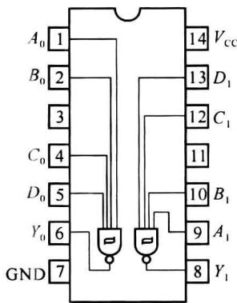  

图10.2.6 7413的引脚排列

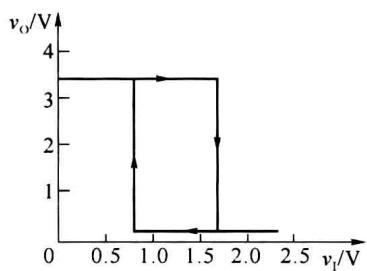  

图10.2.7 7413的电压传输特性

具有施密特触发器功能的TTL集成门电路有很多，如TTL六反相器7414、TTL四2输入与非门74132等。表10.2.1给出了这几种TTL集成施密特触发器主要参数的典型值。带有施密特功能的TTL门电路有以下特点：

(1) 输入信号边沿的变化即使非常缓慢,电路也能正常工作;

(2) 带负载能力和抗干扰能力都很强；

(3) 阈值电压和滞回电压均有温度补偿。

表 10.2.1 TTL 集成施密特触发器的几个典型值

<table><tr><td>器件型号</td><td>延迟时间/ns</td><td>每门功耗/mW</td><td> $V_{T+}/V$ </td><td> $V_{T-}/V$ </td><td> $\Delta V_T/V$ </td></tr><tr><td>7413</td><td>16</td><td>8.7</td><td>1.7</td><td>0.8</td><td>0.9</td></tr><tr><td>7414</td><td>15</td><td>8.6</td><td>1.6</td><td>0.8</td><td>0.8</td></tr><tr><td>74132</td><td>15</td><td>8.8</td><td>1.6</td><td>0.8</td><td>0.8</td></tr></table>

CMOS 集成施密特触发器也有很多种类, 如 CMOS 六施密特触发器 CC40106(六反相器)、CMOS 四 2 输入施密特触发器 CC4093(四 2 输入与非门)等。如图 10.2.8(a) 所示是 CMOS 集成施密特触发器 CC40106 的引脚排列图, 如图 10.2.8(b) 所示是对应的 TTL 六反相器 7414 的引脚排列图。

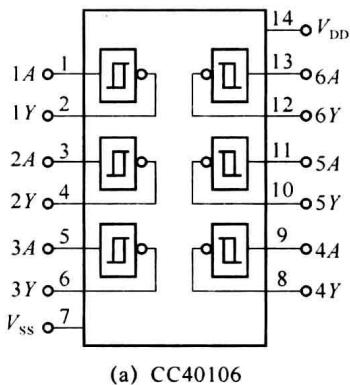

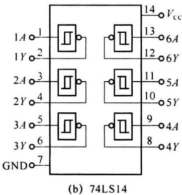  

图10.2.8 集成施密特触发器CC40106和7414的引脚排列图

CMOS 集成施密特触发器 CC40106 的内部电路如图 10.2.9(a) 所示, 图 10.2.9(b) 为其逻辑符号。CC40106 由施密特电路、整形电路和缓冲输出级电路组成, 其核心部分是施密特电路。施密特电路由 P 沟道 MOS 管 $\mathrm{VT}_{1} \sim \mathrm{VT}_{3}$ 和 N 沟道 MOS 管 $\mathrm{VT}_{4} \sim \mathrm{VT}_{6}$ 组成。若去掉 $\mathrm{VT}_{3}$ 和 $\mathrm{VT}_{6}$ , 施密特电路变成了一个反相器。设 P 沟道 MOS 管的开启电压为 $V_{\mathrm{TP}}$ , N 沟道 MOS 管的开启电压为 $V_{\mathrm{TN}}$ , 输入信号 $v_{\mathrm{I}}$ 为三角波。

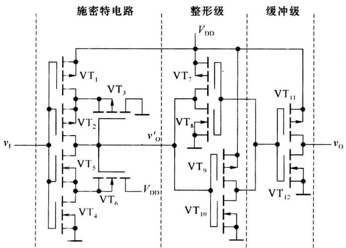  

(a) 电路结构图

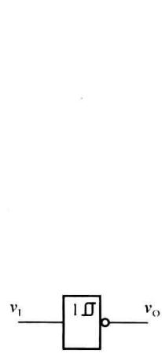  

(b) 逻辑符号  

图 10.2.9 CMOS 集成施密特触发器 CC40106

当 $v_{1}=0$ 时， $VT_{1}$ 、 $VT_{2}$ 导通， $VT_{4}$ 、 $VT_{5}$ 截止， $v_{0}^{\prime}$ 为高电平 ( $v_{0}^{\prime}\approx V_{DD},v_{0}=V_{OH}$ )，使 $VT_{3}$ 截止、 $VT_{6}$ 导通并工作在源极输出状态。因此， $VT_{5}$ 源极的电位 $v_{S5}\approx V_{DD}-V_{TN}$ ，该点电位较高。

随着输入信号 $v_{I}$ 的电压逐渐升高，当 $v_{I} > V_{TN}$ 时， $VT_{4}$ 导通。但由于 $VT_{5}$ 的源极电压 $v_{S5}$ 较高，即使 $v_{I} > V_{DD}/2$ ， $VT_{5}$ 仍不能导通。 $v_{I}$ 继续升高，直到 $VT_{1}$ 和 $VT_{2}$ 的栅源电压 $|v_{GS1}|$ 、 $|v_{GS2}|$ 减小到使 $VT_{1}$ 、 $VT_{2}$ 趋于截止时，随着其内阻增大，使 $v'_{O}$ 和 $v_{S5}$ 开始下降。当 $v_{I} - v_{S5} \geqslant V_{TN}$ 时， $VT_{5}$ 开始导通，并引起如下正反馈过程：

$$

v _ {\mathrm{O}} ^ {\prime} \downarrow \rightarrow v _ {\mathrm{S5}} \downarrow \rightarrow v _ {\mathrm{GS5}} \uparrow \rightarrow R _ {\mathrm{ON5}} \downarrow (\mathrm{VT} _ {5} \text {的导通电阻})

$$

从而使 $VT_{1}$ 、 $VT_{2}$ 迅速截止， $v_{0}^{\prime}$ 下降为低电平，电路的输出状态转换为 $v_{0}=0$ 。

$v_{0}^{\prime}$ 的低电平使 $VT_{6}$ 截止， $VT_{3}$ 导通并工作于源极输出器状态， $VT_{2}$ 的源极电压 $v_{S2} \approx 0 - V_{TP}$ ，该点电位较低。

同理可分析，当 $v_{I}$ 逐渐下降时，电路工作过程与 $v_{I}$ 上升过程类似，只有当 $\left|v_{I}-v_{S2}\right|>\left|V_{TP}\right|$ 时，电路又转换为 $v_{O}^{\prime}$ 高电平， $v_{O}=V_{OH}$ 的状态。

在 $V_{DD} \gg V_{TN} + |V_{TP}|$ 的条件下，电路的正向阈值电压（转换电平） $V_{T+}$ 远大于 $V_{DD}/2$ ，而且随着 $V_{DD}$ 的增加而增加。在 $v_{I}$ 下降过程中的负向阈值电压 $V_{T-}$ 也要比 $V_{DD}/2$ 低得多。

可见,电路在 $v_{I}$ 上升和下降过程中分别有两个不同的阈值电压 $V_{T+}$ 和 $V_{T-}$ ,具有施密特电压传输特性。它的传输特性以及 $V_{DD}$ 对 $V_{T+}$ 和 $V_{T-}$ 影响如图 10.2.10 所示。由于集成电路内部器件参数的差异,即便 $V_{DD}$ 一定,不同芯片的 $V_{T+}$ 、 $V_{T-}$ 也不一定相同,其数值有一定的离散性。

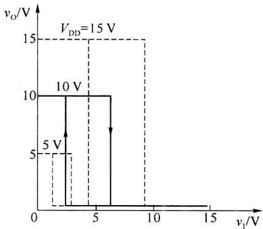  

图 10.2.10 集成施密特触发器 CC40106 的电压传输特性

整形电路由 $VT_{7} \sim VT_{10}$ 组成，电路为两个首尾相连的反相器。在 $v_{0}^{\prime}$ 上升和下降的过程中，通过两级反相器的正反馈作用，使输出电压波形进一步得到改善。

输出缓冲级电路是由 $VT_{11}$ 和 $VT_{12}$ 组成的反相器。它不仅提高了电路的带负载能力，还起到了将内部电路与负载隔离的作用。

## 10.2.3 施密特触发器的应用

施密特触发器的用途很广,下面举几个典型的应用。

### 1. 波形变换

施密特触发器有两个阈值,利用施密特触发器的滞回特性可以实现波形变换,如图

10.2.2所示,输入为三角波,输出为矩形波。同样,利用图 10.2.1 所示的施密特触发器,也可以将输入的正弦波、锯齿波等变换成矩形波,读者可自行分析。

### 2. 波形整形

在数字系统中，矩形脉冲经过传输后可能会发生波形畸变，或者在信号的高电平、低电平期间串入干扰信号，使波形的上升沿和下降沿明显变坏。传感器来的信号，经过放大后也可能是不规则的波形。这些波形都可以通过施密特触发器整形而获得比较理想的矩形脉冲波形。图10.2.11(a)给出的输入信号 $v_{I}$ 不仅波形上升沿和下降沿变坏，而且波形顶部干扰严重，但只要选择具有合适回差电压 $\Delta V_{T}$ 的施密特触发器对其整形，输出信号 $v_{O}$ 又变为较理想矩形波。图10.2.11(b)的输入信号 $v_{I}$ 波形也严重变坏，通过选择合适的阈值电压 $V_{T+}$ 和 $V_{T-}$ ，经施密特触发器整形后，输出信号 $v_{O}$ 又变为理想矩形波。

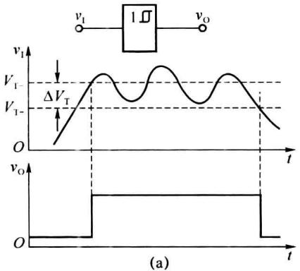

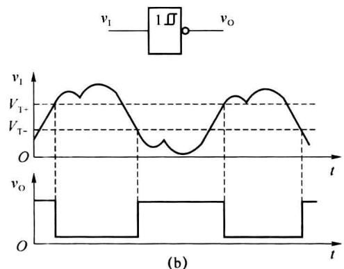  

图 10.2.11 施密特触发器用于波形整形

### 3. 幅度鉴别

利用施密特触发器的输出信号 $v_{0}$ 取决于输入信号 $v_{I}$ 阈值电平的特点，可以通过调整触发器的上限触发电平 $V_{T+}$ 到规定的幅度 $V_{th}$ ，使某些信号被鉴别出来。例如，将一系列幅度各异的脉冲信号加到施密特触发器的输入端 $v_{I}$ ，只有那些幅度大于上限触发电平 $V_{T+}$ 的脉冲才产生输出信号。因此，可以选出幅度大于 $V_{th}$ 的信号，消除了幅度较小的脉冲信号，如图 10.2.12 所示，施密特触发器具有幅度鉴别能力。

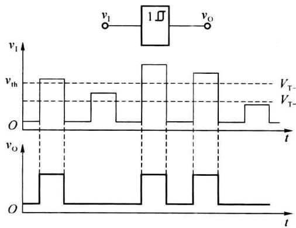  

图 10.2.12 施密特触发器用于脉冲幅度鉴别
