import Guide from '@/components/Guide.astro';
import Knowledge from '@/components/Knowledge.astro';
import Example from '@/components/Example.astro';
import Analysis from '@/components/Analysis.astro';
import Solution from '@/components/Solution.astro';
import Variant from '@/components/Variant.astro';
import Note from '@/components/Note.astro';
import Block from '@/components/Block.astro';
import Method from '@/components/Method.astro';
import Exercise from '@/components/Exercise.astro';

单稳态触发器广泛应用于脉冲波形的变换、延迟和定时电路中。单稳态触发器具有稳态和暂稳态两个不同的工作状态，在外界触发脉冲的作用下，能够从稳态翻转到暂稳态。暂稳态不是一个能长久保持的状态，维持一段时间之后，又自动翻转到稳态。暂稳态的持续时间取决于电路本身的参数，与触发脉冲的宽度和幅度无关。

## 10.3.1 用门电路组成的单稳态触发器

单稳态触发器的暂稳态通常都是靠 RC 定时电路来维持的, 根据 RC 电路的接法不同, 可分为微分型单稳态触发器和积分型单稳态触发器两种。

### 1. 微分型单稳态触发器

### (1) 电路的组成和工作原理

微分型单稳态触发器可由“或非门”或“与非门”构成，图10.3.1所示是由TTL与非门和RC微分电路组成的单稳态触发器，其工作波形如图10.3.2所示。图10.3.1中， $R_{i}$ 、 $C_{i}$ 为输入微分环节，保证门 $G_{1}$ 的输入信号为很窄的正、负脉冲，RC为构成微分型单稳态触发器的定时电路，两个与非门的输出端作为触发器的输出。

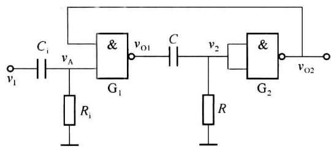

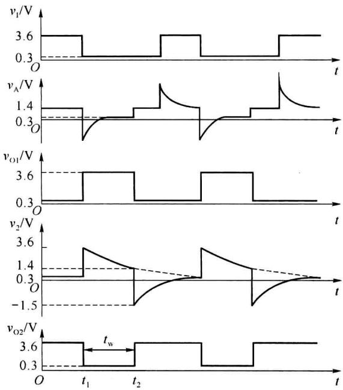  

图10.3.1 由与非门组成的微分型单稳态触发器 图10.3.2 微分型单稳态触发器的工作波形

① 无触发信号时,电路处于一种稳态

在图 10.3.1 所示的电路中，稳态时， $v_{I}$ 为高电平 $V_{IH}$ （约 3.6 V），电阻 $R_{i}$ 的值一般大于 2 kΩ，电阻 R 的值一般小于 700 Ω，以保证稳态时门 $G_{1}$ 输出低电平 $v_{O1}=V_{OL}$ （约 0.3 V），门 $G_{2}$ 输出高电平 $v_{O2}=V_{OH}$ 。此时 $v_{A}\approx1.4\ V, v_{2}=v_{O1}\approx0.3\ V$ ，电容 C 上没有电荷存储。

## ② 外加触发信号,电路由稳态翻转到暂稳态

在 $t=t_{1}$ 时刻， $v_{I}$ 跳变为低电平 $V_{IL}$ （约 0.3 V）。 $v_{I}$ 的下降沿经 $R_{i}C_{i}$ 产生一个负尖峰脉冲，当 $v_{A}$ 下降到 $G_{1}$ 的阈值电压 $V_{th}$ 时，引发如下正反馈过程：

$$

v _ {\mathrm{A}} \downarrow \rightarrow v _ {\mathrm{O1}} \uparrow \rightarrow v _ {2} \uparrow \rightarrow v _ {\mathrm{O2}} \downarrow

$$

使 $v_{O1}$ 迅速跳变为高电平 $V_{OH}$ ，跳变幅度为 $V_{OH}-V_{OL}$ 。由于电容 C 上的电压不能突变， $v_{2}$ 也同时跳变为高电平，使 $v_{O2}$ 跳变为低电平 $V_{OL}$ ，触发器进入暂稳态。这时即使 $v_{A}$ 回到高电平， $v_{O2}$ 的低电平仍将维持。在暂稳态期间， $v_{O1}=V_{OH}, v_{O2}=V_{OL}$ 。

③ 电容 C 充电, 电路由暂稳态自动返回至稳态

在暂稳态期间， $v_{01}$ 通过电阻 R 给电容 C 充电，充电的等效电路如图 10.3.3 所示， $R_{0}$ 为门 $G_{1}$ 的输出电阻，约为 $100 \Omega$ 。随着充电过程的进行， $v_{2}$ 按指数规律下降，在 $t = t_{2}$ 时刻， $v_{2}$ 下降到门 $G_{2}$ 的阈值电压 $V_{th}$ ，又引发另外一个正反馈过程：

$$

\begin{array}{c}v _ {2} \downarrow \rightarrow v _ {\mathrm{O} 2} \uparrow \rightarrow v _ {\mathrm{O} 1} \downarrow\\\uparrow\end{array}

$$

使 $v_{O1}$ 和 $v_{2}$ 迅速跳变为低电平， $v_{O2}$ 跳变高电平，暂稳态结束，电路回到稳态。在稳态期间， $v_{O1}=V_{OL}, v_{O2}=V_{OH}$ 。

暂稳态结束后电路进入恢复过程,电容 C 开始放电,使 C 上的电压恢复到稳态时的初始值,放电的等效电路如图 10.3.4 所示。

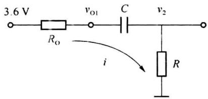  

图 10.3.3 电容充电等效电路

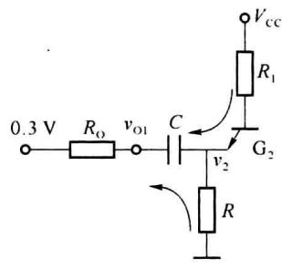  

图 10.3.4 电容放电等效电路

### (2) 主要参数计算

在实际应用中,经常使用输出脉冲宽度 $t_{w}$ 、恢复时间 $t_{re}$ 、最高工作频率 $f_{max}$ 、输出脉冲幅度 $V_{m}$ 等几个参数来定量描述单稳态触发器的性能。

① 输出脉冲宽度 $t_{w}$

输出脉冲宽度 $t_{w}$ 是暂稳态的持续时间，暂稳态的持续时间是从电容 C 开始充电到 $v_{2}$ 下降到 $V_{th}$ 的这段时间，充电等效电路如图 10.3.3 所示。若 $R_{0} \ll R$ ，则充电时间常数近似等于 RC。根据对 RC 电路过渡过程的分析可知，在电容充、放电过程中，电容上的电压从初始值变化到某一稳态值所经历的时间 t 可以用下式计算：

$$

t = R C \ln \frac {v _ {\mathrm{C}} (t _ {1}) - v _ {\mathrm{C}} (\infty)}{v _ {\mathrm{C}} (t _ {2}) - v _ {\mathrm{C}} (\infty)}\tag{10.3.1}

$$

其中， $v_{\mathrm{C}}(t_{1})$ 是电容上电压的初始值， $v_{\mathrm{C}}(t_{2})$ 是电容充、放电结束时的稳态值， $v_{\mathrm{C}}(\infty)$ 当 t 趋于无穷时电容上电压的终值。

由图 10.3.2 中的波形可见， $v_{2}$ 的初始值 $v_{2}(t_{1})\approx(V_{\mathrm{OH}}-V_{\mathrm{OL}})+v_{2}(0),v_{2}(0)$ 为稳态时$v_{2}$ 的值， $v_{2}(0)\approx0.3\ V$ ; $v_{2}$ 的终值 $v_{2}(\infty)=0\ V$ ，电容 C 充电到 $t_{2}$ 时刻暂稳态结束，此时 $v_{2}(t_{2})=V_{\mathrm{th}}$ 。因此，输出脉冲宽度为

$$

t _ {\mathrm{w}} = R C \ln \frac {v _ {2} (t _ {1}) - v _ {2} (\infty)}{v _ {2} (t _ {2}) - v _ {2} (\infty)} = R C \ln \frac {(V _ {\mathrm{OH}} - V _ {\mathrm{OL}}) + v _ {2} (0)}{V _ {\mathrm{th}}}\tag{10.3.2}

$$

近似估算时， $t_{w}$ 一般取 $(0.7\sim1.3)RC$ 。

由上述讨论可知,输出脉冲宽度 $t_{w}$ 取决于电容 C 的充电速度,因此称 RC 为定时电路。为了调整输出脉冲的宽度,需要调整 R 和 C 的参数。通常以改变电容 C 的值作为粗调,改变电阻 R 的值作为细调。

## ② 恢复时间 $t_{\mathrm{re}}$

暂稳态结束后,还需要一段恢复时间才能把电容 C 上所充的电荷释放完毕,使电路恢复到初始状态。一般要经过 $(3\sim5)\tau_{d}(\tau_{d}$ 为放电时间常数)的时间,放电才能结束,故

$$

t _ {\mathrm{re}} \approx (3 \sim 5) \tau_ {\mathrm{d}}

$$

## ③ 最高工作频率 $f_{max}$

设触发信号 $v_{1}$ 的时间间隔为 T，为了使单稳态电路能正常工作，应满足 $T > t_{w} + t_{re}$ ，即最小时间间隔 $T_{\min} = t_{w} + t_{re}$ 。因此，单稳态触发器的最高工作频率为

$$

f _ {\max} = \frac {1}{T _ {\min}} = \frac {1}{t _ {\mathrm{w}} + t _ {\mathrm{re}}}

$$

## ④ 输出脉冲的幅度

输出脉冲的幅度就是门 $G_{2}$ 输出的高、低电平之差，即

$$

V _ {\mathrm{m}} = V _ {\mathrm{OH}} - V _ {\mathrm{OL}}

$$

微分型单稳态触发器由于在输入端存在微分电路,当触发脉冲 $v_{A}$ 的宽度大于输出脉冲宽度时电路仍能正常工作,但输出脉冲的上升沿变差。

图 10.3.5 给出了另一种微分型单稳态触发器电路,读者可自行分析其工作原理。

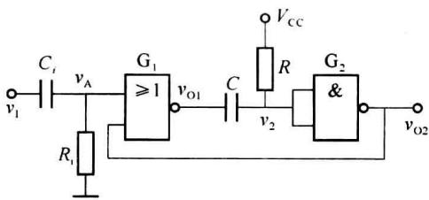  

图 10.3.5 微分型单稳态触发器

### 2. 积分型单稳态触发器

图 10.3.6 是由 TTL 门电路和 RC 积分电路组成的积分型单稳态触发器, 其工作波形如图 10.3.7 所示。电路中, 电阻 R 的取值不能过大, 以保证 $v_{01}$ 为低电平时 $v_{A}$ 也是低电平。

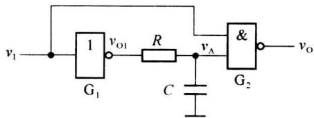  

图 10.3.6 积分型单稳态触发器

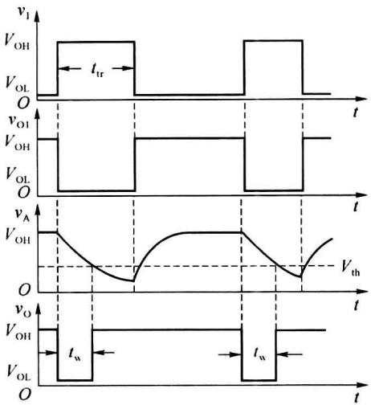  

图 10.3.7 积分型单稳态触发器的工作波形

### (1) 电路的工作原理

稳态时，输入信号 $v_{1}$ 为低电平，门 $G_{1}$ 、 $G_{2}$ 的输出均为高电平，即 $v_{01} = v_{0} = V_{OH}$ 。电容 C 充电结束， $v_{A} = V_{OH}$ ，触发器处于稳定状态。

触发脉冲 $v_{1}$ 的上升沿到后，同时使两个门的状态发生变化， $v_{O1}$ 和 $v_{0}$ 均跳变为低电平，即 $v_{O1} = v_{0} = V_{OL}$ ，电路进入暂稳态。电容 C 开始通过电阻 R 和门 $G_{1}$ 的输出端放电， $v_{A}$ 开始呈指数规律下降。但在一段时间里 $v_{A}$ 仍高于门 $G_{2}$ 的阈值电压 $V_{th}$ （约 1.4 V），使 $v_{0} = V_{OL}$ 不变。

随着放电过程的进行, $v_{A}$ 不断降低,当 $v_{A}$ 下降至 $V_{th}$ 时,与非门 $G_{2}$ 的状态发生翻转, $v_{0}$ 跳变为高电平。当触发输入 $v_{1}$ 返回低电平以后, $v_{01}$ 又重新变成高电平 $V_{OH}$ ,并向电容C充电,触发器回到初始稳定状态。

应该指出,在暂稳态期间,当电容 C 上的电压 $v_{A}$ 未达到与非门 $G_{2}$ 的阈值电压 $V_{th}$ 之前,触发电平 $v_{I}$ 不能撤销,否则 $G_{2}$ 将因 $v_{I}$ 下跳而提前翻转,达不到由 RC 电路控制定时的目的,所以要求触发脉冲宽度 $t_{tr}$ 比输出脉冲宽度 $t_{w}$ 宽。

### (2) 主要参数计算

由上述分析可知, 输出脉冲的宽度等于电容 C 开始放电, $v_{A}$ 从 $V_{OH}$ 下降至 $V_{th}$ 所需的时间, 放电回路如图 10.3.8 所示。在 $v_{A}$ 高于 $G_{2}$ 的阈值电压 $V_{th}$ 期间, 与非门 $G_{2}$ 的输入电流非常小, 可以忽略不计, 因而电容 C 的放电等效电路可以简化为 $(R + R_{0})$ 与 C 串联, 其中 $R_{0}$ 是 $v_{01} = V_{OL}$ 时 $G_{1}$ 的输出电阻。

由图 10.3.7 的波形可见, $v_{\mathrm{A}}$ 的初始值 $v_{\mathrm{A}}(t_{1}) = V_{\mathrm{OH}}$ , 稳态值 $v_{\mathrm{A}}(t_{2}) = V_{\mathrm{th}}$ , 终值 $v_{\mathrm{A}}(\infty) = V_{\mathrm{OL}}$ 。因此, 输出脉冲宽度

$$

t _ {\mathrm{w}} = (R + R _ {0}) C \ln \frac {v _ {\mathrm{A}} (t _ {1}) - v _ {2} (\infty)}{v _ {\mathrm{A}} (t _ {2}) - v _ {2} (\infty)} = (R + R _ {0}) C \ln \frac {V _ {\mathrm{OH}} - V _ {\mathrm{OL}}}{V _ {\mathrm{th}} - V _ {\mathrm{OL}}}\tag{10.3.3}

$$

输出脉冲的幅度

$$

V _ {\mathrm{m}} = V _ {\mathrm{OH}} - V _ {\mathrm{OL}}

$$

恢复时间 $t_{re}$ 等于 $v_{01}$ 跳变为高电平后，电容 C 充电至 $V_{OH}$ 所经过的时间，通常取充电时

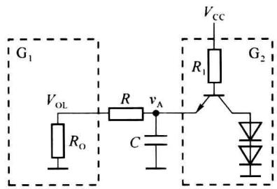  

图 10.3.8 电路中电容 C 的放电回路

间常数的 3～5 倍时间为恢复时间, 即

$$

t _ {\mathrm{re}} \approx (3 \sim 5) (R + R _ {0} ^ {\prime}) C\tag{10.3.4}

$$

其中， $R_{0}^{\prime}$ 是 $G_{1}$ 输出高电平时的输出电阻。为简化计算，这里没有计入门 $G_{2}$ 的输入电路对电容充电过程的影响。

与微分型单稳态触发器相比,积分型单稳态触发器具有抗干扰能力强的优点。数字电路中的噪声多为尖峰脉冲噪声,积分型单稳态触发器具有抑制这种噪声的能力。

积分型单稳态触发器的状态转换过程没有正反馈作用,它的缺点是输出波形的边沿比较差。另外,在积分型单稳态触发器中,触发脉冲的宽度必须大于输出脉冲的宽度。

## 10.3.2 施密特触发器构成的单稳态触发器

利用 CMOS 施密特触发器的滞回特性, 可以方便地构成单稳态触发器。图 10.3.9(a) 所示是由施密特触发器和 R、C 定时元件构成的单稳态触发器, 其工作波形如图 10.3.9(b) 所示。

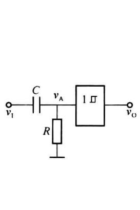

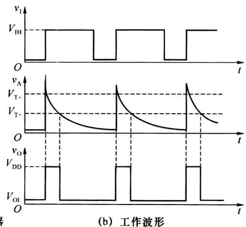  

(a) 由施密特构成的单稳态触发器  

图 10.3.9 由施密特触发器构成的单稳态电路及其工作波形

假设输入触发脉冲 $v_{I}$ 的低电平为 0 V，高电平为 $V_{IH}$ 。当 $v_{I}=0\ V$ 时， $v_{A}=0\ V$ ，输出电压 $v_{O}=V_{OL}$ ，电路处于稳定状态。

触发脉冲 $v_{I}$ 的上升沿到达后，由于电容 C 两端的电压不能突变， $v_{A}$ 也随之上跳同样的幅度。此时 $v_{A} > V_{T+}$ ，施密特触发器发生状态翻转，输出 $v_{O} = V_{DD}$ ，电路进入暂稳态。

此后，随着电容 C 的充电， $v_{A}$ 按指数规律下降。在 $v_{A}$ 达到 $V_{T-}$ 之前，电路维持 $v_{0}=$

$V_{DD}$ 。当 $v_{A}$ 下降至 $V_{T-}$ 时，施密特触发器再次发生翻转，电路由暂稳态回到稳态。

由上述分析可知, 输出脉冲的宽度等于电容 C 开始充电, $v_{A}$ 从 $V_{IH}$ 下降至 $V_{T-}$ 所需的时间。忽略施密特触发器输入端的电流, 则充电时间常数为 RC, $v_{A}$ 的初始值为 $V_{IH}$ , 稳态值 $V_{T-}$ , 终值 $v_{\mathrm{A}}(\infty)=0\;\mathrm{V}$ 。因此, 输出脉冲宽度

$$

t _ {\mathrm{w}} = R C \ln \frac {V _ {\mathrm{IH}}}{V _ {\mathrm{T-}}}\tag{10.3.5}

$$

## 10.3.3 集成单稳态触发器

单稳态触发器的应用十分广泛,市场上有很多 TTL 和 CMOS 型单片集成单稳态触发器。集成单稳态触发器只需外接很少的元件即可使用,在电路上可以采取温漂补偿措施,温度稳定性好。

根据工作状态的不同,集成单稳态触发器分为可重复触发的单稳态触发器和不可重复触发的单稳态触发器两类。可重复触发的单稳态触发器在暂稳态期间仍然能够响应新的触发脉冲信号,如果有新的触发脉冲到来,电路将重新被触发,使输出脉冲再继续维持一个 $t_{w}$ 宽度,如图10.3.10(a)所示。不可重复触发的单稳态触发器在暂稳态期间将再不响应新的触发信号,只有当暂稳态结束后,它才能响应下一个触发脉冲而转入暂稳态,如图10.3.10(b)所示。

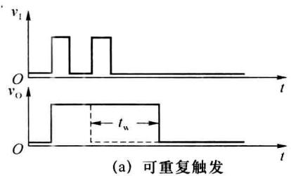

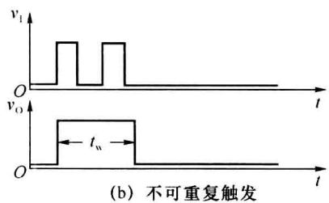  

图 10.3.10 可重复触发和不可重复触发的单稳态触发器

可重复触发的单稳态触发器有 74121、74221 等，不可重复触发的单稳态触发器有 74122、74123 等。有些集成单稳态触发器还设有复位端（如置 74122、74123），通过在复位端加入复位信号能立即终止暂稳态过程。

### 1. TTL 集成单稳态触发器 74121

图 10.3.11 所示是 TTL 集成单稳态触发器 74121 的逻辑电路图, 其引脚排列如图 10.3.12 所示。它由基本微分型单稳态触发器电路、输入控制电路和输出缓冲电路构成。门 $G_{5}$ 、 $G_{6}$ 、 $G_{7}$ 和外接定时元件 $R_{ext}$ 、 $C_{ext}$ 组成微分型单稳态触发器。外部电容 $C_{ext}$ 接在 74121 的 10 脚和 11 脚之间。如果工作时采用内部定时电阻 $R_{int}$ ，则需将 9 脚直接接电源 $V_{CC}$ 。 $R_{int}$ 的阻值不大（约为 $2 k\Omega$ ），若希望得到较宽的输出脉冲，仍需使用外接电阻 $R_{ext}$ 。门 $G_{1} \sim G_{4}$ 构成输入控制电路，用于实现上升沿触发或下降触发。门 $G_{8}$ 和 $G_{9}$ 构成输出缓冲电路，提高电路的带负载能力， $v_{0}$ 和 $\overline{v_{0}}$ 为单稳态触发器 74121 的两个互补输出端。

如果把门 $G_{5}$ 和 $G_{6}$ 视为一个具有施密特触发特性的或非门，则由门 $G_{5}$ 、 $G_{6}$ 、 $G_{7}$ 和外接电阻 $R_{ext}$ 、外接电容 $C_{ext}$ 组成电路与图 10.3.5 所示的微分型单稳态触发器基本相同。它的触发信号来自于门 $G_{4}$ ，为正脉冲触发，输出脉冲的宽度由 $R_{ext}$ 和 $C_{ext}$ 的大小决定。

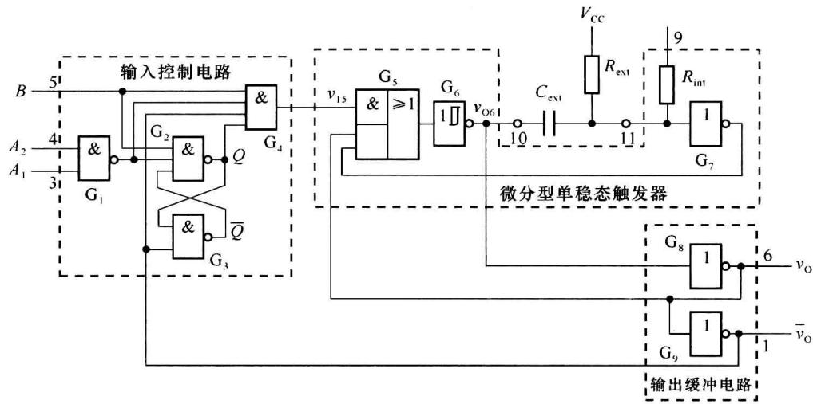

图 10.3.11 集成单稳态触发器 74121 逻辑图  

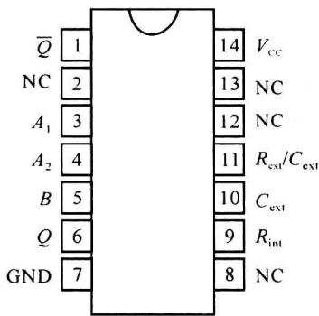  

图10.3.12 74121的引脚排列图

集成单稳态触发器 74121 的功能表如表 10.3.1 所示。如果用上升沿触发，触发脉冲由 B 端输入，同时 $A_{1}$ 和 $A_{2}$ 至少有一个接低电平。当触发脉冲的上升沿到达时，因为门 $G_{4}$ 的其他 3 个输入端均处于高电平，所以 $v_{15}$ 也随之由低电平跳变为高电平，并触发单稳态电路使之进入暂稳态，输出端跳变为 $v_{0}=1, \overline{v}_{0}=0$ 。与此同时， $\overline{v_{0}}$ 的低电平立即将门 $G_{2}$ 和 $G_{3}$ 组成的触发器复位，使 $v_{15}$ 返回低电平。可见， $v_{15}$ 的高电平持续时间极短，与触发脉冲的宽度无关，使 74121 具有边沿触发的特点，同时也保证了在触发脉冲宽度大于输出脉冲宽度时输出脉冲的下降沿仍然很陡。图 10.3.13 是 74121 在触发脉冲作用下的波形图。

表 10.3.1 集成单稳态触发器 74121 功能表

<table><tr><td colspan="3">输入</td><td colspan="2">输出</td></tr><tr><td> $A_1$ </td><td> $A_2$ </td><td> $B_-$ </td><td>Q</td><td> $\overline{Q}$ </td></tr><tr><td>0</td><td>×</td><td>1</td><td>0</td><td>1</td></tr><tr><td>×</td><td>0</td><td>1</td><td>0</td><td>1</td></tr><tr><td>×</td><td>×</td><td>0</td><td>0</td><td>1</td></tr><tr><td>1</td><td>1</td><td>×</td><td>0</td><td>1</td></tr><tr><td>1</td><td>↓</td><td>1</td><td>几</td><td> $\top$ </td></tr><tr><td>↓</td><td>1</td><td>1</td><td>几</td><td> $\top$ </td></tr><tr><td>↓</td><td>↓</td><td>1</td><td>几</td><td> $\top$ </td></tr><tr><td>0</td><td>×</td><td>↑</td><td>几</td><td> $\top$ </td></tr><tr><td>×</td><td>0</td><td>↑</td><td>几</td><td> $\top$ </td></tr></table>

如果用下降沿触发, 触发脉冲则应由 $A_{1}$ 或 $A_{2}$ 输入(另一个应接高电平), 同时将 B 端接高电平, 电路的工作过程和上升沿触发时相同。

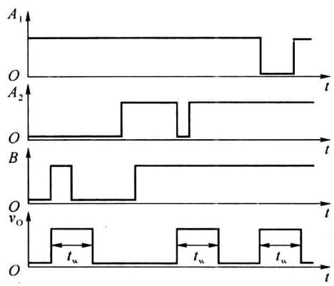  

图 10.3.13 集成单稳态触发器 74121 的工作波形

可以推得,74121的输出脉冲宽度

$$

t _ {\mathrm{w}} \approx R _ {\mathrm{ext}} C _ {\mathrm{ext}} \ln 2 \approx 0. 6 9 R _ {\mathrm{ext}} C _ {\mathrm{ext}}\tag{10.3.6}

$$

通常 $R_{ext}$ 的取值在 1.4～40 kΩ 之间， $C_{ext}$ 的取值在 10pF～10μF 之间， $t_{w}$ 的范围为 10 ns～300 ms。图 10.3.14 给出了 74121 使用外接电阻 $R_{ext}$ 和内部电阻 $R_{int}$ 时电路的连接方法。

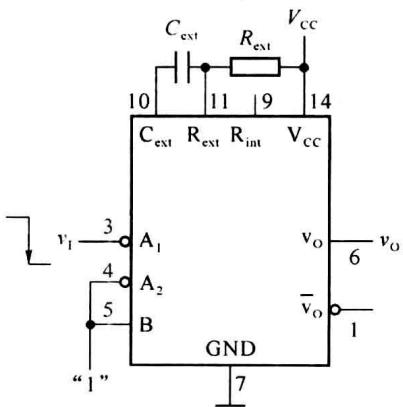  

(a) 使用外接电阻 $R_{ext}$ (下降沿触发)

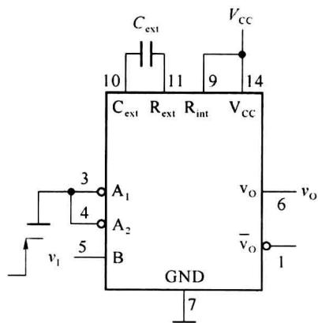  

(b) 使用内部电阻 $R_{int}$ (上升沿触发)  

图 10.3.14 集成单稳态触发器 74121 的连接方式

### 2. CMOS 集成单稳态触发器 CC14528

常用的 CMOS 集成单稳态触发器有可重复触发单稳态触发器 CC14528、CC14538 和不可重复触发的单稳态触发器 CC74HC123 等。现以 CC14528 为例介绍 CMOS 单稳态触发器的工作原理。

图 10.3.15 是可重复触发单稳态触发器 CC14528 的逻辑电路图，其引脚排列如图 10.3.16 所示。CC14528 主要由 3 部分组成：由门 $G_{10} \sim G_{12}$ 和 $VT_{1}$ 、 $VT_{2}$ 组成的三态门电路，由门 $G_{1} \sim G_{9}$ 组成的输入控制电路，以及由门 $G_{13} \sim G_{16}$ 组成的输出缓冲电路。电路的核心部分是由积分电路（包含外接电阻 $R_{ext}$ 和外接电容 $C_{ext}$ ）、三态门和三态门的控制电路构成的积分型单稳态触发器。

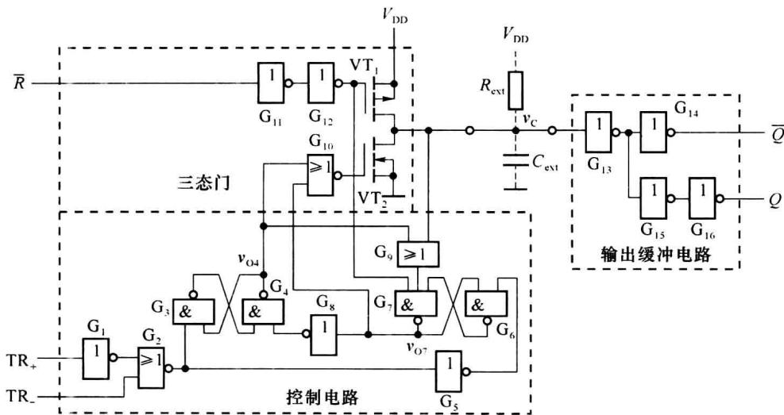

图 10.3.15 集成单稳态触发器 CC14528 逻辑图  

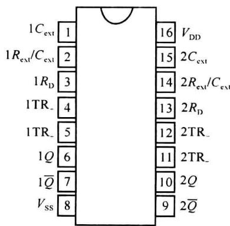  

图10.3.16 74121和CC14528的引脚排列图

CC14528 的功能表如表 10.3.2 所示, $\mathrm{TR}_{+}$ 为下降沿触发输入端, $\mathrm{TR}_{-}$ 为上升沿触发输入端, $\overline{R}$ 为置零输入端, $Q$ 和 $\overline{Q}$ 是两个互补输出端。当 $\overline{R} = 0$ 时, 触发器输出 $Q = 0$ , $\overline{Q} = 1$ 。

表 10.3.2 集成单稳态触发器 CC14528 的功能表

<table><tr><td colspan="3">输入</td><td colspan="2">输出</td></tr><tr><td> $\overline{R}$ </td><td> $TR_{+}$ </td><td> $TR_{-}$ </td><td>Q</td><td> $\overline{Q}$ </td></tr><tr><td>0</td><td>×</td><td>×</td><td>0</td><td>1</td></tr><tr><td>×</td><td>1</td><td>×</td><td>0</td><td>1</td></tr><tr><td>×</td><td>×</td><td>0</td><td>0</td><td>1</td></tr><tr><td>1</td><td>1</td><td>↑</td><td>几</td><td> $\sqcup$ </td></tr><tr><td>1</td><td>↓</td><td>0</td><td>几</td><td> $\sqcup$ </td></tr></table>

### (1) 稳态

在控制电路中，门 $\mathrm{G}_3$ 和 $\mathrm{G}_4$ 、 $\mathrm{G}_6$ 和 $\mathrm{G}_7$ 分别组成基本RS触发器。稳态时输入端 $\mathrm{TR}_{+}$ 和 $\mathrm{TR}_{-}$ 均没有触发信号。若 $\overline{R} = \times ,\mathrm{TR}_{+} = 1,\mathrm{TR}_{-} = \times$ ，则门 $\mathbf{G}_4$ 的输出 $v_{\mathrm{O4}}$ 必为高电平。由于在接通电源后电容 $C_\mathrm{ext}$ 还未充电， $v_{\mathrm{C}} = 0\mathrm{V}$ ，倘若 $v_{\mathrm{O4}}$ 处于低电平，则在 $v_{\mathrm{C}}$ 和 $v_{\mathrm{O4}}$ 的共同作用下，门 $\mathbf{G}_9$ 输出低电平，并使 $\mathbf{G}_7$ 输出高电平，门 $\mathbf{G}_8$ 输出低电平，于是门 $\mathbf{G}_4$ 的输出 $v_{\mathrm{O4}}$ 被置成高电平。如果接通电源后 $v_{\mathrm{O4}}$ 处于高电平状态，则门 $\mathbf{G}_7$ 的输出 $v_{\mathrm{O7}}$ 被置成低电平，故 $\mathbf{G}_8$ 输出高电平， $v_{\mathrm{O4}}$ 的高电平状态保持不变。此时， $\mathbf{G}_{10}$ 输出低电平（ $v_{10} = V_{\mathrm{OL}})$ ， $\mathbf{G}_{12}$ 输出高电平 $(v_{12} = V_{\mathrm{OH}})$ ，VT和VT2同时截止， $V_{\mathrm{DD}}$ 经 $R_{\mathrm{ext}}$ 向 $C_\mathrm{ext}$ 充电，当 $v_{\mathrm{C}} > V_{\mathrm{th13}}$ 时， $Q = 0,\overline{Q} = 1$ ，电路处于稳态。

同样，若 $\overline{R}=\times,TR_{+}=\times,TR_{-}=0$ ，门 $G_{5}$ 输出低电平，门 $G_{7}$ 的输出 $v_{O7}$ 被置成低电平，经 $G_{8}$ 反相后使 $v_{O4}$ 处于高电平，电路处于稳态。

### (2) 触发与定时

采用上升沿触发时， $\overline{R}=1,TR_{+}=1$ ，触发脉冲从TR-端加入。当TR-上升沿到来时， $v_{O4}=V_{OL}$ ，由于 $v_{O7}=V_{OL}$ ，从而使 $G_{10}$ 的输出变为高电平， $VT_{2}$ 导通， $C_{ext}$ 开始放电。当 $v_{C}$ 下降到门 $G_{13}$ 的阈值电压 $V_{th13}$ 时，电路进入暂稳态，Q=1， $\overline{Q}=0$ 。

但这种暂稳态不会一直持续下去，当 $v_{C}$ 进一步下降至门 $G_{9}$ 的阈值电压 $V_{th9}$ 时， $G_{9}$ 的输出变为低电平，并通过 $G_{7}$ 、 $G_{8}$ 将 $v_{O4}$ 置成高电平， $G_{10}$ 输出变为低电平，于是 $VT_{2}$ 截止， $C_{ext}$ 又重新开始充电。当 $v_{C}$ 充电到门 $G_{13}$ 的阈值电压 $V_{th13}$ 时，电路自动返回到稳态状态，Q=0， $\overline{Q}=1$ 。 $C_{ext}$ 继续充电至 $V_{DD}$ 以后，电路恢复为稳态。

图 10.3.17 给出了 $v_{C}$ 和 Q 在触发脉冲作用下的工作波形。输出脉冲宽度 $T_{w}$ 等于 $v_{C}$ 从 $V_{th13}$ 下降到 $V_{th9}$ 的放电时间与 $v_{C}$ 从 $V_{th9}$ 再次充电到 $V_{th13}$ 的充电时间之和。为了获得较宽的输出脉冲，一般都将 $V_{th13}$ 设计得较高而将 $V_{th9}$ 设计得较低。

CC14528 为可重复触发的单稳态触发器，在 $t_5$ 时刻触发脉冲到来，电路被触发进入暂稳态，电容 $C_{\mathrm{ext}}$ 很快放电后又进入充电状态。当 $v_{\mathrm{C}}$ 尚未充至 $V_{\mathrm{th}13}$ 时， $t_6$ 时刻电路再次被触发，门 $\mathbf{G}_2$ 输出低电平，使 $v_{\mathrm{O4}} = V_{\mathrm{OL}}$ ，门 $\mathbf{G}_{10}$ 输出高电平， $\mathrm{VT}_2$ 导通，电容 $C_{\mathrm{ext}}$ 又开始放电，当放电使 $v_{\mathrm{C}}$ 下降至门 $\mathbf{G}_9$ 的阈值电压 $V_{\mathrm{th}9}$ 时， $\mathbf{G}_9$ 输出低电平， $\mathbf{G}_{10}$ 输出低电平， $\mathrm{VT}_2$ 截止，电容又充电，一直充电到 $V_{\mathrm{th}13}$ ，若此时再无触发信号作用，则电路返回到稳态。在这两个重复触发脉冲作用下，输出脉冲宽度为 $t_\Delta + t_\mathrm{w}$ 。显然，可重复触发单稳态触发器可利用在暂稳态时

加触发脉冲的方法增加输出脉冲宽度。

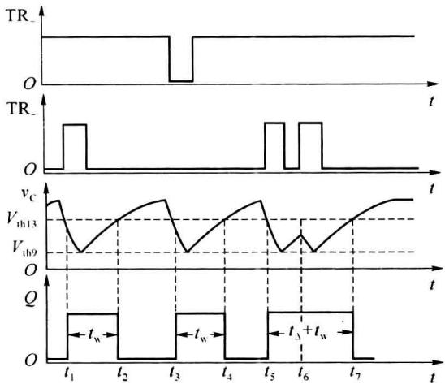  

图 10.3.17 集成单稳态触发器 CC14528 的工作波形

当需要采用下降沿触发时,应从 $TR_{+}$ 端输入负的触发脉冲,同时使 B 端保持在低电平。

当利用 $\overline{R}$ 端置零时，应在 $\overline{R}$ 端加入低电平信号，这时 $VT_{1}$ 导通， $VT_{2}$ 截止， $C_{ext}$ 通过 $VT_{1}$ 迅速充电到 $V_{DD}$ ，使Q=0， $\overline{Q}=1$ 。

## 10.3.4 单稳态触发器的主要应用

单稳态触发器是数字系统中常用的基本单元电路,典型应用如下。

### 1. 定时

由前面的分析可知,单稳态触发器在触发脉冲的作用下,能产生一定宽度 $t_{w}$ 的矩形脉冲,如果利用该矩形脉冲作为定时信号去控制某电路,可使其在 $t_{w}$ 内动作。例如,用单稳态触发器输出的正脉冲控制与门 G,如图 10.3.18 所示,则只有这个 $t_{w}$ 时间内的高频信号 $v_{2}$ 才能通过与门 G 传送到输出端,在其余时间里,信号 $v_{2}$ 被单稳态触发器输出的低电平屏蔽掉。

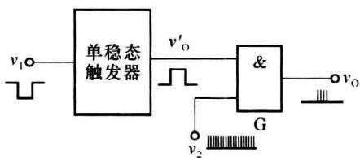  

图 10.3.18 单稳态触发器的定时作用

### 2. 延时

从图 10.3.2 所示的微分型单稳态触发器的工作波形不难从看出，输出电压 $v_{01}$ 的上升沿相对输入信号 $v_{1}$ 的上升沿延迟了 $t_{w}$ 一段时间，单稳态触发器具有延时作用。单稳态触发器的这种延时作用常用于时序控制。

(b)

### 3. 整形

利用单稳态触发器的触发和定时功能,还可以实现波形的整形,例如,将图 10.3.19(a) 所示的不规则脉冲做为单稳态触发器的触发脉冲,则它的输出就成为具有确定宽度 $t_{w}$ 和幅度、边沿陡峭的同频率矩形波,如图 10.3.19(b) 所示,这种作用便是波形的整形。

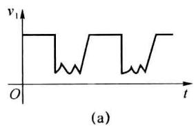

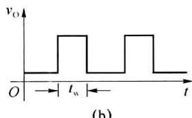  

图 10.3.19 单稳态触发器的整形作用
