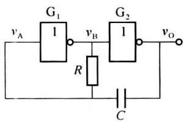
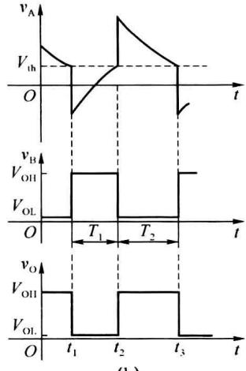
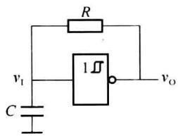
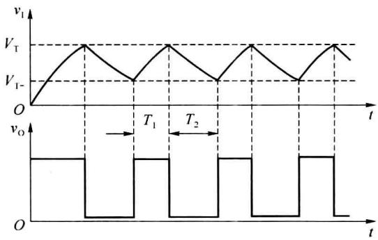
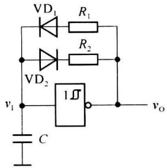
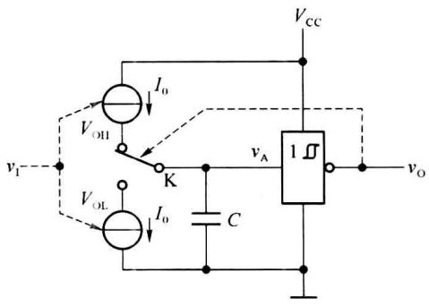
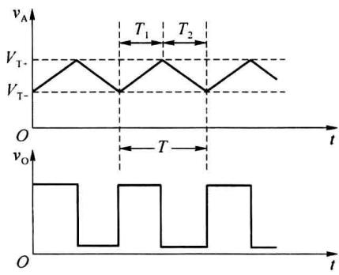
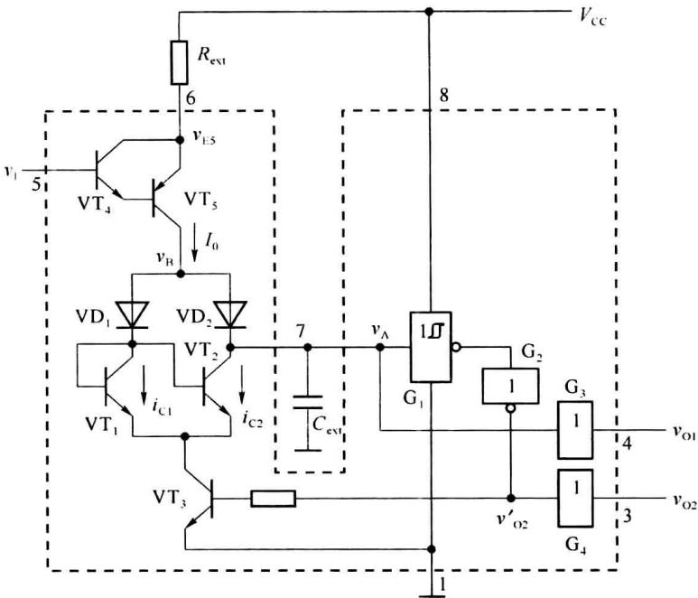
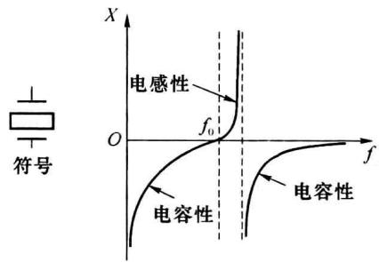
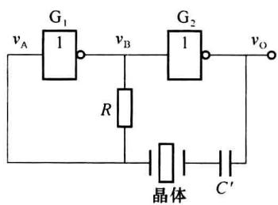

import Guide from '@/components/Guide.astro';
import Knowledge from '@/components/Knowledge.astro';
import Example from '@/components/Example.astro';
import Analysis from '@/components/Analysis.astro';
import Solution from '@/components/Solution.astro';
import Variant from '@/components/Variant.astro';
import Note from '@/components/Note.astro';
import Block from '@/components/Block.astro';
import Method from '@/components/Method.astro';
import Exercise from '@/components/Exercise.astro';

在实用电路中,除了常见的正弦波发生器外,多谐振荡器也是一类常用电路。多谐振荡器是一种自激振荡器,接通电源后,不需要外加触发信号,就能自动产生矩形脉冲波。由于矩形波中含有丰富的高次谐波,故习惯称为多谐振荡器。多谐振荡器没有稳态,只有两个暂稳态,又称为无稳态电路。

多谐振荡器有多种电路形式,它们的共同特点是:

（1）电路中含有开关元件，如门电路、电压比较器、模拟开关等，这些元件的作用是产生高低电平。

(2) 电路中含有反馈网络, 反馈网络将输出电压反馈给开关元件, 使之改变输出状态。

（3）电路中含有定时环节，以获得所需的振荡频率，定时环节可以利用 RC 电路的充、放电特性实现，也可以利用器件本身的延迟等方式实现。

## 10.4.1 由门电路组成的多谐振荡器

电容正反馈多谐振荡器的基本电路如图 10.4.1(a) 所示。电路由两级 TTL 反相器构成，并通过电容 C 引入正反馈，工作波形如图 10.4.1(b) 所示。

### (1) 基本工作原理

这种多谐振荡器主要是依靠电容 C 的充、放电引起电压 $v_{A}$ 的变化来实现振荡。当 $v_{A}$ 达到 TTL 门的阈值电压 $V_{th}$ 时，引起反相器状态的翻转。

假设在 $t_1$ 时刻 $\upsilon_{\mathrm{A}}$ 正好降至反相器的阈值电压 $V_{\mathrm{th}}$ ， $\upsilon_{\mathrm{B}}$ 由低电平 $V_{\mathrm{OL}}$ 跳变至高电平 $V_{\mathrm{OH}}$ ， $\upsilon_{\mathrm{O}}$ 由高电平 $V_{\mathrm{OH}}$ 跳变至低电平 $V_{\mathrm{OL}}$ ，跳变值均为 $V_{\mathrm{OH}} - V_{\mathrm{OL}}$ ，由于电容 $C$ 两端的电压不能突变，使 $\upsilon_{\mathrm{A}}$ 从 $V_{\mathrm{th}}$ 也下跳了 $V_{\mathrm{OH}} - V_{\mathrm{OL}}$ 。此时门 $\mathbf{G}_1$ 输出高电平 $V_{\mathrm{OH}}$ ，门 $\mathbf{G}_2$ 输出低电平 $V_{\mathrm{OL}}$ ，电路进入暂稳态 I。

当 $t > t_{1}$ 时，门 $G_{1}$ 通过电阻 R 给电容 C 充电，使 $v_{A}$ 逐渐上升。在 $t_{2}$ 时刻， $v_{A}$ 上升至门 $G_{1}$ 的阈值电压 $V_{th}$ ，电路发生正反馈翻转，门 $G_{1}$ 输出低电平 $V_{OL}$ ，门 $G_{2}$ 输出高电平 $V_{OH}$ 。经电容 C 耦合，使 $v_{A}$ 从 $V_{th}$ 上跳 $V_{OH} - V_{OL}$ ，电路进入暂稳态Ⅱ。

  

(a)

  

(b)  

图10.4.1 由门电路组成的多谐振荡器及其工作波形

当 $t > t_{2}$ 时，电容 C 开始放电，使 $v_{A}$ 开始下降。当 $v_{A}$ 下降至门 $G_{1}$ 的阈值电平 $V_{th}$ 时，电路再次发生正反馈翻转，门 $G_{1}$ 输出高电平 $V_{OH}$ ，门 $G_{2}$ 输出低电平 $V_{OL}$ 。经电容 C 耦合，使 $v_{A}$ 从 $V_{th}$ 下跳 $V_{OH} - V_{OL}$ ，电路又回到 $t_{1}$ 时刻的状态。如此循环，形成自激振荡，输出矩形脉冲。

### (2) 振荡周期的计算

由图 10.4.1 可知，在 $T_{1}$ 期间 $G_{1}$ 输出高电平 $V_{OH}$ （约为 3.6 V）， $G_{2}$ 输出低电平 $V_{OL}$ （约为 0.3 V），电容 C 充电。为便于计算，忽略 $G_{1}$ 的输出电阻和输入端电流，则充电时间常数为 RC，初值 $v_{\mathrm{A}}(t_{1}) = V_{\mathrm{th}} - (V_{\mathrm{OH}} - V_{\mathrm{OL}})$ ，终值为 $v_{\mathrm{A}}(\infty) = V_{\mathrm{OH}}$ ，稳态值 $v_{\mathrm{A}}(t_{2}) = V_{\mathrm{th}}$ ，由此得

$$

T _ {1} = R C \ln \frac {v _ {\mathrm{A}} (t _ {1}) - v _ {\mathrm{A}} (\infty)}{v _ {\mathrm{A}} (t _ {2}) - v _ {\mathrm{A}} (\infty)} = R C \ln \frac {V _ {\mathrm{th}} - (V _ {\mathrm{OH}} - V _ {\mathrm{OL}}) - V _ {\mathrm{OH}}}{V _ {\mathrm{th}} - V _ {\mathrm{OH}}}\tag{10.4.1}

$$

在 $T_{2}$ 期间 $\mathrm{G}_{1}$ 输出低电平 $V_{\mathrm{OL}}$ ， $\mathrm{G}_{2}$ 输出高电平 $V_{\mathrm{OH}}$ ，电容 $C$ 反向充电， $v_{\mathrm{A}}$ 从 $V_{\mathrm{th}} + (V_{\mathrm{OH}} - V_{\mathrm{OL}})$ 开始下降，到 $t = t_3$ 时 $v_{\mathrm{A}}$ 下降至 $V_{\mathrm{th}}$ ，初值 $v_{\mathrm{A}}(t_1) = V_{\mathrm{th}} + (V_{\mathrm{OH}} - V_{\mathrm{OL}})$ ，终值为 $v_{\mathrm{A}}(\infty) = V_{\mathrm{OL}}$ ，稳态值 $v_{\mathrm{A}}(t_2) = V_{\mathrm{th}}$ ，由此得

$$

T _ {1} = R C \ln \frac {v _ {\mathrm{A}} (t _ {1}) - v _ {\mathrm{A}} (\infty)}{v _ {\mathrm{A}} (t _ {2}) - v _ {\mathrm{A}} (\infty)} = R C \ln \frac {V _ {\mathrm{th}} + (V _ {\mathrm{OH}} - V _ {\mathrm{OL}}) - V _ {\mathrm{OL}}}{V _ {\mathrm{th}} - V _ {\mathrm{OL}}}\tag{10.4.2}

$$

振荡周期

$$

T = T _ {1} + T _ {2}

$$

需要注意的是,在精确计算振荡周期时,当输入电压低于 $V_{th}$ 时反相器的输入电流不能忽略,所以电容充、放电的等效电路略显复杂一些。

为了使电路容易起振,电阻 R 取值不宜过大,典型值为 $500 \Omega \sim 1 k\Omega$ ,电容 C 可根据振荡频率的要求选择,典型值为 $100 pF \sim 100 \mu F$ 。

用 CMOS 反相器同样可以组成图 10.4.1 所示的电容正反馈多谐振荡器。但无论采用 CMOS 电路还是 TTL 电路，这种多谐振荡器的振荡周期与时间常数 RC、门电路的阈值电压 $V_{th}$ 均有关系，频率稳定性较差。在对频率稳定要求较高的场合，可以采用石英晶体组成的石英晶体振荡器。

## 10.4.3 由施密特触发器组成的多谐振荡器

前面讨论的多谐振荡器是由门电路作开关元件,利用施密特触发器作开关,配以 RC 定时元件也可以构成多谐振荡器,其原理电路如图 10.4.2 所示。

  

图 10.4.2 用施密特触发器构成多谐振荡器的原理电路

假设初始状态电容 C 上的电压为零，施密特触发器输出 $v_{0}$ 为高电平。此时 $v_{0}$ 通过电阻 R 对电容 C 充电， $v_{1}$ 开始上升，当 $v_{1}$ 达到 $V_{T+}$ 时，施密特触器发生翻转，输出 $v_{0}$ 变为低电平，电容 C 又开始通过电阻 R 放电， $v_{1}$ 开始下降。

当 $v_{I}$ 达到 $V_{T-}$ 时，施密特触发器再次发生翻转，输出 $v_{O}$ 变为高电平，电容 C 重新开始充电。如此周而复始地形成振荡， $v_{O}$ 和 $v_{I}$ 的电压波形如图 10.4.3 所示。

  

图10.4.3 施密特多谐振荡器的波形

若使用的是 CMOS 施密特触发器, 而且 $V_{OH} \approx V_{DD}, V_{OL} \approx 0$ , 则根据图 10.4.3 的电压波形可得振荡周期的计算公式为

$$

\begin{array}{r l} T = T _ {1} + T _ {2} & = R C \ln \frac {V _ {\mathrm{T-}} - V _ {\mathrm{DD}}}{V _ {\mathrm{T+}} - V _ {\mathrm{DD}}} + R C \ln \frac {V _ {\mathrm{T+}}}{V _ {\mathrm{T-}}} \\ & = R C \ln (\frac {V _ {\mathrm{T-}} - V _ {\mathrm{DD}}}{V _ {\mathrm{T+}} - V _ {\mathrm{DD}}} \cdot \frac {V _ {\mathrm{T+}}}{V _ {\mathrm{T-}}}) \end{array}\tag{10.4.3}

$$

通过调节电阻 R 和电容 C 的大小可改变电路的振荡周期。

在图 10.4.2 所示的电路上稍加修改就能够实现输出脉冲占空比可调的多谐振荡器，电路的接法如图 10.4.4 所示。在这个电路中，利用二极管的单向导电性，使电路充电和放电回路不同，充电和放电时间常数不一样。只要改变 $R_{1}$ 和 $R_{2}$ 的比值，就能改变输出波形的占空比。

如果用TTL施密特触发器构成多谐振荡器，在计算振荡周期时需考虑触发器的输入电路对电容充、放电的影响，因此得到的计算公式要比式(10.4.3)稍微复杂一些。

  

图 10.4.4 占空比可调的多谐振荡器

## 10.4.4 压控振荡器

压控振荡器(Voltage Controlled Oscillator, VCO)是一种频率可控的振荡器, 它的振荡频率受输入电压的控制。压控振荡器广泛用于自动检测、自动控制以及通信系统中。从工作原理上分, 集成压控振荡器可以分为施密特触发器型、电容交叉充放电型和定时器型。下面讨论施密特触发器型压控振荡器的工作原理。

在图 10.4.2 所示的多谐振荡器中，电容 C 的充、放电电流来自施密特触发器的输出端，如果采用独立的压控电流源对电容 C 进行充电和放电，就可以实现通过输入电压 $v_{I}$ 控制振荡频率的目的。压控振荡器的原理如图 10.4.5(a) 所示，其中充、放电转换开关 K 受施密特触发器输出 $v_{O}$ 的控制，电容 C 的充、放电时间随输入电压 $v_{I}$ 的改变而改变。

  

(a) 电路原理

  

(b)电压波形  

图 10.4.5 施密特触发器型压控振荡器的原理电路及工作波形

由图 10.4.5(b) 的电压波形可以看出, 当电容 C 的充、放电电流 $I_{0}$ 增大时, 充电时间 $T_{1}$ 和放电时间 $T_{2}$ 随之减小, 故振荡周期 T 缩短、振荡频率增加。电容 C 恒流充、放电, 电压 $v_{A}$ 线性变化, 如果充电和放电的电流相等, 则电压 $v_{A}$ 是对称的三角波, 施密特触发器输出 $v_{0}$ 为方波。

集成压控振荡器 LM566 就是根据上述原理设计的, 它的原理框图如图 10.4.6 所示。晶体管 $VT_{4}$ 、 $VT_{5}$ 和外接电阻 $R_{ext}$ 组成电流源电路, 产生受 $v_{I}$ 控制的电流源 $I_{0}$ , 晶体管 $VT_{1}$ 、 $VT_{2}$ 、 $VT_{3}$ 和二极管 $VD_{1}$ 、 $VD_{2}$ 组成电容充、放电的转换控制开关。

接通电源时，电容 C 未充电， $v_{A}=0$ ，故反相器 $G_{2}$ 输出低电平，使 $VT_{3}$ 截止。 $I_{0}$ 经 $VD_{2}$ 开始向外接电容 $C_{ext}$ 恒流充电， $v_{A}$ 线性升高。

  

图 10.4.6 LM566 原理框图

当 $v_{A}$ 上升至 $V_{T+}$ 时，施密特触发器 $G_{1}$ 的输出发生翻转，使 $v_{O2}^{\prime}$ 跳变为高电平， $VT_{3}$ 导通。 $VT_{3}$ 导通使得 $v_{B}$ 下降，导致 $VD_{2}$ 截止，电容 $C_{ext}$ 经 $VT_{2}$ 开始放电。因为 $VT_{1}$ 和 $VT_{2}$ 是镜像对称接法，两管的 $v_{BE}$ 始终是相等的，所以在基极电流远小于集电极电流的情况下，必有 $i_{C2} \approx i_{C1} \approx I_{0}$ 。随着 $C_{ext}$ 的放电， $v_{A}$ 线性下降。

当 $v_{A}$ 下降至 $V_{T-}$ 时， $G_{1}$ 的输出跳变为高电平， $v_{0}^{\prime}$ 再次跳变为低电平， $VT_{3}$ 截止， $I_{0}$ 又重新开始向 $C_{ext}$ 充电。这样， $v_{O1}$ 输出三角波， $v_{O2}$ 输出矩形波。

假定 $VT_{4}$ 和 $VT_{5}$ 的发射结压降相等，即 $\left|v_{BE4}\right|=\left|v_{BE5}\right|$ ，则 $VT_{5}$ 发射极电位 $v_{E5}$ 与输入电压 $v_{I}$ 相等，因此充、放电电流

$$

I _ {0} = \frac {V _ {\mathrm{cc}} - v _ {1}}{R _ {\mathrm{ext}}}\tag{10.4.4}

$$

在充电过程中,电容 $C_{ext}$ 两端电压 $v_{A}$ 的变化量为 $\Delta V_{T}=V_{T+}-V_{T-}$ , 设电容 $C_{ext}$ 的充电时间为 $T_{1}$ , 则

$$

\begin{array}{r l} & C _ {\mathrm{ext}} = \frac {I _ {0} T _ {1}}{\Delta V _ {\mathrm{T}}} \\ & T _ {1} = \frac {C _ {\mathrm{ext}} \Delta V _ {\mathrm{T}}}{I _ {0}} \end{array}

$$

因为充电时间与放电时间相等,故振荡周期为

$$

\begin{array}{r l} T & = 2 T _ {1} = \frac {2 C _ {\mathrm{ext}} \Delta V _ {\mathrm{T}}}{I _ {0}} \\ & = \frac {2 R _ {\mathrm{ext}} C _ {\mathrm{ext}} \Delta V _ {\mathrm{T}}}{V _ {\mathrm{CC}} - v _ {\mathrm{I}}} \end{array}\tag{10.4.5}

$$

在 LM566 中 $\Delta V_{T}=\frac{1}{4}V_{cc}$ ，代入式(10.4.5)后得出

$$

T = \frac {R _ {\mathrm{ext}} C _ {\mathrm{ext}} V _ {\mathrm{cc}}}{2 (V _ {\mathrm{cc}} - v _ {\mathrm{l}})}\tag{10.4.6}

$$

振荡频率为

$$

f = \frac {1}{T} = \frac {2 (V _ {\mathrm{cc}} - v _ {\mathrm{I}})}{R _ {\mathrm{ext}} C _ {\mathrm{ext}} V _ {\mathrm{cc}}}\tag{10.4.7}

$$

式(10.4.7)表明,振荡频率 f 和输入控制电压 $v_{I}$ 呈线性关系。LM566 的外接电阻一般为 $2 \sim 20 \, k\Omega$ , 最高振荡频率可达 $1 \, MHz$ 。当 $V_{cc} = 12 \, V$ 时, $v_{I}$ 在 $\frac{3}{4}V_{cc} \sim V_{cc}$ 范围内的非线性误差在 1% 以内。LM566 还具有较高的输入电阻和较低的输出电阻, $v_{I}$ 端的输入电阻约为 $1 \, M\Omega$ , 两个输出端的输出电阻各为 $50 \, \Omega$ 左右。

需要注意的是，LM566 输出形波最低点的电平都比较高。例如， $V_{cc}=12\ V$ 时，三角波的最低点在 3.5 V 以上，矩形波的最低点在 6 V 左右。

## 10.4.5 石英晶体振荡器

晶体振荡器简称晶振,分为有源晶振(oscillator)和无源晶振(crystal)两种。有源晶振由晶体和内置集成电路(IC)组成,无需外接元器件,只要加电即可输出一定频率的振荡信号;无源晶振严格来说不能叫晶振,只能算晶体,使用时必须外接振荡电路才能工作。

石英晶体之所以能作为振荡器的选频元件使用,是基于它的压电效应:若在晶体薄片的两极施加电压,晶片就会产生机械变形;反之,若在晶片的两侧施加机械压力,晶片的两极就会产生电压。如果在晶片上加交变电压,晶片会产生机械振动,同时机械振动又会产生交变电场,一般情况下,这种机械振动的振幅和交变电场都非常微小,当外加交变电压的频率与晶片的固有频率相同时,其振幅将比其他频率下大很多,这就是晶体的谐振特性。谐振频率与晶片的切割方式、几何形状和尺寸等因素有关。

石英晶体振荡器具有体积小、重量轻、可靠性高、频率稳定度高等优点，获得广泛应用。国际电工委员会(IEC)将石英晶体振荡器分为4类：恒温控制晶体振荡(OCXO)、温度补偿晶体振荡(TCXO)、电压控制晶体振荡器(VCXO)和普通晶体振荡(SPXO)。

恒温控制晶体振荡器(Oven Controlled X'tal Oscillator, OCXO)是一种频率温度稳定性非常高的晶体振荡器，主要用于通信、导航、测试仪表等对时钟稳定性要求较高的领域。OCXO由恒温槽控制电路和振荡电路组成，利用恒温槽使振荡器中的石英晶体温度保持恒定，以减小环境温度变化对振荡频率的影响。OCXO的缺点是功耗大，体积大，正常工作前需要预热时间。

温度补偿晶体振荡器(Temperature Compensate X'tal Oscillator, TCXO)通过增加温度补偿电路来减小环境温度对振荡频率影响,它具有开机特性好、功耗低、频率温度稳定性高等特点,广泛用于移动通信、雷达、卫星定位、程控电话交换机中。TCXO分为直接补偿晶体振荡器和间接补偿晶体振荡器,前者由热敏电阻和阻容元件组成温度补偿电路,在振荡器中与石英晶体串联,用于抵消振荡频率的温度漂移,补偿电路简单,成本较低,适用于小型和低电压小电流场合。后者又分模拟式和数字式两种类型,模拟式间接温度补偿是利用热敏电阻等温度传感元件组成温度-电压变换电路,并将该电压施加到与晶体串联的变容二极管上,对频率漂移进行补偿;数字化间接温度补偿是在模拟式补偿电路的温度-电压变换电路后面再加一级ADC,将模拟量转换成数字量,该法可实现自动温度补偿,频率稳定性高,但补偿电路复杂,成本较高。

压控晶体振荡器(Voltage Controlled X'tal Oscillator, VCXO)是一种频率可调的晶体振荡器, 可通过改变外加控制电压来调节振荡频率。在典型的 VCXO 中, 通常是用电压调整变容二极管的电容值来“牵引”石英晶体的频率。VCXO 主要应用于移频直放站、测试设备、蜂窝基站等。

普通晶体振荡器(Standard Packaged X'tal Oscillator, SPXO)是最简单、应用最广泛的一种石英晶体振荡器，其特点是品种繁多、使用方便、价格便宜。由于未采用温度控制和温度补偿方式，它的频率温度特性主要由晶体元件决定。无源晶体振荡器是有2个引脚的无极性元件，需要借助于时钟电路才能产生振荡信号。有源晶体振荡器是内部带震荡电路的晶体振荡器，通常采用DIP-8封装(正方形)或DIP-14封装(长方形)，底部有4个引脚。在实际使用时，有打点标记的为1脚，按逆时针顺序(管脚向下)，1脚悬空、2脚接地、3脚接输出、4脚接电压。

振荡器在工作温度范围内的频率变化与标称频率的比值称为其频率稳定度,它是衡量振荡器质量的重要指标。普通石英晶体振荡器的频率稳定度可达 $10^{-11}\sim10^{-9}$ ，因此,完全可以将石英晶体振荡器视为恒定的基准频率源。

图 10.4.7 给出了石英晶体的符号和电抗的频率特性。石英晶体的选频特性非常好，它有一个稳定的串联谐振频率 $f_{0}$ ，且等效品质因数 Q 值很高，只有频率为 $f_{0}$ 的信号最容易通过，而其他频率的信号均会被晶体衰减。因此，石英晶体振荡器的振荡频率取决于晶体的串联谐振频率 $f_{0}$ ，而与外接电阻、电容无关。采用门电路和石英晶体构成石英晶体振荡电路如图 10.4.8 所示，其中电容 $C'$ 为隔直电容。为了改善输出波形，增加带负载的能力，可以在振荡电路的输出端再加一级驱动器。

  

图10.4.7 石英晶体的电抗频率特性

  

图 10.4.8 石英晶体振荡电路
