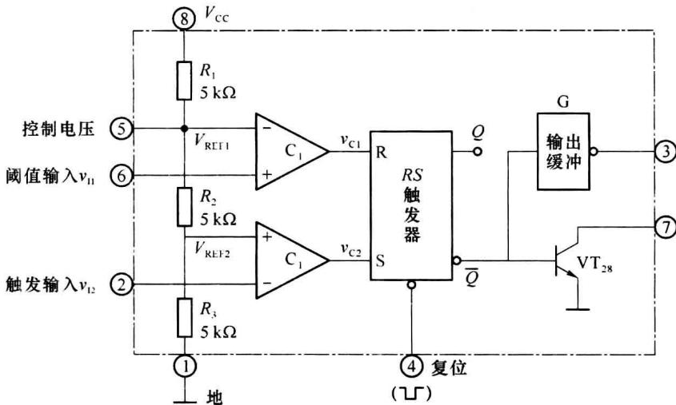
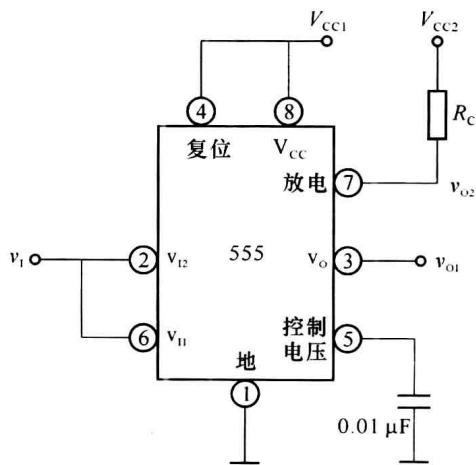
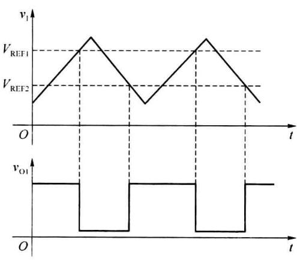
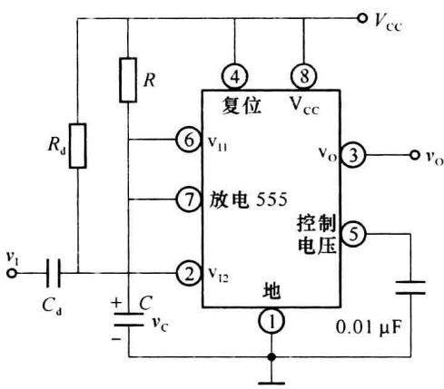
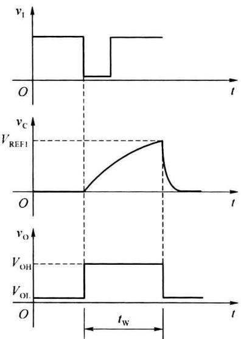
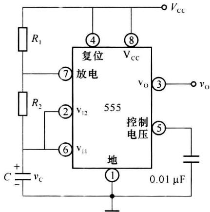
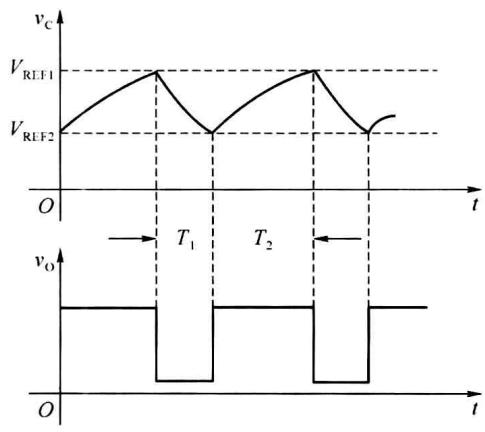

import Guide from '@/components/Guide.astro';
import Knowledge from '@/components/Knowledge.astro';
import Example from '@/components/Example.astro';
import Analysis from '@/components/Analysis.astro';
import Solution from '@/components/Solution.astro';
import Variant from '@/components/Variant.astro';
import Note from '@/components/Note.astro';
import Block from '@/components/Block.astro';
import Method from '@/components/Method.astro';
import Exercise from '@/components/Exercise.astro';

555 定时器是美国 Signetics 公司 1972 年研制的多用途单片集成电路, 因电路输入端设计有 3 个 $5 \mathrm{k} \Omega$ 的电阻而得名。此电路的设计初衷是取代机械式定时器, 后来竟风靡全球。

555 定时器将模拟电路和数字电路巧妙地结合在一起, 只需外接少量的电容和电阻等元件就可以构成单稳态触发器、施密特触发器、多谐振荡器等电路, 广泛应用于信号波形的产生、变换、检测与控制等领域。

## 10.5.1 555 定时器的结构及工作原理

在 Signetics 公司推出这种产品后, 很多电子器件公司也都相继推出了各自的 555 定时器。尽管产品型号繁多, 但所有双极型产品型号最后 3 位数码都是 555, 所有 CMOS 产品最后 4 位数码都是 7555, 如 5G555 和 C7555 等型号, 它们的结构及工作原理基本相同, 引脚排列也完全一致。如图 10.5.1 所示为 555 定时器的内部组成框图, 它由分压器、电压比较器 $C_{1}$ 和 $C_{2}$ 、基本 RS 触发器、放电(泄放)管 $VT_{28}$ 和输出缓冲器 G 组成。其中, 分压器由 3 个阻值为 5 kΩ 的电阻串联而成, 晶体管 $VT_{28}$ 为集电极开路输出的泄放晶体管。

  

图 10.5.1 555 定时器内部组成框图

比较器 $C_{1}$ 、 $C_{2}$ 的基准偏压由电阻 $R_{1} \sim R_{3}$ 分压提供， $C_{1}$ 的基准电压为 $V_{REF1} = 2V_{CC}/3$ ， $C_{2}$ 的基准电压为 $V_{REF2} = V_{CC}/3$ 。外部控制电压通过 5 脚输入，其功能是调整 $C_{1}$ 和 $C_{2}$ 的基准电压，如果 5 脚外接固定直流电压，则两个比较器的基准电压也将发生变化。外部输入 $v_{I1}$ 通过 6 脚接于比较器 $C_{1}$ 的同相输入端，称为阈值输入；外部输入 $v_{I2}$ 通过 2 脚接于比较器 $C_{2}$ 的反相输入端，称为触发输入。

定时器的工作状态由内部 RS 触发器的状态所决定，比较器 $C_{1}$ 、 $C_{2}$ 的输出控制 RS 触发器的状态，并通过触发器的 $\overline{Q}$ 端控制放电管 $VT_{28}$ 的工作状态。4 脚为内部 RS 触发器的异步复位端，低电平有效，当 4 脚有负脉冲到来时，RS 触发器被立即复位， $\overline{Q}$ 输出高电平，放电管 $VT_{28}$ 导通。

当 $v_{I1}<V_{REF1}, v_{I2}<V_{REF2}$ 时，比较器 $C_{1}$ 输出低电平， $C_{2}$ 输出高电平，RS=01，触发器被置位， $\overline{Q}$ 为低电平，3 脚输出高电平，放电管 $VT_{28}$ 截止。

当 $v_{I1} > V_{REF1}, v_{I2} > V_{REF2}$ 时，比较器 $C_{1}$ 输出高电平， $C_{2}$ 输出低电平，RS = 10，触发器被复位， $\overline{Q}$ 为高电平，3 脚输出低电平，放电管 $VT_{28}$ 导通。

当 $v_{I1}<V_{REF1}, v_{I2}>V_{REF2}$ 时，比较器 $C_{1}$ 输出低电平， $C_{2}$ 输出也为低电平，RS=00，触发器维持原状态不变， $\overline{Q}$ 保持以前的状态。

综上分析,555定时器的功能表如表10.5.1所示。

表 10.5.1 555 定时器的功能表

<table><tr><td colspan="3">输入</td><td colspan="2">输出</td></tr><tr><td>阈值输入 ${v}_{11}$ </td><td>阈值输入 ${v}_{12}$ </td><td>复位输入(4脚)</td><td>输出 ${\mathrm{v}}_{\mathrm{O}}$ (3脚)</td><td>放电管 ${\mathrm{{VT}}}_{28}$ </td></tr><tr><td>X</td><td>X</td><td>0</td><td>0</td><td>导通</td></tr><tr><td> $< {\mathrm{V}}_{\mathrm{{REF}}1}$ </td><td> $< {\mathrm{V}}_{\mathrm{{REF}}2}$ </td><td>1</td><td>1</td><td>截止</td></tr><tr><td> $>{\mathrm{V}}_{\mathrm{{REF}}1}$ </td><td> $>{\mathrm{V}}_{\mathrm{{REF}}2}$ </td><td>1</td><td>0</td><td>导通</td></tr><tr><td> $< {\mathrm{V}}_{\mathrm{{REF}}1}$ </td><td> $>{\mathrm{V}}_{\mathrm{{REF}}2}$ </td><td>1</td><td>不变</td><td>不变</td></tr></table>

555 定时器可以在很宽的电源电压范围内工作,能够承受较大的负载电流,双极型 555 定时器的电源电压范围为 5\~16 V,最大负载电流可达 200 mA,CMOS 型 555 定时器的电源电压范围为 3\~18 V,最大负载电流可达 4 mA。

## 10.5.2 由 555 定时器组成的施密特触发器

将 555 定时器的阈值输入端(6 脚)和触发输入端(2 脚)连接在一起,便构成了施密特触发器,如图 10.5.2(a)所示,其中放电管 $VT_{28}$ 的集电极经上拉电阻 $R_{C}$ 接至 $V_{CC2}$ ,此时输出电压 $v_{O2}$ 的高电平由电阻 $R_{C}$ 和 $V_{CC2}$ 决定,可实现电平转换。

由图 10.5.1 可知，比较器 $C_{1}$ 、 $C_{2}$ 的阈值电压分别为 $V_{REF1}=2V_{CC1}/3$ 和 $V_{REF2}=V_{CC1}/3$ ，输入信号 $v_{1}$ 的波形如图 10.5.2(b) 所示。在 t=0 时刻， $v_{1}<V_{REF2}$ ，此时比较器 $C_{1}$ 输出低电平， $C_{2}$ 输出高电平，RS=01，RS 触发器置位， $v_{O1}$ 输出高电平；当输入信号 $v_{1}$ 增加到 $V_{REF2}$ 时，比较器 $C_{2}$ 的输出变为低电平，RS=00，触发器维持原状态不变， $v_{O1}$ 继续输出高电平；当 $v_{1}$ 增加到 $V_{REF1}$ 时，比较器 $C_{1}$ 输出变为高电平，RS=10，触发器发生状态翻转， $v_{O1}$ 输出低电平； $v_{1}$ 继续增加，上述状态保持不变。

  

(a) 电路图

  

(b) 工作波形  

图10.5.2 由555定时器构成的施密特触发器

输入信号 $v_{1}$ 达到最大值后开始下降，只要 $v_{I} > V_{REF2}, v_{O1}$ 输出保持低电平不变；当 $v_{1}$ 下降到 $V_{REF2}$ 时，触发器再次发生状态翻转， $v_{O1}$ 输出变为高电平； $v_{I}$ 继续减小，上述状态保持不变。当输入为三角波形时，从施密特触发器的 $v_{O1}$ 端可输出方波。

触发器的回差电压 $\Delta V_{th}=V_{REF1}-V_{REF2}=V_{CC1}/3$ ，若要改变阈值电压 $V_{REF1}$ 和 $V_{REF2}$ ，可在 5 脚外接直流控制电压。

## 10.5.3 由 555 定时器组成的单稳态触发器

由 555 定时器组成的单稳态触发器及其工作波形如图 10.5.3 所示, 其中 R、C 为定时元件。外部触发脉冲 $v_{1}$ 通过 2 脚接于比较器 $C_{2}$ 的反相输入端, 稳态时 $v_{1}$ 输入为高电平, 比较器 $C_{2}$ 输出低电平, 触发器置位信号 S=0 。 $R_{d}$ 和 $C_{d}$ 为输入回路的微分环节, 如果输入的负触发脉冲小于单稳态触发器的输出脉宽, 微分环节可以省略。

电源刚接通时， $V_{cc}$ 通过电阻 R 给电容 C 充电，当电容上的电压上升到 $V_{REF1}$ 时，比较器 $C_{1}$ 输出高电平，由于此时无触发脉冲，比较器 $C_{2}$ 输出低电平，即 RS=10，内部 RS 触发器被复位， $v_{0}$ 输出低电平，同时放电管 $VT_{28}$ 导通，将电容 C 上的电荷迅速放掉，使得比较器 $C_{1}$ 输出低电平，此时，RS=00，基本 RS 触发器处于保持状态，输出不再发生变化，电路进入稳定状态。

  

(a)电路图

  

(b) 工作波形  

图10.5.3 由555定时器构成的单稳态触发器

若在输入端 $v_{1}$ 施加触发脉冲，当触发脉冲的下降沿到来时，由于2脚电位低于 $V_{\mathrm{REF2}}$ ，比较器 $\mathbf{C}_2$ 输出高电平，此时 $RS = 01$ ，基本RS触发器被置位， $\overline{\mathbf{Q}}$ 输出低电平，电路开始进入暂稳态， $v_{0}$ 输出高电平，放电管 $\mathrm{VT}_{28}$ 截止。 $V_{\mathrm{CC}}$ 通过电阻 $R$ 开始给电容 $C$ 充电，电容上的电压 $v_{\mathrm{C}}$ 按指数规律上升，当 $v_{\mathrm{C}}$ 上升到 $V_{\mathrm{REF1}}$ 时，比较器 $\mathbf{C}_1$ 输出高电平，由于此时外部触发脉冲已经撤销，比较器 $\mathbf{C}_2$ 输出低电平，即 $RS = 10$ ，基本RS触发器被复位，暂稳态过程结束，电路又自动返回到稳定状态， $v_{0}$ 变为低电平，放电管 $\mathrm{VT}_{28}$ 导通。

如果忽略晶体管 $VT_{28}$ 的饱和压降，则暂稳态持续的时间即是电容 C 从 0 V 充电至 $V_{REF1}$ 所需的时间，因此

$$

t _ {\mathrm{w}} = R C \ln \frac {V _ {\mathrm{cc}}}{V _ {\mathrm{cc}} - 2 V _ {\mathrm{cc}} / 3} = R C \ln 3 \approx 1. 1 R C\tag{10.5.1}

$$

这种电路产生的脉冲宽度可以从几微秒到数分钟，精度可达1%。图10.5.3(a)中控制电压输入端(5脚)通过0.001 $\mu$ F电容接地，以防止脉冲干扰。

## 10.5.4 由 555 定时器组成的多谐振荡器

由 555 定时器构成的多谐振荡器如图 10.5.4(a) 所示, 图 10.5.4(b) 所示为其工作波形。

接通电源后, $V_{\mathrm{CC}}$ 通过电阻 $R_{1}, R_{2}$ 给电容 $C$ 充电, 充电时间常数为 $(R_{1} + R_{2})C$ , 电容上的电压 $v_{\mathrm{C}}$ 按指数规律上升, 当 $v_{\mathrm{C}}$ 上升到 $V_{\mathrm{REF1}} = 2V_{\mathrm{CC}} / 3$ 时, 比较器 $\mathbf{C}_{1}$ 输出高电平, $\mathbf{C}_{2}$ 输出低电平, $RS = 10$ , 触发器被复位, 放电管 $\mathrm{VT}_{28}$ 导通, 此时 $v_{\mathrm{O}}$ 输出低电平, 电容 $C$ 开始通过 $R_{2}$ 放电, 放电时间常数约为 $R_{2} \mathrm{C}, v_{\mathrm{C}}$ 指数下降, 当 $v_{\mathrm{C}}$ 下降到 $V_{\mathrm{REF2}} = V_{\mathrm{CC}} / 3$ 时, 比较器 $\mathbf{C}_{1}$ 输出低电平, $\mathbf{C}_{2}$ 输出高电平, $RS = 01$ , 触发器被置位, 放电管 $\mathrm{VT}_{28}$ 截止, $v_{\mathrm{O}}$ 输出高平, 电容 $C$ 又开始充电, 当 $v_{\mathrm{C}}$ 上升到 $V_{\mathrm{REF1}} = 2V_{\mathrm{CC}} / 3$ 时, 触发器又开始发生翻转。如此周而复始, $v_{\mathrm{O}}$ 输出矩形脉冲。

  

(a) 电路图

  

(b)工作波形  

图10.5.4 由555定时器构成的多谐振荡器

由图 10.5.4(b) 可知, 电容 C 放电所需的时间即是 $v_{C}$ 从 $V_{REF1}=2V_{CC}/3$ 下降到 $V_{REF2}=V_{CC}/3$ 所需的时间, 因此

$$

T _ {1} = R _ {2} C \mathrm{ln} 2 \approx 0. 7 R _ {2} C\tag{10.5.2}

$$

电容 C 充电所需的时间即是 $v_{C}$ 从 $V_{REF1}=V_{CC}/3$ 上升到 $V_{REF2}=2V_{CC}/3$ 所需的时间，因此

$$

T _ {2} = (R _ {1} + R _ {2}) C \mathrm{ln} 2 \approx 0. 7 (R _ {1} + R _ {2}) C\tag{10.5.3}

$$

因而，振荡周期为

$$

T = T _ {1} + T _ {2} \approx 0. 7 (R _ {1} + 2 R _ {2}) C\tag{10.5.4}

$$

振荡器输出波形的占空比为

$$

D = \frac {T _ {1}}{T} = \frac {R _ {2}}{R _ {1} + 2 R _ {2}}\tag{10.5.5}

$$

上面仅讨论了 555 定时器的几种简单应用,实际上,由于 555 定时器功能灵活,输出驱动电流大,在电子技术中获得广泛应用,限于篇幅,这里就不再一一枚举了,感兴趣的读者可查阅相关参考书。
