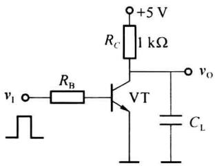
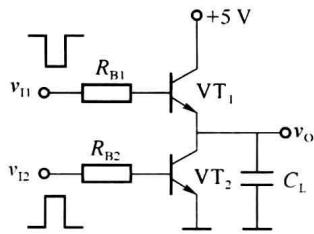
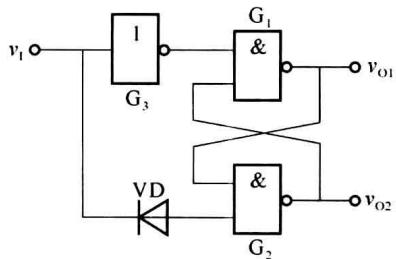
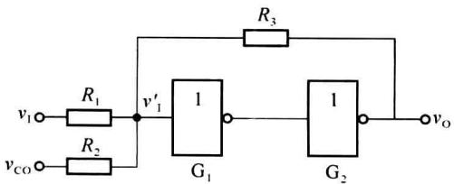
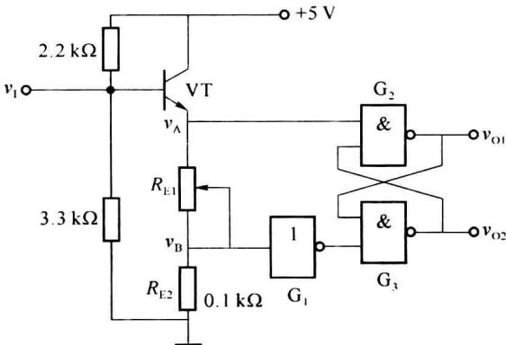
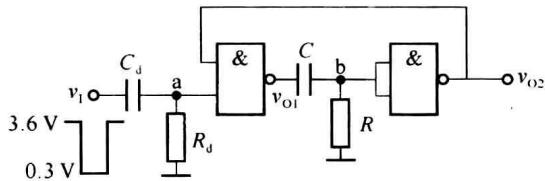
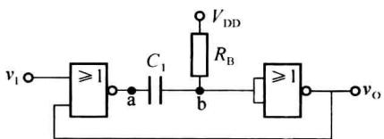
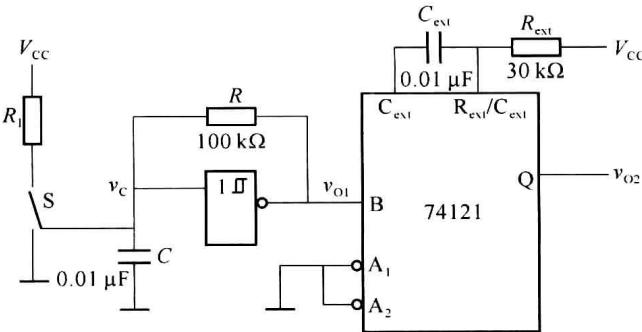
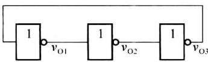

import Guide from '@/components/Guide.astro';
import Knowledge from '@/components/Knowledge.astro';
import Example from '@/components/Example.astro';
import Analysis from '@/components/Analysis.astro';
import Solution from '@/components/Solution.astro';
import Variant from '@/components/Variant.astro';
import Note from '@/components/Note.astro';
import Block from '@/components/Block.astro';
import Method from '@/components/Method.astro';
import Exercise from '@/components/Exercise.astro';

## 习题

<Exercise title="习题 10-1">
什么是脉冲波？什么是占空比？方波的占空比是多少？
</Exercise>

<Exercise title="习题 10-2">
两种晶体管反相器电路如题图 10.1 所示, 负载电容 $C_{L}=100pF$ , $v_{I1}$ 、 $v_{I2}$ 为反相输入信号, $v_{O}$ 为反相器的输出端。设各晶体管的参数相同, 导通时基极驱动电流相等, 试分析这两种电路输出电压的边沿变化情况, 比较它们的工作速度。

  

(a)

  

(b)  

题图10.1
</Exercise>

<Exercise title="习题 10-3">
由TTL门电路组成的施密特触发器如题图10.2所示，试分析电路的工作原理，画出 $v_{\mathrm{O1}}$ 和 $v_{\mathrm{O2}}$ 的电压传输特性。

  

题图10.2
</Exercise>

<Exercise title="习题 10-4">
题图 10.3 所示是用 CMOS 反相器接成的压控施密特触发器, CMOS 反相器的阈值电压为 $V_{th}$ , 试分析该施密特触发器的阈值电压 $V_{T+}$ 、 $V_{T-}$ 以及回差电压 $\Delta V_{T}$ 与控制电压 $V_{CO}$ 的关系。

  

题图10.3
</Exercise>

<Exercise title="习题 10-5">
题图 10.4 所示是一个回差电压可调的施密特触发器电路，试分析它的工作原理，当 $R_{E1}$ 在 $50 \sim 100 \Omega$ 范围内变化时，计算回差电压的变化范围，其中门电路的阈值电压 $V_{th} = 1.4 V$ 。

  

题图10.4
</Exercise>

<Exercise title="习题 10-6">
用TTL与非门组成的单稳态触发器如题图10.5所示。

(1) 为保证稳态时 $v_{O1}$ 输出低电平, $v_{O2}$ 输出高电平, $R_{d}$ 和 R 应如何选取?

(2) 画出 $v_{01}$ 、 $v_{02}$ 的波形。

(3) 设与非门截止时输出电阻为 $R_{0}$ ，求输出脉宽 $t_{w}$ 。

  

题图10.5
</Exercise>

<Exercise title="习题 10-7">
用 CMOS 或非门组成的微分型单稳态触发器电路如题图 10.6 所示。

(1) 试分析其工作原理。

(2) 画出 a、b 及 $v_{0}$ 点的波形。

(3) 求输出脉冲宽度 $t_{w}$ 。

  

题图10.6
</Exercise>

<Exercise title="习题 10-8">
由集成施密特触发器和集成单稳态触发器74121构成的电路如题图10.7所示，已知施密特电路的 $V_{DD}=10\ V$ ，单稳态触发器 $V_{T+}=6.3\ V,V_{T-}=2.7\ V$ 。

(1) 计算 $v_{O1}$ 的周期和 $v_{O2}$ 的脉宽。

(2) 画出 $v_{C}$ 、 $v_{O1}$ 、 $v_{O2}$ 的波形。

  

题图10.7
</Exercise>

<Exercise title="习题 10-9">
利用门电路固有的传输延迟,将奇数个非门首尾相接,可组成多谐振荡器,常称为环形振荡器。题图 10.8 所示电路是由 3 个 TTL 非门构成的环形振荡器,设各门的传输延迟时间相同。试画出各输出端的波形,并计算振荡周期和频率。

  

题图10.8
</Exercise>
