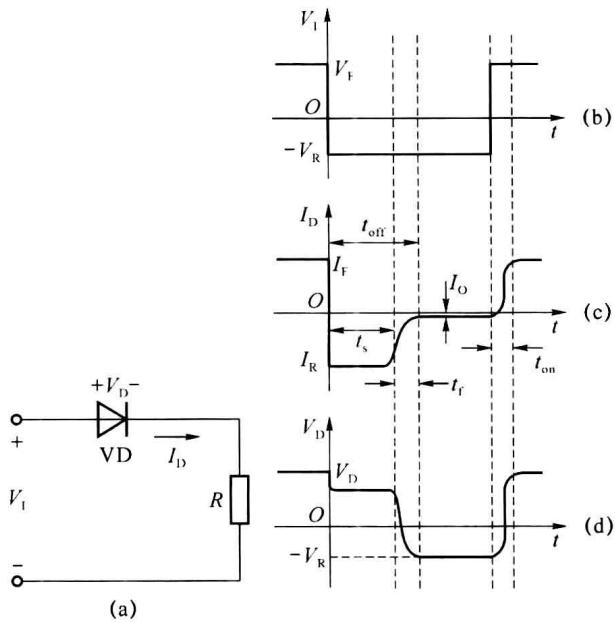
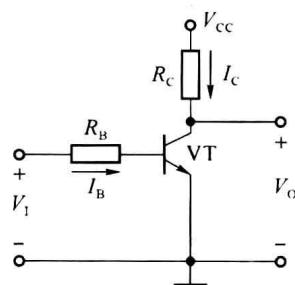
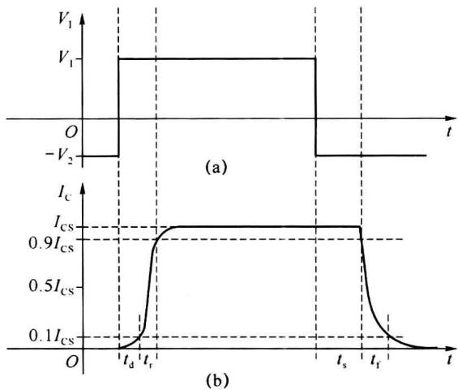

import Guide from '@/components/Guide.astro';
import Knowledge from '@/components/Knowledge.astro';
import Example from '@/components/Example.astro';
import Analysis from '@/components/Analysis.astro';
import Solution from '@/components/Solution.astro';
import Variant from '@/components/Variant.astro';
import Note from '@/components/Note.astro';
import Block from '@/components/Block.astro';
import Method from '@/components/Method.astro';
import Exercise from '@/components/Exercise.astro';

## 第2章 逻辑门电路

逻辑门是构成各种数字逻辑电路的基本单元。逻辑门可以用电阻、电容、二极管、晶体三极管、场效应管等分立元件构成，叫分立元件门，也可以将构成逻辑门电路的所有器件及连接导线制作在同一块半导体基片上，构成集成逻辑门。本章主要介绍二极管和三极管的开关特性以及集成逻辑门的构成、工作原理、参数和应用方法。

数字集成逻辑门按其内部有源器件的不同可以分为两大类。一类为双极型晶体管集成逻辑门，主要有晶体管-晶体管逻辑（Transistor Transistor Logic, TTL）、射极耦合逻辑（Emitter Coupled Logic, ECL）和集成注入逻辑（Integrated Injection Logic, I²L）等几种类型。双极型晶体管集成逻辑门的工作速度高、驱动能力强，但功耗较大、集成度稍低。另一类为 MOS(Metal Oxide Semiconductor) 集成逻辑门，MOS 门又可分为 NMOS、PMOS 和 CMOS 几种类型，特点是集成度高、功耗较低，工作速度略低。目前数字系统中普使用较多的是 TTL 和 CMOS 集成电路。

## 2.1.1 二极管的开关特性

在数字电路中,半导体二极管(由 PN 结构成)的工作状态主要在导通与截止间转换,称其为工作在开关状态。由于 PN 结结电容的存在(相关知识见电子电路基础教材),在较高速度工作的二极管不能再用简单、理想的单向导电性描述,导通与截止两种状态间转换时间决定了二极管电路的最高工作速度和整个电路的性能。

图 2.1.1 给出了一个简单的二极管开关电路及其开关特性曲线。当输入电压 $V_{I}=V_{F}$ 时，二极管导通，正向电流 $I_{F}=\frac{V_{F}-V_{D}}{R}$ ，其中 $V_{D}$ 为二极管两端的正向压降。由于结电容的存在，在 PN 结两端有电荷的堆积存储，正向电流 $I_{F}$ 越大，堆积存储的电荷就越多。在 t=0 时刻，外加电压 $V_{F}$ 下降到 $-V_{R}$ ，这些堆积存储电荷不能瞬间消失，在反向电压 $-V_{R}$ 的作用下，存储电荷形成漂移电流，即反向电流 $I_{R}$ ，其值约为 $\frac{-V_{R}}{R}$ ，如图 2.1.1(c) 所示。电流 $I_{R}$ 持续时间用 $t_{s}$ 表示，称为存储时间，在这段时间内，PN 结仍为正向偏置（简称正偏）。随着反向电流 $I_{R}$ 的下降，PN 结由正偏转为反向偏置（简称反偏），最后反向电流趋于 $I_{0}$ （反向漏电流）。反向电流从 $I_{R}$ 下降到 $I_{0}$ 的这段时间称为为下降时间，用 $t_{f}$ 表示，此时二极管由导通转为截止。

  

图 2.1.1 二极管开关电路及其开关特性曲线

存储时间加下降时间 $t_{s} + t_{f}$ 称为二极管的反向恢复时间，用 $t_{off}$ （部分书籍用 $t_{r}$ 表示）表示。 $t_{off}$ 与二极管本身的特性有关，如 PN 结的面积、结电容等；同时 $t_{off}$ 也与外电路有关，正向电流 $I_{F}$ 越大，存储电荷越多，反向恢复时间越长，反向电压 $V_{R}$ 越大，存储电荷消失得越快，反向恢复时间越短。

开通时间 $t_{on}$ 是指二极管从反向截止到正向导通的时间。由于 PN 结正向导通电阻和正向压降都很小，二极管的开通时间较短，相对反向恢复时间而言开通时间一般可以忽略不计。所以影响二极管开关速度的主要因素是反向恢复时间。

## 2.1.2 双极型晶体三极管的开关特性

在模拟电路中,双极型晶体三极管(简称晶体管或三极管)主要工作在放大区,而在数字电路中,晶体管工作在开关状态,也就是主要工作在饱和区和截止区。图2.1.2是由晶体管

构成的反相器电路，在矩形脉冲信号 $V_{1}$ 的作用下，晶体管交替工作于饱和区和截止区，输出信号 $V_{0}$ 也是脉冲信号，而且输出信号与输入信号的相位相反，实现反相器的功能。

同二极管一样,晶体三极管作为开关元件使用时,截止与饱和两种工作状态的转换也不可能瞬间完成,在作为开关应用的过程中,晶体管内部存在着存储电荷的建立和消散过程,如图2.1.3所示,开关过程依然需要一定的时间,输出信号有一定的时延。

  

图 2.1.2 晶体管反相器

  

图 2.1.3 三极管反相器的时延特性

在晶体管反相器中，当输入信号 $V_{\mathrm{I}} = -V_{2}$ 时，晶体管VT截止，此时基极电流 $I_{\mathrm{B}} \approx 0$ ，集电极电流 $I_{\mathrm{C}} \approx 0$ ，集电极C和发射极E之间相当于断开的开关，输出 $V_{\mathrm{O}} \approx V_{\mathrm{CC}}$ 。一般情况下，当 $V_{\mathrm{I}} \leqslant V_{\mathrm{TH}} (V_{\mathrm{TH}}$ 为晶体管的死区电压）时，晶体管VT也可近似认为处于截止状态。

当输入信号 $V_{\mathrm{I}} = V_{1}$ 时，晶体管进入饱和区，此时 $I_{\mathrm{B}} = \frac{V_{1} - V_{\mathrm{BE}}}{R_{\mathrm{B}}}$ ，晶体管C、E之间的压降很小（为饱和压降 $V_{\mathrm{CES}}$ ，晶体管相当于闭合的开关，输出 $V_{\mathrm{O}} = V_{\mathrm{CES}} \approx 0$ ，集电极电流 $I_{\mathrm{C}} = I_{\mathrm{CS}} = \frac{V_{\mathrm{CC}} - V_{\mathrm{CES}}}{R_{\mathrm{C}}}$ 。由于晶体管处于饱和区，基极电流 $I_{\mathrm{B}}$ 和集电极电流 $I_{\mathrm{C}}$ 之间不存在 $I_{\mathrm{C}} = \beta I_{\mathrm{B}}$ 的关系，而是 $I_{\mathrm{C}} < \beta I_{\mathrm{B}}$ 。

将晶体管进入临界饱和状态时的集电极和基极电流分别表示为 $I_{CS}$ 和 $I_{BS}$ ，则

$$

I _ {\mathrm{cs}} = \frac {V _ {\mathrm{cc}} - V _ {\mathrm{CES}}}{R _ {\mathrm{c}}} \approx \frac {V _ {\mathrm{cc}}}{R _ {\mathrm{c}}}\tag{2.1.1}

$$

$$

I _ {\mathrm{BS}} = \frac {I _ {\mathrm{CS}}}{\beta}\tag{2.1.2}

$$

晶体管在饱和区工作时,其基极电流 $I_{B}$ 与临界饱和时的基极电流 $I_{BS}$ 之比称为饱和深度 S,饱和深度的公式见式(2.1.3)。饱和深度 S 越大,带负载能力越强。

$$

\mathrm{饱和深度} S = \frac {I _ {\mathrm{B}}}{I _ {\mathrm{BS}}}\tag{2.1.3}

$$

当图 2.1.3(a) 所示的输入电压加到反相器的输入端时, 对应的集电极电流 $I_{c}$ 的波形如图 2.1.3(b) 所示。图中:

$t_{d}$ 为延迟时间，定义为 $I_{C}=0$ 到 $I_{C}=0.1I_{CS}$ 所对应的时间。延迟时间的长短取决于晶体管内部的结构和电路的工作条件，发射结的结电容越小，正向驱动电流越大延迟时间越短。

$t_{r}$ 为上升时间, 定义为 $I_{C}=0.1I_{CS}$ 到 $I_{C}=0.9I_{CS}$ 所对应的时间。晶体管基区越薄, 正向驱动电流越大上升时间越短。

$t_{s}$ 为存储时间, 定义为 $I_{C}=I_{CS}$ 下降到 $I_{C}=0.9I_{CS}$ 所对应的时间。晶体管结电容越大, 饱和深度越深存储时间越长。

$t_{f}$ 为下降时间, 定义为 $I_{C}=0.9I_{CS}$ 下降到 $I_{C}=0.1I_{CS}$ 所对应的时间。晶体管基区越薄,

反向电压越高,下降时间就越短。

$t_{on}=t_{d}+t_{r}$ 称为开通时间，是晶体管从截止状态转换为饱和状态所需要的时间。

$t_{off}=t_{s}+t_{f}$ 称为关断时间，是晶体管从饱和状态转换为截止状态所需要的时间。

以上所提到的 $t_{d}$ 、 $t_{r}$ 、 $t_{s}$ 、 $t_{f}$ 4 个参数中， $t_{s}$ 是影响工作速度的主要因素，并且饱和深度越深， $t_{s}$ 越大。饱和深度越深虽然可以提高反相器的带负载能力，但降低工作速度，设计时应综合考虑。
