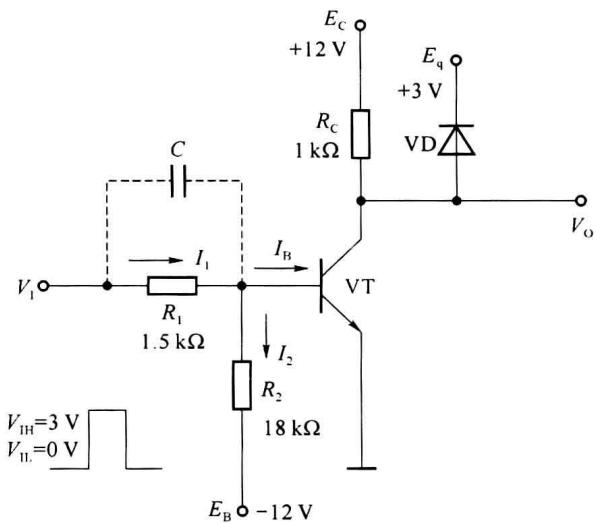
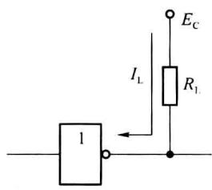
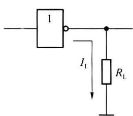
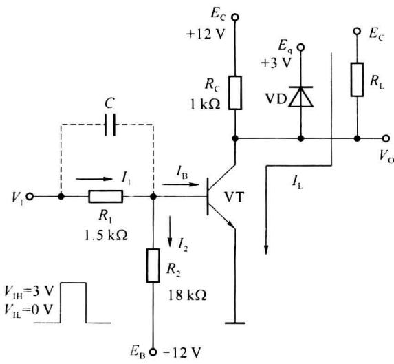
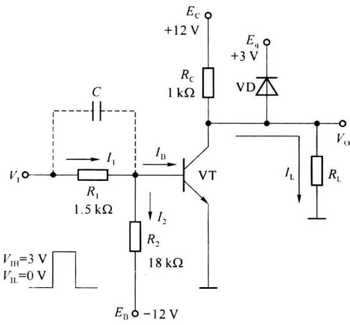

import Guide from '@/components/Guide.astro';
import Knowledge from '@/components/Knowledge.astro';
import Example from '@/components/Example.astro';
import Analysis from '@/components/Analysis.astro';
import Solution from '@/components/Solution.astro';
import Variant from '@/components/Variant.astro';
import Note from '@/components/Note.astro';
import Block from '@/components/Block.astro';
import Method from '@/components/Method.astro';
import Exercise from '@/components/Exercise.astro';

在第 1 章介绍与逻辑和或逻辑时,我们已经介绍了二极管构成的与门和或门。利用晶体三极管可以构成非门,也称为反相器。晶体三极管反相器电路如图 2.2.1 所示。

  

图 2.2.1 晶体管反相器

## 2.2.1 反相器的工作原理

反相器中的晶体三极管工作在开关状态, 输入为低电平 $(V_{\mathrm{IL}}=0\ \mathrm{V})$ 时晶体管截止, 即发射结反偏, 集电结也是反偏, 输出为高电平; 输入为高电平 $(V_{\mathrm{IL}}=3\ \mathrm{V})$ 时晶体管饱和导通, 即发射结正偏, 集电结也是正偏, 输出为低电平。电路中二极管 VD 和电源 $E_{q}$ 为钳位电路, 二极管 VD 称为钳位二极管。若设二极管的正向压降为 0.7 V, 则 VD 导通时输出 $V_{0}$ 被钳位在 3.7 V 左右。

### 1. 晶体管截止

输入低电平 $V_{IL}=0\ V$ 时，由于发射极为 0 电位，若基极电位 $V_{B}$ 满足条件 $V_{B}<0\ V$ ，则发射结反偏，晶体管截止。在图 2.2.1 所示电路中，先假设晶体管 VT 截止， $I_{B}=0$ ，则有基极电位为

$$

V _ {\mathrm{B}} = V _ {\mathrm{IL}} - \frac {V _ {\mathrm{IL}} - E _ {\mathrm{B}}}{R _ {1} + R _ {2}} R _ {1}\tag{2.2.1}

$$

代入电路参数得: $V_{B}=-0.92\ V$ , 可见假设成立, 晶体管在输入低电平 0 V 条件下发射结反偏,能够可靠截止。由于钳位电路的作用,电路输出高电平为 $V_{OH} \approx 3.7 \, V$ (设二极管 VD 正向压降为 0.7 V)。

### 2. 晶体管饱和

输入高电平 $V_{IH}=3V$ 时，若晶体管的基极电流满足 $I_{B}>I_{BS}$ ，则晶体管饱和导通。 $I_{BS}$ 为基极临界饱和电流。

设饱和时发射结的压降 $V_{BES}=0.7\ V, V_{CES}\approx0.1\ V, \beta=30$ 。晶体管 VT 的基极电流为 $I_{B}=I_{1}-I_{2}$ ，代入电路参数得到

$$

I _ {1} = \frac {V _ {\mathrm{IH}} - V _ {\mathrm{BES}}}{R _ {1}} = \frac {3 - 0 . 7}{1 . 5} = 1. 5 3 \mathrm{mA}

$$

则

$$

\begin{array}{r} I _ {2} = \frac {V _ {\mathrm{BES}} - E _ {\mathrm{B}}}{R _ {2}} = \frac {0 . 7 + 1 2}{1 8} = 0. 7 1 \mathrm{mA} \\ I _ {B} = I _ {1} - I _ {2} = 0. 8 2 \mathrm{mA} \end{array}

$$

根据输出回路,可以求出

$$

I _ {\mathrm{BS}} = \frac {I _ {\mathrm{CS}}}{\beta} \approx \frac {E _ {\mathrm{C}}}{\beta R _ {\mathrm{C}}} = 0. 4 \mathrm{mA}

$$

由于 $I_{B} > I_{BS}$ ，晶体管进入饱和状态，输出低电平

$$

V _ {\mathrm{OL}} = V _ {\mathrm{CES}} \approx 0. 1 \mathrm{V}

$$

饱和深度

$$

S = \frac {I _ {\mathrm{B}}}{I _ {\mathrm{BS}}} \approx 2

$$

由以上分析可以看到,在输入低电平0 V时,输出高电平约为3.7 V;在输入高电平3 V时,输出低电平近似为0.1 V。电路完成反相器的功能。

图 2.2.1 中的电容 C 为加速电容。当输入信号正向跳变时，由于加速电容两端电压不能突变，驱动信号可以通过电容瞬时提供一个较大的基极电流，缩短了晶体管的开启时间；当输入信号负跳变时，电容将通过发射结反向放电，从而产生一个较大的反向基极电流，大大缩短了晶体管的关断时间，因而提高了晶体管的开关速度。

## 2.2.2 反相器的负载能力

根据数字逻辑电路的负载连接情况,负载可分为灌电流负载和拉电流负载。以反相器的负载为例,若负载电流 $I_{L}$ 流进反相器,则称反相器带的是灌电流负载;若负载电流 $I_{L}$ 流出反相器,则称反相器带的是拉电流负载。示意电路如图 2.2.2 所示。

  

(a)灌电流负载

  

(b)拉电流负载  

图 2.2.2 灌电流负载与拉电流负载

### 1. 灌电流负载

在图 2.2.3(a) 中, 反相器带有灌电流负载 $R_{L}$ 。我们分别在输出为低电平和高电平两种情况分析负载对输出电平的影响。

（1）当输出为低电平时，此时要求晶体管VT饱和，由于低电平在0V左右，钳位二极管VD截止。负载电流 $I_{\mathrm{LI}}$ （表示灌电流）从负载流入反相器的晶体管集电极，这时集电极电流为 $I_{\mathrm{C}} = I_{R_{\mathrm{C}}} + I_{\mathrm{LI}}$ ，其中 $I_{R_{\mathrm{C}}} \approx \frac{E_{\mathrm{C}}}{R_{\mathrm{C}}}$ （即晶体管饱和时 $R_{\mathrm{C}}$ 上的电流，忽略晶体管饱和压降）。当 $R_{\mathrm{L}}$ 减小时， $I_{\mathrm{LI}}$ 增大，集电极电流 $I_{\mathrm{C}}$ 将随着 $I_{\mathrm{LI}}$ 的增大而增大，因晶体管的基极电流 $I_{\mathrm{B}}$ 不变（由输入回路确定），所以晶体管的饱和深度将随 $I_{\mathrm{LI}}$ 的增加而降低。当 $I_{\mathrm{LI}}$ 增加到使饱和深度 $S = 1$ （即 $I_{\mathrm{B}} = I_{\mathrm{BS}}$ ）时，晶体管将脱离饱和状态进入放大状态，晶体管的 $V_{\mathrm{CE}}$ 将上升，即输出电位上升，偏离了电路应提供的低电平（一般低电平为0.1～0.4V），从而破坏了正常的逻辑关系。因此，为了使反相器能够输出正常的低电平，要求反相器带有灌入负载电流负载后，晶体管VT不能进入放大区。定义反相器允许最大灌电流值 $I_{\mathrm{LImax}}$ （即带灌电流负载能力）为三极管从饱和状态退到临界饱和状态时所允许灌入的最大负载电流。

$$

I _ {\mathrm{LImax}} \leqslant \beta I _ {\mathrm{B}} - I _ {R _ {\mathrm{C}}} \approx \beta I _ {\mathrm{B}} - \frac {E _ {\mathrm{C}}}{R _ {\mathrm{C}}}\tag{2.2.2}

$$

例如，在图2.2.3(a)中，晶体管 $\beta = 30$ ，输入高电平 $V_{\mathrm{IH}} = 3\mathrm{V}$ 时，基极电流为 $I_{\mathrm{B}} = 0.82\mathrm{mA}$ ，晶体管临界饱和时的集电极电流 $I_{\mathrm{C}} = \beta I_{\mathrm{B}} = 30\times 0.82 = 24.6\mathrm{mA}$ ，也就是要保证晶体管饱和，集电极电流 $I_{\mathrm{C}}$ 应小于 $24.6\mathrm{mA}$ ，允许最大灌电流值 $I_{\mathrm{LImax}}$ 为

$$

I _ {\mathrm{LImax}} \leqslant \beta I _ {\mathrm{B}} - I _ {R _ {\mathrm{C}}} \approx \beta I _ {\mathrm{B}} - \frac {E _ {\mathrm{C}}}{R _ {\mathrm{C}}} = 2 4. 6 \mathrm{mA} - \frac {1 2 \mathrm{V}}{1 \mathrm{k} \Omega} = 1 2. 6 \mathrm{mA}

$$

  

(a)

  

(b)  

图 2.2.3 反相器带灌电流负载和拉电流负载

设计时除应注意负载电流 $I_{LI}$ 的值对输出低电平的影响外, 还要注意反相器带负载后集电极电流 $I_{C}$ 不要超过三极管最大允许电流 $I_{CM}$ 。

（2）当输出为高电平时，此时晶体管 VT 截止，晶体管 $I_{C} \approx 0$ 。由于钳位电路的作用（钳位二极管 VD 导通， $V_{D} = 0.7 V$ ），输出为高电平，约为 3.7 V。由于负载 $R_{L}$ 的一端接电源

$E_{c}$ ，无论 $R_{L}$ 是什么取值，都不会使输出高电平变低，也就是不会影响输出为“1”的逻辑关系。因此，输出高电平时对 $I_{LI}$ 一般没有要求。只是注意不要使钳位二极管 VD 的电流过大而损坏即可。

由以上分析可知,要提高反相器带灌电流负载能力,关键在于加大晶体管的饱和深度(增加 $I_{B}$ , 增大 $R_{C}$ , 减小 $I_{R_{C}}$ ), 饱和越深, 带负载能力越强。同时也要注意, 饱和越深, 工作速度越慢。

### 2. 拉电流负载

加有拉电流负载的反相器电路如图 2.2.3(b) 所示。

（1）当输出为低电平时，此时晶体管 VT 饱和，输出低电平在 0 V 左右，负载 $R_{L}$ 两端的电压近似为 0 V。 $R_{L}$ 的变化不会使反相器输出为低电平时的逻辑关系发生变化（不会使低电平升高），所以带有拉电流负载的反相器在输出低电平时对负载电流 $I_{LO}$ （表示拉电流）的大小没有要求。

（2）当输出为高电平时，晶体管 VT 截止，晶体管集电极电流 $I_{C} \approx 0$ 。由于钳位电路的作用（钳位二极管 VD 导通， $\dot{V}_{D} = 0.7 V$ ），输出为高电平，约为 3.7 V。负载电流 $I_{LO}$ 的方向为从反相器中向外流出，形成拉电流。流经电阻 $R_{C}$ 的电流 $I_{R_{C}}$ 分为两部分，一部分流入钳位二极管 VD，另一部分流入负载成为 $I_{LO}$ ，即 $I_{R_{C}} = I_{D} + I_{LO}$ 。只要二极管 VD 的电流不为 0，二极管就导通，输出电压就为 $E_{q} + V_{D} = 3.7 V$ ，并且流过 $R_{C}$ 的电流 $I_{R_{C}}$ 为固定值：

$$

I _ {R _ {\mathrm{C}}} = \frac {E _ {\mathrm{C}} - (E _ {\mathrm{q}} + V _ {\mathrm{D}})}{R _ {\mathrm{C}}}\tag{2.2.3}

$$

当负载电流 $I_{LO}$ 增加时，钳位二极管电流 $I_{D}$ 将相应的减小。为了使输出高电平保持固定，钳位二极管 VD 必须导通，即有电流通过。在 $I_{LO}$ 增加时并使 $I_{D}$ 刚好为 0 时， $I_{LO}$ 为最大拉电流 $I_{LOmax}$ ，要求 $I_{LOmax} \leqslant I_{R_{C}}$ 。带入图 2.2.3 中的参数，可以得到最大拉电流为

$$

I _ {\mathrm{LOmax}} \leqslant I _ {R _ {\mathrm{C}}} = \frac {E _ {\mathrm{C}} - (E _ {\mathrm{q}} + V _ {\mathrm{D}})}{R _ {\mathrm{C}}} = 8. 3 \mathrm{mA}

$$

从增加拉电流负载能力看,应使 $I_{R_{C}}$ 尽可能大,即 $R_{C}$ 值越小越好;而对于增强灌电流负载能力来说,应使 $I_{R_{C}}$ 尽可能小,即 $R_{C}$ 值越大越好。因此,设计一个反相器时,应兼顾考虑 $R_{C}$ 的取值,使其既满足灌电流的需求,也满足拉电流的需求。例如,设计一个反相器,要求灌电流 $I_{LImax}=10\ mA$ ,拉电流 $I_{LOmax}=5\ mA$ ,电路的其他参数如图2.2.3所示,则 $R_{C}$ 的取值范围为

$$

\begin{array}{r l} & {R _ {\mathrm{c}} \geqslant \frac {E _ {\mathrm{c}}}{\beta I _ {\mathrm{B}} - I _ {\mathrm{LImax}}} = \frac {1 2 \mathrm{V}}{2 4 . 6 \mathrm{mA} - 1 0 \mathrm{mA}} \approx 8 2 2 \Omega} \\ & {R _ {\mathrm{c}} \leqslant \frac {E _ {\mathrm{c}} - (E _ {\mathrm{q}} + V _ {\mathrm{D}})}{I _ {\mathrm{LOmax}}} = \frac {1 2 \mathrm{V} - 3 . 7 \mathrm{V}}{5 \mathrm{mA}} = 1. 6 6 \mathrm{k} \Omega} \end{array}

$$

可取中间值 $R_{c}=1.2\ k\Omega$ ，也可以为减小功耗，让 $R_{c}$ 接近 $1.66\ k\Omega$ ，并留有一定余量，取 $R_{c}=1.5\ k\Omega$ 。
