import Guide from '@/components/Guide.astro';
import Knowledge from '@/components/Knowledge.astro';
import Example from '@/components/Example.astro';
import Analysis from '@/components/Analysis.astro';
import Solution from '@/components/Solution.astro';
import Variant from '@/components/Variant.astro';
import Note from '@/components/Note.astro';
import Block from '@/components/Block.astro';
import Method from '@/components/Method.astro';
import Exercise from '@/components/Exercise.astro';

常用的通用逻辑门主要有TTL门和CMOS门。TTL门分为54系列和74系列，二者具有完全相同封装、相近的电路结构和电气参数，差别稍大一些的仅为工作温度范围和电源电压范围。54系列的工作温度范围为 $-55\sim +125^{\circ}\mathrm{C}$ ，供电电源电压范围为 $5\mathrm{V}(1\pm 10\%)$ 。74系列的工作温度范围为 $0\sim 70^{\circ}\mathrm{C}$ ，电源电压范围为 $5\mathrm{V}(1\pm 5\%)$ 。

以 74 系列 TTL 与非门为例, 根据性能的不同, 又分为一些子系列, 有标准 TTL(简称 TTL, 与非门型号为 7400)、高速 TTL(简称 HTTL, 与非门型号为 74H00)、肖特基 TTL (简称 STTL, 与非门型号为 74S00)、低功耗肖特基 TTL(简称 LSTTL, 与非门型号为 74LS00)、先进肖特基 TTL(简称 ASTTL, 与非门型号为 74AS00)、先进低功耗肖特基 TTL (简称 ALSTTL, 与非门型号为 74ALS00)、快速 TTL(简称 FTTL, 与非门型号为 74F00) 等。不同种类的与非门具有相同的封装、相同的逻辑功能, 但性能有差异, 如传输时延、功耗、带负载能力等。

## 2.3.1 标准TTL与非门的电路结构和工作原理

### 1. 电路结构

图 2.3.1 所示为标准 TTL 与非门 7400 的内部电路。电路可分为输入级、中间级和输出级。在分析电路时，各项参数定义为：电源电压 $V_{CC} = 5 \, V$ ，输入低电平为 0.3 V，高电平为 3.6 V，发射结导通时 $V_{BE} = 0.7 \, V$ ，集电结导通时 $V_{BC} = 0.7 \, V$ ，晶体管饱和压降 $V_{CES} = 0.3 \, V$ （深度饱和时取值为 0.1 V）。

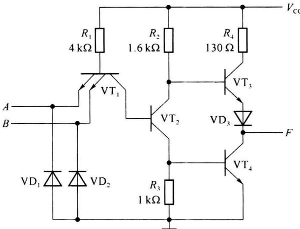  

图 2.3.1 与非门 7400 内部电路

输入级:由多发射极晶体管 $VT_{1}$ 、电阻 $R_{1}$ 和保护二极管 $VD_{1}$ 、 $VD_{2}$ （防止负极性干扰脉冲损坏 $VT_{1}$ ，正常工作时相当于开路）组成。可以将多射极晶体管 $VT_{1}$ 看成两个晶体管，它们的集电极和基极分别并接在一起，如图 2.3.2(a) 所示，作为开关状态的晶体管 $VT_{1}$ 也可以等效为图 2.3.2(b) 所示电路。

当输入信号 A、B 中有一个或两个都为低电平 (0.3 V) 时，晶体管 $VT_{1}$ 的基极电位 $VT_{B1}=1\ V(0.3V+0.7\ V)$ ，此时 $VT_{1}$ 深度饱和，集电极电位 $V_{C1}=0.4\ V(0.3\ V+0.1\ V)$ 。

当 A、B 全部为高电平(3.6 V)时，由于 $VT_{1}$ 的集电极电位受到 $VT_{2}$ 、 $VT_{4}$ 发射结电压的限制， $VT_{1}$ 的集电极电位 $V_{C1}=1.4V$ ; $VT_{1}$ 的集电结正向导通， $VT_{1}$ 的基极电位 $V_{B1}=2.1V$ ，而发射极的电位为 3.6 V，所以 $VT_{1}$ 的发射结反偏，因此 $VT_{1}$ 工作于倒置(反向)放大工作状态。

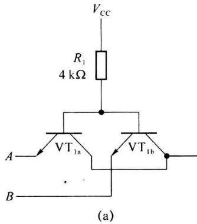

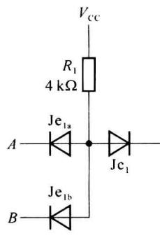  

图 2.3.2 晶体管 $VT_{1}$ 的等效电路

从 $VT_{1}$ 集电极电平与输入电平的逻辑关系看，仅当所有输入都为高电平时， $VT_{1}$ 集电极输出为高电平 (1.4 V)，只要有一个输入为低电平， $VT_{1}$ 集电极输出便是低电平 (0.4 V)，所以输入级完成“与逻辑”功能。如果观察图 2.3.2(b) 给出的等效电路，则与第 1 章中图 1.2.1(b) 所示的二极管与门电路相同。

从图 2.3.2 给出的输入端等效电路还可以分析出, 如果某个输入端(例如 A)悬空, 对应晶体管的发射结偏置电压为 0, 工作在截止状态, 与接高电平时的效果相同, 因此, 某个输入端悬空等效接高电平(逻辑“1”)。

中间级:由晶体管 $VT_{2}$ 、 $R_{2}$ 、 $R_{3}$ 组成, $VT_{2}$ 的集电极和发射极同时输出两个电压反相的信号,作为输出级中晶体管 $VT_{3}$ 、 $VT_{4}$ 的驱动信号。

输出级:由晶体管 $VT_{3}$ 、 $VT_{4}$ 、 $VD_{3}$ 和 $R_{4}$ 组成推挽输出电路。 $VT_{3}$ 导通时 $VT_{4}$ 截止， $VT_{3}$ 截止时 $VT_{4}$ 饱和。由于采用了推挽输出(又称图腾输出)，不仅输出阻抗低，带负载能力强，而且可以提高工作速度，降低功耗。

### 2. TTL 与非门工作原理

### (1) 输入全部为高电平(3.6 V)

当输入端全部为高电位 3.6 V 时，由于 VT $_{1}$ 的基极电压 V $_{B1}$ 约为 2.1 V (V $_{B1}$ =V $_{CB1}$ +V $_{BE2}$ +V $_{BE4}$ )，所以 VT $_{1}$ 所有的发射结反偏，集电结正偏，VT $_{1}$ 的基极电流 I $_{B1}$ = $\frac{E_{C}-V_{B1}}{R_{1}}$ = $\frac{5\text{ V}-2.1\text{ V}}{4\text{ k}\Omega}$ =0.725 mA，VT $_{1}$ 处于倒置（反向）放大工作状态，晶体管的反向电流放大系数 β $_{F}$ 很小（β $_{F}$ 约为 0.02），此时 I $_{B2}$ =I $_{C1}$ ≈I $_{B1}$ =0.725 mA，由于 I $_{B2}$ 较大而以使 VT $_{2}$ 管饱和，且 VT $_{2}$ 发射极向 VT $_{4}$ 管提供足够的基极电流，使 VT $_{4}$ 也饱和。这时 VT $_{2}$ 的集电极电位为 V $_{C2}$ =V $_{CES2}$ +V $_{BE4}$ ≈0.3 V+0.7 V=1 V，这个电压加至 VT $_{3}$ 管基极，不足以使 VT $_{3}$ 的发射结和二极管 VD $_{3}$ 都导通，因为要使 VT $_{3}$ 导通其基极电位需要达到 1.7 V(V $_{B3}$ =V $_{CES4}$ +V $_{BE3}$ +V $_{D3}$ ≈0.3 V+0.7 V+0.7 V=1.7 V)。由于 VT $_{4}$ 饱和，VT $_{3}$ 截止，因此输出为低电平 V $_{O}$ =V $_{OL}$ =V $_{CES4}$ ≈0.3 V。

### (2) 输入端至少有一个为低电平(0.3 V)

当输入端至少有一个为低电位(0.3 V)时, $VT_{1}$ 对应低电位的发射结正偏, $VT_{1}$ 的基极电位 $V_{B1} \approx 1 V$ , 并且 $VT_{1}$ 进入深度饱和状态, 集电极电位 $V_{C1} \approx 0.4 V$ , 要使 $VT_{2}$ 和 $VT_{4}$ 都导通，需要 $V_{\mathrm{C1}}$ 在 $1.3\sim 1.4\mathrm{V}$ ，所以 $\mathrm{VT}_2, \mathrm{VT}_4$ 都截止。由于 $\mathrm{VT}_2$ 截止，其集电极电位 $V_{\mathrm{C2}}$ 近似为电源电压值(5V)， $\mathrm{VT}_3, \mathrm{VD}_3$ 通过 $R_2$ 提供基极电流而导通（ $\mathrm{VT}_3$ 管处于放大状态，而不是饱和状态），此时输出为高电平 $V_{\mathrm{O}} = V_{\mathrm{OH}} = V_{\mathrm{C2}} - V_{\mathrm{BE3}} - V_{\mathrm{D3}} \approx 5\mathrm{V} - 0.7\mathrm{V} - 0.7\mathrm{V} = 3.6\mathrm{V}$ 。

综上所述，当输入端全部为高电平(3.6 V)时，输出为低电平(0.3 V)，对应 $VT_{4}$ 饱和、 $VT_{3}$ 截止，此时称电路处于开门状态；当输入端至少有一个为低电平(0.3 V)时，输出为高电平(3.6 V)，这时对应 $VT_{4}$ 截止、 $VT_{3}$ 导通，此时称电路处于关门状态。经过分析可知，电路的输出和输入之间满足与非逻辑关系： $F=\overline{AB}$ 。表2.3.1给出的是图2.3.1所示与非门的晶体管工作状态(L表示低电平，H表示高电平)。

表 2.3.1 TTL 与非门晶体管工作状态

<table><tr><td>A B</td><td> ${\mathrm{{VT}}}_{1}$ </td><td> ${\mathrm{{VT}}}_{2}$ </td><td> ${\mathrm{{VT}}}_{3}$ </td><td> ${\mathrm{{VT}}}_{4}$ </td><td>F</td></tr><tr><td>L L</td><td>饱和</td><td>截止</td><td>导通</td><td>截止</td><td>H</td></tr><tr><td>L H</td><td>饱和</td><td>截止</td><td>导通</td><td>截止</td><td>H</td></tr><tr><td>H L</td><td>饱和</td><td>截止</td><td>导通</td><td>截止</td><td>H</td></tr><tr><td>H H</td><td>截止</td><td>饱和</td><td>截止</td><td>饱和</td><td>L</td></tr></table>

## 2.3.2 TTL 与非门的特性及参数

### 1. 电压传输特性及相关参数

电压传输特性是指输出电压随输入电压变化的曲线。7400与非门的电压传输特性曲线可以用图2.3.3(a)所示的曲线表示。图2.3.3(b)为电路的计算机仿真曲线。由图可见，曲线可分为4段。

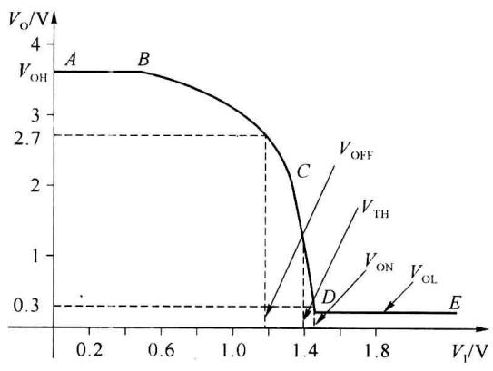  

(a)

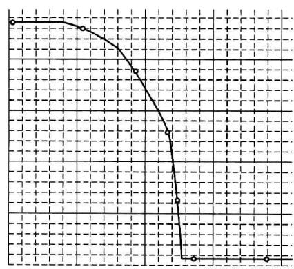  

(b)  

图2.3.3 7400与非门的电压传输特性及仿真曲线

AB 段: $V_{I}<0.6\ V, V_{B1}<1.3\ V, VT_{2}, VT_{4}$ 截止, $VT_{3}$ 导通, $V_{O}=V_{OH}=3.6\ V$ 。

BC 段 : $0.6 \, V \leqslant V_{I} < 1.3 \, V$ 时, $VT_{2}$ 开始导通而 $VT_{4}$ 依然截止, $V_{C2}$ 随 $V_{I}$ 增加而下降, 并通过 $VT_{3}$ 、 $VD_{3}$ 射极跟随器使输出电压 $V_{0}$ 也下降。

CD 段: $1.3 \, V \leqslant V_{I} \leqslant 1.4 \, V$ , 当 $V_{I}$ 略大于 $1.3 \, V$ 时, $VT_{4}$ 开始导通, 并使得 $VT_{2}$ 发射极到地的等效电阻明显减小, $VT_{2}$ 的放大倍数增加, $V_{C2}$ 迅速下降, 输出电压 $V_{O}$ 也迅速下降,

最后 $VT_{3}$ 截止， $VT_{4}$ 进入饱和状态。

DE 段: 当 $V_{I} \geqslant 1.4 \, V$ 时, 随着 $V_{I}$ 增加 $VT_{1}$ 始终处于倒置工作状态, $VT_{2}$ 饱和, $VT_{3}$ 截止, $VT_{4}$ 饱和, 因而输出始终为低电平 $V_{OL} < 0.3 \, V$ 。

从电压传输特性可以得出以下几个重要参数：

① 输出高电平 $V_{OH}$ 和输出高电平的最小值 $V_{OHmin}$

输出高电平 $V_{OH}$ 是指门电路典型的高电平输出值，一般 $V_{OH} \geqslant 3.4 V$ 。

输出高电平的最小值 $V_{OHmin}$ 通常由数据手册给出，是指门电路在满足输出电流指标时，输出高电平允许的最低值，一般要求 $V_{OHmin} \geqslant 2.7 V$ 。不同器件该值会有差异，可参看数据手册。例如，标准 TTL 与非门 7400 的 $V_{OHmin} \geqslant 2.4 V$ ，低功耗肖特基器件 54LS 器件的 $V_{OHmin} \geqslant 2.5 V$ 。而常用的低功耗肖特基器件 74LS00 为 $V_{OHmin} \geqslant 2.7 V$ 。

② 输出低电平 $V_{OL}$ 和输出低电平的最大值 $V_{OLmax}$

输出低电平 $V_{OL}$ 是指门电路典型的低电平输出值，一般 $V_{OL} \leqslant 0.25 V$ 。

输出低电平的最大值 $V_{OLmax}$ 也是由数据手册给出的，是指门电路在满足输出电流指标时，输出低电平允许的最高值，一般为 $V_{OLmax} \leqslant 0.4 V$ 。

数据手册中 7400 的典型值为 $V_{OL}=0.2\ V$ ，最大值 $V_{OLmax}=0.4\ V$ ; 74LS00 的典型值为 $V_{OL}=0.25\ V$ ，最大值 $V_{OLmax}=0.4\ V$ 。

## ③ 阈值电压 $V_{TH}$

阈值电压 $V_{TH}$ 也称门限电压，为电压传输特性上 CD 段中点所对应的输入电压，对于 TTL 器件一般接近 1.4 V，通常取 $V_{TH} \approx 1.4 V$ 。可以将 $V_{TH}$ 看成门电路导通（输出低电平）和截止（输出高电平）的分界线。

④ 开门电平 $V_{ON}$

开门电平 $V_{ON}$ 是保证 $VT_{4}$ 饱和导通，与非门达到稳定输出低电平时的最小输入高电平（参见图 2.3.3）。一般器件 $V_{ON} \leqslant 1.8 \, V, V_{ON}$ 越接近 $V_{TH}$ ，器件噪声容限越大，抗干扰能力越强。

## ⑤ 关门电平 $V_{OFF}$

关门电平 $V_{OFF}$ 是保证 $VT_{4}$ 截止，使与非门的输出为高电平的最小值时，对应允许输入低电平的最大值（参见图 2.3.3）。一般器件产品要求 $V_{OFF} \geqslant 0.8 V, V_{OFF}$ 越接近 $V_{TH}$ ，器件噪声容限越大，抗干扰能力越强。

⑥ 输入低电平的最大值 $V_{ILmax}$

$V_{ILmax}$ 一般由器件手册给出，该参数与关门电平类似，通常手册所给的数值略小于关门电平，多数器件的 $V_{ILmax}=0.8V$ 。例如，数据手册中7400的 $V_{ILmax}=0.8V$ ，74LS00的 $V_{ILmax}=0.8V$ ，54LS00的 $V_{ILmax}=0.7V$ 。

⑦ 输入高电平的最小值 $V_{IHmin}$

$V_{IHmin}$ 也是由器件手册给出,该参数与开门电平类似,通常所给的数值略大于开门电平,多数器件的 $V_{IHmin}=2V$ 。

⑧ 噪声容限 $V_{NL}$ 、 $V_{NH}$

实际应用中,由于外界干扰、电源波动等原因,可能使某个器件的输出电平 $V_{0}$ 偏离规定高电平或低电平,当叠加的干扰过大时,会对后级的输入产生影响,使其产生逻辑电平的判断错误。为了保证电路可靠工作，应对干扰的幅度有一定的限制，称为噪声容限。

低电平噪声容限是指前级逻辑门给一个与非门输入一个低电平，在保证与非门能够正常输出高电平的前提下，允许叠加在输入低电平上的最大噪声电压（正向干扰），用 $V_{NL}$ 表示：

$$

V _ {\mathrm{NL}} = V _ {\mathrm{OFF}} - V _ {\mathrm{OLmax}}\tag{2.3.1}

$$

如图 2.3.4 所示, 前级的与非门 $G_{1}$ 输出低电平为 $V_{OLmax}=0.4V$ , 后级的与非门 $G_{2}$ 的关门电平 $V_{OFF}=1V$ , 则低电平噪声容限其 $V_{NL}=V_{OFF}-V_{OLmax}=0.6V$ , 也就是在前级输出的低电平上再叠加一个不大于 0.6V 峰值的噪声, 后级仍能正确判为输入是低电平。

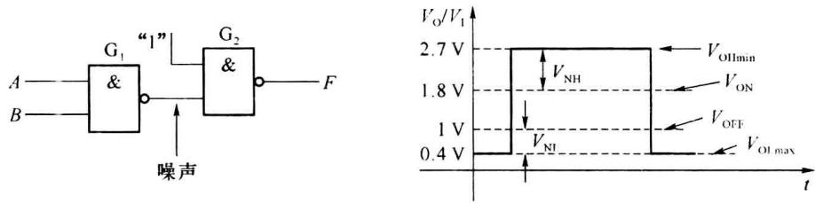  

图2.3.4 噪声容限

高电平噪声容限是指给一个与非门输入一个高电平，在保证与非门能够正常输出低电平的前提下，允许叠加在输入高电平上的最大噪声电压（负向干扰），用 $V_{NH}$ 表示：

$$

V _ {\mathrm{NH}} = V _ {\mathrm{OHmin}} - V _ {\mathrm{ON}}\tag{2.3.2}

$$

如图 2.3.4 所示, 前级的输出高电平的最小值 $V_{OHmin} = 2.7 \, V$ , 器件的开门电平 $V_{ON} = 1.8 \, V$ , 则其高电平噪声容限 $V_{NH} = V_{OHmin} - V_{ON} = 0.9 \, V$ 。

### 2. 静态输入特性

静态输入特性是指输入电流与输入电压之间的关系,典型的输入特性曲线如图 2.3.5(a) 所示,图 2.3.5(b)为仿真曲线。

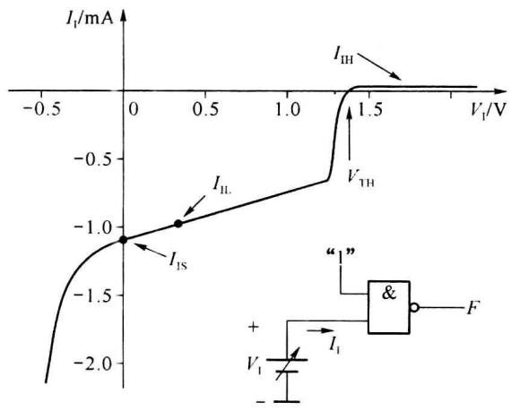  

(a)

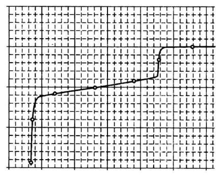  

(b)  

图 2.3.5 静态输入特性及计算机仿真曲线

<Knowledge title="定义">
输入电流 $I_{1}$ 由信号源流入门电路为正方向，反之取负值。根据与非门的工作原

理,可以得到:

当 $V_{I}>V_{TH}$ 时，与非门晶体管 $VT_{1}$ 工作在倒置放大状态，如果设晶体管的反向电流放大系数 $\beta_{F}=0.02$ ，可以得到高电平输入电流（也称输入漏电流） $I_{IH}$ ：

$$

I _ {\mathrm{IH}} = \beta_ {\mathrm{F}} I _ {\mathrm{B}} = \beta_ {\mathrm{F}} \frac {V _ {\mathrm{CC}} - V _ {\mathrm{Bl}}}{R _ {1}} = 0. 0 2 \times \frac {5 \mathrm{V} - 2 . 1 \mathrm{V}}{4 \mathrm{k} \Omega} = 1 4. 5 \mu \mathrm{A}

$$

当 $0 < V_{I} < V_{TH}$ 且由高到低变化时，与非门晶体管 $VT_{1}$ 由倒置放大状态过渡到深度饱和状态， $VT_{2}$ 则由饱和状态变为截止状态。输入电压为低电平 $V_{I} = 0.3 V$ 时，流出与非门的输入电流称为低电平输入电流 $I_{IL}$ ：

$$

I _ {\mathrm{II}} \approx - I _ {\mathrm{BI}} = - \frac {V _ {\mathrm{CC}} - V _ {\mathrm{BE1}} - V _ {\mathrm{IL}}}{R _ {1}} = - \frac {5 \mathrm{V} - 0 . 7 \mathrm{V} - 0 . 3 \mathrm{V}}{4 \mathrm{k} \Omega} = - 1 \mathrm{mA}

$$

当 $V_{I}=0\ V$ 时，流出与非门的输入电流称为输入短路电流 $I_{IS}$ :

$$

I _ {\mathrm{IS}} = - I _ {\mathrm{B1}} = - \frac {V _ {\mathrm{CC}} - V _ {\mathrm{BE1}}}{R _ {1}} = - \frac {5 \mathrm{V} - 0 . 7 \mathrm{V}}{4 \mathrm{k} \Omega} = - 1. 0 7 5 \mathrm{mA}

$$

在进行电路近似分析时,可以用 $I_{IS}$ 替代 $I_{IL}$ 。

当 $V_{1}<0\ V$ 时，电路输入端的保护二极管开始导通，输入电流迅速增加。

另外需要注意的是, $VT_{1}$ 发射结的反向击穿电压较低,当 $V_{1}>7V$ 时 $VT_{1}$ 的BE结可能会被击穿,因此在使用时,尤其是使用电源电压不同的集成器件设计电路时,应采取相应的保护措施,使输入电位钳制在安全工作区内。
</Knowledge>

### 3. 输入负载特性

输入负载特性是指在门电路的输入端对地或对电源接电阻时,电阻的大小对输入逻辑电平的影响。

### (1) 输入端与电源间接电阻 $R_{I}$

输入端与电源间接电阻也称输入端接“上拉电阻”，如图2.3.6所示。我们已经知道，当与非门的某个输入端接高电平或接电源时（等效电阻 $R_{1}=0$ ），该输入端为接逻辑“1”；当某一输入端悬空时（等效电阻 $R_{1}=\infty$ ），该输入端也等效接高电平。因此无论 $R_{1}$ 为任何值，都等效接逻辑“1”。当需要与非门的某个输入端固定接逻辑“1”时，理论上接任何上拉阻值的电阻均可。实际上，为了避免干扰，输入端不许悬空，可直接接电源或通过一个10 kΩ左右的电阻接电源。

### (2) 输入端与地之间接电阻 $R_{I}$

在输入端与地之间接电阻也称接下拉电阻,通常是要求让该输入端等效接逻辑“0”。由于输入电流会在 $R_{I}$ 上产生电压 $V_{I}$ ，根据关门电平的要求， $V_{I}$ 应该小于0.8V。 $V_{I}=0.8V$ 时对应的电阻值，称为关门电阻 $R_{OFF}$ 。

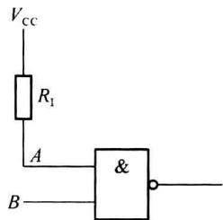

$R_{OFF}$ 的计算参考图 2.3.7。当 $R_{I}$ 较小时， $V_{I}$ 随 $R_{I}$ 增加而线性增加，此时 $VT_{2}$ 、 $VT_{4}$ 截止，忽略 $VT_{2}$ 基极电流的影响，输入电压可由式(2.3.3)求取：

图 2.3.6 输入端接上拉电阻

$$

V _ {\mathrm{I}} = \frac {V _ {\mathrm{cc}} - V _ {\mathrm{BE1}}}{R _ {1} + R _ {I}} R _ {\mathrm{I}}\tag{2.3.3}

$$

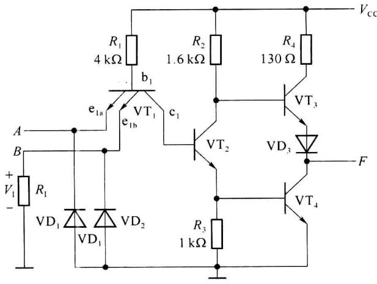  

(a)

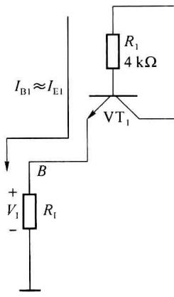  

(b)  

图 2.3.7 输入负载电路及等效电路

根据图2.3.7所示电路，若 $V_{\mathrm{OFF}} = 0.8\mathrm{V}, R_1 = 4\mathrm{k}\Omega$ ，可求得 $R_{\mathrm{OFF}} = 914\Omega$ 。关门电阻 $R_{\mathrm{OFF}}$ 是保证TTL与非门输出为高电平，即 $\mathrm{VT}_4$ 管截止时容许的最大阻值。由于不同种类TTL器件的内部电路不同（如74S、74LS、74ALS等），对应 $R_{\mathrm{OFF}}$ 的值也不同，当选取 $R_{\mathrm{I}}\leqslant$ $300\Omega$ 时能满足所有种类器件的要求。

### 4. 逻辑门的扇出系数 $N_{0}$

扇出系数反映了逻辑门的带负载能力，是指一个逻辑门能够驱动同类型逻辑门的个数，用 $N_{0}$ 来表示。

在逻辑门的数据手册中,有两个关于驱动能力的重要参数需要关注:高电平输出最大电流(拉电流) $I_{OHmax}$ 和低电平输出最大电流(灌电流) $I_{OLmax}$ 。

$I_{OHmax}$ 是逻辑门输出为高电平( $V_{OH}$ 不低于 $V_{OHmin}$ )时, 输出端能够提供给负载的最大电流, 电流的方向为流出逻辑门(拉电流)。与非门7400和74LS00均为-0.4mA。

$I_{OLmax}$ 是逻辑门输出为低电平( $V_{OL}$ 不高于 $V_{OLmax}$ )时, 输出端能够提供给负载的最大电流, 电流的方向为流入逻辑门(灌电流)。与非门7400为16 mA, 74LS00为4 mA。

扇出系数 $N_{0}$ 可通过手册给出的参数 $I_{OHmax}$ 、 $I_{OLmax}$ 、 $I_{ILmax}$ 、 $I_{IHmax}$ ，对输出为高电平和输出低电平时分别进行计算。

逻辑门在输出高电平时能够驱动同类门的个数为

$$

N _ {\mathrm{OH}} = \left| \frac {I _ {\mathrm{OHmax}}}{I _ {\mathrm{IHmax}}} \right|\tag{2.3.4}

$$

逻辑门在输出低电平时能够驱动同类门的个数为

$$

N _ {\mathrm{OL}} = \left| \frac {I _ {\mathrm{OLmax}}}{I _ {\mathrm{ILmax}}} \right|\tag{2.3.5}

$$

$N_{OH}$ 和 $N_{OL}$ 的数值通常是不一样的, 计算逻辑门的扇出系数 $N_{O}$ 时应取较小的一个, 并且只取整数。

<Example title="例 2.3.1">
根据数据手册参数,与非门 54LS00 的 $I_{OHmax} = -0.4 \, mA$ , $I_{OLmax} = 4 \, mA$ , $I_{ILmax} = -0.4 \, mA$ , $I_{IHmax} = 20 \, \mu A$ 。求该与非门的扇出系数。

<Solution title="解">
$$

N _ {\mathrm{OH}} = | \frac {I _ {\mathrm{OHmax}}}{I _ {\mathrm{IHmax}}} | = \frac {4 0 0 \mu \mathrm{A}}{2 0 \mu \mathrm{A}} = 2 0

$$

$$

N _ {\mathrm{OL}} = | \frac {I _ {\mathrm{OLmax}}}{I _ {\mathrm{ILmax}}} | = \frac {4 \mathrm{mA}}{0 . 4 \mathrm{mA}} = 1 0

$$

该与非门最多可以驱动 10 个同类与非门, 即扇出系数 $N_{0} = 10$ 。
</Solution>
</Example>

<Example title="例 2.3.2">
逻辑门的输入端可以并联使用, 某逻辑电路见图 2.3.8, 与非门的内部电路参考图 2.3.1。已知门电路的参数为 $I_{OHmax} = -0.4 \, mA$ , $I_{OLmax} = 4 \, mA$ , $I_{ILmax} = -0.4 \, mA$ , $I_{IHmax} = 20 \, \mu A$ 。按照这样的连接方法, 与非门 $G_{1}$ 最多可以驱动多少个同样的逻辑门? 为什么?

<Solution title="解">
根据图 2.3.1 与非门内部电路,三输入端与非门的输入部分电路如图 2.3.9 所示,当某一个输入端(例如 A)接低电平(0.3 V),其他输入端接高电平时,等效的晶体管 $VT_{1A}$ 深度饱和, $VT_{1B}$ 、 $VT_{1C}$ 截止,基极电位被钳制在 1 V 左右,流过 $R_{1}$ 的电流全部流到 $VT_{1A}$ 的发射极;若 3 个输入端都为低电平, $R_{1}$ 上的电压不变,电流不变,流到 3 个发射极的总电流不变,即每个输入端的输入电流为原来的 $\frac{1}{3}$ 。当 3 个输入端都为高电平时,由于每个等效晶体管的发射极有各自的电流通路,每个输入端的高电平输入电流与单个输入端为高电平时的电流相同。

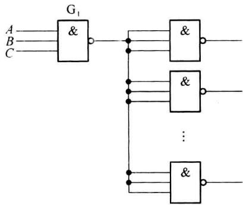  

图2.3.8 例2.3.2的逻辑电路

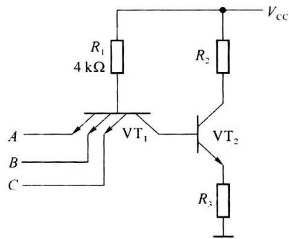  

图 2.3.9 三输入与非门的输入级电路

当 $G_{1}$ 为低电平时能够驱动的门数

$$

N _ {\mathrm{L}} = | \frac {I _ {\mathrm{OLmax}}}{I _ {\mathrm{ILmax}}} | = \frac {4 \mathrm{mA}}{0 . 4 \mathrm{mA}} = 1 0

$$

当 $G_{1}$ 为高电平时能够驱动的门数

$$

N _ {\mathrm{H}} = | \frac {I _ {\mathrm{OHmax}}}{3 \times I _ {\mathrm{IHmax}}} | = \frac {4 0 0 \mu \mathrm{A}}{3 \times 2 0 \mu \mathrm{A}} \approx 6. 6 7

$$

所以，与非门 $G_{1}$ 最多可以驱动 6 个同样的逻辑门。
</Solution>
</Example>

### 5. 平均传输延迟时间 $t_{\mathrm{pd}}$

平均延迟时间是指输出信号滞后于输入信号的时间。将输出电压由高电平跳变为低电平的传输延迟时间称为导通延迟时间 $t_{\mathrm{PHL}}$ ，将输出电压由低电平跳变为高电平的传输延迟时间称为截止延迟时间 $t_{\mathrm{PLH}}$ 。如图2.3.10所示， $t_{\mathrm{PHL}}$ 和 $t_{\mathrm{PLH}}$ 是以输入、输出波形对应边上等于最大幅度 $50\%$ 的两点时间间隔来确定，平均延迟时间是衡量门电路速度的重要指标，传输延时越短，工作速度越快，工作频率越高。 $t_{pd}$ 为 $t_{PLH}$ 和 $t_{PHL}$ 的平均值，表达式见式(2.3.6)。与非门7400的 $t_{pd} \approx 9 ns, 74S00$ 的 $t_{pd} \approx 3 ns$ 。

$$

t _ {\mathrm{pd}} = \frac {1}{2} (t _ {\mathrm{PHL}} + t _ {\mathrm{PLH}})\tag{2.3.6}

$$

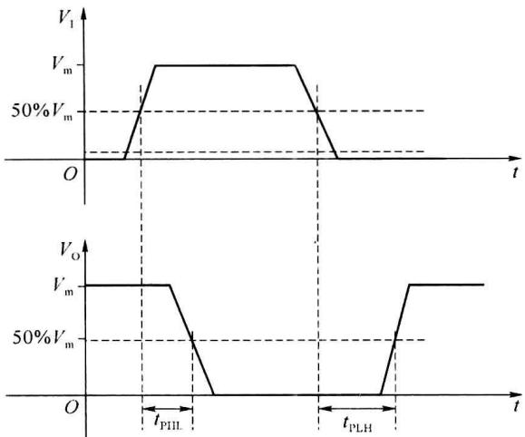  

图2.3.10 传输延迟时间

## 2.3.3 或非、与或非及异或门

1. 或非门

图 2.3.11 所示为两输入端或非门 7402 的内部电路, 类似与非门, 可分为输入级、中间级和输出级。

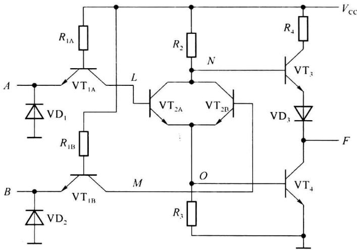  

图2.3.11 或非门7402电路

$R_{1A}$ 、 $VT_{1A}$ 和 $R_{1B}$ 、 $VT_{1B}$ 构成输入级。以 $R_{1A}$ 、 $VT_{1A}$ 电路为例，当A为低电平， $VT_{1A}$ 深度饱和，L点为低电平（相对低电平）；当A为高电平， $VT_{1A}$ 处于倒置放大状态，L点为高电平（相对高电平），L点与输入A之间的逻辑关系为L=A。同理，M点与输入B之间的逻辑关

系为 M=B。

$VT_{2A}$ 、 $VT_{2B}$ 、 $R_{2}$ 和 $R_{3}$ 构成中间级。中间级完成或逻辑（或者为或非逻辑）。以 L 点和 M 点作为中间级的输入，当 L 和 M 中某一个（或两个同时）为高电平，则对应的晶体管的发射极（O 点）电位被拉高，且该晶体管饱和，集电极电位（N 点）降低。只有 L 和 M 都为低电平时，发射极为低电平，集电极为高电平。因此 O 点和 N 点与 L、M 之间的逻辑关系为 $O = L + M, N = \overline{L + M}$ 。

输出级由 $VT_{3}$ 、 $VT_{4}$ 、 $R_{4}$ 和 $VD_{3}$ 构成。 $VT_{3}$ 构成电压跟随器，所以逻辑关系为 $F=N=\overline{L+M}$ 。也可以从 $VT_{4}$ 支路分析， $VT_{4}$ 构成反相器，所以逻辑关系为 $F=\overline{O}=\overline{L+M}$ 。即电路实现或非功能， $F=\overline{A+B}$ 。

这里要注意,当或非门的输入端并接使用时,由于两个输入端各自有各自的电流通路,并联使用时总的输入电流等于输入端电流之和( $I_{IL}$ 之和及 $I_{IH}$ 之和),而不像与非门输入端并接使用时,总的高电平输入电流等于各输入端电流 $I_{IH}$ 之和,总的低电平输入电流等于单个输入端的电流 $I_{IL}$ 。

### 2. 与或非门

将或非门中的 $VT_{1A}$ 和 $VT_{1B}$ 改为多发射极晶体管，即可完成与或非功能。与或非门7450的内部电路如图2.3.12所示。对应 L 点与输入 A、B 之间的逻辑关系为 L = AB。同理，M 点与输入 C、D 之间的逻辑关系为 M = CD，其他各点的逻辑关系与或非门相同。所以可实现与或非关系： $F = \overline{AB + CD}$ 。

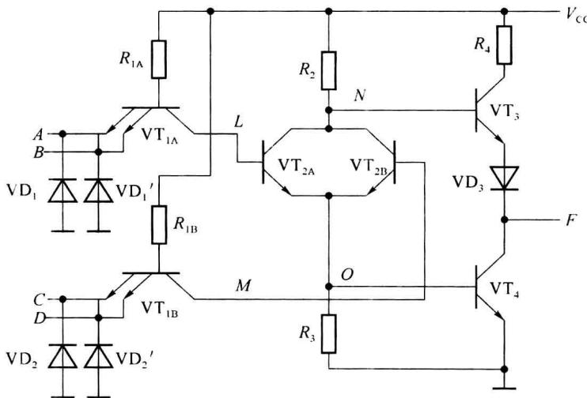  

图 2.3.12 与或非门 7450 内部电路

### 3. 异或门

通过例题的方式进行分析。

<Example title="例 2.3.3">
分析图 2.3.13 所示逻辑器件内部电路, 写出 L、M、N、O、P、Q、F 点与输入 A、B 之间的逻辑关系, 说明电路完成什么逻辑功能。

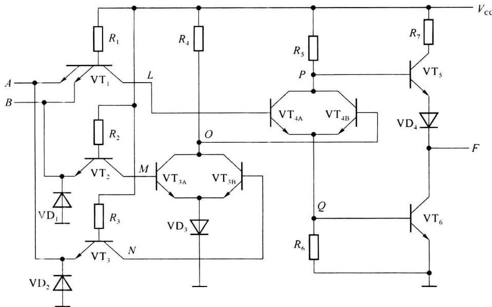  

图2.3.13 例2.3.3电路

<Solution title="解">
写出各点的逻辑表达式:

$$

L = A B

$$

$$

M = B

$$

$$

N = A

$$

$$

O = \overline {{{M + N}}} = \overline {{{A + B}}}

$$

$$

P = \overline {{L + O}} = \overline {{A B + A + B}}

$$

$$

Q = L + O = A B + \overline {{{A + B}}}

$$

$$

F = P = \overline {{A B + \overline {{A + B}}}} = (\overline {{A}} + \overline {{B}}) (A + B) = \overline {{A}} B + A \overline {{B}}

$$

或 $F=\overline{Q}=\overline{AB+\overline{A+B}}=(\overline{A}+\overline{B})(A+B)=\overline{A}B+A\overline{B}$

该电路完成异或功能 $F=A \oplus B$ 。
</Solution>
</Example>

## 2.3.4 集电极开路门电路(OC 门)

以上介绍的均为推挽式输出结构 TTL 门电路, 这种门电路不允许两个或两个以上门的输出端直接并联使用, 除非其输入端的输入逻辑完全相同, 输出端不会出现一个输出高电平, 另一个输出低电平的现象。因为输出端并联时, 若一个门输出为高电平, 另一个门输出低电平, 就会有一个很大的电流从输出高电平的门流出进入输出低电平的门, 不但使输出电平不能确定, 而且这个电流会使逻辑门电流过大而损坏。

### 1. OC 门及“线与”逻辑功能

有一类逻辑门把输出级改成晶体管集电极开路的输出结构,该类门称为集电极开路的门电路,简称 OC(Open Collector)门。与非 OC 门 7403 内部电路及符号如图 2.3.14 所示,电路中没有与非门 7400 中 VT₃ 和 VD₃ 组成的射极跟随器,VT₄ 的集电极是开路的。应用时须将输出端(也就是 VT₄ 的集电极)经外接电阻 Rₗ 接到电源 Vcc (或其他电源 Vcc′)上,才能实现与非逻辑功能,电阻 Rₗ 也称为上拉电阻。

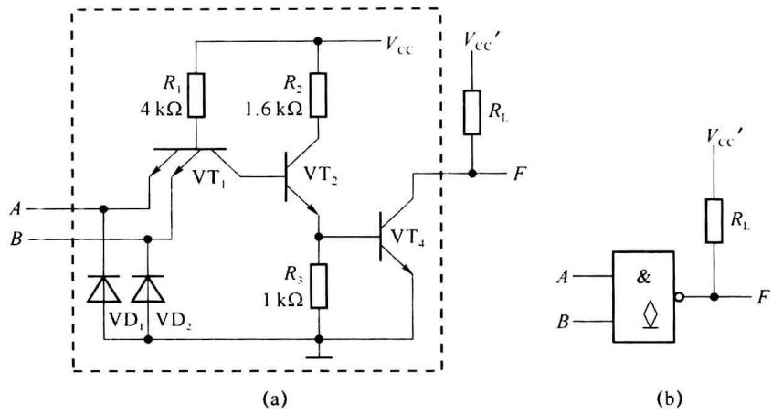  

图 2.3.14 与非 OC 门 7403 的内部电路及 OC 门符号

多个 OC 门的输出端可以直接并联使用, 如图 2.3.15 所示, 两个 OC 门共用一个上拉电阻 $R_{\mathrm{L}}$ 。从图 2.3.15(a) 所示电路可以看出, 只要有一个门的输出晶体管 $\mathrm{VT}_{4}$ 饱和 (该门输出低电平), 则 $F$ 端输出为低电平, 只有所有门的输出晶体管 $\mathrm{VT}_{4}$ 都截止, 输出 $F$ 才为高电平, 也就是输出端 $F$ 与 OC 门输出端 $F_{1}$ 和 $F_{2}$ 的关系是“逻辑与”的关系。又由于 OC 门输出端直接进行“线连接”, 故称两个 OC 门实现“线与 (WIRED-AND)”。图 2.3.15 电路的逻辑关系由式 (2.3.7) 给出。

$$

F = F _ {1} \cdot F _ {2} = \overline {{{A B}}} \cdot \overline {{{C D}}} = \overline {{{A B + C D}}}\tag{2.3.7}

$$

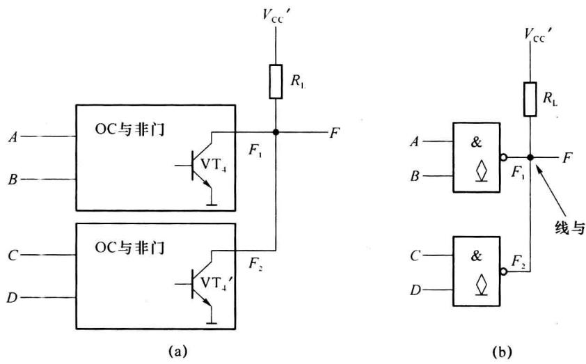  

图 2.3.15 OC 门的输出端直接连接实现“线与”

### 2. 上拉电阻 $R_{\mathrm{L}}$ 的选取

在使用 OC 门时, 必须接上拉电阻, 这样才能实现应有的逻辑功能。可以一个 OC 门或多个 OC 门的输出端并联使用驱动下一级逻辑器件。外接上拉电阻 $R_{\mathrm{L}}$ 的选取应保证在带有负载时, 输出高电平不低于高电平的最小值 $V_{\mathrm{OHmin}}$ ; 输出低电平不高于输出低电平的最大值 $V_{\mathrm{OLmax}}$ 。假设有 $n$ 个 OC 与非门输出并联, 驱动若干个与非门、非门及或非门, 负载门总输入端数目为 $m$ 个。

(1) OC 门输出为高电平: 如图 2.3.16(a) 所示, 当所有的 OC 门输出都为高电平时 (输出晶体管截止), $R_{\mathrm{L}}$ 应能提供足够的负载电流, 并保证输出高电平不低于其允许的最低值。

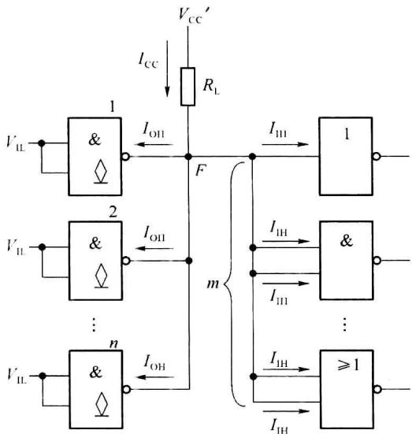  

(a) 输出高电平

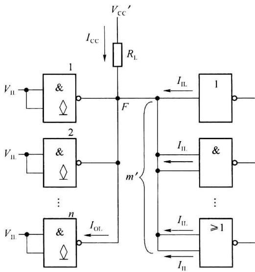  

(b) 输出低电平  

图2.3.16 OC门上拉电阻 $R_{\mathrm{L}}$ 的选取

设: $I_{OH}$ 为OC门输出晶体管截止时的漏电流(也就是穿透电流 $I_{CEO}$ ), $I_{IH}$ 为负载门的高电平输入电流,则输出电压为

$$

V _ {\mathrm{OH}} = V _ {\mathrm{CC}} ^ {\prime} - I _ {\mathrm{CC}} R _ {\mathrm{L}} \geqslant V _ {\mathrm{OHmin}}\tag{2.3.8}

$$

流过 $R_{\mathrm{L}}$ 的电流为

$$

I _ {\mathrm{CC}} = m I _ {\mathrm{IH}} + n I _ {\mathrm{OH}}\tag{2.3.9}

$$

式(2.3.9)表示由于有 n 个 OC 门, 对应有 n 个漏电流 $I_{OH}$ ; 负载门共有 m 个输入端, 对应有 m 个高电平输入电流 $I_{IH}$ 。根据式(2.3.8)和式(2.3.9)可求得 $R_{L}$ 的值为

$$

R _ {\mathrm{L}} \leqslant \frac {V _ {\mathrm{CC}} ^ {\prime} - V _ {\mathrm{OHmin}}}{n I _ {\mathrm{OH}} + m I _ {\mathrm{IH}}}\tag{2.3.10}

$$

(2) OC 门输出为低电平: 如图 2.3.16(b) 所示, 驱动能力最弱的情况是只有一个 OC 门的输出晶体管饱和, 其他门输出晶体管截止。求取 $R_{\mathrm{L}}$ 时只要满足驱动能力最弱的情况即可, 在多个 OC 门的输出晶体管都饱和时一定能够满足驱动需求。流入 OC 门饱和晶体管的总电流为各负载门的输入电流及流过 $R_{\mathrm{L}}$ 的电流之和。由于与非门 (也包括与门) 的输入端并联使用时, 该门总的低电平输入电流仍为 $I_{\mathrm{IL}}$ , 对于或非门 (及或门), 则有几个输入端就有几个 $I_{\mathrm{IL}}$ (这是由逻辑门内部电路构成方式确定的), 所以, 负载门有效输入端数为 $m'(m' < m)$ 。 $R_{\mathrm{L}}$ 的选取应使总电流小于 OC 门允许的最大灌电流。

设: $I_{\mathrm{OL}}$ 为 OC 门输出管的负载电流, $I_{\mathrm{OLmax}}$ 为 OC 门输出管允许的最大低电平负载电流, 输出低电平的最大值为 $V_{\mathrm{OLmax}} = 0.4 \mathrm{~V}$ , $I_{\mathrm{IL}}$ 为负载门的低电平输入电流, 忽略 OC 门截止管的漏电流 $I_{\mathrm{OH}}$ 。则有

$$

I _ {\mathrm{OL}} = I _ {\mathrm{CC}} + m ^ {\prime} I _ {\mathrm{IL}} \leqslant I _ {\mathrm{OLmax}}\tag{2.3.11}

$$

流过 $R_{\mathrm{L}}$ 的电流为

$$

I _ {\mathrm{cc}} = \frac {V _ {\mathrm{cc}} ^ {\prime} - V _ {\mathrm{ol}}}{R _ {\mathrm{L}}}\tag{2.3.12}

$$

根据式(2.3.11)和式(2.3.12)可以求得 $R_{L}$ 为

$$

R _ {\mathrm{L}} \geqslant \frac {V _ {\mathrm{CC}} ^ {\prime} - V _ {\mathrm{OL}}}{I _ {\mathrm{OLmax}} - m ^ {\prime} I _ {\mathrm{IL}}}\tag{2.3.13}

$$

选择上拉电阻 $R_{L}$ 时，应在满足式(2.3.10)和式(2.3.13)的要求的情况下，电阻值选择稍大一些，以减少功耗。

<Example title="例 2.3.4">
电路如图 2.3.17 所示，请选择合适的阻值 $R_{L}$ 。已知 OC 门输出管截止时的漏电流为 $I_{OH}=200\ \mu A$ ，OC 门输出晶体管导通时允许的最大负载电流为 $I_{OLmax}=16\ mA$ ；负载门的低电平输入电流为 $I_{IL}=1\ mA$ ，高电平输入电流为 $I_{IH}=40\ \mu A, V_{CC}'=5\ V$ ，要求 OC 门的输出高电平 $V_{OH}\geqslant3.0\ V$ ，输出低电平 $V_{OL}\leqslant0.4\ V$ 。

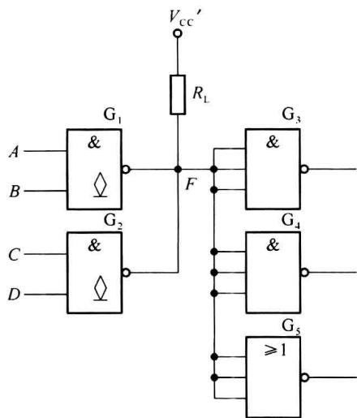  

图2.3.17 例2.3.4逻辑图

<Solution title="解">
根据前面的分析,由于 n=2,m=9, $m^{\prime}=5$ ,则

输出高电平时

$$

R _ {\mathrm{L}} \leqslant \frac {V _ {\mathrm{cc}} ^ {\prime} - V _ {\mathrm{OHmin}}}{n I _ {\mathrm{OH}} + m I _ {\mathrm{IH}}} = \frac {5 - 3}{2 \times 0 . 2 + 9 \times 0 . 0 4} = 2. 6 3 \mathrm{k} \Omega

$$

输出低电平时

$$

R _ {\mathrm{L}} \geqslant \frac {V _ {\mathrm{CC}} ^ {\prime} - V _ {\mathrm{OL}}}{I _ {\mathrm{OLmax}} - m ^ {\prime} I _ {\mathrm{IL}}} = \frac {5 - 0 . 4}{1 6 - 5 \times 1} \approx 0. 4 2 \mathrm{k} \Omega

$$

可选择 $R_{L}=2.4\ k\Omega$ 。
</Solution>
</Example>

### 3. OC 门的应用

① OC门在输出管的击穿电压和负载电流满足要求的情况下,可以直接驱动不同电压需求的指示灯、继电器或其他器件(设备)。图2.3.18(a)为OC门直接驱动发光二极管,电阻R用来限制电流。图2.3.18(b)为OC门直接驱动继电器,二极管VD用来限制继电器产生的自感电压,避免损坏逻辑门。

② 通过改变外接电源 $(V_{\mathrm{cc}}')$ ，可以来改变输出高电平，实现电平转换。如图2.3.18(c)所示，通过OC门可以将0.3～3.4V的TTL电平转换为0.3～12V的逻辑电平。

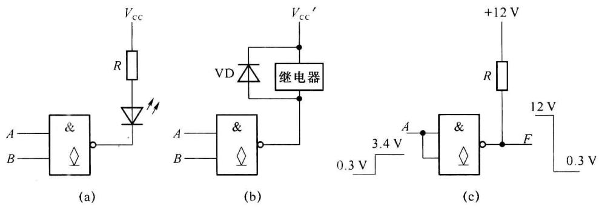  

图 2.3.18 OC 门直接驱动负载及电平转换

## 2.3.5 三态门

### 1. 三态门的工作原理

普通TTL门的输出只有逻辑0和逻辑1两种输出状态，这两种状态都是低阻输出。三态逻辑门的输出除了具有这两个状态外，还具有高阻输出态（或称禁止态），这时输出端相当于与其他电路断开。图2.3.19是三态非门的原理图与符号。根据图2.3.19(a)所示电路，当 $\mathrm{EN} = 1$ 时， $\mathrm{VD}_2$ 截止，此时电路类似与非门7400，输出取决于输入，可以得到 $F = \overline{A}$ 。当 $\mathrm{EN} = 0$ 时，使 $\mathrm{VT}_1$ 深度饱和并使得 $\mathrm{VT}_2, \mathrm{VT}_4$ 截止（输出 $F$ 端对地的支路等效断开），同时 $\mathrm{EN} = 0$ 又使得 $\mathrm{VD}_2$ 导通， $V_{\mathrm{C2}}$ 为低电平（不高于1V），这又使得 $\mathrm{VT}_3$ 和 $\mathrm{VD}_3$ 截止（输出 $F$ 端对电源的支路等效断开），输出端呈高阻态，输出可表示为 $F = z$ 。这种EN为1时，三态门处于正常工作状态（输出0或1），EN为0时，三态门处于高阻状态（输出为高阻 $z$ )的三态门称为控制端“高电平有效”的三态门，高电平有效三态非门的符号如图2.3.19(b)所示；反之，如果三态控制端 $\overline{\mathrm{EN}} = 0$ 时，三态门处于正常工作状态，称为控制端“低电平有效”的三态门，低电平有效三态非门的符号如图2.3.19(c)所示。低电平有效三态非门控制端使用符号 $\overline{\mathrm{EN}}$ 的目的是为了对两种三态门的控制方式进行统一描述，即 $\mathrm{EN} = 1$ 时三态门处于正常工作状态， $\mathrm{EN} = 0$ 时三态门处于高阻状态。

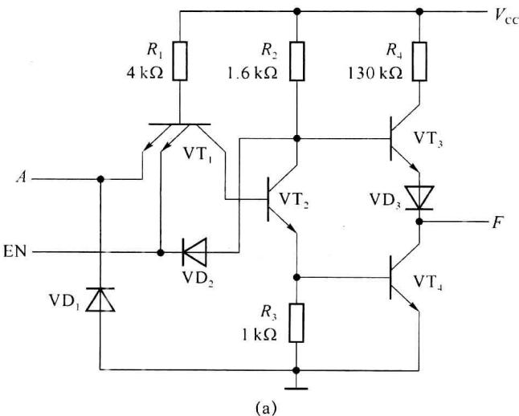

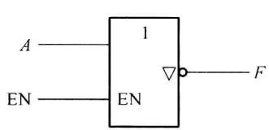

图 2.3.19 三态非门原理电路与符号  

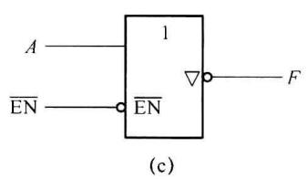

### 2. 三态缓冲门 74126 简介

缓冲门类似非门，只是不反相，实现 $F = A$ 的逻辑功能。三态缓冲门74126的符号如图2.3.20(b)所示，它是一个控制端高电平有效的缓冲门，内部电路如图2.3.20(a)所示。图中虚线右侧类似图2.3.19给出的三态非门原理电路，只是在 $\mathrm{VT}_{1}$ 的集电极和 $\mathrm{VT}_{2}$ 的基极间增加了一级反相器，电路实现 $F = A$ 的逻辑功能。在虚线左侧，也是一个缓冲电路，可以看成两个非门的串接，图中 $\mathrm{EN}'$ 点和EN之间的逻辑关系为 $\mathrm{EN}' = \mathrm{EN}$ 。控制端低电平有效的缓冲门74125的符号如图2.3.20(c)所示。这两个三态缓冲器在计算机系统和数字通信系统的电路设计中有较多的应用。

(a)  

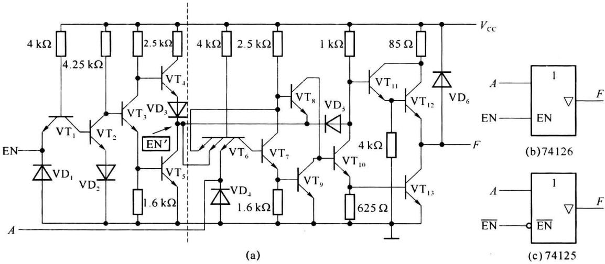  

图 2.3.20 74126 内部电路及三态缓冲门符号

### 3. 三态门的应用

（1）数据线的分时复用：当三态门处于禁止状态时，其输出呈现高阻态，可视为与数据线脱离。利用分时传送原理，可以实现多个三态门挂在同一数据线上进行数据传送，某一时刻只允许一个三态门的输出为低阻，在总线上发送数据。电路如图2.3.21(a)所示，当EN=1时， $F_{2}$ 为高阻，数据A传送的数据线上；当EN=0时， $F_{1}$ 为高阻，数据B传送的数据线上。

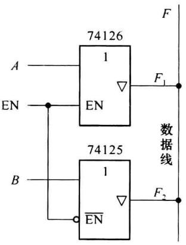

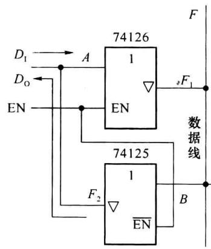  

图2.3.21 数据线复用

(2) 双向传输: 如图 2.3.21(b) 所示, 当 EN=1 时, 数据 $D_{1}$ 通过 A 端传送的数据线上, 此时由于 $F_{2}$ 为高阻 (相当于开路), 不会影响数据 $D_{1}$ 的传输; 当 EN=0 时, $F_{1}$ 为高阻, 相当于与数据线脱离, 不影响其他数据传输, 数据线上数据可通过 B 端传送到 $F_{2}$ 端, 即通过 EN 的控制实现数据的双向传输。

## 2.3.6 TTL 改进系列门电路简介

为了满足高速度、低功耗、高抗干扰的要求，TTL 电路不断改进，因此细分出 74H、74S、74LS、74AS、74ALS 等系列，仍以与非门进行简单介绍。

### 1. 74H00

高速TTL与非门74H00内部电路如图2.3.22所示，它将7400中的 $\mathrm{VD}_3$ 换为晶体管 $\mathrm{VT}_{5}$ 和电阻 $R_{5}$ 。可将 $\mathrm{VT}_{3}$ 和 $\mathrm{VT}_{5}$ 看成一个复合晶体管，具有更好的电压跟随特性。另外，电路中的电阻比7400更小，电路具有更强的驱动能力。

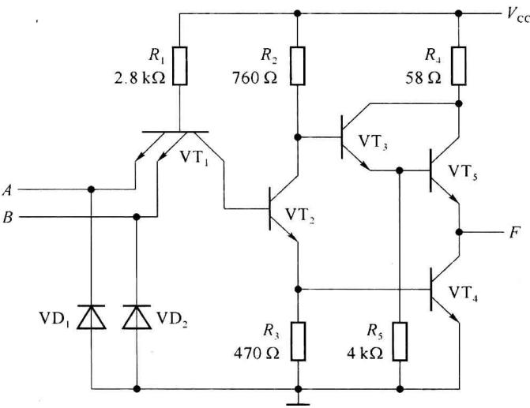  

图2.3.22 与非门74H00内部电路

### 2. 74S00

肖特基系列门电路中使用了肖特基晶体管（也称抗饱和晶体管），其结构和符号如图2.3.23所示，图中二极管 $\mathrm{VD}_{\mathrm{k}}$ 是肖特基势垒二极管(Schottky Barrier Diode,SBD)，这种二极管的正向压降约为 $0.3\mathrm{V}$ 。肖特基二极管没有电荷存储效应，开关速度比一般PN结要高得多。由于在晶体管的基极和集电极间加有肖特基二极管，使晶体管不会进入深度饱和，其饱和时 $V_{\mathrm{CE}}$ 始终会保持在 $0.4\mathrm{V}$ 左右，大大缩短了晶体管的存储时间，提高了开关速度。

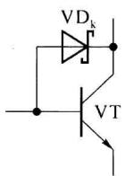  

(a)

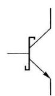  

(b)  

图 2.3.23 肖特基晶体管结构及符号

在 74S 系列门电路中上采用了肖特基抗饱和三极管, 同时增加有源泄放电路, 用以提高工作速度并改善电压传输特性。图 2.3.24 所示为 74S00 与非门内部电路。

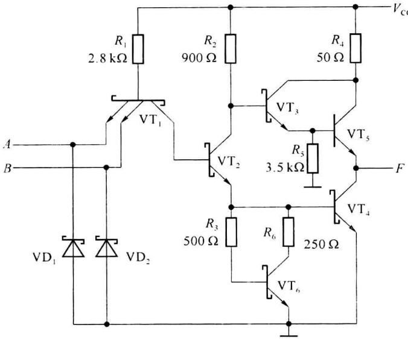  

图 2.3.24 与非门 74S00 内部电路

图 2.3.24 电路中由于晶体管 $VT_{5}$ 不会饱和，无须使用抗饱和晶体管外，其他晶体管都采用了肖特基晶体管。有源泄放回路由电阻 $R_{3}$ 、 $R_{6}$ 和晶体管 $VT_{6}$ 构成。有源泄放回路的作用有：第一，在 $VT_{4}$ 的发射结电压刚超过死区电压时， $VT_{6}$ 还未导通，可以提高 $VT_{4}$ 从截止到导通的速度；第二，在 $VT_{4}$ 饱和后， $VT_{6}$ 的集电极分流了一部分 $VT_{4}$ 的基极电流，减少了 $VT_{4}$ 发射结电荷的堆积；第三， $VT_{2}$ 截止后， $VT_{4}$ 发射结两端的堆积电荷可以通过 $VT_{6}$ 的集电极回路泄放，提高 $VT_{4}$ 从导通到截止的速度；第四，改善了电压传输特性曲线（参见图 2.3.3），使 CD 线性向上延伸，BCD 的斜率趋于一致，从而接近理想开关，低电平噪声容限也得到提高。

### 3. 74LS00

性能比较好的门电路应该是工作速度快、功耗又小的门电路。通常用功耗和传输延迟时间的乘积(简称功耗-延迟积或pd积)来评价门电路性能的优劣。74LS系列是低功耗肖特基逻辑门，它的功耗-延迟积很小，因此得到最广泛的应用。

图 2.3.25 是 74LS00 的内部电路。它的特点主要是大幅度提高了电路中各电阻的阻值。为了缩短延迟时间，提高开关速度，它像 74S 系列一样，使用了抗饱和晶体管和有源泄放电路，同时还采用了将输入端的多发射极晶体管用肖特基二极管代替等措施。肖特基二极管 $VD_{1}$ 、 $VD_{2}$ 及 $R_{1}$ 组成输入电路，由于 $VD_{1}$ 、 $VD_{2}$ 本身没有电荷存储效应，电路的工作速度较快。 $VD_{5}$ 、 $VD_{6}$ 两个肖特基二极管为泻放二极管，主要是当输出从高电平到低电平转换时， $VD_{5}$ 和 $VD_{6}$ 通过 $VT_{2}$ 的集电极分别泻放 $VT_{5}$ 发射结及负载上的多余电荷，加快 $VT_{5}$ 截止和 $VT_{4}$ 饱和导通过程。

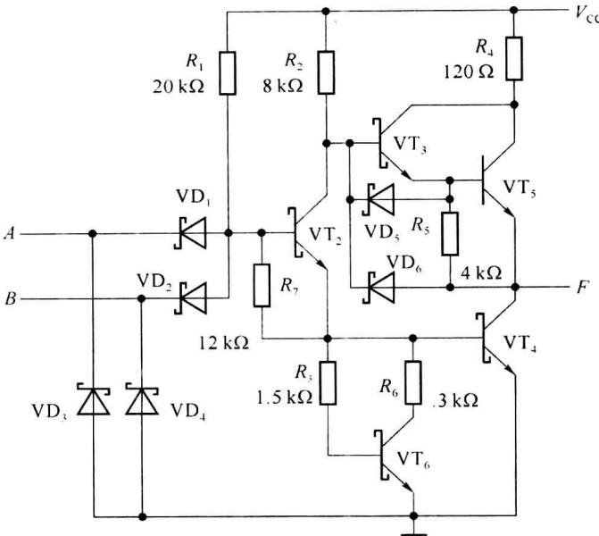  

图 2.3.25 与非门 74LS00 内部电路

## 2.3.7 TTL 的选用及应注意的问题

1. 不同系列的TTL逻辑门（如STTL、HTTL、LSTTL等），虽然同一种门的逻辑功能一样，封装也一样，但工作速度、带负载能力等方面会有不同，在设计时应加以注意。表2.3.2以与非门为例给出了不同系列TTL门电路的主要参数，由于在同一系列中还有更细的划分，表中参数源自某公司的技术手册，是常用的典型值，供应用时参考。

表 2.3.2 74 系列与非门主要参数

<table><tr><td>参数</td><td>符号</td><td>单位</td><td>7400</td><td>74H00</td><td>74S00</td><td>74LS00</td><td>74ALS00</td><td>74F00</td></tr><tr><td>导通延迟时间</td><td> $t_{PHL}$ </td><td>ns</td><td>7</td><td>6.2</td><td>3</td><td>10</td><td>4</td><td>3</td></tr><tr><td>截止延迟时间</td><td> $t_{PLH}$ </td><td>ns</td><td>11</td><td>5.9</td><td>3</td><td>9</td><td>5</td><td>4</td></tr><tr><td>截止电源电流</td><td> $I_{CCH}$ </td><td>mA</td><td>4</td><td>10</td><td>10</td><td>0.8</td><td>0.5</td><td>1.9</td></tr><tr><td>导通电源电流</td><td> $I_{CCL}$ </td><td>mA</td><td>12</td><td>26</td><td>20</td><td>2.4</td><td>1.5</td><td>6.8</td></tr><tr><td>最大静态功耗</td><td>P</td><td>mW</td><td>60</td><td>130</td><td>100</td><td>12</td><td>7.5</td><td>34</td></tr><tr><td>低电平输入电压</td><td> $V_{ILmax}$ </td><td>V</td><td>0.8</td><td>0.8</td><td>0.8</td><td>0.8</td><td>0.8</td><td>0.8</td></tr><tr><td>高电平输入电压</td><td> $V_{IHmin}$ </td><td>V</td><td>2</td><td>2</td><td>2</td><td>2</td><td>2</td><td>2</td></tr><tr><td>低电平输入电流</td><td> $I_{ILmax}$ </td><td>mA</td><td>-1.6</td><td>-2</td><td>-2</td><td>-0.4</td><td>-0.1</td><td>-0.6</td></tr><tr><td>高电平输入电流</td><td> $I_{IHmax}$ </td><td>μA</td><td>40</td><td>50</td><td>50</td><td>20</td><td>20</td><td>20</td></tr><tr><td>低电平输出电压</td><td> $V_{OLmax}$ </td><td>V</td><td>0.4</td><td>0.4</td><td>0.5</td><td>0.5</td><td>0.5</td><td>0.5</td></tr><tr><td>高电平输出电压</td><td> $V_{OHmin}$ </td><td>V</td><td>2.4</td><td>2.4</td><td>2.7</td><td>2.7</td><td>2.7</td><td>2.7</td></tr><tr><td>低电平输出电流</td><td> $I_{OLmax}$ </td><td>mA</td><td>16</td><td>20</td><td>20</td><td>8</td><td>8</td><td>20</td></tr><tr><td>高电平输出电流</td><td> $I_{OHmax}$ </td><td>μA</td><td>-400</td><td>-500</td><td>-1000</td><td>-400</td><td>-400</td><td>-1000</td></tr></table>

设计电路时,可根据需求选用合适的门电路,如需要低功耗,可选 LS 系列或 ALS 系列的门电路,需要高速工作,可选 S 系列或 F 系列的门电路等。

2. 在使用集成逻辑门设计电路时应注意以下问题：

（1）给门电路供电的电源电压应该在指定范围内工作，74系列门电路的 $V_{cc}=4.75\sim5.25V$ ，54系列门电路的 $V_{cc}=4.5\sim5.5V$ 。

（2）应根据应用环境选用门电路，一般在室内工作的设备，可选用74系列门电路，若在室外，则应选用54系列的门电路。

(3) 集电极开路门(OC门)可以将输出端直接并接使用,并实现线与功能;三态门的输出端可直接连接,条件是在任意时刻只能有一个输出为低阻,其他必须为高阻;推挽式输出的TTL门一般不允许输出并接,除非用于增加驱动能力时,保证输入端的信号完全一致,不会出现一个输出高电平,另一个输出低电平的情况。

(4) 无论什么门的输出端均不允许直接接电源或接地。

（5）为避免干扰产生逻辑错误，一般不使用的输入端不允许悬空，应该根据逻辑功能接低电平或接高电平（与门、与非门的不使用输入端接高电平，或门、或非门的不使用输入端接低电平）。对TTL器件来说，接低电平一般是经过一个小于 $300\Omega$ 电阻接地，或直接接地；接高电平可经过一个小于 $10\mathrm{k}\Omega$ 的电阻接电源或直接接电源。在前级驱动能力允许情况下，不使用的输入端也可和已使用端并联使用。

（6）TTL 电路工作时存在尖峰电流形成的内部噪声，使用时应注意电源应提供足够的功率，并在靠近门电路的电源和地之间加退耦电容。
