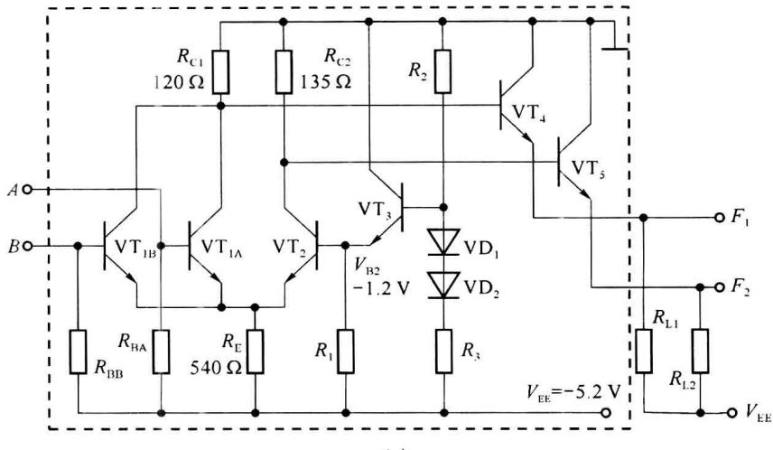
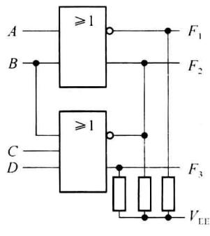
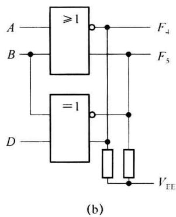

import Guide from '@/components/Guide.astro';
import Knowledge from '@/components/Knowledge.astro';
import Example from '@/components/Example.astro';
import Analysis from '@/components/Analysis.astro';
import Solution from '@/components/Solution.astro';
import Variant from '@/components/Variant.astro';
import Note from '@/components/Note.astro';
import Block from '@/components/Block.astro';
import Method from '@/components/Method.astro';
import Exercise from '@/components/Exercise.astro';

ECL(Emitter Coupled Logic, 射极耦合逻辑)是一种非饱和双极型晶体管的逻辑门电路, 它和 TTL 逻辑电路不同之处在于 ECL 所含的晶体管只工作在浅截止区和放大区, 因而晶体管的基区没有多余的存储电荷, 晶体管基本没有存储时间, 且电路的输入、输出逻辑幅度小 (输入高电平为 -0.8 V, 低电平为 -1.6 V), 从而进一步提高了逻辑电路的开关速度。

ECL 逻辑门也有许多种类,包括或门、异或门、或/或非门(实现或逻辑,同时也有或非逻辑输出)、异或/同或门等。以型号为 10105 的集成或/或非门为例,介绍其工作原理及应用方法。10105 集成 ECL 或/或非门芯片中有两个 2 输入端的或/或非门及 1 个 3 输入端的或/或非门。

ECL或/或非门10105内部2输入端的或/或非门电路如图2.4.1(a)中虚线框内电路所示，其符号如图2.4.1(b)所示。ECL或/或非门是由差分电路（由 $\mathrm{VT}_{1\mathrm{A}}$ 、 $\mathrm{VT}_{1\mathrm{B}}$ 、 $\mathrm{VT}_2$ 及相关电阻）、参考电源（ $\mathrm{VT}_3$ 、 $\mathrm{VD}_1$ 、 $\mathrm{VD}_2$ 及相关电阻）、两个射极跟随器（发射极开路的 $\mathrm{VT}_4$ 、 $\mathrm{VT}_5$ )3个部分组成。供电电源为 $V_{\mathrm{EE}} = -5.2\mathrm{V}$ 。

图 2.4.1(a) 中 VT $_{1}$ (包括 VT $_{1A}$ 和 VT $_{1B}$ )、VT $_{2}$ 、R $_{C1}$ 、R $_{C2}$ 及 R $_{E}$ 组成差分放大电路, 其中 VT $_{1A}$ 、VT $_{1B}$ 的发射极并联、集电极并联, 在发射极端实现输入信号的“或”逻辑功能, 即 A、B 中一个或两个都为高电平时, VT $_{1A}$ 、VT $_{1B}$ 的发射极为相对高电平, VT $_{1A}$ 、VT $_{1B}$ 的集电极实现“或非”逻辑 (原理与前面提到的或非门相同)。R $_{2}$ 、R $_{3}$ 和 VT $_{3}$ 组成参考电源, 为晶体管

$VT_{2}$ 的基极提供固定的 -1.2 V 电压。 $VT_{4}$ 、 $VT_{5}$ 及外接负载电阻 $R_{L1}$ 和 $R_{L2}$ 构成两个射极跟随器，完成电平转换功能，即把 $VT_{1}$ 、 $VT_{2}$ 集电极电位降低约 0.8 V（这里设 BE 结的压降设为 0.8 V），使电路输出电平和输入电平一致，同时增强电路的带负载能力。电路的核心部分是差分电路。

  

图 2.4.1 ECL 或/或非电路(10105)及符号

### 1. ECL 或/或非门的工作原理

设:电路输入高电平 $V_{IH} = -0.8 \, V$ ，输入低电平 $V_{IL} = -1.6 \, V$ ，晶体管 $VT_{2}$ 的基极电压固定为 $V_{b2} = -1.2 \, V$ 。

（1）当输入 A、B 均为低电平 -0.8 V 时， $VT_{2}$ 导通， $VT_{2}$ 的发射极电平为 $V_{E} = -1.2 - V_{BE} = -2.0 V$ ， $VT_{1A}$ 、 $VT_{1B}$ 的发射结电压仅为 0.4 V，低于死区电压，所以 $VT_{1A}$ 、 $VT_{1B}$ 截止， $VT_{1A}$ 、 $VT_{1B}$ 集电极电平约为 0 V，此时 $VT_{2}$ 的集电极电平 $V_{C2} = 0 - I_{C2} \times R_{C2} \approx -R_{C2} \frac{V_{E} - V_{EE}}{R_{E}} = -135 \times \frac{-2 - (-5.2)}{540} = -0.8 V$ 。可以得到输出端 $F_{1}$ 和 $F_{2}$ 的输出电平分别为 -0.8 V（高电平）和 -1.6 V（低电平）。

（2）当输入 A、B 中至少有一个为高电平，设输入 A 为高电平，则晶体管 $VT_{1A}$ 导通， $VT_{1A}$ 的发射极电平 $V_{E} = -0.8 - V_{BE} = -1.6 \, V$ ，由于 $VT_{2}$ 的发射结电压为 0.4 V，所以 $VT_{2}$ 截止， $VT_{1}$ 的集电极电平为 $V_{C1} = 0 - I_{C1} \times R_{C1} \approx -R_{C1} \frac{V_{E} - V_{EE}}{R_{E}} = -120 \times \frac{-1.6 - (-5.2)}{540} = -0.8 \, V, V_{C2} \approx 0 \, V$ 。可以得到输出端 $F_{1}$ 和 $F_{2}$ 的输出电平分别为 -1.6 V（低电平）和 -0.8 V（高电平）。

由上述分析并根据差分放大电路原理可知，在 $VT_{1}$ 的集电极得到“或非”逻辑功能，在 $VT_{2}$ 的集电极得到“或”逻辑功能， $VT_{4}$ 和 $VT_{5}$ 实现电平的偏移，使 $VT_{1}$ 和 $VT_{2}$ 的集电极电位下降 0.8 V，所以电路逻辑功能可表示为

$$

\begin{array}{l} F _ {1} = \overline {{A + B}} \\ F _ {2} = A + B \end{array}

$$

### 2. ECL 门的特点

(1) ECL 门的优点:由于电路中的晶体管都工作在放大区和浅截止区,ECL 工作速度很快, $t_{pd}<1\ ns$ ;在正常工作时,总的工作电流基本不变,由电流变化而产生的干扰较小;由于输出是射极输出结构,具有较强的驱动能力;ECL门输出可直接相连,实现线或(WIRED-OR)逻辑。

(2) ECL 门的缺点: 逻辑电平摆幅小, 噪声容限低, 抗干扰能力弱; 由于 ECL 电路中的电阻都很小, 而且晶体管工作在非饱和态, 所以电路功耗较大。

<Example title="例 2.4.1">
图 2.4.2(a) 电路由一个 2 输入 ECL 或/或非门和一个 3 输入 ECL 或/或非门组成(使用 ECL 芯片 10105)，图(b) 电路由 ECL 或/或非门和异或/同或门组成(使用芯片 10105 和 10107)。写出输出的逻辑表达式。

  

图2.4.2 例2.4.1ECL电路

<Solution title="解">
根据电路及 ECL 门的线或功能,输出逻辑表达式为

$$

\begin{array}{r l} & F _ {1} = \overline {{A + B}} = \overline {{A}} \overline {{B}} \\ & F _ {2} = A + B + \overline {{B + C + D}} = A + B + \overline {{B}} \overline {{C}} \overline {{D}} \\ & F _ {3} = B + C + D \\ & F _ {4} = \overline {{A + B}} + \overline {{B}} C + B \overline {{C}} = \overline {{A}} \overline {{B}} + \overline {{B}} C + B \overline {{C}} \\ & F _ {5} = A + B + B C + \overline {{B}} \overline {{C}} = A + B C + \overline {{B}} \overline {{C}} \end{array}

$$

如图 2.4.2 所示, ECL 门在使用时应接下拉电阻到负电源 $V_{EE}$ , 但如果后面接的也是 ECL 门, 则无须再接下拉电阻, 因为下一级的输入端中已经有所需的等效电阻 ( $R_{B}$ 并联从基极看入的电阻)。

本节介绍的是由负电源供电的 ECL 电路。还有一种 PECL 门，它采用与 ECL 基本相同的电路和工作原理，但是用正电源供电，逻辑电平的数值与 ECL 不同，但高低电平的摆幅、性能基本相同。
</Solution>
</Example>
