import Guide from '@/components/Guide.astro';
import Knowledge from '@/components/Knowledge.astro';
import Example from '@/components/Example.astro';
import Analysis from '@/components/Analysis.astro';
import Solution from '@/components/Solution.astro';
import Variant from '@/components/Variant.astro';
import Note from '@/components/Note.astro';
import Block from '@/components/Block.astro';
import Method from '@/components/Method.astro';
import Exercise from '@/components/Exercise.astro';

集成注入逻辑(Integrated Inject Logic, I²L)逻辑门电路是20世纪70年代初发展起来的一种高集成密度、双极型逻辑电路。它是在常规双极型集成电路工艺的基础上经过改进而成。I²L电路具有结构紧凑、不用电阻、工艺简单、集成密度高、低功耗和较高工作的速度等特点。目前I²L主要用于制作大规模集成电路的内部逻辑电路，并得到了广泛的应用。

## 2.5.1 $\mathbf{I}^2\mathbf{L}$ 的基本单元电路

$I^{2}L$ 基本单元电路由构成恒流源的 PNP 晶体管和构成反相器的多集电极 NPN 晶体管构成。电路图如图 2.5.1(a) 所示，符号如图 2.5.1(b) 所示。

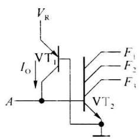

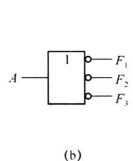

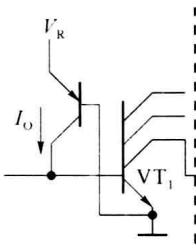

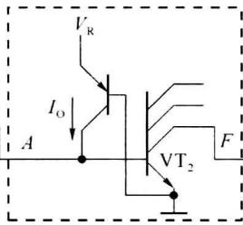

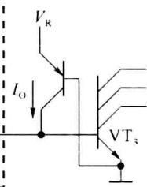  

图 2.5.1 I²L 基本单元电路、符号及工作原理

为说明 $I^{2}L$ 基本单元电路前级的驱动和与后级的负载关系, 工作原理分析时参考图 2.5.1(c) 中虚线框内的单元电路。 $I^{2}L$ 基本单元电路中 PNP 晶体管工作在放大区, 发射极接固定电源 $V_{R}$ , 因此 $V_{BE}$ 为固定值, 集电极电流也为固定值 $I_{O}$ 。

如果前级 $I^{2}L$ 单元电路晶体管 $VT_{1}$ 截止，相当于图 2.5.1(c) 中虚线框内的单元电路输入端 A 悬空（等效输入为高电平，A 点电位约为 0.7 V）， $I_{0}$ 全部注入 NPN 晶体管 $VT_{2}$ 的基极，使 NPN 晶体管 $VT_{2}$ 饱和，输出 F 点的电位约为 0.1 V。

如果前级电路晶体管 $VT_{1}$ 饱和，本级的恒流源电流 $I_{0}$ 全部注入前级晶体管 $VT_{1}$ 的集电极，则输入端 A 为低电平，A 点电位约为 0.1 V，NPN 晶体管 $VT_{2}$ 的基极电流近似为 0，晶体管 $VT_{2}$ 截止，输出 F 点的电位约为 0.7 V。

所以图 2.5.1(a) 所示的单元电路可看成是 3 个非门，输入端是公共的，各自有自己的输出端。符号如图 2.5.1(b) 所示。

在集成电路中,恒流源也可以使用多集电极晶体管结构,可进一步减小面积和增加集成密度。图2.5.1(c)电路可简化为图2.5.2所示电路。如果固定电源 $V_{R}$ 端不用于其他用途,在画内部电路时也可使用图2.5.3的画法。

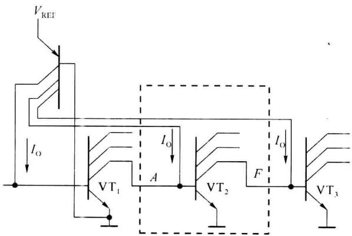  

图 2.5.2 I²L 多集电极恒流源结构

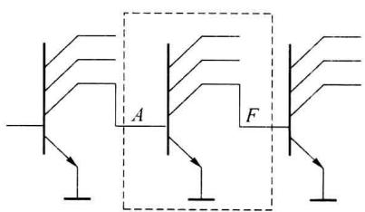  

图 2.5.3 1 I²L 电路的简化画法

## 2.5.2 $\mathbf{I}^2\mathbf{L}$ 门电路

### 1. 或非门

由于 $I^{2}L$ 基本单元电路是集电极开路输出的电路结构，只要将输出端直接“线连接”可以获得线与。根据图 2.5.4 所示电路可以得到： $F=\overline{A}\cdot\overline{B}=\overline{A+\overline{B}}$ ，即由两个基本单元电路可得到或非门。

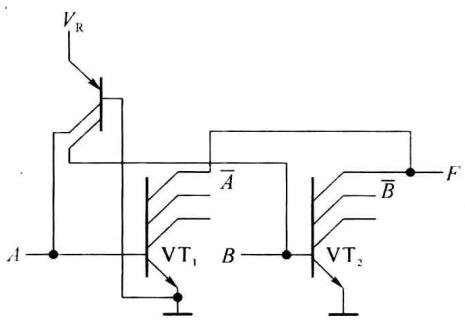  

(a)

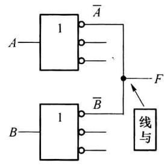  

(b)  

图2.5.4 $\mathrm{I}^2\mathrm{L}$ 或非门电路

### 2. 与门

如果将或非门的输入端各加一级非门,即可得到与门。电路如图 2.5.5 所示。

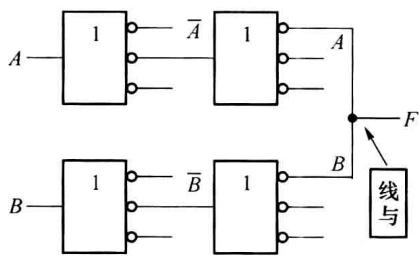  

图2.5.5 $\mathrm{I}^2\mathrm{L}$ 与门电路

### 3. 与非门

根据前面的分析,基本单元电路完成 $F=\overline{A}$ 的逻辑功能,如果电源 $V_{R}=0$ , 则 $I_{0}=0$ , NPN 晶体管始终处于截止状态, 输出始终为高电平。用 $V_{R}$ 端作为输入端 B, 可以得到, 只有 A 和 B 均为高电平时输出为低电平, 因而实现与非门的功能 $F=\overline{AB}$ 。电路图及符号如图 2.5.6 所示。

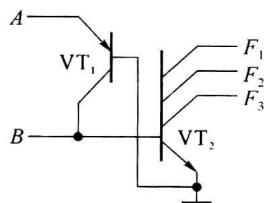  

(a)

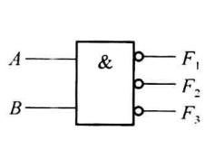  

(b)  

图2.5.6 $\mathrm{I}^2\mathrm{L}$ 与非门

### 4. 与或非门

使用两个与非门, 输出进行线与可得到与或非门 $F=\overline{AB}\cdot\overline{CD}=\overline{AB+CD}$ , 电路如图2.5.7所示。

<Example title="例 2.5.1">
分析图 2.5.8 所示简化的 I²L 电路的逻辑功能。

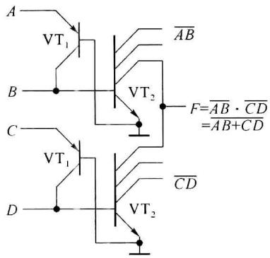  

图2.5.7 $\mathrm{I}^2\mathrm{L}$ 与或非门电路

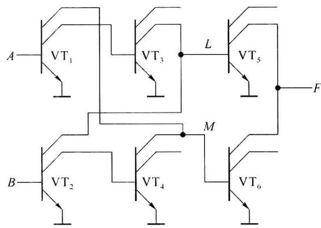  

图2.5.8 例2.5.1图

<Solution title="解">
由于 $VT_{1}$ 的输出为 $\overline{A}$ , $VT_{3}$ 的输出为 A, $VT_{2}$ 的输出为 $\overline{B}$ , $VT_{4}$ 的输出为 B, 因此 L 点的输出为 $L = A \overline{B}$ , M 点为 M = $\overline{A}B$ , 因此有 $F = \overline{A\overline{B}} \cdot \overline{\overline{A}B} = \overline{A\overline{B}} + \overline{\overline{A}B} = A \odot B$ , 所以图 2.5.8 电路为同或门。
</Solution>
</Example>

## 2.5.3 $\mathbf{I}^2\mathbf{L}$ 门电路的特点

电路优点：

（1）在双极型集成电路中有较高的集成密度，电路简单，管芯面积小。而TTL集成电路电路结构比较复杂，元件较多，并且需要采用隔离技术，而隔离占用芯片面积较大。

（2）制造工艺简单，无须隔离，且可以与其他种类电路(如TTL、ECL等)集成在同一芯片上。

(3) 低功耗, 可在低电压 (1 V 以下) 和低电流 (纳安级) 情况下工作, 有较低的功耗。

电路缺点：

（1）工作速度较低，主要原因是 PNP 为横向晶体管，电流增益低；NPN 晶体管的结电容较大；属于饱和型电路。所以延迟时间较大，为 20～30 ns。

(2) 逻辑摆幅较小, 约为 $600 \, mV$ , 抗干扰能力较弱。
