import Guide from '@/components/Guide.astro';
import Knowledge from '@/components/Knowledge.astro';
import Example from '@/components/Example.astro';
import Analysis from '@/components/Analysis.astro';
import Solution from '@/components/Solution.astro';
import Variant from '@/components/Variant.astro';
import Note from '@/components/Note.astro';
import Block from '@/components/Block.astro';
import Method from '@/components/Method.astro';
import Exercise from '@/components/Exercise.astro';

CMOS(Complementary Metal Oxide Semiconductor)逻辑门以其低功耗、强抗干扰能力、宽电压范围、制造工艺简单、集成度高等优势得到越来越广泛的应用。本节先通过NMOS逻辑门电路介绍MOS门的工作原理，然后主要介绍CMOS逻辑门的构成、工作原理及特性。

## 2.6.1 NMOS门电路

### 1. NMOS 非门

NMOS非门电路如图2.6.1(a)所示，实际上就是在电子电路基础中见到的E/E型反相器，数字逻辑电路中用于驱动的场效应管工作于截止区和可变电阻区。图中 $\mathrm{VT}_2$ 称为负载管， $\mathrm{VT}_1$ 称为和驱动管，均为N沟道增强型MOS管。由于负载管的 $V_{\mathrm{GD}} = 0\mathrm{V}$ ，所以负载管始终工作在饱和区（对应晶体管的放大区），故又称为饱和型负载。 $\mathrm{VT}_2$ 的栅源之间等效一个非线性电阻。

(b)  

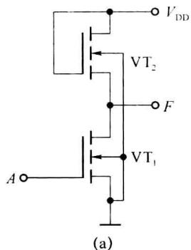

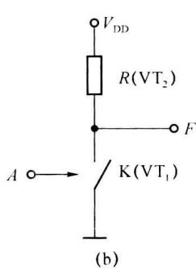  

图2.6.1 NMOS非门

当输入端 A 为低电平 0 V 时， $VT_{1}$ 截止，输出 F 为高电平，有 $V_{OH}=V_{DD}-V_{TH2}(V_{TH2}$ 为负载管的开启电压），如果设开启电压 $V_{TH2}=2V$ ，则 $V_{OH}=5V-2V=3V$ 。当输入端 A 为高电平 3 V 时， $VT_{1}$ 导通，此时 $VT_{2}$ 也是导通的，只要 $VT_{1}$ 的导通电阻比 $VT_{2}$ 的导通电阻小得多，输出 F 的电平将接近于 0 V。导通电阻的大小可通过设计 MOS 数字集成电路时使用不同的沟道宽长比来实现。

NMOS 非门的工作原理也可以用图 2.6.1(b) 所示开关电路描述, 输入端控制开关 K, 当闭合时, 输出低电平, 断开时输出高电平。

### 2. NMOS 与非门

NMOS 与非门是在非门的基础上又串接了一个驱动管构成, 即 $VT_{3}$ 为负载管, $VT_{1}$ 、 $VT_{2}$ 为两个串联的驱动管。电路如图 2.6.2(a) 所示。

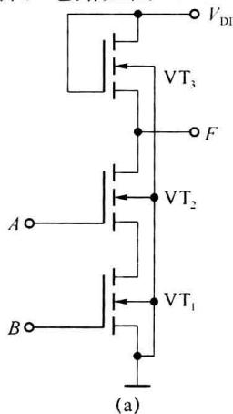

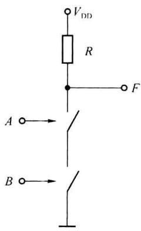  

图2.6.2 NMOS与非门

当输入 A、B 中有一个或两个为低电平 0 V 时，驱动管截止，输出 F 为高电平 $V_{OH} = V_{DD} - V_{TH3}$ ；当输入 A、B 均为高电平 3 V 时， $VT_{1}$ 和 $VT_{2}$ 都导通，输出 F 为低电平，只要 $VT_{1}$ 和 $VT_{2}$ 串联的导通电阻比 $VT_{3}$ 的导通电阻小得多，输出 F 的电平将接近于 0 V，完成与非逻辑功能 F = $\overline{AB}$ 。NMOS 与非门的工作原理也可以用图 2.6.2(b) 所示开关电路描述。当与非门的输入端数增加时，串联驱动管的个数就要增多，由于与非门的输出低电平取决于负载管的导通电阻与驱动管导通电阻之和的比，因此要求负载管与驱动管导通电阻相差更悬殊，这将不利于集成度的提高，故与非门的输入端数不宜超过 3 个。

### 3. NMOS 或非门

NMOS或非门是在非门的基础上并接了一个驱动管构成，即 $\mathrm{VT}_3$ 为负载管， $\mathrm{VT}_1$ 、 $\mathrm{VT}_2$ 为两个并联的驱动管。电路如图2.6.3(a)所示。

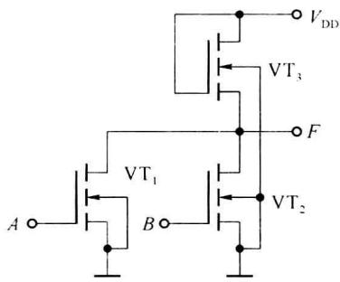  

(a)

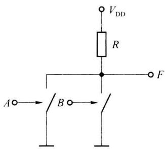  

(b)  

图2.6.3 NMOS或非门

当输入 A、B 中有一个或两个都为高电平 3 V 时，驱动管导通，输出为低电平将接近于 0 V，当输入 A、B 均为低电平 0 V 时， $VT_{1}$ 和 $VT_{2}$ 都截止，输出 F 为高电平 $V_{OH} = V_{DD} - V_{TH3}$ ，电路完成或非逻辑功能 $F = \overline{A + B}$ 。分析逻辑功能时也可以通过相位关系和“线与”逻辑概念进行，场效应管的栅极和漏极之间为反相关系（晶体管的基极和集电极之间也是一样），因此， $VT_{1}$ 和 $VT_{2}$ 的漏极输出为 $\overline{A}$ 和 $\overline{B}$ ，两个漏极实现“线与”，有 $F = \overline{A}\overline{B} = \overline{A + B}$ 。NMOS 或非门的工作原理也可以用图 2.6.3(b) 所示开关电路描述。

### 4. NMOS 与或非门

图 2.6.4 所示 NMOS 电路完成与或非逻辑 $F = \overline{AB + C + D}$ 的逻辑功能。读者可根据前面所述的工作原理自行分析。

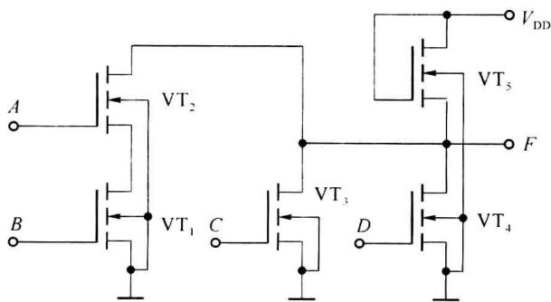  

图2.6.4 NMOS与或非门

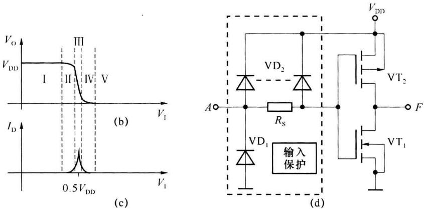

## 2.6.2 CMOS 非门

### 1. CMOS 非门工作原理

CMOS非门也称为互补MOS反相器，由一个NMOS管 $\mathrm{VT}_{1}$ 和一个PMOS管 $\mathrm{VT}_{2}$ 构成，电路图如图2.6.5(a)所示。当输入低电平为 $0\mathrm{V}$ 时， $\mathrm{VT}_{1}$ 的栅源电压 $V_{\mathrm{GS1}} = 0,V\mathrm{T}_{1}$ 截止，而此时加在 $\mathrm{VT}_{2}$ 上的栅源电压 $V_{\mathrm{GS2}}\approx -5\mathrm{V}$ ，绝对值大于其开启电压的绝对值，有 $|V_{\mathrm{GS2}}| > |V_{\mathrm{THP}}|$ （ $V_{\mathrm{THP}}$ 为P沟道MOS管的开启电压）， $\mathrm{VT}_{2}$ 导通，输出为高电平， $V_{\mathrm{O}} = V_{\mathrm{OH}}\approx V_{\mathrm{DD}}$ 。

当输入为高电平 5 V 时， $V_{GS1} \approx 5 V, VT_{1}$ 导通，而 $V_{GS2} \approx 0 V, VT_{2}$ 截止，输出为低电平， $V_{O} = V_{OL} \approx 0 V$ 。电路实现非的逻辑功能。

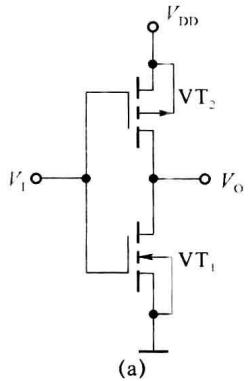  

图2.6.5 CMOS非门

### 2. CMOS 非门电压与电流传输特性

图 2.6.5(b) 所示为 CMOS 非门的电压传输特性。在 $V_{I}$ 较小时， $V_{I} \leqslant V_{\mathrm{THN}} (V_{\mathrm{THN}}$ 为 N 沟道 MOS 管的开启电压) 时， $VT_{1}$ 截止， $VT_{2}$ 工作在可变电阻区，有较小的导通电阻，输出高电平接近于电源电压 $V_{DD}$ ，如图 2.6.5(b) 中的第 I 段。

当输入电压增加到 $V_{I} \geqslant V_{THN}$ 时， $VT_{1}$ 开始进入饱和区， $VT_{2}$ 仍然处于可变电阻区，电路有较小的电流通过，如图 2.6.5(c) 所示，输出电压开始下降，如图 2.6.5(b) 曲线的第Ⅱ段。

输入电压继续增大,达到 $0.5 V_{DD}$ 附近, $VT_{1}$ 和 $VT_{2}$ 都工作在 MOS 管的饱和导通区,有较大电流通过,此时电路输入 $V_{I}$ 有一个微小增量,输出电平就会急剧下降,如图 2.6.5(b) 中曲线的第Ⅲ段。

随着输入电平继续增大, $VT_{1}$ 进入可变电阻区, $VT_{2}$ 在饱和导通区,输出电平进一步降低,流过电路的电流又开始下降,输出电平如图2.6.5(b)中曲线的第Ⅳ段所示。

当输入电平 $V_{I} \geqslant V_{DD} - |V_{TNP}|$ 时， $VT_{1}$ 工作于可变电阻区， $VT_{2}$ 截止，电流降为零，输出低电平接近 0 V，对应图 2.6.5(b) 中曲线的第 V 段。

实际上，电压传输特性曲线在 $V_{I}=0.5V_{DD}$ 附近是很陡的，因此 CMOS 非门高、低电平的噪声容限都比较大，可达电源电压的 45% 左右，而且抗干扰能力随电源电压提高而增强。

由图 2.6.5(c) 的电源电流与输入电压之间的关系曲线可知, CMOS 非门只在过渡区域出现较大的电流。输出达到稳定的高电平和低电平时，电流几乎为零，所以静态功耗极小，这也是CMOS门在数字电路系统中得到了广泛的应用的理由之一。

### 3. 集成 CMOS 非门

4000 系列 4069 集成 CMOS 非门的内部电路如图 2.6.5(d) 所示，在 4069 中集成了 6 个非门。由于 MOS 器件的栅极是绝缘的，栅极感生少量的电荷就会产生击穿，所以 CMOS 电路都采用了各种形式的输入端保护电路，图 2.6.5(d) 电路中 $VD_{1}$ 、 $VD_{2}$ 为双极型保护二极管，它们的正向导通压降为 0.5～0.7 V，反向击穿电压约为 30 V。由于 $VD_{2}$ 是集成工艺中由输入端的 P 型扩散电阻区和 N 型衬底间自然形成的，是一种所谓分布式二极管结构，所以在图 2.6.5(d) 中用一条虚线和两端的两个二极管来表示。 $R_{s}$ 的阻值在 1.5～2.5 kΩ 之间。正常工作时，输入电压最大为 $V_{DD}$ ，最小为 0，故 $VD_{1}$ 、 $VD_{2}$ 不会导致通。

## 2.6.3 CMOS与非门

型号为 4011UB 的 CMOS 与非门电路如图 2.6.6(a)、(b) 所示, 图 2.6.6(a) 中 $\mathrm{VT}_{1}$ 、 $\mathrm{VT}_{3}$ 构成互补对管, $\mathrm{VT}_{2}$ 、 $\mathrm{VT}_{4}$ 构成互补对管, 互补对管中的两个场效应管若一个导通, 另一个截止。电路工作时, 只有当输入 $A$ 、 $B$ 均为高电平时, 将有 $\mathrm{VT}_{1}$ 、 $\mathrm{VT}_{2}$ 导通, $\mathrm{VT}_{3}$ 、 $\mathrm{VT}_{4}$ 截止, 输出 $F$ 为低电平。只要 $A$ 、 $B$ 中有一个为低电平, 则 $\mathrm{VT}_{1}$ 、 $\mathrm{VT}_{2}$ 中会有一个截止, $\mathrm{VT}_{3}$ 、 $\mathrm{VT}_{4}$ 中会有一个导通, 输出 $F$ 为高电平, 所以实现与非门功能, $F = \overline{AB}$ 。图 2.6.6(b) 为输入的保护单元, 即图 2.6.6(a) 中的每个输入端都串接有图 2.6.6(b) 的保护单元。由于所有 CMOS 门电路的输入端都串接有图 2.6.6(b) 的保护电路, 后面分析其他逻辑门时, 保护单元不再画出。

(b)  

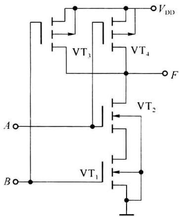

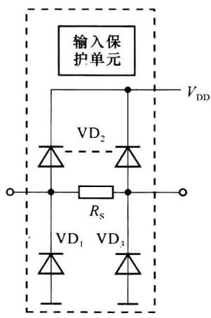  

图2.6.6 CMOS与非门4011UB内部电路

相同功能 CMOS 与非门的内部电路也不相同, 图 2.6.7(a) 给出的是型号为 4011B 与非门的内部电路, 图 2.6.6(b) 为其等效电路。

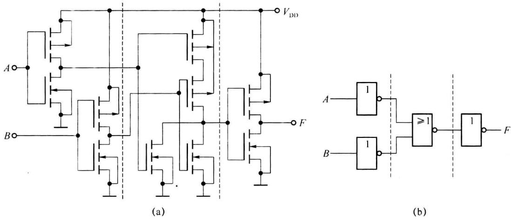  

图 2.6.7 CMOS 与非门 4011B 内部电路

## 2.6.4 CMOS或非门

CMOS或非门4001UB的内部电路如图2.6.8(a)所示。图(a)中 $\mathrm{VT}_{1},\mathrm{VT}_{3}$ 构成互补对管， $\mathrm{VT}_{2},\mathrm{VT}_{4}$ 构成互补对管，只要输入 $A,B$ 中有一个为高电平，则 $\mathrm{VT}_{1},\mathrm{VT}_{2}$ 中就有一个导通， $\mathrm{VT}_{3},\mathrm{VT}_{4}$ 中就有一个截止，输出低电平；只有 $A,B$ 均为低电平，则 $\mathrm{VT}_{1},\mathrm{VT}_{2}$ 均截止， $\mathrm{VT}_{3},\mathrm{VT}_{4}$ 均导通，输出高电平，因而完成或非逻辑功能， $F = \overline{A + B}$ 。

图 2.6.8(b) 给出的是型号为 4001B 或非门的内部电路。

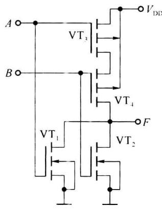  

(a)

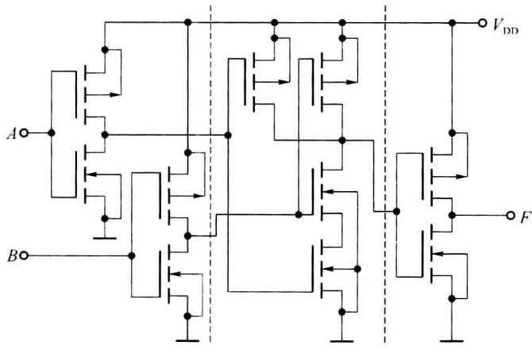  

(b)  

图 2.6.8 CMOS 或非门 4001UB 及 4001B 的内部电路

## 2.6.5 CMOS与或非门

CMOS与或非门的原理电路如图2.6.9所示， $\mathrm{VT}_2$ 、 $\mathrm{VT}_3$ 、 $\mathrm{VT}_4$ 、 $\mathrm{VT}_7$ 和 $\mathrm{VT}_1$ 、 $\mathrm{VT}_5$ 、 $\mathrm{VT}_6$ 、 $\mathrm{VT}_8$ 分别构成了两个与非逻辑逻辑电路，即MOS管 $\mathrm{VT}_2$ 的漏极输出为 $\overline{AB}$ ，MOS管 $\mathrm{VT}_4$ 的漏极输出为 $\overline{CD}$ ，两个漏极线与， $F = \overline{AB} \cdot \overline{CD} = \overline{AB + CD}$ 。

与或非逻辑也可以通过其他方式获得,如芯片 4085B 中使用了 3 个与非逻辑单元和一个非门,输出为 $F=\overline{AB}\cdot\overline{CD}=\overline{AB+CD}$ 。

图 2.6.9(b)给出的是与或非门芯片 4085B 内部结构的框图,没有画出具体内部逻辑电路。

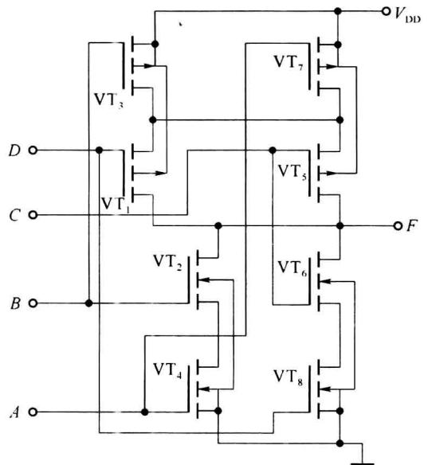  

(a)CMOS与或非门电路

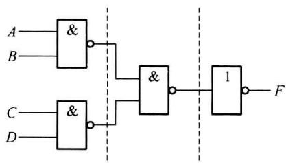  

(b)芯片4085B的内部结构  

图 2.6.9 CMOS 与或非门电路及芯片 4085B 的内部结构

## 2.6.6 CMOS 漏极开路与非门电路(OD 与非门)

与TTL电路一样，CMOS逻辑门将输出电路接成漏极开路形式时，称为OD门。图2.6.10所示是一个OD与非门，也称为与非缓冲/驱动器，芯片型号为40107。其输出是一个漏极开路的N沟道增强型MOS管，用于输出缓冲驱动或进行电平的转换，该芯片可以满足驱动大负载电流的需要，驱动电流可达 $50\mathrm{mA}$ 。OD门也可实现“线与”逻辑，外接上拉电阻的计算方法与TTL的集电极开路门(OC门)电路相同。

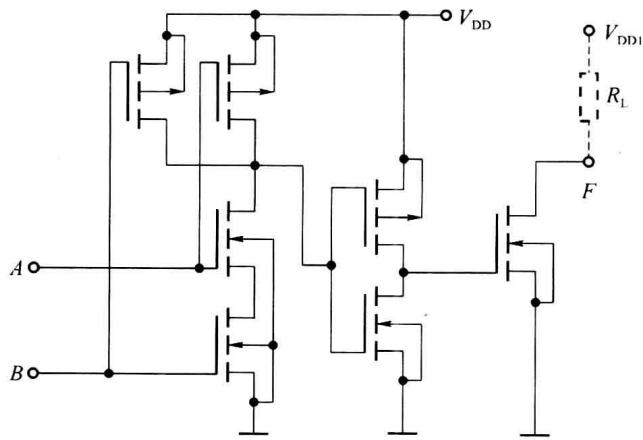  

图 2.6.10 OD 与非门(与非缓冲/驱动器)40107 内部电路

## 2.6.7 CMOS传输门及模拟开关

CMOS 传输门(TG)由增强型 NMOS 和 PMOS 管并联构成,有两个互补的控制端 C 和 $\overline{C}$ 。电路如图 2.6.11(a) 所示,传输门符号如图 2.6.11(b) 所示。当 NMOS 管 VT $_{1}$ 栅极电平 $C=V_{DD}$ , PMOS 管 VT $_{2}$ 栅极电平 $\overline{C}=0$ 时, VT $_{1}$ 、VT $_{2}$ 两个 MOS 管都处于导通状态,输入和输出端总导通电阻为两只场效应管导通电阻的并联值, $R_{on}=R_{onN}//R_{onP}$ , 关系曲线如图 2.6.12 所示。由于电阻 $R_{on}$ 较小, 可把输入和输出端看成一个开关, 此时开关闭合。当 C=0, $\overline{C}=V_{DD}$ 时, 两只 MOS 管均截止, 此时等效开关断开。

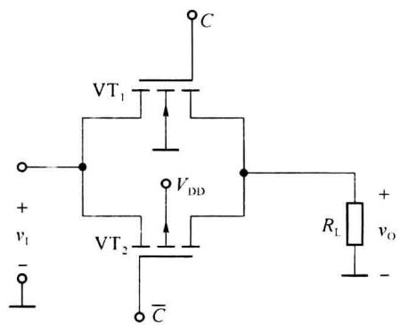  

(a)

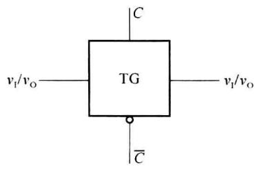  

(b)

图2.6.11 CMOS传输门  

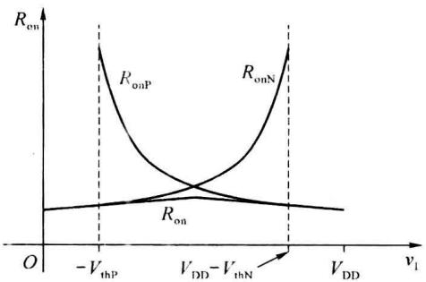

CMOS 模拟开关时在 CMOS 传输门的基础上增加一个反相器,通过一个控终端实现 VT $_{1}$ 、VT $_{2}$ 两管同时导通或同时关断。2.6.13(a)电路 CMOS 模拟开关,等效电路如图 2.6.13(b)所示,图 2.6.13(c)为 CMOS 模拟开关的符号。CMOS 模拟开关在模拟电路和数字电路中都有较广泛的应用,模拟开关芯片 4066 中集成了 4 个完全一样的 CMOS 模拟开关。

图 2.6.12 CMOS 传输门的导通电阻  

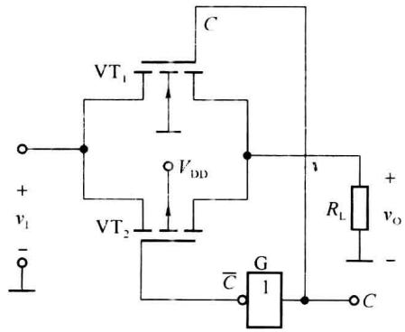  

(a)

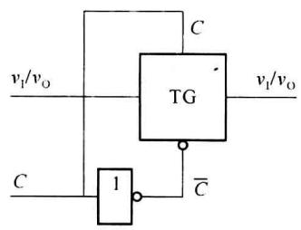  

(b)

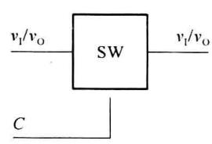  

(c)  

图 2.6.13 CMOS 模拟开关

## 2.6.8 CMOS三态门

三态输出 CMOS 门是在普通门电路的基础上增加三态控制电路构成的,这里仅简单介绍三态非门(或三态缓冲门)的工作原理。CMOS 三态门可以有多种电路结构实现三态输出,这里介绍 4 种,分别称为非门控制、或非门控制、与非门控制和传输门控制方式。

(1) 非门控制的电路结构形式如图 2.6.14(a) 所示。它是在反相器基础上增加一个 P 沟道 MOS 管 VT $_{1}$ ' 和一个 N 沟道 MOS 管 VT $_{2}$ ' 及非门构成。当控制端 EN=1 时，VT $_{2}$ ' 和 VT $_{1}$ ' 同时截止，输出呈高阻态；当控制端 EN=0 时，VT $_{2}$ ' 和 VT $_{1}$ ' 同时导通，反相器正常工作，输出 F= $\overline{A}$ 。由于控制端 EN 为低电平时电路实现反相器正常工作，称为控制端低电平有效的三态非门，符号如图 2.6.14(e) 所示。

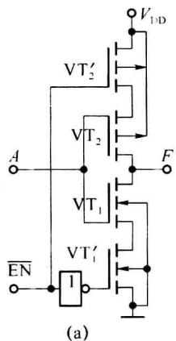

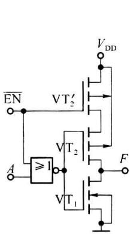

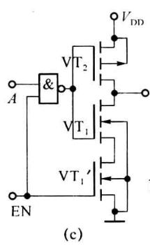

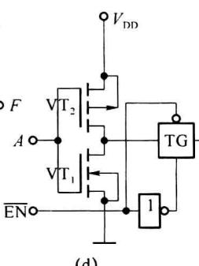

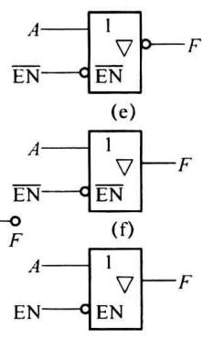  

图 2.6.14 三态门高阻输出的控制方式及符号

（2）或非门控制电路结构如图 2.6.14(b) 所示。当控制端 $\overline{EN}=1$ 时， $VT_{2}^{\prime}$ 截止，同时由于或非门的输出为低电平， $VT_{1}$ 也截止，输出呈高阻态；当控制端 $\overline{EN}=0$ 时， $VT_{2}^{\prime}$ 导通，或非门作为反相器使用，电路的输出为 F=A 。所以电路是控制端 $\overline{EN}$ 低电平有效的三态缓冲门，符号如图 2.6.14(f) 所示。

（3）与非门控制电路结构如图2.6.14(c)所示。当控制端 $\mathrm{EN} = 1$ 时， $\mathrm{VT}_1'$ 导通，与非门作为反相器使用，电路正常工作，输出为 $F = A$ 。当控制端 $\mathrm{EN} = 0$ 时， $\mathrm{VT}_1'$ 截止，与非门的输出为高电平， $\mathrm{VT}_2$ 也截止，所以电路是控制端 $\mathrm{EN}$ 高电平有效的三态缓冲门，符号如图2.6.14(g)所示。

（4）传输门控制方式是在反相器基础上增加一级CMOS模拟开关。当 $\overline{\mathrm{EN}} = 1$ 时，模拟开关断开，输出呈高阻态；当 $\overline{\mathrm{EN}} = 0$ 时，模拟开关导通，输出 $F = \overline{A}$ 。电路为 $\overline{\mathrm{EN}}$ 低电平有效的三态非门，符号如图2.6.14(e)所示。

## 2.6.9 CMOM 逻辑门特点及应用

(1) 除前面介绍的 4000 系列 CMOS 逻辑门外, 还有 74HC (高速 CMOS, CMOS 电平)、74HCT (高速 TTL 电平 CMOS, TTL 电平) 等系列。典型参数如表 2.6.1 所示。参数的测试条件为: 电源电压 $V_{\mathrm{DD}} = 5 \mathrm{~V}$ , 负载电容 $C_{\mathrm{L}} = 50 \mathrm{pF}$ , 负载电阻 $R_{\mathrm{L}} = 200 \mathrm{k} \Omega$ , 4000 系列的输入信号的上升时间和下降时间 $t_{\mathrm{r}} = t_{\mathrm{f}} = 25 \mathrm{~ns}$ , 74HC、74HCT 系列的输入信号的上升时间和

下降时间 $t_{r}=t_{f}=6\ ns$ 。

表 2.6.1 4000、74HC、74HCT 系列主要参数

<table><tr><td>参数</td><td>符号</td><td>单位</td><td>4000</td><td>74HC</td><td>74HCT</td><td>参数</td><td>符号</td><td>单位</td><td>4000</td><td>74HC</td><td>74HCT</td></tr><tr><td>延迟时间</td><td> $t_{PHL}$  $t_{PLH}$ </td><td>ns</td><td>125</td><td>18</td><td>15</td><td>输入电流</td><td> $I_{Imax}$ </td><td> $\mu A$ </td><td> $\pm 10^{-5}$ </td><td> $\pm 0.1$ </td><td> $\pm 0.1$ </td></tr><tr><td>静态电源电流</td><td> $I_{CC}$ </td><td> $\mu A$ </td><td>0.01</td><td>2</td><td>2</td><td>低电平输出电压</td><td> $V_{OLmax}$ </td><td>V</td><td>0.05</td><td>0.1</td><td>0.1</td></tr><tr><td>最大静态功耗</td><td>P</td><td> $\mu W$ </td><td>0.05</td><td>10</td><td>10</td><td>高电平输出电压</td><td> $V_{OHmin}$ </td><td>V</td><td>4.95</td><td>4.4</td><td>4.4</td></tr><tr><td>低电平输入电压</td><td> $V_{ILmax}$ </td><td>V</td><td>1.5</td><td>1.35</td><td>0.8</td><td>低电平输出电流</td><td> $I_{OLmax}$ </td><td>mA</td><td>2.6</td><td>4</td><td>4</td></tr><tr><td>高电平输入电压</td><td> $V_{IHmin}$ </td><td>V</td><td>3.5</td><td>3.15</td><td>2</td><td>高电平输出电流</td><td> $I_{OHmax}$ </td><td> $\mu A$ </td><td>-1000</td><td>-4000</td><td>-4000</td></tr></table>

(2) CMOS 逻辑门的工作电压:4000 系列 CMOS 逻辑门可使用的工作电压为 $3 \sim 18 \mathrm{~V}$ ; 74HC 和 74HCT 系列逻辑门的工作电压为 $2 \sim 6 \mathrm{~V}$ , 较多情况下使用 $5 \mathrm{~V}$ 供电。

（3）CMOS 输入电流基本为 0，CMOS 输入端通过电阻接地或接电源时，对电阻值无严格限制，但 CMOS 逻辑门输入端不允许悬空。（TTL 门输入端悬空时，相当于输入高电平，但实际使用时，最好不要悬空，以免引进干扰。）

（4）CMOS 逻辑门的扇出系数很大，通常输出端可驱动 50 个同类门电路（驱动门过多时，负载电容也较大，延时增加），但是若用 CMOS 门来驱动纯电阻负载或 TTL 门电路，负载能力十分有限，往往需要另加 CMOS 驱动器提供较大的输出电流。

（5）相对 TTL 门而言，CMOS 逻辑门的传输延迟时间稍大，主要源自 CMOS 的高输入阻抗及寄生电容和负载电容的影响。传输延迟时间还与电源电压有关，例如 4000 系列门如用 5 V 供电时的传输延迟时间为 125 ns，使用 15 V 供电时的传输延迟时间为 45 ns。

(6) 由于 CMOS 逻辑电路的工艺结构问题,很容易出现栓锁(Latch-up)现象,当有一定的触发条件,CMOS 逻辑所固有的寄生双极型晶体管被触发导通,在电源和地之间形成一很大的电流,除非切断电源,否则这一电流不会消失,并会造成器件损坏。因此要避免在器件的输入和输出端有大的电压的过冲和大电流的灌入与拉出,同时需要保证电源不能有过大的浪涌。

（7）CMOS 电路在使用时应注意对输入电路进行静电防护。输入端接长线时（例如，两块电路板间通过接插件连接），应串接保护电阻，以限制振荡脉冲。

(8) CMOS 电路虽然静态功耗很低,但在输入信号动态转换时,会有较大电流,如图 2.6.5(c) 所示,工作频率越高,动态功耗越大。
