import Guide from '@/components/Guide.astro';
import Knowledge from '@/components/Knowledge.astro';
import Example from '@/components/Example.astro';
import Analysis from '@/components/Analysis.astro';
import Solution from '@/components/Solution.astro';
import Variant from '@/components/Variant.astro';
import Note from '@/components/Note.astro';
import Block from '@/components/Block.astro';
import Method from '@/components/Method.astro';
import Exercise from '@/components/Exercise.astro';

### 1. 逻辑电平

除我们已经熟悉的逻辑电平 74/54TTL 系列、4000 CMOS 系列、ECL 系列以外，还有 LVTTL（低电压 TTL, Low Voltage TTL）、LVCMOS（低电压 CMOS, Low Voltage CMOS）、PECL（正射极耦合逻辑，Positive Emitter Coupled Logic）、LVPECL（低电压正发射极耦合逻辑, Low Voltage Positive Emitter Coupled Logic) 和用于信号传输的 RS232、RS422、RS485 等。

### (1) LVTTL

因为TTL器件输出高电平 $V_{\mathrm{OHmin}} \approx 2.7 \mathrm{~V}$ （有些为 $V_{\mathrm{OHmin}} \approx 2.4 \mathrm{~V}$ ），高电平高于 $2.7 \mathrm{~V}$ 对改善噪声容限并不会带来太多的好处，又会增大功耗，所以可改变电路设计，使用更低的电压对器件供电，因此有了LVTTL。LVTTL又分 $3.3 \mathrm{~V}$ 、 $2.5 \mathrm{~V}$ 、 $1.8 \mathrm{~V}$ 等系列。3.3VLVTTL的 $V_{\mathrm{OHmin}} = 2.4 \mathrm{~V}, V_{\mathrm{OLmax}} = 0.4 \mathrm{~V}, V_{\mathrm{IHmin}} = 2 \mathrm{~V}, V_{\mathrm{ILmax}} = 0.8 \mathrm{~V}$ 。2.5VLVTTL的 $V_{\mathrm{OHmin}} = 2 \mathrm{~V}, V_{\mathrm{OLmax}} = 0.2 \mathrm{~V}, V_{\mathrm{IHmin}} = 1.7 \mathrm{~V}, V_{\mathrm{ILmax}} = 0.7 \mathrm{~V}$ 。更低电压的LVTTL多用在处理器等高速芯片中，如需要可查看相关手册。

### (2) LVCMOS

LVCMOS 相对 LVTTL 来说有更大的噪声容限，输入阻抗远大于 LVTTL 的输入阻抗。3.3 V LVCMOS 的 $V_{OHmin}=3.2\ V, V_{OLmax}=0.1\ V, V_{IHmin}=2\ V, V_{ILmax}=0.7\ V$ 。2.5 V LVCMOS 的 $V_{OHmin}=2\ V, V_{OLmax}=0.1\ V, V_{IHmin}=1.7\ V, V_{ILmax}=0.7\ V$ 。

### (3) $74 / 54$ 系列 CMOS

在 74/54 系列中 HC、HCT、ACT 等为 CMOS 工艺器件，HC 为 CMOS 电平，当与 4000 系列使用同一电源时，可直接驱动。HCT 和 ACT 为 TTL 电平，当与 TTL 器件使用 5 V 电源时可相互驱动。HC、HCT、ACT 的工作电源电压为 2～6 V，也就是说可以用 2.5 V、3.3 V、5 V 供电，在不同电源电压下输出、输入电平值可查阅手册。

### (4) PECL 和 LVPECL

PECL 是采用正电源供电的发射极耦合逻辑电路。当 ECL 器件原应该接负电源的位置作为地，原接地的位置接正电源时，可作为 PECL 使用，这时逻辑电平值应该在原来电平的基础上加上正电源的电压值即可，当供电电压为 5 V 时，输出电平约为 $V_{OHmin} = 4.12 \, V$ ， $V_{OLmax} = 3.28 \, V$ 。

$$

V _ {\mathrm{OHmin}} = 2. 4 2 \mathrm{V}, V _ {\mathrm{OLmax}} = 1. 5 8 \mathrm{V。}

$$

### (5) RS232

RS232 是被广泛用于计算机间通信的接口, 接口标准定义了电气特性。RS232 由数据的收、发信号线和若干控制线组成, 高电平为 $3 \sim 15 \mathrm{~V}$ , 低电平为 $-3 \sim -15 \mathrm{~V}$ 。数据的收、发采用负逻辑, 即逻辑 1 对应输出为 $-3 \sim -15 \mathrm{~V}$ , 逻辑 0 对应输出为 $3 \sim 15 \mathrm{~V}$ 。多数情况下只使用数据发送端 TxD、接收端 RxD 以及地 GND 实现两个设备间的全双工通信。一般使用专用芯片实现 TTL 与 RS232 间的电平转换, 如 MAX232 等。

### (6) RS422

RS422 是以差动方式发送和接收数据，即通过两对双绞线实现全双工工作，不需要数字地线。差动工作方式在同速率条件下相比非差动方式（如 RS232）能够传输更远的距离。定义发送端 A、B 两端的电平差为 +2～+6 V 为逻辑 1，-2～-6 V 为逻辑 0，输入两端大于 +200 mV 时能够正确接收逻辑 1，为 -200 mV 时能够正确接收逻辑 0。一般使用专用芯片实现 TTL 与 RS422 间的电平转换，如芯片 MC3486 和 MC3487。

### (7) RS485

RS485 也是以差动方式发送和接收数据,电平与 RS422 相同,但数据使用一条双绞线分时进行数据收发,实现半双工工作。优点在于可以将数据线并联,实现一个设备与多个设备的通信。一般使用专用芯片实现 TTL 与 RS485 间的电平转换,如 SN65HVD20。

还有一些芯片既可以用于 RS422，也可以用于 RS485 接口，如 SN75172（RS-485/422 四差分线驱动器）和 SN75173（RS-485/422 四差分线接收器）。

### 2. 负载驱动

（1）当某一个门的输出需要驱动较多的负载门且带负载能力不够时，可分别进行驱动，如图2.7.1所示。

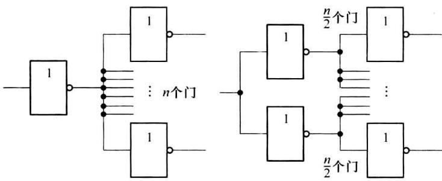  

图 2.7.1 多负载门的分别驱动

（2）当某一个门的输出需要驱动负载电流较大的单一负载时，实现方法举例如下。方法一是逻辑门并联使用。例如，TTL门的 $I_{OLmax}=8\ mA$ ，现需要驱动5 V、12 mA的继电器，可用两个门并联，使总的输出 $I_{OLmax}\approx16\ mA$ ，如图2.7.2(a)所示。方法二是利用晶体管实现驱动，如图2.7.2(b)所示，该方法不但能够解决电流驱动能力不足的问题，也可以实现负载对不同电压的需求。例如，需要驱动12 V、20 mA的继电器。方法三是使用OC(或OD)门实现，如图2.3.18所示。

（3）当一个门驱动某个负载时的输出电压和输出电流都能满足要求，如驱动一个发光二极管，可以有图2.7.3所示的两种方法，但最好采用图2.7.3(a)的灌电流负载的方式，好处是一般芯片的灌电流驱动能力强，有较大的驱动电压范围，还有可以减小芯片上的功耗。

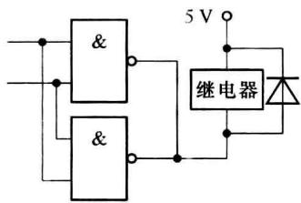

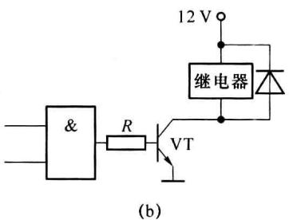  

图 2.7.2 增加驱动能力的方法

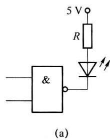

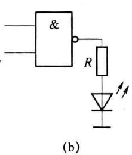  

图 2.7.3 灌电流与拉电流负载

### 3. 逻辑电平转换

不同逻辑系列的器件进行混合逻辑电路设计时，驱动门和负载门之间的接口应满足驱动电流的需求和驱动电平的需求。一个驱动门带 n 个负载门时，要求驱动门的最大低电平输出电流大于等于 n 个负载门的低电平最大输入电流，即 $\left|I_{OLmax}\right|\geqslant n\left|I_{ILmax}\right|$ ，同时要求驱动门的最大高电平输出电流大于等于 n 个负载门的高电平最大输入电流，即 $\left|I_{OHmax}\right|\geqslant n\left|I_{IHmax}\right|$ 。对于电平，要求驱动门高电平输出时的最小值不能低于负载门输入高电平的最低值，即 $V_{OHmin}\geqslant V_{IHmin}$ ，同时要求驱动门输出低电平的最大值不能大于负载门输入低电平的最大值，即 $V_{OLmax}\leqslant V_{ILmax}$ 。

表 2.7.1 重新列出了一些常用的 TTL、ECL 和 CMOS 门的典型电平参数。下面我们只从电平配合的角度分析和介绍接口之间的连接和处理方式，能否满足电流的驱动要求，还需要通过芯片手册给出的参数确定。

表 2.7.1 常用的 TTL、ECL 和 CMOS 门的典型电平参数

<table><tr><td>参数</td><td>符号</td><td>单位</td><td>4000</td><td>74HC</td><td>74HCT</td><td>74H</td><td>74LS</td><td>LVTTL3.3V</td><td>LVTTL2.5V</td><td>LVCMOS3.3V</td><td>ECL10K</td><td>PECL</td></tr><tr><td>低电平输入电压</td><td> $V_{\text{ILmax}}$ </td><td>V</td><td>1.5</td><td>1.35</td><td>0.8</td><td>0.8</td><td>0.8</td><td>0.8</td><td>0.7</td><td>0.7</td><td>-1.36</td><td>3.64</td></tr><tr><td>高电平输入电压</td><td> $V_{\text{IHmin}}$ </td><td>V</td><td>3.5</td><td>3.15</td><td>2</td><td>2</td><td>2</td><td>2</td><td>1.7</td><td>2</td><td>-1.24</td><td>3.78</td></tr><tr><td>低电平输出电压</td><td> $V_{\text{OLmax}}$ </td><td>V</td><td>0.05</td><td>0.1</td><td>0.1</td><td>0.4</td><td>0.5</td><td>0.4</td><td>0.2</td><td>0.1</td><td>-1.72</td><td>3.28</td></tr><tr><td>高电平输出电压</td><td> $V_{\text{OHmin}}$ </td><td>V</td><td>4.95</td><td>4.4</td><td>4.4</td><td>2.4</td><td>2.7</td><td>2.4</td><td>2</td><td>3.2</td><td>-0.88</td><td>4.12</td></tr></table>

（1）74系列门电路中TTL电平的门如74H、74LS、74S、74ALS与74HCT（CMOS工艺，TTL电平）、74ACT（CMOS工艺，TTL电平)以及 $3.3\mathrm{V}$ 的LVTTL、LVCMOS门可以直接相互连接驱动，通常LVTTL、LVCMOS门的输入端能够容忍TTL门的高电平值，但需要注意相互驱动时电流驱动能力的差别。

(2) 在使用相同电源(例如 5 V)的情况下, CMOS 电平的 4000 系列与 74HC(也是 CMOS 电平)系列可以相互连接驱动。

（3）在使用相同电源(例如 5 V)、驱动电流满足要求的情况下，CMOS 门可以直接驱动 TTL 门，如图 2.7.4(a) 所示；但 TTL 门不能直接驱动 CMOS 门，这是由于 TTL 门输出的高电平的最低值 (2.7 V 或 2.4 V) 不满足 CMOS 门的输入高电平的最低值 (3.5 V) 的需求，需要对 TTL 输出的高电平进行拉升。方法是将 TTL 门的输出接一上拉电阻，如图 2.7.4(b) 所示，原理是当 TTL 门接有上拉电阻时，门电路的输出端等效为 OC 门，参看图 2.3.1，电路中的 VT₃、VD₃ 在输出高电平时不再导通。当电阻 R 的值不是很大时，输出电平被上拉到接近 5 V 左右。R 的值也不能大小，否则会对 TTL 输出的低电平产生影响，R 的取值 1～5 kΩ 为宜。当然设计时也可以直接使用 TTL 的 OC 门驱动 CMOS 器件，如图 2.7.4(c) 所示。

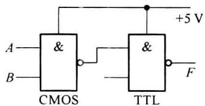  

(a)

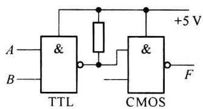  

(b)

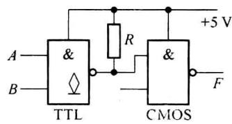  

(c)  

图 2.7.4 相同供电电源 TTL 与 CMOS 之间的驱动

（4）当TTL和CMOS使用不同电源时(如TTL使用 $5\mathrm{V}$ 、CMOS使用 $15\mathrm{V}$ )，可使用OC门或晶体管进行电平转换。电路如图2.7.5(a)、(b)、(c)所示，这里不再详细分析原理。

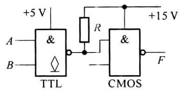  

(a)

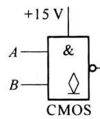

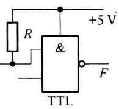  

(b)

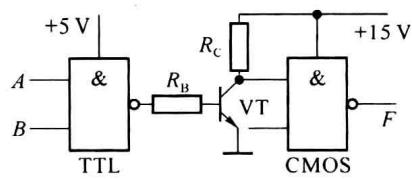  

(c)  

图 2.7.5 不同供电电源 TTL 与 CMOS 之间的驱动

(5) ECL 与 TTL 之间的电平转换通常使用专用电平转换芯片进行。例如 MC10124 可实现 TTL 电平到 ECL 电平的转换；MC10125 可实现 ECL 电平到 TTL 电平的转换。电路如图 2.7.6 所示。

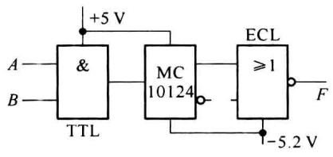  

(a)

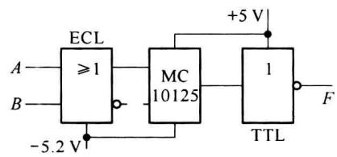  

(b)  

图2.7.6 ECL与TTL之间的电平转换

(6) TTL/CMOS 与 RS232 接口之间的转换可直接采用转换芯片。现在多使用由单 +5 V 供电的器件, 如 MAX232、MAX233 等, 在这些电平转换器件的内部, 可以利用 +5 V 电源产生 ±10 V 左右的 RS232 输出电平, 应用电路框图如图 2.7.7 所示, 具体使用方法参考器件手册。

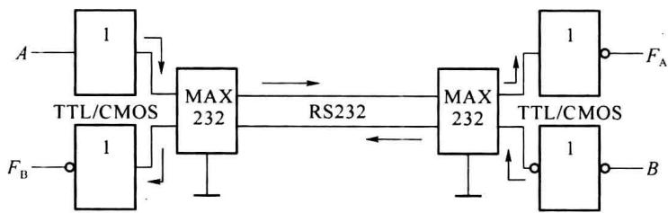  

图 2.7.7 TTL/CMOS 与 RS232 之间的电平转换

(7) TTL 与 RS422 接口之间的转换可使用如 MC3486(422-TTL)、MC3487(TTL-422) 等芯片。RS422 接口采用差动方式发送和接收数据，通过两对双绞线实现全双工工作，不需要数字地线，能够传输较远的距离。电路如图 2.7.8 所示。

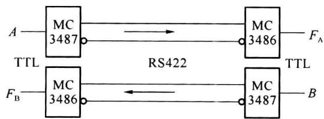  

图 2.7.8 TTL 与 RS422 之间的电平转换

(8) 用于TTL与RS485接口的芯片SN65HVD20的内部逻辑框图如图2.7.9(a)所示。DE端用于控制器件在485总线输出是否为高阻， $\overline{\mathrm{RE}}$ 用于控制器件TTL输出端是否为高阻。在485总线上，只有被允许发送数据时，该器件（或设备）才能发送数据（低阻），其他器件(设备)必须为高阻。挂在485总线上的设备可实现一个设备对多个设备之间的双向半双工通信。总线结构如图2.7.9(b)所示。

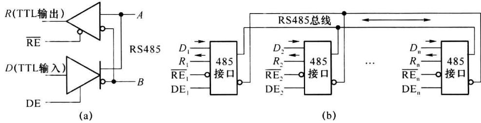  

图 2.7.9 RS485 内部结构及 RS485 总线结构

除以上介绍的接口电平转换方法和转换电路外还有较多的电平转换芯片可用，如SY89321L可完成LVPECL到LVTTL之间的电平变换等，读者可根据设计需求参阅相关资料选用。
