import Guide from '@/components/Guide.astro';
import Knowledge from '@/components/Knowledge.astro';
import Example from '@/components/Example.astro';
import Analysis from '@/components/Analysis.astro';
import Solution from '@/components/Solution.astro';
import Variant from '@/components/Variant.astro';
import Note from '@/components/Note.astro';
import Block from '@/components/Block.astro';
import Method from '@/components/Method.astro';
import Exercise from '@/components/Exercise.astro';

## 习题

<Exercise title="习题 2-1">
已知门电路的输入信号重复频率为 100 MHz, 输入信号和电路如题图 2.1 所示。试补画出下列两种情况下的输出信号波形。

(1) 不考虑非门的延迟时间；

(2) 设非门、与非门的延迟时间均为 $t_{pd}=10\ ns$ 。

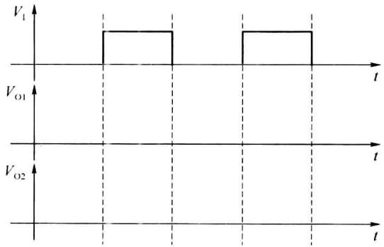  

(a)

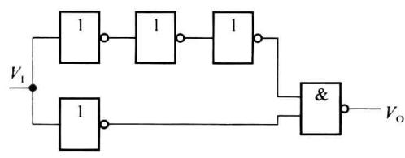  

(b)  

题图2.1
</Exercise>

<Exercise title="习题 2-2">
试说明在下列情况下,用万用表测量题图 2.2 中 $V_{12}$ 得到的电压各为多少?与非门为 74H 系列 TTL 电路,万用表使用 5V 量程,内阻为 20 kΩ/V。

(1) $V_{\mathrm{II}}$ 悬空；(2) $V_{\mathrm{II}} = 0.2 \mathrm{~V}$ ; (3) $V_{\mathrm{II}} = 3.2 \mathrm{~V}$ ; (4) $V_{\mathrm{II}}$ 经 $100 \Omega$ 电阻接地；(5) $V_{\mathrm{II}}$ 经 $10 \mathrm{k} \Omega$ 电阻接地。

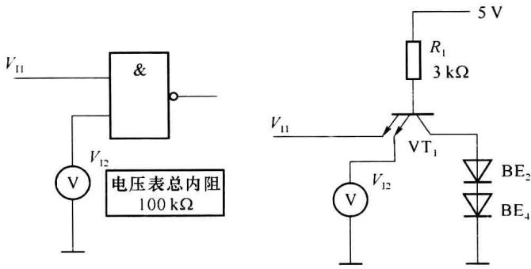  

题图2.2
</Exercise>

<Exercise title="习题 2-3">
已知逻辑门的参数是 $V_{OH}=3.5\ V$ , $V_{OL}=0.1\ V$ , $V_{IHmin}=2.4\ V$ , $V_{ILmax}=0.3\ V$ , $I_{IH}=20\ \mu A$ , $I_{IS}=1.0\ mA$ , $I_{OH}=360\ \mu A$ , $I_{OL}=8\ mA$ , 求题图 2.3 中 R 的取值范围。

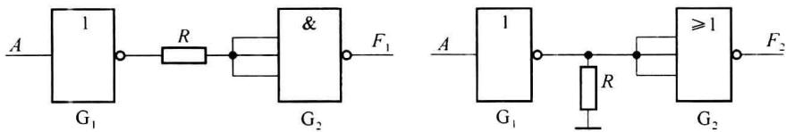  

题图2.3
</Exercise>

<Exercise title="习题 2-4">
在 STTL 集成电路中,采取了哪些措施来提高电路的开关速度?
</Exercise>

<Exercise title="习题 2-5">
试为题图 2.4 中的 $R_{L}$ 选择合适的阻值，已知 OC 门输出管截止时的漏电流为 $I_{OH}=150\mu A$ ，输出管导通时允许的最大负载电流为 $I_{OL}=16mA$ ，负载门的低电平输入电流为 $I_{IL}=-1mA, I_{IL}=1mA$ ，高电平输入电流为 $I_{IH}=40\mu A, V_{CC}=5V$ ，要求 OC 门的输出高电平 $V_{OH}\geqslant3V$ ，输出低电平 $V_{OL}\leqslant0.3V$ 。

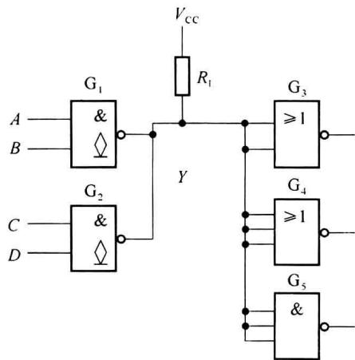  

题图2.4
</Exercise>

<Exercise title="习题 2-6">
已知题图 2.5 中各个门电路都是 74H 系列 TTL 电路, 试写出各门电路的输出状态 (0,1 或 Z)。

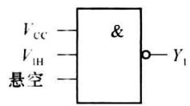

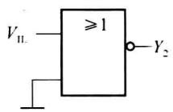

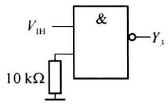

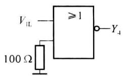

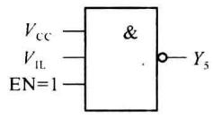  

题图2.5

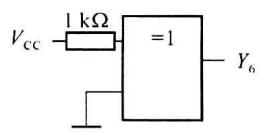
</Exercise>

<Exercise title="习题 2-7">
已知TTL三态门电路及控制信号 $C_1, C_2$ 的波形如题图2.6所示，试分析此电路能否正常工作。

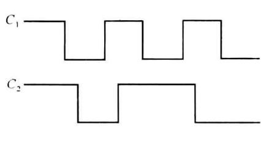  

(a)

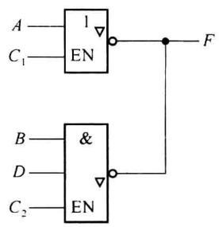  

(b)  

题图2.6
</Exercise>

<Exercise title="习题 2-8">
由 CMOS 门组成的电路如题图 2.7 所示。已知 $V_{DD} = 5 \, V, V_{OH} \geqslant 3.5 \, V, V_{OL} \leqslant 0.5 \, V$ 。门的驱动能力 $I_{O} = \pm 4 \, mA$ 。问以下根据给定电路写出的输出表达式是否正确？

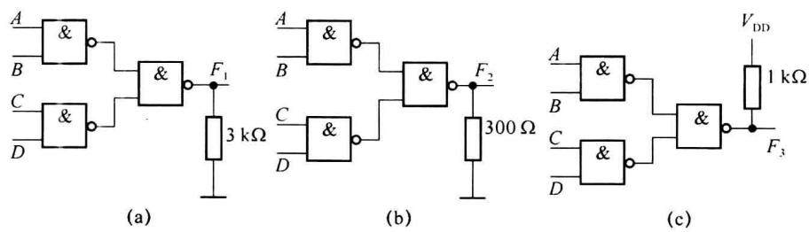  

题图2.7

(a) $F_{1} = \overline{AB}\cdot \overline{CD};$

(b) $F_{2} = AB + CD;$

(c) $F_{3} = AB + CD$
</Exercise>

<Exercise title="习题 2-9">
CMOS 门电路如题图 2.8 所示, 分析此电路所完成的逻辑功能。

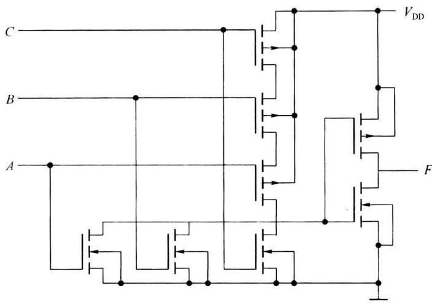  

题图2.8
</Exercise>

<Exercise title="习题 2-10">
逻辑门电路如题图 2.9 所示, 针对下面两种情况, 分别讨论它们的输出与输入各是什么关系?

(1) 两个电路均为 CMOS 电路输出高电平 $5 \mathrm{~V}$ , 输出低电平 $0 \mathrm{~V}$ 。

(2) 两个电路均为 TTL 电路输出高电平 3.6 V, 输出低电平 0.3 V, 门电路的开门电阻为 2 kΩ, 关门电阻为 0.8 kΩ。

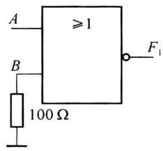  

(a)

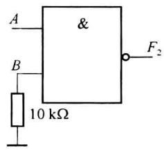  

(b)  

题图2.9
</Exercise>

<Exercise title="习题 2-11">
CMOS 门电路如题图 2.10 所示,试写出各门的输出电平。

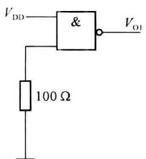  

(a)

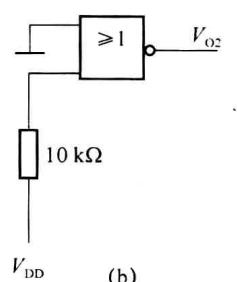  

(b)

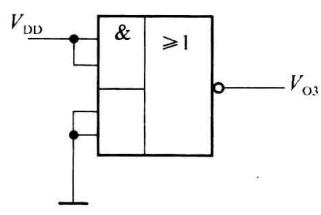  

(c)  

题图2.10
</Exercise>

<Exercise title="习题 2-12">
CMOS 与或非门不使用的输入端应如何连接？
</Exercise>

<Exercise title="习题 2-13">
写出题图 2.11 所示 E/E MOS 电路的 F 输出逻辑表达式。

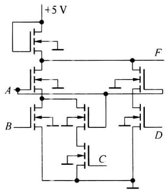  

(a)

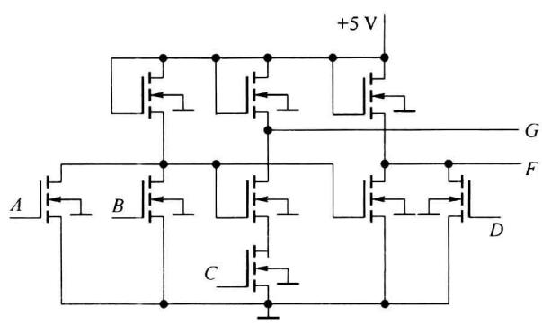  

(b)  

题图2.11
</Exercise>

<Exercise title="习题 2-14">
分析题图 2.12 所示各 CMOS 门电路, 哪些能正常工作, 哪些不能。写出能正常工作的输出信号的逻辑表达式。

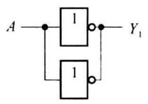  

(a)

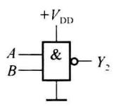  

(b)

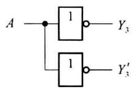  

(c)

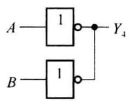

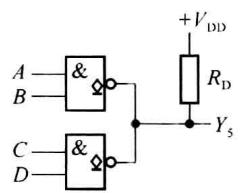

(d)  

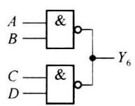

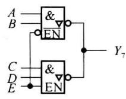  

(g)

(e)  

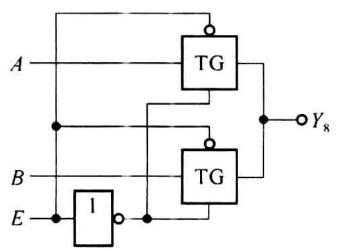  

(h)

(f)  

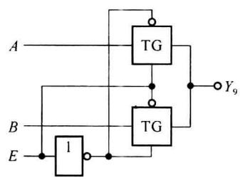  

(i)

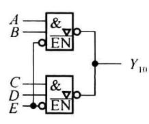  

(j)  

题图2.12
</Exercise>

<Exercise title="习题 2-15">
试分别画出实现逻辑函数 $F_{1} = \overline{AC + BD + E}, F_{2} = \overline{(A + B)D} + C$ 的 CMOS 电路图。
</Exercise>

<Exercise title="习题 2-16">
分析题图 2.13 所示 ECL 逻辑电路的逻辑功能, 写出各输出的逻辑表达式(设输出端都有下拉电阻)。

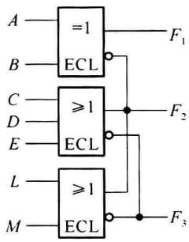  

(a)

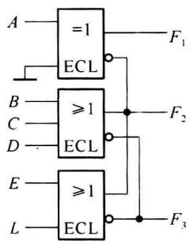  

(b)

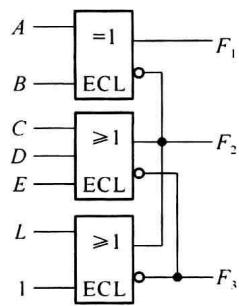  

(c)  

题图2.13
</Exercise>

<Exercise title="习题 2-17">
$\mathrm{I}^2\mathrm{L}$ 集成电路中部分简化电路如题图2.14所示，分析 $F_{1}, F_{2}, F_{3}$ 与输入 $A, B$ 之间的逻辑关系，写出表达式。

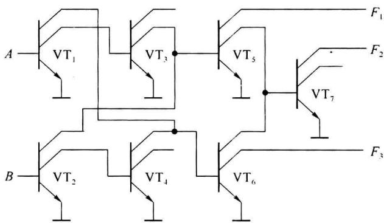  

题图2.14

## 第 3 章 组合电路的分析与设计

数字逻辑电路按逻辑功能分为组合逻辑电路和时序逻辑电路两大类,本章主要介绍小规模组合逻辑电路的分析和设计方法,以及组合逻辑电路中的冒险现象,并介绍常用的几种中规模组合逻辑电路(数码比较器、编码器、译码器、数据选择器、数据分配器、奇偶校验电路和运算电路等)。
</Exercise>
