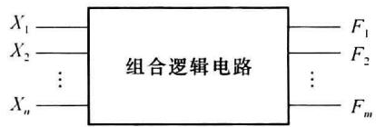

import Guide from '@/components/Guide.astro';
import Knowledge from '@/components/Knowledge.astro';
import Example from '@/components/Example.astro';
import Analysis from '@/components/Analysis.astro';
import Solution from '@/components/Solution.astro';
import Variant from '@/components/Variant.astro';
import Note from '@/components/Note.astro';
import Block from '@/components/Block.astro';
import Method from '@/components/Method.astro';
import Exercise from '@/components/Exercise.astro';

## 第3章 组合电路的分析与设计

数字逻辑电路按逻辑功能分为组合逻辑电路和时序逻辑电路两大类,本章主要介绍小规模组合逻辑电路的分析和设计方法,以及组合逻辑电路中的冒险现象,并介绍常用的几种中规模组合逻辑电路(数码比较器、编码器、译码器、数据选择器、数据分配器、奇偶校验电路和运算电路等)。

组合逻辑电路的框图如图 3.1.1 所示, 图中 $X_{1}, X_{2}, \cdots, X_{n}$ 表示输入变量, $F_{1}, F_{2}, \cdots, F_{m}$ 表示输出函数。

  

图3.1.1 组合电路框图

输出函数的一般逻辑表达式为

$$

\begin{array}{c} {F _ {1} = f _ {1} (X _ {1}, X _ {2}, \dots , X _ {n})} \\ {F _ {2} = f _ {2} (X _ {1}, X _ {2}, \dots , X _ {n})} \\ {\vdots} \\ {F _ {m} = f _ {m} (X _ {1}, X _ {2}, \dots , X _ {n})} \end{array}

$$

简记为

$$

F _ {i} = f _ {i} (X _ {1}, X _ {2}, \dots , X _ {n}) \quad i = 1, 2, \dots , m

$$

从电路结构上看,组合电路由逻辑门组成,不包含记忆元件,输出与输入之间没有反馈。这一结构决定组合电路有如下特点:任一时刻电路的输出只与当时的输入有关,而与电路过去的输入无关。

由此可知,前面所列举的逻辑电路都属于组合电路。关于时序电路将在以后各章详细讨论。
