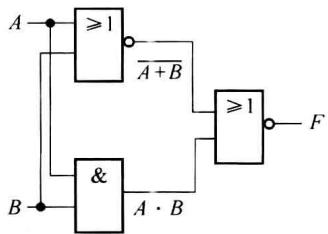
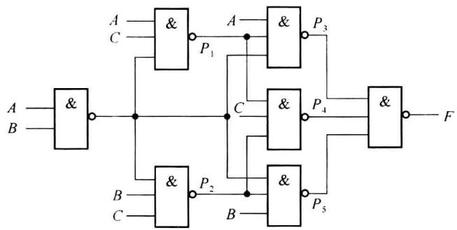
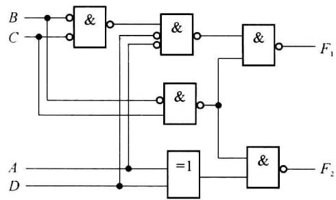

import Guide from '@/components/Guide.astro';
import Knowledge from '@/components/Knowledge.astro';
import Example from '@/components/Example.astro';
import Analysis from '@/components/Analysis.astro';
import Solution from '@/components/Solution.astro';
import Variant from '@/components/Variant.astro';
import Note from '@/components/Note.astro';
import Block from '@/components/Block.astro';
import Method from '@/components/Method.astro';
import Exercise from '@/components/Exercise.astro';

分析组合逻辑电路一般是根据逻辑图求出逻辑功能,即求出真值表与逻辑函数表达式

等。分析的目的有时在于求出逻辑功能,有时在于证明给定的逻辑功能正确与否。

通常将分析步骤概括为：

（1）分别用符号标注各级门的输出端，从输入到输出逐级写出输出函数的逻辑表达式，并化为最简式。

(2) 需要时, 列出真值表。

（3）根据函数表达式或真值表确定电路的逻辑功能。有时逻辑功能难以用简练的语言描述，列出真值表即可。

需要指出,上述步骤可根据具体情况进行灵活处理,步骤可适当取舍。下面举例说明。

<Example title="例 3.2.1">
分析图 3.2.1 所示逻辑电路。

<Solution title="解">
图 3.2.1 为二级组合电路。组合电路的级数是指输入信号从输入端到输出端所经历的逻辑门数的最大数目。这个电路简单, 可以由输入到输出逐级写出逻辑门的输出表达式:

$$

\begin{array}{r l} F (A, B) & = \overline {{A + B}} + A \cdot B \\ & = (A + B) (\overline {{A \cdot B}}) \\ & = (A + B) (\overline {{A}} + \overline {{B}}) \\ & = \overline {{A}} B + A \overline {{B}} \end{array}

$$

该函数表达式简单,不用列真值表,由表达式直接可以知道电路的逻辑功能。这是一个异或电路。
</Solution>
</Example>

<Example title="例 3.2.2">
分析图 3.2.2 所示电路的逻辑功能。

  

图3.2.1 例3.2.1组合电路逻辑图

  

图3.2.2 例3.2.2的逻辑电路

<Solution title="解">
这个电路较复杂, 将各逻辑门的输出用一个代号来表示。根据各器件的逻辑功能, 可以写出:

$$

\begin{array}{r l} & P _ {1} = \overline {{A C}} \overline {{A B}} = \overline {{A C}} \overline {{B}} \\ & P _ {2} = \overline {{A B}} \overline {{B C}} = \overline {{A B C}} \\ & P _ {3} = \overline {{A P _ {1}}} \overline {{A B}} = \overline {{A}} \overline {{A C}} \overline {{B}} \overline {{A B}} = \overline {{A}} \overline {{B}} \overline {{C}} \\ & P _ {4} = \overline {{P _ {1} C P _ {2}}} = \overline {{A}} \overline {{B}} \overline {{C}} \overline {{C}} \overline {{A B C}} = \overline {{A B C + A}} \overline {{B C}} \\ & P _ {5} = \overline {{A B}} P _ {2} B = \overline {{A B}} \overline {{A B C}} B = \overline {{A B}} \overline {{C}} \end{array}

$$

则输出函数为

$$

F (A, B, C) = \overline {{P _ {3} P _ {4} P _ {5}}} = \overline {{A}} \overline {{B}} \overline {{C}} \overline {{A}} B C + \overline {{A}} \overline {{B}} C \overline {{\overline {{A}} B \overline {{C}}}}

$$

再进一步化简,可得

$$

F (A, B, C) = A \overline {{B}} \overline {{C}} + A B C + \overline {{A}} \overline {{B}} C + \overline {{A}} B \overline {{C}} = \sum m (1, 2, 4, 7)

$$

该表达式较复杂,为了分析电路的逻辑功能,需要根据表达式列出真值表,找出使函数等于1的条件,从而得知电路的逻辑功能。由表达式所得出的真值表如表3.2.1所示。从真值表可知,输入变量取值的组合中,含1的个数为奇数时,输出F为1;而对于其余输入变量取值组合,输出F为0。因此,该组合电路为三变量输入的奇偶校验电路。
</Solution>
</Example>

<Example title="例 3.2.3">
分析图 3.2.3 所示混合逻辑电路, 写出表达式。

表 3.2.1 例 3.2.2 真值表

<table><tr><td>A</td><td>B</td><td>C</td><td>F</td></tr><tr><td>0</td><td>0</td><td>0</td><td>0</td></tr><tr><td>0</td><td>0</td><td>1</td><td>1</td></tr><tr><td>0</td><td>1</td><td>0</td><td>1</td></tr><tr><td>0</td><td>1</td><td>1</td><td>0</td></tr><tr><td>1</td><td>0</td><td>0</td><td>1</td></tr><tr><td>1</td><td>0</td><td>1</td><td>0</td></tr><tr><td>1</td><td>1</td><td>0</td><td>0</td></tr><tr><td>1</td><td>1</td><td>1</td><td>1</td></tr></table>

  

图3.2.3 例3.2.3混合逻辑逻辑图

<Solution title="解">
图 3.2.2 电路只含一种逻辑称为单一逻辑, 而在本题中既有正逻辑, 又有负逻辑, 称为混合逻辑。分析混合逻辑时, 需要通过下列变换, 写出表达式:

(1) 任何输入或输出线的小圈去掉(或加上), 则相应变量或函数取非。

（2）在一个门的输入、输出端同时加上或消去小圈，则门的主体逻辑符号改变：与变或，或变与。

根据上述变换规律,可写出表达式如下:

$$

\begin{array}{r l} F _ {1} (A, B, C, D) & = \overline {{(B + C) \overline {{A}} \overline {{D}}}} \cdot \overline {{\overline {{B}} C}} \\ & = \overline {{A}} B \overline {{D}} + \overline {{A}} C \overline {{D}} + \overline {{B}} C \end{array}

$$

$$

\begin{array}{r l} F _ {2} (A, B, C, D) & = \overline {{A \oplus D \cdot \overline {{B}}   C}} \\ & = \overline {{A \oplus D}} + \overline {{B}} C \\ & = \overline {{A}}   \overline {{D}} + A D + \overline {{B}} C \end{array}

$$
</Solution>
</Example>
