import Guide from '@/components/Guide.astro';
import Knowledge from '@/components/Knowledge.astro';
import Example from '@/components/Example.astro';
import Analysis from '@/components/Analysis.astro';
import Solution from '@/components/Solution.astro';
import Variant from '@/components/Variant.astro';
import Note from '@/components/Note.astro';
import Block from '@/components/Block.astro';
import Method from '@/components/Method.astro';
import Exercise from '@/components/Exercise.astro';

组合电路的设计就是根据逻辑功能的要求,设计出实现该功能的最优逻辑电路。从采用的器件来看,可以分为小规模集成电路(SSI)、中规模集成电路(MSI)和大规模集成电路(LSI)的组合电路的设计。前面介绍的逻辑函数简化方法,追求的目标是最少门数,这是在小规模集成电路的条件下最经济的指标。这些方法是数字电路逻辑设计的基础,是比较成熟的方法,本节仍以追求逻辑门数最少为目标来讨论逻辑设计。而对于中大规模集成电路,追求最少门数将不再成为最优设计的指标,而转为追求集成块数的减少,这将在后面讨论。


用 SSI, 即用基本逻辑门电路设计组合电路时, 其一般步骤是:


(1) 列真值表。给出的设计要求,通常是用文字描述的具有一定因果的一个事件。这时必须运用逻辑抽象的方法,抽象成一个逻辑问题。即将起因作为逻辑变量,将结果定为输出函数;然后对逻辑赋值,即规定 0、1 分别表示变量与函数的不同状态;最后做出真值表。


(2) 根据真值表, 写出逻辑函数标准表达式。


（3）将逻辑函数进行简化或变换。如果限定设计必须使用某种类型门电路，还须进行相应的变换，写出与使用的逻辑门相对应的最简表达式。


(4) 按简化逻辑表达式绘制逻辑电路图。


(5) 选择逻辑门进行装配、调试。


但还存在几个实际问题：


（1）输入变量的形式。输入变量有两种形式，一种是既提供原变量也提供反变量，称双轨输入；另一种是只提供原变量形式，而无反变量形式，称单轨输入。


(2) 多输出函数的设计。


(3) 采用 SSI 芯片时的设计。


(4) 指定门类型时的设计。


本节也将对这些情况分别作相应的介绍。

## 3.3.1 由设计要求列真值表

关键是确定逻辑变量、逻辑函数，以及定义变量值与函数值分别代表的状态。

<Example title="例 3.3.1">
有一火灾报警系统,设有烟感、温感和紫外光感 3 种不同类型的火灾探测器。为了防止误报警,只有当其中两种或两种以上的探测器发出火灾探测信号时,报警系统才产生报警控制信号。作出真值表。

<Solution title="解">
首先确定逻辑变量是烟感、温感和紫外光感3种火灾探测器,分别用符号A、B、C表示,它们的含义如下:

$$

A = 1 \quad \text {   烟感探测器发出火灾探测信号   }

$$


$$

B = 1 \quad \text {   温感探测器发出火灾探测信号   }

$$


$$

C = 1 \quad \text { 紫外光感探测器发出火灾探测信号 }

$$


逻辑函数就是报警控制信号,用 F 表示,产生报警时 F=1。


然后按一定规律(通常采用自然二进制码规律)取输入变量的组合,确定每个组合下函数 F 的值,得到真值表如表 3.3.1 所示。


表3.3.1 例3.3.1的真值表


<table><tr><td>组合序号i</td><td>输入ABC</td><td>输出F</td></tr><tr><td>0</td><td>0 0 0</td><td>0</td></tr><tr><td>1</td><td>0 0 1</td><td>0</td></tr><tr><td>2</td><td>0 1 0</td><td>0</td></tr><tr><td>3</td><td>0 1 1</td><td>1</td></tr><tr><td>4</td><td>1 0 0</td><td>0</td></tr><tr><td>5</td><td>1 0 1</td><td>1</td></tr><tr><td>6</td><td>1 1 ,0</td><td>1</td></tr><tr><td>7</td><td>1 1 1</td><td>1</td></tr></table>


由真值表可见,只有当其中两种或两种以上的探测器发出火灾探测信号时,报警系统才产生报警控制信号,F=1。


由真值表不难写出函数的表达式,得到最简式。
</Solution>
</Example>

## 3.3.2 逻辑函数的两级门实现

在允许双轨输入时,可采用两级门电路来实现。

### 1. 两级与非门电路的实现

对于最简与或式,一定可用两级与非门电路实现。这时只需将函数的最简与或式两次取非,根据反演律,即可得到两级与非表达式。例如:


$$

F (A, B, \dots , M, N) = A B + C D + \dots + M N = \overline {{A B + C D + \cdots + M N}} = \overline {{A B}} \cdot \overline {{C D}} \cdot \dots \cdot \overline {{M N}}

$$


根据表达式画出逻辑图如图 3.3.1 所示, 即为两级与非电路, 因此两级与非电路的设计, 就是求函数的最简与或式, 再经两次取反变换成与非-与非式。

<Example title="例 3.3.2">
试用两级与非门实现下面的函数：

$$

F (A, B, C, D) = \sum m (0, 1, 4, 5, 8, 9, 1 0, 1 1, 1 4, 1 5)

$$

<Solution title="解">
首先作函数的卡诺图,如图 3.3.2(a) 所示。由卡诺图化简得到最简与或式:

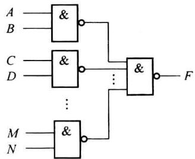  

图3.3.1 两级与非电路


$$

F (A, B, C, D) = A \overline {{B}} + \overline {{A}} \overline {{C}} + A C

$$


将该式两次取反,便得与非-与非式:


$$

F (A, B, C, D) = \overline {{A}} \overline {{B}} + \overline {{A}} \overline {{C}} + A C = \overline {{\overline {{A}} \overline {{B}}}} \cdot \overline {{\overline {{A}} \overline {{C}}}} \cdot \overline {{A C}}

$$


按上述与非-与非式作出逻辑图,如图 3.3.2(b)所示。


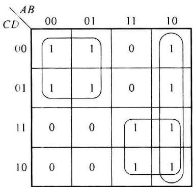  

(a)


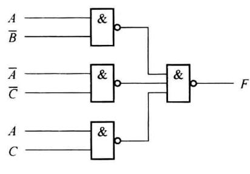  

(b)  

图3.3.2 例3.3.2的卡诺图与逻辑图
</Solution>
</Example>

### 2. 两级或非门电路的实现

对于最简或与式,一定可用两级或非门电路实现。由函数的或与表达式,运用反演律就可以得到两级或非式。例如:


$$

\begin{array}{r l} F (A, B, \dots , M, N) & = (A + B) (C + D) \dots (M + N) = \overline {{(A + B) (C + D) \cdots (M + N)}} \\ & = \overline {{A + B}} + \overline {{C + D}} + \dots + \overline {{M + N}} \end{array}

$$


根据表达式画出电路图,如图 3.3.3 所示,即为两级或非门电路。所以,两级或非电路的设计是求函数的最简或与式,再两次取非变换成或非-或非式。


对于例 3.3.2 的函数, 若用或非门实现, 首先简化求得最简或与式, 如图 3.3.4(a) 所示, 则


$$

\begin{array}{r l} F (A, B, C, D) & = (A + \overline {{C}}) (\overline {{A}} + \overline {{B}} + C) \\ & = \overline {{A + \overline {{C}} + \overline {{A}} + \overline {{B}} + C}} \end{array}

$$


按照上式绘制逻辑图,如图 3.3.4(b)所示。它和图 3.3.2(b)比较,可见该函数用或非门实现,使用门数更少,电路更简单。因此,有下列结论:同一函数,既可用与非门,也可用或非门实现,复杂度可能有区别,实际中应根据已有器件、复杂度要求进行选择。


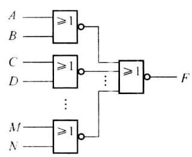  

图3.3.3 两级或非电路


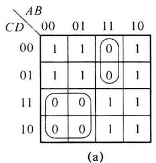


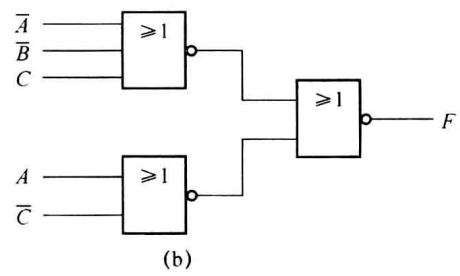  

图3.3.4 例3.3.2用或非门实现

## 3.3.3 逻辑函数的三级门实现

在单轨输入,即输入信号源不提供反变量时,只能由电路本身提供所需的反变量。最简单的方法是对每一个输入原变量增加一个非门,产生所需的反变量,这样在两级门的基础上构成了三级门电路,如图 3.3.5 所示。有几个输入变量就需要几个非门,显然是不经济的,需要采用适当的方法来节省器件,常用代数法和阻塞法。下面介绍阻塞法。


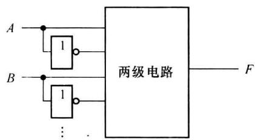  

图 3.3.5 加非门的三级门电路

### 1. 阻塞逻辑

卡诺图有两个特殊的方格: 全 1 格和全 0 格, 又称 1 重心和 0 重心, 如图 3.3.6 中的 111 格和 000 格。化简函数为最简与或式时, 卡诺图中所有的圈对应的乘积项共有以下 4 种类型:


(1) 凡是包含 1 重心的圈都是用原变量标注；


(2) 凡是包含 0 重心的圈都是用反变量标注；


(3) 两个重心都不包含的圈, 其标注既有原变量又有反变量;


(4) 两个重心都包含的圈只有一个, 即恒为 1。


所以,可根据需要圈合并圈。


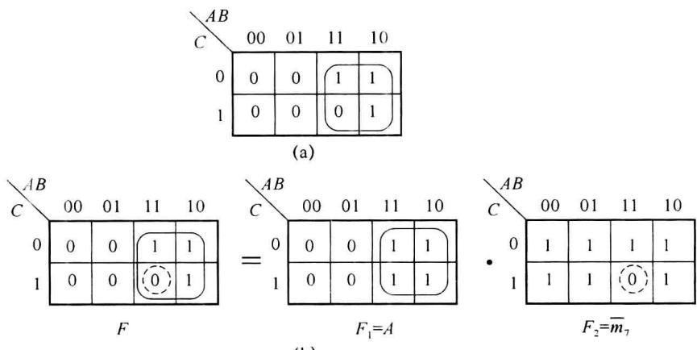  

图3.3.6 积项的阻塞逻辑


当需要用原变量标注时，在化简时，就围绕1重心来圈，如三级门设计中，输入全为原变量，当然希望围绕1重心来圈。而实际围绕1重心来圈时，有时将0方格也圈入，所以要设法将圈入的0方格扣除，这种扣除不是像普通代数中的用减法扣除，而是用被扣除的最小项的非 $\overline{m_{i}}$ 乘之来扣除，这就是阻塞逻辑，因为 $\overline{m_{i}}$ 在其相应输入组合下值为0，禁止了积项的输出，使积项受 $\overline{m_{i}}$ 控制。


如图3.3.6(a)所示，需将圈入的0方格 $m_{7}$ 扣除，根据阻塞逻辑，将积项乘 $\overline{m_7}$ 即可： $F(A,B,C) = A \cdot \overline{m_7}$ 。这一结论的正确性，可利用卡诺图来证明。由卡诺图的运算规则，可得到图3.3.6(b)，图中阻塞圈用虚线画出，以示区别，则


$$

F (A, B, C) = F _ {1} \cdot F _ {2} = A \cdot \overline {{m _ {7}}} = A \cdot \overline {{A B C}}

$$


即完成从 $F_{1}$ 中扣除了 $m_{7}$ 的操作。


对于积项 $A \cdot \overline{ABC}$ ，由两部分因子构成：一部分因子为原变量形式，称为头部因子；另一部分因子为带“非”号形式，称为尾因子。


这个例子说明:头部因子与尾部因子的积体现在卡诺图上,就是在头部因子决定的合并圈中扣除尾部因子决定的合并圈所得的结果。换句话说,为使积项用原变量标注而绕1重心圈时,圈入的0格的扣除,就相当于乘以一个尾因子。所以阻塞逻辑就是利用扣除0格的方法,使积项受尾因子控制。故尾因子也称阻塞项、禁止项。


当然阻塞圈还可以扩大,对结果没有影响,如图 3.3.7 所示。


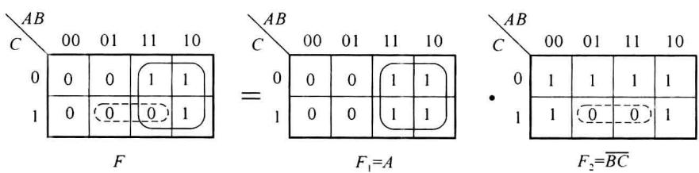  

图3.3.7 阻塞圈扩大


$$

F (A, B, C) = F _ {1} \cdot F _ {2} = A \overline {{{B C}}}

$$


由此可知：


(1) 阻塞圈可大可小, 小可以到某个最小项, 大可超过头部因子的合并圈。


(2) 为保证尾因子的“非”内不再有非, 阻塞圈也应包含 1 重心。


（3）大的阻塞圈可以使变量少，但究竟选大还是选小，应考虑此阻塞圈(尾因子)的公用程度。

### 2. 用阻塞法设计三级与非电路

阻塞法设计三级与非电路的方法要点如下：


(1) 画圈时尽量围绕 1 重心, 使积项用原变量标注, 这时可以将某些 0 格圈入。


(2) 将圈进的 0 格阻塞掉, 阻塞圈必须包含 1 重心, 阻塞圈内可以不全是 0 格, 扣除的 1 格以后补上。


(3) 圈各积项的阻塞圈时, 应尽可能为各积项所公用。


(4) 用最少的积项圈及最少的阻塞圈覆盖全部 1 格。


下面举例说明。

<Example title="例 3.3.3">
设输入没有反变量,用三级与非门实现函数:

$$

F (A, B, C, D) = \sum m (1, 2, 3, 4, 6, 9, 1 2, 1 4, 1 5)

$$


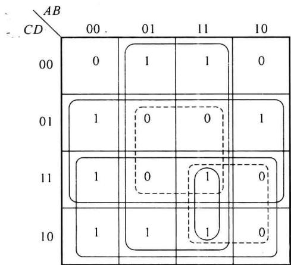  

图3.3.8 例3.3.3的卡诺图

<Solution title="解">
作函数卡诺图,如图3.3.8所示。圈 $m_{1}$ 、 $m_{3}$ 和 $m_{9}$ 围绕1重心来圈时,需将8个方格圈在一起,构成积项D,但是多了4个0方格,应加以阻塞,需要两个阻塞圈。该积项的阻塞圈如图3.3.8中虚线所示,即为 $\overline{BD}$ 和 $\overline{AC}$ ,为使阻塞圈也包含1重心,不得不阻塞掉1方格 $m_{15}$ 。对于阻塞因子 $\overline{AC}$ ,虽然还可以选择两个方格,即为 $\overline{ACD}$ ,但考虑和其他积项公用,选取 $\overline{AC}$ 而不用 $\overline{ACD}$ ,得出合并积项 $D\overline{BD}\overline{AC}$ 。

为了圈最小项 $m_{2}$ 和 $m_{6}$ ，也要围绕1重心8个方格得积项 $C$ ，并需扣除3个0方格，为使阻塞圈也包含1重心，不得不阻塞掉1方格 $m_{14}$ 。阻塞圈与前一积项相同，仍然是 $\overline{BD}$ 和 $\overline{AC}$ ，得合并积项 $C\overline{BD}\overline{AC}$ 。


在圈最小项 $m_{4}$ 、 $m_{12}$ 和 $m_{14}$ 时，围绕 1 重心 8 个方格得积项 B，并需要一个阻塞圈 $\overline{BD}$ 扣除 3 个 0 方格，得合并积项 $B\overline{BD}$ 。


获得上述3个积项后，还剩下最小项 $m_{15}$ 没有被包含，则圈 $\sum (14,15)$ ，得积项 $ABC$ ，全部最小项已被包含，函数的表达式为


$$

\begin{array}{r l} F (A, B, C, D) & = D \overline {{B D}} \overline {{A C}} + C \overline {{B D}} \overline {{A C}} + B \overline {{B D}} + A B C \\ & = \overline {{D \cdot \overline {{B D}} \cdot \overline {{A C}} \cdot \overline {{C \cdot \overline {{B D}} \cdot \overline {{A C}}}}} \cdot \overline {{B \cdot \overline {{B D}}}} \cdot \overline {{A B C}}} \end{array}

$$


根据表达式绘出逻辑图,如图 3.3.9 所示。


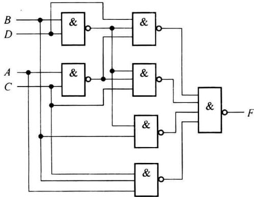  

图3.3.9 例3.3.3的逻辑图
</Solution>
</Example>

<Example title="例 3.3.4">
设输入只有原变量而无反变量,试用最少的三级与非门实现函数:

$$

F (A, B, C, D) = \prod M (3, 6, 7, 8, 1 2, 1 5)

$$

<Solution title="解">
作函数卡诺图,如图3.3.10所示。该题的难点在于0重心为1,为圈 $m_{0}$ 而围绕1重心来圈的积项圈只有一个,即两个重心都包含的圈只有1个,需将所有的方格圈在一起,因此首先必须先圈该积项圈(图3.3.10中未画出来,以便看清楚),该积项圈的头部因子为1,这时多圈了所有的6个0方格,应加以阻塞,需要3个阻塞圈。该积项的阻塞圈如图3.3.10中虚线所示,即为 $\overline{A}$ 、 $\overline{CD}$ 和 $\overline{BC}$ ,为使阻塞圈也包含1重心,不得不阻塞掉5个1方格 $m_{9}$ 、 $m_{10}$ 、 $m_{11}$ 、 $m_{13}$ 、 $m_{14}$ ,得出合并积项 $\overline{A}\overline{CD}\overline{BC}$ ,已覆盖5个1方格 $m_{0}$ 、 $m_{1}$ 、 $m_{2}$ 、 $m_{4}$ 、 $m_{5}$ 。为了圈最小项 $m_{9}$ 、 $m_{11}$ 、 $m_{13}$ ,也要围绕1重心4个方格得积项AD,并需扣除1重心的0方格,阻塞圈与前一积项相同,仍然是 $\overline{BC}$ ,得合并积项AD $\overline{BC}$ 。

在圈最小项 $m_{10}$ 和 $m_{14}$ 时，围绕 1 重心 4 个方格得积项 AC，需扣除 1 重心的 0 方格，阻塞圈与前一积项相同，仍然是 $\overline{CD}$ ，得合并积项 $AC\overline{CD}$ 。


至此全部最小项已被包含,函数的表达式为


$$

F = \overline {{A}} \overline {{C D}} \overline {{B C}} + A D \overline {{B C}} + A C \overline {{C D}}

$$


根据表达式绘出逻辑图,如图 3.3.11 所示。


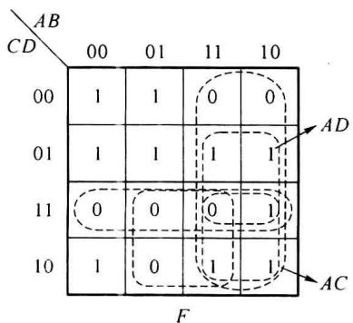  

图3.3.10 例3.3.4的卡诺图


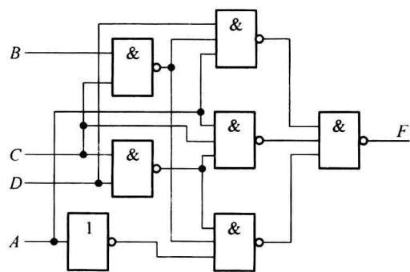  

图3.3.11 例3.3.4的逻辑图
</Solution>
</Example>

### 3. 用阻塞法设计三级或非电路

用阻塞法设计三级或非电路的过程与三级与非电路是相似的,只是圈0方格,阻塞掉1方格,均绕0重心圈,目的是覆盖全部0格。


阻塞原理如图 3.3.12 所示, 则


$$

F (A, B, C, D) = F _ {1} + F _ {2} = C + D + \overline {{A + B + C + D}}

$$


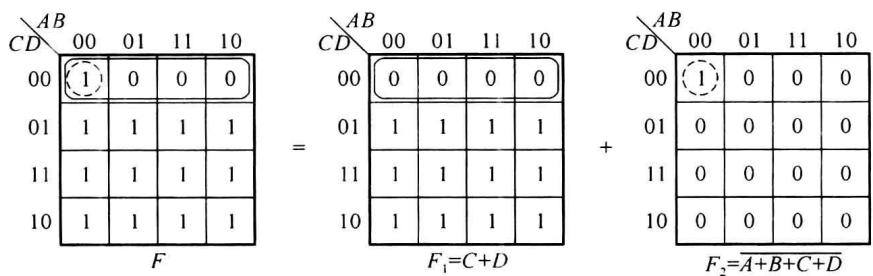  

图3.3.12 和项的阻塞逻辑


下面举例说明三级或非电路设计过程。

<Example title="例 3.3.5">
在输入不提供反变量情况下用三级或非门实现函数：

$$

F (A, B, C, D) = \sum m (0, 2, 4, 7, 8, 1 0, 1 2, 1 4, 1 5)

$$

<Solution title="解">
作函数的卡诺图,如图3.3.13(a)所示,圈画合并圈和阻塞圈如图3.3.13(a)所示,则合并项 $C+\overline{C+D}$ 覆盖最大项 $M_{1}$ 、 $M_{5}$ 、 $M_{9}$ 、 $M_{13}$ ,合并项 $B+\overline{B+D}$ 覆盖 $M_{1}$ 、 $M_{3}$ 、 $M_{9}$ 、 $M_{11}$ ,合并项 $A+D+\overline{B+D}+\overline{C+D}$ 覆盖 $M_{6}$ 。全部最大项都被覆盖,则得表达式为

$$

\begin{array}{r l} F (A, B, C, D) & = (C + \overline {{C + D}}) (B + \overline {{B + D}}) (A + D + \overline {{B + D}} + \overline {{C + D}}) \\ & = \overline {{C + \overline {{C + D}}}} + \overline {{B + B + D}} + \overline {{A + D + \overline {{B + D}} + \overline {{C + D}}}} \end{array}

$$


由表达式绘出三级或非电路的逻辑图,如图 3.3.13(b)所示。


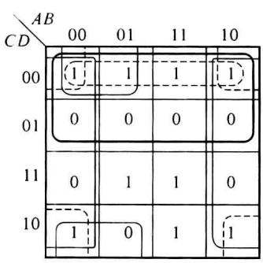  

(a)


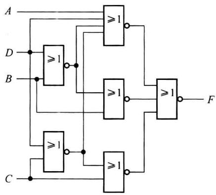  

(b)  

图 3.3.13 三级或非卡诺图与逻辑图
</Solution>
</Example>

## 3.3.4 组合电路实际设计中的几个问题

### 1. 多输出函数的设计

前面所讨论的都是只有一个输出函数的组合电路,实际中常遇到多输出函数的电路,即对应一种输入组合下,有多个函数输出,如编码器、译码器、全加器等。多输出函数电路的设计以单输出函数设计为基础,但目的是达到总体电路的简化,而不是局部简化,所以设计原则为:


尽可能利用公用项,虽然每个函数表达式可能不是最简的,但由于利用公用项,可使总体电路所用的门数减少,电路最简单。


例如,用与非门实现下列多输出函数:


$$

\begin{array}{r l} & F _ {1} (A, B, C) = \sum m (0, 2, 3) \\ & F _ {2} (A, B, C) = \sum m (3, 6, 7) \\ & F _ {3} (A, B, C) = \sum m (3, 4, 5, 6, 7) \end{array}

$$


先将 $F_{1}$ 、 $F_{2}$ 、 $F_{3}$ 按单输出函数分别进行简化，对应的卡诺图如图 3.3.14 所示，则表达式为


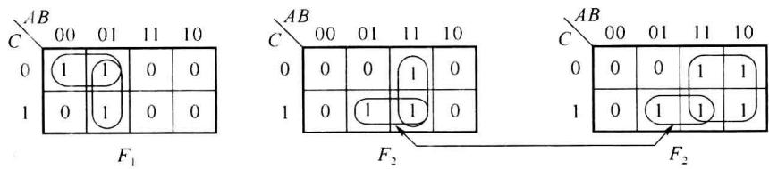  

图3.3.14 多输出函数卡诺图


$$

\begin{array}{l l} {F _ {1} (A, B, C) = \overline {{{A}}} B + \overline {{{A}}}   \overline {{{C}}}} & {\quad (3 \text {个与非门})} \\ {F _ {2} (A, B, C) = A B + B C} & {\quad (3 \text {个与非门})} \\ {F _ {3} (A, B, C) = A + B C} & {\quad (1 \text {个与非门})} \end{array}

$$


由于在 $F_{2}$ 和 $F_{3}$ 的卡诺图上，存在相同的圈 $\sum m(3,7)$ （以连线示出），说明 $F_{2}$ 和 $F_{3}$ 有公用积项 $BC$ ，即 $\overline{BC}$ 与非门可为 $F_{2}, F_{3}$ 公用，省去一个与非门，这样在允许双轨入时，同时实现这3个函数共需7个与非门。


现在试着改圈法, 找公用项。若将 $F_{1}$ 的圈 $\sum m(2,3)$ 改成孤立的最小项 $m_{3}$ , 另一最小项 $m_{2}$ 被圈 $\sum m(0,2)$ 包含, 同时 $F_{2}$ 的圈 $\sum m(3,7)$ 也改成孤立的最小项 $m_{3}$ , 另一最小项 $m_{7}$ 包含在圈 $\sum m(6,7)$ 中, $F_{3}$ 的 $\sum m(3,7)$ 也作同样修改, 如图 3.3.15 所示。则 $F_{1}、F_{2}$ 和 $F_{3}$ 的两个不同的圈改成一个相同的圈, 使总体卡诺图不同的圈数减少一个。由于一个圈对应一个与非门 (单变量除外), 因此总体电路的门数也将减少一个, 说明此改法可取。


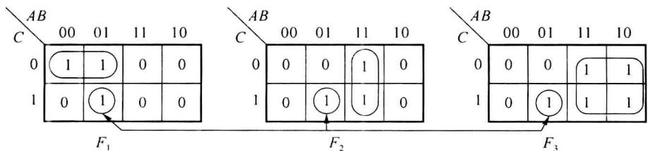  

图3.3.15 改变圈法的卡诺图


由图3.3.15得函数的表达式为


$$

\begin{array}{l} F _ {1} (A, B, C) = \overline {{A}}   \overline {{C}} + \overline {{A}} B C \\ F _ {2} (A, B, C) = A B + \overline {{A}} B C \\ F _ {3} (A, B, C) = A + \overline {{A}} B C \end{array}

$$


其逻辑电路图如图 3.3.16 所示, 共需 6 个与非门, 虽然从单个函数看, 电路变复杂了 (因为增加一个输入端), 但总体电路却因减少一个与非门和一个输入端而变得简单。


由此可得多输出函数的设计步骤：


(1) 用卡诺图分别对每个函数进行化简, 并用箭头连线表示出所有的公用圈。


(2) 从各个函数相同最小项出发,试图改变原来圈法,以求得更多的公用圈。


原则:若改圈法后能使总圈数减少(指不同圈),则改;若使总圈数增加,则不改;若总圈数不变,则取大的合并圈,使变量输入端减少。这一工作可重复进行多次。注意:单个变量的圈不用修改。


(3) 写出多输出函数的表达式, 并绘出逻辑图。


下面再看一个例子。

<Example title="例 3.3.6">
用与非门实现下列多输出函数。

$$

\begin{array}{r l} & : F _ {1} (A, B, C, D) = \sum m (2, 4, 5, 1 0, 1 1, 1 3) \\ & F _ {2} (A, B, C, D) = \sum m (4, 1 0, 1 1, 1 2, 1 3) \\ & F _ {3} (A, B, C, D) = \sum m (2, 3, 7, 1 0, 1 1, 1 2) \\ & F _ {4} (A, B, C, D) = \sum m (0, 1, 4, 5, 8, 9, 1 0, 1 1, 1 2, 1 3) \end{array}

$$


圈画卡诺图如图3.3.17所示。图中虚线圈所示的3个圈 $m_{5}, m_{12}, m_{13}$ 表示将 $F_{1}$ 的 $\sum m(5,13)$ 圈与 $F_{2}$ 的 $\sum m(12,13)$ 圈改小的情况，但这种修改，总圈数不变，而合并圈变小，故是不可取的，最后化简结果如图3.3.17实线圈所示。


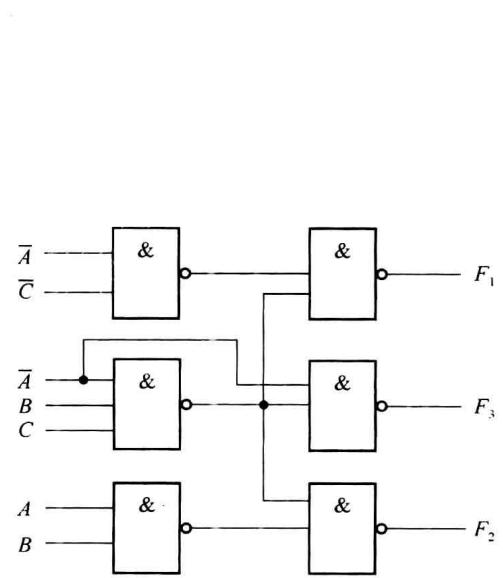  

图3.3.16 多输出函数逻辑图


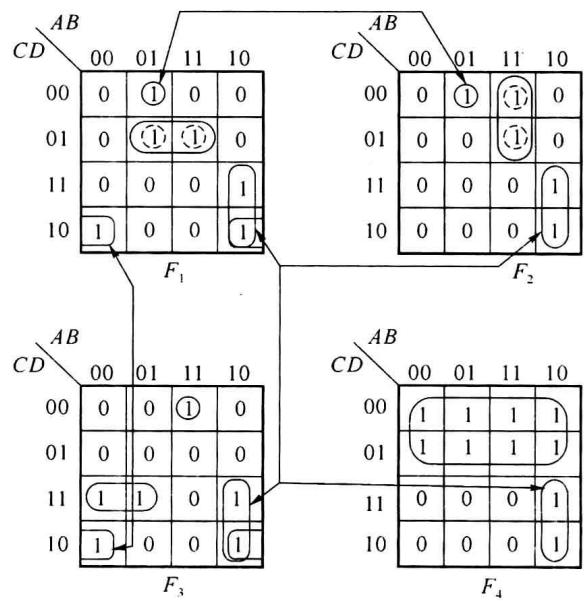  

图3.3.17 例3.3.6的卡诺图


由图3.3.17写出各函数的表达式如下：


$$

F _ {1} (A, B, C, D) = \overline {{{A}}} B \overline {{{C}}} \overline {{{D}}} + A \overline {{{B}}} C + \overline {{{B}}} C \overline {{{D}}} + B \overline {{{C}}} D

$$


$$

F _ {2} (A, B, C, D) = \overline {{{A}}} B \overline {{{C}}} \overline {{{D}}} + A B \overline {{{C}}} + A \overline {{{B}}} C

$$


$$

F _ {3} (A, B, C, D) = A B \overline {{{C}}} \overline {{{D}}} + A \overline {{{B}}} C + \overline {{{B}}} C \overline {{{D}}} + \overline {{{A}}} C D

$$


$$

F _ {4} (A, B, C, D) = \overline {{{C}}} + A \overline {{{B}}} C

$$


其逻辑电路图如图 3.3.18 所示, 共需用 11 个逻辑门, 36 个输入端。


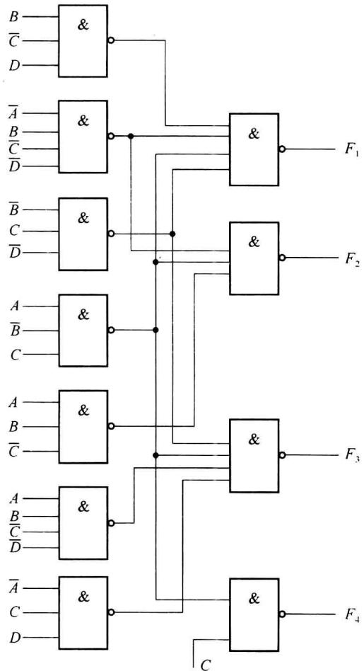  

图3.3.18 例3.3.6的逻辑图


多输出电路的设计不仅适用于小规模集成电路,对于大规模集成电路也具有应用价值。


上述介绍的逻辑设计方法是一种传统的、以门电路为基本单元的设计方法，是电路设计的基本方法，在实际设计中还应结合所使用的器件灵活应用。
</Example>

### 2. 采用 SSI 芯片时的设计

在用 SSI 芯片实现逻辑函数时,由于芯片中封装的逻辑门数及每个门的输入端数是一定的,还须将函数表达式变换成与芯片种类相适应的形式,目的是使所用的芯片数目最少。表 3.3.2 列出了几种常用的 74LS 系列芯片,如 74LS00 有 4 个两输入端与非门,74LS10 有 3 个三输入端与非门。


表 3.3.2 几种 74LS 系列器件


<table><tr><td>型号</td><td>器件名称</td></tr><tr><td>74LS00</td><td>二输入端四与非门</td></tr><tr><td>74LS01</td><td>二输入端四与非门(OC)</td></tr><tr><td>74LS02</td><td>二输入端四或非门</td></tr><tr><td>74LS04</td><td>六非门</td></tr><tr><td>74LS10</td><td>三输入端三与非门</td></tr><tr><td>74LS12</td><td>三输入端三与非门(OC)</td></tr><tr><td>74LS27</td><td>三输入端三或非门</td></tr><tr><td>74LS32</td><td>二输入端四或门</td></tr><tr><td>74LS386</td><td>二输入端四异或门</td></tr></table>

<Example title="例 3.3.7">
试用 74LS00 实现下列函数：

$$

F (A, B, C, D) = \sum m (2, 3, 6, 7, 8, 9, 1 0, 1 1, 1 2, 1 3)

$$

<Solution title="解">
由卡诺图得到最简与或式为

$$

F (A, B, C, D) = A \overline {{B}} + A \overline {{C}} + \overline {{A}} C

$$


若用两级与非门实现,需要 4 个与非门,但有一个与非门需要 3 个输入端。由于所使用的芯片每门只有两个输入端,对上式作如下变换:


$$

\begin{array}{r l} F (A, B, C, D) & = A \overline {{B}} + A \overline {{C}} + \overline {{A}} C = A (\overline {{B}} + \overline {{C}}) + \overline {{A}} C = A \overline {{B}} \overline {{C}} + \overline {{A}} C \\ & = \overline {{A \cdot \overline {{B}} \overline {{C}} \cdot \overline {{A}} C}} \end{array}

$$


其逻辑图如图 3.3.19 所示,用了 4 个二输入与非门,即一片 74LS00。


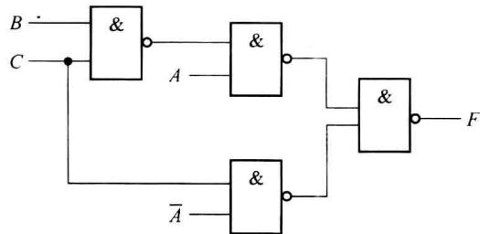  

图3.3.19 例3.3.7的逻辑图


3. 指定门类型的设计(与非、或非、与或非等不同表达式的转换)


如果限定设计必须使用某种类型(例如与或非门)门电路,还必须进行相应的变换。逻辑函数表达式不同形式间的转换,在实际设计数字系统时十分有用,应该熟悉,下面将讨论这方面的内容。


(1) 与或表达式转为与非-与非表达式


在前面两级与非门电路的实现时,已经讲过。只要将最简与或式两次求反,再使用摩根定理,就可得到与非-与非表达式。
</Solution>
</Example>

<Example title="例 3.3.8">
将 $F(A,B,C,D)=AB\overline{D}+AC+A\overline{C}D+AD$ 变为最简与非-与非形式。

<Solution title="解">
用卡诺图法将 F 化简为

$$

F (A, B, C, D) = A B + A C + A D

$$


再对 $F$ 两次求反，得


$$

F (A, B, C, D) = \overline {{\overline {{F}}}} = \overline {{\overline {{A C + B C + C D}}}} = \overline {{\overline {{A C}}}} \cdot \overline {{\overline {{B C}}}} \cdot \overline {{\overline {{C D}}}}

$$


(2) 或与表达式变换为或非-或非表达式


在前面两级或非门电路的实现时,已经讲过。只要将最简或与式两次求反,再使用摩根定理,就可得到或非-或非表达式。
</Solution>
</Example>

<Example title="例 3.3.9">
将函数 $F(A,B,C,D)=(\overline{A}+\overline{B})(\overline{A}+\overline{C}+D)(A+C)(B+\overline{C})$ 变成或非-或非表达式。

<Solution title="解">
求 F 的对偶式 $F'(A, B, C, D) = \overline{A} \overline{B} + \overline{A} \overline{C} D + AC + B \overline{C}$

$$

\begin{array}{r l} F ^ {\prime} (A, B, C, D) & = \overline {{A}} \overline {{B}} + \overline {{A}} \overline {{C}} D + A C + B \overline {{C}} \\ & = \overline {{A}} \overline {{B}} + A C + B \overline {{C}} \end{array}

$$


求 $F'$ 的对偶式, 得最简或与式: $F(A, B, C, D) = (\overline{A} + \overline{B})(A + C)(B + \overline{C})$


对 F 两次求反, 得


$$

\begin{array}{r l} F (A, B, C, D) & = \overline {{(\overline {{A}} + \overline {{B}}) (A + C) (B + \overline {{C}})}} \\ & = \overline {{\overline {{A}} + \overline {{B}} + \overline {{A + C}} + \overline {{B + \overline {{C}}}}}} \end{array}

$$


(3) 与或表达式变换为与或非表达式


变换方法如下：


① 作卡诺图,用圈 0 的方法先求反函数 $\overline{F}$ 的最简与或表达式;


② 再对 $\overline{F}$ 求反, 直接可得函数 F 的与或非表达式。
</Solution>
</Example>

<Example title="例 3.3.10">
求 $F(A,B,C)=\overline{A}\overline{B}\overline{C}+A\overline{B}+AC+\overline{B}C$ 的与或非表达式。

<Solution title="解">
在函数的卡诺图中, 圈 0 可得其反函数 $\overline{F}$ 的表达式, 如图 3.3.20 所示。

$$

\overline {{{F}}} (A, B, C) = \overline {{{A}}} B + B \overline {{{C}}}

$$


再对 $\overline{F}$ 求反，可得：


$$

F (A, B, C) = \overline {{A}} B + B \overline {{C}}

$$


(4) 与或表达式变换为或与表达式


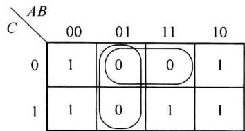


在卡诺图上圈 0 格得到最简或与表达式在第 1 章已经讲过。


(5) 与或表达式转为或非-或非表达式


图3.3.20 例3.3.10的卡诺图


先将与或式变为最简或与式,再两次取反,用摩根定理转为或非-或非式。这两步的具体操作见前面(4)和(2)。


下面举例说明这几个实际问题综合在一起的情况。
</Solution>
</Example>

<Example title="例 3.3.11">
设输入不提供反变量,试用一片 74LS00 和一片 74LS386(异或门)实现全减器。

<Solution title="解">
涉及单轨输入、多输出函数、指定芯片及指定门的问题。

首先做出全减器的真值表,如表3.3.3所示。其中输入变量 $A_{i}$ 为被减数, $B_{i}$ 为减数, $C_{i-1}$ 为低位的借位;输出函数 $D_{i}$ 是全减器的差, $C_{i}$ 是向高位借位。得出函数的表达式


$$

\begin{array}{r l} D _ {i} (A _ {i}, B _ {i}, C _ {i - 1}) & = \overline {{A _ {i}}} B _ {i} \overline {{C}} _ {i - 1} + \overline {{A _ {i}}} \overline {{B _ {i}}} C _ {i - 1} + A _ {i} \overline {{B _ {i}}} \overline {{C}} _ {i - 1} + A _ {i} B _ {i} C _ {i - 1} \\ & = \overline {{C}} _ {i - 1} (A _ {i} \overline {{B _ {i}}} + \overline {{A _ {i}}} B _ {i}) + C _ {i - 1} (\overline {{A _ {i}}} \overline {{B _ {i}}} + A _ {i} B _ {i}) \\ & = \overline {{C}} _ {i - 1} (A _ {i} \oplus B _ {i}) + C _ {i - 1} (\overline {{A _ {i} \oplus B _ {i}}}) \\ & = A _ {i} \oplus B _ {i} \oplus C _ {i - 1} \end{array}

$$


为了使两个函数公用门, $C_{i}$ 可变换成


$$

\begin{array}{r l} C _ {i} (A _ {i}, B _ {i}, C _ {i - 1}) & = \overline {{A _ {i}}} \overline {{B _ {i}}} C _ {i - 1} + \overline {{A _ {i}}} B _ {i} \overline {{C}} _ {i - 1} + \overline {{A _ {i}}} B _ {i} C _ {i - 1} + A _ {i} B _ {i} C _ {i - 1} \\ & = \overline {{A _ {i}}} (\overline {{B _ {i}}} C _ {i - 1} + B _ {i} \overline {{C}} _ {i - 1}) + B _ {i} C _ {i - 1} \\ & = \overline {{A _ {i}}} (B _ {i} \oplus C _ {i - 1}) + B _ {i} C _ {i - 1} \end{array}

$$


其逻辑图如图 3.3.21 所示, 使用 4 个与非门、两个异或门, 用一片 74LS00 和一片 74LS386 即可。


表 3.3.3 全减器真值表


<table><tr><td> ${A}_{i}$ </td><td> ${B}_{i}$ </td><td> ${C}_{i - 1}$ </td><td> ${D}_{i}$ </td><td> ${C}_{i}$ </td></tr><tr><td>0</td><td>0</td><td>0</td><td>0</td><td>0</td></tr><tr><td>0</td><td>0</td><td>1</td><td>1</td><td>1</td></tr><tr><td>0</td><td>1</td><td>0</td><td>1</td><td>1</td></tr><tr><td>0</td><td>1</td><td>1</td><td>0</td><td>1</td></tr><tr><td>1</td><td>0</td><td>0</td><td>1</td><td>0</td></tr><tr><td>1</td><td>0</td><td>1</td><td>0</td><td>0</td></tr><tr><td>1</td><td>1</td><td>0</td><td>0</td><td>0</td></tr><tr><td>1</td><td>1</td><td>1</td><td>1</td><td>1</td></tr></table>


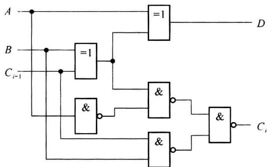  

图3.3.21 例3.3.11逻辑图
</Solution>
</Example>

## 3.3.5 组合电路设计实例

下面通过几个例子来说明如何应用前面介绍的方法设计常用的组合电路,同时了解几个常用组合电路的功能。

<Example title="例 3.3.12">
用或非门设计一个 8421BCD 码的四舍五入电路。

<Solution title="解">
设 8421BCD 码用变量 A、B、C、D 表示, 输出用 F 表示, 可得真值表如表 3.3.4 所示。

表 3.3.4 四舍五入电路真值表


<table><tr><td>A</td><td>B</td><td>C</td><td>D</td><td>F</td></tr><tr><td>0</td><td>0</td><td>0</td><td>0</td><td>0</td></tr><tr><td>0</td><td>0</td><td>0</td><td>1</td><td>0</td></tr><tr><td>0</td><td>0</td><td>1</td><td>0</td><td>0</td></tr><tr><td>0</td><td>0</td><td>1</td><td>1</td><td>0</td></tr><tr><td>0</td><td>1</td><td>0</td><td>0</td><td>0</td></tr><tr><td>0</td><td>1</td><td>0</td><td>1</td><td>1</td></tr><tr><td>0</td><td>1</td><td>1</td><td>0</td><td>1</td></tr><tr><td>0</td><td>1</td><td>1</td><td>1</td><td>1</td></tr><tr><td>1</td><td>0</td><td>0</td><td>0</td><td>1</td></tr><tr><td>1</td><td>0</td><td>0</td><td>1</td><td>1</td></tr><tr><td>1</td><td>0</td><td>1</td><td>0</td><td> $\times$ </td></tr><tr><td>1</td><td>0</td><td>1</td><td>1</td><td> $\times$ </td></tr><tr><td>1</td><td>1</td><td>0</td><td>0</td><td> $\times$ </td></tr><tr><td>1</td><td>1</td><td>0</td><td>1</td><td> $\times$ </td></tr><tr><td>1</td><td>1</td><td>1</td><td>0</td><td> $\times$ </td></tr><tr><td>1</td><td>1</td><td>1</td><td>1</td><td> $\times$ </td></tr></table>


化简得 $F$ 的最简或与表达式：


$$

F (A, B, C, D) = (A + B) (A + C + D)

$$


其电路图如图 3.3.20 所示, 可用一片 74LS27(3 个三输入或非门) 实现。
</Solution>
</Example>

<Example title="例 3.3.13">
半加器、全加器的设计。

<Solution title="解">
① 半加器

半加器是能实现两个1位二进制数相加求得和数及向高位进位的逻辑电路。设被加数、加数用变量 $A, B$ 表示，求得的和、向高位进位用变量 $S, C$ 表示，可得真值表3.3.5。


(a)  

(b)  

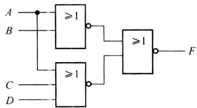  

图3.3.22 例3.3.12逻辑图


表 3.3.5 半加器真值表


<table><tr><td>A</td><td>B</td><td>S</td><td>C</td></tr><tr><td>0</td><td>0</td><td>0</td><td>0</td></tr><tr><td>0</td><td>1</td><td>1</td><td>0</td></tr><tr><td>1</td><td>0</td><td>1</td><td>0</td></tr><tr><td>1</td><td>1</td><td>0</td><td>1</td></tr></table>


写出输出函数表达式：


$$

\begin{array}{l} {S (A, B) = \overline {{{A}}} B + A   \overline {{{B}}} = A   \oplus   B} \\ {C (A, B) = A B} \end{array}

$$


用异或门及与门实现的电路如图 3.3.23(a) 所示, 图 3.3.23(b) 是其逻辑符号。


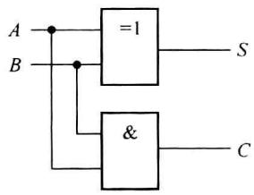


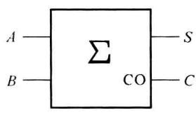  

图 3.3.23 半加器的逻辑图及逻辑符号
</Solution>
</Example>

## ② 全加器

全加器是实现两个 1 位二进制数及低位来的进位相加(即将 3 个 1 位二进制数相加)，求得和数及向高位进位的逻辑电路。


根据全加器的功能,可得真值表 3.3.6,其中 $A_{i}$ 、 $B_{i}$ 分别代表第 i 位的被加数、加数, $C_{i-1}$ 代表低位向本位的进位, $S_{i}$ 代表本位和, $C_{i}$ 代表向高位的进位。


表 3.3.6 全加器真值表


<table><tr><td> $A_i$ </td><td> $B_i$ </td><td> $C_{i-1}$ </td><td> $S_i$ </td><td> $C_i$ </td></tr><tr><td>0</td><td>0</td><td>0</td><td>0</td><td>0</td></tr><tr><td>0</td><td>0</td><td>1</td><td>1</td><td>0</td></tr><tr><td>0</td><td>1</td><td>0</td><td>1</td><td>0</td></tr><tr><td>0</td><td>1</td><td>1</td><td>0</td><td>1</td></tr><tr><td>1</td><td>0</td><td>0</td><td>1</td><td>0</td></tr><tr><td>1</td><td>0</td><td>1</td><td>0</td><td>1</td></tr><tr><td>1</td><td>1</td><td>0</td><td>0</td><td>1</td></tr><tr><td>1</td><td>1</td><td>1</td><td>1</td><td>1</td></tr></table>


化简与变换得出输出和 $S_{i}$ 与进位 $C_{i}$ 表达式。


$$

\begin{array}{l} S _ {i} (A _ {i}, B _ {i}, C _ {i - 1}) = A _ {i} \oplus B _ {i} \oplus C _ {i - 1} \\ C _ {i} (A _ {i}, B _ {i}, C _ {i - 1}) = (A _ {i} \oplus B _ {i}) C _ {i - 1} + A _ {i} B _ {i} \end{array}

$$


用异或门和与或非门实现的逻辑图如图 3.3.24(a) 所示, 图 3.3.24(b) 是其逻辑符号。


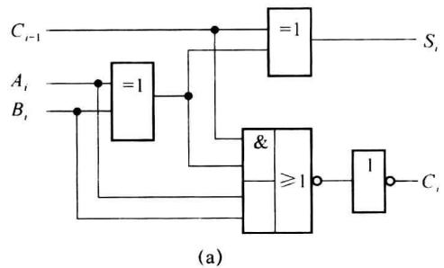


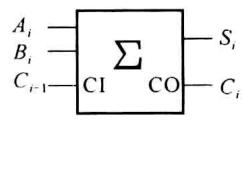  

图 3.3.24 全加器的逻辑图及逻辑符号


一个全加器只能实现 1 位二进制加法, 若是实现多位二进制相加, 需要多个全加器。图 3.3.25 是用 4 个全加器实现两个 4 位数相加的连接图。


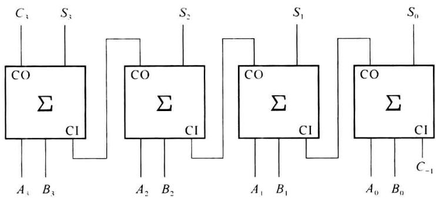  

图3.3.25 全加器实现的4位加法器

<Example title="例 3.3.14">
用同或门、与非门及或非门设计 1 个 2 位二进制数码比较器。

<Solution title="解">
第一步:列真值表。

设比较的两个二进制数为 $A = A_{1}A_{0}, B = B_{1}B_{0}$ ，比较的结果有 $A > B$ 、 $A = B$ 、 $A < B$ 3种情况，分别用 $F_{1}, F_{2}, F_{3}$ 表示。则 $A > B, F_{1} = 1; A = B, F_{2} = 1; A < B, F_{3} = 1$ ，可作出真值表3.3.7。


表 3.3.7 比较器真值表


<table><tr><td> $A_1$ </td><td> $A_0$ </td><td> $B_1$ </td><td> $B_0$ </td><td> $F_1$ </td><td> $F_2$ </td><td> $F_3$ </td></tr><tr><td>0</td><td>0</td><td>0</td><td>0</td><td>0</td><td>1</td><td>0</td></tr><tr><td>0</td><td>0</td><td>0</td><td>1</td><td>0</td><td>0</td><td>1</td></tr><tr><td>0</td><td>0</td><td>1</td><td>0</td><td>0</td><td>0</td><td>1</td></tr><tr><td>0</td><td>0</td><td>1</td><td>1</td><td>0</td><td>0</td><td>1</td></tr><tr><td>0</td><td>1</td><td>0</td><td>0</td><td>1</td><td>0</td><td>0</td></tr><tr><td>0</td><td>1</td><td>0</td><td>1</td><td>0</td><td>1</td><td>0</td></tr><tr><td>0</td><td>1</td><td>1</td><td>0</td><td>0</td><td>0</td><td>1</td></tr><tr><td>0</td><td>1</td><td>1</td><td>1</td><td>0</td><td>0</td><td>1</td></tr><tr><td>1</td><td>0</td><td>0</td><td>0</td><td>1</td><td>0</td><td>0</td></tr><tr><td>1</td><td>0</td><td>0</td><td>1</td><td>1</td><td>0</td><td>0</td></tr><tr><td>1</td><td>0</td><td>1</td><td>0</td><td>0</td><td>1</td><td>0</td></tr><tr><td>1</td><td>0</td><td>1</td><td>1</td><td>0</td><td>0</td><td>1</td></tr><tr><td>1</td><td>1</td><td>0</td><td>0</td><td>1</td><td>0</td><td>0</td></tr><tr><td>1</td><td>1</td><td>0</td><td>1</td><td>1</td><td>0</td><td>0</td></tr><tr><td>1</td><td>1</td><td>1</td><td>0</td><td>1</td><td>0</td><td>0</td></tr><tr><td>1</td><td>1</td><td>1</td><td>1</td><td>0</td><td>1</td><td>0</td></tr></table>


第二步:作卡诺图,对函数进行简化,并作相应的变换。


函数的卡诺图如图 3.3.26 所示。因要求用同或门、与非门及或非门实现，由卡诺图化简和变换：


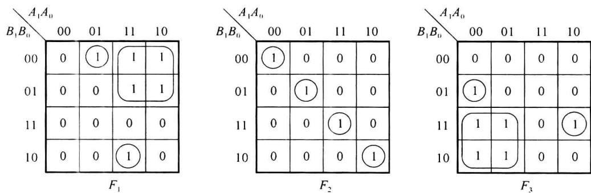  

图3.3.26 两位比较器卡诺图


$$

\begin{array}{r l} F _ {1} (A _ {1}, A _ {0}, B _ {1}, B _ {0}) & = A _ {1} \overline {{B _ {1}}} + A _ {1} A _ {0} B _ {1} \overline {{B _ {0}}} + \overline {{A _ {1}}} A _ {0} \overline {{B _ {1}}} \overline {{B _ {0}}} \\ & = A _ {1} \overline {{B _ {1}}} + A _ {0} \overline {{B _ {0}}} (A _ {1} B _ {1 +} \overline {{A _ {1}}} \overline {{B _ {1}}}) \\ & = A _ {1} \overline {{B _ {1}}} + A _ {0} \overline {{B _ {0}}} (A _ {1} \odot B _ {1}) \end{array}

$$


$F_{1}$ 表达式意义很明显, 即两个数比较, 高位大的一定大, 式中第一项为 1, 使 $F_{1}=1$ ; 若高位相同比低位, 低位大的则大, 式中第二项为 1, 使 $F_{1}=1$ 。


对 $F_{2}$ 作如下变换：


$$

\begin{array}{r l} F _ {2} (A _ {1}, A _ {0}, B _ {1}, B _ {0}) & = \overline {{A _ {1}}} \overline {{A _ {0}}} \overline {{B _ {1}}} \overline {{B _ {0}}} + \overline {{A _ {1}}} A _ {0} \overline {{B _ {1}}} B _ {0} + A _ {1} \overline {{A _ {0}}} B _ {1} \overline {{B _ {0}}} + A _ {1} A _ {0} B _ {1} B _ {0} \\ & = \overline {{A _ {1}}} \overline {{B _ {1}}} (\overline {{A _ {0}}} \overline {{B _ {0}}} + A _ {0} B _ {0}) + A _ {1} B _ {1} (\overline {{A _ {0}}} \overline {{B _ {0}}} + A _ {0} \dot {B _ {0}}) \\ & = \overline {{A _ {1}}} \overline {{B _ {1}}} (A _ {0} \odot B _ {0}) + A _ {1} B _ {1} (A _ {0} \odot B _ {0}) \\ & = (A _ {1} \odot B _ {1}) (A _ {0} \odot B _ {0}) \end{array}

$$


该式表明,只有两个数的对应位都相同, $F_{2}$ 才为1,表示两数相等。


函数 $F_{3}$ 的变换和 $F_{1}$ 类似, 即


$$

\begin{array}{r l} F _ {3} (A _ {1}, A _ {0}, B _ {1}, B _ {0}) & = \overline {{A _ {1}}} B _ {1} + \overline {{A _ {1}}} \overline {{A _ {0}}} \overline {{B _ {1}}} B _ {0} + A _ {1} \overline {{A _ {0}}} B _ {1} B _ {0} \\ & = \overline {{A _ {1}}} B _ {1} + \overline {{A _ {0}}} B _ {0} (\overline {{A _ {1}}} \overline {{B _ {1}}} + A _ {1} B _ {1}) \\ & = \overline {{A _ {1}}} B _ {1} + \overline {{A _ {0}}} B _ {0} (A _ {1} \odot B _ {1}) \end{array}

$$


$F_{3}$ 说明两数进行比较,高位小的一定小,高位相同时低位小的一定小。

并且由真值表还可看出 3 个输出函数之间的关系：


$$

F _ {2} = \overline {{F _ {1} + F _ {3}}}

$$


第三步:作逻辑电路图,如图 3.3.27 所示。


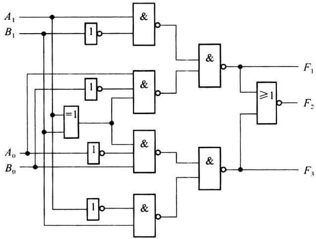  

图3.3.27 两位数码比较器逻辑图


由此例的两位数比较,找出了比较器的规律,可以推广至 N 位数比较。如 4 位二进制数比较的表达式为


$$

\begin{array}{r l} & F _ {1} (A > B) = A _ {3} \overline {{B _ {3}}} + A _ {2} \overline {{B _ {2}}} (A _ {3} \odot B _ {3}) + A _ {1} \overline {{B _ {1}}} (A _ {3} \odot B _ {3}) (A _ {2} \odot B _ {2}) \\ & \qquad + A _ {0} \overline {{B _ {0}}} (A _ {3} \odot B _ {3}) (A _ {2} \odot B _ {2}) (A _ {1} \odot B _ {1}) \\ & F _ {2} (A = B) = (A _ {3} \odot B _ {3}) (A _ {2} \odot B _ {2}) (A _ {1} \odot B _ {1}) (A _ {0} \odot B _ {0}) \\ & F _ {3} (A <   B) = \overline {{A _ {3}}} B _ {3} + \overline {{A _ {2}}} B _ {2} (A _ {3} \odot B _ {3}) + \overline {{A _ {1}}} B _ {1} (A _ {3} \odot B _ {3}) (A _ {2} \odot B _ {2}) \\ & \qquad + \overline {{A _ {0}}} B _ {0} (A _ {3} \odot B _ {3}) (A _ {2} \odot B _ {2}) (A _ {1} \odot B _ {1}) \end{array}

$$
</Solution>
</Example>

<Example title="例 3.3.15">
试用全加器及与非门设计一个 1 位 8421BCD 码加法器。

<Solution title="解">
第一步:作真值表。

一位 8421BCD 码由 4 位二进制码构成, 所以 1 位 8421BCD 码加法可用 4 个全加器完成。但两个 4 位二进制数相加是“逢十六进一”, 而两个 1 位 BCD 码相加却是“逢十进一”, 两者在进位时相差 6 (即 0110), 又由于 8421BCD 码只用 0000\~1001 前 10 种编码表示 0\~9 这 10 个数, 因此当和数大于 9 (1001) 或向高位有进位时, 必须对结果进行修正, 加修正项 (即 0110)。如下例所示:


$$

\begin{array}{c c}\text {\textcircled{1}}&4\\&+ 3 \rightarrow\\\hline&7\end{array}\qquad\begin{array}{c c}&0 1 0 0\\&+ 0 0 1 1\\\hline&0 1 1 1\end{array}

$$


因为和为 7&lt;9，所以全加器的结果 0111 与 8421BCD 码一致。


$$

\begin{array}{c c}\text {\textcircled{2}}&6\\&+ 7 \rightarrow\\\hline&1 3\end{array}\qquad\begin{array}{c c}&0 1 1 0\\&+ 0 1 1 1\\\hline&1 1 0 1\end{array}

$$


因为和为 13 > 9，所以结果 1101 与 8421 BCD 码不一致，须加 6 修正。


$$

\begin{array}{r l} {\text {即:}} & {1 1 0 1} \\ & {+ 0 1 1 0} \\ \hline & 1 0 0 1 1 \end{array}

$$


现在的结果是“13”的8421BCD码。


$$

\begin{array}{c c}\text {\textcircled{3}}&8\\&+ 9 \rightarrow\\\hline&1 7\end{array}\qquad\begin{array}{c c}&1 0 0 0\\&+ 1 0 0 1\\\hline&1 0 0 0 1\end{array}

$$


因为有进位,所以结果 10001 与 8421BCD 码不一致,须加 6 修正。


```csv

即：10001

+ 0110

10111

```


现在的结果是“17”的 8421BCD 码。


现在只需列出加“6”修正电路的真值表即可。其输入是二进制数加法的结果，输出是8421BCD码，如表3.3.8所示，这是一个五变量输入(变量 $C_{b}$ 是二进制加法进位)的5个输出函数的真值表。由于两个用8421BCD码表示的十进制数相加且考虑到低位来的进位时，其和最大为19，故输入变量组合10100～11111不会出现，为任意项。


表 3.3.8 加“6”修正电路真值表


<table><tr><td rowspan="2">十进制数</td><td colspan="5">二进制加法结果</td><td colspan="5">8421BCD</td><td rowspan="2">说明</td></tr><tr><td> $C_b$ </td><td> $S_8$ </td><td> $S_4$ </td><td> $S_2$ </td><td> $S_1$ </td><td>C</td><td> $Y_8$ </td><td> $Y_4$ </td><td> $Y_2$ </td><td> $Y_1$ </td></tr><tr><td>0</td><td>0</td><td>0</td><td>0</td><td>0</td><td>0</td><td>0</td><td>0</td><td>0</td><td>0</td><td>0</td><td rowspan="10">无须修正</td></tr><tr><td>1</td><td>0</td><td>0</td><td>0</td><td>0</td><td>1</td><td>0</td><td>0</td><td>0</td><td>0</td><td>1</td></tr><tr><td>2</td><td>0</td><td>0</td><td>0</td><td>1</td><td>0</td><td>0</td><td>0</td><td>0</td><td>1</td><td>0</td></tr><tr><td>3</td><td>0</td><td>0</td><td>0</td><td>1</td><td>1</td><td>0</td><td>0</td><td>0</td><td>1</td><td>1</td></tr><tr><td>4</td><td>0</td><td>0</td><td>1</td><td>0</td><td>0</td><td>0</td><td>0</td><td>1</td><td>0</td><td>0</td></tr><tr><td>5</td><td>0</td><td>0</td><td>1</td><td>0</td><td>1</td><td>0</td><td>0</td><td>1</td><td>0</td><td>1</td></tr><tr><td>6</td><td>0</td><td>0</td><td>1</td><td>1</td><td>0</td><td>0</td><td>0</td><td>1</td><td>1</td><td>0</td></tr><tr><td>7</td><td>0</td><td>0</td><td>1</td><td>1</td><td>1</td><td>0</td><td>0</td><td>1</td><td>1</td><td>1</td></tr><tr><td>8</td><td>0</td><td>1</td><td>0</td><td>0</td><td>0</td><td>0</td><td>1</td><td>0</td><td>0</td><td>0</td></tr><tr><td>9</td><td>0</td><td>1</td><td>0</td><td>0</td><td>1</td><td>0</td><td>1</td><td>0</td><td>0</td><td>1</td></tr><tr><td>10</td><td>0</td><td>1</td><td>0</td><td>1</td><td>0</td><td>1</td><td>0</td><td>0</td><td>0</td><td>0</td><td rowspan="10">需加0110修正</td></tr><tr><td>11</td><td>0</td><td>1</td><td>0</td><td>1</td><td>1</td><td>1</td><td>0</td><td>0</td><td>0</td><td>1</td></tr><tr><td>12</td><td>0</td><td>1</td><td>1</td><td>0</td><td>0</td><td>1</td><td>0</td><td>0</td><td>1</td><td>0</td></tr><tr><td>13</td><td>0</td><td>1</td><td>1</td><td>0</td><td>1</td><td>1</td><td>0</td><td>0</td><td>1</td><td>1</td></tr><tr><td>14</td><td>0</td><td>1</td><td>1</td><td>1</td><td>0</td><td>1</td><td>0</td><td>1</td><td>0</td><td>0</td></tr><tr><td>15</td><td>0</td><td>1</td><td>1</td><td>1</td><td>1</td><td>1</td><td>0</td><td>1</td><td>0</td><td>1</td></tr><tr><td>16</td><td>1</td><td>0</td><td>0</td><td>0</td><td>0</td><td>1</td><td>0</td><td>1</td><td>1</td><td>0</td></tr><tr><td>17</td><td>1</td><td>0</td><td>0</td><td>0</td><td>1</td><td>1</td><td>0</td><td>1</td><td>1</td><td>1</td></tr><tr><td>18</td><td>1</td><td>0</td><td>0</td><td>1</td><td>0</td><td>1</td><td>1</td><td>0</td><td>0</td><td>0</td></tr><tr><td>19</td><td>1</td><td>0</td><td>0</td><td>1</td><td>1</td><td>1</td><td>1</td><td>0</td><td>0</td><td>1</td></tr></table>


第二步:写出输出函数表达式,并化简。


正规的作法是做出 5 个输出函数的五变量卡诺图, 再进行简化, 很烦琐。在此通过分析真值表的规律, 可简便地得到输出函数表达式。


首先从真值表可见, 当输出 C=0 时, 无须修正, 当 C=1 时, 需要修正, 所以 C 就是加 “6” 修正的标志, 需要先求出 C 的表达式。


由真值表发现, 当 $C_{b}=1$ 时, C=1; 当 $C_{b}=0$ 时, $C=\sum m(10,11,12,13,14,15)$ , 所以


$$

\begin{array}{r l} C (C _ {\mathrm{b}}, S _ {8}, S _ {4}, S _ {2}, S _ {1}) & = C _ {\mathrm{b}} + \overline {{{C _ {\mathrm{b}}}}} \sum m (1 0, 1 1, 1 2, 1 3, 1 4, 1 5) \\ & = C _ {\mathrm{b}} + \sum m (1 0, 1 1, 1 2, 1 3, 1 4, 1 5) \\ & = C _ {\mathrm{b}} + S _ {8} S _ {4} + S _ {8} S _ {2} \leftarrow \text {用卡诺图化简} \sum m (1 0, 1 1, 1 2, 1 3, 1 4, 1 5) \end{array}

$$


其次，所谓加“6”修正就是将二进制加法结果加上0110即可得到其余4个输出函数，故需要全加器来实现0110与 $S_{8}$ 、 $S_{4}$ 、 $S_{2}$ 、 $S_{1}$ 相加。由函数C来控制0110的加入，C=1，加0110(0110中的两个1来自C)；C=0，则不加。因为最低位 $S_{1}$ 恒加0， $S_{1}$ 就是 $Y_{1}$ ，无须用全加器，故共需3个全加器，以实现对 $S_{8}$ 、 $S_{4}$ 、 $S_{2}$ 的修正，得到 $Y_{8}$ 、 $Y_{4}$ 、 $Y_{2}$ 。


第三步：绘制逻辑图如图 3.3.28 所示。


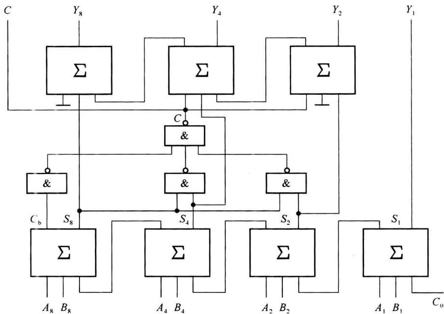  

图3.3.28 1位8421BCD加法器逻辑图


1 位 8421BCD 码加法器由 3 部分组成: 第一部分是 4 位全加器, 以实现对两个输入的 8421BCD 码及低位来的进位进行二进制加法; 第二部分是用与非门实现输出 C 的电路; 第三部分是加“6”修正电路。


由此例可知,组合电路的设计不一定都采用前面介绍的传统设计方法,应根据具体题目灵活设计,使设计和实现简单,这种方法更适合 MSI 电路。
</Solution>
</Example>
