import Guide from '@/components/Guide.astro';
import Knowledge from '@/components/Knowledge.astro';
import Example from '@/components/Example.astro';
import Analysis from '@/components/Analysis.astro';
import Solution from '@/components/Solution.astro';
import Variant from '@/components/Variant.astro';
import Note from '@/components/Note.astro';
import Block from '@/components/Block.astro';
import Method from '@/components/Method.astro';
import Exercise from '@/components/Exercise.astro';

前面组合电路设计是在理想情况下进行的,即认为电路中的连线及逻辑门没有延迟,电路中的多个输入信号发生变化时,都是同时瞬间完成的。但事实上信号的变化需要一定的过渡时间,信号通过逻辑门也需要一个响应时间,多个信号发生变化时,不可能完全同时。因此,理想情况下设计的逻辑电路,在实际工作时,当输入信号发生变化时就可能出现瞬时错误。

例如, 图 3.4.1(a) 所示电路, 其输出函数 $F = A \cdot \overline{A}, G_{2}$ 的输入是 $A$ 和 $\overline{A}$ 两个互反信号, 由于 $G_{1}$ 的延迟, $\overline{A}$ 的下降沿滞后于 $A$ 的上升沿, 因此在很短的时间间隔内, $G_{2}$ 的两个输入都会出现高电平, 使输出产生了不应有的窄脉冲, 如图 3.4.1(b) 所示, 俗称毛刺, 这种现象称为冒险。

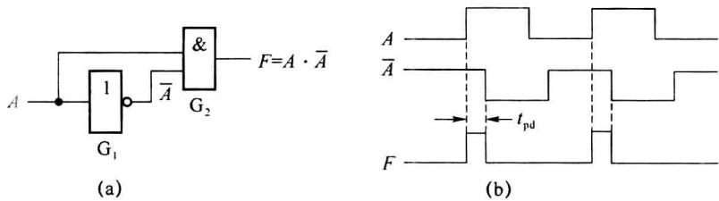  

图 3.4.1 产生冒险的电路

要使设计的电路可靠地工作,必须考虑冒险现象,组合逻辑电路中的冒险分为逻辑冒险和功能冒险两类,下面将分别进行讨论。

## 3.4.1 逻辑冒险与消除方法

### 1. 逻辑冒险

在组合电路中,若某一个输入变量变化前后的输出相同,而在输入变量变化时可能出现瞬时错误输出,这种冒险称为静态逻辑冒险。下面以图 3.4.2 所示电路为例进一步分析产生冒险的原因。

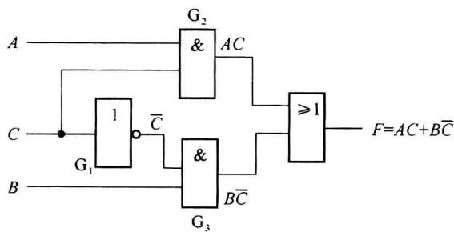  

图 3.4.2 产生逻辑冒险的组合电路

由电路图写出函数表达式为

$$

F (A, B, C) = A C + B \overline {{{C}}}

$$

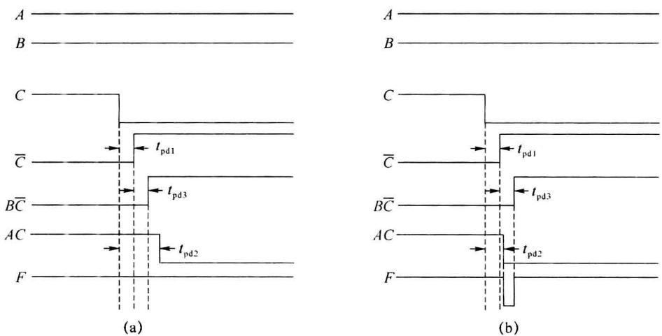  

图3.4.3 产生冒险的现象

当输入变量 ABC=111 时，门 2 的输出 AC=1，则函数 F=1；当 ABC=110 时，由于门 3 输出 $B\overline{C}=1$ ，则 F=1。因此稳态时无论 C 为 1 还是为 0，函数值相同。当变量 C 从 $1\rightarrow0$ 时，门 2、门 3 的输出都发生变化，AC 从 $1\rightarrow0$ ， $B\overline{C}$ 从 $0\rightarrow1$ 。由于逻辑门的延迟时间（忽略导线的传输时间）不同，门 2、门 3 输出变化的先后顺序也不同。如果门 2 的延迟时间大于门 1、门 3 延迟时间的和 $t_{pd2}>t_{pd3}+t_{pd1}$ ，这时 AC 从 $1\rightarrow0$ 的变化滞后于 $B\overline{C}$ 从 $0\rightarrow1$ 的变化，如图 3.4.3(a) 所示，不会有错误发生。但如果 $t_{pd2}<t_{pd3}+t_{pd1}$ 即 AC 从 $1\rightarrow0$ 的变化，先于 $B\overline{C}$ 从 $0\rightarrow1$ 的变化，则在变化的瞬间 AC 和 $B\overline{C}$ 将同时出现 0，函数 F=0，如图 3.4.3(b) 所示，发生瞬时错误。由于逻辑门传输时间具有一定的离散性，在实际中这两种可能性都可能发生，因此电路存在逻辑冒险现象，并且可知逻辑冒险产生的原因是门的延迟。

这种稳态时输出 1、输入变化瞬间输出 0 的冒险, 称为偏 1 型冒险; 稳态时输出为 0, 而输入变化瞬间出现 1 的冒险, 称为偏 0 型冒险, 图 3.4.1 电路产生的就是偏 0 型逻辑冒险。

### 2. 逻辑冒险的检查与消除

逻辑冒险的检查及消除方法有两种:代数法和卡诺图法。

### (1) 代数法

代数法是从表达式判断电路是否存在逻辑冒险。例如图3.4.2电路的输出表达式 $F(A,B,C)=AC+B\overline{C}$ ，将输入AB=11代入，则 $F(A,B,C)=C+\overline{C}$ ，在稳态时无论C=0还是C=1，函数值F都为1；但在C变化瞬间，C和 $\overline{C}$ 都可能为0，使F瞬时为0，存在偏1型逻辑冒险。

因此代数法的判断方法如下：

① 在函数表达式中找出既以原变量又以反变量出现的变量。

② 通过使其余变量为 0 或 1（积项取 1，和项取 0），孤立出该变量，若表达式形式如下： $F = A + \overline{A}$ ，则存在偏 1 型逻辑冒险；

$F=A\cdot\overline{A}$ ，则存在偏0型逻辑冒险。

对于积之和式(只对两级)的电路, 只存在偏 1 型逻辑冒险。这是因为在与或式中, 若某变量 $x$ 变化前后函数值为 0 , 则各积项值必须都为 0 。既然无论 $x$ 取 0 或取 1 , 含有 $x$ 变量和 $\overline{x}$ 变量的积项都为 0 , 这些积项中必须都存在另一个值为 0 的因子才行。因此在 $x$ 变化时,这些积项都不会瞬时出现1,故无偏0型冒险。

同理,对于或与式(只对两级)的电路,只存在偏0型逻辑冒险。

若判断电路存在逻辑冒险,为使电路可靠工作,必须消除。方法是在产生冒险的表达式上,加上冗余项,使之不出现 $A + \overline{A}$ 或 $A \cdot \overline{A}$ 的形式。需要注意:分析哪些变量可能造成冒险,针对它们加冗余项。

例如, 上例加上冗余项变为 $F(A, B, C) = AC + B\overline{C} + AB$ , 此时令 $A = B = 1$ , 得 $F = C + \overline{C} + 1 = 1$ , 所以无冒险。这是因为在 $A = B = 1$ 时, $C$ 变化时, $AB$ 值一直是 1, 使 $F$ 值总保持 1, 不会有瞬时错误发生, 故消除了冒险。

<Example title="例 3.4.1">
判断表达式 $F(A,B,C,D)=\overline{A}\overline{D}+\overline{A}\overline{B}\overline{C}+ABC+ACD$ 是否存在逻辑冒险？若存在，设法消除。

<Solution title="解">
A、B、C、D 均有互补形式, 需要考虑各种情况:

对于 A: 令 D=0, B=C=1, $F=\overline{A}+A$ , 存在偏 1 型逻辑冒险, 加冗余项 $BC\overline{D}$ 。

对于 B: 不存在逻辑冒险。

对于 C: 不存在逻辑冒险。

对于 D：不存在逻辑冒险。

所以存在偏 1 型逻辑冒险, 加冗余项 BC $\overline{D}$ 。
</Solution>
</Example>

### (2) 卡诺图法

卡诺图法检查逻辑冒险的方法是:若在函数的卡诺图上存在相切的合并圈,则存在逻辑冒险。称两个合并圈之间存在不被同一合并圈包含的相邻最小项的关系为相切。

这是因为由合并圈相切的概念,根据最小项的相邻性,相切意味着有些变量会同时以原变量和反变量的形式存在,且不能消掉,就会以 $A + \overline{A}$ 或 $A \cdot \overline{A}$ 的形式出现在表达式。

若相切的合并圈圈的是1,就是偏1型逻辑冒险;圈的是0,就是偏0型逻辑冒险。

仍以图 3.4.2 电路为例, 其相应的卡诺图示于图 3.4.4 中。由卡诺图可见, 两个合并圈相切, 其相邻最小项是 $m_{7}$ 和 $m_{6}$ (如箭头所示), 说明在输入变量 ABC 从 111 变到 110 时, 存在偏 1 型逻辑冒险, 与代数法一致。

消除逻辑冒险的方法:加一个冗余圈(图 3.4.4 中虚线圈),将相切的合并圈所相邻的最小项圈起来。这样可使原来以原变量和反变量的形式存在的变量在该冗余圈内消掉,从而消除了冒险。

图 3.4.4 中加的冗余圈对应的积项是 AB，与代数法一致，其实冗余圈对应的积项就是冗余项。

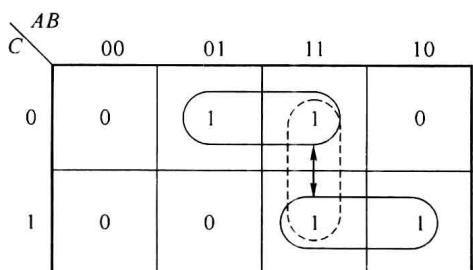  

图 3.4.4 卡诺图法判断冒险与消除

<Example title="例 3.4.2">
用卡诺图法重做例 3.4.1。

<Solution title="解">
函数 $F(A,B,C,D)=\overline{A}\overline{D}+\overline{A}\overline{B}\overline{C}+ABC+ACD$ 的卡诺图如图 3.4.5 所示(注意积项与合并圈对应), 积项 $\overline{A}\overline{D}$ 和 ABC 对应的合并圈相切, 且当 ABCD 由 0110 变为 1110 时(如箭头所示), 存在偏 1 型逻辑冒险, 所以加冗余圈 $BC\overline{D}$ , 如图 3.4.5 中虚线所示, 与代数法一致。

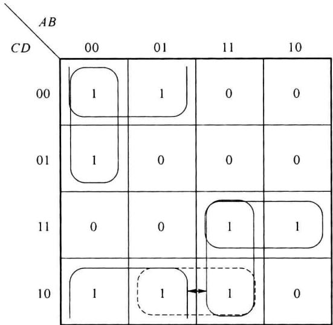  

图3.4.5 例3.4.1的卡诺图
</Solution>
</Example>

<Example title="例 3.4.3">
将函数 $F(A,B,C,D)=A\overline{C}+\overline{A}\overline{B}D+\overline{A}C\overline{D}$ 设计为无逻辑冒险的组合电路。

<Solution title="解">
作函数 F 的卡诺图,如图 3.4.6(a) 所示。由图可见,相切的合并圈有两处如箭头所示,故存在偏 1 型逻辑冒险。为了消除冒险需加两个冗余圈,如图中虚线所示。由图写出函数表达式为

$$

F (A, B, C, D) = A \overline {{C}} + \overline {{A}} \overline {{B}} D + \overline {{A}} C \overline {{D}} + \overline {{B}} \overline {{C}} D + \overline {{A}} \overline {{B}} C

$$

其相应的逻辑图如图 3.4.6 (b) 所示。

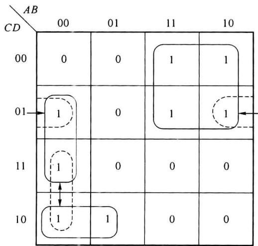  

(a)

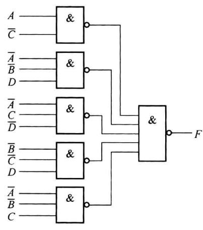  

(b)  

图 3.4.6 例 3.4.3 用与非门实现的卡诺图与逻辑图

如果该函数用或非门实现,其卡诺图如图 3.4.7(a) 所示,用卡诺图法判别冒险的存在和消除冒险的方法与圈 1 的方法类似。由图可知相切的合并圈有两处,存在偏 0 型逻辑冒险。需加两个冗余圈,如图中虚线所示。则得表达式为

$$

F (A, B, C, D) = (\overline {{{A}}} + \overline {{{C}}}) (A + C + D) (A + \overline {{{B}}} + \overline {{{D}}}) (A + \overline {{{B}}} + \overline {{{D}}}) (\overline {{{B}}} + \overline {{{C}}} + \overline {{{D}}})

$$

其逻辑图如图 3.4.7(b) 所示。

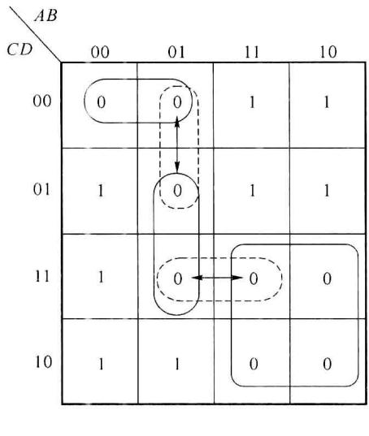  

(a)

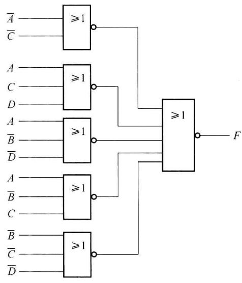  

(b)  

图3.4.7 例3.4.3用或非门实现的卡诺图与逻辑图
</Solution>
</Example>

### (3) 代数法和卡诺图法的比较

代数法较繁,但适用范围广,对两级以上的电路均适用。注意函数表达式不能化简,否则对应的逻辑电路改变,由电路延迟造成的冒险随之改变。

卡诺图法检查和消除逻辑冒险都很直观、方便，但只能用于两级电路。函数表达式的积项或和项必须与合并圈一一对应。

代数法的冗余项与卡诺图法的冗余圈是对应的。由此可知函数的最简，不一定最佳，必要的冗余，反而可使电路工作增加可靠性。

<Example title="例 3.4.4">
判断 $F(A,B,C,D)=(B+C)(\overline{B}D+A)+A\overline{B}C$ 是否存在冒险？

<Solution title="解">
由于是多级形式,而不是两级电路,只能用代数法,不能用卡诺图法,且不能化简。对于 B: 令 C=0, A=0, D=1, 则 $F(A, B, C, D)=B \cdot \overline{B}$ , 所以存在偏 0 型逻辑冒险。
</Solution>
</Example>

## 3.4.2 功能冒险与消除方法

### 1. 功能冒险

在组合电路中,当有两个或两个以上输入变量同时发生变化,变化前后电路的输出相同,而在输入变量发生变化时可能出现瞬时错误输出,这种现象称为静态功能冒险。

产生功能冒险的原因:两个或两个以上输入变量实际上是不可能同时发生变化的,它们的变化总是有先有后。例如在如图3.4.8所示的卡诺图中,当输入变量ABCD从0111变到1101时,A、C两个变量要同时发生变化,且变化前、后函数值相同,都为1。如C先于A变化,则输入变量将由 $0111 \rightarrow 0101 \rightarrow 1101$ , 如实线箭头所示, 所经路径函数值相同, 不会发生错误。如果 A 先于 C 变化, 输入将由 $0111 \rightarrow 1111 \rightarrow 1101$ , 如虚线箭头所示, 所经路径函数值不相同, 输出就会发生瞬间错误。由于变量变化的先后顺序是随机的, 因而可能产生功能冒险。

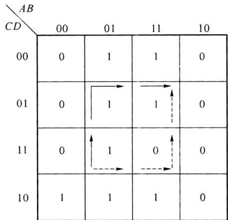  

图3.4.8 产生功能冒险的函数  

如果输入变量 ABCD 从 0101 变到 1100, A、D 两个变量同时发生变化, 因为 4 格、13 格的函数值都是 1, 所以无论 A 先变, 还是 D 先变都不会产生错误输出, 没有冒险。  

从以上分析可知,产生静态功能冒险必须具备以下3个条件:

(1) 必须有 P 个变量 $(P \geqslant 2)$ 同时发生变化；  

(2) 输入变量变化前后函数值相同；  

(3) 由变化的 P 个变量组合所构成的 $2^{P}$ 个格, 既有 1 又有 0。

<Example title="例 3.4.5">
判断卡诺图 3.4.9 中所示逻辑函数, 当输入 ABCD 从 0110→0111, 0111→1011, 0010→0101, 0011→0110 变化时, 是否存在功能冒险。

<table><tr><td>CD\AB</td><td>00</td><td>01</td><td>11</td><td>10</td></tr><tr><td>00</td><td>0</td><td>0</td><td>1</td><td>0</td></tr><tr><td>01</td><td>0</td><td>1</td><td>1</td><td>1</td></tr><tr><td>11</td><td>1</td><td>1</td><td>0</td><td>0</td></tr><tr><td>10</td><td>1</td><td>1</td><td>1</td><td>1</td></tr></table>

图3.4.9 例3.4.5的卡诺图

<Solution title="解">
① 当输入变量 ABCD 从 0110→0111 时, 只有 D 一个变量变化, 不存在功能冒险。

② 当输入变量 ABCD 从 0111→1011 时, AB 两个变量同时变化, 但变化前后的函数值不同即 $F(7) \neq F(11)$ , 不存在功能冒险。

③ 输入 ABCD 从 0010→0101，BCD3 个变量同时发生变化，变化前后的函数值相同即 $F(2)=F(5)=1$ ，不变量 A=0，其相应积项包含的 8 个格既有 1 又有 0，故存在功能冒险。

④ 输入 ABCD 从 0011→0110, BD 两个变量同时发生变化, 变化前后的函数值相同 $F(3)=F(6)=1$ , 对应于变量 AC 为 01 的积项圈所包含的 4 个格全为 1, 不存在功能冒险。
</Solution>
</Example>

### 2. 功能冒险的消除

功能冒险是函数的逻辑功能决定的,如图 3.4.8 所示函数,只要输入进入 15 格,输出就出 0,这是该函数所具有的功能,因此不能在设计中消除,需外加选通脉冲。

由于冒险仅发生在输入信号变化的瞬间, 只要使选通脉冲出现的时间与输入信号变化的时间错开, 即可消除任何形式的冒险, 此时输出不再是电位信号, 而是脉冲信号, 如图 3.4.10 所示。需要指出, 必须对选通脉冲的宽度及产生的时间有严格的要求。

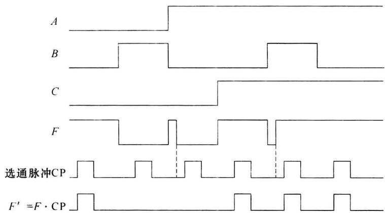  

图 3.4.10 选通脉冲消除冒险

选通脉冲的加法:(位置与极性)

因为

$$

F ^ {\prime} = F \cdot \mathrm{CP}

$$

所以：

① 若用与非门实现函数 $F(A, B, C, D) = AB + CD$ ，则：

$$

F ^ {\prime} (A, B, C, D) = F \cdot \mathrm{CP} = A B \cdot \mathrm{CP} + C D \cdot \mathrm{CP} = \overline {{A B \cdot \mathrm{CP}}} \cdot \overline {{C D \cdot \mathrm{CP}}}

$$

如图 3.4.11(a) 所示, 正极性选通脉冲加在第Ⅱ级。

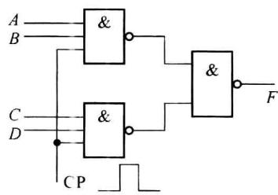  

(a)

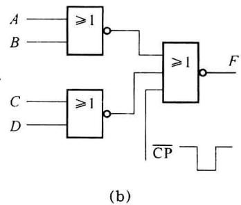

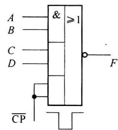  

(c)  

图 3.4.11 几种加选通脉冲电路

② 若用或非门实现函数 $F(A,B,C,D)=(A+B)(C+D)$ ，则：

$$

\begin{array}{r l} F ^ {\prime} (A, B, C, D) & = F \cdot \mathrm{CP} = (A + B) (C + D) \cdot \mathrm{CP} \\ & = \overline {{A + B}} + \overline {{C + D}} + \overline {{\mathrm{CP}}} \end{array}

$$

如图 3.4.11(b) 所示, 负极性选通脉冲加在第 I 级。

③ 若用与或非门实现函数 $F(A,B,C,D)=\overline{AB+CD}$ ，则：

$$

\begin{array}{r l} F ^ {\prime} (A, B, C, D) & = F \cdot \mathrm{CP} = \overline {{A B + C D}} \cdot \mathrm{CP} \\ & = \overline {{A B + C D + \overline {{C P}}}} \end{array}

$$

如图 3.4.11(c) 所示, 负极性选通脉冲加在一个与门上。

在对输出波形边沿要求不高时,还可在输出端接一个几十到几百皮法的滤波电容 $C_{L}$ 消除冒险,如图 3.4.12 所示。但输出波形的边沿变坏,只适用于低速电路。

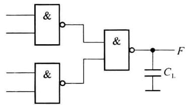  

图 3.4.12 用电容滤波器消除冒险

## 3.4.3 冒险消除方法的比较

综上所述，消除冒险共有3种方法：增加冗余项或冗余圈只能消除逻辑冒险，而不能消除功能冒险；加滤波电容简单易行，但使输出波形变坏；加选通脉冲则是行之有效的方法，对逻辑冒险和功能冒险都有效。目前大多数中规模集成电路都设有使能端，其作用之一即是作为选通脉冲输入端，待电路稳定后，才使输出有效。

## 3.4.4 动态冒险

上面两种冒险都是静态冒险,其特点是输入信号变化前、后函数值相同。

实际还有另一种冒险:在输入变化前、后函数值不同,而在输入信号变化瞬间,输出不是变化一次而是变化三次或更高的奇数次,如图3.4.13所示,这种瞬时错误称为动态冒险。但由于逻辑门的延迟惯性,动态冒险很少发生;而且显然存在动态冒险的电路也存在静态冒险,消除了静态冒险,动态冒险也自然消除。故对动态冒险不再讨论。

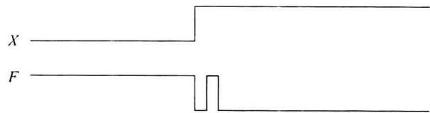  

图3.4.13 动态冒险现象
