import Guide from '@/components/Guide.astro';
import Knowledge from '@/components/Knowledge.astro';
import Example from '@/components/Example.astro';
import Analysis from '@/components/Analysis.astro';
import Solution from '@/components/Solution.astro';
import Variant from '@/components/Variant.astro';
import Note from '@/components/Note.astro';
import Block from '@/components/Block.astro';
import Method from '@/components/Method.astro';
import Exercise from '@/components/Exercise.astro';

随着集成电路的不断发展,在单个芯片上集成的电子元件数目越来越多,形成了中、大规模(LSI)和超大规模集成电路(VLSI)。

SSI: 10 门以下。器件集成: 如逻辑门或触发器。

MSI:100 门以下。逻辑器件集成:如比较器、编码器、译码器、数据选择器、数据分配器等

LSI:1000门以下。数字系统的集成:如存储器、单片机、微处理器等。

VLSI: 1 000 门以上。

MSI、LSI 的特点：

(1) 通用性、兼容性及扩展功能较强, 其名称仅代表主要用途, 不是全部用途。

(2) 外接元件少。可靠性高、体积小、功耗低、使用方便。

（3）MSI、LSI 封装在一个标准化的外壳内，对内部电路的了解是次要的，关心的是外部功能，通过查器件手册中的引脚图、逻辑符号、功能表，了解其逻辑功能。

(4) 用 MSI、LSI 进行设计时, 和选用的器件有关。

有时选用不同的器件都可实现电路功能,就需比较,以芯片数最少、最经济为目标。

因此要求:①熟悉芯片的功能和使用方法;②会灵活使用。

下面介绍几种常用的中大规模集成电路及其应用。

## 3.5.1 集成数码比较器

在计算机和许多数字系统中,经常需要对两个数进行比较,能对两组同样位数的二进制数进行数值比较且判断其大小的逻辑电路称为数码比较器。

### 1. 基本功能

TTL 中规模集成 4 位数码比较器 74LS85 的内部电路如图 3.5.1(a) 所示, 图 3.5.1(b) 为其逻辑符号。其中 $a_{3}, a_{2}, a_{1}, a_{0}$ 和 $b_{3}, b_{2}, b_{1}, b_{0}$ 分别代表被比较的两个 4 位二进制数, 输出端有 3 个, 分别为 $A < B, A = B, A > B$ , 另有 3 个级联输入端 $a < b, a = b, a > b$ , 作用是扩展功能, 下面分别用 $S', E', G'$ 表示。

由电路图 3.5.1 (a) 可推出表达式为

$$

\begin{array}{r l} A > B & = \overline {{a _ {3}}} b _ {3} + \overline {{a _ {2}}} b _ {2} D _ {3} + \overline {{a _ {1}}} b _ {1} D _ {3} D _ {2} + \overline {{a _ {0}}} b _ {0} D _ {3} D _ {2} D _ {1} + S ^ {\prime} D _ {3} D _ {2} D _ {1} D _ {0} + E ^ {\prime} D _ {3} D _ {2} D _ {1} D _ {0} \\ & = (\overline {{A <   B}}) + \overline {{A = B}} \\ A <   B & = \overline {{a _ {3}}} \overline {{b _ {3}}} + a _ {2} \overline {{b _ {2}}} D _ {3} + a _ {1} \overline {{b _ {1}}} D _ {3} D _ {2} + a _ {0} \overline {{b _ {0}}} D _ {3} D _ {2} D _ {1} + G ^ {\prime} D _ {3} D _ {2} D _ {1} D _ {0} + E ^ {\prime} D _ {3} D _ {2} D _ {1} D _ {0} \\ & = (\overline {{A > B}}) + \overline {{A = B}} \\ A = B & = D _ {3} D _ {2} D _ {1} D _ {0} E ^ {\prime} \end{array}

$$

式中： $D_{3} = \overline{a_{3}\oplus b_{3}} = a_{3}\odot b_{3}$

$$

D _ {2} = \overline {{{a _ {2} \oplus b _ {2}}}} = a _ {2} \odot b _ {2}

$$

$$

D _ {1} = \overline {{{a _ {1} \oplus b _ {1}}}} = a _ {1} \odot b _ {1}

$$

$$

D _ {0} = \overline {{{a _ {0}}}} \oplus b _ {0} = a _ {0} \odot b _ {0}

$$

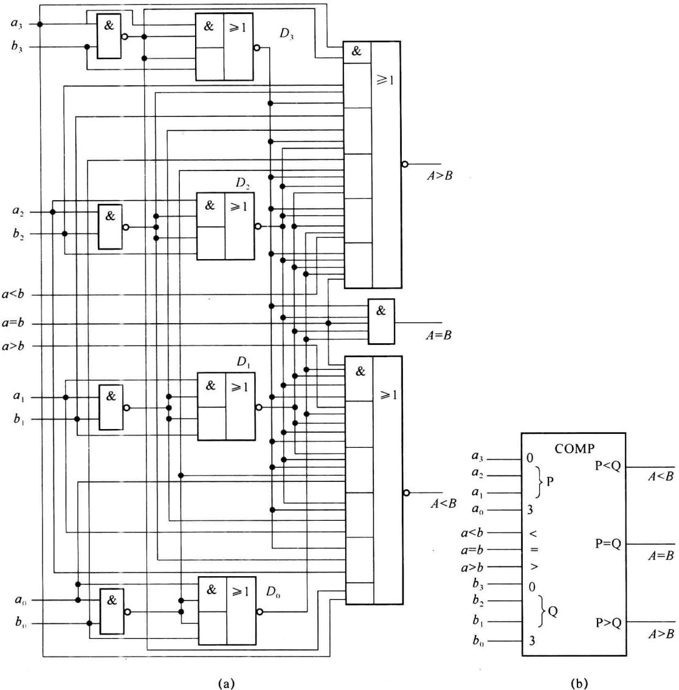  

图 3.5.1 集成 4 位比较器的逻辑图与其符号

其功能表如表 3.5.1 所示, 分析可知: ①从高位开始比较, 高位相同时, 才比较低位; ②比较结果和级联输入有关, 当 4 位均相等时, 看 $S^{\prime}, E^{\prime}, G^{\prime}$ 的级联输入; ③只有当 $A = B$ , 且 $G^{\prime} = S^{\prime} = 0$ , $E^{\prime} = 1$ 时, 相等输出才为 1。所以只比较 4 位数时, $G^{\prime}, S^{\prime}$ 均接地, $E^{\prime}$ 接高电平。

表 3.5.1 比较器功能表

<table><tr><td colspan="4">比较输入</td><td colspan="3">级联输入</td><td colspan="3">输出</td></tr><tr><td> $a_3$   $b_3$ </td><td> $a_2$   $b_2$ </td><td> $a_1$   $b_1$ </td><td> $a_0$   $b_0$ </td><td> $G'$ </td><td> $S'$ </td><td> $E'$ </td><td>A&gt;B</td><td>AAB</td><td>A=B</td></tr><tr><td> $a_3 >b_3$ </td><td>×</td><td>×</td><td>×</td><td>×</td><td>×</td><td>×</td><td>1</td><td>0</td><td>0</td></tr><tr><td> $a_3 < b_3$ </td><td>×</td><td>×</td><td>×</td><td>×</td><td>×</td><td>×</td><td>0</td><td>1</td><td>0</td></tr><tr><td> $a_3 = b_3$ </td><td> $a_2 >b_2$ </td><td>×</td><td>×</td><td>×</td><td>×</td><td>×</td><td>1</td><td>0</td><td>0</td></tr><tr><td> $a_3 = b_3$ </td><td> $a_2 < b_2$ </td><td>×</td><td>×</td><td>×</td><td>×</td><td>×</td><td>0</td><td>1</td><td>0</td></tr><tr><td> $a_3 = b_3$ </td><td> $a_2 = b_2$ </td><td> $a_1 >b_1$ </td><td>×</td><td>×</td><td>×</td><td>×</td><td>1</td><td>0</td><td>0</td></tr><tr><td> $a_3 = b_3$ </td><td> $a_2 = b_2$ </td><td> $a_1 < b_1$ </td><td>×</td><td>×</td><td>×</td><td>×</td><td>0</td><td>1</td><td>0</td></tr><tr><td> $a_3 = b_3$ </td><td> $a_2 = b_2$ </td><td> $a_1 = b_1$ </td><td> $a_0 >b_0$ </td><td>×</td><td>×</td><td>×</td><td>1</td><td>0</td><td>0</td></tr><tr><td> $a_3 = b_3$ </td><td> $a_2 = b_2$ </td><td> $a_1 = b_1$ </td><td> $a_0 < b_0$ </td><td>×</td><td>×</td><td>×</td><td>0</td><td>1</td><td>0</td></tr><tr><td> $a_3 = b_3$ </td><td> $a_2 = b_2$ </td><td> $a_1 = b_1$ </td><td> $a_0 = b_0$ </td><td>1</td><td>0</td><td>0</td><td>1</td><td>0</td><td>0</td></tr><tr><td> $a_3 = b_3$ </td><td> $a_2 = b_2$ </td><td> $a_1 = b_1$ </td><td> $a_0 = b_0$ </td><td>0</td><td>1</td><td>0</td><td>0</td><td>1</td><td>0</td></tr><tr><td> $a_3 = b_3$ </td><td> $a_2 = b_2$ </td><td> $a_1 = b_1$ </td><td> $a_0 = b_0$ </td><td>0</td><td>0</td><td>1</td><td>0</td><td>0</td><td>1</td></tr></table>

### 2. 功能扩展

### (1) 单片扩展(自扩展)

利用级联输入端可将一片4位比较器74LS85扩展成5位比较器，将 $G^{\prime}$ 、 $S^{\prime}$ 作为最低位比较输入端，即 $a_{0}$ 接 $G^{\prime}, b_{0}$ 接 $S^{\prime}, E^{\prime}$ 不用，必须接地，这时只能对5位二进制数进行大小的比较，比较相等的输出端不用。

其实当5位数相等时，因为 $A > B = \overline{S}^{\prime}, A < B = \overline{G}^{\prime}$ ，所以两个输出 $A > B, A < B$ 同时为0或1。

### (2) 多片扩展

当比较的位数超过五位时,须将多片 74LS85 进行级联,有串行级联和并行级联两种方式。

## ① 串行级联

图 3.5.2 所示的是由两片 4 位比较器组成 8 位数码比较器的串行级联图。输入信号同时加到两个比较器的比较输入端，低位片Ⅱ的输出接到高位片Ⅰ的级联输入端，比较结果由高位片Ⅰ的输出端输出。需要注意低位片Ⅱ的级联输入端必须 $G' = S' = 0, E' = 1$ ，否则当两数相等时输出端“ $A = B'' \neq 1$ 。由此得出结论：在一个比较电路中，接最低位的比较器片子必须接成 4 位比较器，以保证相等的结果能正确输出。

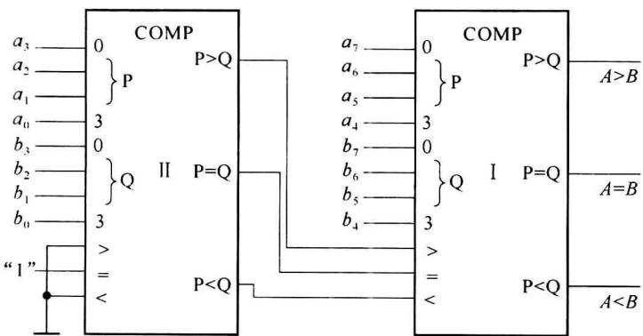  

图 3.5.2 串行级联构成的 8 位比较器

同理可将 3 片或多片 4 位比较器串行级联, 来比较多位的二进制数。串行级联电路简单, 但显然级数越多, 速度越慢。

## ② 并行级联

即树形结构, 图 3.5.3 是两个 24 位二进制数进行比较的并行级联图。共用了 6 片 4 位比较器, 片 2 至片 5 接成 5 位比较器, 片 1 接成 4 位比较器。片 2\~5 的输出端“A>B”和 “A&lt;B”分别接至片 6 的比较输入端, 注意高位出接高位入, 低位出接低位入。片 1 的 3 个输出端接片 6 的级联输入端, 比较结果由片 6 的输出端输出。显然输出结果仍决定于最高位。例如, $a_{23} > b_{23}$ , 片 5 的输出“A>B”=1, “A&lt;B”=0, 即片 6 的 $a_{3} > b_{3}$ , 因此输出“A>B”=1, 输出“A&lt;B”和“A=B”都为 0。

并行级联的特点是速度快,只需经两级芯片的延迟就可得到输出。此例也可6片串行级联,但速度慢。因此在组成多位比较器时,常采用并行级联。

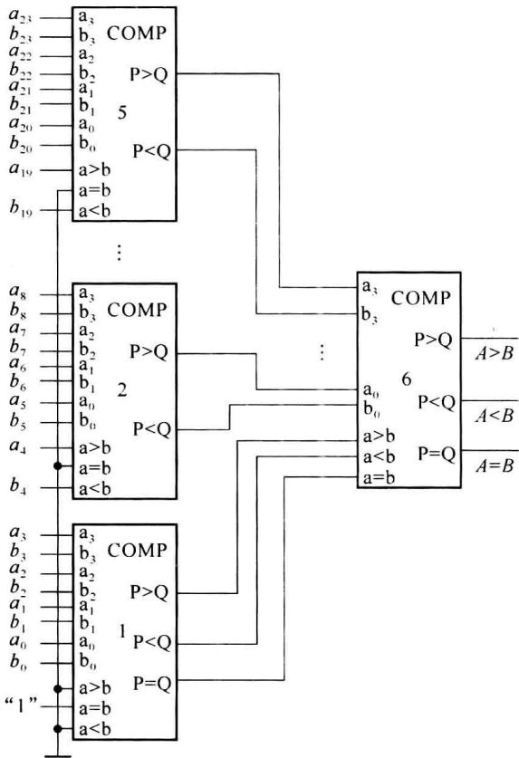  

图3.5.3 并行级联构成的24位比较器

### 3. 应用

<Example title="例 3.5.1">
用数码比较器构成用 8421BCD 码表示的 1 位十进制数的四舍五入电路。

<Solution title="解">
用 1 片 4 位比较器即能实现上述功能。

设 8421BCD 码为 $A_{3}$ $A_{2}$ $A_{1}$ $A_{0}$ ，当其小于或等于 4（即 0100）时电路输出 F 为 0，否则输出 F 为 1。将 4 位 BCD 码接于比较器的 $a_{3} \sim a_{0}$ 端，而将 0100 接于 $b_{3} \sim b_{0}$ 端，输出“A > B”端作为判别输出端 F，如图 3.5.4 所示。

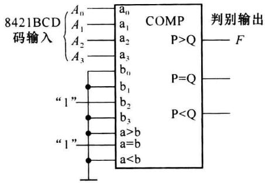  

图3.5.4 例3.5.1四舍五入电路
</Solution>
</Example>

## 3.5.2 编码器与优先编码器

将所要处理的信息或数据赋予二进制代码的过程称为编码,实现编码功能的电路称为

编码器(Encoder)，如图3.5.5所示。由于 $n$ 位二进制代码有 $2^{n}$ 个取值组合，可以表示 $2^{n}$ 种信息，所以输出 $n$ 位代码的编码器可有 $m\leqslant 2^n$ 个输入信号端，故编码器输入端比输出端多。

按照输出的代码种类不同,可分为二进制编码器 $(m=2^{n})$ 和二-十进制编码器 $(m<$

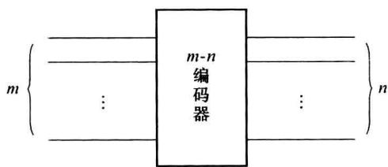  

图3.5.5 编码器框图

$2^{n}$ ); 按是否有优先权编码, 可分为普通编码器和优先编码器(Priority Encoder)。

### 1. 普通二-十进制编码器

C304 是一个 8421BCD 码的编码器, 其逻辑电路如图 3.5.6 所示。写出其输出函数 D、B、C、A 的表达式为

$$

\begin{array}{l} D = 8 + 9 \\ C = 4 + 5 + 6 + 7 \\ B = 2 + 3 + 6 + 7 \\ A = 1 + 3 + 5 + 7 + 9 \end{array}

$$

作出这 4 个函数的真值表, 如表 3.5.2 所示。

表 3.5.2 编码器真值表

<table><tr><td>9</td><td>8</td><td>7</td><td>6</td><td>5</td><td>4</td><td>3</td><td>2</td><td>1</td><td>D</td><td>C</td><td>B</td><td>A</td></tr><tr><td>0</td><td>0</td><td>0</td><td>0</td><td>0</td><td>0</td><td>0</td><td>0</td><td>0</td><td>0</td><td>0</td><td>0</td><td>0</td></tr><tr><td>0</td><td>0</td><td>0</td><td>0</td><td>0</td><td>0</td><td>0</td><td>0</td><td>1</td><td>0</td><td>0</td><td>0</td><td>1</td></tr><tr><td>0</td><td>0</td><td>0</td><td>0</td><td>0</td><td>0</td><td>0</td><td>1</td><td>0</td><td>0</td><td>0</td><td>1</td><td>0</td></tr><tr><td>0</td><td>0</td><td>0</td><td>0</td><td>0</td><td>0</td><td>1</td><td>0</td><td>0</td><td>0</td><td>0</td><td>1</td><td>1</td></tr><tr><td>0</td><td>0</td><td>0</td><td>0</td><td>0</td><td>1</td><td>0</td><td>0</td><td>0</td><td>0</td><td>1</td><td>0</td><td>0</td></tr><tr><td>0</td><td>0</td><td>0</td><td>0</td><td>1</td><td>0</td><td>0</td><td>0</td><td>0</td><td>0</td><td>1</td><td>0</td><td>1</td></tr><tr><td>0</td><td>0</td><td>0</td><td>1</td><td>0</td><td>0</td><td>0</td><td>0</td><td>0</td><td>0</td><td>1</td><td>1</td><td>0</td></tr><tr><td>0</td><td>0</td><td>1</td><td>0</td><td>0</td><td>0</td><td>0</td><td>0</td><td>0</td><td>0</td><td>1</td><td>1</td><td>1</td></tr><tr><td>0</td><td>1</td><td>0</td><td>0</td><td>0</td><td>0</td><td>0</td><td>0</td><td>0</td><td>1</td><td>0</td><td>0</td><td>0</td></tr><tr><td>1</td><td>0</td><td>0</td><td>0</td><td>0</td><td>0</td><td>0</td><td>0</td><td>0</td><td>1</td><td>0</td><td>0</td><td>1</td></tr></table>

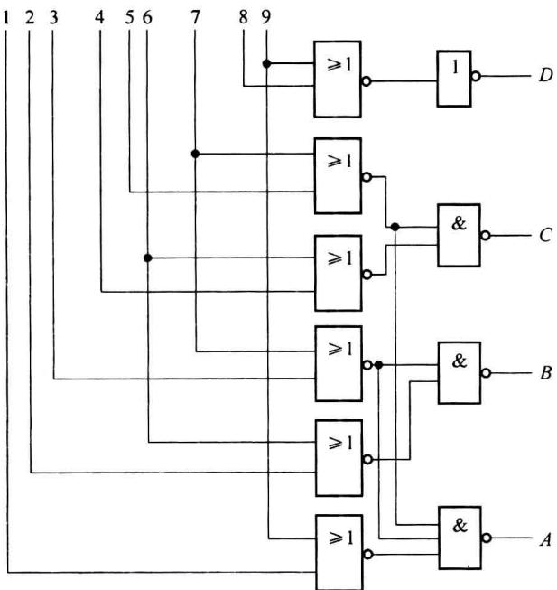  

图 3.5.6 普通 8421BCD 码编码器

电路有 9 条输入线, 每条输入线可以接收一个代表十进制符号的信号; 有 4 条输出线, 组成二进制码。由真值表可知, 某条输入线上有信号 1, 电路就输出与该十进制数相应的二进制码。例如, 第三线上有信号 1, DCBA 输出编码 0011; 而当 1\~9 线都没有信号时, 即是 0, DCBA 输出 0000。因此该电路是 8421BCD 码编码器。

该编码器对输入线是有限制的,在任何时刻只允许有一条输入线上有信号,否则编码器输出发生混乱。

### 2. 优先编码器

优先编码器各个输入端的优先权是不同的,若几个输入同时有信号到来,输出端给出优先权较高的那个输入信号所对应的代码。

### (1) 基本功能

74148 是 8 线-3 线优先编码器，图 3.5.7 是其逻辑电路及引脚图。图中 $\overline{I_{0}} \sim \overline{I_{7}}$ 分别代表十进制数 0～7，角标越大，优先权越高， $\overline{ST}$ 是使能输入端； $\overline{Y_{2}} \sim \overline{Y_{0}}$ 为编码输出端， $Y_{s}$ 是使能输出端， $\overline{Y}_{EX}$ 是扩展输出端，此两端都用于扩展编码器功能。输入信号是低电平有效，输出为 3 位二进制反码，表 3.5.3 为其功能表。

由功能表可见, 当 $\overline{I_{7}}=0$ 时, 不管其他端有无信号, 输出只对 $\overline{I_{7}}$ 编码, 即 $\overline{Y_{2}}\overline{Y_{1}}\overline{Y_{0}}=000$ ; 当 $\overline{I_{7}}=1,\overline{I_{6}}=0$ , 其他端任意, 输出按 $\overline{I_{6}}$ 编码得 $\overline{Y_{2}}\overline{Y_{1}}\overline{Y_{0}}=001$ , 其余类推。

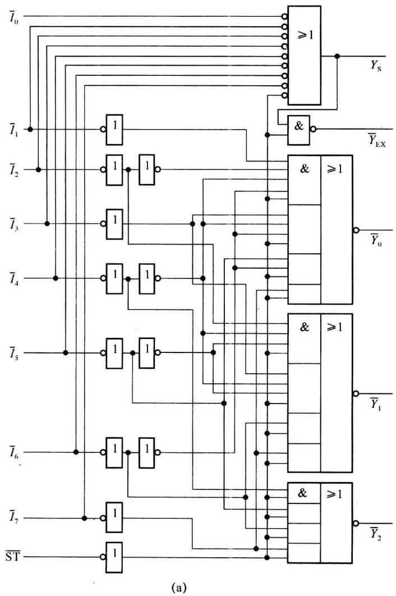

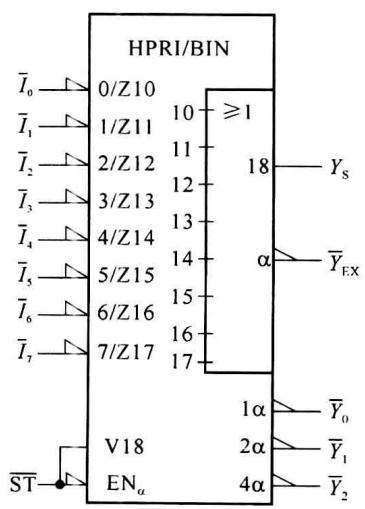  

(b)

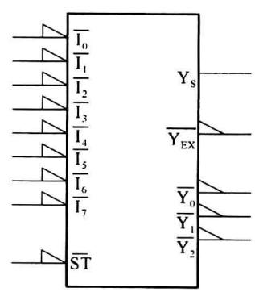  

(c)  

图 3.5.7 优先编码器 74148 原理图、国标符号和简化符号

表 3.5.3 优先编码器 74148 功能表

<table><tr><td> $\overline{ST}$ </td><td> $\overline{I}_0$ </td><td> $\overline{I}_1$ </td><td> $\overline{I}_2$ </td><td> $\overline{I}_3$ </td><td> $\overline{I}_4$ </td><td> $\overline{I}_5$ </td><td> $\overline{I}_6$ </td><td> $\overline{I}_7$ </td><td> $\overline{Y}_2$ </td><td> $\overline{Y}_1$ </td><td> $\overline{Y}_0$ </td><td> $\overline{Y}_{EX}$ </td><td> $Y_S$ </td></tr><tr><td>1</td><td>×</td><td>×</td><td>×</td><td>×</td><td>×</td><td>×</td><td>×</td><td>×</td><td>1</td><td>1</td><td>1</td><td>1</td><td>1</td></tr><tr><td>0</td><td>1</td><td>1</td><td>1</td><td>1</td><td>1</td><td>1</td><td>1</td><td>1</td><td>1</td><td>1</td><td>1</td><td>1</td><td>0</td></tr><tr><td>0</td><td>×</td><td>×</td><td>×</td><td>×</td><td>×</td><td>×</td><td>×</td><td>0</td><td>0</td><td>0</td><td>0</td><td>0</td><td>1</td></tr><tr><td>0</td><td>×</td><td>×</td><td>×</td><td>×</td><td>×</td><td>×</td><td>0</td><td>1</td><td>0</td><td>0</td><td>1</td><td>0</td><td>1</td></tr><tr><td>0</td><td>×</td><td>×</td><td>×</td><td>×</td><td>×</td><td>0</td><td>1</td><td>1</td><td>0</td><td>1</td><td>0</td><td>0</td><td>1</td></tr><tr><td>0</td><td>×</td><td>×</td><td>×</td><td>×</td><td>0</td><td>1</td><td>1</td><td>1</td><td>0</td><td>1</td><td>1</td><td>0</td><td>1</td></tr><tr><td>0</td><td>×</td><td>×</td><td>×</td><td>0</td><td>1</td><td>1</td><td>1</td><td>1</td><td>1</td><td>0</td><td>0</td><td>0</td><td>1</td></tr><tr><td>0</td><td>×</td><td>×</td><td>0</td><td>1</td><td>1</td><td>1</td><td>1</td><td>1</td><td>1</td><td>0</td><td>1</td><td>0</td><td>1</td></tr><tr><td>0</td><td>×</td><td>0</td><td>1</td><td>1</td><td>1</td><td>1</td><td>1</td><td>1</td><td>1</td><td>1</td><td>0</td><td>0</td><td>1</td></tr><tr><td>0</td><td>0</td><td>1</td><td>1</td><td>1</td><td>1</td><td>1</td><td>1</td><td>1</td><td>1</td><td>1</td><td>1</td><td>0</td><td>1</td></tr></table>

进一步分析, 当使能输入端 $\overline{ST}=0$ 时, 编码器正常工作; $\overline{ST}=1$ 时, 输出均为 1, 编码器不工作。

$Y_{s}$ 为使能输出端,由电路图可知:

$$

Y _ {\mathrm{s}} = \overline {{\mathrm{ST} \cdot \overline {{I _ {0}}} \cdot \overline {{I _ {1}}} \cdot \overline {{I _ {2}}} \cdot \overline {{I _ {3}}} \cdot \overline {{I _ {4}}} \cdot \overline {{I _ {5}}} \cdot \overline {{I _ {6}}} \cdot \overline {{I _ {7}}}}}

$$

可见，当 $\overline{ST}=0$ 时，只有 $\overline{I_{0}}\sim\overline{I_{7}}$ 均为1（无信号输入）情况下，才使 $Y_{s}=0$ 。所以若两片串接应用时，应将高位片的 $Y_{s}$ 和低位片的 $\overline{ST}$ 相连，在高位片无信号输入时，启动低位片正常工作。

扩展输出端 $\overline{Y}_{EX}$ 的表达式为

$$

\overline {{{Y _ {\mathrm{EX}}}}} = \overline {{{\mathrm{ST} (I _ {0} + I _ {1} + I _ {2} + I _ {3} + I _ {4} + I _ {5} + I _ {6} + I _ {7})}}}

$$

当 $\overline{S}\overline{T}=Q$ 时，只要输入端有信号存在，则 $\overline{Y}_{EX}=0$ 。因此， $\overline{Y}_{EX}$ 的低电平表示该片编码器有输入信号；相反， $\overline{Y}_{EX}=1$ 表示无输入信号。利用这一标志，在多片编码器串接应用中可作输出位的扩展端。

根据逻辑图和功能表,写出3位编码输出表达式:

$$

\begin{array}{r l} \overline {{Y}} _ {0} & = \overline {{\mathrm{ST} (I _ {1} \overline {{I}} _ {2} \overline {{I}} _ {4} \overline {{I}} _ {6} + I _ {3} \overline {{I}} _ {4} \overline {{I}} _ {6} + I _ {5} \overline {{I}} _ {6} I _ {7})}} \\ \overline {{Y}} _ {1} & = \overline {{\mathrm{ST} (I _ {2} \overline {{I}} _ {4} \overline {{I}} _ {5} + I _ {3} \overline {{I}} _ {4} \overline {{I}} _ {5} + I _ {6} + I _ {7})}} \\ \overline {{Y}} _ {2} & = \overline {{\mathrm{ST} (I _ {4} + I _ {5} + I _ {6} + I _ {7})}} \end{array}

$$

### (2) 功能扩展

用两片 74148 可扩展成 16 线-4 线的优先编码器，如图 3.5.8 所示。编码器输入信号为 $\overline{I_{0}} \sim \overline{I_{15}}$ ，低电平有效，而且 $\overline{I_{15}}$ 优先权最高， $\overline{I_{0}}$ 最低；编码器输出 $F_{3}$ 、 $F_{2}$ 、 $F_{1}$ 、 $F_{0}$ 为 4 位二进制反码。

接法:①Ⅰ片的 $\overline{\mathrm{ST}}$ 作为这个扩展的16线-4线编码器的使能输入端, Ⅱ片的 $Y_{\mathrm{s}}$ 作为16线-4线编码器的使能输出端,两片的 $\overline{Y_{\mathrm{EX}}}$ 相与作为16线-4线的扩展输出端 $F_{\mathrm{EX}}$ ; ②Ⅰ片的使能输出 $Y_{\mathrm{s}}$ 接至Ⅱ片 $\overline{\mathrm{ST}}$ 端; ③Ⅰ片扩展输出 $\overline{Y_{\mathrm{EX}}}$ 作为4位码最高位 $F_{3}$ 输出,两片对应位 $\overline{Y_{2}} \sim \overline{Y_{0}}$ 相与作为低3位 $F_{2} \sim F_{0}$ 输出。

工作过程:① I 片 $\overline{ST}=0$ ，允许编码。当 $\overline{I_{15}}\sim\overline{I_{8}}$ 中有信号时，I 片正常编码，由于 I 片 $Y_{s}=1$ ，则 II 片 $\overline{ST}=1$ 禁止编码，II 片输出全为 1，不影响 I 片的编码，且 I 片 $\overline{Y_{EX}}=0$ （即最高位），此时输出 $F_{3}\sim F_{0}$ 就是 I 片有效输入的优先编码。② I 片 $\overline{I_{15}}\sim\overline{I_{8}}$ 均无信号输入时， $Y_{s}=0$ ，II 片允许编码，当 $\overline{I_{7}}\sim\overline{I_{0}}$ 中有信号时，II 片正常编码，I 片除了 $\overline{Y_{EX}}=1$ （即最高位），其余输出为1,不影响Ⅱ片的编码,此时输出 $F_{3}\sim F_{0}$ 就是Ⅱ片有效输入的优先编码。例如, $\overline{I_{15}}=\overline{I_{14}}=1,\overline{I_{13}}=0$ ,其余输入任意,I片编码输出 $\overline{Y_{2}}\sim\overline{Y_{0}}=010$ ,且I片的 $\overline{Y_{EX}}=0$ ,同时由于片I的 $Y_{S}=1$ ,则Ⅱ片不工作,输出 $F_{3}F_{2}F_{1}F_{0}=0010$ 是 $\overline{I_{13}}$ 的编码。故完成了16线-4线优先编码器的功能。

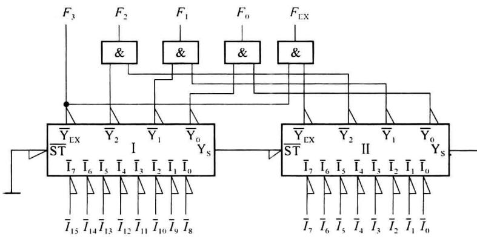  

图3.5.8 编码器扩展连接图

(3) 应用

<Example title="例 3.5.2">
用一片 74148 和外加门构成 8421BCD 码编码器。

<Solution title="解">
8421BCD码编码器需要10个输入和4个输出,而74148只有8个输入和3个输出,利用使能输入端 $\overline{ST}$ 扩展输入端,如图3.5.9所示。

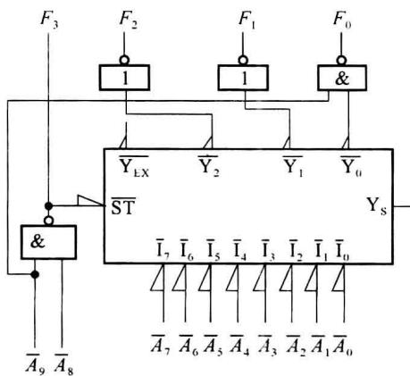  

图3.5.9 74148构成BCD码编码器

当输入 $\overline{A_{8}}$ 或 $\overline{A_{9}}$ 为低电平时(即有8或9十进制数输入)，两输入端与非门出1使74148编码器禁止编码，对 $\overline{A_{8}}$ 或 $\overline{A_{9}}$ 进行编码；当输入 $\overline{A_{8}}$ 和 $\overline{A_{9}}$ 均为高电平时，74148编码器正常工作，对 $\overline{A_{0}}\sim\overline{A_{7}}$ 进行编码。
</Solution>
</Example>

## 3.5.3 译码器

译码是编码的逆操作, 是将每个代码所代表的信息翻译过来, 还原成相应的输出信息。实现译码功能的逻辑电路称为译码器 (Decoder), 图 3.5.10 为其框图, 满足关系式: $m \leqslant 2^n$ 。常用的译码器有二进制译码器 ( $m = 2^n$ )、二-十进制译码器 ( $m < 2^n$ ) 和数字显示译码器 3 种。

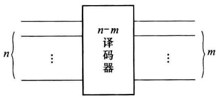  

图3.5.10 译码器框图

### 1. 二进制译码器

二进制译码器满足关系式: $m=2^{n}$ ，即完全译码，输出是输入变量的各种组合，因此一个输出对应一个最小项，又称为最小项译码器。若输出是1有效，称为高电平译码，一个输出就是一个最小项；若输出是0有效，称为低电平译码，一个输出对应一个最小项的非。

### (1) 基本功能

图 3.5.11 是一个 2 线 -4 线的译码器电路, 输入是两位二进制码, 有 4 条输出线。

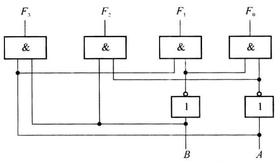  

图3.5.11 2线-4线译码器

由逻辑图写出输出表达式：

$$

F _ {0} (B, A) = \overline {{B}} \overline {{A}}, F _ {1} (B, A) = \overline {{B}} A, F _ {2} (B, A) = B \overline {{A}}, F (B, A) _ {3} = B A

$$

可见输出就是4个最小项，其真值表如表3.5.4所示。对应每个输入状态，仅有一个输出为1，其余皆为0，是高电平译码。例如，当输入BA=00时，仅 $F_{0}=1$ ，即 $F_{0}$ 是输入代码00的译码输出，因而实现了译码器功能。

表 3.5.4 2 线-4 线译码器功能表

<table><tr><td>B</td><td>A</td><td> $F_0$ </td><td> $F_1$ </td><td> $F_2$ </td><td> $F_3$ </td></tr><tr><td>0</td><td>0</td><td>1</td><td>0</td><td>0</td><td>0</td></tr><tr><td>0</td><td>1</td><td>0</td><td>1</td><td>0</td><td>0</td></tr><tr><td>1</td><td>0</td><td>0</td><td>0</td><td>1</td><td>0</td></tr><tr><td>1</td><td>1</td><td>0</td><td>0</td><td>0</td><td>1</td></tr></table>

图 3.5.12 所示为一种 TTL74LS138 3 线-8 线译码器，输入为 3 位二进制数 $A_{2}$ 、 $A_{1}$ 、 $A_{0}$ ，输出有 8 个，由图 3.5.12(a) 写出输出表达式：

$$

\overline {{Y}} _ {i} = \overline {{S _ {\mathrm{A}} S _ {\mathrm{B}} S _ {\mathrm{C}} m _ {i}}} = \overline {{S _ {\mathrm{A}} \overline {{S _ {\mathrm{B}}}} + \overline {{S _ {\mathrm{C}}}} m _ {i}}} (i = 0 \sim 7)

$$

当 $S_{A}=1,\overline{S_{B}}=\overline{S_{C}}=0$ 时， $\overline{Y_{i}}=\overline{m_{i}},i=0\sim7$ ，即每个输出是输入变量所对应的最小项的非，是低电平译码。为了功能扩展，还设有使能输入端 $S_{A}$ 、 $\overline{S_{B}}$ 、 $\overline{S_{C}}$ ，只有当 $S_{A}=1,\overline{S_{B}}=\overline{S_{C}}=0$ 时，译码器工作，否则译码器不实现译码，输出全为1。表3.5.5是其功能表。

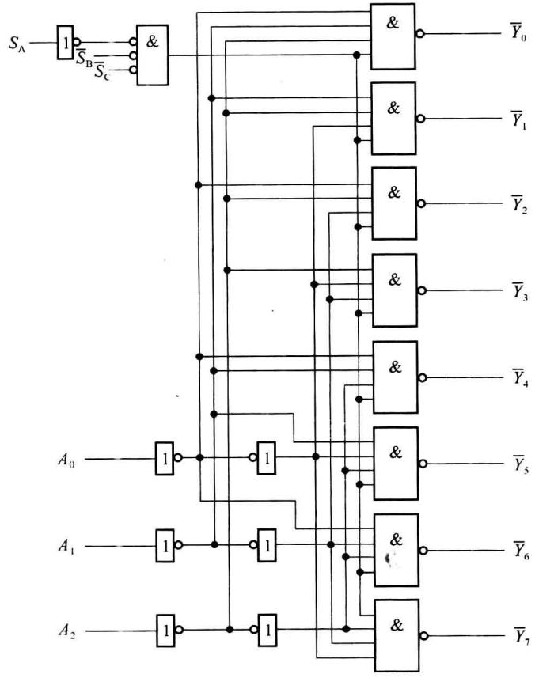  

(a)

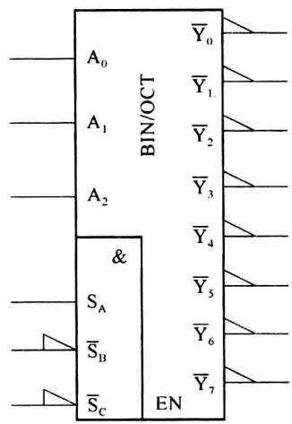  

(b)

图3.5.12 3线-8线译码器的逻辑图及其符号  

表 3.5.5 3 线-8 线译码器功能表

<table><tr><td colspan="5">输入</td><td colspan="8">输出</td></tr><tr><td> $S_A$ </td><td> $\overline{S_B}+\overline{S_C}$ </td><td> $A_2$ </td><td> $A_1$ </td><td> $A_0$ </td><td> $\overline{Y}_0$ </td><td> $\overline{Y}_1$ </td><td> $\overline{Y}_2$ </td><td> $\overline{Y}_3$ </td><td> $\overline{Y}_4$ </td><td> $\overline{Y}_5$ </td><td> $\overline{Y}_6$ </td><td> $\overline{Y}_7$ </td></tr><tr><td>0</td><td>×</td><td>×</td><td>×</td><td>×</td><td>1</td><td>1</td><td>1</td><td>1</td><td>1</td><td>1</td><td>1</td><td>1</td></tr><tr><td>×</td><td>1</td><td>×</td><td>×</td><td>×</td><td>1</td><td>1</td><td>1</td><td>1</td><td>1</td><td>1</td><td>1</td><td>1</td></tr><tr><td>1</td><td>0</td><td>0</td><td>0</td><td>0</td><td>0</td><td>1</td><td>1</td><td>1</td><td>1</td><td>1</td><td>1</td><td>1</td></tr><tr><td>1</td><td>0</td><td>0</td><td>0</td><td>1</td><td>1</td><td>0</td><td>1</td><td>1</td><td>1</td><td>1</td><td>1</td><td>1</td></tr><tr><td>1</td><td>0</td><td>0</td><td>1</td><td>0</td><td>1</td><td>1</td><td>0</td><td>1</td><td>1</td><td>1</td><td>1</td><td>1</td></tr><tr><td>1</td><td>0</td><td>0</td><td>1</td><td>1</td><td>1</td><td>1</td><td>1</td><td>0</td><td>1</td><td>1</td><td>1</td><td>1</td></tr><tr><td>1</td><td>0</td><td>1</td><td>0</td><td>0</td><td>1</td><td>1</td><td>1</td><td>1</td><td>0</td><td>1</td><td>1</td><td>1</td></tr><tr><td>1</td><td>0</td><td>1</td><td>0</td><td>1</td><td>1</td><td>1</td><td>1</td><td>1</td><td>1</td><td>0</td><td>1</td><td>1</td></tr><tr><td>1</td><td>0</td><td>1</td><td>1</td><td>0</td><td>1</td><td>1</td><td>1</td><td>1</td><td>1</td><td>1</td><td>0</td><td>1</td></tr><tr><td>1</td><td>0</td><td>1</td><td>1</td><td>1</td><td>1</td><td>1</td><td>1</td><td>1</td><td>1</td><td>1</td><td>1</td><td>0</td></tr></table>

### (2) 功能扩展

在中规模译码器中,一般都设置有使能端。使能端有两个用途:其一是作选通脉冲输入端,消除冒险脉冲的发生;其二是用于功能扩展。

## ① 串行扩展

<Example title="例 3.5.3">
用 3 线 -8 线译码器组成 4 线 -16 线译码器。

<Solution title="解">
显然一片 3 线 -8 线译码器不够, 必须两片, 连接如图 3.5.13 所示。输入 4 位码为 DCBA, 片 I 的 $\overline{S_{C}}$ 和片 II 的 $\overline{S_{B}}$ 连在一起作为外部使能端。由于片 I 的 $\overline{S_{B}}$ 与片 II 的 $S_{A}$ 并接在一起, 作为最高位 D 的输入端, 当 D=0 时, 片 I 正常译码, 而片 II 被禁止译码, $\overline{Y_{0}}\sim\overline{Y_{7}}$ 有信号输出, $\overline{Y_{8}}\sim\overline{Y_{15}}$ 均为 1。当 D=1 时, 片 I 被禁止译码, 片 II 正常译码, $\overline{Y_{8}}\sim\overline{Y_{15}}$ 有信号输出, $\overline{Y_{0}}\sim\overline{Y_{7}}$ 均为 1, 从而实现了 4 线 -16 线译码器功能, 使能端可用于进一步扩展, 否则接地, 保证正常工作。

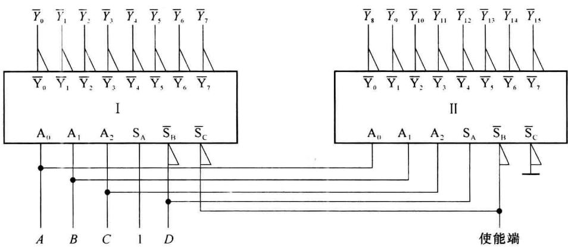  

图3.5.13 4线-16线译码器扩展连接图

所以扩展方法：Ⅰ根据输出线数确定需要的最少片数，Ⅱ连接时，同名地址端相连作低位输入，高位输入接使能端，保证每次只有一片处于工作状态，其余处于禁止状态。

② 并行扩展(树形结构)
</Solution>
</Example>

<Example title="例 3.5.4">
用 3 线 -8 线译码器组成 6 线 -64 线译码器。

<Solution title="解">
由输出线数可知,至少需要8片3线-8线译码器,这时使能端本身已经不能完成高位控制了,常采用树形结构扩展,再加1片译码器对高3位译码,其8个输出分别控制其余8片的使能端,选择其中一个工作,连接如图3.5.14所示。
</Solution>
</Example>

### (3) 应用

## ① 在存储器中的应用

用做地址译码器或指令译码器, 输入为地址代码, 输出为存储单元的地址, n 位地址线可以寻址 $2^{n}$ 个单元。

<Example title="例 3.5.5">
用 3 线 -8 线译码器 74LS138 组成图 3.5.15 所示电路，说明 $\overline{Y_{0}}$ 、 $\overline{Y_{1}}$ 、 $\cdots$ 、 $\overline{Y_{7}}$ 分别被译中时，相应的地址线 $A_{7} \sim A_{0}$ 的状态是什么？用十六进制数表示。若改用 10 位地址线 $A_{9} \sim A_{0}$ 和 74LS138 相连，且要求 $\overline{Y_{0}}$ 、 $\overline{Y_{1}}$ 、 $\cdots$ 、 $\overline{Y_{7}}$ 被译中时， $A_{9} \sim A_{0}$ 的状态分别为 340H、341H、 $\cdots$ 、347H，电路连线应作何改动？画出相应的接线图。

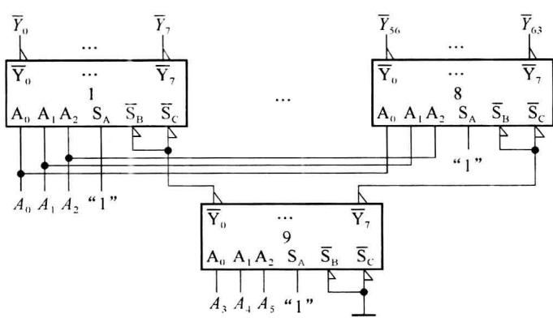  

图 3.5.14 6 线-64 线译码器扩展连接图

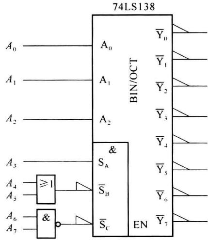  

图3.5.15 例3.5.5的电路

<Solution title="解">
74LS138 芯片要实现译码,要求 $A_{3}$ 、 $A_{6}$ 、 $A_{7}$ 为高电平,同时 $A_{4}$ 、 $A_{5}$ 为低电平,即地址线 $A_{7}A_{6}A_{5}A_{4}A_{3}=11001$ 时芯片才能正常工作,此时输出通道的选择则取决于 $A_{2}A_{1}A_{0}$ 的状态,在 $A_{2}A_{1}A_{0}=000$ 时, $\overline{Y_{0}}$ 被译中, $A_{2}A_{1}A_{0}=001$ 时, $\overline{Y_{1}}$ 被译中, $\cdots$ , $A_{2}A_{1}A_{0}=111$ 时, $\overline{Y_{7}}$ 被译中。不难得到 $\overline{Y_{0}}$ 、 $\overline{Y_{1}}$ 、 $\cdots$ 、 $\overline{Y_{7}}$ 分别被译中时,相应的地址线 $A_{7}\sim A_{0}$ 的状态应为 C8H、C9H、CAH、CBH、CCH、CDH、CEH、CFH。

要满足 $\overline{Y_{0}}$ 、 $\overline{Y_{1}}$ 、…、 $\overline{Y_{7}}$ 被译中时，地址线 $A_{9}\sim A_{0}$ 的状态分别为340H、341H、…、347H，高7位的地址线 $A_{9}A_{8}A_{7}A_{6}A_{5}A_{4}A_{3}$ 应设定为1101000，电路的连线应保证 $A_{9}$ 、 $A_{8}$ 、 $A_{6}$ 为高电平， $A_{7}$ 、 $A_{5}$ 、 $A_{4}$ 、 $A_{3}$ 为低电平，可考虑采用图3.5.16所示的连接。图中连接表明，当 $A_{9}$ 、 $A_{8}$ 、 $A_{6}$ 为高电平时， $\overline{S_{C}}=0;A_{7}$ 、 $A_{5}$ 、 $A_{4}$ 、 $A_{3}$ 为低电平时， $\overline{S_{B}}=0,S_{A}=1$ 。在使能端条件满足的条件下， $A_{2}A_{1}A_{0}=000$ 时， $\overline{Y_{0}}$ 被译中， $A_{2}A_{1}A_{0}=001$ 时， $\overline{Y_{1}}$ 被译中，…， $A_{2}A_{1}A_{0}=111$ 时， $\overline{Y_{7}}$ 被译中。

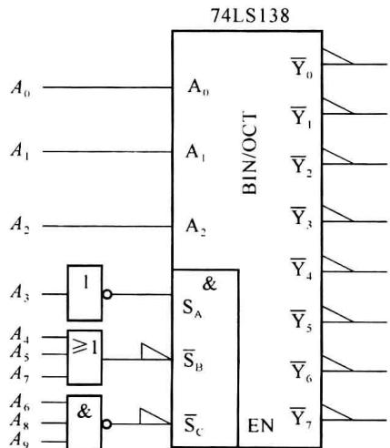  

图3.5.16 74LS138接线图
</Solution>
</Example>

## ② 作数据分配器

具有使能端的译码器,可将数据按要求分配到不同地址的通道上去。如图 3.5.17 所示,其中 $\overline{Y_{i}}$ 为输出,地址输入作控制信号,决定此时将输入数据 D 分配到哪一路输出。

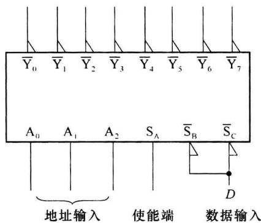  

图3.5.17 译码器用做数据分配器

令 $S = S_{\mathrm{A}} \cdot \overline{\overline{S_{\mathrm{B}}} + \overline{S_{\mathrm{C}}}}$ ，则 $\overline{Y_i} = \overline{S \cdot m_i}$ ，若使能 $S_{A} = 1$ ，可得 $\overline{Y_i} = \overline{D \cdot m_i}$ 。

显然当 $m_{i}=1$ 时， $\overline{Y_{i}}=D$ 。

即选中哪一路,输入数据 D 就送到哪一路,而其余路保持 1。

③ 作函数发生器

因为译码器的输出分别对应一个最小项(高电平译码)或一个最小项的非(低电平译码),所以附加适当门,可实现任意函数。

特点: 方法简单, 无须简化, 工作可靠。

<Example title="例 3.5.6">
用 3 线 -8 线译码器实现函数 $F(A,B,C)=\sum m(0,3,4,7)$ 。

<Solution title="解">
3 线-8 线译码器实现函数如图 3.5.18 所示。

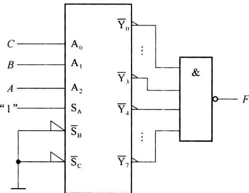  

图3.5.18 3线-8线译码器实现函数

由图可得： $F(A,B,C)=\overline{Y_{0}Y_{3}Y_{4}Y_{7}}=Y_{0}+Y_{3}+Y_{4}+Y_{7}=m_{0}+m_{3}+m_{4}+m_{7}=\sum m(0,3,4,7)$ 。
</Solution>
</Example>

### 2. 二-十进制译码器(4线-10线译码器)

(1) 基本功能

4 线-10 线译码器可由 4 线-16 线译码器构成,也有专用的 4 线-10 线译码器。

图 3.5.19 为 CMOS 型 (C301) BCD 十进制译码器的逻辑电路图, 它只有 4 位 BCD 码输入端, 无使能端, 输出为高电平译码, 功能表如表 3.5.6 所示。由电路图可以直接写出表达式:

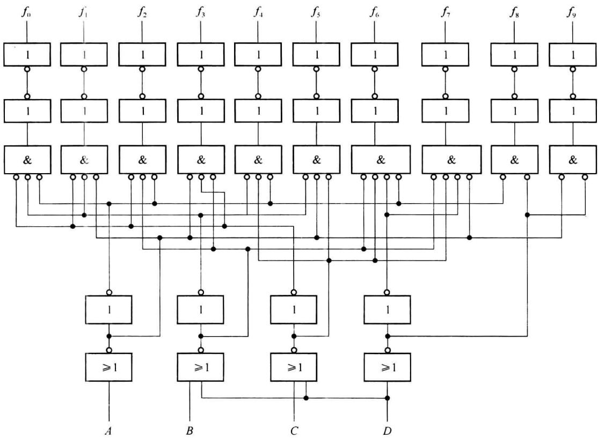  

图 3.5.19 二-十进制译码器

表 3.5.6 4 线-10 线译码器功能表

<table><tr><td></td><td colspan="3">输入</td><td colspan="10">输出</td></tr><tr><td>D</td><td>C</td><td>B</td><td>A</td><td> $f_0$ </td><td> $f_1$ </td><td> $f_2$ </td><td> $f_3$ </td><td> $f_4$ </td><td> $f_5$ </td><td> $f_6$ </td><td> $f_7$ </td><td> $f_8$ </td><td> $f_9$ </td></tr><tr><td>0</td><td>0</td><td>0</td><td>0</td><td>1</td><td>0</td><td>0</td><td>0</td><td>0</td><td>0</td><td>0</td><td>0</td><td>0</td><td>0</td></tr><tr><td>0</td><td>0</td><td>0</td><td>1</td><td>0</td><td>1</td><td>0</td><td>0</td><td>0</td><td>0</td><td>0</td><td>0</td><td>0</td><td>0</td></tr><tr><td>0</td><td>0</td><td>1</td><td>0</td><td>0</td><td>0</td><td>1</td><td>0</td><td>0</td><td>0</td><td>0</td><td>0</td><td>0</td><td>0</td></tr><tr><td>0</td><td>0</td><td>1</td><td>1</td><td>0</td><td>0</td><td>0</td><td>1</td><td>0</td><td>0</td><td>0</td><td>0</td><td>0</td><td>0</td></tr><tr><td>0</td><td>1</td><td>0</td><td>0</td><td>0</td><td>0</td><td>0</td><td>0</td><td>1</td><td>0</td><td>0</td><td>0</td><td>0</td><td>0</td></tr><tr><td>0</td><td>1</td><td>0</td><td>1</td><td>0</td><td>0</td><td>0</td><td>0</td><td>0</td><td>1</td><td>0</td><td>0</td><td>0</td><td>0</td></tr><tr><td>0</td><td>1</td><td>1</td><td>0</td><td>0</td><td>0</td><td>0</td><td>0</td><td>0</td><td>0</td><td>1</td><td>0</td><td>0</td><td>0</td></tr><tr><td>0</td><td>1</td><td>1</td><td>1</td><td>0</td><td>0</td><td>0</td><td>0</td><td>0</td><td>0</td><td>0</td><td>1</td><td>0</td><td>0</td></tr><tr><td>1</td><td>0</td><td>0</td><td>0</td><td>0</td><td>0</td><td>0</td><td>0</td><td>0</td><td>0</td><td>0</td><td>0</td><td>1</td><td>0</td></tr><tr><td>1</td><td>0</td><td>0</td><td>1</td><td>0</td><td>0</td><td>0</td><td>0</td><td>0</td><td>0</td><td>0</td><td>0</td><td>0</td><td>1</td></tr></table>

$$

f _ {0} (D, C, B, A) = \overline {{{{D}}}}   \overline {{{{C}}}}   \overline {{{{B}}}}   \overline {{{{A}}}} = m _ {0}

$$

$$

f _ {7} (D, C, B, A) = \overline {{{{D}}}} C B A = m _ {7}

$$

$$

f _ {8} (D, C, B, A) = \overline {{{A}}} D

$$

$$

f _ {9} (D, C, B, A) = A D

$$

可见输出 $f_{0} \sim f_{7}$ 为对应的最小项， $f_{8}$ 和 $f_{9}$ 则利用了 10～15 这 6 个任意项化简而来。

### (2) 功能扩展

BCD十进制译码器可以构成带有使能端的3线-8线译码器，只需将最高位输入端 $D$ 当做使能端，输出端 $f_{8}, f_{9}$ 不用即可。如图3.5.20所示，当 $D = 0$ 时，由 $C, B, A$ 输入决定 $f_{0} \sim f_{7}$ 中某一个输出为1，其余输出为0；若 $D = 1$ ，则 $f_{0} \sim f_{7}$ 输出均为0，处于“禁止”状态。

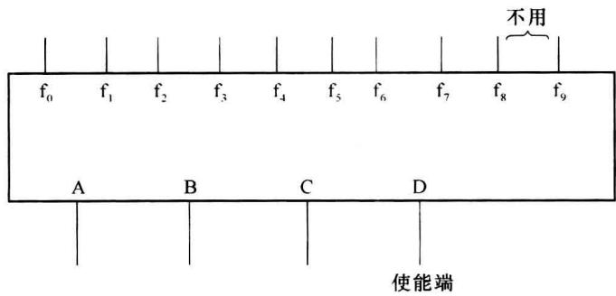  

图 3.5.20 二-十进制译码器用作 3 线-8 线译码器

### 3. 数字显示译码器

在数字系统中,常常需要将测量或数值运算结果用十进制数码显示出来,数字显示电路包括译码驱动电路和数码显示器,其框图如图 3.5.21 所示。

数字显示器有许多种不同类型的产品,如发光二极管、荧光数码管、液晶数字显示器等,由于显示器件和显示方式不同,其译码电路也不相同。下面介绍常用的七段荧光数码管显示器及其译码驱动电路。

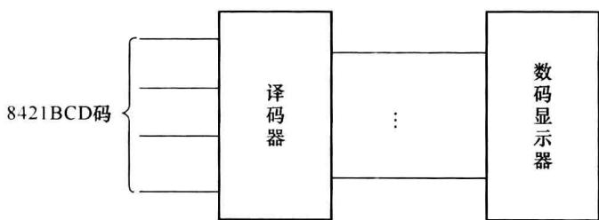  

图 3.5.21 8421BCD 显示译码电路框图

### (1) 七段荧光数码管

七段荧光数码管是分段式半导体显示器件，7个发光段就是7个发光二极管，它的PN结是由特殊的半导体材料磷砷化镓做成。当外加正向电压时，发光二极管可以将电能转化为光能，从而发出清晰悦目的光线。发光二极管显示电路有共阳极和共阴极两种连接方式：共阳极是将7个发光二极管的阳极接在一起并接到正电源上，阴极接到译码器的各输出端，哪个发光二极管的阴极为低电平哪一个发光管就亮；共阴极是将7个发光二极管的阴极联在一起并接地，阳极接到译码器的各输出端，哪一个阳极为高电平哪一个发光管就亮。若用共阴极电路，译码器的输出经输出驱动电路分别加到7个阳极上，当给其中某些段加上驱动信号时,则这些段发光,显示出相应的十进制数字。图 3.5.22(a) 是一种共阴极荧光数码管 BS201A(还带一个小数点),图(b)为其显示的十进制数。

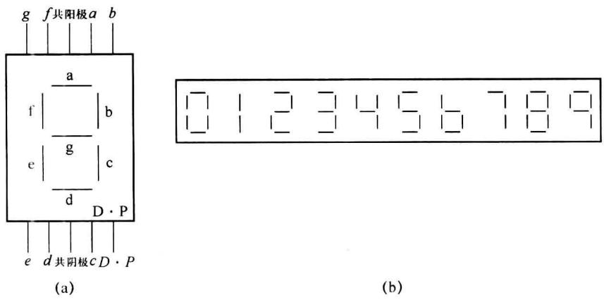  

图 3.5.22 BS201A 数码管及显示字形

### (2) 译码驱动电路

七段数码管工作时需要有分段式译码驱动电路相配合。下面介绍一种中规模二-十进制七段显示译码/驱动器74LS48，图3.5.23是它的逻辑符号，其中 $A_{3}, A_{2}, A_{1}, A_{0}$ 为BCD码输入信号， $Y_{\mathrm{a}}, Y_{\mathrm{b}}, Y_{\mathrm{c}}, Y_{\mathrm{d}}, Y_{\mathrm{e}}, Y_{\mathrm{f}}, Y_{\mathrm{g}}$ 为译码器的7个输出（高电平有效），因为它驱动的是共阴极电路。为增加器件的功能，扩大器件的应用，在译码/驱动电路基础上又附加了辅助功能控制信号 $\overline{\mathrm{LT}}$ 、 $\overline{\mathrm{RBI}}$ 、 $\overline{\mathrm{BI}} / \overline{\mathrm{RBO}}$ 。

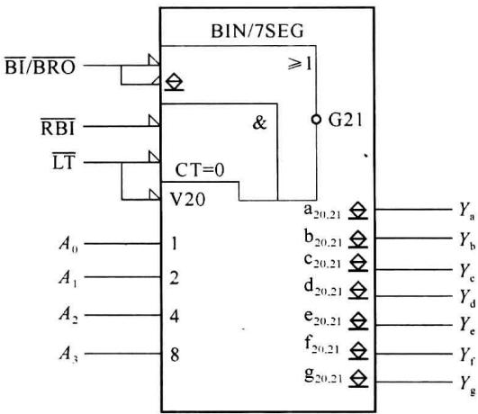  

图3.5.23 74LS48逻辑符号

74LS48 的功能列于表 3.5.7 中, 可见, 当辅助功能控制信号无效时, 即表中 1\~16 行, $A_{3}、A_{2}、A_{1}、A_{0}$ 输入一组二进制码, $Y_{\mathrm{a}} \sim Y_{\mathrm{g}}$ 输出端有相应的输出, 电路实现正常译码。如 $A_{3} A_{2} A_{1} A_{0} = 0001$ , 只有 $Y_{\mathrm{b}}、Y_{\mathrm{c}}$ 输出 1, b、c 字段点燃, 显示数字 1。由于已接有上拉电阻, 使用时可将输出 $Y_{\mathrm{a}} \sim Y_{\mathrm{g}}$ 直接驱动 BS201A 的输入。

下面介绍辅助功能控制信号 $\overline{LT}$ 、 $\overline{RBI}$ 、 $\overline{BI}/\overline{RBO}$ 的作用。

① $\overline{\mathrm{BI}}$ 为熄灭信号。当 $\overline{\mathrm{BI}} = 0$ 时，不论 $\overline{\mathrm{LT}}$ 、 $\overline{\mathrm{RBI}}$ 及输入 $A_{3}A_{2}A_{1}A_{0}$ 为何值，输出 $Y_{\mathrm{a}} \sim Y_{\mathrm{g}}$ 均为 0，使七段显示都处于熄灭状态，不显示数字，优先权最高。

② $\overline{\mathrm{LT}}$ 为试灯信号，用来检查七段显示器件是否能正常显示。当 $\overline{\mathrm{BI}} = 1, \overline{\mathrm{LT}} = 0$ 时，不论输入 $A_{3}A_{2}A_{1}A_{0}$ 为何值，输出 $Y_{\mathrm{a}} \sim Y_{\mathrm{g}}$ 均为1，使七段显示都点燃，优先权次之。

表 3.5.7 74LS48 功能表

<table><tr><td colspan="6">输入</td><td rowspan="2"> $\overline{BI}/\overline{RBO}$ </td><td colspan="7">输出</td></tr><tr><td> $\overline{LT}$ </td><td> $\overline{RBI}$ </td><td> $A_3$ </td><td> $A_2$ </td><td> $A_1$ </td><td> $A_0$ </td><td> $Y_a$ </td><td> $Y_b$ </td><td> $Y_c$ </td><td> $Y_d$ </td><td> $Y_e$ </td><td> $Y_f$ </td><td> $Y_g$ </td></tr><tr><td>1</td><td>1</td><td>0</td><td>0</td><td>0</td><td>0</td><td>1</td><td>1</td><td>1</td><td>1</td><td>1</td><td>1</td><td>1</td><td>0</td></tr><tr><td>1</td><td>×</td><td>0</td><td>0</td><td>0</td><td>1</td><td>1</td><td>0</td><td>1</td><td>1</td><td>0</td><td>0</td><td>0</td><td>0</td></tr><tr><td>1</td><td>×</td><td>0</td><td>0</td><td>1</td><td>0</td><td>1</td><td>1</td><td>1</td><td>0</td><td>1</td><td>1</td><td>0</td><td>1</td></tr><tr><td>1</td><td>×</td><td>0</td><td>0</td><td>1</td><td>1</td><td>1</td><td>1</td><td>1</td><td>1</td><td>1</td><td>0</td><td>0</td><td>1</td></tr><tr><td>1</td><td>×</td><td>0</td><td>1</td><td>0</td><td>0</td><td>1</td><td>0</td><td>1</td><td>1</td><td>0</td><td>0</td><td>1</td><td>1</td></tr><tr><td>1</td><td>×</td><td>0</td><td>1</td><td>0</td><td>1</td><td>1</td><td>1</td><td>0</td><td>1</td><td>1</td><td>0</td><td>1</td><td>1</td></tr><tr><td>1</td><td>×</td><td>0</td><td>1</td><td>1</td><td>0</td><td>1</td><td>0</td><td>0</td><td>1</td><td>1</td><td>1</td><td>1</td><td>1</td></tr><tr><td>1</td><td>×</td><td>0</td><td>1</td><td>1</td><td>1</td><td>1</td><td>1</td><td>1</td><td>1</td><td>0</td><td>0</td><td>0</td><td>0</td></tr><tr><td>1</td><td>×</td><td>1</td><td>0</td><td>0</td><td>0</td><td>1</td><td>1</td><td>1</td><td>1</td><td>1</td><td>1</td><td>1</td><td>1</td></tr><tr><td>1</td><td>×</td><td>1</td><td>0</td><td>0</td><td>1</td><td>1</td><td>1</td><td>1</td><td>1</td><td>0</td><td>0</td><td>1</td><td>1</td></tr><tr><td>1</td><td>×</td><td>1</td><td>0</td><td>1</td><td>0</td><td>1</td><td>0</td><td>0</td><td>0</td><td>1</td><td>1</td><td>0</td><td>1</td></tr><tr><td>1</td><td>×</td><td>1</td><td>0</td><td>1</td><td>1</td><td>1</td><td>0</td><td>0</td><td>1</td><td>1</td><td>0</td><td>0</td><td>1</td></tr><tr><td>1</td><td>×</td><td>1</td><td>1</td><td>0</td><td>0</td><td>1</td><td>0</td><td>1</td><td>0</td><td>0</td><td>0</td><td>1</td><td>1</td></tr><tr><td>1</td><td>×</td><td>1</td><td>1</td><td>0</td><td>1</td><td>1</td><td>1</td><td>0</td><td>0</td><td>1</td><td>0</td><td>1</td><td>1</td></tr><tr><td>1</td><td>×</td><td>1</td><td>1</td><td>1</td><td>0</td><td>1</td><td>0</td><td>0</td><td>0</td><td>1</td><td>1</td><td>1</td><td>1</td></tr><tr><td>1</td><td>×</td><td>1</td><td>1</td><td>1</td><td>1</td><td>1</td><td>0</td><td>0</td><td>0</td><td>0</td><td>0</td><td>0</td><td>0</td></tr><tr><td>×</td><td>×</td><td>×</td><td>×</td><td>×</td><td>×</td><td>0</td><td>0</td><td>0</td><td>0</td><td>0</td><td>0</td><td>0</td><td>0</td></tr><tr><td>1</td><td>0</td><td>0</td><td>0</td><td>0</td><td>0</td><td>0</td><td>0</td><td>0</td><td>0</td><td>0</td><td>0</td><td>0</td><td>0</td></tr><tr><td>0</td><td>×</td><td>×</td><td>×</td><td>×</td><td>×</td><td>1</td><td>1</td><td>1</td><td>1</td><td>1</td><td>1</td><td>1</td><td>1</td></tr></table>

③ $\overline{\mathrm{RBI}}$ 为灭0输入信号，当不希望0（例如小数点前后多余的0）显示出来时，可以用 $\overline{\mathrm{RBI}}$ 信号灭掉。当 $\overline{\mathrm{LT}} = 1, \overline{\mathrm{RBI}} = 0$ 时，只有当输入 $A_{3}A_{2}A_{1}A_{0} = 0000$ 时， $Y_{\mathrm{a}} \sim Y_{\mathrm{g}}$ 输出均为0，七段显示都熄灭，不显示数字0，而输入 $A_{3}A_{2}A_{1}A_{0}$ 为其他组合时能正常显示。故 $\overline{\mathrm{RBI}} = 0$ ，只能熄灭0字，优先权最低。

④ $\overline{\mathrm{RBO}}$ 为灭0输出信号。当 $\overline{\mathrm{LT}} = 1, \overline{\mathrm{RBI}} = 0$ 时，若输入 $A_{3}A_{2}A_{1}A_{0} = 0000$ ，不仅本片灭0，而且输出 $\overline{\mathrm{RBO}} = 0$ 。这个0送到另一片七段译码器的 $\overline{\mathrm{RBI}}$ 端，可以使这两片的0都熄灭。

<Note title="注意">
熄灭信号 $\overline{BI}$ 和灭零输出信号 $\overline{RBO}$ 是电路的同一点,故标示 $\overline{BI}/\overline{RBO}$ ,即该端口是双重功能的端口,既可作为输入信号 $\overline{BI}$ 端口,又可作为输出信号 $\overline{RBO}$ 端口。

将灭 0 输入 $\overline{RBI}$ 与灭 0 输出 $\overline{RBO}$ 配合使用，可实现多位数码显示系统的灭 0 控制。图 3.5.24 所示为灭 0 控制的连接方法。只需在整数部分把高位的 $\overline{RBO}$ 与低位的 $\overline{RBI}$ 相连，在小数部分将低位的 $\overline{RBO}$ 与高位的 $\overline{RBI}$ 相连，就可以把前后多余的 0 熄灭了。这样在整数部分，由于百位（片 I）的 $\overline{RBI}=0$ ，当百位输入 $A_{3}A_{2}A_{1}A_{0}=0000$ 时，百位不会显示 0 字，如果十位（片 II）的输入 $A_{3}A_{2}A_{1}A_{0}$ 和百位输入 $A_{3}A_{2}A_{1}A_{0}$ 同时都为 0000 时，使得十位也处于灭0状态。若百位输入 $A_{3}A_{2}A_{1}A_{0}\neq 0000$ ，则片I输出 $\overline{\mathrm{RBO}} = 1$ ，使片II $\overline{\mathrm{RBI}} = 1$ ，则十位（片II）不会灭0。在小数部分，最低位1/1000位(片VI)的输入RBI接地，所以1/1000位显示器灭0，而当1/1000位的输入和1/100位(片V)的输入同时为0000时，则会实现1/1000和1/100同时灭“0”。例如当各片输入为002.800，由于 $\overline{\mathrm{RBO}}$ 和 $\overline{\mathrm{RBI}}$ 的配合，直接显示2.8。这样，既看起来清晰，又可以减少功耗。

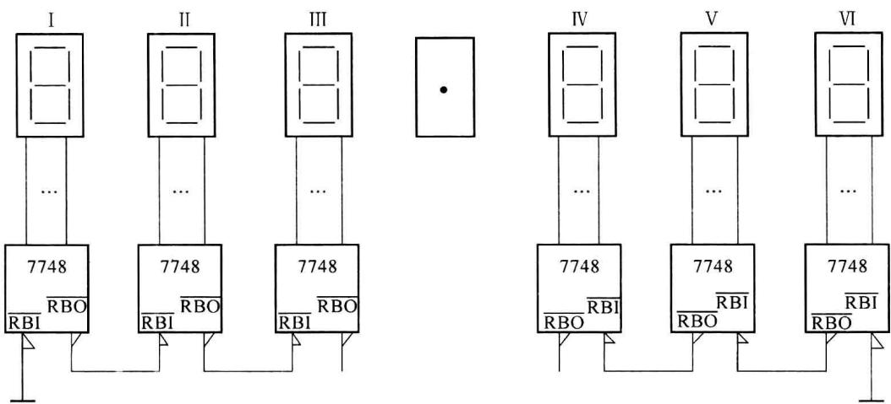  

图3.5.24 数字显示系统连接图
</Note>

## 3.5.4 数据选择器

数据选择器(Multiplexer)又称多路选择器,简称MUX,它能够从多路输入数据中选择一路输出,选择哪一路由当时的控制信号决定,其功能类似于单刀多掷开关,如图3.5.25所示。

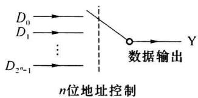  

图 3.5.25 数据选择器示意图

### 1. 基本功能

74LS151 是一种 TTL 型 8 选 1 数据选择器, 如图 3.5.26 所示, 其中 $D_{7} \sim D_{0}$ 为数据输入端, $A_{2}, A_{1}, A_{0}$ 为地址控制端, $\overline{\mathrm{ST}}$ 为使能输入端, $Y$ 和 $W$ 为两个互补输出端。当 $\overline{\mathrm{ST}} = 0$ 时, 由图可写出输出的逻辑表达式为

$$

\begin{array}{r l} Y & = \overline {{A _ {2}}}   \overline {{A _ {1}}}   \overline {{A _ {0}}} D _ {0} + \overline {{A _ {2}}}   \overline {{A _ {1}}} A _ {0} D _ {1} + \overline {{A _ {2}}} A _ {1}   \overline {{A _ {0}}} D _ {2} + \overline {{A _ {2}}} A _ {1} A _ {0} D _ {3} + A _ {2}   \overline {{A _ {1}}}   \overline {{A _ {0}}} D _ {4} + A _ {2}   \overline {{A _ {1}}} A _ {0} D _ {5} + \\ & A _ {2} A _ {1}   \overline {{A _ {0}}} D _ {6} + A _ {2} A _ {1} A _ {0} D _ {7} = \sum_ {i = 0} ^ {2 ^ {3} - 1} m _ {i} D _ {i} \end{array}

$$

其中， $m_{i}$ 为地址变量 $A_{2}A_{1}A_{0}$ 构成的最小项。

由上式可知，当 $A_{2}A_{1}A_{0}=000$ 时， $Y=D_{0}, A_{2}A_{1}A_{0}=001$ 时， $Y=D_{1}$ ，依此类推。即在 $A_{2}A_{1}A_{0}$ 的控制下，从 8 路数据中选择 1 路送至输出端。

当 $\overline{ST}=1$ 时，输出Y=0，处于禁止状态，表3.5.8是其功能表。同理，可推出 $2^{n}$ 选1数据选择器的输出表达式：

$$

Y = \sum_ {i = 0} ^ {2 ^ {n} - 1} m _ {i} D _ {i}

$$

其中，n 为地址端数， $m_{i}$ 为地址变量构成的最小项。

表 3.5.8 74LS151 的功能表

<table><tr><td rowspan="2">使能输入 $\overline{\mathrm{{ST}}}$ </td><td colspan="3">选择地址输入</td><td rowspan="2">数据输入 ${D}_{7} \sim {D}_{0}$ </td><td colspan="2">输出</td></tr><tr><td> ${A}_{2}$ </td><td> ${A}_{1}$ </td><td> ${A}_{0}$ </td><td>Y</td><td> $\overline{W}$ </td></tr><tr><td>1</td><td>×.</td><td>×</td><td>×</td><td>×</td><td>0</td><td>1</td></tr><tr><td>0</td><td>0</td><td>0</td><td>0</td><td> ${D}_{7} \sim {D}_{0}$ </td><td> ${D}_{0}$ </td><td> $\overline{D}_{0}$ </td></tr><tr><td>0</td><td>0</td><td>0</td><td>1</td><td> ${D}_{7} \sim {D}_{0}$ </td><td> ${D}_{1}$ </td><td> $\overline{D}_{1}$ </td></tr><tr><td>0</td><td>0</td><td>1</td><td>0</td><td> ${D}_{7} \sim {D}_{0}$ </td><td> ${D}_{2}$ </td><td> $\overline{D}_{2}$ </td></tr><tr><td>0</td><td>0</td><td>1</td><td>1</td><td> ${D}_{7} \sim {D}_{0}$ </td><td> ${D}_{3}$ </td><td> $\overline{D}_{3}$ </td></tr><tr><td>0</td><td>1</td><td>0</td><td>0</td><td> ${D}_{7} \sim {D}_{0}$ </td><td> ${D}_{4}$ </td><td> $\overline{D}_{4}$ </td></tr><tr><td>0</td><td>1</td><td>0</td><td>1</td><td> ${D}_{7} \sim {D}_{0}$ </td><td> ${D}_{5}$ </td><td> $\overline{D}_{5}$ </td></tr><tr><td>0</td><td>1</td><td>1</td><td>0</td><td> ${D}_{7} \sim {D}_{0}$ </td><td> ${D}_{6}$ </td><td> $\overline{D}_{6}$ </td></tr><tr><td>0</td><td>1</td><td>1</td><td>1</td><td> ${D}_{7} \sim {D}_{0}$ </td><td> ${D}_{7}$ </td><td> $\overline{D}_{7}$ </td></tr></table>

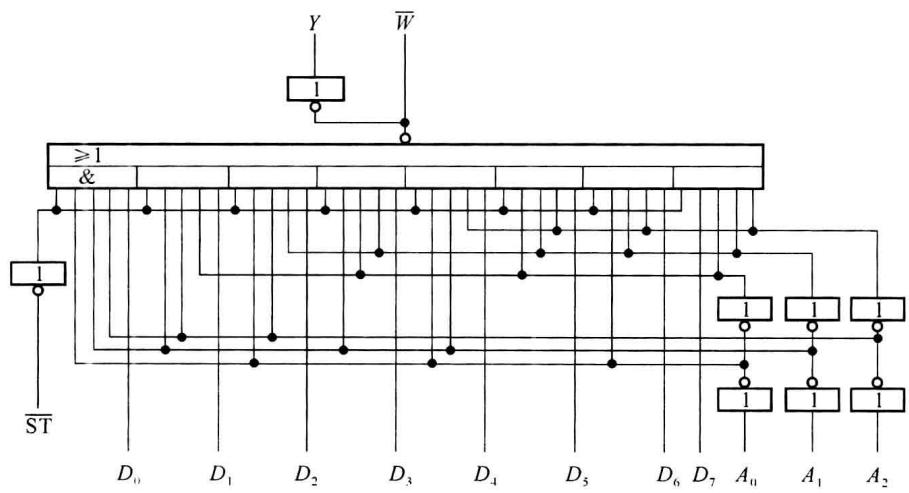

(a)  

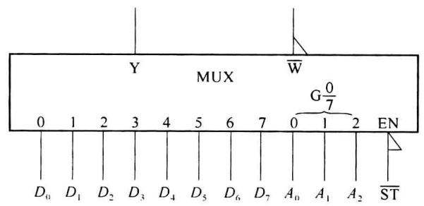  

(b)  

图3.5.26 8选1数据选择器逻辑图及逻辑符号

74LS153 是双 4 选 1 数据选择器, 在一个芯片上集成了两个完全相同 4 选 1 数据选择器, 如图 3.5.27 所示。其中 $A_{1}, A_{0}$ 为两个地址输入端, 被两个选择器所共用, 每个选择器各有一个使能输入端。表 3.5.9 是其功能表, 对芯片中的任意一个都适用。

当 $\overline{\mathrm{ST}} = 0$ 时，其输出表达式为 $Y = \sum_{i=0}^{3} m_i D_i = m_0 D_0 + m_1 D_1 + m_2 D_2 + m_3 D_3$ 。

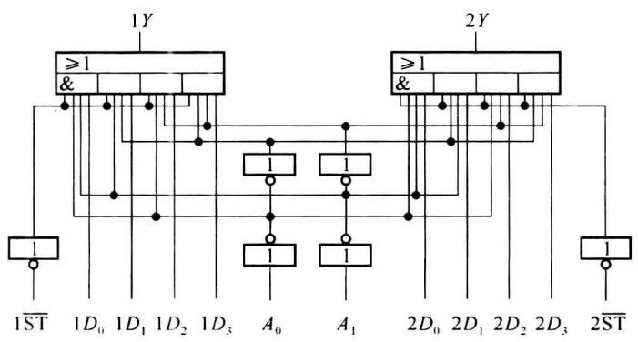  

(a)

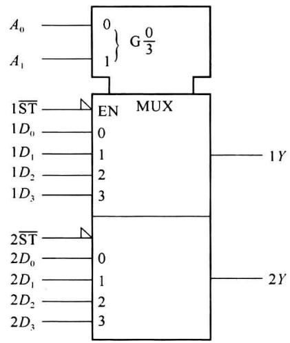  

(b)

图3.5.27 双4选1数据选择器  

表 3.5.9 74LS153 功能表

<table><tr><td rowspan="2">使能输入 $\overline{\mathrm{{ST}}}$ </td><td colspan="2">地址输入</td><td rowspan="2">数据输入 ${D}_{3} \sim {D}_{0}$ </td><td rowspan="2">输出Y</td></tr><tr><td> ${A}_{1}$ </td><td> ${A}_{0}$ </td></tr><tr><td>1</td><td>×</td><td>×</td><td>×</td><td>0</td></tr><tr><td>0</td><td>0</td><td>0</td><td> ${D}_{3} \sim {D}_{0}$ </td><td> ${D}_{0}$ </td></tr><tr><td>0</td><td>0</td><td>1</td><td> ${D}_{3} \sim {D}_{0}$ </td><td> ${D}_{1}$ </td></tr><tr><td>0</td><td>1</td><td>0</td><td> ${D}_{3} \sim {D}_{0}$ </td><td> ${D}_{2}$ </td></tr><tr><td>0</td><td>1</td><td>1</td><td> ${D}_{3} \sim {D}_{0}$ </td><td> ${D}_{3}$ </td></tr></table>

### 2. 功能扩展

可以利用使能端或多片级联来扩展功能。

(1) 用使能端扩展

<Example title="例 3.5.7">
用双 4 选 1 数据选择器构成 8 选 1 数据选择器。

<Solution title="解">
如图 3.5.28 所示, 将双 4 选 1 数据选择器的使能端 $\overline{1ST}$ 和 $\overline{2ST}$ 通过一个反相器接在一起作地址的最高位 $A_{2}$ 。当 $A_{2}=0$ 时, 低位片 (1) 工作而高位片 (2) 不工作, $Y_{1}$ 按地址输入 000\~011 选中数据 $D_{0}\sim D_{3}$ 中的某一个输出, 此时 $Y_{2}=0$ ; 当 $A_{2}=1$ 时, 两片工作情况正好相反, 此时 $Y_{2}$ 按地址输入 100\~111 选中数据 $D_{4}\sim D_{7}$ 中的某一个输出, 而 $Y_{1}=0$ , 故 8 选 1 数据选择器的输出 $Y=Y_{1}+Y_{2}=D_{i}(i=0\sim7)$ 。

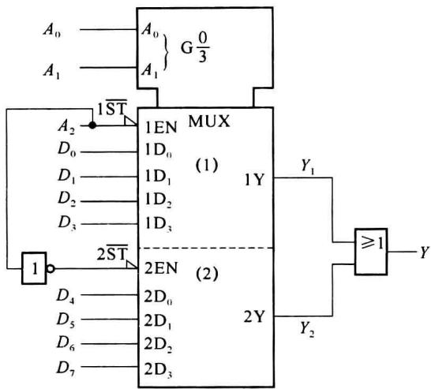  

图 3.5.28 利用使能端扩展的 8 选 1 数据选择器
</Solution>
</Example>

### (2) 级联扩展(树形扩展)

图 3.5.29 是用 3 片双 4 选 1 数据选择器级联构成 16 选 1 数据选择器的连接图。第Ⅰ级用了 1 片双 4 选 1 数据选择器中的一个，它的 $A_{1}A_{0}$ 为高两位地址 $A_{3}A_{2}$ 的输入端，第Ⅱ级用了两片双 4 选 1 数据选择器，它们的 $A_{1}A_{0}$ 为低两位地址 $A_{1}A_{0}$ 的输入端，第Ⅱ级的 4 个输出送至第Ⅰ级相应的数据输入端。数据选择分为两步：①由低位地址 $A_{1}A_{0}$ 从输入的 16 路数据中选出 4 路数据；②再由高位地址 $A_{3}A_{2}$ 选出其中的一路数据输出。从而实现了 16 选 1 数据选择器的功能。

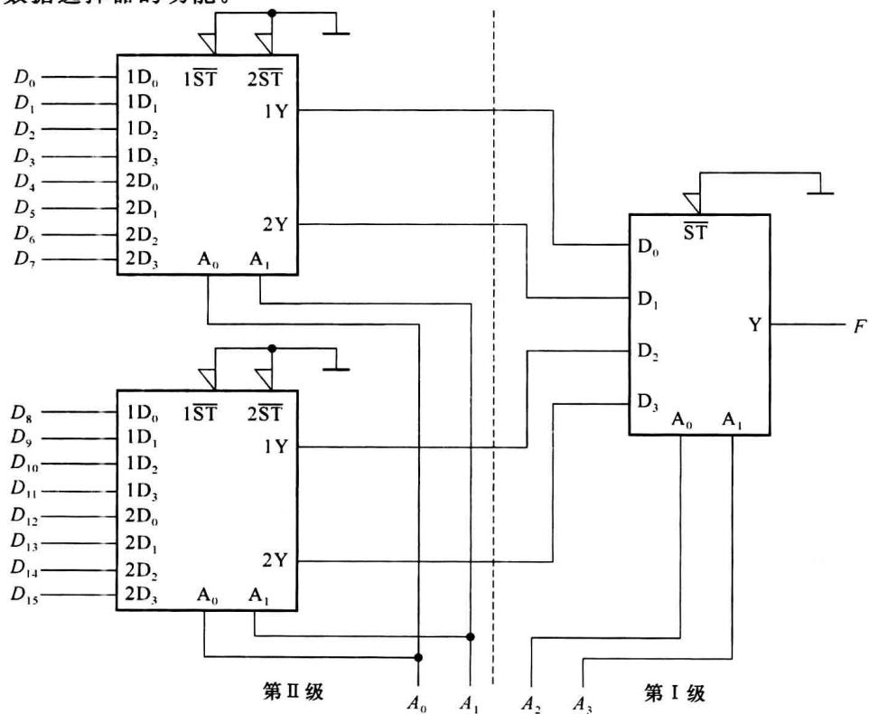  

图3.5.29 4选1组成16选1数据选择器

<Example title="例 3.5.8">
用 8 选 1MUX 构成 64 选 1MUX。

<Solution title="解">
共需9片8选1MUX,片1\~片8的同名地址端相连接低3位地址输入,片9的3位地址端接高3位地址输入,并将片1\~片8的输出接至片9相应的数据输入端,即构成了64选1MUX,如图3.5.30所示。

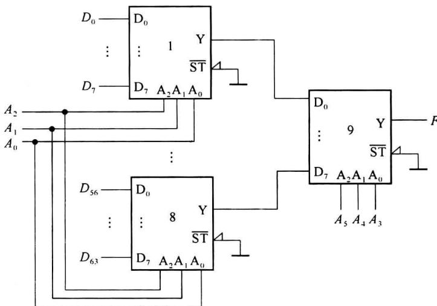  

图3.5.30 8选1构成64选1数据选择器
</Solution>
</Example>

### 3. 数据选择器的应用

数据选择器通用性较强,除了能从多路数据中选择输出信号外,还可以实现并行数据到串行数据的转换,作函数发生器等。

### (1) 并-串转换电路

在数字系统中,往往要求将并行输入的数据转换成串行数据输出,用数据选择器很容易完成这种转换。例如,将4位的并行数据送到4选1数据选择器的数据端上,然后在 $A_{1}$ 、 $A_{0}$ 地址输入端周期性顺序给出 $00\rightarrow01\rightarrow10\rightarrow11$ ,则在输出端将输出串行数据,先是 $D_{0}$ ,而后是 $D_{1}$ 、 $D_{2}$ 、 $D_{3}$ ,之后又按该顺序不断重复,如图3.5.31所示。

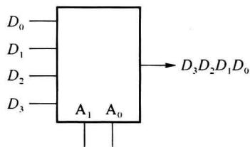  

图 3.5.31 并-串转换电路

### (2) 实现逻辑函数

$2^{n}$ 选1数据选择器的输出表达式如下：

$$

Y = \sum_ {i = 0} ^ {2 ^ {n} - 1} m _ {i} D _ {i}

$$

其中，n 为地址端数， $m_{i}$ 对为地址变量对应的最小项。

将该表达式与 $F = \sum m_{i}$ 对比可见， $D_{i}$ 相当于最小项表达式中的系数，当 $D_{i} = 1$ ，对应的最小项列入函数式， $D_{i} = 0$ ，对应的最小项不列入函数式。所以将逻辑变量从数据选择器的地址端输入，而在数据端加上适当的 0 或 1，就可以实现逻辑函数。

① 逻辑变量数小于或者等于所选用 MUX 地址端数时, 列出真值表, 直接在 MUX 的数据输入端加上与真值表对应的值。

<Example title="例 3.5.9">
用 8 选 1 数据选择器实现三变量的奇校验函数。

<Solution title="解">
其真值表见本章第 2 节表 3.2.1, 则在数据选择器的数据输入端加上与真值表对应的值, 即 $D_{1}=D_{2}=D_{4}=D_{7}=1$ , 其余为 0, 如图 3.5.32 所示。则输出函数表达式为

$$

F (A, B, C) = m _ {1} + m _ {2} + m _ {4} + m _ {7} = \overline {{{A}}} \overline {{{B}}} C + \overline {{{A}}} B \overline {{{C}}} + A \overline {{{B}}} \overline {{{C}}} + A B C

$$

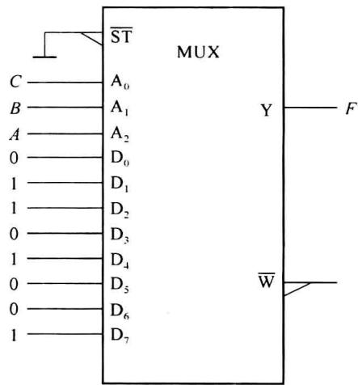  

图3.5.32 8选1数据选择器实现函数

连接时注意:一是使能端,二是高低位,三是若变量数小于选用 MUX 地址端数时,不用的地址端和数据端均接地。如图 3.5.33 用 8 选 1 数据选择器实现异或函数和同或函数。

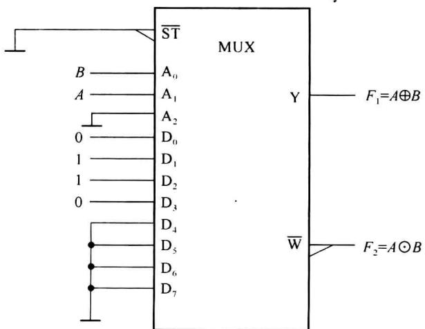  

图 3.5.33 8 选 1 数据选择器实现异或、同或函数

② 逻辑变量数 $n$ 大于所选用数据选择器地址端数 $m$ 时, 首先选出 $m$ 个变量从数据选择器地址端输入, 其余 $n - m$ 个变量只能从数据端输入, 故 $D_{i}$ 不再是简单的 0 或 1 , 而是其余 $n - m$ 个变量的函数。

例如,用 4 选 1 数据选择器实现三变量函数:

$$

F (A, B, C) = \overline {{A}} \overline {{B}} \overline {{C}} + \overline {{A}} \overline {{B}} C + A \overline {{B}} \overline {{C}} + A B C

$$

若选变量 A, B(也可以选其他任何两个变量)作地址变量, 则从上述最小项表达式中提取地址变量最小项的公共因子, 整理后如下:

$$

F (A, B, C) = A \overline {{B}} (C + \overline {{C}}) + A \overline {{B}} \overline {{C}} + A B C = m _ {0} + m _ {2} \overline {{C}} + m _ {3} C

$$

即得 4 选 1 数据选择器数据输入 $D_{3} \sim D_{0}$ 。 $D_{0}$ 为 $m_{0}$ 的系数， $D_{0} = 1, D_{1}$ 为 $m_{1}$ 的系数， $D_{1} = 0$ ；同理可得 $D_{2} = \overline{C}$ ， $D_{3} = C_{0}, D_{2}, D_{3}$ 是变量 $C$ 的函数，其逻辑图如图 3.5.34 所示。

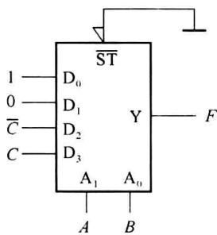  

图3.5.34 4选1数据选择器实现函数的逻辑图

上例是代数法, 更常用卡诺图法进行设计, 简便直观。卡诺图法是按 $m$ 个地址变量的组合将原卡诺图划分为 $2^{m}$ 个区域, 称为子卡诺图, 由 $2^{m}$ 个子卡诺图求出各个 $D_{i}$ 的值。必须先解决一个问题: 如何选择合适的地址变量? 所谓合适是指能使 $D_{i}$ 的表达式简单, 电路实现经济。有两种方法:

一是选函数最简式中出现最多的变量作地址变量,它能使剩余变量组成的函数最简。

二是可先假设一种选法，在卡诺图上看一下它的子卡诺图情况，再决定是否这样选。

经常采用第一种方法,下面举例说明。
</Solution>
</Example>

<Example title="例 3.5.10">
用4选1数据选择器实现函数：

$$

F (A, B, C, D) = \sum m (1, 2, 4, 9, 1 0, 1 1, 1 2, 1 4, 1 5)

$$

<Solution title="解">
首先由函数的卡诺图求出最简式: $F(A,B,C,D)=B\overline{C}\overline{D}+AC+\overline{B}\overline{C}D+\overline{B}C\overline{D}$ 。

统计变量出现的次数: A 为 1 次, B 为 3 次, C 为 4 次, D 为 3 次, 所以选择 BC 或 CD 作地址变量均可, 在此选 BC。

其次按 $BC$ 组合将原卡诺图划分为 4 个子卡诺图, 如图 3.5.35(a) 中虚线所示。子卡诺图是两维的 (两个变量), 故又称为降维卡诺图。各子卡诺图内所示的函数就是与其地址码 $m_{i}$ 对应的数据输入 $D_{i}$ 。由于一个数据输入对应一个地址码, 因此求 $D_{i}$ 时只能在相应的子卡诺图内化简。分别化简 4 个子卡诺图, 见图中实线圈。标注这些圈的积项时去掉所有地址变量, 即可得到各个 $D_{i}$ 的函数表达式: $D_{0} = D$ , $D_{1} = A + \overline{D} = \overline{A D}$ , $D_{2} = \overline{D}$ , $D_{3} = A$ , 其逻辑图如图 3.5.35(b) 所示, 只附加一个与非门。

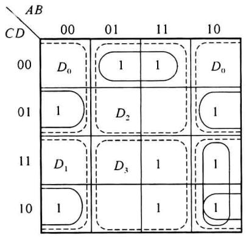  

(a)

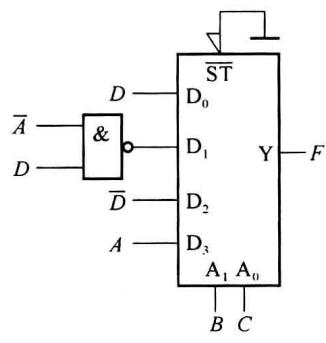  

(b)  

图3.5.35 例3.5.9的卡诺图与逻辑图

上述函数如果选用 AB 作地址变量, 相应的子卡诺图、逻辑图如图 3.5.36 所示, 各 $D_{i}$ 为: $D_{0} = \overline{C}D + C\overline{D}, D_{1} = \overline{C}\overline{D}, D_{2} = C + D = \overline{\overline{C}\overline{D}}, D_{3} = C + \overline{D} = \overline{\overline{C}D}$ , 需加 5 个与非门。

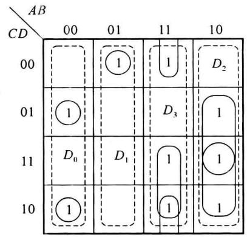  

(a)

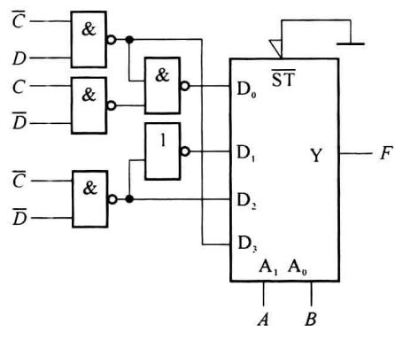  

(b)  

图3.5.36 例3.5.9的另一方案

显然用 BC 作地址变量电路更简单,读者可自己验证用 CD 作地址变量电路也简单。当然数据输入 $D_{i}$ 函数表达式也可以用数据选择器来实现。

数据选择器实现函数与译码器实现函数相比，在一个芯片前提下，译码器必须外加门才能实现变量数不大于其输入端数的函数，不能实现变量数大于其输入端数的函数，但可同时实现多个函数；数据选择器不用外加门就能实现变量数不大于其地址端数的函数，在外加门时还能实现变量数大于其地址端数的函数，但只能实现一个函数。
</Solution>
</Example>

## 3.5.5 数据分配器

数据分配器(DMUX)的功能与数据选择器相反, 将一个输入数据分配到多路输出中的某一路, 从哪一路输出由当时的地址变量决定, 也等效为单刀多掷开关, 如图 3.5.37 所示, 只是方向相反, 故称 DMUX。

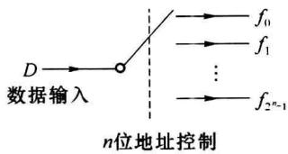  

图3.5.37 数据分配器框图

### 1. 基本功能

74LS155 为 TTL 型双 1 线至 4 线数据分配器, 这两个 1 线至 4 线数据分配器不完全相同, 图 3.5.38(a) 是其中一个的逻辑原理图, 图 3.5.36(b) 为逻辑符号。图中 D 为数据输入端, $A_{1}A_{0}$ 为公用地址输入端, ST 为使能端, $f_{0} \sim f_{3}$ 为数据输出端。

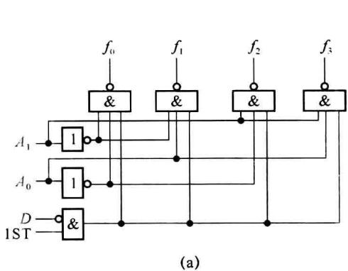

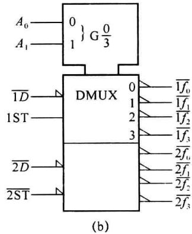  

图3.5.38 数据分配器的逻辑原理图与逻辑符号

由图 3.5.38(a) 可以看出, 数据分配器的核心部分是一个 2 线至 4 线译码器, 比译码器多了一个数据端, 所以数据分配器是译码器加数据端构成。当 $1 \mathrm{ST} = 0$ 时, $\overline{f_0} \sim \overline{f_2} = 1$ , 输出与输入无关, 为禁止态; 当 $1 \mathrm{ST} = 1$ 时, 写出输出表达式: $\overline{f_0} = \overline{\overline{D} m_0}, \overline{f_1} = \overline{\overline{D} m_1}, \overline{f_2} = \overline{\overline{D} m_2}, \overline{f_3} = \overline{\overline{D} m_3}, m_i (i = 0 \sim 3)$ 为地址变量 $A_1 A_0$ 的最小项, 故 $m_i = 1$ 时, 则 $\overline{f_i} = D$ , 即根据地址不同, 将 $D$ 送到不同的输出端。其功能表如表 3.5.10(a)、(b) 所示。

表 3.5.10 数据分配器功能表  

(a)  

(b)

<table><tr><td colspan="3">输入</td><td colspan="4">输出</td></tr><tr><td>1ST</td><td> $1A_1$ </td><td> $1A_0$ </td><td> $\overline{1f_0}$ </td><td> $\overline{1f_1}$ </td><td> $\overline{1f_2}$ </td><td> $\overline{1f_3}$ </td></tr><tr><td>0</td><td>×</td><td>×</td><td>1</td><td>1</td><td>1</td><td>1</td></tr><tr><td>1</td><td>0</td><td>0</td><td> $\overline{1D}$ </td><td>1</td><td>1</td><td>1</td></tr><tr><td>1</td><td>0</td><td>1</td><td>1</td><td> $\overline{1D}$ </td><td>1</td><td>1</td></tr><tr><td>1</td><td>1</td><td>0</td><td>1</td><td>1</td><td> $\overline{1D}$ </td><td>1</td></tr><tr><td>1</td><td>1</td><td>1</td><td>1</td><td>1</td><td>1</td><td> $\overline{1D}$ </td></tr></table>

<table><tr><td colspan="3">输入</td><td colspan="4">输出</td></tr><tr><td> $\overline{2ST}$ </td><td> $2A_1$ </td><td> $2A_0$ </td><td> $\overline{2f_0}$ </td><td> $\overline{2f_1}$ </td><td> $\overline{2f_2}$ </td><td> $\overline{2f_3}$ </td></tr><tr><td>1</td><td>×</td><td>×</td><td>1</td><td>1</td><td>1</td><td>1</td></tr><tr><td>0</td><td>0</td><td>0</td><td> $\overline{2D}$ </td><td>1</td><td>1</td><td>1</td></tr><tr><td>0</td><td>0</td><td>1</td><td>1</td><td> $\overline{2D}$ </td><td>1</td><td>1</td></tr><tr><td>0</td><td>1</td><td>0</td><td>1</td><td>1</td><td> $\overline{2D}$ </td><td>1</td></tr><tr><td>0</td><td>1</td><td>1</td><td>1</td><td>1</td><td>1</td><td> $\overline{2D}$ </td></tr></table>

### 2. 功能扩展

直接利用使能端进行扩展。如果将双1线至4线数据分配器的使能端1ST与 $\overline{2ST}$ 并接作为高位地址变量 $A_{2}$ 输入端，两个数据输入端并接作为数据输入，则可扩展为1线至8线

的分配器。

### 3. 应用

### (1) 作译码器

由于数据分配器是译码器加数据端构成,若将数据输入端接地,则图3.5.38(a)电路就变成2线至4线的译码器,令D=0,表3.5.10就变成译码器的功能表。反之,具有使能端的译码器也可用做数据分配器,将输入数据D从使能端输入即可,在译码器部分已有介绍。

<Example title="例 3.5.11">
使用一片 74LS155，请附加最少的门实现如下两输出函数（在给出的图 3.5.39 上完成设计，A 为高位）。

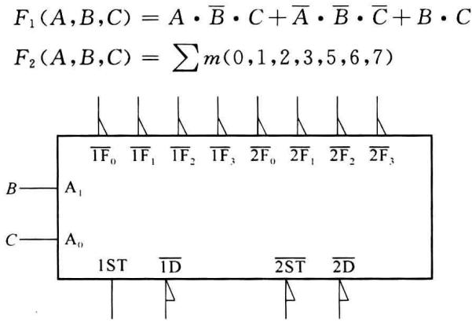  

图3.5.39 74LS155的简化符号

<Solution title="解">
首先将 74LS155 双 1 线至 4 线数据分配器扩展为 1 线至 8 线分配器:将使能端 1ST 与 $\overline{2ST}$ 并接作为高位地址变量 A 输入端,两个数据输入端并接作为数据输入端 $\overline{D}$ 。

然后将此1线至8线分配器变成3线至8线译码器: 将数据输入端 $\overline{D}$ 接地。注意: 此时8条输出线(即8个最小项的非)的排列如图3.5.40所示。

再将 $F_{1}$ 转换为最小项表达式为 $F_{1}(A,B,C) = A\cdot \overline{B}\cdot C + \overline{A}\cdot \overline{B}\cdot \overline{C} +B\cdot C = \sum m$ (0,3,5,7)，外加一个与非门即可实现； $F_{2}$ 转换为 $F_{2}(A,B,C) = \sum m(0,1,2,3,5,6,7) =$ $M_4 = \overline{m_4}$ 不用外加门，直接引出即可，如图3.5.40所示。

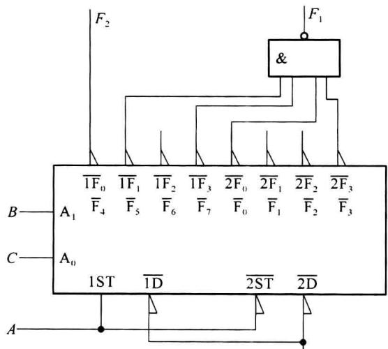  

图3.5.40 例3.5.11的实现逻辑图
</Solution>
</Example>

### (2) 多路分配器

将数据选择器和数据分配器配合使用, 就可以实现多路数据的传输。图 3.5.41 所示的是 8 路数据传输, 受地址输入 ABC 的控制。例如, 当 ABC=001 时, 实现 $D_{1} \rightarrow f_{1}$ 的传输, 在此强调指出, 收、发两端的地址要严格同步。

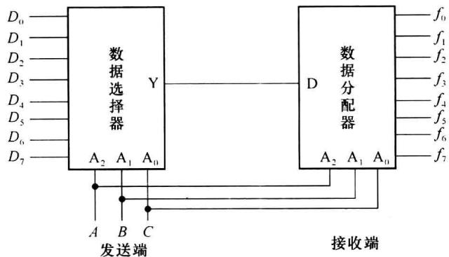  

图3.5.41 8路数据传输

## 3.5.6 奇偶校验与可靠性编码

### 1. 奇偶校验码

### (1) 基本功能

在数码的传送及存储过程中由于存在干扰,数码可能发生差错,如1变为0或0变为1。发现这些错误并将它们进行纠正,这就是纠错技术,这一技术已经广泛地应用到数据传输及计算机系统中。奇偶校验码是其中最基本的检错码,这种码具有一定的检错能力,但不能纠错。

奇偶校验码是在信息码之后，加一位校验位，使整个码组中1的个数为奇数或偶数，前者称为奇校验，后者称为偶校验。表3.5.11为8421BCD码的奇偶校验码。只要收发双方预先约定采用何种校验码，当传输中有差错便能很容易地判断出来。但若有两位同时有错是不能发现的，不过两位同时出错的概率很小，故奇偶校验码被广泛应用。常采用奇校验，因为它排除了全0的情况。奇偶校验单元的通用符号如图3.5.42所示。

表 3.5.11 8421BCD 码的奇偶校验码

<table><tr><td>十进制数</td><td colspan="4">8421BCD码(信息码)</td><td>奇校验位</td><td>偶校验位</td></tr><tr><td>0</td><td>0</td><td>0</td><td>0</td><td>0</td><td>1</td><td>0</td></tr><tr><td>1</td><td>0</td><td>0</td><td>0</td><td>1</td><td>0</td><td>1</td></tr><tr><td>2</td><td>0</td><td>0</td><td>1</td><td>0</td><td>0</td><td>1</td></tr><tr><td>3</td><td>0</td><td>0</td><td>1</td><td>1</td><td>1</td><td>0</td></tr><tr><td>4</td><td>0</td><td>1</td><td>0</td><td>0</td><td>0</td><td>1</td></tr><tr><td>5</td><td>0</td><td>1</td><td>0</td><td>1</td><td>1</td><td>0</td></tr><tr><td>6</td><td>0</td><td>1</td><td>1</td><td>0</td><td>1</td><td>0</td></tr><tr><td>7</td><td>0</td><td>1</td><td>1</td><td>1</td><td>0</td><td>1</td></tr><tr><td>8</td><td>1</td><td>0</td><td>0</td><td>0</td><td>0</td><td>1</td></tr><tr><td>9</td><td>1</td><td>0</td><td>0</td><td>1</td><td>1</td><td>0</td></tr></table>

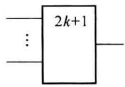

  

(a) 奇校验单元  

(b) 偶校验单元  

图 3.5.42 奇偶校验单元的通用符号

由于异或的性质:奇数个1异或结果为1,偶数个1异或结果为0。因此用异或门构成奇偶校验电路十分方便。图3.5.43为8421BCD码发送端奇校验位产生电路和接收端奇校验电路,这是串行连接,当位数多时,还可采用并行(树形)结构。

  

图 3.5.43 奇校验位产生电路与奇校验电路

由图3.5.41可得：

$$

\begin{array}{l} P = \overline {{D \oplus C \oplus B \oplus A}} \\ F = D \oplus C \oplus B \oplus A \oplus P \end{array}

$$

则 $F = 0$ 表示传输有错误。

集成 9 位奇偶校验器 74LS280 的逻辑符号如图 3.5.44 所示, 其中 $A \sim I$ 是输入端, $Q_{\mathrm{E}}$ 和 $Q_{\mathrm{O}}$ 是输出端, 功能列于表 3.5.12 中。输出表达式为

$$

\begin{array}{r l} & Q _ {0} = A \oplus B \oplus C \oplus D \oplus E \oplus F \oplus G \oplus H \oplus I \\ & Q _ {\mathrm{E}} = \overline {{A \oplus B \oplus C \oplus D \oplus E \oplus F \oplus G \oplus H \oplus I}} \end{array}

$$

表 3.5.12 奇偶校验器功能表

<table><tr><td>输入A～I中1的个数</td><td> ${Q}_{\mathrm{O}}$ </td><td> ${Q}_{\mathrm{E}}$ </td></tr><tr><td>偶数</td><td>0</td><td>1</td></tr><tr><td>奇数</td><td>1</td><td>0</td></tr></table>

图3.5.44 74LS280的逻辑符号

74LS280 既适用于奇校验,也适用于偶校验;既可用于校验位的产生,也可用于奇偶性的校验。图 3.5.45 所示是利用 74LS280 对 8 位信息传输产生校验位与校验的电路。

### (2) 功能扩展

若用 74LS280 实现输入多于 9 位的奇偶校验, 可用串行级联和并行级联的方式扩展, 如图 3.5.46 所示。

图3.5.45 具有奇偶校验的数据传输  

  

(a) 25位奇校验

  

(b) 81位奇校验  

图3.5.46 多位奇偶校验

### 2. 汉明码

奇偶校验码只能检测出一位错，而不能纠正错误。汉明码是既具有检错功能又具有纠错功能的一种可靠性编码。汉明码校验的基础也是奇偶校验，但它是多重的奇偶校验码。

下面以 8421 汉明码为例来说明汉明码的编码方法及检错纠错原理。

### (1) 汉明码的编码

8421 汉明码是由 8421 码和 3 位校验位组成。设 8421 码为 $I_{4}, I_{3}, I_{2}, I_{1}$ ，3 位汉明校验位为 $P_{3}, P_{2}, P_{1}$ ，3 位校验位的位置分别设置在 $2^{i}$ 码位上， $i = 0, 1, 2$ 。即 $P_{1}$ 置于 $2^{0} = 1$ 码位上， $P_{2}$ 置于 $2^{1} = 2$ 码位上， $P_{3}$ 置于 $2^{2} = 4$ 码位。这样组成的 8421 汉明码的位序如下：

$$

\begin{array}{c c c c c c c} 7 & 6 & 5 & 4 & 3 & 2 & 1 \\ I _ {4} & I _ {3} & I _ {2} & P _ {3} & I _ {1} & P _ {2} & P _ {1} \end{array}

$$

其中 3 位校验码的编码方法如下：

首先将7位汉明码进行分组，因为用3位校验码，就分成3组进行奇偶校验。分组时，位序号所在的列中，先填写位序号对应的二进制码 $(S_{1}$ 为低位），如6是 $110, S_{3}S_{2}S_{1} = 110$ ，然后，在1的位置上填写位序号对应的码元，如6对应 $I_{3}$ ，就在6列下 $S_{3}, S_{2}$ 行填写 $I_{3}$ ，如表3.5.13所示。分组结果3个校验位分别位于3个组，每一组写出校验位的生成表达式如下：

表 3.5.13 汉明码分组表

<table><tr><td colspan="2">分组\位序号</td><td>7</td><td>6</td><td>5</td><td>4</td><td>3</td><td>2</td><td>1</td></tr><tr><td rowspan="3"></td><td> $S_3$ </td><td> $I_4$ </td><td> $I_3$ </td><td> $I_2$ </td><td> $P_3$ </td><td></td><td></td><td></td></tr><tr><td> $S_2$ </td><td> $I_4$ </td><td> $I_3$ </td><td></td><td></td><td> $I_1$ </td><td> $P_2$ </td><td></td></tr><tr><td> $S_1$ </td><td> $I_4$ </td><td></td><td> $I_2$ </td><td></td><td> $I_1$ </td><td></td><td> $P_1$ </td></tr></table>

$$

\begin{array}{l} P _ {3} = I _ {4} \oplus I _ {3} \oplus I _ {2} \\ P _ {2} = I _ {4} \oplus I _ {3} \oplus I _ {1} \\ P _ {1} = I _ {4} \oplus I _ {2} \oplus I _ {1} \end{array}

$$

根据上述规则写出 8421 汉明码如表 3.5.14 所示。

表 3.5.14 8421 汉明码

<table><tr><td>N\位序号</td><td>7</td><td>6</td><td>5</td><td>4</td><td>3</td><td>2</td><td>1</td></tr><tr><td>0</td><td>0</td><td>0</td><td>0</td><td>0</td><td>0</td><td>0</td><td>0</td></tr><tr><td>1</td><td>0</td><td>0</td><td>0</td><td>0</td><td>1</td><td>1</td><td>1</td></tr><tr><td>2</td><td>0</td><td>0</td><td>1</td><td>1</td><td>0</td><td>0</td><td>1</td></tr><tr><td>3</td><td>0</td><td>0</td><td>1</td><td>1</td><td>1</td><td>1</td><td>0</td></tr><tr><td>4</td><td>0</td><td>1</td><td>0</td><td>1</td><td>0</td><td>1</td><td>0</td></tr><tr><td>5</td><td>0</td><td>1</td><td>0</td><td>1</td><td>1</td><td>0</td><td>1</td></tr><tr><td>6</td><td>0</td><td>1</td><td>1</td><td>0</td><td>0</td><td>1</td><td>1</td></tr><tr><td>7</td><td>0</td><td>1</td><td>1</td><td>0</td><td>1</td><td>0</td><td>0</td></tr><tr><td>8</td><td>1</td><td>0</td><td>0</td><td>1</td><td>0</td><td>1</td><td>1</td></tr><tr><td>9</td><td>1</td><td>0</td><td>0</td><td>1</td><td>1</td><td>0</td><td>0</td></tr></table>

### (2) 汉明码的校验

发送端将汉明码发送出去后,若接收端收到以后不再满足上述 $P_{i}$ 表达式,则说明传输过程出了错,因此,接收端通过下列奇偶校验方程来判断。

$$

\begin{array}{l} S _ {3} = I _ {4} \oplus I _ {3} \oplus I _ {2} \oplus P _ {3} \\ S _ {2} = I _ {4} \oplus I _ {3} \oplus I _ {1} \oplus P _ {2} \\ S _ {1} = I _ {4} \oplus I _ {2} \oplus I _ {1} \oplus P _ {1} \end{array}

$$

如果收到的代码是正确的，则 $S_{3}S_{2}S_{1} = 000$ ；如果收到的代码不正确，有一个错，则由 $S_{3}, S_{2}, S_{1}$ 所构成的二进制数指出错误位序号。

例如,发送端发出的 8421 汉明码为

$$

\begin{array}{c c c c c c c} 7 & 6 & 5 & 4 & 3 & 2 & 1 \\ 0 & 1 & 0 & 1 & 0 & 1 & 0 \end{array}

$$

接收端收到的代码为

$$

\begin{array}{c c c c c c c} 7 & 6 & 5 & 4 & 3 & 2 & 1 \\ 0 & 1 & 0 & 1 & 1 & 1 & 0 \end{array}

$$

则由校验方程得到 $S_{3}S_{2}S_{1}=011$ ，表明位序 3 出错，将第三位码 $I_{1}$ 修改，1 变为 0，即得到纠正。

这是因为从分组表可见 $I_{1}$ 序号是3，对应 $S_{3}S_{2}S_{1}$ 的二进制码是011，如果传输正确， $S_{i}$ 皆为0，一旦 $I_{1}$ 出错，则对应二进制码011中所有1的 $S_{i}$ 表达式 $S_{2}, S_{1}$ 均为1，故由 $S_{3}S_{2}S_{1}$ 的二进制码即可发现错误的位置。

表 3.5.15 汉明码校验位与最大信息位关系

<table><tr><td>校验位k</td><td>总位数 $2^{k}-1$ </td><td>最大信息位数n</td></tr><tr><td>2</td><td>3</td><td>1</td></tr><tr><td>3</td><td>7</td><td>4</td></tr><tr><td>4</td><td>15</td><td>11</td></tr><tr><td>5</td><td>31</td><td>26</td></tr><tr><td>6</td><td>63</td><td>57</td></tr><tr><td>7</td><td>127</td><td>120</td></tr></table>

由上述分析可知，3位校验码形成的 $S_{3}, S_{2}, S_{1}$ 共给出 $2^{3} = 8$ 种不同的状态，除了000表示正确外，其余7种状态分别指出7个码元的错误。因为包含了3位校验位，故3位校验位最多可校正4位信息位。

设有 $k$ 位校验位，共 $2^{k}$ 种组合，其中全0表示正确，出错组合数为 $2^{k} - 1$ ，即总位数为 $2^{k} - 1$ ，所以若信息位为 $n$ 位，则 $n_{\mathrm{max}}\leqslant 2^k -1 - k$ ，表3.5.15给出汉明码校验位与最大信息位的关系。

随着校验位的增加,汉明码的检错、纠错能力也随之增强,它可以检出双位错、纠正一位错,也可以指出多位错、纠正双位错等,汉明码在计算机的信息传输中应用很广。

## 3.5.7 运算电路

### 1. 加法器

两个二进制数之间的算术运算无论是加、减、乘、除，目前在数字计算机中都是化做若干步加法运算进行的，因此加法器是构成算术运算器的基本单元。

加法器可由全加器构成, 当有 n 位二进制数相加时就需 n 个全加器构成多位并行加法器。按照进位方式不同, 常分为串行进位加法器和超前进位加法器两种。

### (1) 串行进位加法器

本章第 3 节图 3.3.25 为 4 位串行进位加法器的逻辑框图, 这种加法器的构成比较简单, 只需将 4 个全加器串联起来, 低位全加器的进位输出连到相邻高位全加器的进位输入, 最低位全加器的进位端 CI 应当接 0。

这种加法器虽然各位相加是并行的,但其进位信号是由低位向高位逐级传递的,因此运算速度较慢。但结构比较简单,在运算速度要求不高的情况下,仍可采用。

### (2) 超前进位加法器

为了提高运算速度,必须设法减小或消除由于进位信号逐级传递所耗费的时间,可以通过逻辑电路事先得出每一位全加器的进位信号,而无须再从最低位开始向高位逐位传递进位信号,采用这种结构的加法器叫超前进位加法器。下面以4位超前进位加法器为例来说明。

设两个加数 A 和 B, $A = A_{4} A_{3} A_{2} A_{1}$ , $B = B_{4} B_{3} B_{2} B_{1}$ 。

由前面逐位传递加法器可得到各位和与进位表达式为

$$

\begin{array}{r l r} {S _ {1} = A _ {1} \oplus B _ {1} \oplus C _ {0}} & & {C _ {1} = A _ {1} B _ {1 +} C _ {0} (A _ {1} \oplus B _ {1})} \\ {S _ {2} = A _ {2} \oplus B _ {2} \oplus C _ {1}} & & {C _ {2} = A _ {2} B _ {2 +} C _ {1} (A _ {2} \oplus B _ {2})} \end{array}

$$

$$

\begin{array}{r l r} {S _ {3} = A _ {3} \oplus B _ {3} \oplus C _ {2}} & & {C _ {3} = A _ {3} B _ {3 +} C _ {2} (A _ {3} \oplus B _ {3})} \\ {S _ {4} = A _ {4} \oplus B _ {4} \oplus C _ {3}} & & {C _ {4} = A _ {4} B _ {4 +} C _ {3} (A _ {4} \oplus B _ {4})} \end{array}

$$

在表达式中,设

$$

G _ {i} = A _ {i} B _ {i} \qquad P _ {i} = A _ {i} \oplus B _ {i}

$$

$G_{i}$ 为进位生成项， $P_{i}$ 为进位传递项。则进位 $C_{i}$ 形成速度决定于积项 $P_{i}C_{i-1}$ ，将进位表达式变换一下得

$$

\begin{array}{l} C _ {1} = G _ {1} + P _ {1} C _ {0} \\ C _ {2} = G _ {2} + P _ {2} C _ {1} = G _ {2} + P _ {2} G _ {1 +} P _ {2} P _ {1} P _ {0} \\ C _ {3} = G _ {3} + P _ {3} C _ {2} = G _ {3} + P _ {3} G _ {2} + P _ {3} P _ {2} G _ {1} + P _ {3} P _ {2} P _ {1} C _ {0} \\ C _ {4} = G _ {4} + P _ {4} C _ {3} = G _ {4} + P _ {4} G _ {3} + P _ {4} P _ {3} G _ {2} + P _ {4} P _ {3} P _ {2} G _ {1} + P _ {4} P _ {3} P _ {2} P _ {1} C _ {0} \end{array}

$$

各位和的输出为

$$

S _ {i} = P _ {i} \oplus C _ {i - 1}

$$

74LS283 4 位超前进位加法器就是基于这种逻辑结构制作的, 其逻辑图示于图 3.5.47(a) 中, 可知最多经过四级门就得到结果, 图 3.5.47(b) 是其简化逻辑符号。

  

(a)

  

图 3.5.47 4 位超前进位加法器  

(b)

显然，进位传递时间的节省是以逻辑电路的复杂为代价换取的。因此当运算位数较多时常采用折中方法，即将 $n$ 位分为若干组，组内采用超前进位，组间采用串行进位。例如实现两个16位二进制数相加，需用4片74LS2834位超前进位加法器串行级联，低位片的进位 $C_3$ 接到相邻高位片的 $C_{-1}$ ，最低位片的 $C_{-1}$ 接0即可。

### (3) 应用

加法器除作二进制加法运算外,还可以广泛用于构成其他功能电路,如代码转换电路、减法器、十进制加法器等。

<Example title="例 3.5.12">
用 4 位加法器实现 8421BCD 码至余 3BCD 码的转换。

<Solution title="解">
由于余 3BCD 码比相应的 8421BCD 多 3(0011), 只需将输入的 8421BCD 加 3 即可, 用 1 片 4 位加法器就能实现, 如图 3.5.48 所示。
</Solution>
</Example>

<Example title="例 3.5.13">
试将两位 8421BCD 码转换为等值的二进制数。

<Solution title="解">
两位8421BCD码转换为二进制数,比较简便的方法是利用权值来转换。设两位8421BCD码N的高位为 $D_{8}^{\prime}D_{4}^{\prime}D_{2}^{\prime}D_{1}^{\prime}$ ,低位是

图3.5.48 代码转换电路

$D_{8}D_{4}D_{2}D_{1}$ ，则：

$$

\begin{array}{r l} N & = (D _ {8} ^ {\prime} \times 8 + D _ {4} ^ {\prime} \times 4 + D _ {2} ^ {\prime} \times 2 + D _ {1} ^ {\prime}) \times 1 0 + D _ {8} \times 8 + D _ {4} \times 4 + D _ {2} \times 2 + D _ {1} \\ & = D _ {8} ^ {\prime} \times 8 0 + D _ {4} ^ {\prime} \times 4 0 + D _ {2} ^ {\prime} \times 2 0 + D _ {1} ^ {\prime} \times 1 0 + D _ {8} \times 8 + D _ {4} \times 4 + D _ {2} \times 2 + D _ {1} \\ & = D _ {8} ^ {\prime} \times (6 4 + 1 6) + D _ {4} ^ {\prime} \times (3 2 + 8) + D _ {2} ^ {\prime} \times (1 6 + 4) + D _ {1} ^ {\prime} \times (8 + 2) + D _ {8} \times 8 + D _ {4} \times 4 + D _ {2} \times 2 + D _ {1} \\ & = D _ {8} ^ {\prime} \times 2 ^ {6} + D _ {4} ^ {\prime} \times 2 ^ {5} + (D _ {8} ^ {\prime} + D _ {2} ^ {\prime}) \times 2 ^ {4} + (D _ {4} ^ {\prime} + D _ {1} ^ {\prime} + D _ {8}) \times 2 ^ {3} + (D _ {2} ^ {\prime} + D _ {4}) \times 2 ^ {2} + (D _ {1} ^ {\prime} + D _ {2}) \times 2 + D _ {1} \end{array}

$$

由推导结果可知,按上式进行计算,将相加的进位加到高位上去,用两个4位加法器就可实现将两位8421BCD码转换为等值的二进制数,其逻辑连接图如图3.5.49所示。

  

图 3.5.49 两位 8421BCD 码转换电路
</Solution>
</Example>

<Example title="例 3.5.14">
用 4 位二进制加法器构成 1 位 8421BCD 码加法器。

<Solution title="解">
本章第3节例3.3.15是用全加器实现的,本题改用4位二进制加法器实现,原理相同,如图3.5.50所示。

  

图3.5.50 例3.5.14的逻辑电路图
</Solution>
</Example>

### 2. 减法器

### (1) 全减器

本章第3节例3.3.11是用SSI芯片实现的全减器，其真值表见表3.3.3。实用中，为了简化系统结构，通常不另外设计减法器，而是将减法运算变为加法运算来处理，使运算器既能实现加法运算，又可实现减法运算。

由真值表得到 $D_{i}$ 和 $C_i$ 的表达式如下：

$$

\begin{array}{l} D _ {i} = A _ {i} \oplus B _ {i} \oplus C _ {i - 1} \\ C _ {i} = \overline {{{A _ {i}}}} B _ {i} + \overline {{{A _ {i}}}} C _ {i - 1} + B _ {i} C _ {i - 1} \end{array}

$$

若以 $\overline{A_i}$ 作为输入，则表达式为

$$

\begin{array}{l} D _ {i} = \overline {{A _ {i}}} \oplus B _ {i} \oplus C _ {i - 1} \\ C _ {i} = (\overline {{A _ {i}}} \oplus B _ {i}) C _ {i - 1} + \overline {{A _ {i}}} B _ {i} \end{array}

$$

可见与全加器表达式形式相似,故可用全加器实现全减器,如图 3.5.51 所示。

  

图3.5.51 全加器实现的全减器

在数字电路中,减法运算用补码的加法来完成,先介绍二进制数的表示方法。

### (2) 二进制正、负数的表示法

在数字系统中,数的符号是用 0 表示正号,1 表示负号。有符号的二进制数有 3 种表示法:原码、反码和补码。

3 种表示法对于正整数来说是一样的, 即符号位为 0, 随后是二进制数的数值。例如 +18, 3 种表示均为 010010。

对于负数 3 种表示法不同。

原码:负数的符号位为1,随后是二进制数的绝对值。例如,-18的原码是110010。

反码:符号位为1,随后是将绝对值按位取反。也相当于将其对应的正数按位取反(连同符号位)。例如,-18的反码是+18(010010)的按位取反为101101。

补码:负数的补码是其反码加1。例如,-18的补码是101110。

求一个负数的补码也可按下述方法进行:对于其对应的正数(连同符号位),从最低位开始,保留所有的低位0不变;遇到第一个1时,保持这个1不变;以后各高位均取反:即1换0,0换1。

### (3) 补码表示法的减法

对于减法运算：

$$

(\pm A) - (+ B) = (\pm A) + (- B)

$$

将被减数和减数取补, 将减法运算变成补码的加法运算, 其运算结果为补码形式。

由于负数的补码的补(连同符号位)正是其对应的正数(绝对值),例如,-18的补码是101110,再一次取补(按位取反加1),则为010010,即是正数18,所以在减法运算中,若减数是负数,对负数的补码取补为正数,即减负等于加正。如下列运算:

$$

(\pm A) - (- B) = (\pm A) + (B)

$$

因此,当两个补码表示的二进制数相减时,可对补码表示的减数再取补(连同符号位),减法运算变成加法运算,运算结果也是补码形式。

对于无符号数,上述减法也适用,图3.5.52所示是两个4位正数相减A-B,对减数B取补(按位取反加1),将减法变成加法,用4位加法器完成。由于没有考虑符号位(A的符号是0,(-B)的符号是1),所以相加结果若 $C_{3}=1$ ,表示够减,输出 $\Sigma_{0}\sim\Sigma_{3}$ 即为差值正数。若 $C_{3}=0$ ,表示不够减,输出为负数补码,将结果取补即为差的绝对值。

  

图3.5.52 4位减法电路

图 3.5.53 是可控的加减电路, M=1, 实现减法运算, M=0 实现加法运算。

  

图3.5.53 可控的加减电路

另外,乘法和除法运算也可用加法器实现,具体实现可参考相关资料。

### 3. 算术逻辑单元 (Arithmetic-logic Unit, ALU)

数字系统中常把执行数值比较、加法和减法等算术运算、与、与非、或、或非、异或和移位等逻辑运算，以及逻辑运算和算术运算的混合运算的各种电路组合成一个电路，称为算术逻辑单元(ALU)或称多功能函数发生器，故算术逻辑单元(ALU)能够完成一系列的算术运算和逻辑运算。

74LS381是比较简单的双极型ALU，其功能如表3.5.16所示，引脚图如图3.5.54所示。

表 3.5.16 74LS381 功能表

<table><tr><td colspan="3">选择</td><td rowspan="2">算术/逻辑操作</td></tr><tr><td> $S_2$ </td><td> $S_1$ </td><td> $S_0$ </td></tr><tr><td>0</td><td>0</td><td>0</td><td>清零</td></tr><tr><td>0</td><td>0</td><td>1</td><td>B减A</td></tr><tr><td>0</td><td>1</td><td>0</td><td>A减B</td></tr><tr><td>0</td><td>1</td><td>1</td><td>A加B</td></tr><tr><td>1</td><td>0</td><td>0</td><td>A⊕B</td></tr><tr><td>1</td><td>0</td><td>1</td><td>A+B</td></tr><tr><td>1</td><td>1</td><td>0</td><td>A·B</td></tr><tr><td>1</td><td>1</td><td>1</td><td>预置</td></tr></table>

  

图 3.5.54 74LS381 引脚图

该算术逻辑单元可以对两个4位数据 $A$ 和 $B$ 进行6种算术或逻辑运算，并有清零和预置功能。所谓清零是使各种数据输出端的状态为0，预置是使数据输出端处于预定的状态。输入信号 $S_{2} \sim S_{0}$ 可以选择8种不同的运算功能。进行算术运算时，其输出为二进制数；进行逻辑运算时，则为含一定意义的代码。进行预置操作时，预定的状态从 $A_{3}, A_{2}, A_{1}, A_{0}$ 端输入。

可以根据需要把若干片 4 位 ALU 与超前进位产生器连接, 扩展 ALU 的位数。
