import Guide from '@/components/Guide.astro';
import Knowledge from '@/components/Knowledge.astro';
import Example from '@/components/Example.astro';
import Analysis from '@/components/Analysis.astro';
import Solution from '@/components/Solution.astro';
import Variant from '@/components/Variant.astro';
import Note from '@/components/Note.astro';
import Block from '@/components/Block.astro';
import Method from '@/components/Method.astro';
import Exercise from '@/components/Exercise.astro';

## 习题

<Exercise title="习题 3-1">
试分析题图 3.1 所示逻辑电路的功能。

(a)  

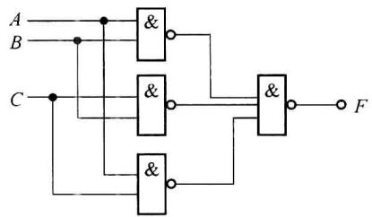

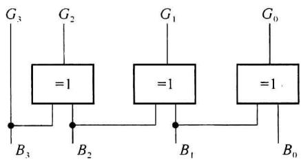

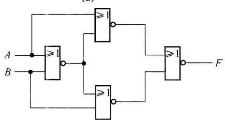  

(c)

(b)  

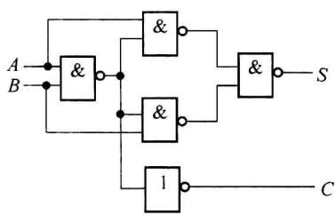

(d)  

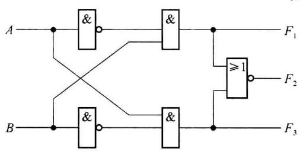  

(e)  

题图3.1
</Exercise>

<Exercise title="习题 3-2">
试分析哪些输入码型可使题图3.2逻辑图中输出 $F$ 为1。

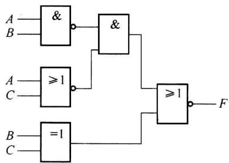  

题图3.2
</Exercise>

<Exercise title="习题 3-3">
题图 3.3 中, 如果 a 点有接地故障(即 a 点为 0), 同时 b 点有接高电位的故障, 试问对电路的输出有无影响?

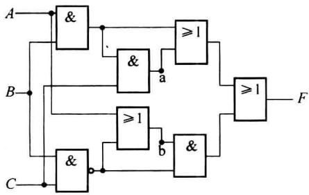  

题图3.3
</Exercise>

<Exercise title="习题 3-4">
试分析题图 3.4 所示各逻辑电路,作出真值表,并说明其逻辑功能。

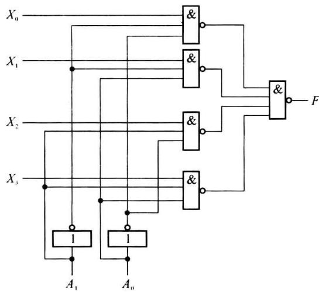  

题图3.4
</Exercise>

<Exercise title="习题 3-5">
已知题图 3.5 是一个受 M 控制的 4 位二进制码和格雷码的相互转换。当 M=1 时，完成自然二进制码至格雷码转换；当 M=0 时，完成相反的转换，试说明之。

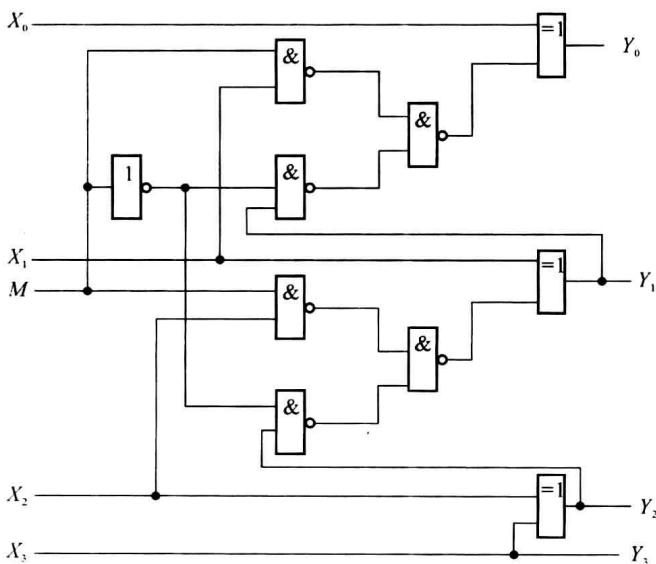  

题图3.5
</Exercise>

<Exercise title="习题 3-6">
分析题图 3.6 所示多功能逻辑运算电路。图中 $S_{3}$ 、 $S_{2}$ 、 $S_{1}$ 、 $S_{0}$ 为控制输入端，列出真值表，说明 F 与 A、B 的关系。

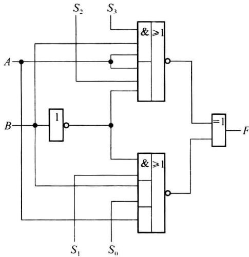  

题图3.6
</Exercise>

<Exercise title="习题 3-7">
在输入既有原变量又有反变量的条件下,用与非门实现下列函数:

(1) $F(A,B,C) = \sum m(2,3,4,5,7)$ ;

(2) $F(A,B,C,D)=\sum m(0,2,6,7,10,12,13,14,15);$

(3) $F(A,B,C,D)=\sum m(0,4,5,6,7,10,11,13,14,15);$

(4) $F(A,B,C,D,E) = A\overline{B} + \overline{A}C + B\overline{C}\overline{D} + BCE + B\overline{D}\overline{E};$

(5) $F(A,B,C,D)=AB+\overline{A+C}\cdot BD+B\overline{C}D;$

$$

F (A, B, C, D) = \sum m (2, 4, 5, 6, 7, 1 0) + \sum \phi (0, 3, 8, 1 5)

$$

(7) $F(A,B,C,D,E)=\sum m(0,1,3,6,7,13,15,20,23,28,31)+\sum\phi(10,12,16,18,25,27,29)$ 。
</Exercise>

<Exercise title="习题 3-8">
设输入既有原变量又有反变量,用与非门实现下列多输出电路:

(1) $F_{1}(A,B,C,D) = \sum m(2,4,5,6,7,10,13,14,15)$ ; $F_{2}(A,B,C,D) = \sum m(2,5,8,9,10,11,12,13,14,15)$ 。  

(2) $F_{1}(A,B,C,D) = \sum m(0,4,8,9,10,14)$ ; $F_{2}(A,B,C,D) = \sum m(1,2,4,5,10,11)$ ; $F_{3}(A,B,C,D) = \sum m(0,1,3,5,7,8,9,10,11,14)$ 。
</Exercise>

<Exercise title="习题 3-9">
在有原变量又有反变量的输入条件下,用或非门设计实现下列函数的组合电路:

(1) $F(A,B,C,D) = \sum m(0,1,2,4,5,10,14,15)$ ;

(2) $F(A,B,C,D) = \prod M(0,1,3,7,9,11,14)\cdot \prod \phi (5,8,10,12);$

(3) $F(A,B,C,D)=\sum m(2,4,6,10,14,15)+\sum\phi(0,3,9,11);$

(4) $F = \overline{A + B} + \overline{B + C} \cdot \overline{A} \overline{B}$ .
</Exercise>

<Exercise title="习题 3-10">
设输入只有原变量而无反变量,试用最少的三级与非门实现下列函数:

(1) $F(A,B,C)=\overline{A}B+A\overline{C}+A\overline{B};$

(2) $F(A,B,C,D)=\sum m(1,2,5,6,8,9,10);$

(3) $F(A,B,C,D)=\sum m(1,3,5,6,7,9,11,12,13,14);$

(4) $F(A,B,C,D) = \prod M(3,6,7,8,12,15)$ 。
</Exercise>

<Exercise title="习题 3-11">
在输入只有原变量没有反变量的条件下,用或非门设计实现下列函数的组合电路:

(1) $F(A,B,C,D)=\prod M(1,2,3,8,9,10)$ ;

(2) $F(A,B,C,D)=\sum m(0,1,5,7,10,11,12,13,14,15)$ 。
</Exercise>

<Exercise title="习题 3-12">
用与非门设计 1 个 4 人表决器, 多数人赞成决议通过, 否则决议不通过。
</Exercise>

<Exercise title="习题 3-13">
设 X、Y 均为 4 位二进制数, 它们分别是一个逻辑电路的输入与输出, 当 $0 \leqslant X \leqslant 4$ 时, $Y = X + 1$ ; 当 $5 \leqslant X \leqslant 9$ 时, Y = X - 1, 且 X 不大于 9。试用与非门实现该电路。
</Exercise>

<Exercise title="习题 3-14">
试为某水坝设计一个水位报警控制器,设水位高度用4位二进制数提供。当水位上升到8m时,白指示灯开始亮;当水位上升到10m时,黄指示灯开始亮;当水位上升到12m时,红指示灯开始亮。水位不可能上升到14m,且同时只允许一个指示灯亮。试用或非门设计此报警器的控制电路。
</Exercise>

<Exercise title="习题 3-15">
已知输入信号 A、B、C、D 的波形如题图 3.7 所示,选择适当的集成逻辑门电路,设计产生输出 F 波形的组合电路(输入无反变量)。

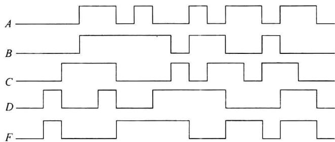  

题图3.7
</Exercise>

<Exercise title="习题 3-16">
设计 1 个 4 位格雷码至 4 位二进制码的转换电路,用异或门实现。
</Exercise>

<Exercise title="习题 3-17">
3人裁判举重比赛，1个主裁判、2个副裁判，认为杠铃举上时，按自己面前的电键（为1），否则不按（为0）；裁判结果用红、绿灯表示，红绿灯都亮（均为1）表示完全举上，只红灯亮表示需研究录像决定，其余为未举上。

(1) 三个裁判均按下自己的电键, 红绿灯全亮;

(2) 两个裁判(其中一个是主裁判)按下自己的电键,红绿灯全亮;

（3）两个副裁判或一个主裁判按下自己的电键，只红灯亮；

(4) 其他情况红绿灯全灭。

用与非门设计满足上述要求的控制电路。
</Exercise>

<Exercise title="习题 3-18">
用与非门实现下列代码转换：

(1) 8421 码转换为余 3 码；

(2) 8421 码转换为 2421 码；

(3) 余 3 码转换为余 3 格雷码。

其代码转换表如题表 3.1 所示。

题表3.1

<table><tr><td>十进制数</td><td colspan="4">8421码</td><td colspan="4">余3码</td><td colspan="4">2421码</td><td colspan="4">余3格雷码</td></tr><tr><td>0</td><td>0</td><td>0</td><td>0</td><td>0</td><td>0</td><td>0</td><td>1</td><td>1</td><td>0</td><td>0</td><td>0</td><td>0</td><td>0</td><td>0</td><td>1</td><td>0</td></tr><tr><td>1</td><td>0</td><td>0</td><td>0</td><td>1</td><td>0</td><td>1</td><td>0</td><td>0</td><td>0</td><td>0</td><td>0</td><td>1</td><td>0</td><td>1</td><td>1</td><td>0</td></tr><tr><td>2</td><td>0</td><td>0</td><td>1</td><td>0</td><td>0</td><td>1</td><td>0</td><td>1</td><td>0</td><td>0</td><td>1</td><td>0</td><td>0</td><td>1</td><td>1</td><td>1</td></tr><tr><td>3</td><td>0</td><td>0</td><td>1</td><td>1</td><td>0</td><td>1</td><td>1</td><td>0</td><td>0</td><td>0</td><td>1</td><td>1</td><td>0</td><td>1</td><td>0</td><td>1</td></tr><tr><td>4</td><td>0</td><td>1</td><td>0</td><td>0</td><td>0</td><td>1</td><td>1</td><td>1</td><td>0</td><td>1</td><td>0</td><td>0</td><td>0</td><td>1</td><td>0</td><td>0</td></tr><tr><td>5</td><td>0</td><td>1</td><td>0</td><td>1</td><td>1</td><td>0</td><td>0</td><td>0</td><td>1</td><td>0</td><td>1</td><td>1</td><td>1</td><td>1</td><td>0</td><td>0</td></tr><tr><td>6</td><td>0</td><td>1</td><td>1</td><td>0</td><td>1</td><td>0</td><td>0</td><td>1</td><td>1</td><td>1</td><td>0</td><td>0</td><td>1</td><td>1</td><td>0</td><td>1</td></tr><tr><td>7</td><td>0</td><td>1</td><td>1</td><td>1</td><td>1</td><td>0</td><td>1</td><td>0</td><td>1</td><td>1</td><td>0</td><td>1</td><td>1</td><td>1</td><td>1</td><td>1</td></tr><tr><td>8</td><td>1</td><td>0</td><td>0</td><td>0</td><td>1</td><td>0</td><td>1</td><td>1</td><td>1</td><td>1</td><td>1</td><td>0</td><td>1</td><td>1</td><td>1</td><td>0</td></tr><tr><td>9</td><td>1</td><td>0</td><td>0</td><td>1</td><td>1</td><td>1</td><td>0</td><td>0</td><td>1</td><td>1</td><td>1</td><td>1</td><td>1</td><td>0</td><td>1</td><td>0</td></tr></table>
</Exercise>

<Exercise title="习题 3-19">
设输入既有原变量又有反变量,试用两块 74LS10(三输入端三与非门)实现下列多输出函数:

(1) $F_{1}(A,B,C,D) = \sum m(6,7,8,9,12)$ ;

(2) $F_{2}(A,B,C,D) = \sum m(5,6,7,8,10,13,15)$ 。
</Exercise>

<Exercise title="习题 3-20">
用两个半加器和一个或门构成一个全加器。
</Exercise>

<Exercise title="习题 3-21">
设计一个无冒险的电路, 其工作条件是: 当输入 4 位码为 $\sum m(0,1,5,7,8,11,15)$ 时, 绿灯亮, 输入其他码时红灯亮。
</Exercise>

<Exercise title="习题 3-22">
判断下列表达式是否存在逻辑冒险,如有,则说明是什么类型的冒险。

(1) $F(A,B,C) = A\overline{B} +\overline{A} C + B\overline{C};$

(2) $F(A,B,C)=\overline{A}\overline{C}+\overline{A}B+AC;$

(3) $F(A,B,C)=(A+B)\cdot(\overline{B}+C);$

(4) $F(A,B,C)=(A+\overline{B})(\overline{A}+C)(B+\overline{C})$ 。
</Exercise>

<Exercise title="习题 3-23">
用卡诺图法消除函数 $F = \overline{A} C + B\overline{C} D + A\overline{B}\overline{C}$ 的冒险。
</Exercise>

<Exercise title="习题 3-24">
用代数法判断题图 3.8 所示各逻辑电路是否存在逻辑冒险,如有,则说明是什么类型的冒险。

(b)  

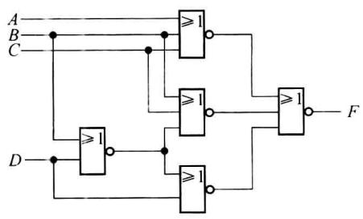

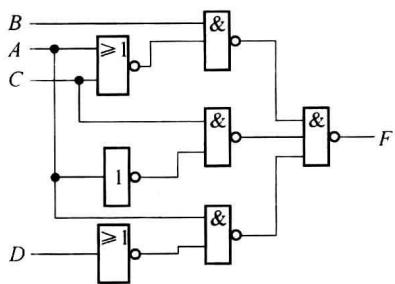

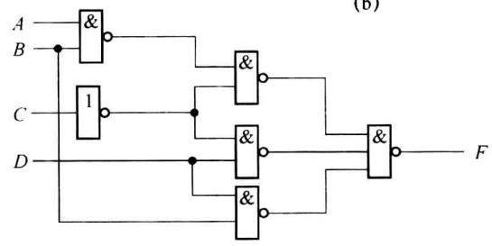  

(c)  

题图3.8
</Exercise>

<Exercise title="习题 3-25">
某逻辑函数的卡诺图如题图 3.9 所示, 试判断当输入信号作如下变化时, 是否存在功能冒险。

(1) ABCD 从 0011→0100;

(2) ABCD 从 0110→0111;

(3) ABCD 从 1010→1100;

(4) ABCD 从 0010→1110;

(5) ABCD 从 1001→1100。

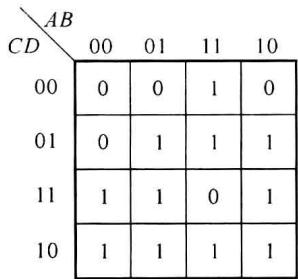
</Exercise>

<Exercise title="习题 3-26">
已知逻辑函数 $F(A, B, C, D) = \sum m(1, 3, 4, 5, 6, 8, 9, 12, 14)$ ，试判断当输入变量变化按自然二进制码的顺序变化时，是否存在静态功能冒险，如果存在，请用选通脉冲法消除。画出用与非门实现的逻辑电路图。

题图3.9
</Exercise>

<Exercise title="习题 3-27">
试用中规模集成 4 位数码比较器扩展成 18 位数码比较器。
</Exercise>

<Exercise title="习题 3-28">
设 A、B、C 为 3 个互不相等的 4 位二进制数。试用 4 位数码比较器和 2 选 1 选择器，设计一个能在 3 个数中选出最小数的逻辑电路。
</Exercise>

<Exercise title="习题 3-29">
试用两个4位数码比较器组成3个数的判断电路。要求能够判别3个4位二进制数 $A(a_{3}a_{2}a_{1}a_{0})$ 、 $B(b_{3}b_{2}b_{1}b_{0})$ 、 $C(c_{3}c_{2}c_{1}c_{0})$ 是否相等、 $A$ 是否最大、 $A$ 是否最小，并分别给出“3个数相等”、“ $A$ 最大”、“ $A$ 最小”的输出信号。可以附加必要的门电路。
</Exercise>

<Exercise title="习题 3-30">
用 4 位数码比较器和 4 位加法器构成 4 位二进制数转换成 8421BCD 码的电路。
</Exercise>

<Exercise title="习题 3-31">
试用 74148 组成 24 线 -5 线优先编码器。
</Exercise>

<Exercise title="习题 3-32">
设计一个 4 线-2 线优先编码器, 要求输入/输出均为高电平有效, 试写出用与非门实现的编码器输出的逻辑表达式。
</Exercise>

<Exercise title="习题 3-33">
用一片 3 线-8 线译码器和与非门构成 1 位全加器。
</Exercise>

<Exercise title="习题 3-34">
试用 4 片 BCD 码/十进制译码器和一个二输入变量的译码器, 组成一个 5 线-32

线的译码器。
</Exercise>

<Exercise title="习题 3-35">
试用 3 片 3 线 -8 线译码器组成一个 5 线 -24 线译码器。
</Exercise>

<Exercise title="习题 3-36">
写出题图 3.10 电路输出 $Y_{1}$ 、 $Y_{2}$ 的逻辑函数式。

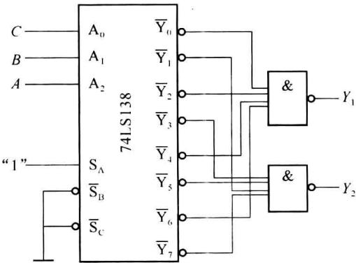  

题图3.10
</Exercise>

<Exercise title="习题 3-37">
用 3 线-8 线译码器设计一个路灯控制电路, 要求在 4 个不同的地方都能独立地开灯和关灯。
</Exercise>

<Exercise title="习题 3-38">
用 3 线-8 线译码器实现二进制码到格雷码的转换。
</Exercise>

<Exercise title="习题 3-39">
写出如题图 3.11 所示的地址译码器的选通信号 $\overline{CS}_{1}$ 、 $\overline{CS}_{2}$ 、 $\overline{CS}_{3}$ 所选中的地址空间范围（以十六进制表示，若不连续，分别写出），地址线为 $A_{7} \sim A_{0}$ 。

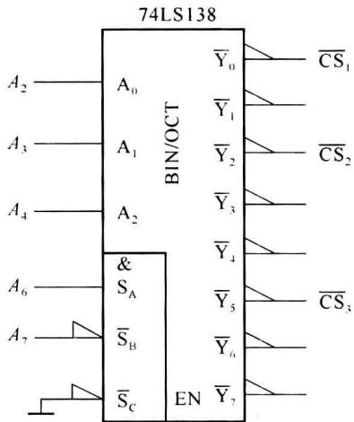  

题图3.11
</Exercise>

<Exercise title="习题 3-40">
用一片双 4 选 1 数据选择器实现 1 位全加器。
</Exercise>

<Exercise title="习题 3-41">
电路的输出 $F$ 与输入 $A, B, C$ 的关系如题图3.12所示，试用一片8选1数据选择器实现。

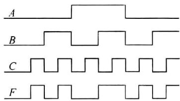  

题图3.12
</Exercise>

<Exercise title="习题 3-42">
用8选1数据选择器实现下列函数(输入提供原变量和反变量):

(1) $F(A,B,C)=AB+BC+AC;$

(2) $F(A,B,C)=A\oplus B\oplus AC\oplus BC;$

(3) $F(A,B,C)=\sum m(0,2,3,6,7);$

(4) $F(A,B,C,D)=\sum m(0,4,5,8,12,13,14);$

$$

F (A, B, C, D) = \sum m (0, 3, 5, 8, 1 1, 1 4) + \sum \phi (1, 6, 1 2, 1 3)

$$

(6) $F(A,B,C,D,E)=\sum m(0,2,4,10,11,15,18,20,25,26,28,29)+\sum\phi(5,6,14,17,22,24)$ 。
</Exercise>

<Exercise title="习题 3-43">
用双 4 选 1 数据选择器实现题 3-42 各函数。
</Exercise>

<Exercise title="习题 3-44">
分析如题图 3.13 所示的 8 选 1 数据选择器组成的电路的逻辑功能。

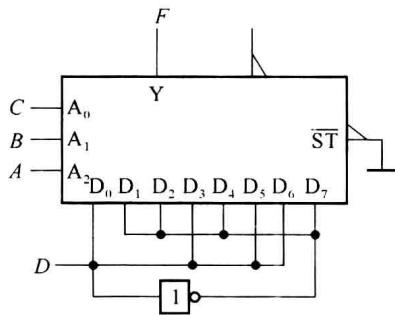  

题图3.13
</Exercise>

<Exercise title="习题 3-45">
分析如题图 3.14 所示的由双 4 选 1 数据选择器组成的电路的逻辑功能。

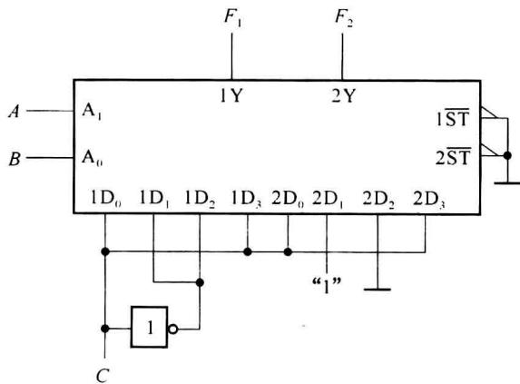  

题图3.14
</Exercise>

<Exercise title="习题 3-46">
用8选1数据选择器设计一个函数发生器电路，它的功能表如题表3.2所示。

题表3.2

<table><tr><td> $S_1$ </td><td> $S_0$ </td><td>Y</td></tr><tr><td>0</td><td>0</td><td>A·B</td></tr><tr><td>0</td><td>1</td><td>A+B</td></tr><tr><td>1</td><td>0</td><td>A⊕B</td></tr><tr><td>1</td><td>1</td><td> $\overline{A}$ </td></tr></table>
</Exercise>

<Exercise title="习题 3-47">
试用6个8路数据选择器连接一个40路数据选择器。
</Exercise>

<Exercise title="习题 3-48">
用 8 选 1 数据选择器产生 10110011 序列信号。
</Exercise>

<Exercise title="习题 3-49">
由8选1数据选择器实现的函数 $F$ 如题图3.15所示。

(1) 写出函数 F 的表达式；

(2) 用 3 线 -8 线译码器 74LS138 实现函数 F。

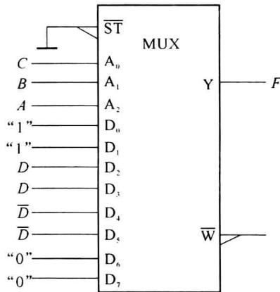  

题图3.15
</Exercise>

<Exercise title="习题 3-50">
设计一个既能实现 1 位二进制全加运算, 又能实现 1 位二进制全减运算的组合逻辑电路。

(1) 写出电路输出函数的最简与或表达式；

(2) 用 3 线 -8 线译码器 74LS138 实现该电路；

(3) 用双 4 选 1 数据选择器 74LS153 实现该电路。
</Exercise>

<Exercise title="习题 3-51">
设 $A, B, C$ 为 3 个互不相等的 4 位二进制数，用 4 位数码比较器和 2 选 1 数据选择器设计一个能在 3 个数中选出最小数的逻辑电路。
</Exercise>

<Exercise title="习题 3-52">
用一片4位加法器构成将余3码转换为8421BCD码的电路。
</Exercise>

<Exercise title="习题 3-53">
用4位加法器和4位数码比较器构成将8421BCD码转换为2421BCD码的电路。
</Exercise>

<Exercise title="习题 3-54">
分析题图 3.16 所示电路, 图中 $A_{3} \sim A_{0}$ 和 $B_{3} \sim B_{0}$ 为两位十进制数的 8421BCD

码,输出为二进制数,说明该电路完成的功能。

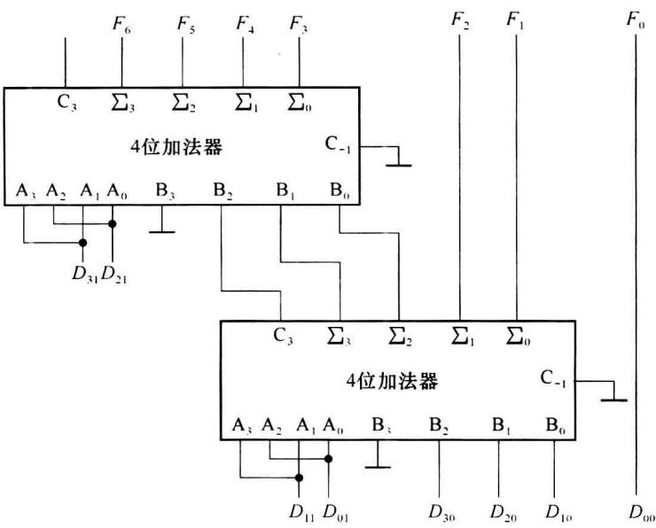  

题图3.16
</Exercise>

<Exercise title="习题 3-55">
试用 74LS283 加法器和逻辑门实现 1 位 8421BCD 码减法电路, 输入/输出均是 BCD 码。

## 第 4 章 集成触发器

从本章开始学习时序逻辑电路(Sequential Logic Circuit)的分析与设计。主要介绍触发器的特点、构成及时序电路描述和分析方法。
</Exercise>
