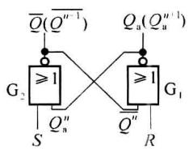
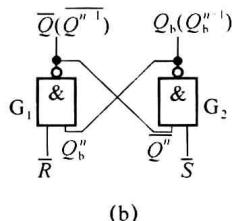
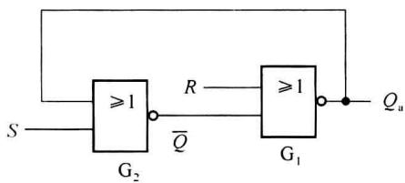
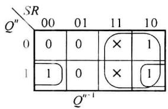
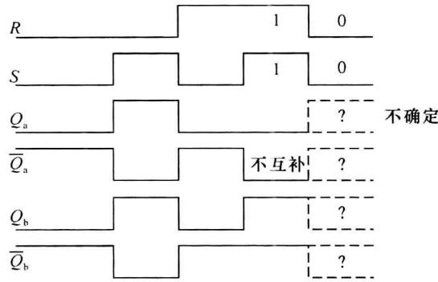
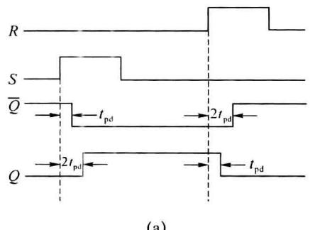
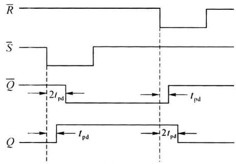
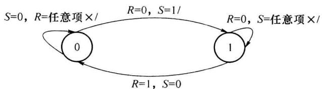

import Guide from '@/components/Guide.astro';
import Knowledge from '@/components/Knowledge.astro';
import Example from '@/components/Example.astro';
import Analysis from '@/components/Analysis.astro';
import Solution from '@/components/Solution.astro';
import Variant from '@/components/Variant.astro';
import Note from '@/components/Note.astro';
import Block from '@/components/Block.astro';
import Method from '@/components/Method.astro';
import Exercise from '@/components/Exercise.astro';

## 4.3.1 电路结构及工作原理

基本 RS 触发器是一切触发器构成的基础。

### 1. 结构

基本 RS 触发器由两级或非门或两级与非门交叉形成, 如图 4.3.1 所示, 其中, S 为 Set 置位端, R 为 Reset 复位端。图 4.3.1 (a) 的等效图如图 4.3.2 所示。

(a)  

  

图4.3.1 基本RS触发器的两种结构图

  

图4.3.2 图4.3.1(a)的另一种画法

两种结构图均反映了一个基本特点:时序电路的下一状态是其输入和现在状态的函数。

由于或非门有1就输出0,1信号起作用,1有效;与非门有0就输出1,0信号起作用,0有效。为统一两者取值关系,在与非门组成的触发器输入信号上加非号成 $\overline{SR}$ ,逻辑符号上R、S端加一小圆圈,表示0有效。图4.3.1(a)称为RS触发器,图4.3.1(b)称为 $\overline{R}\overline{S}$ 触发器。

### 2. 原理

由图 4.3.1(a)、(b) 不难得出两种结构的触发器具有下面相同的结论：

(1) 当 $\left.\begin{aligned}S=0,R=0\\ \overline{S}=1,\overline{R}=1\end{aligned}\right\}$ 时， $Q^{n+1}=Q^{n}$ ，触发器保持原状态。

(2) 当 $\left.\begin{aligned}S=0,R=1\\ \overline{S}=1,\overline{R}=0\end{aligned}\right\}$ 时， $Q^{n+1}=0$ ，复位，触发器置 0。

(3) 当 $\left.\begin{aligned} S=1, R=0 \\ \overline{S}=0, \overline{R}=1 \end{aligned}\right\}$ 时， $Q^{n+1}=1$ ，置位，触发器置 1。

(4) 当 $\left.\begin{aligned} S=1, R=1 \\ \overline{S}=0, \overline{R}=0 \end{aligned}\right\}$ 时，或非门： $Q^{n+1}=0, \overline{Q^{n+1}}=0$ ；与非门： $Q^{n+1}=1, \overline{Q^{n+1}}=1$ 。这是触发器的禁止状态，因为：

① 此时输出 $Q = \overline{Q}$ 相等, 破坏了输出端互补的逻辑关系。

② 若以此时的状态作现在状态，则当 $S, R$ 同时由 $1 \to 0(\overline{S}, \overline{R}$ 由 $0 \to 1)$ ，由于两个门的延迟时间不同 $(t_{\mathrm{pd1}} \neq t_{\mathrm{pd2}})$ ，且谁大谁小具有随机性，当 $t_{\mathrm{pd1}} < t_{\mathrm{pd2}}$ 时， $Q^{n+1} = 1$ ， $t_{\mathrm{pd1}} > t_{\mathrm{pd2}}$ 时， $Q^{n+1} = 0$ ，所以新状态不确定；而 $R, S$ 非同时由 $1 \to 0$ 时，若 $S$ 先由 $1 \to 0$ ， $Q^{n+1} = 0$ ，若 $R$ 先由 $1 \to 0$ ， $Q^{n+1} = 1$ ，新状态同样不确定。

故综合以上情况,基本 RS 触发器不允许 S=R=1 出现,称为约束条件,即 $R \cdot S = 0$ 。

## 4.3.2 描述触发器(时序电路)的方法

下面以基本 RS 触发器为例介绍。

### 1. 状态表

将输入信号称为外输入, 触发器的原状态 $Q^{n}$ 称为内输入。状态表是用表格形式表示所有可能的输入与输出的对应关系, 类似于真值表, 更常以卡诺图(二维真值表)的形式出现。由此可以得到基本 RS 触发器的状态表如图 4.3.3 所示。

S=R=1 为不允许输入,在表中表现为任意项。

### 2. 功能表

为简化的状态表, 只列出外输入与输出 $Q^{n+1}$ 的对应关系, 多用于器件手册。基本 RS 触发器的功能表如表 4.3.1 所示。

  

图4.3.3 基本RS触发器的状态表

表 4.3.1 基本 RS 触发器的功能表

<table><tr><td>S</td><td>R</td><td> ${\mathrm{Q}}^{n + 1}$ </td><td>功能说明</td></tr><tr><td>0</td><td>0</td><td> ${\mathrm{Q}}^{n}$ </td><td>保持</td></tr><tr><td>0</td><td>1</td><td>0</td><td>置0</td></tr><tr><td>1</td><td>0</td><td>1</td><td>置1</td></tr><tr><td>1</td><td>1</td><td>×</td><td>不允许</td></tr></table>

功能表在形式上与组合逻辑电路的真值表相似, 左边是输入状态的各种组合; 右边是相应的输出状态。但这时输出取值中除了 0 和 1 之外还有反映过去输入结果的 $Q^n$ ，这正体现出时序电路的特性。

### 3. 状态方程(特征方程)

将输入 S、R、 $Q^{n}$ 和 $Q^{n+1}$ 之间的关系用函数式表示出来，有两种方法：

(1) 化简图 4.3.3 基本 RS 触发器的状态表, 可得:

$$

\left\{ \begin{array}{l} Q ^ {n + 1} = S + \overline {{{R}}} Q ^ {n} \\ R \cdot S = 0 \end{array} \right.\tag{4.3.1}

$$

(2) 从电路图 4.3.1(a) 中直接求得: $Q^{n+1} = \overline{R + S + Q^n} = \overline{R}(S + Q^n) = S\overline{R} + \overline{R}Q^n$ , 由于有约束条件 $R \cdot S = 0$ , 可在上式中加入一项 $RS$ , 得:

$$

\left\{ \begin{array}{l l} Q ^ {n + 1} = S   \overline {{R}} + \overline {{R}} Q ^ {n} + R S = S + \overline {{R}} Q ^ {n} \\ R \cdot S = 0 (\text {或非门}) \text {或} \overline {{R}} + \overline {{S}} = 1 (\text {与非门}) \end{array} \right.\tag{4.3.2}

$$

可见两种方法的结论相同， $\overline{RS}$ 触发器的状态方程和 $RS$ 触发器是一致的，仅约束条件的形式有所不同，以后统一采用公式(4.3.1)。

### 4. 波形图(时序图)

触发器输入信号和其输出 Q 之间对应关系的工作波形图称做时序图，可直观地说明触发器的特性。根据功能表就可由触发器的现在状态及输入来决定触发器的下一状态，图 4.3.4 为基本 RS 触发器的波形图，设初始状态为 $Q_{0}=0$ ，图中虚线部分表示状态不确定。

  

图4.3.4 基本RS触发器的波形图

正像所有逻辑电路都有延迟，RS 触发器的输出对输入也有一定的延迟。设每个或非门（与非门）的延迟时间为 $t_{pd}$ ，则可以得到图 4.3.5(a)、(b) 的波形图，图(a) 是带延迟的或非门基本触发器的输出波形，图(b) 是带延迟的与非门基本触发器的输出波形。在图(a) 中当 S 变为 1 时，经过一个 $t_{pd}$ 后引起 $\overline{Q}$ 的变化，再经过一个 $t_{pd}$ 引起 Q 的变化。而在图(b) 中，则是 $\overline{S}$ 变为低电平后先引起 Q 的变化（延迟 $t_{pd}$ ），再经过一个 $t_{pd}$ 后才引起 $\overline{Q}$ 的变化。所以考虑到门延迟的影响，要保证基本 RS 触发器有稳定的输出，输入信号的持续时间应大于 $2t_{pd}$ 。

  

图4.3.5 考虑延迟的基本RS触发器波形图

### 5. 状态图(或状态转移图)

以图形方式表示输出状态转换的条件和规律。用圆圈○表示各状态，圈内注明状态名或取值，用箭头→表示状态间的转移，箭头指向新状态，线上注明状态转换的条件/输出，条件可以多个。基本RS触发器的状态图如图4.3.6所示。

  

图4.3.6 基本RS触发器的状态图

### 6. 激励表

列出已知的状态转换和所要求的输入条件的表格叫激励表。是以当前状态 $Q^n$ 和下一状态 $Q^{n + 1}$ 为变量，以对应的输入变量 $R, S$ 为函数的关系表，即在什么样的激励下，才能使 $Q^n \to Q^{n + 1}$ 。表4.3.2为基本RS触发器的激励表。

表 4.3.2 基本 RS 触发器的激励表

<table><tr><td> ${Q}^{n}$ </td><td> ${Q}^{n + 1}$ </td><td>S</td><td>R</td></tr><tr><td>0</td><td>0</td><td>0</td><td>×</td></tr><tr><td>0</td><td>1</td><td>1</td><td>0</td></tr><tr><td>1</td><td>0</td><td>0</td><td>1</td></tr><tr><td>1</td><td>1</td><td>×</td><td>0</td></tr></table>

显然以上各种描述方法之间可以互相转换。

对于触发器,最重要的是掌握它们的特征方程和约束条件。

## 4.3.3 基本 $RS$ 触发器的特点

（1）状态转换时刻和方向（即变成哪种状态），同受输入信号 S、R 控制，为异步时序电路。

(2) 基本 $RS$ 触发器是组成各类触发器的基础。(因为 $R, S$ 输入有限制, 所以使用不便。)

在一些数字系统中,往往要求触发器的状态不是在输入信号变化时立即转换,而是等待一个控制脉冲到达时才转换,这个控制脉冲就是时钟脉冲 CP(Clock Pulse)。

用一个时钟信号保持整个时序系统协调工作的电路称为同步时序电路。

转换时刻受 CP 控制的触发器称为钟控触发器, 是同步时序电路的基础。下面介绍各种钟控触发器。
