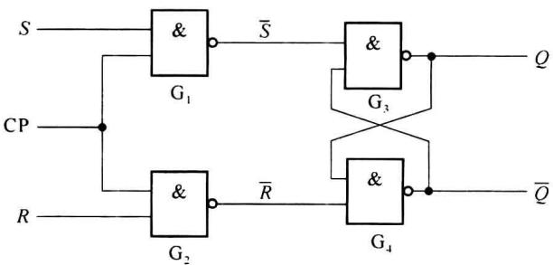
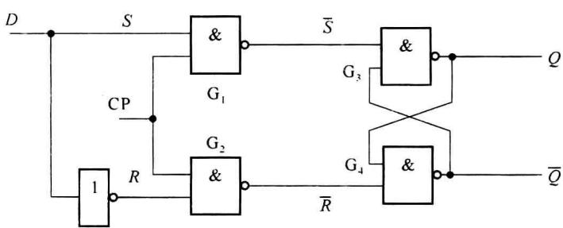
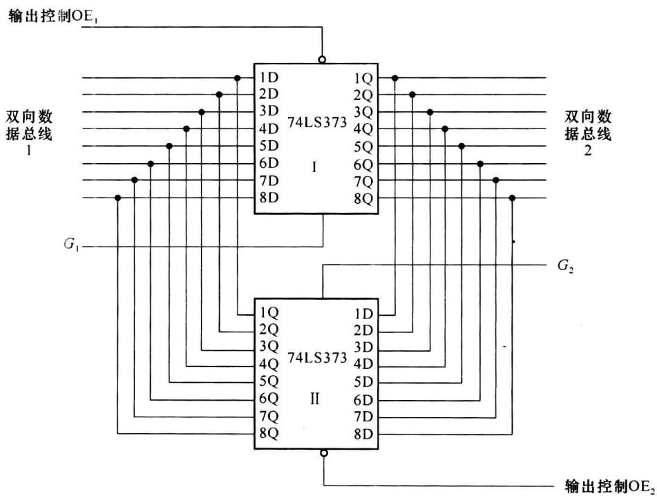
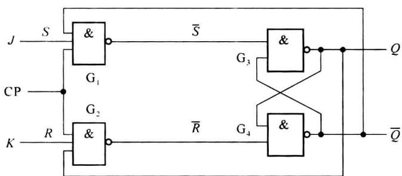
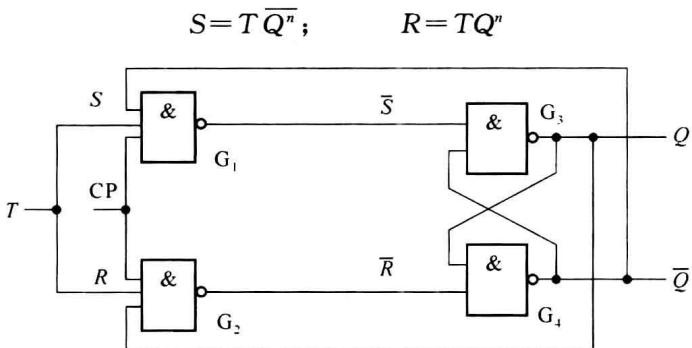
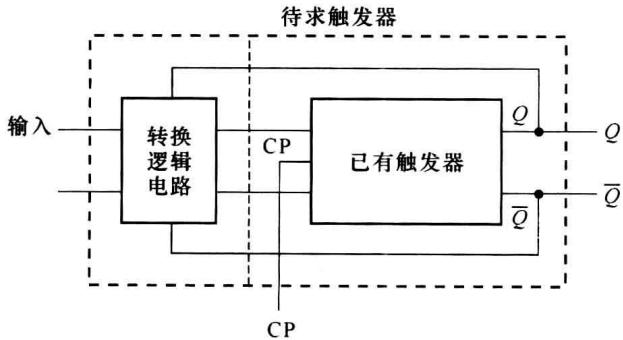
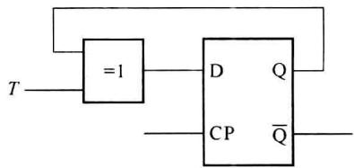

import Guide from '@/components/Guide.astro';
import Knowledge from '@/components/Knowledge.astro';
import Example from '@/components/Example.astro';
import Analysis from '@/components/Analysis.astro';
import Solution from '@/components/Solution.astro';
import Variant from '@/components/Variant.astro';
import Note from '@/components/Note.astro';
import Block from '@/components/Block.astro';
import Method from '@/components/Method.astro';
import Exercise from '@/components/Exercise.astro';

## 4.4.1 钟控 $RS$ 触发器

### 1. 结构

具有时钟输入的 RS 触发器如图 4.4.1 所示，由 4 个与非门构成，与非门 G3、G4 构成基本 $\overline{R} \overline{S}$ 触发器。

  

图 4.4.1 钟控 RS 触发器逻辑图

### 2. 原理

电路的工作分为两种情况：

(1) 当 CP=0 时, 与非门 $G_{1}$ 、 $G_{2}$ 的输出都为 1, 即 $\overline{R}\overline{S}=11$ 。由 $\overline{R}\overline{S}$ 触发器的性能可知

此时触发器保持原状态,即

$$

Q ^ {n + 1} = Q ^ {n} \cdot \overline {{{\mathrm{CP}}}}

$$

(2) 当 $\mathrm{CP} = 1$ 时, $\mathrm{G}_{1}, \mathrm{G}_{2}$ 打开, 输入信号 $RS$ 通过 $\mathrm{G}_{1}, \mathrm{G}_{2}$ 作用到 $\overline{R} \overline{S}$ 触发器的输入端, 实现基本 $RS$ 触发器的功能, 即

$$

Q ^ {n + 1} = (S + \overline {{{R}}} Q ^ {n}) \cdot \mathrm{CP}

$$

综合以上两种情况,可以得出钟控 RS 触发器的状态方程为

$$

Q ^ {n + 1} = (S + \overline {{{R}}} Q ^ {n}) \cdot \mathrm{CP} + Q ^ {n} \cdot \overline {{{\mathrm{CP}}}}

$$

对于有时钟的电路,其状态方程中应该有 CP 这个输入变量。但由于在 CP=0 时,触发器只是维持原状态,因此,一般都把状态方程只限于 CP=1 的情况,省去 CP 这个变量: $Q^{n+1}=S+\overline{R}Q^{n}$ (此时 CP=1),其功能表如表 4.4.1 所示。

钟控 RS 触发器在 CP=0 时, 维持原状态; 在 CP=1 时, 输出随输入按基本 RS 触发器的特性而变化, 这种钟控触发方式称为电位触发。

表 4.4.1 钟控 RS 触发器功能表

<table><tr><td>CP</td><td>S</td><td>R</td><td> $Q^{n+1}$ </td><td>功能说明</td></tr><tr><td>0</td><td>×</td><td>×</td><td> $Q^n$ </td><td>保持</td></tr><tr><td>1</td><td>0</td><td>0</td><td> $Q^n$ </td><td>保持</td></tr><tr><td>1</td><td>0</td><td>1</td><td>0</td><td>置0</td></tr><tr><td>1</td><td>1</td><td>0</td><td>1</td><td>置1</td></tr><tr><td>1</td><td>1</td><td>1</td><td>×</td><td>不允许</td></tr></table>

钟控 RS 触发器的缺点是输入有限制, 使用不方便。

## 4.4.2 钟控 $D$ 触发器

在钟控 RS 触发器的输入部分加一个反相器, 将两个输入端减为一个, 就构成了钟控 D 触发器, 其逻辑图示于图 4.4.2。从图中可以看出, 原来的 RS 输入信号, 现在则以 S = D 和 R = $\overline{D}$ 来代替, 因此可利用 RS 触发器的状态方程得出 D 触发器的状态方程, 即当 CP = 1 时:

$$

Q ^ {n + 1} = S + \overline {{{R}}} Q ^ {n} = D + \overline {{{\overline {{{D}}}}}} Q ^ {n} = D\tag{4.4.1}

$$

  

图4.4.2 钟控 $D$ 触发器

由状态方程可以立即得出 D 触发器的功能表, 如表 4.4.2 所示。可见其逻辑功能十分简单, 就是在时钟信号作用下, 将输入的数据接收并保存。由于 D 触发器只有一个输入端, 在许多情况下, 可使触发器之间的连接变得简单, 因此使用十分广泛。

表 4.4.2 D 触发器功能表

<table><tr><td>CP</td><td>D</td><td> $Q^{n+1}$ </td><td>功能说明</td></tr><tr><td>0</td><td>×</td><td> $Q^n$ </td><td>保持</td></tr><tr><td>1</td><td>0</td><td>0</td><td>置0</td></tr><tr><td>1</td><td>1</td><td>1</td><td>置1</td></tr></table>

## 4.4.3 锁存器

在实际中,有些数据出现时间很短,但使用的时间比较长,就需要在数据出现时,将数据存储起来,以便以后使用。完成这种功能的部件称为锁存器(Latch)。

由于 D 触发器有直接存储数据的功能,一般都是用 D 触发器构成锁存器。一位钟控 D 触发器只能传送或存储一位数据,而在实际工作中往往希望一次传送或存储多位数据。为此可以把若干个钟控 D 触发器的控制端 CP 连接起来,用一个公共的控制信号来控制,而各个数据端仍然是各自独立地接收数据。

集成锁存器的品种很多,位数有2位、4位、8位等,输出有单输出Q,反相输出 $\overline{Q}$ ,以及互补输出Q和 $\overline{Q}$ 。常用的8位D锁存器74LS373还带有输出三态控制,使输出可以呈现0、1或高阻3种状态,表4.4.3是其功能表。注意:无时钟信号CP,而是电位信号G。

表 4.4.3 8 位 D 锁存器 74LS373 功能表

<table><tr><td>输出控制 OE</td><td>G</td><td>D</td><td> ${Q}^{n + 1}$ </td></tr><tr><td>0</td><td>1</td><td>1</td><td>1</td></tr><tr><td>0</td><td>1</td><td>0</td><td>0</td></tr><tr><td>0</td><td>0</td><td>×</td><td> ${Q}^{n}$ </td></tr><tr><td>1</td><td>×</td><td>×</td><td>高阻</td></tr></table>

利用这种锁存器，可以构成双向数据锁存器，逻辑图如图4.4.3所示。当输出控制信号 $\mathrm{OE}_1 = 0$ 和 $\mathrm{OE}_2 = 1$ 时，锁存器Ⅱ输出为高阻态，锁存器I工作，数据可以从左边传送到右边。而当 $\mathrm{OE}_1 = 1$ 和 $\mathrm{OE}_2 = 0$ 时，锁存器I为高阻抗输出，锁存器II工作，数据可以从右边传到左边，从而完成了双向数据传送和锁存的功能。

  

图4.4.3 由74LS373构成双向数据锁存器

锁存器仍然是一种电位控制的触发器,在控制信号有效时,输出是随输入数据的变化而变化的。有的资料上把由脉冲边沿触发的 D 触发器构成的数据寄存器也称为锁存器。而实际上，这两类电路的工作是不同的。为了加以区别，有时称前者为透明式锁存器，而把后一种称为非透明的锁存器。

锁存器在实践中有广泛的应用,但它们不能用在同步时序系统中构成计数器、移位寄存器或其他同步电路。

## 4.4.4 钟控JK触发器

另一种使用十分广泛的触发器是 $JK$ 触发器。它有两个输入端，但对输入的取值不再受限制，即可以取00、01、10、114种组合的任何一种。 $JK$ 触发器的逻辑图如图4.4.4所示，是由钟控 $RS$ 触发器加上两条反馈线而构成的：即从 $\overline{Q}$ 反馈到原 $S$ 信号输入门，从 $Q$ 反馈到原 $R$ 信号输入门，并把 $S$ 输入端改为 $J, R$ 输入端改为 $K$ 。这样，实际的 $R$ 和 $S$ 信号为

$$

S = J \overline {{{Q ^ {n}}}}; \qquad R = K Q ^ {n}

$$

  

图4.4.4 钟控JK触发器

把它们代入 $RS$ 触发器的状态方程可得

$$

Q ^ {n + 1} = S + \overline {{{R}}} Q ^ {n} = J \overline {{{Q ^ {n}}}} + \overline {{{K Q ^ {n}}}} \cdot Q ^ {n} = J \overline {{{Q ^ {n}}}} + \overline {{{K}}} Q ^ {n}\tag{4.4.2}

$$

由状态方程可作出 JK 触发器的功能表 4.4.4。

表 4.4.4 JK 触发器的功能表

<table><tr><td>CP</td><td>J</td><td>K</td><td> ${Q}^{n + 1}$ </td><td>功能说明</td></tr><tr><td>0</td><td>×</td><td>×</td><td> ${Q}^{n}$ </td><td>保持</td></tr><tr><td>1</td><td>0</td><td>0</td><td> ${Q}^{n}$ </td><td>保持</td></tr><tr><td>1</td><td>0</td><td>1</td><td>0</td><td>置0</td></tr><tr><td>1</td><td>1</td><td>0</td><td>1</td><td>置1</td></tr><tr><td>1</td><td>1</td><td>1</td><td> $\overline{{Q}^{n}}$ </td><td>翻转</td></tr></table>

由表可见,RS 触发器对输入 11 组合不允许出现的限制,在这里不再存在,从而使得 JK 触发器的使用,比 RS 触发器广泛得多。

## 4.4.5 钟控 $T$ 触发器

把 JK 触发器的两个输入端连接在一起,构成了另一种只有一个输入端的触发器,称为

T 触发器, 其逻辑图如图 4.4.5 所示。采用与 JK 触发器同样的分析方法, 可知这时的等效 R、S 输入信号为

  

图4.4.5 钟控 $T$ 触发器

因此， $T$ 触发器的状态方程为

$$

Q = S + R Q = T \overline {{Q ^ {n}}} + \overline {{T Q ^ {n}}} \cdot Q ^ {n} = T \overline {{Q ^ {n}}} + \overline {{T}} Q ^ {n} = T \oplus Q ^ {n}\tag{4.4.3}

$$

其逻辑功能也很简单, 当 T=0 时, 触发器状态不变, 而当 T=1 时, 触发器状态就翻转一次。表 4.4.5 是 T 触发器的功能表。

当 $T \equiv 1$ 或没有 T 输入端（对 TTL 电路来说，这隐含着 $T \equiv 1$ ），则来一个时钟脉冲，触发器就改变一次状态，这种触发器称为 $T'$ 触发器或计数触发器，其状态方程为

$$

Q ^ {n + 1} = \overline {{{{Q ^ {n}}}}}

$$

表 4.4.5 T 触发器的功能表

<table><tr><td>CP</td><td>T</td><td> $Q^{n+1}$ </td><td>功能说明</td></tr><tr><td>0</td><td>×</td><td> $Q^n$ </td><td>保持</td></tr><tr><td>1</td><td>0</td><td> $Q^n$ </td><td>保持</td></tr><tr><td>1</td><td>1</td><td> $\overline{Q^n}$ </td><td>翻转</td></tr></table>

(4.4.4)

## 4.4.6 各种触发器之间的转换

目前市场上出售的集成触发器,从功能上看,大多是 $JK$ 触发器和 $D$ 触发器。这是因为 $JK$ 触发器的逻辑功能最为完善,而 $D$ 触发器对于单端信号输入时使用最为方便。在实际工作中,经常需要利用手中现有的触发器完成其他触发器的逻辑功能,这就需要将不同功能的触发器进行转换。图 4.4.6 表示触发器逻辑功能转换的框图,图中已有触发器是给定的,与转换逻辑电路一起构成待求功能的触发器,转换的关键是转换逻辑电路。转换逻辑电路的输入端为转换后触发器的输入端,而其输出端为已有触发器输入端。同时应注意,转换前后的触发方式不变。

  

图 4.4.6 触发器逻辑功能转换框图

转换依据是转换前后的状态方程相等,转换方法有两种:公式法和真值表法。如将 D 触发器转换为 T 触发器。

### 1. 公式法

因为在 CP=1 时， $D:Q^{n+1}=D,T:Q^{n+1}=T\oplus Q^{n}$ ，所以 $D=T\oplus Q^{n}$ ，得到转换图 4.4.7。

  

图4.4.7 由 $D$ 触发器到 $T$ 触发器的转换

### 2. 真值表法

将 $Q^{n}$ 、T 作为输入变量，先得到 $Q^{n+1}$ 的值，再根据 $Q^{n}$ 到 $Q^{n+1}$ 的状态转移求出此时所需的激励信号 D，即得以 $Q^{n}$ 、T 为输入变量的函数 D 的真值表，如表 4.4.6 所示。中间一列 $Q^{n+1}$ 只起过渡作用。

表 4.4.6 求 $D$ 的真值表

<table><tr><td> ${Q}^{n}$ </td><td>T</td><td> ${Q}^{n + 1}$ </td><td>D</td></tr><tr><td>0</td><td>0</td><td>0</td><td>0</td></tr><tr><td>0</td><td>1</td><td>1</td><td>1</td></tr><tr><td>1</td><td>0</td><td>1</td><td>1</td></tr><tr><td>1</td><td>1</td><td>0</td><td>0</td></tr></table>

由真值表可以求出 D 的表达式: $D=\overline{Q^{n}}\cdot T+Q^{n}\cdot\overline{T}=T\oplus Q^{n}$ 。

公式法简单,但适用范围窄;真值表法适用范围广。

## 4.4.7 钟控触发器的缺点

以上这些钟控触发器均为电位触发, 即在 CP=1 时触发器状态随输入信号变化而改变, 所以为了使这类触发器稳定可靠工作, 要求在 CP=1 期间, 输入信号不变, 这就限制了它们的应用, 同时也说明这类触发器的抗干扰能力较差。

另一方面，在 CP=1 时，即使输入信号不变，对于 $T'$ 触发器及 JK 触发器 J=K=1 时，触发器的状态转移均为 $Q^{n+1}=\overline{Q^{n}}$ ，因此，若 CP=1 的脉冲宽度较宽，超过组成触发器的门的延迟时，触发器将会出现连续不停地多次翻转，这种现象叫做空翻。如果要求每来一个 CP 脉冲，触发器仅发生一次翻转的话，则对脉冲信号的宽度要求极其苛刻。

故电位触发式触发器工作不可靠,在使用时有两个限制:

(1) CP=1 时, 脉冲信号的宽度要求窄。

(2) CP=1 时, 输入信号不变。

但由于外来干扰不易控制,还会引起错翻。所以产生了主从触发器和边沿触发器两种实用的触发器,它们在1个CP到来时,只翻转一次,且对CP要求不高。
