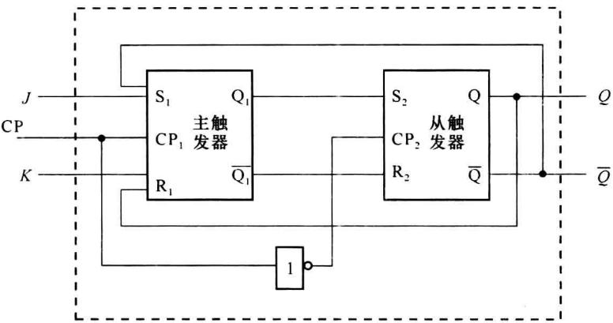
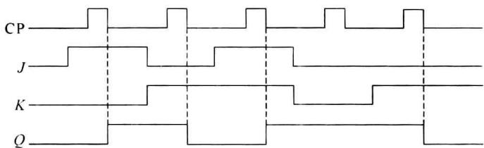
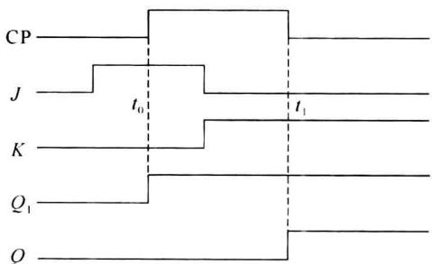
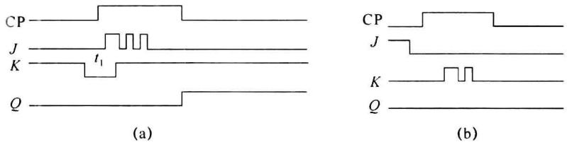
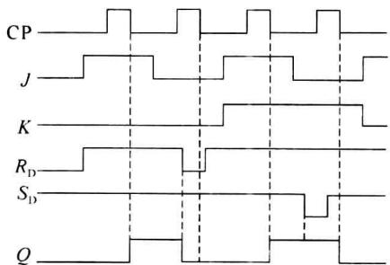

import Guide from '@/components/Guide.astro';
import Knowledge from '@/components/Knowledge.astro';
import Example from '@/components/Example.astro';
import Analysis from '@/components/Analysis.astro';
import Solution from '@/components/Solution.astro';
import Variant from '@/components/Variant.astro';
import Note from '@/components/Note.astro';
import Block from '@/components/Block.astro';
import Method from '@/components/Method.astro';
import Exercise from '@/components/Exercise.astro';

实际用于同步时序电路中的触发器应该在一个时钟周期中, 只能翻转一次, 并且对于时钟的宽度不应有苛刻的要求。主从触发器可以满足这些要求, 是目前应用最广泛的集成触发器之一。

## 4.5.1 基本工作原理

图 4.5.1 是 TTL 主从触发器的原理逻辑图。

  

图4.5.1 主从 $JK$ 触发器

它由两个钟控RS触发器构成:与输入相连的称为主触发器(Master Flip-flop),与输出相连的称为从触发器(Slave Flip-flop),两条反馈线由从触发器的输出接到主触发器的输入,从而使整个电路具有JK触发器的特性而不是RS触发器的特性。时钟CP直接作用于主触发器,经反相后再作用于从触发器。

其工作原理依据主、从触发器的时钟反相的特点容易理解。先假设在 CP=1 期间，输入 J、K 不变。工作分为两个阶段：

（1）当 $\mathrm{CP} = 0$ 时， $\mathrm{CP}_1 = 0,\mathrm{CP}_2 = 1$ ，使主触发器封锁，保持原状态，从触发器工作，其输入信号为

所以

$$

\begin{array}{r l} & S _ {2} = Q _ {1} ^ {n} \\ & R _ {2} = \overline {{{Q _ {1} ^ {n}}}} \\ & Q ^ {n + 1} = S _ {2} + \overline {{{R _ {2}}}} Q ^ {n} = Q _ {1} ^ {n} + \overline {{{\overline {{{Q _ {1} ^ {n}}}}}}} \cdot Q ^ {n} = Q _ {1} ^ {n} \end{array}

$$

从触发器重复主触发器的状态。即将主触发器的状态传送给从触发器，并且在整个CP=0期间，由于主触发器状态不变，所以从触发器状态也不再改变。

（2）当 $\mathrm{CP} = 1$ 时， $\mathrm{CP}_1 = 1,\mathrm{CP}_2 = 0$ ，使从触发器封锁，保持原状态，主触发器工作，其输入信号为

$$

\left. \begin{array}{l} S _ {1} = J \overline {{Q ^ {n}}} \\ R _ {1} = K Q ^ {n} \end{array} \right\}\tag{4.5.1}

$$

所以

$$

Q _ {1} ^ {n + 1} = S _ {1} + \overline {{{R _ {1}}}} Q _ {1} ^ {n} = J \overline {{{Q ^ {n}}}} + \overline {{{K Q ^ {n}}}} \cdot Q _ {1} ^ {n} = J \overline {{{Q ^ {n}}}} + \overline {{{K}}} Q _ {1} ^ {n} + \overline {{{Q ^ {n}}}} Q _ {1} ^ {n}\tag{4.5.2}

$$

由于在时钟出现之前,主触发器的状态和从触发器状态是一致的,即 $Q_{1}^{r}=Q^{r}$ ,则式(4.5.2)可

改写为

$$

Q _ {1} ^ {n + 1} = J \overline {{{{Q _ {1} ^ {n}}}}} + \overline {{{{K}}}} Q _ {1} ^ {n} = J \overline {{{{Q ^ {n}}}}} + \overline {{{{K}}}} Q ^ {n}

$$

这是 JK 触发器的状态方程, 即主触发器的状态按 JK 触发器的功能发生变化。

故主从 JK 触发器的工作过程: 在 CP=1 时, 主触发器的状态按 JK 触发器特性决定, 然后在 CP 从 1→0 时, 再将此状态传送到从触发器输出, 由于此时主触发器封锁, 所以输出不随输入变化, 只在 CP 下降沿改变一次输出状态。

由此可知,主从 JK 触发器输出变化的时刻在时钟的下降沿,输出变化的方向由时钟脉冲下降时的 JK 值和 JK 触发器的特性来决定。

图 4.5.2 给出了主从 JK 触发器的波形图, 设初始状态 Q=0。

  

图4.5.2 主从 $JK$ 触发器输出波形

## 4.5.2 主从JK触发器的一次翻转

若在 CP=1 期间，JK 信号发生了变化，由于主触发器工作，虽然从触发器封锁，输出不变，但对主触发器的输出是有影响的，当 CP=0 时，这个影响会传到输出。问题是：主触发器是否也会像钟控触发器那样随输入 JK 变化发生多次翻转？答案是否定的，主触发器只可能发生一次翻转，这就是所谓的主从 JK 触发器的一次翻转现象。

一次翻转的根本原因是由于主触发器的反馈线取自从触发器的输出,而不是自己的输出。当 CP=1 时,从触发器封锁,输出不变,即 $Q^{n}$ 、 $\overline{Q^{n}}$ 不变,由式(4.5.1)可知,主触发器的输入总有一个为 0,这时有两种情况:

(1) 若 $Q^n = 0$ , 由式 (4.5.1) 可得: $S_1 = J, R_1 = 0, S_1R_1$ 只有 10 (置 1)、00 (保持) 两种组合, 而不能为置 0 状态, 所以即使 $JK$ 变化多次, 主触发器只能由 0 到 1 变化一次, 而不可能再返回到 0 状态, 即一次翻转, 并且可知 $K$ 不起作用, 由 $J$ 决定是否翻转, $J = 1$ , 主触发器翻转。

(2) 若 $Q^{n}=1, S_{1}=0, R_{1}=K, S_{1}R_{1}$ 只有 01(置 0)、00(保持)两种组合，而不能为置 1 状态，所以主触发器只能由 1 到 0 翻转一次，由 K 决定是否翻转，K=1，主触发器翻转。

如图 4.5.3 所示的波形图，在 $t_{0}$ 时刻，由于 J=1，所以 $Q_{1}$ 翻转，并在时钟的下降沿 $t_{1}$ 时刻，传给从触发器，使 Q 翻转。

  

图4.5.3 主从 $JK$ 触发器的一次翻转

所以主从 $JK$ 触发器有如下特点：

(1) 输出变化的时刻在时钟的下降沿(用↓表示)。

(2) 输出变化的方向：

① 若在 CP=1 期间，JK 信号不变，由 CP 下降沿的 JK 值决定输出状态。

② 若在 CP=1 期间，JK 信号发生了变化，这时可按以下方法来处理：

\- $\mathrm{CP} = 1$ 以前，若 $Q = 0$ ，则看 $\mathrm{CP} = 1$ 期间的 $J$ 信号，若 $J$ 有1出现，则CP下降时 $Q$ 一定为1。否则， $Q$ 保持0。

\- $\mathrm{CP} = 1$ 以前，若 $Q = 1$ ，则看 $\mathrm{CP} = 1$ 期间的 $K$ 信号，若 $K$ 有1出现，则CP下降时 $Q$ 一定为0。否则， $Q$ 保持1。

例如，图4.5.4(a)所示的波形图， $Q$ 原状态为0。在CP为1期间，在 $t_1$ 时刻 $J = 1$ ，所以在 $\mathrm{CP}\downarrow ,Q$ 变为1。在图4.5.4(b)中，在 $\mathrm{CP} = 1$ 期间，没有出现 $J = 1$ ，所以在 $\mathrm{CP}\downarrow ,Q$ 仍为0。

一次翻转是主从 JK 触发器所特有的现象,其他的集成触发器都无一次翻转现象存在。

  

图 4.5.4 考虑一次翻转的输出波形

## 4.5.3 异步置0置1输入

对于集成 JK 触发器, 状态转换的时刻除了受时钟控制外, 还受异步置 0 置 1 输入的控制。异步置 0 端是 $R_{D}$ , 异步置 1 端是 $S_{D}$ , 其作用是使触发器在任何时刻都被强迫置 0 或置 1, 而与当时的 CP、J、K 值无关, 因此又叫直接置 0 置 1 端。由于它们的作用与时钟是否到来无关, 所以称为异步置位输入。

$R_{D}$ 和 $S_{D}$ 均是低电平有效，当 $R_{D}=0, S_{D}=1$ 时，JK 触发器置 0，当 $S_{D}=0, R_{D}=1$ 时，JK 触发器置 1。但须注意，不允许 $R_{D}$ 和 $S_{D}$ 同时为 0，否则会使 Q 和 $\overline{Q}$ 都为高电位。在不需要置位功能时， $R_{D}$ 和 $S_{D}$ 都应该为 1。图 4.5.5 是带有异步置 0、置 1 输入信号的波形图，可见，当 $R_{D}=0$ 时，输出 Q 立刻变为 0，而当 $S_{D}=0$ 时，由于 Q 已经是 1，所以不影响 Q 的输出。

表 4.5.1 是带有异步置 0 置 1 输入 JK 触发器的功能表。前两行为异步置位功能，“×”表示该信号可为任意值，第三行是不允许状态。下面 4 行反映 JK 触发器特性，此时 $R_{D}=S_{D}=1$ 。也有手册用 H 代表 1，L 代表 0。

  

图 4.5.5 带有异步置 0 置 1 输入的 JK 触发器波形

表 4.5.1 具有异步置 0 置 1 输入的 JK 触发器功能表

<table><tr><td> $S_D$ </td><td> $R_D$ </td><td>CP</td><td>J</td><td>K</td><td>Q</td><td> $\overline{Q}$ </td></tr><tr><td>0</td><td>1</td><td>×</td><td>×</td><td>×</td><td>1</td><td>0</td></tr><tr><td>1</td><td>0</td><td>×</td><td>×</td><td>×</td><td>0</td><td>1</td></tr><tr><td>0</td><td>0</td><td>×</td><td>×</td><td>×</td><td>1*</td><td>1*</td></tr><tr><td>1</td><td>1</td><td>↓</td><td>0</td><td>0</td><td> $Q^n$ </td><td> $\overline{Q^n}$ </td></tr><tr><td>1</td><td>1</td><td>↓</td><td>0</td><td>1</td><td>0</td><td>1</td></tr><tr><td>1</td><td>1</td><td>↓</td><td>1</td><td>0</td><td>1</td><td>0</td></tr><tr><td>1</td><td>1</td><td>↓</td><td>1</td><td>1</td><td> $\overline{Q^n}$ </td><td> $Q^n$ </td></tr><tr><td>1</td><td>1</td><td>1</td><td>×</td><td>×</td><td> $Q^n$ </td><td> $\overline{Q^n}$ </td></tr></table>

\* 此状态不使用。

## 4.5.4 主从触发器的特点

主从 JK 触发器虽然只在时钟的下降沿改变一次状态, 满足了来一个时钟只翻转一次的要求, 可用于同步时序电路; 但在 CP=1 期间, 主触发器对外是开放的, 所以也容易受干扰信号的影响。在使用时, 应该减少 CP=1 宽度, 减少触发器可能接收干扰的时间。
