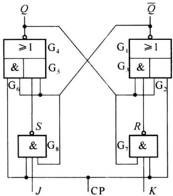
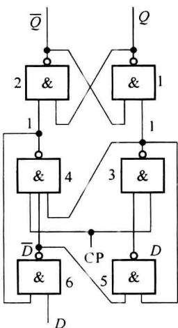
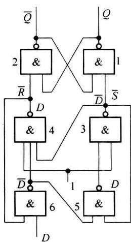
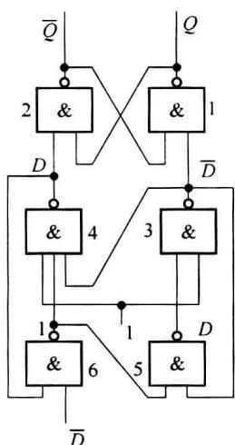
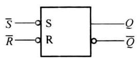
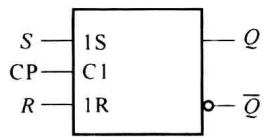
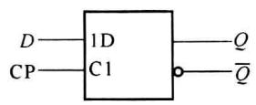
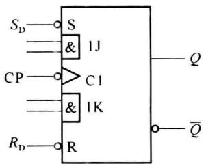
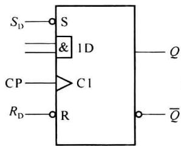
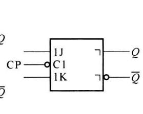

import Guide from '@/components/Guide.astro';
import Knowledge from '@/components/Knowledge.astro';
import Example from '@/components/Example.astro';
import Analysis from '@/components/Analysis.astro';
import Solution from '@/components/Solution.astro';
import Variant from '@/components/Variant.astro';
import Note from '@/components/Note.astro';
import Block from '@/components/Block.astro';
import Method from '@/components/Method.astro';
import Exercise from '@/components/Exercise.astro';

边沿触发器不仅只在时钟信号的某一边沿(上升沿↑或下降沿↓)才改变一次状态,而且状态转换方向仅取决于转换前(CP↑或CP↓)一瞬间的数据输入,故此命名。

边沿触发器的特点: 只在时钟信号的某一边沿(CP↑或CP↓)对输入信号作出响应并引起状态翻转。即: 只有时钟有效边沿附近的输入信号才是真正有效的, 其他时间的输入不影响触发器的输出, 因而提高了抗干扰能力, 工作更可靠。

边沿触发器从电路结构上可分成两类:一类利用门的延迟,另一类用门电路构成维持-阻塞电路,以实现边沿触发的功能。

## 4.6.1 负边沿JK触发器

### 1. 电路构成

图 4.6.1 是利用门的延迟构成的负边沿 JK 触发器逻辑图。两个与或非门构成基本 RS 触发器，两个与非门 $G_{7}$ 、 $G_{8}$ 用来接收 JK 信号。时钟信号一路送给 $G_{7}$ 、 $G_{8}$ ，另一路送给 $G_{2}$ 、 $G_{6}$ ，注意 CP 信号是经 $G_{7}$ 、 $G_{8}$ 延时，所以送到 $G_{3}$ 、 $G_{5}$ 的时间比到达 $G_{2}$ 、 $G_{6}$ 的时间晚一个与非门的延迟时间 ( $1t_{pd}$ )，这就保证了触发器的翻转对准的是 CP 的负边沿。

### 2. 工作原理

下面分 3 个阶段分析：

（1）当 CP=0 时，与门 $G_{2}$ 、 $G_{6}=0$ ，与非门 $G_{7}$ 、 $G_{8}$ 封锁，不接受 JK 输入，输出 S=R=1，使触发器的输出保持不变。

(2) 当 CP=1 时, 与非门 $G_{7}$ 、 $G_{8}$ 打开, 接受 JK 输入, 由图可得输出表达式:

$$

Q ^ {n + 1} = \overline {{\overline {{Q ^ {n}}}}} \cdot \mathrm{CP} + \overline {{\overline {{Q ^ {n}}}}} \cdot S = \overline {{\overline {{Q ^ {n}}}}} + \overline {{\overline {{Q ^ {n}}}}} \cdot S = Q ^ {n}

$$

$$

\overline {{{Q ^ {n + 1}}}} = \overline {{{Q ^ {n} \cdot \mathrm{CP} + Q ^ {n} \cdot R}}} = \overline {{{Q ^ {n} + Q ^ {n} \cdot R}}} = \overline {{{Q ^ {n}}}}\tag{4.6.1}

$$

(4.6.2)

  

图4.6.1 负边沿JK触发器

可知触发器的输出仍保持不变。

（3）在 CP 由 $1 \rightarrow 0$ 的瞬间，CP 信号是直接加到与门 $G_{2}$ 、 $G_{6}$ 输入端，但 $G_{7}$ 、 $G_{8}$ 的输出 S 和 R，需要经过一个与非门延迟 $t_{pd}$ 才能变为 1。设 $\overline{Q^{n}}$ 为 $G_{1}$ 在这一瞬间的输出，则 S、R 在没有变为 1 以前，仍维持 CP 下降前的值：

$$

S = \overline {{J Q ^ {n}}} \quad R = \overline {{K Q ^ {n}}}

$$

由式 $(4.6.1)$ ，可得

$$

Q ^ {n + 1} = \overline {{\overline {{Q ^ {n ^ {\prime}}}}} \cdot 0 + \overline {{Q ^ {n ^ {\prime}}}} \cdot S} = \overline {{\overline {{Q ^ {n ^ {\prime}}}}} \cdot S}\tag{4.6.3}

$$

由式(4.6.2)可得

$$

\overline {{{Q ^ {n}}}} ^ {\prime} = \overline {{{Q ^ {n} \cdot 0 + Q ^ {n} \cdot R}}} = \overline {{{Q ^ {n} \cdot R}}}

$$

代入式(4.6.3)得

$$

\begin{array}{r l} { Q ^ {n + 1} =} & {\overline {{Q ^ {n} \cdot R \cdot S}}} \\ & {= \overline {{Q ^ {n} \cdot K Q ^ {n}}} \cdot \overline {{J Q ^ {n}} (\text {将} S , R \text {代入})}} \\ & {= J \overline {{Q ^ {n}}} + \overline {{K}} Q ^ {n}} \end{array}

$$

显然,这是 JK 触发器的特征方程。

由以上分析可知, 只有时钟下降前的 JK 值才能对触发器起作用并引起翻转, 实现了边沿触发 JK 触发器的功能。

## 4.6.2 维持-阻塞 $D$ 触发器

### 1. 电路组成

图 4.6.2 是正边沿触发维持-阻塞 D 触发器的逻辑图, 共由 6 个与非门构成, 门 1\~4 构成 RS 钟控触发器, 门 5\~6 为信号接收门。它是利用电路的内部反馈构成维持阻塞电路, 来实现正边沿触发功能。

### 2. 工作原理

下面分 3 个阶段分析：

（1）当 $\mathrm{CP} = 0$ 时，如图4.6.2(a)所示，门3和门4的输出都是1，使触发器的输出维持原状态。

(2) 当 CP=1 时, 如图 4.6.2 (b) 所示, 输入的 D 信号经过门 6\~3 加到由门 1 和门 2 构成的 $\overline{R}$ $\overline{S}$ 触发器的输入端, 有 $\overline{S}=\overline{D}, \overline{R}=D$ 即 S=D, R= $\overline{D}$ , 使电路的输出为

$$

Q ^ {n + 1} = S + \overline {{{R}}} Q ^ {n} = D + \overline {{{\overline {{{D}}}}}} Q ^ {n} = D

$$

是 D 触发器的特征方程。

(3) 在 $\mathrm{CP} = 1$ 期间, 如果输入信号 $D$ 发生变化, 如图4.6.2(c)所示, 将输入信号改为 $\overline{D}$ , 以表示 $D$ 信号发生了变化, 其结果只是使门6的输出变为1, 而其他各门的输出仍然与图(b)相同, 输出当然不会改变。

使得在 $\mathrm{CP} = 1$ 期间，触发器输出保持不变的原因是门4输出到门6输入，门3输出到门5输入的反馈。如果没有门4到门6的反馈，输入由 $D$ 变为 $\overline{D}$ 后，变化的结果会传递到门2的输入。现在由于有了这条反馈线，使得门6的输出为1，这就阻塞了输入变化所产生的作用。在门6输出变为1后，通过门3输出到门5输入的反馈，使得门5的输出维持为原来的 $D$ 不变。可见正是这些反馈线起了维持和阻塞作用，因此称这种电路为维持-阻塞型电路。

由以上分析可知,只有在时钟上升前的 D 信号才能进入触发器并引起翻转,故为边沿型触发器,常称为正边沿型 D 触发器。

  

(a)

  

(b)

(c)  

  

图 4.6.2 维持-阻塞 D 触发器

### 3. 功能

表 4.6.1 是正边沿型 D 触发器功能表。其中 $S_{D}$ 和 $R_{D}$ 为异步置 1 和置 0 输入信号，均为 0 有效，非置位工作时都应为 1，注意两个置位输入不能同时为 0。

表 4.6.1 正边沿型 $D$ 触发器功能表

<table><tr><td> $S_D$ </td><td> $R_D$ </td><td>CP</td><td>D</td><td>Q</td><td> $\overline{Q}$ </td></tr><tr><td>0</td><td>1</td><td>×</td><td>×</td><td>1</td><td>0</td></tr><tr><td>1</td><td>0</td><td>×</td><td>×</td><td>0</td><td>1</td></tr><tr><td>0</td><td>0</td><td>×</td><td>×</td><td>1*</td><td>1*</td></tr><tr><td>1</td><td>1</td><td>↑</td><td>1</td><td>1</td><td>0</td></tr><tr><td>1</td><td>1</td><td>↑</td><td>0</td><td>0</td><td>1</td></tr><tr><td>1</td><td>1</td><td>0</td><td>×</td><td> $Q^n$ </td><td> $\overline{Q^n}$ </td></tr></table>

\* 此状态不使用。

## 4.6.3 JK 触发器和 D 触发器的实际产品

实际的 JK 触发器芯片的输入方式有多种, 不同芯片内的触发器个数也不同, 时钟控制方式各不相同, 有的没有置 0 端, 有的没有置 1 端等, 如表 4.6.2 所示。

实际的 D 触发器芯片的输出方式有多种,有双轨或单轨输出,有三态输出等,如表 4.6.3 所示。

表 4.6.2 几种 JK 触发器芯片特性

<table><tr><td>型号</td><td>特性</td><td>J输入</td><td>K输入</td><td>时钟</td><td>置1</td><td>置0</td></tr><tr><td>7472</td><td>主从JK</td><td> $J_1 \cdot J_2 \cdot J_3$ </td><td> $K_1 \cdot K_2 \cdot K_3$ </td><td></td><td>√</td><td>√</td></tr><tr><td>7470</td><td>正边沿JK</td><td> $J_1 \cdot J_2 \cdot J_3$ </td><td> $K_1 \cdot K_2 \cdot K_3$ </td><td></td><td>√</td><td>√</td></tr><tr><td>74H160</td><td>双JK负边沿</td><td>J</td><td>K</td><td>独立</td><td>独立</td><td>独立</td></tr><tr><td>74H108</td><td>双JK负边沿</td><td>J</td><td>K</td><td>公共</td><td>独立</td><td>独立</td></tr><tr><td>74109</td><td>双JK正边沿</td><td>J</td><td> $\overline{K}$ </td><td>独立</td><td>独立</td><td>独立</td></tr><tr><td>74H101</td><td>JK负边沿</td><td> $J_{1A}J_{1B} + J_{2A}J_{2B}$ </td><td> $K_{1A}K_{1B} + K_{2A}K_{2B}$ </td><td></td><td>√</td><td>×</td></tr><tr><td>7473</td><td>双主从JK</td><td>J</td><td>K</td><td>独立</td><td>×</td><td>独立</td></tr><tr><td>74276</td><td>四JK负边沿</td><td>J</td><td> $\overline{K}$ </td><td>独立</td><td>公共</td><td>公共</td></tr><tr><td>74376</td><td>四JK正边沿</td><td>J</td><td> $\overline{K}$ </td><td>公共</td><td>×</td><td>公共</td></tr></table>

表 4.6.3 几种 $D$ 触发器芯片特性

<table><tr><td>型号</td><td>特性</td><td>输入</td><td>输出</td><td>时钟</td><td>置1</td><td>置0</td></tr><tr><td>74LS171</td><td>4D正边沿</td><td>D</td><td> $Q\overline{Q}$ </td><td>公共</td><td>×</td><td>公共</td></tr><tr><td>74LS174</td><td>6D正边沿</td><td>D</td><td>Q</td><td>公共</td><td>×</td><td>公共</td></tr><tr><td>74LS273</td><td>8D正边沿</td><td>D</td><td>Q</td><td>公共</td><td>×</td><td>公共</td></tr><tr><td>74LS374</td><td>8D正边沿</td><td>D</td><td>三态</td><td>公共</td><td>×</td><td>×</td></tr><tr><td>74AS575</td><td>8D正边沿</td><td>D</td><td>三态</td><td>公共</td><td>×</td><td>公共</td></tr><tr><td>74ALS74</td><td>4D正边沿</td><td>D</td><td> $Q\overline{Q}$ </td><td>独立</td><td>独立</td><td>独立</td></tr></table>

可见,不同芯片的使用各不相同,这里列出的也只是一部分芯片,在实际工作中,首先通过器件手册了解芯片的功能,然后根据需要来选用。

## 4.6.4 触发器的逻辑符号

图 4.6.3 是上述各种触发器的逻辑符号。

(a) 基本RS触发器  

(b) 钟控RS触发器  

  

(d) 下降沿JK触发器

  

(e) 上升沿 $D$ 触发器

(c) 钟控D触发器  

  

图 4.6.3 触发器逻辑符号  

(f) 主从JK触发器
