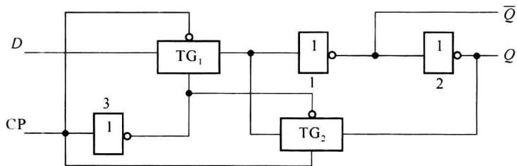
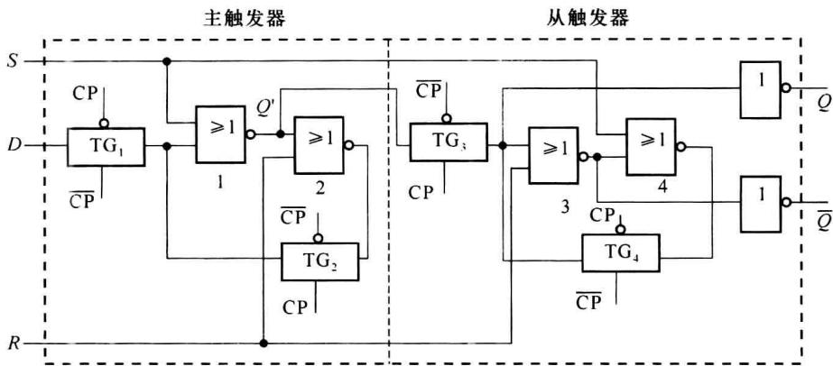
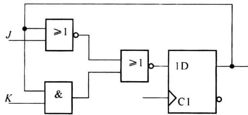

import Guide from '@/components/Guide.astro';
import Knowledge from '@/components/Knowledge.astro';
import Example from '@/components/Example.astro';
import Analysis from '@/components/Analysis.astro';
import Solution from '@/components/Solution.astro';
import Variant from '@/components/Variant.astro';
import Note from '@/components/Note.astro';
import Block from '@/components/Block.astro';
import Method from '@/components/Method.astro';
import Exercise from '@/components/Exercise.astro';

从基本工作原理而言, CMOS 触发器和 TTL 触发器是相同的, 但从具体构成和使用来看, 两者还是有不少差别。TTL 集成触发器以钟控 RS 触发器为基础, 而 CMOS 集成触发器以钟控 D 触发器为基础。

## 4.7.1 CMOS钟控 $D$ 触发器

### 1. 电路结构

图 4.7.1 是 CMOS 钟控 D 触发器的逻辑结构图，由两个传输门 $TG_{1}$ 、 $TG_{2}$ 和两个反相器 1、2 组成，反相器 3 为传输门提供反相控制信号。

  

图 4.7.1 CMOS 钟控 D 触发器

### 2. 工作原理

电路的工作可分为两个阶段：

（1）当 CP=0 时， $TG_{1}$ 导通， $TG_{2}$ 截止，使输入 D 和输出 Q 之间形成通路，输出到反相器 1 的反馈被切断。电路实际按组合电路工作，因此有：

$$

Q = D, \overline {{{Q}}} = \overline {{{D}}}

$$

(2) 当 $\mathrm{CP} = 1$ 时, $\mathrm{TG}_{1}$ 截止, $\mathrm{TG}_{2}$ 导通,使输入和输出之间的通路被切断,但连通了输出到反相器1的反馈通路。触发器封锁,即保持原状态,维持 $\mathrm{CP} = 1$ 之前的 $D$ 输入。

由以上分析可知，在 CP=1 时，触发器保持原状态，CP=0 时，具有 D 触发器功能，其功能表如表 4.7.1 所示。

表 4.7.1 CMOS 钟控 $D$ 触发器功能表

<table><tr><td>CP</td><td>D</td><td> ${Q}^{n + 1}$ </td></tr><tr><td>0</td><td>1</td><td>1</td></tr><tr><td>0</td><td>0</td><td>0</td></tr><tr><td>1</td><td>×</td><td> ${Q}^{n}$ </td></tr></table>

## 4.7.2 CMOS 主从 $D$ 触发器

### 1. 电路结构

CMOS 主从 D 触发器由两个 CMOS 钟控 D 触发器构成, 图 4.7.2 是带有异步置 0 置 1 输入的主从 D 触发器逻辑图。R 是异步置 0 端, S 是异步置 1 端, 由于 R、S 是 1 有效, 将图 4.7.1 中的反相器改为或非门, 这样在非置位工作时, 置位输入 R = S = 0, 图 4.7.2 中的或非门就相当于反相器。

  

图4.7.2 CMOS主从 $D$ 触发器

### 2. 工作原理

在置位输入 R=S=0 时, 电路的工作可分为 3 个阶段:

(1) 当 $\mathrm{CP} = 0$ 时, $\mathrm{TG}_{1}$ 导通, $\mathrm{TG}_{2}$ 截止, 主触发器接收输入端 $D$ 的数据, $Q' = \overline{D}$ ; $\mathrm{TG}_{3}$ 截止, $\mathrm{TG}_{4}$ 导通, 从触发器保持原状态, 输出不变。

(2) 当 CP 由 $0 \to 1$ 时, $\mathrm{TG}_{1}$ 截止, $\mathrm{TG}_{2}$ 导通, 主触发器封锁, $Q^{\prime}$ 保持 CP 上升前一瞬间的输入信号: $Q^{\prime} = \overline{D}$ ; 同时 $\mathrm{TG}_{3}$ 导通, $\mathrm{TG}_{4}$ 截止, 从触发器开放, 因此 $Q^{\prime} = \overline{D}$ 就进入从触发器, 输出为

$$

Q = \overline {{{Q}}} ^ {\prime} = D, \overline {{{Q}}} = \overline {{{D}}}

$$

实现了主触发器状态向从触发器的转移。

(3) 在 CP=1 期间,由于主触发器封锁,从触发器的输出不再变化。

由以上分析可知,虽然在 CP=0 期间,主触发器是开放的,但只有 CP 上升前一瞬间的输入信号 D 进入从触发器,影响输出,从而实现了上升沿触发的边沿 D 触发器功能。

### 3. 置位信号的功能实现

由于是异步置位,所以要保证无论在什么状态下,置位信号都能起作用。

当 SR=10，若 CP=0，从触发器的或非门 4 输出为 0，再经 $TG_{4}$ 和反相器使输出 Q=1；若 CP=1，主触发器的或非门 1 输出 $Q'=0$ ，再经 $TG_{3}$ 和反相器也使 Q=1。可见 S 端实现了异步置 1 功能，且 1 有效。

对于 SR=01 作类似分析, 可以证明 R 端能实现异步置 0 功能, 且 1 有效。

### 4. 特点

表 4.7.2 是其功能表,与 TTL 型 D 触发器功能表的差别有 3 点:

(1) 异步置 0 置 1 信号是高电平有效, 而不是低电平有效;

(2) 状态翻转的时刻是时钟的上升沿, 而不是下降沿;

（3）不存在一次翻转现象，为边沿触发器，只根据 CP 上升前的输入信号，就可以决定输出。

这是因为其主触发器是 D 触发器, 只有置 0 或置 1 功能, 而没有保持功能。所以 CMOS 主从 D 触发器尽管在结构上属于主从触发器, 但功能上属于边沿触发器, 只是现在一般的器件手册上, 还都是从结构着眼, 称之为主从触发器, 这是应该特别注意的。

表 4.7.2 CMOS 主从 $D$ 触发器功能表

<table><tr><td>S</td><td>R</td><td>CP</td><td>D</td><td> $Q^{n+1}$ </td><td> $\overline{Q^{n+1}}$ </td></tr><tr><td>0</td><td>1</td><td>×</td><td>×</td><td>0</td><td>1</td></tr><tr><td>1</td><td>0</td><td>×</td><td>×</td><td>1</td><td>0</td></tr><tr><td>1</td><td>1</td><td>×</td><td>×</td><td>1*</td><td>1*</td></tr><tr><td>0</td><td>0</td><td>↑</td><td>0</td><td>0</td><td>1</td></tr><tr><td>0</td><td>0</td><td>↑</td><td>1</td><td>1</td><td>0</td></tr><tr><td>0</td><td>0</td><td>0</td><td>×</td><td> $Q^n$ </td><td> $\overline{Q^n}$ </td></tr></table>

\* 此状态不使用。

## 4.7.3 CMOS 主从 JK 触发器

CMOS 主从 JK 触发器是在 CMOS 主从 D 触发器的基础上增加转换电路构成的。采用公式法, 可得转换电路的表达式为

$$

D = J \overline {{{Q ^ {n}}}} + \overline {{{K}}} Q ^ {n}

$$

在具体实现时,再将表达式作一些变换:

$$

D = J \overline {{{Q ^ {n}}}} + \overline {{{K}}} Q ^ {n} = (J + Q ^ {n}) (\overline {{{Q ^ {n}}}} + \overline {{{K}}}) = (J + Q ^ {n}) \cdot \overline {{{K Q ^ {n}}}} = \overline {{{J + Q ^ {n}}}} + K Q ^ {n}

$$

这样得到 CMOS 主从 JK 触发器的逻辑图如图 4.7.3 所示, 它具有 CMOS 主从 D 触发器的所有特点, 也是边沿触发器, 只是实现了 JK 触发器的功能。

  

图4.7.3 CMOS主从JK触发器逻辑图
