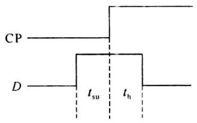
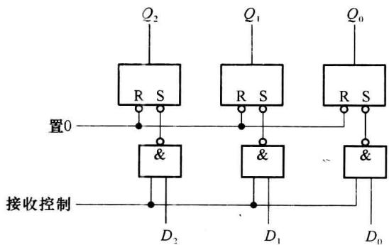
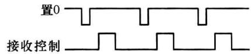

import Guide from '@/components/Guide.astro';
import Knowledge from '@/components/Knowledge.astro';
import Example from '@/components/Example.astro';
import Analysis from '@/components/Analysis.astro';
import Solution from '@/components/Solution.astro';
import Variant from '@/components/Variant.astro';
import Note from '@/components/Note.astro';
import Block from '@/components/Block.astro';
import Method from '@/components/Method.astro';
import Exercise from '@/components/Exercise.astro';

在实际中,应该从逻辑功能、触发方式和参数3个方面来考虑触发器的选择问题。

## 4.8.1 逻辑功能的选择

在选择触发器的逻辑功能时,应作如下考虑:

(1) 如果要求单端形式的输入信号时, 宜选用 D 触发器。

（2）如果要求双端形式的输入信号时，宜选用 JK 触发器。JK 触发器包含 RS 触发器的逻辑功能，且没有约束条件。

（3）如果用触发器进行计数时，宜选用 $T'$ 触发器。它可以容易地用 JK 触发器或 D 触发器转换而成。

## 4.8.2 触发方式的选择

如果只用触发器作存储数据用,可选择主从触发方式;如果要求触发器的状态不受干扰,工作稳定,最好选用边沿触发方式。注意,有上升沿和下降沿两种触发方式。

## 4.8.3 触发器的参数

为了保证触发器稳定可靠地工作,除了正确选择逻辑功能和触发方式外,还应考虑其参数。触发器的参数包括直流参数和时间参数。

### 1. 直流参数

由于触发器是由门电路组成的,所以触发器的直流参数几乎与门电路一样,也可以用同样的方法来测试。主要包括:输出高电平 $V_{OH}$ 、输出低电平 $V_{OL}$ 、输入高电平(开门电平) $V_{ON}$ 、输入低电平(关门电平) $V_{OFF}$ 、低电平输入电流(输入短路电流) $I_{iL}$ 、高电平输入电流(交叉漏电流) $I_{iH}$ 、电源电流(功耗) $I_{CC}$ 。

主要差别在于对不同的输入端(CP、J、K、 $S_{D}$ 、 $R_{D}$ 、D)输入电流的指标是不同的,原因是每个输入端所连接的触发器内部晶体管的数目是不同的。例如,TTL JK 触发器7472的输入电流指标如表4.8.1所示,反映了对前级的不同电流要求。另外不同触发器的各输入端电流值的比例也可能是不同的。

表 4.8.1 7472 触发器的电流指标

<table><tr><td rowspan="4"> $I_{iH}$ </td><td>J,K</td><td>40μA</td></tr><tr><td> $R_D$ </td><td>80μA</td></tr><tr><td> $S_D$ </td><td>80μA</td></tr><tr><td>CP</td><td>40μA</td></tr><tr><td rowspan="4"> $I_{iL}$ </td><td>J,K</td><td>1.6 mA</td></tr><tr><td> $R_D$ </td><td>3.2 mA</td></tr><tr><td> $S_D$ </td><td>3.2 mA</td></tr><tr><td>CP</td><td>1.6 mA</td></tr></table>

### 2. 时间参数

触发器的时间参数比门电路复杂得多,也更重要。因为它们将影响触发器是否可以正常、可靠地工作。

集成触发器状态转换的时刻虽然是在时钟的某一边沿,但由于触发器内部电路存在的延迟,触发器翻转也需要一定时间,所以输入信号不能在时钟的边沿出现时才来到,也不能在时钟有效边沿之后就立即消失。因此为保证触发器能正常工作，对各种信号都有时间上的要求，这就是时间参数。

### (1) 输入信号 $(J、K、D$ 等 $)$ 的时间参数

输入信号的时间参数有两个:建立时间 $t_{su}$ 和保持时间 $t_{h}$ 。其定义如图 4.8.1 所示。

建立时间 $t_{su}$ 是指输入信号较之时钟有效边沿提前到来的时间；保持时间 $t_{h}$ 是输入信号位于时钟有效边沿之后保持不变的时间。

显然,输入信号不这样的话,就可能写不进触发器,或者触发器工作不可靠。

有些触发器,如边沿型 JK 触发器, $t_{h}$ 可为 0,这是由其电路结构决定的。这也是边沿型 JK 触发器的一个优点。

有时手册中也给出异步置位信号的建立时间。

### (2) 时钟信号的时间参数

时钟信号的时间参数也有两个:高电平宽度 $t_{WH}$ 和低电平宽度 $t_{WL}$ 。

图 4.8.1. 建立时间和保持时间 高电平宽度 $t_{WH}$ 是指时钟保持高电平的最小持续时间，低电平宽度 $t_{WL}$ 是指时钟保持低电平的最小持续时间。

时钟的时间参数和输入信号的时间参数有关，在图4.8.1的情况下，要求 $t_{WL} \geqslant t_{su}$ ， $t_{WH} \geqslant t_{h}$ 。一般这两对参数不是相等的关系，特别是当 $t_{h}=0$ 时， $t_{WL}$ 或 $t_{WH}$ 不能为0。

$t_{WH}$ 和 $t_{WL}$ 之和是保证触发器正常工作的最小时钟周期, 由此可确定触发器的最高工作频率 $f_{max}$ :

$$

f _ {\max} \leqslant \frac {1}{t _ {\mathrm{WH}} + t _ {\mathrm{WL}}}\tag{4.8.1}

$$

$f_{max}$ 是表明触发器工作速度的一个指标。

对于每个具体型号的集成触发器,可以从手册上查到这些时间参数,在使用时应符合这些参数所规定的条件。例如,74ALS114 JK 负边沿触发器的主要时间参数为: $t_{su}=25\ ns$ , $t_{h}=0\ ns$ , $t_{WH}=25\ ns$ , $t_{WL}=5\ ns$ , $f_{max}=30\ MHz$ 。

下面通过一个例子说明时序的重要性。

<Example title="例 4.8.1">
图 4.8.2 是一种两拍工作寄存器的逻辑图，即每次在存入数据之前，必须先加入置 0 信号，然后“接收”信号有效，数据存入寄存器。①若不按两拍工作方式来工作，即置 0 信号始终无效，则当输入数据为 $D_{2}D_{1}D_{0}=100\rightarrow001\rightarrow010$ 时，输出数据 $Q_{2}Q_{1}Q_{0}$ 将如何变化？②为使电路正常工作，置 0 信号和接收信号应如何配合？画出这两种信号的正确时间关系。

<Solution title="解">
(1) 若按一拍工作, 并且置 0 信号恒为 1 时, 可得表 4.8.2。

  

图4.8.2 两拍工作寄存器逻辑图

表4.8.2

<table><tr><td> $\overline{S}$ </td><td> $\overline{R}$ </td><td colspan="2"> ${Q}^{n + 1}$ </td></tr><tr><td rowspan="2"> $\overline{D}$ </td><td rowspan="2">1</td><td> $D = 0$ </td><td>保持</td></tr><tr><td> $D = 1$ </td><td>置1</td></tr></table>

所以可得状态表 4.8.3。

表4.8.3

<table><tr><td> $D_2$ </td><td> $D_1$ </td><td> $D_0$ </td><td> $Q_1^{q+1}$ </td><td> $Q_1^{q+1}$ </td><td> $Q_0^{q+1}$ </td><td>说明</td></tr><tr><td>1</td><td>0</td><td>0</td><td>1</td><td>0</td><td>0</td><td>触发器状态与数据一致,正确</td></tr><tr><td>0</td><td>0</td><td>1</td><td>1</td><td>0</td><td>1</td><td>触发器状态与数据不一致,错误</td></tr><tr><td>0</td><td>1</td><td>0</td><td>1</td><td>1</td><td>1</td><td>触发器状态与数据不一致,错误</td></tr></table>

即当 $D_{2}D_{1}D_{0}$ 为 $100\rightarrow001\rightarrow010$ 时， $Q_{2}Q_{1}Q_{0}$ 为 $100\rightarrow101\rightarrow111$ （初始状态都为 0）。这是因为当 D=0, $\overline{R}\overline{S}=11$ ，只起保持 Q 不变的作用，而不一定使 Q 输出为 0。

（2）若按两拍工作方式，即每次在存入数据之前，必须先加入置0信号，然后“接收”信号有效，如图4.8.3所示。

  

图 4.8.3 加入置 0 信号后“接收”信号有效

可得表 4.8.4。

表4.8.4

<table><tr><td></td><td> $\overline{S}$ </td><td> $\overline{R}$ </td><td colspan="2"> ${Q}^{n + 1}$ </td><td>功能</td></tr><tr><td>置0信号有效</td><td>1</td><td>0</td><td colspan="2">0</td><td>清0</td></tr><tr><td rowspan="2">接收信号有效</td><td rowspan="2"> $\overline{D}$ </td><td rowspan="2">1</td><td> $D = 0$ </td><td>保持</td><td rowspan="2">接收数据</td></tr><tr><td> $D = 1$ </td><td>置1</td></tr><tr><td>之后</td><td>1</td><td>1</td><td colspan="2">保持</td><td>保持数据</td></tr></table>

这样安排时序,使输出每拍都先有一段的 000 时间,实际使用时,还要加输出控制门以保证正确输出。
</Solution>
</Example>
