import Guide from '@/components/Guide.astro';
import Knowledge from '@/components/Knowledge.astro';
import Example from '@/components/Example.astro';
import Analysis from '@/components/Analysis.astro';
import Solution from '@/components/Solution.astro';
import Variant from '@/components/Variant.astro';
import Note from '@/components/Note.astro';
import Block from '@/components/Block.astro';
import Method from '@/components/Method.astro';
import Exercise from '@/components/Exercise.astro';

## 习题

<Exercise title="习题 4-1">
由或非门构成的触发器电路如题图 4.1(a) 所示, 请写出输出 $Q$ 的下一状态方程。已知输入信号 $a, b, c$ 的波形如题图 4.1(b) 所示, 画出输出 $Q$ 的波形 (设触发器的初始状态为 1)。

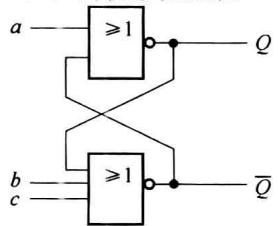  

(a)

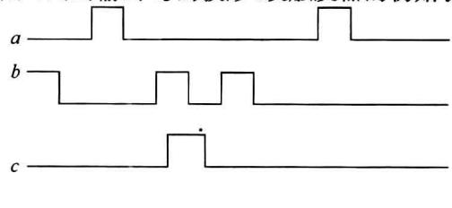  

(b)  

题图4.1
</Exercise>

<Exercise title="习题 4-2">
由与非门构成的触发器电路如题图 4.2(a) 所示, 请写出输出 $Q$ 的下一状态方程, 并根据题图 4.2(b) 所示的输入波形, 画出输出 $Q$ 的波形 (设初始状态 $Q$ 为 1)。

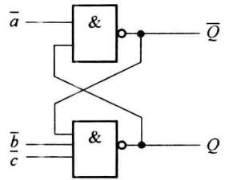  

(a)

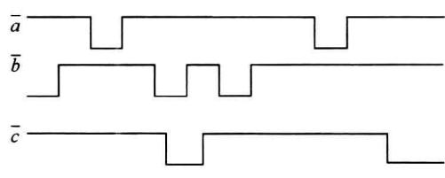  

(b)  

题图4.2
</Exercise>

<Exercise title="习题 4-3">
由与或非门构成的触发器如题图 4.3 所示, 当 G=1 时, 触发器处于什么状态? 当 G=0 时, 触发器的功能等效于哪一种触发器?

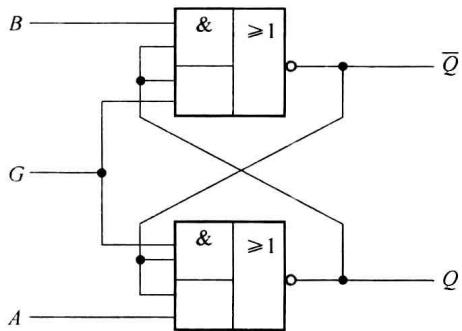  

题图4.3
</Exercise>

<Exercise title="习题 4-4">
用基本 $RS$ 触发器构成一个消除机械开关震颤的防颤电路如题图4.4(a)所示，画出对应于题图4.4(b)输入波形的输出 $Q$ 的波形，并说明其工作原理。

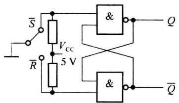  

(a)

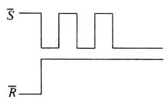  

(b)  

题图4.4
</Exercise>

<Exercise title="习题 4-5">
写出题图 4.5(a) 所示钟控触发器的状态方程和功能表(以 CP 和 $U_{i}$ 为外部输入变量), 并画出在题图 4.5(b) 输入波形作用下的输出 Q 的波形(设初始状态 Q 为 0)。

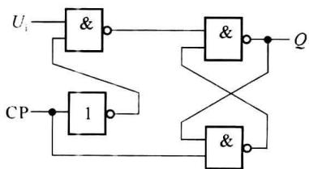  

(a)

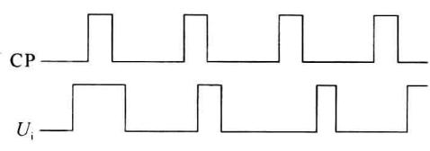  

(b)  

题图4.5
</Exercise>

<Exercise title="习题 4-6">
列表小结 $RS, D, JK$ 和 $T$ 触发器的状态方程、状态表以及功能表。
</Exercise>

<Exercise title="习题 4-7">
将 JK 触发器分别转换为 D 和 T 触发器, 画出逻辑图。
</Exercise>

<Exercise title="习题 4-8">
将 D 触发器分别转换为 JK 和 T 触发器, 画出逻辑图。
</Exercise>

<Exercise title="习题 4-9">
将 T 触发器分别转换为 JK 和 D 触发器, 画出逻辑图。
</Exercise>

<Exercise title="习题 4-10">
用 JK 触发器构成一个可控的 D/T 触发器, 画出逻辑图。
</Exercise>

<Exercise title="习题 4-11">
用 $JK$ 触发器和 $D$ 触发器(可外加门)实现特征方程为 $Q^{n + 1} = A \oplus B \oplus Q^n$ 的触发器。
</Exercise>

<Exercise title="习题 4-12">
已知TTL主从 $JK$ 触发器的输入波形如题图4.6所示，画出输出 $Q$ 的波形。

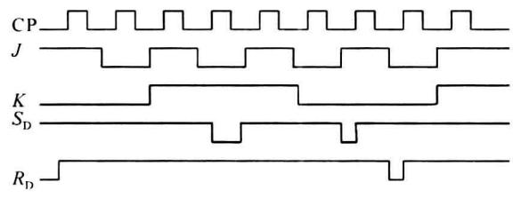  

题图4.6
</Exercise>

<Exercise title="习题 4-13">
题图 4.7(a) 是用 TTL 主从 JK 触发器构成的信号检测电路, 用来检测 CP 高电平期间 u 是否有输入脉冲, 若 CP、u 的波形如题图 4.7(b) 所示, 画出输出 Q 的波形。

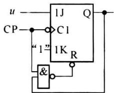  

(a)

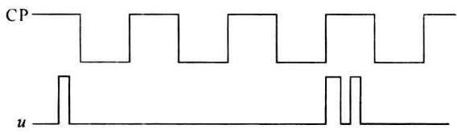  

(b)  

题图4.7
</Exercise>

<Exercise title="习题 4-14">
已知 $JK$ 信号如题图4.8所示,请分别画出TTL主从 $JK$ 触发器和负边沿 $JK$ 触发器的输出 $Q$ 的波形(设触发器的初始状态为0)。

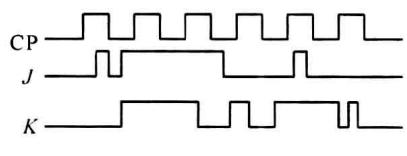  

题图4.8
</Exercise>

<Exercise title="习题 4-15">
负边沿 $JK$ 触发器组成的电路如题图 4.9(a) 所示, 输入波形如题图 4.9(b) 所示, 画出输出 $Q$ 的波形 (设触发器初始状态为 0)。

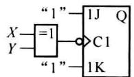  

(a)

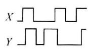  

(b)  

题图4.9
</Exercise>

<Exercise title="习题 4-16">
写出题图 4.10 所示各触发器的下一状态方程。

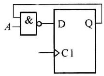  

(a)

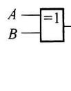

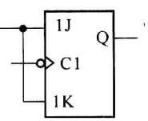  

(b)  

题图4.10

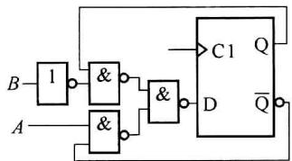  

(c)
</Exercise>

<Exercise title="习题 4-17">
如题图 4.11(a) 所示的电路, 输入波形如题图 4.11(b) 所示, 画出输出 $Q_{1}$ 、 $Q_{2}$ 的波形。

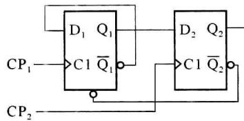  

(a)

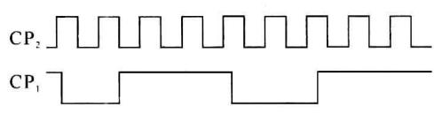  

(b)  

题图4.11
</Exercise>

<Exercise title="习题 4-18">
如题图 4.12(a) 所示的电路, 输入波形如题图 4.12(b) 所示, 分别画出加 R 和不加 R 时, 电路输出 Q 的波形(设触发器初始状态为 0)。

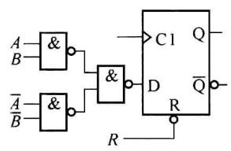  

(a)

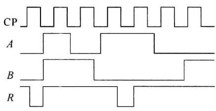  

(b)  

题图4.12
</Exercise>

<Exercise title="习题 4-19">
题图 4.13 (a) 中是由 D 触发器和 JK 触发器构成的电路, 题图 4.13 (b) 是输入波形, 画出输出 $Q_{1}$ 、 $Q_{2}$ 的波形。

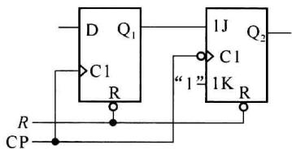  

(a)

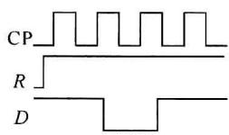  

(b)  

题图4.13
</Exercise>

<Exercise title="习题 4-20">
负边沿 $JK$ 触发器组成的电路如题图4.14所示，它是一个单脉冲发生器，按钮

S 每按下一次(不论时间长短), 就在 $Q_{1}$ 输出一个宽带一定的脉冲, 试根据给定的 CP 和 $J_{1}$ 的波形画出 $Q_{1}$ 和 $Q_{2}$ 的波形。

(b)  

(a)  

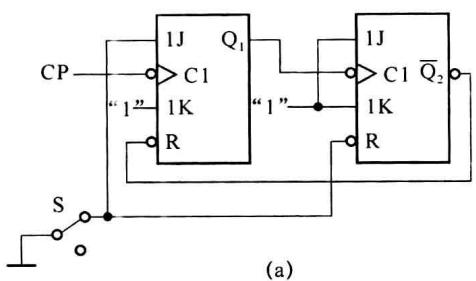

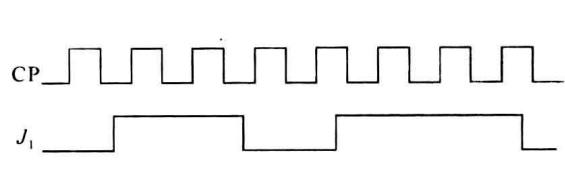  

(b)  

题图4.14
</Exercise>

<Exercise title="习题 4-21">
写出题图 4.15 中各个触发器的下一状态方程, 并画出各个触发器的输出 Q 的波形(设初始状态为 0)。

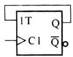

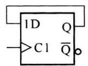

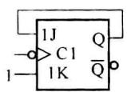

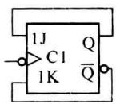

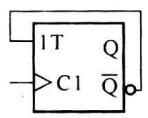  

(e)

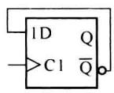  

(f)

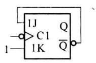  

(g)

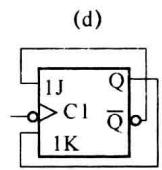  

(h)  

题图4.15
</Exercise>

<Exercise title="习题 4-22">
CMOS 主从 JK 触发器的输入波形如题图 4.16 所示, 画出输出 Q 的波形(设触发器初始状态为 0)。

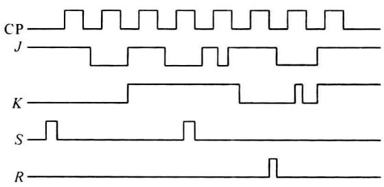  

题图4.16
</Exercise>

<Exercise title="习题 4-23">
题图 4.17 是一种两拍工作寄存器的逻辑图，即每次在存入数据之前，必须先加入置 0 信号，然后“接收”信号有效，数据存入寄存器。① 若不按两拍工作方式来工作，即置 0 信号始终无效，则当输入数据为 $D_{2}D_{1}D_{0}=100\rightarrow001\rightarrow010$ 时，输出数据 $Q_{2}Q_{1}Q_{0}$ 将如何变化？②为使电路正常工作，置0信号和接收信号应如何配合？画出这两种信号的正确时间关系。

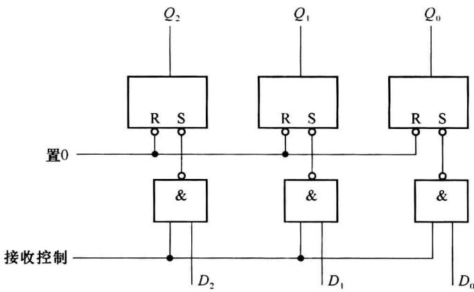  

题图4.17

## 第5章 时序逻辑电路

本章主要在概要讲述时序逻辑电路在逻辑功能和电路结构特点的基础上,详细介绍分析时序逻辑电路的具体方法、步骤以及时序逻辑电路的设计方法。

一般时序逻辑电路按照其时钟工作方式可以分为两类:同步时序电路和异步时序电路。同步时序逻辑电路使用同一个时钟源,即所有触发器的状态变化都受同一个时钟的控制,所有的触发器都是同步工作的。异步时序逻辑电路中的触发器也有时钟的控制,但不是每个触发器的时钟来自同一个时钟源,即不是所有的触发器的状态变化与系统时钟源同步,在沿触发的时序逻辑电路中,不同触发器时钟沿的到来在时间上有差异。

实际的数字系统多数是同步时序电路构成的同步系统。本章介绍的基本时序逻辑电路也主要是关于同步时序电路的分析和设计。
</Exercise>
