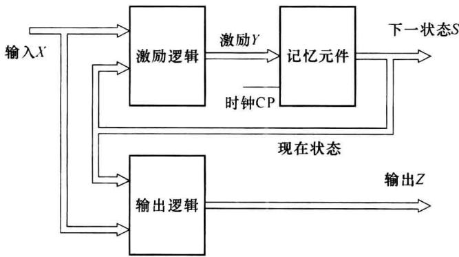
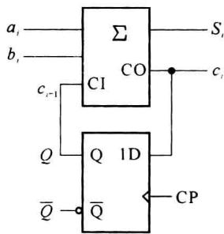

import Guide from '@/components/Guide.astro';
import Knowledge from '@/components/Knowledge.astro';
import Example from '@/components/Example.astro';
import Analysis from '@/components/Analysis.astro';
import Solution from '@/components/Solution.astro';
import Variant from '@/components/Variant.astro';
import Note from '@/components/Note.astro';
import Block from '@/components/Block.astro';
import Method from '@/components/Method.astro';
import Exercise from '@/components/Exercise.astro';

## 第5章 时序逻辑电路

本章主要在概要讲述时序逻辑电路在逻辑功能和电路结构特点的基础上,详细介绍分析时序逻辑电路的具体方法、步骤以及时序逻辑电路的设计方法。

一般时序逻辑电路按照其时钟工作方式可以分为两类:同步时序电路和异步时序电路。同步时序逻辑电路使用同一个时钟源,即所有触发器的状态变化都受同一个时钟的控制,所有的触发器都是同步工作的。异步时序逻辑电路中的触发器也有时钟的控制,但不是每个触发器的时钟来自同一个时钟源,即不是所有的触发器的状态变化与系统时钟源同步,在沿触发的时序逻辑电路中,不同触发器时钟沿的到来在时间上有差异。

实际的数字系统多数是同步时序电路构成的同步系统。本章介绍的基本时序逻辑电路也主要是关于同步时序电路的分析和设计。

在组合逻辑电路中,任一时刻的输出信号仅取决于当时的输入信号,这是组合逻辑电路在逻辑功能上的主要特点。在时序逻辑电路中,任一时刻的输出信号不仅取决于当时的输入信号,还与初始状态及现在所研究时刻之前的输入有关。具备这种逻辑功能特点的电路叫做时序逻辑电路(简称时序电路)。同步时序逻辑电路的一般框图如图5.1.1所示。

  

图5.1.1 同步时序电路框图

n 个输入、k 个触发器和 m 个输出的同步时序电路可用三组方程来表示。

(1) 激励方程

$$

Y = f (\text {   输入信号   } X, \text {   现状态   } S ^ {n})

$$

即

$$

Y _ {i} = f _ {i} \left(X _ {0}, X _ {1}, \dots , X _ {n - 1}, Q _ {0} ^ {n}, Q _ {1} ^ {n}, \dots , Q _ {k - 1} ^ {n}\right) \quad (i = 0, \dots , k - 1)\tag{5.1.1}

$$

式(5.1.1)中， $X_{0}, X_{1}, \cdots, X_{n-1}$ 表示 n 个输入信号， $Q_{0}^{n}, Q_{1}^{n}, \cdots, Q_{k-1}^{n}$ 表示现状态集合 $S^{n}$ 所包括的 k 个触发器的现状态。

### (2) 状态方程

$$

S ^ {n + 1} = h (\text {   输入信号   } X, \text {   现状态   } S ^ {n})

$$

即

$$

Q _ {i} ^ {n + 1} = h _ {i} (X _ {0}, X _ {1}, \dots , X _ {n - 1}, Q _ {0} ^ {n}, Q _ {1} ^ {n}, \dots , Q _ {k - 1} ^ {n}) \quad (i = 0, \dots , k - 1)\tag{5.1.2}

$$

$S^{n+1}$ 表示下一状态(次状态)的集合,式(5.1.2)中 $Q_{i}^{n+1}$ 表示第 i 个触发器下一状态,即下一状态与现状态、输入信号间的逻辑关系。

### (3) 输出方程

$$

Z = g (\text {   输入信号   } X, \text {   现状态   } S ^ {n})

$$

即

$$

Z _ {j} = g _ {j} \left(X _ {0}, X _ {1}, \dots , X _ {n - 1}, Q _ {0} ^ {n}, Q _ {1} ^ {n}, \dots , Q _ {k - 1} ^ {n}\right) \quad (j = 0, \dots , m - 1)\tag{5.1.3}

$$

激励方程是触发器的输入方程, 它是输入信号和现状态的函数。对于 D 触发器, 激励方程应为各触发器 D 输入端函数的集合, 即 $Y=\{D_{0}, D_{1}, \cdots, D_{k-1}\}$ ; 对于 JK 触发器, 激励方程应为各触发器 JK 输入端函数的集合, 即 $Y=\{J_{0}, J_{1}, \cdots, J_{k-1}, K_{0}, K_{1}, \cdots, K_{k-1}\}$ 。状态方程就是触发器的输出方程, 因为触发器的输入与时序电路的输入及现状态有关, 所以, 状态方程是电路的输入和现在状态的函数。现状态 $S^{n}$ 包含了 k 个触发器的现状态, 即 $S^{n}=\{Q_{0}^{n}, Q_{1}^{n}, \cdots, Q_{k-1}^{n}\}$ , 所以每个触发器的下一状态用式 (5.1.2) 表示。

为了进一步说明时序逻辑电路的特点,下面先来分析图 5.1.2 给出的串行加法器。串行加法,是指将两个多位二进制数相加时,采取从低位到高位逐位相加的串行方式完成相加运算,输出也为串行输出。

对于两个 n 位的二进制数 $(a_{0}, a_{1}, \cdots, a_{n-1}$ 和 $b_{0}, b_{1}, \cdots, b_{n-1})$ ，由于每一位（例如第 i 位）相加的结果不仅取决于本位的加数 $a_{i}$ 和被加数 $b_{i}$ ，还与低一位是否有进位有关，所以完整的串行加法器电路除了应该具有将加数、被加数以及来自低位的进位相加的能力之外，还必须具备记忆功能，要把本位相加后的进位结果保存下来，以备作高一位相加时使用。因此，图 5.1.2 的串行加法器电路包含了两个组成部分：一部分是全加器 $\Sigma$ ，另一部分是由 D 触发器构成的存储电路。全加器完成 $a_{i}, b_{i}$ 和 $c_{i-1}$ 3 个数的相加运算，D 触发器记录每次相加后的进位结果，供高一位运算使用。

  

图5.1.2 串行加法器

通过这个简单的例子可以看出,时序电路在电路结构上有两个显著的特点:

（1）时序电路通常包含组合电路和存储电路两个组成部分，一个时序电路可以没有组合逻辑电路部分，但存储电路是必不可少的。

(2) 存储电路的输出状态通常反馈到组合电路的输入端,与输入信号一起,共同决定组合逻辑电路的输出 $(S_{i}$ 是输入 $a_{i}$ 、 $b_{i}$ 以及触发器现状态 $Q^{n}$ 的函数)和触发器的下一状态

$(Q^{n+1} \text{也是 } a_{i}, b_{i} \text{ 和 } Q^{n} \text{ 的函数})$ 。

根据输出信号的特点,可将时序电路划分为米里(Mealy)型和摩尔(Moore)型两种。

### (1) 米里型电路

输出信号不仅取决于存储电路的状态,而且还取决于输入变量。即:

$$

Z _ {i} = g _ {i} \left(X _ {0}, X _ {1}, \dots , X _ {n - 1}, Q _ {0} ^ {n}, Q _ {1} ^ {n}, \dots , Q _ {k - 1} ^ {n}\right) \quad (i = 0, \dots , m - 1)\tag{5.1.4}

$$

例如，串行加法器中的输出 $S_{i}$ 与 $a_{i}$ 、 $b_{i}$ 和 $Q^{n}$ 有关。

### (2) 摩尔型电路

输出信号仅仅取决于存储电路的状态,与输入信号无关。即:

$$

Z _ {i} = g _ {i} (Q _ {0} ^ {n}, Q _ {1} ^ {n}, \dots , Q _ {k - 1} ^ {n}) \quad (i = 0, \dots , m - 1)\tag{5.1.5}

$$

由表达式(5.1.5)可见,摩尔型电路只是米里型电路的一种特例。

在逻辑电路分析和设计中,通常将状态方程和输出方程结合在一起用矩阵的形式表示,构成同步时序电路的状态表,就是说,状态表是用来表示下一状态以及输出与电路的输入和现在状态的关系的表格。

状态表主要描述状态的转换,状态表中的状态一般都用文字、字母(如 A,B,C,…或 $S_{1},S_{2},\cdots$ 等)表示。在具体实现这个状态表时,需要进行状态编码,也就是用字母表示的状态需要改用二进制代码表示,这种经过状态编码的、用二进制代码表示状态的状态表称为状态转移表。

表 5.1.1 米里型状态表

<table><tr><td> $S^{n+1}/Z$ X $S^n$ </td><td>0</td><td>1</td></tr><tr><td>A</td><td>C/1</td><td>D/1</td></tr><tr><td>B</td><td>B/0</td><td>C/1</td></tr><tr><td>C</td><td>C/1</td><td>A/0</td></tr><tr><td>D</td><td>D/0</td><td>C/0</td></tr><tr><td>E</td><td>E/0</td><td>C/0</td></tr><tr><td>F</td><td>F/0</td><td>C/1</td></tr></table>

表 5.1.1 为某米里型状态表,该表描述的时序电路有一个输入信号(X)和6个状态(A\~F)。下一状态 $S^{n+1}$ 与输出 Z 用斜线“/”隔开,斜线左边为下一状态,右边为输出。

表 5.1.2 为另一时序电路的状态表,从表中可以看出,这是一个摩尔型时序逻辑电路,输出仅与现状态有关。表 5.1.3 为对应的状态转移表,状态转移表与状态表的主要区别是把状态表中使用文字或字母的状态描述进行状态编码,即状态改用二进制编码表示。

表 5.1.2 摩尔型状态表

<table><tr><td> $S^n$ X</td><td>0</td><td>1</td><td>Z</td></tr><tr><td>A</td><td>A</td><td>B</td><td>0</td></tr><tr><td>B</td><td>B</td><td>C</td><td>0</td></tr><tr><td>C</td><td>C</td><td>D</td><td>0</td></tr><tr><td>D</td><td>D</td><td>E</td><td>0</td></tr><tr><td>E</td><td>A</td><td>B</td><td>1</td></tr></table>

表 5.1.3 摩尔型状态转移表

<table><tr><td> $S^n$ X</td><td>0</td><td>1</td><td>Z</td></tr><tr><td>000</td><td>000</td><td>001</td><td>0</td></tr><tr><td>001</td><td>001</td><td>010</td><td>0</td></tr><tr><td>010</td><td>010</td><td>011</td><td>0</td></tr><tr><td>011</td><td>011</td><td>100</td><td>0</td></tr><tr><td>100</td><td>000</td><td>001</td><td>1</td></tr></table>

在有些具体的时序电路中，并不都具备图 5.1.1 所示的完整形式。例如，有的时序电路中没有组合逻辑电路部分，而有的时序电路又可能没有输入逻辑变量，但它们在逻辑功能上仍具有时序电路的基本特征。

用输入信号和电路状态(状态变量)的逻辑函数去描述时序电路逻辑功能的方法也称时序机。在分析时序电路时只要把状态变量和输入信号一样当做逻辑函数的输入变量处理，则分析组合电路的一些运算方法仍然可以使用在时序逻辑电路的分析中。
