import Guide from '@/components/Guide.astro';
import Knowledge from '@/components/Knowledge.astro';
import Example from '@/components/Example.astro';
import Analysis from '@/components/Analysis.astro';
import Solution from '@/components/Solution.astro';
import Variant from '@/components/Variant.astro';
import Note from '@/components/Note.astro';
import Block from '@/components/Block.astro';
import Method from '@/components/Method.astro';
import Exercise from '@/components/Exercise.astro';

## 5.2.1 常用时序电路简介

常用时序电路包括寄存器、移位寄存器、计数器等。

### 1. 寄存器

寄存器由多位触发器构成,用来寄存多位二进制信息。各个触发器由统一的时钟控制,在时钟信号的控制下,把需要寄存的信息同时存入寄存器。在没有时钟有效边沿时,已经存入的信息可以供其他设备读取、使用。

集成的寄存器芯片,一般还带有输出的三态控制端,输出有工作方式和高阻方式,即输出可以是0、1或高阻状态。表5.2.1是8位D型寄存器74LS374的功能表,描述了8位触发器中某1位的功能,高阻控制端和时钟输入端为8位公用。

锁存器与寄存器的功能有些相似,但锁存器是使用电平触发的。74LS373 是集成 8 位锁存器,表 5.2.2 给出了 74LS373 的功能表。

表 5.2.1 74LS374 的功能表

<table><tr><td> $\overline{OC}$ </td><td>CP</td><td>D</td><td> $Q^{n+1}$ </td></tr><tr><td>0</td><td>↑</td><td>0</td><td>0</td></tr><tr><td>0</td><td>↑</td><td>1</td><td>1</td></tr><tr><td>0</td><td>0</td><td>×</td><td> $Q^n$ </td></tr><tr><td>1</td><td>×</td><td>×</td><td>高阻</td></tr></table>

表 5.2.2 74LS373 的功能表

<table><tr><td> $\overline{OC}$ </td><td>CP</td><td>D</td><td> ${Q}^{n + 1}$ </td></tr><tr><td>0</td><td>1</td><td>0</td><td>0</td></tr><tr><td>0</td><td>1</td><td>1</td><td>1</td></tr><tr><td>0</td><td>0</td><td>×</td><td> ${Q}^{n}$ </td></tr><tr><td>1</td><td>×</td><td>×</td><td>高阻</td></tr></table>

从两个功能表看出,二者的区别在于74LS374为沿触发,74LS373为电平触发。有些资料上对锁存器和寄存器的提法不加区别,但是在使用时必须注意区分,主要是要看系统中用来控制数据存入的是什么信号,如果是电平信号,则一定要用锁存器;如果是时钟边沿控制寄存,则一定要用寄存器。

在集成电路手册上,有时也称这样的芯片为“D触发器”。本书中,集成D触发器特指芯片上的每个触发器有互补的两个输出(每个触发器有两个输出引脚,Q和 $\overline{Q}$ ,例如74LS379为4D触发器),而寄存器或者锁存器,每位都是只有一个输出Q,没有 $\overline{Q}$ 。

### 2. 移位寄存器

移位寄存器(简称移存器)是由触发器构成的专门一类、具有特殊信号传递寄存方式的常用时序电路。移位寄存器具有寄存和移位两重功能:除了寄存数据外,还可以在时钟的控制下,将数据向左或者向右进行移位。一般移位寄存器有一个串行的数据输入端,一个串行的数据输出端。双向移存器则有两个数据输入端,有一个移存方向控制端,在移存方向控制端的控制下实现数据的左移或右移。

有的集成移位寄存器还可以有并行数据输入端和并行数据输出端。因此，移位寄存器可以有4种工作方式：串行输入串行输出、并行输入并行输出、串行输入并行输出、并行输入串行输出(简称:串入串出、并入并出、串入并出、并入串出)。

### 3. 计数器

计数器是通过电路的状态来反映输入脉冲数目的电路。只要电路的状态和输入脉冲的数目有固定的对应关系，这样的电路就可以作为计数器来使用。从第4章我们知道，一位触发器有两个状态。如果将一个JK触发器的J、K端都接逻辑1，初始时触发器的状态为0。在时钟的作用下，触发器的状态就会是0、1、0、1、……不断变化。将这个触发器的输出接到另一个JK的触发器的时钟输入。如触发器为下降沿触发，则第一个触发器输出的下降沿就会使另一个JK触发器改变状态。两个触发器就有4种不同的状态：00、01、10、11。如果触发器的初始状态是00，则输入一个时钟就到01状态，再输入一个时钟就到状态10……这样，通过电路的状态就可以知道输入脉冲的数目。

一个计数器可以计数的最大值,称为计数器的模值,一般用 M 表示。

如果设电路的初始状态不是 00 而是 10, 这时, 输入一个时钟, 就到状态 11……同样也能进行计数, 只是电路的状态和脉冲的数目是另一种对应关系。计数器的模值 M 没有改变。

计数器是应用非常广泛的一种时序电路。可以用不同的方法对计数器进行分类。

### (1) 按计数模值分类

① 二进制计数器，计数器的模值 M 和触发器数 k 的关系是 $M = 2^{k}$ 。例如 4 位二进制计数器的模值为 16，计数状态为 0000 到 1111。

② 十进制计数器, 计数器的模值是 10, 当采用不同的 BCD 码时, 会有不同的十进制计数器。常用的 8421 码计数器的计数状态使用 0000 到 1001。

③ 任意进制计数器, 计数器有一个最大的计数模值, 由于该类集成计数器多有比较丰富的控制端, 具体使用时可通过简单的连接(一般不需要额外的附加门电路), 计数模值可以在最大值范围内任意设置, 使得一种计数器芯片有多种计数范围。

(2) 按计数值变化的方式分类

①加法计数器,每输入一次时钟,计数值加1,加到最大值后,再从初始状态继续。

②减法计数器,每输入一次时钟,计数值减1,减到最小值后,再从初始状态继续。

③可逆计数器,在加/减控制端或不同时钟端的控制下,可以进行加、减选择的计数器。

### (3) 按时钟控制方式分类

①同步计数器,各级触发器的时钟都由同一外部时钟提供,触发器在时钟有效边沿同时翻转,工作速度较快。

②异步计数器,计数器内一部分触发器的时钟由前级触发器的输出提供,由于触发器本身的延迟,使得后级触发器要等到前级触发器翻转后,才可能获得有效时钟产生状态翻转,速度相对较低。

## 5.2.2 同步时序逻辑电路分析方法

同步时序电路的分析就是对给定的时序电路逻辑图进行分析,得出电路的逻辑功能。

同步时序电路可以用三组方程式来描述:激励方程、状态方程和输出方程。其中的激励方程是获得状态方程的过渡表达式,真正描述时序电路功能的还是状态方程和输出方程。

进行时序电路分析时,为了以更加形象的方式直观地显示出时序电路的逻辑功能,有时还进一步把状态表(或状态转移表)的内容表示成状态图(或状态转移图)的形式。状态图或状态转移图是状态表或者状态转移表的图形化表示。

在状态图或状态转移图中用圆圈表示状态,用带方向的弧线(或直线)表示状态的转移方向,在弧线上标明状态转换的输入条件和转换时得到的输出。通常将输入变量取值写在斜线以上,将输出值写在斜线以下。如果是摩尔型时序电路,可把输出写在圆圈内斜线的下方。状态图和状态转移图不同的是:状态图圆圈内的状态和状态名相对应,状态转移图圆圈内的状态与状态的二进制代码相对应。就像状态表和状态转移表一样,状态图和状态转移图没有本质的不同。图5.2.1是某电路的状态图。

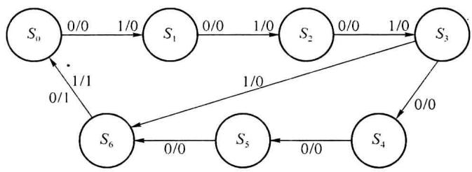  

图5.2.1 状态图

同步时序电路的分析可按以下步骤进行：

(1) 根据给定的时序电路, 写出每个触发器的输入激励方程。

(2) 根据电路, 写出时序电路的输出方程。

（3）由激励方程和触发器的特征方程，写出触发器的状态方程（即下一状态方程）。触发器的特征方程和状态方程没有实质的不同，只是特征方程是用触发器的直接输入（如RS、D、JK)等表示的，而状态方程是用时序电路中输入和现状态表示的。

（4）由触发器的状态方程和时序电路的输出方程，作出电路的状态转移表和状态转移图。

(5) 根据要求和电路状态特点, 分析电路完成的具体逻辑功能。

对于具体的时序电路,以上分析过程的某些步骤可能有所简化。例如,有的时序电路的输出就是触发器的输出,这样就没有电路的输出方程,而只要写出触发器的状态方程就可以进行分析了。

## 5.2.3 一般同步时序电路分析举例

<Example title="例 5.2.1">
分析图 5.2.2 所示时序逻辑电路的逻辑功能, 写出电路的激励方程、状态方程和输出方程, 画出电路的状态转移图并分析电路完成的功能。

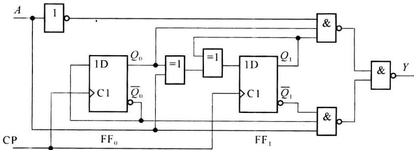
</Example>

<Example title="例 5.2.2">
例5.2.1的时序逻辑电路

<Solution title="解">
（1）从给定的电路图写出激励方程：

$$

\left\{ \begin{array}{l} D _ {0} = \overline {{{Q _ {0} ^ {n}}}} \\ D _ {1} = A \oplus Q _ {0} ^ {n} \oplus Q _ {1} ^ {n} \end{array} \right.\tag{5.2.1}

$$

(2) 将式(5.2.1)代入 D 触发器的特性方程, 得到电路的状态方程:

$$

\left\{ \begin{array}{l} Q _ {0} ^ {n + 1} = D _ {0} = \overline {{{Q _ {0} ^ {n}}}} \\ Q _ {1} ^ {n + 1} = D _ {1} = A \oplus Q _ {0} ^ {n} \oplus Q _ {1} ^ {n} \end{array} \right.\tag{5.2.2}

$$

(3) 从图 5.2.2 的电路图写出输出方程:

$$

Y = \overline {{\overline {{A}} Q _ {0} ^ {n} Q _ {1} ^ {n}}} \cdot \overline {{A}} \overline {{Q _ {0} ^ {n}}} \cdot \overline {{Q _ {1} ^ {n}}} = \overline {{A}} Q _ {0} ^ {n} Q _ {1} ^ {n} + A \overline {{Q _ {0} ^ {n}}} \cdot \overline {{Q _ {1} ^ {n}}}\tag{5.2.3}

$$

（4）通过输出方程和状态方程，可以得到状态转移表及状态转移图（如表 5.2.3 和图 5.2.3 所示）。

表 5.2.3 图 5.2.2 电路的状态转换表

<table><tr><td rowspan="2"> ${Q}_{1}^{n + 1}{Q}_{0}^{n + 1}/Y$ A</td><td colspan="4"> ${Q}_{1}^{n}{Q}_{0}^{n}$ </td></tr><tr><td>00</td><td>01</td><td>11</td><td>10</td></tr><tr><td>0</td><td>01/0</td><td>10/0</td><td>00/1</td><td>11/0</td></tr><tr><td>1</td><td>11/1</td><td>00/0</td><td>10/0</td><td>01/0</td></tr></table>

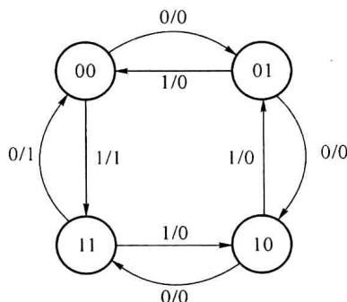  

图5.2.3 图5.2.2的状态转移图

（5）根据状态转移表和状态转移图对电路进行分析，可以看出，图 5.2.2 所示电路是可逆计数器，输入信号 A=0 时为加计数，且状态到 11 时输出为 1；输入信号 A=1 时为减计数，状态为 00 时输出为 1。
</Solution>
</Example>

<Example title="例 5.2.2">
分析图 5.2.4 所示同步计数器的逻辑功能。

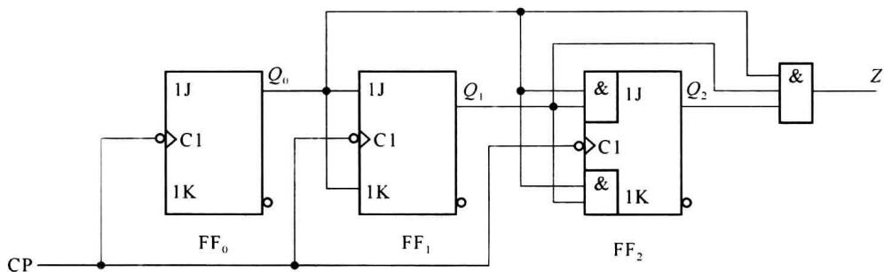  

图5.2.4 例5.2.2的时序电路

<Solution title="解">
(1)写出电路的触发器的激励方程(输入端悬空,认为输入为“1”):

$$

\left\{ \begin{array}{l} J _ {2} = Q _ {0} ^ {n} Q _ {1} ^ {n}, K _ {2} = Q _ {0} ^ {n} Q _ {1} ^ {n} \\ J _ {1} = Q _ {0} ^ {n}, K _ {1} = Q _ {0} ^ {n} \\ J _ {0} = 1, K _ {0} = 1 \end{array} \right.\tag{5.2.4}

$$

(2) 写出触发器的状态方程(即写出电路的状态方程, 把激励方程带入触发器的特征方程 $Q^{n+1}=J\overline{Q^{n}}+\overline{K}Q^{n}$ ):

$$

\left\{ \begin{array}{l} Q _ {2} ^ {n + 1} = Q _ {0} ^ {n} Q _ {1} ^ {n} \overline {{Q _ {2} ^ {n}}} + \overline {{Q _ {0} ^ {n}}} \overline {{Q _ {1} ^ {n}}} Q _ {2} ^ {n} \\ Q _ {1} ^ {n + 1} = Q _ {0} ^ {n} \overline {{Q _ {1} ^ {n}}} + \overline {{Q _ {0} ^ {n}}} Q _ {1} ^ {n} \\ Q _ {0} ^ {n + 1} = 1 \cdot \overline {{Q _ {0} ^ {n}}} + \overline {{1}} \cdot Q _ {0} ^ {n} = \overline {{Q _ {0} ^ {n}}} \end{array} \right.\tag{5.2.5}

$$

(3) 写出电路的输出方程:

$$

Z = Q _ {0} ^ {n} Q _ {1} ^ {n} Q _ {2} ^ {n}\tag{5.2.6}

$$

（4）由状态方程和输出方程，作出状态转移表和状态转移图。作状态转移表的方法和组合电路由函数表达式作真值表的方法类似，但该电路为摩尔型电路，且没有输入，所以得到的状态转移表如表5.2.4所示，状态转移图如图5.2.5所示。每个圆圈表示一个状态，图中用十进制数表示等值的二进制码，0～7相当于二进制码000～111。输出只与状态有关，在状态转移图中，输出直接写在圆圈内斜线的下方。

表 5.2.4 例 5.2.2 计数器的状态转移表

<table><tr><td> ${Q}_{2}^{n}$ </td><td> ${Q}_{1}^{n}$ </td><td> ${Q}_{0}^{n}$ </td><td> ${Q}_{2}^{n + 1}$ </td><td> ${Q}_{1}^{n + 1}$ </td><td> ${Q}_{0}^{n + 1}$ </td><td>Z</td></tr><tr><td>0</td><td>0</td><td>0</td><td>0</td><td>0</td><td>1</td><td>0</td></tr><tr><td>0</td><td>0</td><td>1</td><td>0</td><td>1</td><td>0</td><td>0</td></tr><tr><td>0</td><td>1</td><td>0</td><td>0</td><td>1</td><td>1</td><td>0</td></tr><tr><td>0</td><td>1</td><td>1</td><td>1</td><td>0</td><td>0</td><td>0</td></tr><tr><td>1</td><td>0</td><td>0</td><td>1</td><td>0</td><td>1</td><td>0</td></tr><tr><td>1</td><td>0</td><td>1</td><td>1</td><td>1</td><td>0</td><td>0</td></tr><tr><td>1</td><td>1</td><td>0</td><td>1</td><td>1</td><td>1</td><td>0</td></tr><tr><td>1</td><td>1</td><td>1</td><td>0</td><td>0</td><td>0</td><td>1</td></tr></table>

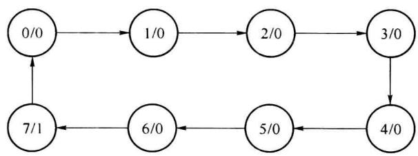  

图5.2.5 例5.2.2的状态转移图

（5）分析逻辑功能:分析计数器是要确定它的计数的模值、确定计数时使用什么编码、确定计数的方式是加计数还是减计数等。根据状态转移图,这个计数器是模值等于8的二进制加法计数器,计数状态是从000\~111。计数满8个数时(状态为111),输出Z等于1,相当于逢8进1的进位输出。

用 $JK$ 触发器构成的同步二进制加法计数器的组成是有规律可循的。若触发器的数目是 $k$ ，计数的模值为 $2^k$ 。触发器各级之间的连接关系为

$$

\left\{ \begin{array}{l} J _ {0} = K _ {0} = 1 \\ J _ {i} = K _ {i} = Q _ {0} ^ {n} Q _ {1} ^ {n} \dots Q _ {i - 1} ^ {n} \end{array} \right.\tag{5.2.7}

$$

若是二进制减法计数器,则连接关系为

$$

\left\{ \begin{array}{l} J _ {0} = K _ {0} = 1 \\ J _ {i} = K _ {i} = \overline {{{Q _ {0} ^ {n}}}} \overline {{{Q _ {1} ^ {n}}}} \dots \overline {{{Q _ {i - 1} ^ {n}}}} \end{array} \right.\tag{5.2.8}

$$
</Solution>
</Example>

<Example title="例 5.2.3">
分析图 5.2.6 所示的同步计数器。

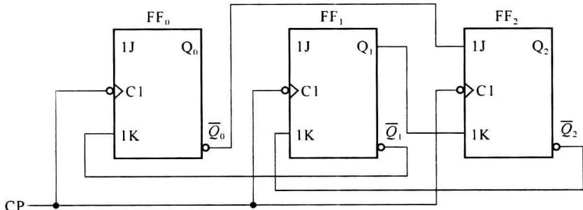  

图5.2.6 例5.2.3的同步计数器电路

<Solution title="解">
这个计数器没有输出电路。分析时, 将直接用触发器的输出作为时序电路的输出。分析和作表时, 可以省略与输出有关的部分, 分析其状态变化即可。

(1) 列写激励方程:

$$

\left\{ \begin{array}{l} J _ {2} = \overline {{{Q _ {0} ^ {n}}}}, K _ {2} = Q _ {1} ^ {n} \\ J _ {1} = 1, K _ {1} = \overline {{{Q _ {2} ^ {n}}}} \\ J _ {0} = 1, K _ {0} = \overline {{{Q _ {1} ^ {n}}}} \end{array} \right.\tag{5.2.9}

$$

(2) 列写状态方程:

$$

\left\{ \begin{array}{l} Q _ {2} ^ {n + 1} = \overline {{Q _ {0} ^ {n}}} \cdot \overline {{Q _ {2} ^ {n}}} + \overline {{Q _ {1} ^ {n}}} Q _ {2} ^ {n} \\ Q _ {1} ^ {n + 1} = 1 \cdot \overline {{Q _ {1} ^ {n}}} + Q _ {2} ^ {n} Q _ {1} ^ {n} = \overline {{Q _ {1} ^ {n}}} + Q _ {2} ^ {n} \\ Q _ {0} ^ {n + 1} = 1 \cdot \overline {{Q _ {0} ^ {n}}} + Q _ {1} ^ {n} Q _ {0} ^ {n} = \overline {{Q _ {0} ^ {n}}} + Q _ {1} ^ {n} \end{array} \right.\tag{5.2.10}

$$

（3）作状态转移表和状态转移图。由于没有专门的输出函数，状态转移表中也就不需要表示输出的列。可先在 $Q^n$ 列中按顺序写出状态组合，然后根据状态方程得到各触发器的下一状态。所得到的状态转移表如表5.2.5所示。

表 5.2.5 例 5.2.3 计数器的状态转移表

<table><tr><td> ${Q}_{2}^{n}$ </td><td> ${Q}_{1}^{n}$ </td><td> ${Q}_{0}^{n}$ </td><td> ${Q}_{2}^{n + 1}$ </td><td> ${Q}_{1}^{n + 1}$ </td><td> ${Q}_{0}^{n + 1}$ </td></tr><tr><td>0</td><td>0</td><td>0</td><td>1</td><td>1</td><td>1</td></tr><tr><td>0</td><td>0</td><td>1</td><td>0</td><td>1</td><td>0</td></tr><tr><td>0</td><td>1</td><td>0</td><td>1</td><td>0</td><td>1</td></tr><tr><td>0</td><td>1</td><td>1</td><td>0</td><td>0</td><td>1</td></tr><tr><td>1</td><td>0</td><td>0</td><td>1</td><td>1</td><td>1</td></tr><tr><td>1</td><td>0</td><td>1</td><td>1</td><td>1</td><td>0</td></tr><tr><td>1</td><td>1</td><td>0</td><td>0</td><td>1</td><td>1</td></tr><tr><td>1</td><td>1</td><td>1</td><td>0</td><td>1</td><td>1</td></tr></table>

从这个状态转移表到作出状态转移图需要一个一个状态进行跟踪。例如，从000状态开始，下一状态是111，再从111到下一状态011……直到把所有的状态和它们的转移关系都在状态转移图中表示清楚为止。例5.2.3的状态转移图如图5.2.7所示。

（4）分析和说明。从状态转移图可以清楚地看到，计数器是在5种状态中进行循环，是模值等于5的五进制计数器。不过，计数状态不是二进制的递增或递减，属于任意编码计数器的范畴。

对于 k 个触发器, 计数模值小于 $2^{k}$ 的计数器, 定有若干状态不在计数循环内, 需要分析计数器是否可以自启动。自启动就是要求计数器不管由于什么原因进入了这些不使用状态, 也能够在经过几个周期的时钟后, 重新进入正常的计数循环。

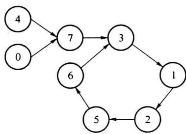  

图5.2.7 例5.2.3的状态转移图

例 5.2.3 的五进制计数器有 3 个不使用状态: 00、100 和 111。从状态转移图上可以看出, 如果进入这些状态, 最多经过 2 个时钟周期后, 就可以重新进入计数循环, 所以该计数器可自启动。
</Solution>
</Example>

## 5.2.4 移位寄存器及其应用电路的分析

### 1. 移位寄存器的构成

移位寄存器除了具有存储代码的功能以外,还具有移位功能。所谓移位功能,是指寄存器里存储的代码能在移位脉冲的作用下依次左移或右移。因此,移位寄存器不但可以用来寄存代码,还可以用来实现数据的串行-并行转换、数值的运算以及数据处理等。

图 5.2.8 所示电路是由边沿触发的 D 触发器组成的 4 位移位寄存器。

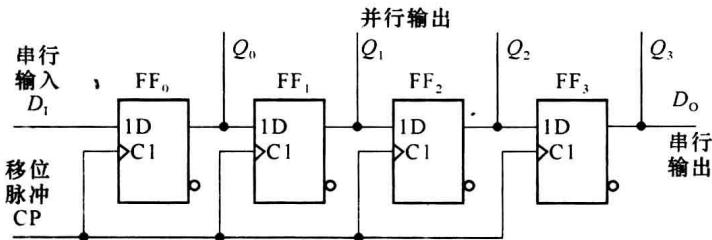  

图5.2.8 用 $D$ 触发器构成的移位寄存器

其中第一个触发器 $FF_{0}$ 的输入端接收输入信号 $D_{1}$ ，其余的每个触发器输入端均与前边一个触发器的 Q 端相连，输出为 $D_{0}$ （串行输出），或输出为 $Q_{3}Q_{2}Q_{1}Q_{0}$ （并行输出）。

因为从 CP 上升沿到达触发器的时钟输入端开始, 到输出端新状态的建立, 需要经过一段传输延迟时间, 所以当 CP 的上升沿同时作用于所有的触发器的瞬间, 它们输入端 (D 端) 的输入信号为前一个触发器原来的输出状态, 即维持在时钟沿到达时刻前的状态, 前一级状态还没有改变。于是对于 $\mathrm{FF}_{1}$ 来说, 是按 $Q_{0}$ 原来的输出 $Q_{0}^{n}$ 作为该级输入信号进行状态变化, $\mathrm{FF}_{2}$ 按 $Q_{1}$ 原来的输出状态进行状态变化, $\mathrm{FF}_{3}$ 按 $Q_{2}$ 原来的输出状态进行变化。同时, 加到寄存器输入端 $D_{1}$ 的代码存入 $\mathrm{FF}_{0}$ 。总的效果相当于移位寄存器里原有的代码依次右移了一位。

例如，在4个时钟周期内输入代码依次为1011，设移位寄存器的初始状态为 $Q_{3}^{n}Q_{2}^{n}Q_{1}^{n}Q_{0}^{n}=0000$ ，那么在移位脉冲（也就是触发器的时钟脉冲）的作用下，移位寄存器里代码的移动情况将如表5.2.6所示。图5.2.9给出了各触发器输出端在移位过程中的电压波形图。

表 5.2.6 移位寄存器中代码的移动情况

| CP 的顺序 | $Q_3^n\ Q_2^n\ Q_1^n\ Q_0^n$ | 输入 $D_1$ |

| :---: | :---: | :---: |

| 0 (初始) | 0 0 0 0 | - |

| 1 | 1 0 0 0 | 1 |

| 2 | 0 1 0 0 | 0 |

| 3 | 1 0 1 0 | 1 |

| 4 | 1 1 0 1 | 1 |

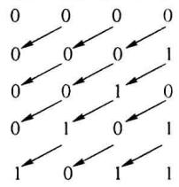

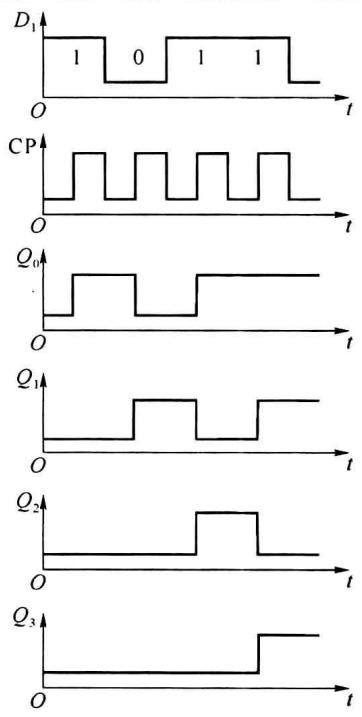  

图5.2.9 图5.2.8电路的电压波形

可以看到,经过 4 个 CP 信号以后,串行输入的 4 位代码全部移入了移位寄存器中,同时在 4 个触发器的输出端可以得到了并行输出的代码。因此,利用移位寄存器可以实现代码的串行-并行转换。

如果首先将 4 位数据并行置入移位寄存器的 4 个触发器中, 然后连续加入 4 个移位脉冲, 则移位寄存器里的 4 位代码将从串行输出端 $Q_{3}$ 依次送出, 从而实现了数据的并行-串行转换。

图 5.2.10 是用 JK 触发器组成的 4 位移位寄存器, 它和图 5.2.8 电路具有同样的逻辑功能。

为便于扩展逻辑功能和增加使用的灵活性,有些集成移位寄存器电路中附加了左、右移控制、数据并行输入、保持、异步置零(复位)等功能。

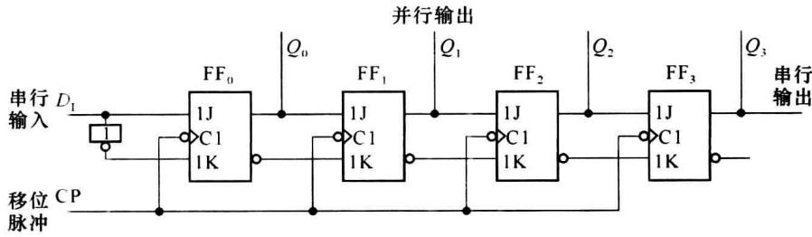  

图5.2.10 用 $JK$ 触发器构成的移位寄存器

### 2. 环形计数器

计数器也可以用移位寄存器构成,这时要求移位寄存器有 M 个状态,分别和 M 个输入脉冲相对应,并且在这 M 个状态中不断地循环,这样的移位寄存器就可以作为模值为 M 的计数器使用。对于这类反馈移位寄存器的分析,一般只要关心输入级的反馈信号是如何获得的即可。

图 5.2.11 是三位环形计数器的逻辑图。环形计数器的特点是输入级的信号(称为反馈信号)直接取自最后一级的 Q 端。

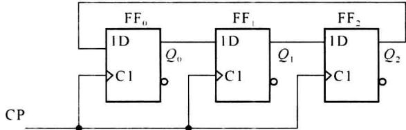  

图 5.2.11 三位环形计数器

在图 5.2.11 中, 反馈信号是

$$

D _ {0} = Q _ {2} ^ {n}\tag{5.2.11}

$$

各个触发器的状态方程为

$$

\left\{ \begin{array}{l} Q _ {0} ^ {n + 1} = Q _ {2} ^ {n} \\ Q _ {1} ^ {n + 1} = Q _ {0} ^ {n} \\ Q _ {2} ^ {n + 1} = Q _ {1} ^ {n} \end{array} \right.\tag{5.2.12}

$$

由这些状态方程式可以得到表 5.2.7 的状态转移表和图 5.2.12 的状态转移图。

表 5.2.7 三位环形计数器状态转移表

<table><tr><td> ${Q}_{2}^{n}$ </td><td> ${Q}_{1}^{n}$ </td><td> ${Q}_{0}^{n}$ </td><td> ${Q}_{2}^{n + 1}$ </td><td> ${Q}_{1}^{n + 1}$ </td><td> ${Q}_{0}^{n + 1}$ </td></tr><tr><td>0</td><td>0</td><td>0</td><td>0</td><td>0</td><td>0</td></tr><tr><td>0</td><td>0</td><td>1</td><td>0</td><td>1</td><td>0</td></tr><tr><td>0</td><td>1</td><td>0</td><td>1</td><td>0</td><td>0</td></tr><tr><td>0</td><td>1</td><td>1</td><td>1</td><td>1</td><td>0</td></tr><tr><td>1</td><td>0</td><td>0</td><td>0</td><td>0</td><td>1</td></tr><tr><td>1</td><td>0</td><td>1</td><td>0</td><td>1</td><td>1</td></tr><tr><td>1</td><td>1</td><td>0</td><td>1</td><td>0</td><td>1</td></tr><tr><td>1</td><td>1</td><td>1</td><td>1</td><td>1</td><td>1</td></tr></table>

由表 5.2.5 和图 5.2.12 可以对三位环形计数器进行分析, 并得到环形计数器的一般特点:

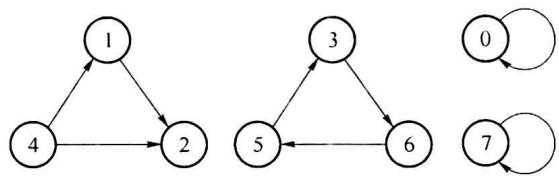  

图 5.2.12 三位环形计数器状态转移图

（1）由 $k$ 位触发器构成的环形计数器反馈连接的方式是： $D_0 = Q_{k-1}^n$ ，其内部连接方式： $D_i = Q_{i-1}^n$ 。

(2) k 位移位寄存器构成的环形计数器可以计 k 个数, 即计数模值是 k。

（3）通常选用的工作计数循环是：计数状态中只有一位触发器是1的循环，也可以只有一位触发器是0的循环。由于有效工作状态都只含有一位1，根据1的位置就可以区分不同状态，用计数器的输出控制其他电路时可以不要译码电路，例如将发光二极管直接接到各个触发器的输出端，根据发光二极管的发光的位置，就可以知道计数器的状态，即计数的结果。

（4）简单地将移位寄存器首尾相连所构成的环形计数器不能自启动。若要求计数器能够自启动，必须对反馈的逻辑函数进行修改，才能既保持环形计数器的特点，又能够自启动。

例如，将反馈函数修改为 $D_0 = \overline{Q_1^r} \cdot \overline{Q_0^r}$ 就可以解决不能自启动的问题。这是由于我们关注的有效工作循环是 100、010、001，在这 3 个状态时，应有确定的转移方向，而处于其他状态时，转移到什么状态我们并不关注，即可设为任意状态（用 $\times$ 表示）。其原卡诺图和反馈函数圈法如图 5.2.13 所示。通过增加或加少任意项的圈入，可改变其任意状态的转移方向，新的圈法如图 5.2.14 所示。这时，状态 000 的下一状态是 001，状态 111 的下一状态是 110、新的状态转移图如图 5.2.15 所示。

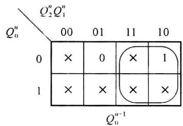  

图 5.2.13 环形计数器原卡诺图

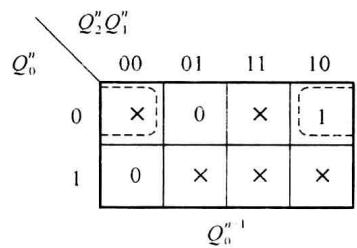  

图 5.2.14 修改圈法后的卡诺图

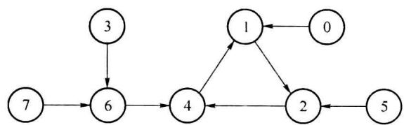  

图 5.2.15 可以自启动的三位环形计数器状态转移图

这种可以自启动环形计数器的连接方法可以推广到一般情况:对于由 $Q_{0}\cdots Q_{k-1}$ 共 k 个 D 触发器构成的环形计数器,反馈得逻辑函数应为

$$

D _ {0} = \overline {{Q _ {0} ^ {n}}} \overline {{Q _ {1} ^ {n}}} \dots \overline {{Q _ {k - 2} ^ {n}}}\tag{5.2.13}

$$

4 位可以自启动的环形计数器逻辑图如图 5.2.16 所示。

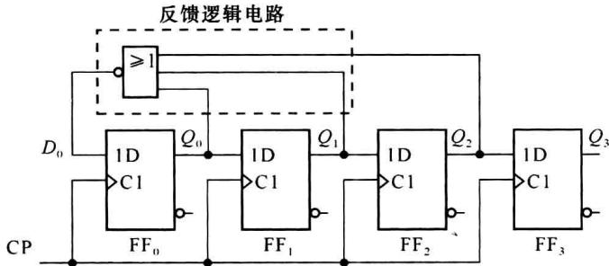  

图 5.2.16 能自启动的环形计数器电路

### 3. 扭环计数器

为了在不改变移位寄存器内部结构的条件下提高环形计数器的电路状态利用率,可以通过改变反馈逻辑电路从而获得更多的使用状态。

实际上任何一种移位寄存器型计数器的结构均可表示为图 5.2.17 的一般形式。其中反馈逻辑电路的函数表达式可写成：

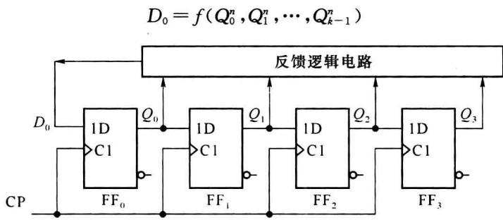  

图 5.2.17 移位寄存器型计数器的一般结构形式

(5.2.14)

环形计数器是反馈逻辑函数中最简单的一种，即 $D_{0}=Q_{k-1}^{n}$ 。若将反馈逻辑函数取为 $D_{0}=\overline{Q_{k-1}^{n}}$ ，则得到扭环计数器电路。4位扭环计数器如图5.2.18所示。

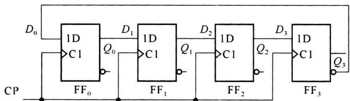  

图5.2.18 扭环形计数器电路

图 5.2.18 所示电路称为扭环计数器(也称为约翰逊计数器)。它的状态转移图如图 5.2.19 所示。

从图 5.2.19 可以看出, 它有两个状态循环, 若取图中左边的一个为有效工作循环, 则余下的一个就是非工作循环。显然, 这个计数器不能自启动。

为了实现自启动,可将图 5.2.18 电路的反馈逻辑函数稍加修改,令 $D_{0}=Q_{1}^{n}\overline{Q_{2}^{n}}+\overline{Q_{3}^{n}}$ , 可以得到可自启动的扭环计数器,电路图如图 5.2.20 所示,图 5.2.21 为状态转移图。

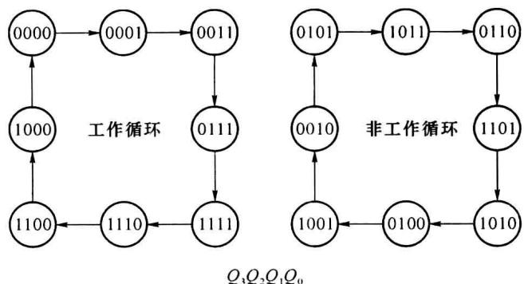

图5.2.19 图5.2.18电路的状态转移图  

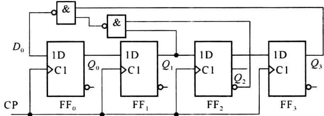

图5.2.20 能自启动的4位扭环计数器  

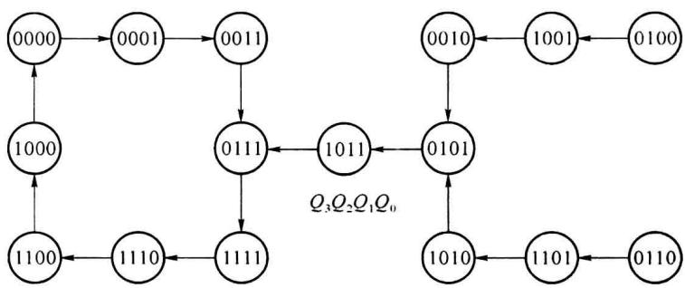  

图5.2.21 图5.2.20电路的状态转移图

从以上分析可以看出,用 k 个触发器构成的扭环计数器可以得到 2k 个有效工作状态的循环,触发器的使用状态比环形计数器提高了一倍。而且,如采用图 5.2.19 中的有效工作循环,由于电路在每次状态转换时只有一位触发器改变状态,因而在对电路状态译码时不会产生竞争-冒险现象(功能冒险)。

从以上分析可以得到扭环计数器有以下的特点：

（1）不考虑自启动时，k 位触发器构成的环形计数器反馈连接的方式是 $D_{0} = \overline{Q_{k-1}^{n}}$ ，其内部仍然是移位寄存器的连接方式 $D_{i} = Q_{i-1}^{n}$ 。

(2) k 个触发器构成的扭环计数器有 2k 个状态构成工作循环, 模值 M=2k, 比环形计数器多一倍。

(3) 一般选取包含全 0 状态和全 1 状态的 $2k$ 个工作循环, 可以从全 0 状态或全 1 状态中的一个来推导出全部的计数状态。

（4）扭环计数器构成脉冲分配器时的译码电路也是比较简单的。不论 k 等于多少，每个状态的译码输出函数都是两变量函数。

脉冲分配器是指使用模值为 M 的计数器加译码电路产生 M 个输出, 即每个状态对应

一个输出,且只在该状态下输出为1(或为0),其他状态时该输出为0(或为1)。

以图 5.2.18 所示的扭环计数器为例,例如 0000 状态对应输出 $F_{0}$ ,该状态下的译码输出为 $F_{0}=1$ , 输出 $F_{0}$ 的卡诺图如图 5.2.22 所示。卡诺图中“×”为非工作循环对应的状态,在正常工作循环中不会出现。由卡诺图可见,“1”所在的位置有 3 个任意项可以与其圈在一起,消去两个变量,即可以用一个两变量函数表示 $F_{0}$ 。

实际上，图5.2.22的卡诺图中每个非任意项的位置都是在计数器工作循环中对应一个状态和脉冲分配器中的一个输出，且在该状态时，输出为1，其他状态下输出为0。也就是脉冲分配器中的8个输出共有8个如图5.2.22所示的卡诺图与其对应。由于每个卡诺图中只有一个1且在不同的位置（对应不同状态），可将8个卡诺图合成1个卡诺图，如图5.2.23所示。

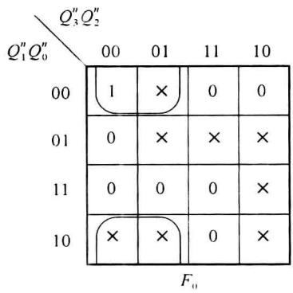  

图5.2.22 状态0000译码输出 $F_{0}$ 的卡诺图

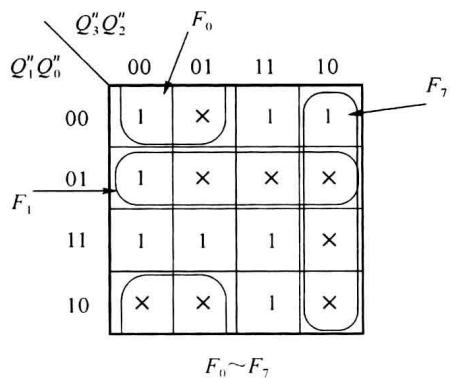  

图5.2.23 8个输出合一的译码卡诺图

图 5.2.23 所示的卡诺图标出了 $F_{0}$ 、 $F_{1}$ 和 $F_{7}$ 的译码简化方法，其他输出类似。从图中可以看出，每个 1 均可与 3 个任意项合并实现简化，成为两变量函数。

如果触发器的个数为 5, 每个输出的“1”可与 7 个任意项合并, 消去 3 个变量。

（5）直接按 $D_{0} = \overline{Q_{k - 1}^{n}}$ 方式连接的扭环计数器是不能自启动的。如果要求电路能够自启动，则还必须另外采取措施。

解决扭环计数器不能自启动的方法之一是:根据图 5.2.18 所示电路,可以得到对应反馈函数的圈法,如图 5.2.24 所示。

由于被圈过的“×”对应输出函数值为“1”，没有被圈过的“×”为“0”，可以通过改变圈法，即：减少“×”的圈入个数或增加“×”的圈入个数，使非工作循环进入到工作循环。图5.2.20所示电路就是增加“×”的圈入个数实现电路自启动的。其圈法如图5.2.25所示。

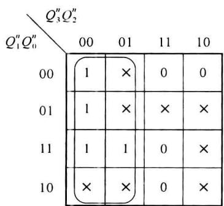  

图 5.2.24 4 触发器扭环计数器原始反馈函数圈法

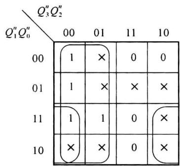  

图 5.2.25 通过改变任意项圈法实现自启动

解决扭环计数器不能自启动的另一方案是利用组合逻辑电路检测非工作循环的某一状态，在该状态下强制修改其反馈输出，使其能够进入工作状态。例如，图5.3.19中， $Q_{3}^{n}Q_{2}^{n}Q_{1}^{n}Q_{0}^{n}=1011$ 是非工作循环的一个状态，它的下一状态应为0110，在该状态下强制修改1011状态下的反馈输出，使反馈值不是为0，而是为1，即变为0111，就可以进入有效工作循环。也就是可以用对1011译码后输出与原来的 $\overline{Q_{3}^{n}}$ 进行异或（即当检测电路在非需要检测的状态时，输出为0，此时异或输出为原来的 $\overline{Q_{3}^{n}}$ ；当检测电路在需要检测的状态时输出为1，异或输出为 $\overline{Q_{3}^{n}}=Q_{3}^{n}$ ，异或的结果作为新的反馈输入( $D_{0}$ 的输入）。

另外，在触发器的复位端没有被使用的情况下，也可以对某不使用状态进行译码后接到触发器的异步复位端，即：在检测到该状态时复位，直接进入0000状态，因为0000为有效使用状态。

环形计数器和扭环计数器是两种特殊结构的、由移位寄存器构成的计数器。根据需要，合理设计反馈函数，可以构成其他模值的移存型计数器。

### 4. 序列信号发生器

序列信号发生器是产生一组循环长度为 M 的、有规律的串行序列信号的时序逻辑电路。使用移存器并加上适当的反馈逻辑电路可以构成移存器型序列信号发生器。电路的组成方式及分析方法都与前面分析的环形和扭环计数器类似。只是电路的作用更强调能够得到一定长度和规律的序列信号(强调的是输出为串行序列)，而不是像计数器那样只要求有一定数目的循环状态(强调的是输出并行状态)。

<Example title="例 5.2.4">
分析图 5.2.26 所示的序列信号发生器,说明序列信号长度 M 和序列码的构成。

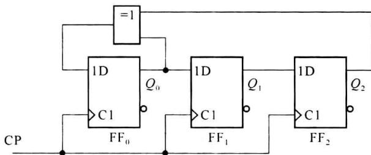  

图 5.2.26 序列信号发生器逻辑图

<Solution title="解">
由于电路是属于反馈移位寄存器应用,所以用移位的方法来构成状态转移表。

(1) 写出反馈信号 $D_{0}$ 的逻辑表达式:

$$

D _ {0} = Q _ {0} ^ {n} \oplus Q _ {2} ^ {n}\tag{5.2.15}

$$

（2）先选择000为起始状态，并通过式(5.2.15)计算出 $D_{0}$ 的值： $D_0 = 0$ 。显然，它的下一状态还是000，所以确定000不是工作循环中的状态。

（3）再选择一个状态，如001，算出 $D_{0}=1$ 。用移位的方法得到下一状态是011。再计算 $D_{0}$ ，得到新的状态，如此重复，直到出现状态的循环（即：下一状态是001）为止。构成的状态转移表如表5.2.8所示。

表 5.2.8 例 5.2.4 的状态转移表  

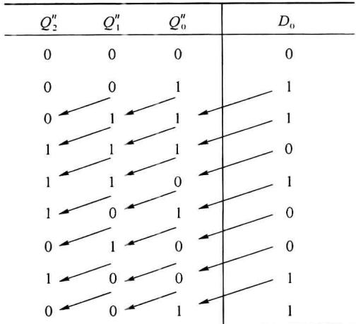

（4）分析和说明：状态转移表显示了电路有7个状态构成循环。这个序列信号发生器的特性是：①序列的长度 $M$ 等于7；②序列码是1110100（由于可能选定的初始点不同，序列的形式会有差别，例如以001状态作为开始点， $Q_{0}$ 的输出为1110100， $Q_{1}$ 的输出为0111010，等，但首尾相接后的序列循环顺序相同）；③不能自启动，000状态自己构成非工作循环。

序列信号发生器和移存型计数器的电路构成和分析方法都是相同的。如果对于计数状态没有特别的要求，只要循环的状态的数

目相同,序列信号发生器就可以作为计数器使用,但是,同样循环长度的移存器型计数器一般不能直接用做特定序列的序列信号发生器,此时,尽管序列的长度是满足了要求,但是序列的排列顺序并不一定满足要求。

如果序列信号发生器由 D 触发器构成,同时反馈电路也比较简单时,可以不作出状态转移表,而直接从起始状态开始,根据反馈函数的逻辑关系,逐位地写出全部的序列信号。图 5.2.27 表示了直接写出图 5.2.26 所示电路的输出序列的过程。

（1）从起始状态 111 开始，根据 $D_{0}=Q_{0}^{n}\oplus Q_{2}^{n}$ 计算出 0、2 位产生的反馈值是 0，将这个 0 直接写到序列的后面，成为 1110。

（2）向后移一位，从状态110开始，继续完成上述的过程，使序列变为11101。

（3）重复上两个步骤，直到重新出现起始状态111为止。

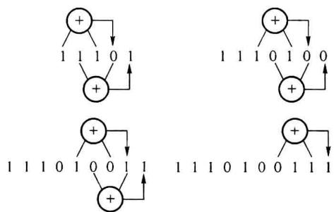
</Solution>
</Example>

## 5.2.5 异步时序逻辑电路的分析方法

图 5.2.27 直接写出输出序列的过程

异步时序电路的分析方法和同步时序电路的分析方法有所不同。在同步时序电路中，只要时钟沿有效，所有的触发器都将根据当时的激励信号进行状态变换，而在异步时序电路中，某些触发器获得有效的时钟沿发生电路状态转换时，另外一些触发器可能没有有效时钟沿。因此在某一时刻，只有那些有有效时钟信号的触发器才需要用特性方程去计算其下一状态，而没有有效时钟信号的触发器将保持原来的状态不变。

在分析异步时序电路时需要以外加时钟为参考,找出每次外时钟沿有效时,哪些触发器有有效时钟信号,哪些触发器没有有效时钟信号。所以,分析异步时序电路要比分析同步时序电路复杂。

一般异步时序电路的分析步骤如下：

(1) 写出激励方程、状态方程和输出方程。

(2) 由外部时钟提供时钟沿触发的触发器, 各个时钟沿均有效。

(3) 设定电路的初始状态(例如 0000), 填入状态表的现状态列的第一行。根据激励方程和状态方程求出由外部时钟提供触发的触发器的下一状态, 填入下一状态列的第一行。

（4）对于某一级触发器取自前级的输出作为时钟时，需要根据前级时钟的变化，确定是否有有效时钟，如果有有效时钟，则根据激励方程和状态方程求其新状态。没有有效时钟时，状态不变。

（5）将求得的新状态作为现状态，重复第(4)步，依次求取各触发器的下一状态，直到状态转移表出现重复状态。

（6）如果某些状态不在上述循环中，可设某一不在循环中的状态作为现状态，重复上述步骤，最终完成状态转移表。

(7) 作出状态图。

(8) 分析其功能。

下面通过一个例子具体说明一下分析的方法和步骤。

<Example title="例 5.2.5">
已知异步时序电路的逻辑图如图 5.2.28 所示, 试分析它的逻辑功能, 画出电路的状态转移图。

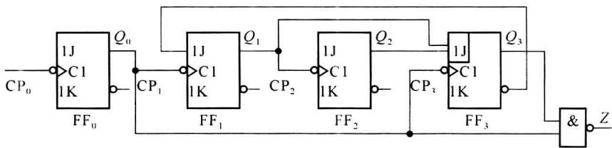  

图 5.2.28 例 5.2.5 异步时序逻辑电路

<Solution title="解">
首先根据逻辑图写出激励方程:

$$

\left\{ \begin{array}{l l} J _ {0} = K _ {0} = 1 \\ J _ {1} = \overline {{{Q _ {3} ^ {n}}}}; K _ {1} = 1 \\ J _ {2} = K _ {2} = 1 \\ J _ {3} = Q _ {1} ^ {n} Q _ {2} ^ {n}; K _ {3} = 1 \end{array} \right.\tag{5.2.16}

$$

将式(5.2.16)代入 JK 触发器的特征方程后得到状态方程：

$$

\left\{ \begin{array}{l} Q _ {0} ^ {n + 1} = \overline {{Q}} _ {0} ^ {n} \cdot \mathrm{CP} _ {0} \\ Q _ {1} ^ {n + 1} = \overline {{Q}} _ {3} ^ {n} \cdot \overline {{Q}} _ {1} ^ {n} \cdot \mathrm{CP} _ {1} \\ Q _ {2} ^ {n + 1} = \overline {{Q}} _ {2} ^ {n} \cdot \mathrm{CP} _ {2} \\ Q _ {3} ^ {n + 1} = Q _ {1} ^ {n} Q _ {2} ^ {n} \overline {{Q}} _ {3} ^ {n} \cdot \mathrm{CP} _ {3} \end{array} \right.\tag{5.2.17}

$$

式(5.2.17)中以小写的 CP 表示时钟信号, 它不是一个逻辑变量。对下降沿触发的触发器而言, CP=1 仅表示时钟输入端有下降沿到达; 对于上升沿触发的触发器而言, CP=1 表示时钟输入端有上升沿到达。CP=0 表示没有时钟信号到达, 触发器保持原来的状态不变。

根据电路图写出输出方程：

$$

Z = Q _ {0} ^ {n} Q _ {3} ^ {n}\tag{5.2.18}

$$

首先设定 $Q_{3}^{n}Q_{2}^{n}Q_{1}^{n}Q_{0}^{n}=0000$ 为初始状态，因为只有触发器 $FF_{0}$ 使用外时钟，所以先求

$Q_{0}^{n+1}$ 。根据状态方程，得到 $Q_{0}^{n+1}=1$ 。由于使用下降沿触发的触发器， $Q_{0}$ 的输出 $(0\rightarrow1)$ 没有给后面的触发器有效时钟沿， $Q_{3}^{n}Q_{1}^{n}$ 不变；由于 $Q_{1}^{n}$ 不变，所以 $Q_{2}^{n}$ 不变。于是得到新状态为0001。将0001作为现状态，可以求得新的 $Q_{0}^{n+1}=0$ 。由于 $FF_{0}$ 从1变为0，所以为 $FF_{1}$ 和 $FF_{3}$ 提供了有效时钟，可根据激励方程和状态方程求得 $FF_{1}$ 和 $FF_{3}$ 的新状态： $Q_{3}^{n}=0,Q_{1}^{n}=1$ ，由于 $Q_{1}^{n}$ 是从0变为1，没有下降沿，所以 $FF_{2}$ 不变。得到新的状态为0010。依次计算下去，可得到表5.2.9所示的状态转移表。

表 5.2.9 例 5.2.5 的状态转移表

<table><tr><td> $CP_0$ 的顺序</td><td> $Q_3^n$ </td><td> $Q_2^n$ </td><td> $Q_1^n$ </td><td> $Q_0^n$ </td><td> $Q_3^{n+1}$ </td><td> $Q_2^{n+1}$ </td><td> $Q_1^{n+1}$ </td><td> $Q_0^{n+1}$ </td><td>Z</td></tr><tr><td>1</td><td>0</td><td>0</td><td>0</td><td>0</td><td>0</td><td>0</td><td>0</td><td>1</td><td>0</td></tr><tr><td>2</td><td>0</td><td>0</td><td>0</td><td>1</td><td>0</td><td>0</td><td>1</td><td>0</td><td>0</td></tr><tr><td>3</td><td>0</td><td>0</td><td>1</td><td>0</td><td>0</td><td>0</td><td>1</td><td>1</td><td>0</td></tr><tr><td>4</td><td>0</td><td>0</td><td>1</td><td>1</td><td>0</td><td>1</td><td>0</td><td>0</td><td>0</td></tr><tr><td>5</td><td>0</td><td>1</td><td>0</td><td>0</td><td>0</td><td>1</td><td>0</td><td>1</td><td>0</td></tr><tr><td>6</td><td>0</td><td>1</td><td>0</td><td>1</td><td>0</td><td>1</td><td>1</td><td>0</td><td>0</td></tr><tr><td>7</td><td>0</td><td>1</td><td>1</td><td>0</td><td>0</td><td>1</td><td>1</td><td>1</td><td>0</td></tr><tr><td>8</td><td>0</td><td>1</td><td>1</td><td>1</td><td>1</td><td>0</td><td>0</td><td>0</td><td>0</td></tr><tr><td>9</td><td>1</td><td>0</td><td>0</td><td>0</td><td>1</td><td>0</td><td>0</td><td>1</td><td>0</td></tr><tr><td>10</td><td>1</td><td>0</td><td>0</td><td>1</td><td>0</td><td>0</td><td>0</td><td>0</td><td>1</td></tr><tr><td>11</td><td>0</td><td>0</td><td>0</td><td>0</td><td>0</td><td>0</td><td>0</td><td>1</td><td>0</td></tr></table>

由于电路中有4个触发器，它们的状态组合有16种，而表5.2.9中只包含了10种，因此需要分别求出其余6种状态下的输出和下一状态。将这些计算结果补充到表5.2.9中，构成完整的状态转移表。完整的电路状态转移图如图5.2.29所示。状态转移图表明，当电路处于表5.2.9中所列10种状态以外的任何一种状态时，都会在时钟信号作用下最终进入表5.2.9中的状态循环中去。即该时序电路能够自启动。

从图 5.2.29 的状态转移图还可以看出, 图 5.2.28 电路是一个异步十进制加法计数器。

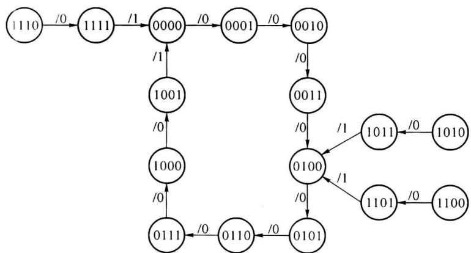  

图5.2.29 图5.2.28电路的状态转移图
</Solution>
</Example>
