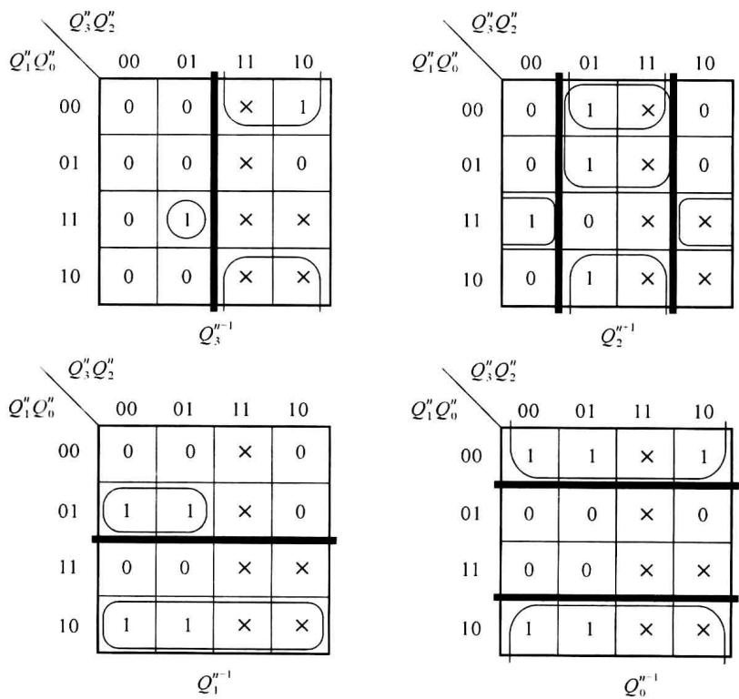
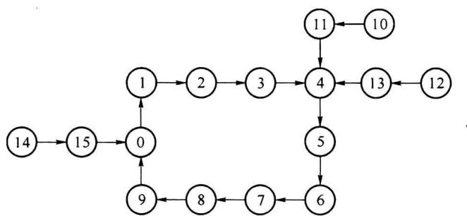
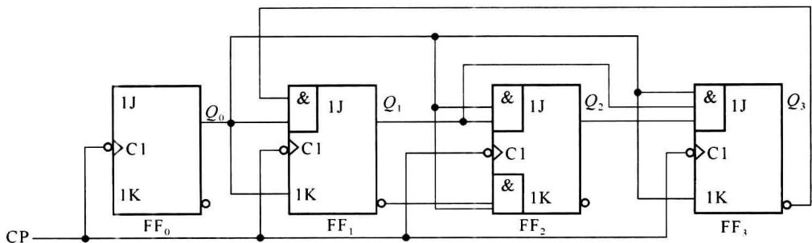
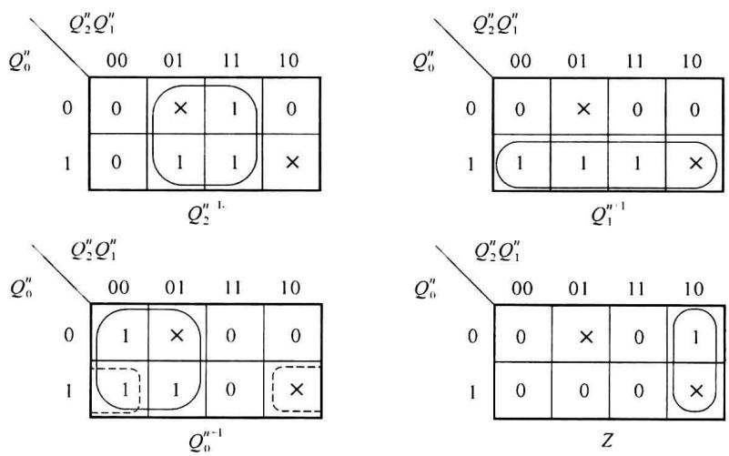
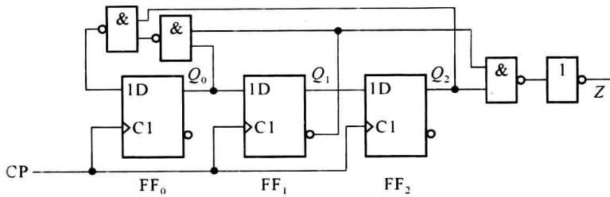
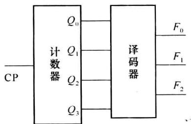
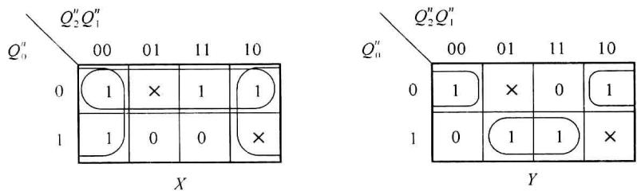
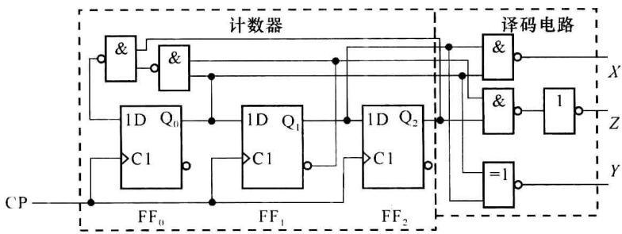
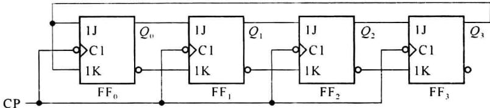

import Guide from '@/components/Guide.astro';
import Knowledge from '@/components/Knowledge.astro';
import Example from '@/components/Example.astro';
import Analysis from '@/components/Analysis.astro';
import Solution from '@/components/Solution.astro';
import Variant from '@/components/Variant.astro';
import Note from '@/components/Note.astro';
import Block from '@/components/Block.astro';
import Method from '@/components/Method.astro';
import Exercise from '@/components/Exercise.astro';

本节介绍同步计数器、序列信号发生器等常用时序电路的设计方法。掌握这些方法，可以根据自己的特定需要，设计时序电路，以便于使用 VHDL 语言对时序电路进行描述和设计。

## 5.3.1 常用时序电路的设计步骤

一般计数器、序列信号发生器等常用时序电路都可以直接从设计要求作出状态转移表，根据状态转移表设计时序电路激励和输出。

具体步骤如下：

(1) 根据设计要求,作出状态转移表。

（2）根据状态转移表，作出以现在状态为输入，下一状态为输出的卡诺图，从卡诺图求出电路的状态方程。同时，作出电路输出的卡诺图，求出输出方程。

(3) 由状态方程直接求出触发器的输入激励方程, 完成触发器输入逻辑的设计。

（4）根据设计结果，画出状态转移图。由于一般设计要求中，指定了工作状态的转移关系，所以要将所有状态的转移关系表示清楚。检查是否能自启动，若不能自启动，还要重新修改某个触发器的激励方程。

（5）根据激励方程和输出方程，选择器件，完成具体的逻辑设计。画出最后得到的逻辑图。

以上的设计步骤,将在以后的设计举例中详细说明。

## 5.3.2 同步计数器的设计

一般设计同步计数器时,往往根据系统需求会给出计数器的模值和编码。因此,很容易作出状态转移表,再使用适当的方法,就可以得到触发器的输入激励方程,完成计数器的设计。在使用JK触发器进行时序电路设计时,为了使得写出的状态方程和触发器的特征方程在形式上一致,直接获得激励函数,可将卡诺图分为两个子卡诺图,即在每个卡诺图都用粗黑线分为 $Q_{i}^{n}=0$ 和 $Q_{i}^{n}=1$ 两个子图。在卡诺图中合并相邻项时,必须只在子图中进行,不允许超越分割线。这样合并和写出的状态方程,将和JK触发器的特征方程的形式相一致,进而就可以直接写出触发器输入的激励方程。以下的例子将说明具体设计方法。

<Example title="例 5.3.1">
用 JK 触发器, 设计一个 8421 码十进制同步计数器。

<Solution title="解">
(1) 确定触发器的数目。因为计数模值 M=10, 所以需要 4 个触发器。

(2) 作出状态转移表。根据设计要求中给出的条件, 可以知道计数的状态转移关系。在状态转移表中, 可在左边现状态栏中先写一个初始现状态 (如 0000), 在右边下一状态栏中写出相应的下一状态 (即 0001); 到下一行, 再以上一行的下一状态 (0001) 为现在状态, 写出本行的下一状态 (0010)。一直写到下一状态中重新出现第一个状态为止。结果如表5.3.1 所示。

表 5.3.1 8421 码十进制计数器状态转移表

<table><tr><td> ${Q}_{3}^{n}$ </td><td> ${Q}_{2}^{n}$ </td><td> ${Q}_{1}^{n}$ </td><td> ${Q}_{0}^{n}$ </td><td> ${Q}_{3}^{n + 1}$ </td><td> ${Q}_{2}^{n + 1}$ </td><td> ${Q}_{1}^{n + 1}$ </td><td> ${Q}_{0}^{n + 1}$ </td></tr><tr><td>0</td><td>0</td><td>0</td><td>0</td><td>0</td><td>0</td><td>0</td><td>1</td></tr><tr><td>0</td><td>0</td><td>0</td><td>1</td><td>0</td><td>0</td><td>1</td><td>0</td></tr><tr><td>0</td><td>0</td><td>1</td><td>0</td><td>0</td><td>0</td><td>1</td><td>1</td></tr><tr><td>0</td><td>0</td><td>1</td><td>1</td><td>0</td><td>1</td><td>0</td><td>0</td></tr><tr><td>0</td><td>1</td><td>0</td><td>0</td><td>0</td><td>1</td><td>0</td><td>1</td></tr><tr><td>0</td><td>1</td><td>0</td><td>1</td><td>0</td><td>1</td><td>1</td><td>0</td></tr><tr><td>0</td><td>1</td><td>1</td><td>0</td><td>0</td><td>1</td><td>1</td><td>1</td></tr><tr><td>0</td><td>1</td><td>1</td><td>1</td><td>1</td><td>0</td><td>0</td><td>0</td></tr><tr><td>1</td><td>0</td><td>0</td><td>0</td><td>1</td><td>0</td><td>0</td><td>1</td></tr><tr><td>1</td><td>0</td><td>0</td><td>1</td><td>0</td><td>0</td><td>0</td><td>0</td></tr></table>

（3）作出下一状态的卡诺图，写出每个触发器的状态方程。先将卡诺图按照 $Q_{i}^{n} = 0$ 和 $Q_{i}^{n} = 1$ 分为两个子图，在子图中进行相邻项的合并，这样获得的触发器状态方程在形式上和触发器的特征方程相一致，以便直接获得触发器的激励方程。例5.3.1计数器下一状态的卡诺图如图5.3.1所示。

  

图5.3.1 例5.3.1的卡诺图

在写出每个触发器的状态方程过程中,对于 $Q_{3}^{n+1}$ 来说,如果按照一般的做法,位于0111的1格应该和相邻的任意项合并,但是这样的合并,跨越了图中的分割线,所得到的方程式中与项将不包含 $Q_{3}^{n}$ 或 $\overline{Q_{3}^{n}}$ ，即与 JK 触发器的特征方程形式上不一致，也就不能直接写出输入激励方程。不跨越图中粗黑线，简化后写出的触发器状态方程见式(5.3.1)。

$$

\left\{ \begin{array}{l} Q _ {3} ^ {n + 1} = Q _ {2} ^ {n} Q _ {1} ^ {n} Q _ {0} ^ {n} \overline {{Q _ {3} ^ {n}}} + \overline {{Q _ {0} ^ {n}}} Q _ {3} ^ {n} \\ Q _ {2} ^ {n + 1} = Q _ {1} ^ {n} Q _ {0} ^ {n} \overline {{Q _ {2} ^ {n}}} + (Q _ {1} ^ {n} + \overline {{Q _ {0} ^ {n}}}) Q _ {2} ^ {n} \\ Q _ {1} ^ {n + 1} = \overline {{Q _ {3} ^ {n}}} Q _ {0} ^ {n} \overline {{Q _ {1} ^ {n}}} + \overline {{Q _ {0} ^ {n}}} Q _ {1} ^ {n} \\ Q _ {0} ^ {n + 1} = \overline {{Q _ {0} ^ {n}}} \end{array} \right.\tag{5.3.1}

$$

式(5.3.1)状态方程的形式与 $JK$ 触发器的特征方程形式一致。 $\overline{Q_i^r}$ 的系数就是 $J_i$ 的输入激励方程， $Q_i^n$ 的系数就是 $\overline{K_i}$ 的输入激励方程，因此，可以直接进入下一步。

(4) 直接写出各触发器的输入激励方程:

$$

\left\{ \begin{array}{l l} J _ {3} = Q _ {2} ^ {n} Q _ {1} ^ {n} Q _ {0} ^ {n} & K _ {3} = Q _ {0} ^ {n} \\ J _ {2} = Q _ {1} ^ {n} Q _ {0} ^ {n} & K _ {2} = \overline {{Q _ {1} ^ {n} + \overline {{Q _ {0} ^ {n}}}}} \\ J _ {1} = \overline {{Q _ {3} ^ {n}}} Q _ {0} ^ {n} & K _ {1} = Q _ {0} ^ {n} \\ J _ {0} = 1 & K _ {0} = 1 \end{array} \right.\tag{5.3.2}

$$

（5）检查不在计数循环中的状态的转移关系。检查不使用状态的转移方向可以有两种方法。

方法一: 将需要检查的状态代入状态方程式(5.3.1), 求出下一状态。

方法二:从图 5.3.1 中直接观察 6 个不使用状态,从而得到其下一状态。即:凡在简化时被圈入的任意项,其下一状态的取值为 1,没有被圈入的任意项取值为 0。例如,对于 1100 状态,其 $Q_{3}^{n+1}$ 、 $Q_{2}^{n+1}$ 、 $Q_{0}^{n+1}$ 被简化时圈入,下一状态为“1”。可以得到 1100 的下一状态为 1101。

通过以上两种方法均可以得到6个不使用状态的下一状态：

$$

1 0 1 0 \rightarrow 1 0 1 1 \quad 1 0 1 1 \rightarrow 1 0 0 0 \quad 1 1 0 0 \rightarrow 1 1 0 1 \quad 1 1 0 1 \rightarrow 0 1 0 0 \quad 1 1 1 0 \rightarrow 1 1 1 1 \quad 1 1 1 1 \rightarrow 0 0 0 0

$$

这样, 就可以画出全部 16 个状态的状态转移图, 如图 5.3.2 所示。由图可以看出, 这个计数器是可以自启动的。

  

图5.3.2 例5.3.1的状态转移图

(6) 画逻辑图, 如图 5.3.3 所示。

  

图5.3.3 8421码十进制计数器
</Solution>
</Example>

<Example title="例 5.3.2">
用 D 触发器和与非门设计一个可自启动的模 6 同步计数器，使用状态为 $S_{0}=000, S_{1}=001, S_{2}=011, S_{3}=111, S_{4}=110, S_{5}=100$ ，且当处于状态 $S_{5}$ 时输出 1。

<Solution title="解">
根据题目要求列出状态转移表,如表 5.3.2 所示。

表 5.3.2 例 5.3.2 的状态转移表

<table><tr><td> ${Q}_{2}^{n}$ </td><td> ${Q}_{1}^{n}$ </td><td> ${Q}_{0}^{n}$ </td><td> ${Q}_{2}^{n + 1}$ </td><td> ${Q}_{1}^{n + 1}$ </td><td> ${Q}_{0}^{n + 1}$ </td><td>Z</td></tr><tr><td>0</td><td>0</td><td>0</td><td>0</td><td>0</td><td>1</td><td>0</td></tr><tr><td>0</td><td>0</td><td>1</td><td>0</td><td>1</td><td>1</td><td>0</td></tr><tr><td>0</td><td>1</td><td>1</td><td>1</td><td>1</td><td>1</td><td>0</td></tr><tr><td>1</td><td>1</td><td>1</td><td>1</td><td>1</td><td>0</td><td>0</td></tr><tr><td>1</td><td>1</td><td>0</td><td>1</td><td>0</td><td>0</td><td>0</td></tr><tr><td>1</td><td>0</td><td>0</td><td>0</td><td>0</td><td>0</td><td>1</td></tr></table>

由表 5.3.2 可以作出下一状态卡诺图和输出函数的卡诺图, 如图 5.3.4 所示。

  

图5.3.4 例5.3.2下一状态和输出函数卡诺图

由于在状态转移表中010和101两个状态未出现，所以图5.3.4中作任意项处理，由图5.3.4中的实线圈，可求出状态方程：

  

图5.3.6 例5.3.2逻辑电路图
</Solution>
</Example>

## 5.3.3 序列信号发生器设计

序列信号发生器一般可以由两种结构构成,一种是由模值为序列信号长度的计数器加组合译码逻辑电路构成,另一种是由移位寄存器加反馈电路来构成。

### 1. 由计数器与译码电路构成的序列信号发生器

计数器加译码器构成的序列信号发生器的框图由图 5.3.7 所示。

  

图 5.3.7 计数器加译码器构成的序列信号发生器框图

该类序列信号发生器的设计主要分为两个部分,计数器和译码电路。计数器的设计一般需要根据序列信号的长度确定计数周期,其设计方法前面已经介绍过,不再介绍。译码电路设计也很简单,只是将计数器的输出作为译码电路的输入,按照计数器的状态顺序和所要求的序列信号给出真值表并求解输出即可。

<Example title="例 5.3.3">
分析图 5.3.6 所示电路 Z 的输出序列，并采用与非门和同或门增加两个输出序列信号：X=110011,110011,…和 Y=101101,101101,…。

<Solution title="解">
(1)首先分析电路 Z 的输出序列:根据前面的设计过程和状态转移表(表 5.3.2)可以知道,该电路 Z 的输出序列为 000001。

(2) 根据所使用的状态、状态转移顺序和所要求的输出序列, 画出真值表(表 5.3.3)。

表 5.3.3 例 5.3.3 的输出序列真值表

<table><tr><td> ${Q}_{2}^{n}$ </td><td> ${Q}_{1}^{n}$ </td><td> ${Q}_{0}^{n}$ </td><td>X</td><td>Y</td><td>Z</td></tr><tr><td>0</td><td>0</td><td>0</td><td>1</td><td>1</td><td>0</td></tr><tr><td>0</td><td>0</td><td>1</td><td>1</td><td>0</td><td>0</td></tr><tr><td>0</td><td>1</td><td>1</td><td>0</td><td>1</td><td>0</td></tr><tr><td>1</td><td>1</td><td>1</td><td>0</td><td>1</td><td>0</td></tr><tr><td>1</td><td>1</td><td>0</td><td>1</td><td>0</td><td>0</td></tr><tr><td>1</td><td>0</td><td>0</td><td>1</td><td>1</td><td>1</td></tr></table>

(3) 通过真值表,画出 X 和 Y 的卡诺图并进行简化。

  

图5.3.8 例5.3.3X和 $Y$ 的输出函数卡诺图

简化后得到 $X$ 和 $Y$ 的输出函数：

$$

\left\{ \begin{array}{l} X = \overline {{Q _ {0} ^ {n}}} + \overline {{Q _ {1} ^ {n}}} = \overline {{Q _ {1} ^ {n} Q _ {0} ^ {n}}} \\ Y = \overline {{Q _ {1} ^ {n}}} \cdot \overline {{Q _ {0} ^ {n}}} + Q _ {1} ^ {n} \cdot Q _ {0} ^ {n} = Q _ {1} ^ {n} \odot Q _ {0} ^ {n} \end{array} \right.\tag{5.3.7}

$$

根据输出函数,绘制完成逻辑电路图。所获得的序列信号发生器完整的逻辑图如图5.3.9所示。

  

图5.3.9 例5.3.3逻辑电路图

需要说明的一个问题是,对于序列信号 Y 的输出,实际上的循环长度为 3(101),对于计数周期能够被整除模值,也可以实现短于计数周期的序列信号。像本例中,通过译码电路的设计,可以实现长度为 3 或 2 的循环序列信号。
</Solution>
</Example>

### 2. 由移位寄存器加反馈电路构成的序列信号发生器

由于移位寄存器的内部结构是固定的,内部连接不需要再设计,需要设计的只是反馈电路。设计的依据就是要产生的序列信号:

对于计数器来说,计数模值 M 和触发器数目 k 之间一定满足以下关系:

$$

2 ^ {k - 1} <   M \leqslant 2 ^ {k}\tag{5.3.8}

$$

如果由移存器构成的序列信号长度也用 $M$ 表示，此时 $M$ 和 $k$ 的关系不一定满足式(5.3.8)的关系。例如要求序列信号的长度是 $5, k$ 值取决于序列信号的具体形式，也许3个触发器就够了，也可能要4个触发器才能实现。

因此,序列信号发生器的设计步骤应该有所变化:

（1）首先根据给定序列信号的长度 M，依据式(5.3.8)初步确定所需要的最少触发器数目 k。

（2）验证并确定实际需要的触发器数目 k。方法是对给定的序列信号，先取最少需要的触发器数目 k 位为一组作为触发器的状态，第一组确定后，向后移一位，按 k 位再取一组，总共取 M 组。如果这 M 组状态，都不重复，就可以使用已经选择的 k；否则，就使 k 增加一位。

这种发生器所产生的序列的长度都是 $2^{k} - 1$ ，其中 $\pmb{k}$ 是移位寄存器的位数。

M 序列发生器是由移位寄存器和反馈电路来构成,但是反馈电路一般都是异或电路,异或电路的构成方式随着 M 序列信号长度的不同而不同。

由于 M 序列使用非常普遍, M 序列发生器的设计也都已经规格化: 也就是在应用时, 如果决定了 M 序列的长度, 可以查表来决定异或门的输入是从哪些触发器的输出来获得。

表 5.3.5 是一些不同长度 M 序列发生器的长度和相应的反馈函数。

表 5.3.5 不同长度的 $M$ 序列发生器的反馈函数

<table><tr><td>k</td><td> $M=2^{k}-1$ </td><td>反馈函数</td></tr><tr><td>3</td><td>7</td><td> $Q_{0} \oplus Q_{2}$ 或 $Q_{1} \oplus Q_{2}$ </td></tr><tr><td>4</td><td>15</td><td> $Q_{0} \oplus Q_{3}$ 或 $Q_{2} \oplus Q_{3}$ </td></tr><tr><td>5</td><td>31</td><td> $Q_{1} \oplus Q_{4}$ 或 $Q_{2} \oplus Q_{4}$ </td></tr><tr><td>6</td><td>63</td><td> $Q_{0} \oplus Q_{5}$ </td></tr><tr><td>7</td><td>127</td><td> $Q_{0} \oplus Q_{6}$ 或 $Q_{2} \oplus Q_{6}$ </td></tr><tr><td>8</td><td>255</td><td> $Q_{0} \oplus Q_{1} \oplus Q_{2} \oplus Q_{7}$ </td></tr><tr><td>9</td><td>511</td><td> $Q_{3} \oplus Q_{8}$ </td></tr><tr><td>10</td><td>1023</td><td> $Q_{5} \oplus Q_{9}$ </td></tr><tr><td>11</td><td>2047</td><td> $Q_{1} \oplus Q_{10}$ </td></tr><tr><td>12</td><td>4095</td><td> $Q_{0} \oplus Q_{3} \oplus Q_{5} \oplus Q_{11}$ </td></tr><tr><td>15</td><td>32767</td><td> $Q_{0} \oplus Q_{14}$ 或 $Q_{13} \oplus Q_{14}$ </td></tr><tr><td>21</td><td>2097151</td><td> $Q_{1} \oplus Q_{20}$ </td></tr></table>

表 5.3.5 中所示的反馈电路构成的 M 序列信号将不包括 k 个 0 的组合, 一旦进入了全零状态就会一直保持下去, 不能自启动。

为了解决不能自启动问题,可以在反馈函数中再增加一项校正项,校正项是先由 k 个触发器输出的“或非”,再将这个或非结果和原来的反馈输出再次进行“异或”运算,表达式如式(5.3.10)所示。

$$

D _ {0} = D _ {0} \oplus \overline {{{Q _ {k - 1} + Q _ {k - 2} + \cdots + Q _ {2} + Q _ {1} + Q _ {0}}}}\tag{5.3.10}

$$

未加校正项前，k 个触发器输出都是 0 时，则 $FF_{0}$ 输入端为 0，M 序列发器仍然进入全 0 状态。加校正项后，触发器全零时，因为或非门的输出是 1，异或后的总输出将是 $1(\mathrm{FF}_{0}$ 的输入端)，使得 $Q_{0}$ 的输出变为 1，全 0 状态不会继续，所以可以自启动。

M 序列信号发生器也可以使用 JK 触发器构成移位寄存器来产生 M 序列，并且有可能不使用异或电路，直接通过适当的连接来产生 M 序列。

因为 $JK$ 触发器的特征方程为

$$

Q ^ {n + 1} = J \overline {{{{Q ^ {n}}}}} + \overline {{{{K}}}} Q ^ {n}\tag{5.3.11}

$$

如果反馈电路的逻辑表达式刚好是 $Q_{0}$ 的输出和另一个触发器的输出的异或, 即

$$

Q _ {0} ^ {n + 1} = D _ {0} = Q _ {i} ^ {n} \overline {{{{Q _ {0} ^ {n}}}}} + \overline {{{{Q _ {i} ^ {n}}}}} Q _ {0} ^ {n}\tag{5.3.12}

$$

比较以上两个表达式, 只要使得 $J_{0}=Q_{i}^{n}$ 和 $\overline{K_{0}}=\overline{Q_{i}^{n}}$ 就可以实现相应长度的 M 序列信号。图 5.3.13 是用 JK 触发器实现的长度 M=15 的序列发发生器, 图中可以不用外加异或电路。

  

图 5.3.13 JK 触发器实现的 M 序列发生器

若需要一个序列信号长度短于 $2^{k}-1$ 的序列信号发生器或计数器，而对于输出什么样的序列没有特殊要求时，可通过缩短 M 序列发生器的方法构成。具体方法如下：

(1) 以触发器为全“1”开始写出 M 序列发生器的输出序列。

（2）如果需要输出序列的长度(或计数周期)为 L，则以全“1”最为第一个状态，找到第 $L+1$ 状态，将该状态译码出到触发器的置位端，使全部触发器置“1”，从而跳过后面的所有状态，即电路在全“1”状态到第 L 个状态间循环，由于一般触发器为异步置位，所以第 $L+1$ 个状态只有短暂的持续时间，与全“1”状态在同一个时钟周期。

（3）为了保证触发器器置位的可靠性，译码输出电路可增加一个触发器，使置位信号延迟半个时钟周期。
