import Guide from '@/components/Guide.astro';
import Knowledge from '@/components/Knowledge.astro';
import Example from '@/components/Example.astro';
import Analysis from '@/components/Analysis.astro';
import Solution from '@/components/Solution.astro';
import Variant from '@/components/Variant.astro';
import Note from '@/components/Note.astro';
import Block from '@/components/Block.astro';
import Method from '@/components/Method.astro';
import Exercise from '@/components/Exercise.astro';

5.3 节介绍了常用时序电路的设计方法, 这些常用电路功能明确, 使用触发器状态和触发器的数量确定, 所以设计比较简单。本小节介绍一般时序电路的设计步骤和设计方法。

## 5.4.1 一般同步时序逻辑电路的设计方法

在设计时序逻辑电路时,要求设计者根据给出的具体逻辑问题,求出实现这一逻辑功能的逻辑电路。所得到的设计结果应力求简单。

当选用小规模集成电路做设计时,电路最简的标准是所用的触发器和门电路的数目最少,并且触发器和门电路的输入端数目也最少。而当使用中、大规模集成电路时,电路最简的标准则是使用的集成电路数目及外围所需要的门电路最少,器件种类最少,而且互相间的连线也最少。

设计同步时序逻辑电路时,一般按如图 5.4.1 所示步骤进行。

### (1) 建立电路的原始状态图或状态表

建立电路的原始状态图或状态表就是把要求实现的时序逻辑功能表示为时序逻辑函数,可以用状态表的形式,也可以用状态图的形式。这就需要:

① 分析给定的逻辑问题,确定输入变量、输出变量以及电路的状态数。通常取原因(或条件)作为输入逻辑变量,取结果作输出逻辑变量。

② 定义输入/输出逻辑状态和每个电路状态的含意,并将电路状态顺序编号。

③ 按照题意列出电路的原始状态表或画出电路的原始状态图。

这样,就把给定的逻辑问题抽象为一个时序逻辑函数了。

表 5.4.1 例 5.4.1 的原始状态表

<table><tr><td rowspan="2"> $S^n$ </td><td colspan="2"> $S^{n+1}$ </td><td colspan="2">Z</td></tr><tr><td>X=0</td><td>X=1</td><td>X=0</td><td>X=1</td></tr><tr><td>A</td><td>A</td><td>B</td><td>0</td><td>0</td></tr><tr><td>B</td><td>C</td><td>D</td><td>0</td><td>0</td></tr><tr><td>C</td><td>E</td><td>F</td><td>0</td><td>0</td></tr><tr><td>D</td><td>G</td><td>H</td><td>0</td><td>0</td></tr><tr><td>E</td><td>A</td><td>B</td><td>0</td><td>0</td></tr><tr><td>F</td><td>A</td><td>D</td><td>0</td><td>0</td></tr><tr><td>G</td><td>A</td><td>B</td><td>0</td><td>0</td></tr><tr><td>H</td><td>A</td><td>H</td><td>0</td><td>1</td></tr></table>

状态表有两种类型,一种是在所有的输入条件下,都有确定的状态转移和确定的输出,这种状态表称为完全规定型状态表,如本例表5.4.1为完全规定型状态表。另一种是在有些输入条件下,下一状态或输出为任意的、不确定的,称为非完全规定型状态表,例如表5.4.2给出的是非完全规定型状态表。

表 5.4.2 非完全规定型状态表

<table><tr><td rowspan="2"> $S^n$ </td><td colspan="2"> $S^{n+1}$ </td><td colspan="2">Z</td></tr><tr><td>X=0</td><td>X=1</td><td>X=0</td><td>X=1</td></tr><tr><td>A</td><td>A</td><td>B</td><td>×</td><td>0</td></tr><tr><td>B</td><td>C</td><td>×</td><td>0</td><td>0</td></tr><tr><td>C</td><td>B</td><td>A</td><td>1</td><td>0</td></tr></table>

在本书中主要介绍完全规定型的状态表简化,非完全规定型状态表简化可参阅其他资料。

第 2 步, 状态简化(完全规定型状态表简化)。

在构成原始状态图和原始状态表时,为了充分如实地描述其功能,根据设计要求,列了许多状态,这些状态之间都有内在联系,有些状态可以进行合并。

在完全规定型状态表中,两个状态如果“等价”,则这两个状态可以合并为一个状态。两个状态等价必须同时满足如下两个条件:

(1) 在所有输入条件下,两个状态对应输出完全相同。

（2）在所有输入条件下，两个状态的下一状态完全相同或在满足一定条件时下一状态相同。

满足上述两个条件的状态称为等价状态,等价状态可以合并。

因此,比较两个状态时,如果不满足第1个条件,则肯定不是等价状态;如果满足第1个条件,则要继续比较第2个条件。第2个等价条件有下面3种情况:

① 在所有输入条件下， $S_{1}$ 和 $S_{2}$ 的下一状态一一对应完全相同（例如在只有一个输入信号，输入 X 为 0 和 1 时， $S_{1}$ 的下一状态对应 $S_{3}$ 和 $S_{4}$ ， $S_{2}$ 的下一状态也是 $S_{3}$ 和 $S_{4}$ ），则状态等价。

② 在有些输入条件下, 状态转移的下一状态虽然不相同(例如, 在输入 X=0 时, $S_{1}$ 转移到 $S_{3}, S_{2}$ 转移到 $S_{4}, X=1$ 时转移状态相同), 但如果证明 $S_{3}$ 和 $S_{4}$ 两个状态是等价状态, 则 $S_{1}$ 和 $S_{2}$ 也是等价状态; 如果 $S_{3}$ 和 $S_{4}$ 不是等价状态, 则 $S_{1}$ 和 $S_{2}$ 也不等价。即 $S_{3}$ 和 $S_{4}$ 是否等价是 $S_{1}$ 和 $S_{2}$ 是否等价的条件, 称 $S_{3}$ 和 $S_{4}$ 是 $S_{1}$ 和 $S_{2}$ 的等价隐含条件。

③ 在有些输入条件下， $S_{1}$ 和 $S_{2}$ 状态对和 $S_{3}$ 和 $S_{4}$ 状态对互为隐含条件，则 $S_{1}$ 和 $S_{2}$ 等价， $S_{3}$ 和 $S_{4}$ 也等价。

此外，等价状态有传递性。例如， $S_{1}$ 和 $S_{2}$ 等价， $S_{2}$ 和 $S_{3}$ 等价，则 $S_{1}$ 和 $S_{3}$ 也等价。

为了有条理地进行状态简化,一般采用列表比较的方法找出所有等价状态对。

### (1) 寻找全部等价状态对

寻找全部等价状态对,采用列表法,如表 5.4.3 所示。表呈现直角形网格形式,称为隐含表。表中每一个小方格代表一个状态对。根据等价条件将各列状态与各行状态一一进行比较,比较结果填入到对应的小方格中。两个状态进行比较时,有 3 种情况:

① 原始状态表中，两个状态输出 Z 不相同，则这两个状态不是等价状态，不能合并，则在对应的小方格中填 × 符号。

② 比较状态表中两个状态,如果在任何输入条件下,输出值 Z 都相同,且在任何输入条件下所对应的下一状态都是相同或为原状态对(比较的两个状态本身),则这两个状态满足等价条件,可以合并,在对应的小方格中记以√符号。

③ 状态表中的两个状态, 如果在任何输入条件下, 输出值 Z 都相同, 但在有些输入条件下, 下一状态不相同, 则将这些不相同的下一状态对作为等价条件填入到相应的方格中, 如表 5.4.1 中, 状态 A 和状态 B, 在所有输入条件下, 对应输出均相同, 但下一状态在输入 X=0 时, 分别为 A 和 C, 在输入 X=1 时, 分别为 B 和 D, 则在表 5.4.3 相应的方格中填 AC、BD, 表示 AC、BD 两对状态是 A 和 B 两状态等价的隐含条件。

## 表 5.4.3 例 5.4.1 的隐含表

<table><tr><td>B</td><td>ACBD</td><td></td><td></td><td></td><td></td><td></td><td></td></tr><tr><td>C</td><td>AEBF</td><td>CEDF</td><td></td><td></td><td></td><td></td><td></td></tr><tr><td>D</td><td>AGBH</td><td>CGDH</td><td>EGFH</td><td></td><td></td><td></td><td></td></tr><tr><td>E</td><td> $\checkmark$ </td><td>ACBD</td><td>AEBF</td><td>AGBH</td><td></td><td></td><td></td></tr><tr><td>F</td><td>BD</td><td>AC</td><td>AEDF</td><td>AGDH</td><td>BD</td><td></td><td></td></tr><tr><td>G</td><td> $\checkmark$ </td><td>ACBD</td><td>AEBF</td><td>AGBH</td><td> $\checkmark$ </td><td>BD</td><td></td></tr><tr><td>H</td><td> $\times$ </td><td> $\times$ </td><td> $\times$ </td><td> $\times$ </td><td> $\times$ </td><td> $\times$ </td><td> $\times$ </td></tr><tr><td></td><td>A</td><td>B</td><td>C</td><td>D</td><td>E</td><td>F</td><td>G</td></tr></table>

当采用列相邻原则进行状态分配后，在 $k$ 个触发器的下一状态的卡诺图中，有 $k - 1$ 个卡诺图相邻编码位置的两个格中的下一状态相同， $k - 1$ 个卡诺图可以有两个“1”（或两个“0”）合并。

### (3) 输出相邻原则

若两个或两个以上的现状态在同一输入组合下有相同的输出时,应给予相邻编码。例如,如果表中有两个状态下都输出1时,应给这两个状态相邻编码。

另外,如果条件允许,可以考虑增加状态代码的位数,(例如集成芯片中有多个触发器,不必考虑使用最少触发器进行电路设计时)可以给每一个状态使用一位状态代码,即所谓的“单位代码”分配法。例如有3个状态,使用3位代码,每个状态的代码是100、010、001,这样可以简化逻辑输出的译码电路。

进行状态编码时,通常以原则(1)到(3)顺序进行,(1)的级别最高,其次是(2)。但如果(2)的需求程度比(1)更大,则需要考虑有尽可能多的需要相邻编码的状态对使用相邻编码,统筹兼顾。

一个简单的方法是统计每一个状态对相邻编码的需求数量,在数量相等的情况下,先考虑(1),其次是(2)。

例 5.4.1 中, 每一个状态对相邻编码的需求数量如表 5.4.5 所示。

表 5.4.5 例 5.4.1 状态对相邻编码的数量统计

<table><tr><td>状态对</td><td>行相邻</td><td>列相邻</td><td>输出相邻</td><td>总计</td></tr><tr><td>ab</td><td>1</td><td>1</td><td></td><td>2</td></tr><tr><td>ac</td><td>1</td><td>1</td><td></td><td>2</td></tr><tr><td>ad</td><td>1</td><td>2</td><td></td><td>3</td></tr><tr><td>bc</td><td>1</td><td></td><td></td><td>1</td></tr><tr><td>bd</td><td>1</td><td></td><td></td><td>1</td></tr><tr><td>cd</td><td>2</td><td></td><td></td><td>2</td></tr></table>

由表 5.4.5 可见, ad 给予相邻编码的优先级最高, 其次为 cd, 再其次是 ab 和 ac。根据以上编码原则, 分配编码为: a 分配编码 00; b 分配编码 01; c 分配编码 11; d 分配编码 10。

根据已选择好的状态分配,可以将表 5.4.4 改写成表 5.4.6 的形式。此表即为状态转移表。

表 5.4.6 例 5.4.1 的简化状态转移表

<table><tr><td colspan="2"> ${S}^{n}$ </td><td colspan="4"> ${S}^{n + 1}$ </td><td colspan="2">Z</td></tr><tr><td rowspan="2"> ${Q}_{1}^{n}$ </td><td rowspan="2"> ${Q}_{0}^{n}$ </td><td colspan="2">X=0</td><td colspan="2">X=1</td><td rowspan="2">X=0</td><td rowspan="2">X=1</td></tr><tr><td> ${Q}_{1}^{n + 1}$ </td><td> ${Q}_{0}^{n + 1}$ </td><td> ${Q}_{1}^{n + 1}$ </td><td> ${Q}_{0}^{n + 1}$ </td></tr><tr><td>0</td><td>0</td><td>0</td><td>0</td><td>0</td><td>1</td><td>0</td><td>0</td></tr><tr><td>0</td><td>1</td><td>0</td><td>0</td><td>1</td><td>1</td><td>0</td><td>0</td></tr><tr><td>1</td><td>1</td><td>0</td><td>0</td><td>1</td><td>0</td><td>0</td><td>0</td></tr><tr><td>1</td><td>0</td><td>0</td><td>0</td><td>1</td><td>0</td><td>0</td><td>1</td></tr></table>

第 4 步,选择存储器的类型,确定存储电路的激励输入。

先确定使用触发器的类型,例如确定使用 JK 触发器,可通过卡诺图求出触发器的激励输入函数。

由表 5.4.6 可分别作出 $Q_{1}^{n+1}$ 及 $Q_{0}^{n+1}$ 以及输出 Z 的卡诺图，如图 5.4.4 所示。

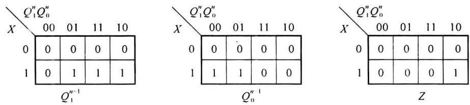  

图5.4.4 例5.4.1的下一状态卡诺图

由卡诺图可求出状态方程为

$$

\left\{ \begin{array}{l} Q _ {1} ^ {n + 1} = X Q _ {0} ^ {n} \overline {{Q _ {1} ^ {n}}} + X Q _ {1} ^ {n} \\ Q _ {0} ^ {n + 1} = X \overline {{Q _ {1} ^ {n}}} \cdot \overline {{Q _ {0} ^ {n}}} + X \overline {{Q _ {1} ^ {n}}} Q _ {0} ^ {n} \end{array} \right.\tag{5.4.3}

$$

JK 触发器的激励函数分别为

$$

\left\{ \begin{array}{l l} J _ {1} = X Q _ {0} ^ {n}; & K _ {1} = \overline {{X}} \\ J _ {0} = X \overline {{Q}} _ {1} ^ {n}; & K _ {0} = \overline {{X}} \overline {{Q}} _ {1} ^ {n} \end{array} \right.\tag{5.4.4}

$$

第 5 步, 求输出函数。

由图 5.4.4 输出函数 Z 的卡诺图得到：

$$

Z = X Q _ {1} ^ {n} \overline {{{Q _ {0} ^ {n}}}}\tag{5.4.5}

$$

第 6 步,画逻辑图。

采用 JK 触发器及与非门, 根据激励函数和输出函数, 可以画出例 5.4.1 的逻辑电路图, 如图 5.4.5 所示。

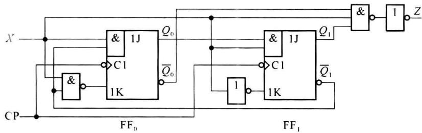  

图5.4.5 例5.4.1的逻辑电路

归纳以上所述,时序逻辑电路设计有4个主要步骤:

第 1 步是确定原始状态图和原始状态表,这是以下各步骤的基础,关键在于要对实际逻辑问题给予正确的理解,要把各种可能情况尽可能没有遗漏地考虑到。在建立状态图时,重要的是正确描述逻辑问题,主要考虑记忆内容以及状态数的多少。

第 2 步状态简化, 状态数的多少将会影响存储电路器件的多少。

第 3 步是状态编码,对于同步时序电路来说,状态编码是否最佳影响电路的结构是否简单,而对于异步时序电路来说,有时还要考虑电路的冒险,是否会影响电路正常工作。有关异步时序电路,尤其是电位型异步时序电路的设计,请参看有关资料。

第 4 步存储电路类型的选择,可以求各个状态的转移方程,然后确定触发器类型,再求上方的 0/0 或 1/0 等标注表示转移条件 C 和输出 Z，即 C/Z。由于最大计数模值为 7，共 7 个状态 $S_{0} \sim S_{6}$ ，因此无须再简化。

由于最大模值为 7，因此必须取代码位数 k=3。假设令 $S_{0}=000, S_{1}=001, S_{2}=011, S_{3}=110, S_{4}=101, S_{5}=010, S_{6}=100$ ，则可以作出状态转移表，如表 5.4.8 所示。

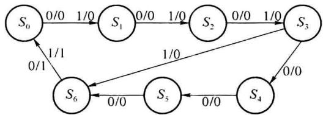  

图5.4.7 例5.4.3的原始状态图

表 5.4.8 例 5.4.3 的状态表

<table><tr><td rowspan="3">序号</td><td colspan="3"> ${Q}^{n}$ </td><td colspan="6"> ${Q}^{n + 1}$ </td><td colspan="2">Z</td></tr><tr><td rowspan="2"> ${Q}_{2}^{n}$ </td><td rowspan="2"> ${Q}_{1}^{n}$ </td><td rowspan="2"> ${Q}_{0}^{n}$ </td><td colspan="3">C=0</td><td colspan="3">C=1</td><td rowspan="2">C=0</td><td rowspan="2">C=1</td></tr><tr><td> ${Q}_{2}^{n + 1}$ </td><td> ${Q}_{1}^{n + 1}$ </td><td> ${Q}_{0}^{n + 1}$ </td><td> ${Q}_{2}^{n + 1}$ </td><td> ${Q}_{1}^{n + 1}$ </td><td> ${Q}_{0}^{n + 1}$ </td></tr><tr><td>0</td><td>0</td><td>0</td><td>0</td><td>0</td><td>0</td><td>1</td><td>0</td><td>0</td><td>1</td><td>0</td><td>0</td></tr><tr><td>1</td><td>0</td><td>0</td><td>1</td><td>0</td><td>1</td><td>1</td><td>0</td><td>1</td><td>1</td><td>0</td><td>0</td></tr><tr><td>2</td><td>0</td><td>1</td><td>1</td><td>1</td><td>1</td><td>0</td><td>1</td><td>1</td><td>0</td><td>0</td><td>0</td></tr><tr><td>3</td><td>1</td><td>1</td><td>0</td><td>1</td><td>0</td><td>1</td><td>1</td><td>0</td><td>0</td><td>0</td><td>0</td></tr><tr><td>4</td><td>1</td><td>0</td><td>1</td><td>0</td><td>1</td><td>0</td><td>x</td><td>x</td><td>x</td><td>0</td><td>0</td></tr><tr><td>5</td><td>0</td><td>1</td><td>0</td><td>1</td><td>0</td><td>0</td><td>x</td><td>x</td><td>x</td><td>0</td><td>0</td></tr><tr><td>6</td><td>1</td><td>0</td><td>0</td><td>0</td><td>0</td><td>0</td><td>0</td><td>0</td><td>0</td><td>1</td><td>1</td></tr></table>

由表 5.4.8 可作出相应的状态转移卡诺图及输出函数卡诺图, 如图 5.4.8 所示。

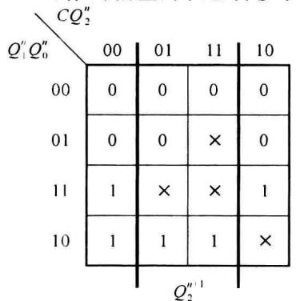

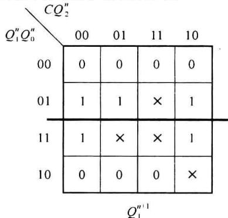

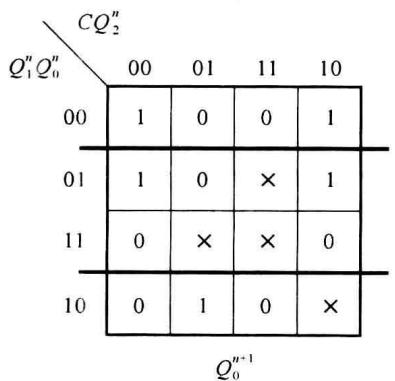

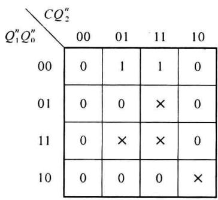  

图5.4.8 例5.4.3的下一状态和输出的卡诺图

若采用 JK 触发器, 经卡诺图化简, 得到各级触发器的状态方程为

$$

\left\{ \begin{array}{l} Q _ {2} ^ {n + 1} = Q _ {1} ^ {n} \overline {{Q _ {2} ^ {n}}} + Q _ {1} ^ {n} Q _ {2} ^ {n} \\ Q _ {1} ^ {n + 1} = Q _ {0} ^ {n} \overline {{Q _ {1} ^ {n}}} + Q _ {0} ^ {n} Q _ {1} ^ {n} \\ Q _ {0} ^ {n + 1} = (\overline {{Q _ {2} ^ {n}}} \cdot \overline {{Q _ {1} ^ {n}}} + \overline {{C}} Q _ {2} ^ {n} Q _ {1} ^ {n}) \overline {{Q _ {0} ^ {n}}} + \overline {{Q _ {2} ^ {n}}} \cdot \overline {{Q _ {1} ^ {n}}} Q _ {0} ^ {n} \end{array} \right.\tag{5.4.6}

$$

激励函数为

$$

\left\{ \begin{array}{l l} J _ {2} = Q _ {1} ^ {n} & K _ {2} = \overline {{Q _ {1} ^ {n}}} \\ J _ {1} = Q _ {0} ^ {n} & K _ {1} = \overline {{Q _ {0} ^ {n}}} \\ J _ {0} = \overline {{Q _ {2} ^ {n}}} \cdot \overline {{Q _ {1} ^ {n}}} + \overline {{C}} Q _ {2} ^ {n} Q _ {1} ^ {n} & K _ {0} = \overline {{\overline {{Q _ {2} ^ {n}}} \cdot \overline {{Q _ {1} ^ {n}}}}} \end{array} \right.\tag{5.4.7}

$$

输出方程为

$$

Z = Q _ {2} ^ {n} \cdot \overline {{{Q _ {1} ^ {n}}}} \cdot \overline {{{Q _ {0} ^ {n}}}}\tag{5.4.8}

$$

由于 $k = 3$ ，共有8个状态，在 $C = 0$ 执行 $M = 7$ 计数时，有一个不使用状态(111)，在 $C = 1$ 执行 $M = 5$ 计数时，有3个不使用状态(111)、(101)、(010)，而其中(101)和(010)在 $C = 0$ 时为有效状态。根据状态方程检验这些不使用状态的转移情况，如表5.4.9所示。可见，不使用状态能自动进入到有效计数状态，具有自启动特性。其状态转移图如图5.4.9所示。

表 5.4.9 例 5.4.3 的不使用状态

<table><tr><td colspan="3"> ${Q}^{n}$ </td><td colspan="6"> ${Q}^{n + 1}$ </td></tr><tr><td rowspan="2"> ${Q}_{2}^{n}$ </td><td rowspan="2"> ${Q}_{1}^{n}$ </td><td rowspan="2"> ${Q}_{0}^{n}$ </td><td colspan="3">C=0</td><td colspan="3">C=1</td></tr><tr><td> ${Q}_{2}^{n + 1}$ </td><td> ${Q}_{1}^{n + 1}$ </td><td> ${Q}_{0}^{n + 1}$ </td><td> ${Q}_{2}^{n + 1}$ </td><td> ${Q}_{1}^{n + 1}$ </td><td> ${Q}_{0}^{n + 1}$ </td></tr><tr><td>1</td><td>1</td><td>1</td><td>1</td><td>1</td><td>0</td><td>1</td><td>1</td><td>0</td></tr><tr><td>1</td><td>0</td><td>1</td><td></td><td></td><td></td><td>0</td><td>1</td><td>0</td></tr><tr><td>0</td><td>1</td><td>0</td><td></td><td></td><td></td><td>1</td><td>0</td><td>0</td></tr></table>

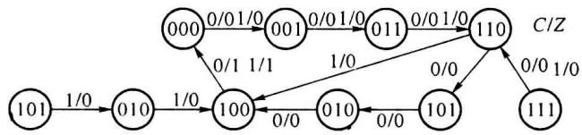  

图5.4.9 例5.4.3的状态转移图

最后画出逻辑图(如图 5.4.10 所示):

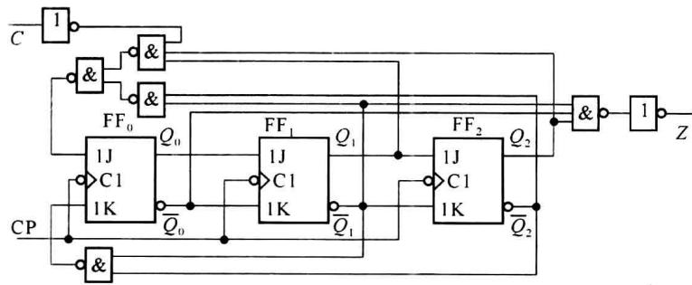  

图5.4.10 例5.4.3的逻辑图

## 5.4.2 采用小规模集成器件设计异步计数器

异步计数器的设计步骤与同步计数器设计步骤有所不同。但由于它是异步工作，因此就必须合理地选择各级触发器的时钟信号。下面通过例题来说明具体的设计步骤。

<Example title="例 5.4.4">
设计 8421BCD 二-十进制异步计数器。采用 8421BCD 码，即 $S_{0}=0000$ ， $S_{1}=0001$ ， $S_{2}=0010$ ， $S_{3}=0011$ ， $S_{4}=0100$ ， $S_{5}=0101$ ， $S_{6}=0110$ ， $S_{7}=0111$ ， $S_{8}=1000$ ， $S_{9}=1001$ ，当处于 $S_{9}$ 状态时输出 1。

<Solution title="解">
原始状态转移图如图 5.4.11 所示。根据原始状态图可以得到状态转移表,如表 5.4.10 所示。

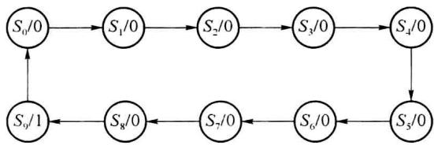  

图5.4.11 例5.4.4的原始状态图

表 5.4.10 例 5.4.4 的状态转移表

<table><tr><td rowspan="2">序号</td><td colspan="4"> ${Q}^{n}$ </td><td colspan="4"> ${Q}^{n + 1}$ </td><td rowspan="2">Z</td></tr><tr><td> ${Q}_{3}^{n}$ </td><td> ${Q}_{2}^{n}$ </td><td> ${Q}_{1}^{n}$ </td><td> ${Q}_{0}^{n}$ </td><td> ${Q}_{3}^{n + 1}$ </td><td> ${Q}_{2}^{n + 1}$ </td><td> ${Q}_{1}^{n + 1}$ </td><td> ${Q}_{0}^{n + 1}$ </td></tr><tr><td>0</td><td>0</td><td>0</td><td>0</td><td>0</td><td>0</td><td>0</td><td>0</td><td>1</td><td>0</td></tr><tr><td>1</td><td>0</td><td>0</td><td>0</td><td>1</td><td>0</td><td>0</td><td>1</td><td>0</td><td>0</td></tr><tr><td>2</td><td>0</td><td>0</td><td>1</td><td>0</td><td>0</td><td>0</td><td>1</td><td>1</td><td>0</td></tr><tr><td>3</td><td>0</td><td>0</td><td>1</td><td>1</td><td>0</td><td>1</td><td>0</td><td>0</td><td>0</td></tr><tr><td>4</td><td>0</td><td>1</td><td>0</td><td>0</td><td>0</td><td>1</td><td>0</td><td>1</td><td>0</td></tr><tr><td>5</td><td>0</td><td>1</td><td>0</td><td>1</td><td>0</td><td>1</td><td>1</td><td>0</td><td>0</td></tr><tr><td>6</td><td>0</td><td>1</td><td>1</td><td>0</td><td>0</td><td>1</td><td>1</td><td>1</td><td>0</td></tr><tr><td>7</td><td>0</td><td>1</td><td>1</td><td>1</td><td>1</td><td>0</td><td>0</td><td>0</td><td>0</td></tr><tr><td>8</td><td>1</td><td>0</td><td>0</td><td>0</td><td>1</td><td>0</td><td>0</td><td>1</td><td>0</td></tr><tr><td>9</td><td>1</td><td>0</td><td>0</td><td>1</td><td>0</td><td>0</td><td>0</td><td>0</td><td>1</td></tr></table>

设计步骤如下。

第 1 步: 由状态转移表, 选择各级触发器的时钟信号。

选择各级触发器时钟信号的原则是:在该级触发器的状态需要发生变化时(即由0至1或由1至0),必须有时钟信号触发沿到达;其他时刻到达该级触发器的时钟信号触发沿越少越好,这样有利于该级触发器的激励函数的简化。

对于第1级触发器 $(\mathrm{FF}_0)$ , 一般使用外部的时钟脉冲CP。对于第2级触发器 $(\mathrm{FF}_1)$ 的时钟触发信号, 先看第1级的输出 $Q_0$ 能否满足要求, 即第2级触发器的状态需要发生变化时, $Q_0$ 是否能够有效时钟信号触发沿, 如果不行, 则选外部的时钟信号。对于第3级触发器 $(\mathrm{FF}_2)$ 的时钟触发信号, 先选第2级输出 $Q_1$ 作为时钟脉冲信号, 如果不满足要求则选第1级的输出 $Q_0$ 作为时钟脉冲信号, 如果还不满足要求, 只能选择外部的时钟脉冲CP作为时钟信号。依此类推,第 i 级触发器的时钟触发信号可以在外部时钟脉冲 CP 和第 i 级以前的所有各级触发器的输出中选取。最先考虑前一级输出作为时钟信号。

根据上述时钟信号的选取原则,选取本例题中各级触发器的时钟:

第 1 级触发器 $FF_{0}$ 的时钟: $CP_{0}$ 为输入时钟脉冲 CP。

第2级触发器 $\mathrm{FF}_1$ 的时钟：从表5.4.10可见， $Q_{1}$ 的状态变化发生在序号1、3、5、7时刻。在这些时刻，计数脉冲和 $Q_{0}$ 输出有下降沿产生（ $\overline{Q}_0$ 有上升沿产生，本例题中设定采用下降沿触发器），因此可选择 $Q_{0}$ 作为触发器的时钟。当然也可以使用输入的时钟脉冲作为触发脉冲，但在 $Q_{1}$ 的状态不发生变化的那些时刻有过多“多余”的触发脉冲存在，这样会使得激励函数变得比较复杂。因此选 $Q_{0}$ 的输出作为 $\mathrm{CP}_1$ 。

第 3 级触发器的时钟:从表 5.4.10 可见, $Q_{2}$ 的状态变化发生在序号 3、7 的时刻,在这些时刻 $Q_{1}$ 有下降沿产生。因此选择 $CP_{2}=Q_{1}$ 。

第 4 级触发器的时钟:从表 5.4.10 可见, $Q_{3}$ 的状态变化发生在序号 7、9 时刻,在序号 9 时刻 $Q_{1}$ 、 $Q_{2}$ 没有下降沿产生, $Q_{0}$ 满足要求,所以选 $Q_{0}$ 作为 $CP_{3}$ 。

第 2 步:作简化状态转移表。

在选择了各级触发器的时钟信号后,由于在某些时刻,没有时钟有效触发沿的触发器,其状态将不会发生变化,因此可以根据各个触发器的时钟信号,作出适合求解激励函数的新的状态转移表,如表 5.4.11 所示。

外部输入时钟脉冲作为触发器 $\mathrm{FF}_0$ 的时钟信号，每一个外部计数脉冲的下降沿对 $\mathrm{FF}_0$ 均有效，触发器 $\mathrm{FF}_0$ 状态的变化与否与将依据其激励输入。所以表5.4.11中的 $Q_0^{n + 1}$ 列与表5.4.10相同，无须修改。

$Q_{0}$ 下降沿作为触发器 $\mathrm{FF}_{1}$ 和触发器 $\mathrm{FF}_{3}$ 的时钟信号触发信号。在序号1、3、5、7、9这些时刻 $Q_{0}$ 会产生下降沿触发触发器 $\mathrm{FF}_{1}$ 和触发器 $\mathrm{FF}_{3}$ ，因此，可以在序号1、3、5、7、9状态时写出触发器 $\mathrm{FF}_{1}$ 和触发器 $\mathrm{FF}_{3}$ 的下一状态 $Q_{1}^{n + 1}, Q_{3}^{n + 1}$ ，即在这些时刻表5.4.11中的 $Q_{1}^{n + 1}, Q_{3}^{n + 1}$ 与表5.4.10相同。而在其余时刻，由于 $Q_{0}$ 不产生下降沿，因此无论加什么样的激励信号，触发器 $\mathrm{FF}_{1}$ 和触发器 $\mathrm{FF}_{3}$ 不会发生状态的变化，其转移状态可以作任意项处理，如表5.4.11中 $Q_{1}^{n + 1}$ 和 $Q_{3}^{n + 1}$ 列中的“×”符号。

同样， $Q_{1}$ 下降沿作为时钟触发触发器 $FF_{2}$ ，在序号 3 和 7 时刻，产生有效时钟沿，因此可写出在序号 3 和 7 时的 $Q_{2}^{n+1}$ 。在其余时刻， $Q_{2}$ 转移状态作任意项处理。如表 5.4.11 中 $Q_{2}^{n+1}$ 列下的“×”符号。

表 5.4.11 例 5.4.4 的简化状态转移表

<table><tr><td rowspan="2">序号</td><td colspan="4"> $Q^n$ </td><td colspan="4"> $Q^{n+1}$ </td><td rowspan="2">Z</td></tr><tr><td> $Q_3^n$ </td><td> $Q_2^n$ </td><td> $Q_1^n$ </td><td> $Q_0^n$ </td><td> $Q_3^{n+1}$ </td><td> $Q_2^{n+1}$ </td><td> $Q_1^{n+1}$ </td><td> $Q_0^{n+1}$ </td></tr><tr><td>0</td><td>0</td><td>0</td><td>0</td><td>0</td><td>×</td><td>×</td><td>×</td><td>1</td><td>0</td></tr><tr><td>1</td><td>0</td><td>0</td><td>0</td><td>1</td><td>0</td><td>×</td><td>1</td><td>0</td><td>0</td></tr><tr><td>2</td><td>0</td><td>0</td><td>1</td><td>0</td><td>×</td><td>×</td><td>×</td><td>1</td><td>0</td></tr><tr><td>3</td><td>0</td><td>0</td><td>1</td><td>1</td><td>0</td><td>1</td><td>0</td><td>0</td><td>0</td></tr><tr><td>4</td><td>0</td><td>1</td><td>0</td><td>0</td><td>×</td><td>×</td><td>×</td><td>1</td><td>0</td></tr><tr><td>5</td><td>0</td><td>1</td><td>0</td><td>1</td><td>0</td><td>×</td><td>1</td><td>0</td><td>0</td></tr><tr><td>6</td><td>0</td><td>1</td><td>1</td><td>0</td><td>×</td><td>×</td><td>×</td><td>1</td><td>0</td></tr><tr><td>7</td><td>0</td><td>1</td><td>1</td><td>1</td><td>1</td><td>0</td><td>0</td><td>0</td><td>0</td></tr><tr><td>8</td><td>1</td><td>0</td><td>0</td><td>0</td><td>×</td><td>×</td><td>×</td><td>1</td><td>0</td></tr><tr><td>9</td><td>1</td><td>0</td><td>0</td><td>1</td><td>0</td><td>×</td><td>0</td><td>0</td><td>1</td></tr></table>

第 3 步: 根据表 5.4.11 作出各级触发器的下一状态卡诺图, 如图 5.4.12 所示。卡诺图中所有的空格是不使用状态, 均按任意项处理。

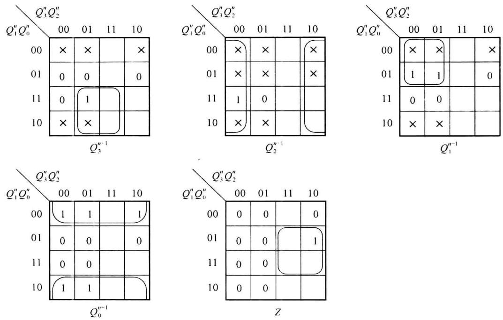  

图5.4.12 例5.4.4的下一状态和输出的卡诺图

当使用下降沿触发的 D 触发器设计电路时, 可写出状态方程和激励方程:

$$

\left\{ \begin{array}{l} Q _ {3} ^ {n + 1} = D _ {3} = Q _ {2} ^ {n} Q _ {1} ^ {n} \\ Q _ {2} ^ {n + 1} = D _ {2} = \overline {{Q _ {2} ^ {n}}} \\ Q _ {1} ^ {n + 1} = D _ {1} = \overline {{Q _ {3} ^ {n}}} \cdot \overline {{Q _ {1} ^ {n}}} \\ Q _ {0} ^ {n + 1} = D _ {0} = \overline {{Q _ {0} ^ {n}}} \end{array} \right.\tag{5.4.9}

$$

输出函数：

$$

Z = Q _ {3} ^ {n} Q _ {0} ^ {n}\tag{5.4.10}

$$

第 4 步: 检验是否具有自启动特性。

本例中一有 1010、1011、1100、1101、1110、1111 共 6 个不使用状态，由于 $FF_{0}(Q_{0})$ 使用外部时钟，每个时钟沿均有效，可根据状态方程先求出 $Q_{0}^{n+1}$ ，如表 5.4.12 所示的最后一列。由于 $Q_{0}$ 输出给 $FF_{1}$ 和 $FF_{3}$ 作为时钟，在没有时钟沿的位置，输出保持不变，例如计数器处于 1010 状态, 外部时钟到达后, $Q_{0}$ 的变化为 $0 \rightarrow 1$ , 没有时钟沿, 因此 $Q_{1}^{n+1}$ 和 $Q_{3}^{n+1}$ 保持不变 (表 5.4.12 中的第 1 行), 由于 $Q_{1}$ 没有变化, 所以 $Q_{2}^{n+1}$ 也不变, 电路进入 1011 状态。当计数器处于状态 1011, 在外部计数脉冲作用下, $Q_{0}$ 由 $1 \rightarrow 0$ , $Q_{0}$ 的下降沿触发触发器 $\mathrm{FF}_{1}$ 和触发器 $\mathrm{FF}_{3}$ , 使 $Q_{1}$ 由 $1 \rightarrow 0$ , $Q_{3}$ 由 $1 \rightarrow 0$ ; 而 $Q_{1}$ 的下降沿触发触发器 $\mathrm{FF}_{2}$ , 使 $Q_{2}$ 由 $0 \rightarrow 1$ 。这样在计数脉冲输入后, 不使用状态由 1011 转移到状态 0100、0100 为有效状态。其余类同, 如表 5.4.12 所示。

表 5.4.12 例 5.4.4 的不使用状态检验

<table><tr><td> ${Q}_{3}^{n}$ </td><td> ${Q}_{2}^{n}$ </td><td> ${Q}_{1}^{n}$ </td><td> ${Q}_{0}^{n}$ </td><td> ${Q}_{3}^{n + 1}$ </td><td> ${Q}_{2}^{n + 1}$ </td><td> ${Q}_{1}^{n + 1}$ </td><td> ${Q}_{0}^{n + 1}$ </td></tr><tr><td>1</td><td>0</td><td>1</td><td>0</td><td>1</td><td>0</td><td>1</td><td>1</td></tr><tr><td>1</td><td>0</td><td>1</td><td>1</td><td>0</td><td>1</td><td>0</td><td>0</td></tr><tr><td>1</td><td>1</td><td>0</td><td>0</td><td>1</td><td>1</td><td>0</td><td>1</td></tr><tr><td>1</td><td>1</td><td>0</td><td>1</td><td>0</td><td>1</td><td>0</td><td>0</td></tr><tr><td>1</td><td>1</td><td>1</td><td>0</td><td>1</td><td>1</td><td>1</td><td>1</td></tr><tr><td>1</td><td>1</td><td>1</td><td>1</td><td>1</td><td>0</td><td>0</td><td>0</td></tr></table>

由表 5.4.10 和表 5.4.12 可以作出状态转移图, 如图 5.4.13 所示。

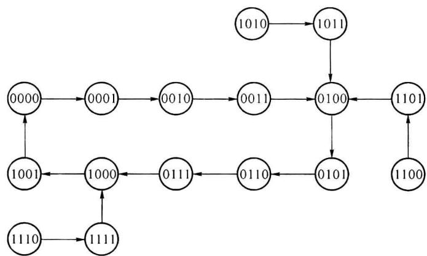  

图5.4.13 例5.4.4的状态转移图

电路可自启动。

第 5 步: 画逻辑电路图。

如果采用 D 触发器,由时钟脉冲下降沿触发,其逻辑电路如图 5.4.14 所示。

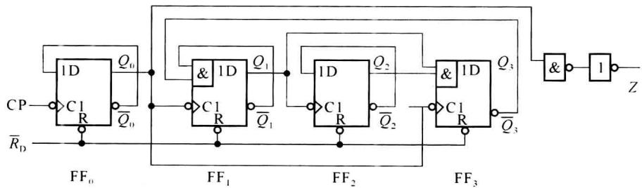  

图5.4.14 例5.4.4采用 $D$ 触发器的逻辑图

如果利用 JK 触发器构成计数器, 逻辑电路如图 5.4.15 所示。

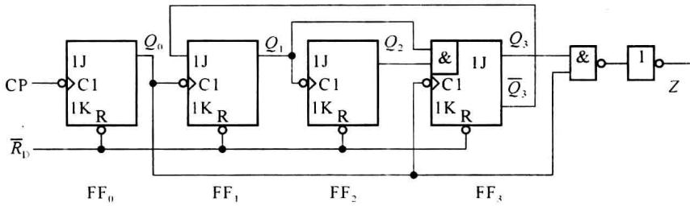  

图5.4.15 例5.4.4的逻辑图

由此例可以看出,异步计数器的设计步骤和同步计数器设计步骤有所不同。由于在选择各级触发器时钟时,可能有不同的方案,电路结构不同(主要是各级触发器激励函数不同)。对于这种异步时序电路,时钟的选择除去影响电路结构外,如果触发器的时钟和激励输入同时发生变化时,还要防止可能出现的竞争冒险现象。
</Solution>
</Example>
