import Guide from '@/components/Guide.astro';
import Knowledge from '@/components/Knowledge.astro';
import Example from '@/components/Example.astro';
import Analysis from '@/components/Analysis.astro';
import Solution from '@/components/Solution.astro';
import Variant from '@/components/Variant.astro';
import Note from '@/components/Note.astro';
import Block from '@/components/Block.astro';
import Method from '@/components/Method.astro';
import Exercise from '@/components/Exercise.astro';

## 习题

<Exercise title="习题 5-1">
已知一个时序电路在时钟作用下,状态的变化是 $000 \rightarrow 010 \rightarrow 011 \rightarrow 001 \rightarrow 101 \rightarrow 110 \rightarrow 010 \rightarrow 011 \rightarrow 001 \rightarrow 101 \rightarrow 110 \rightarrow 010 \rightarrow 011 \rightarrow \cdots$ 这样的电路能否作计数器?为什么?如果可以作计数器,计数模值为多少?
</Exercise>

<Exercise title="习题 5-2">
如果一个时序电路,在时钟作用下,状态的变化是 $000 \rightarrow 010 \rightarrow 011 \rightarrow 001 \rightarrow 101 \rightarrow 010 \rightarrow 011 \rightarrow 101 \rightarrow 110 \rightarrow 010 \rightarrow 011 \rightarrow 001 \rightarrow \cdots$ 这样的电路能否作计数器?为什么?如果可以作计数器,计数模值为多少?
</Exercise>

<Exercise title="习题 5-3">
分析题图 5.1 所示时序电路的逻辑功能, 写出电路激励方程、状态转移方程和输出方程, 画出状态转移图, 说明电路是否具有自启动特性。

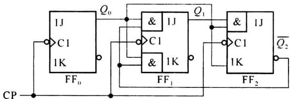  

题图5.1
</Exercise>

<Exercise title="习题 5-4">
分析题图 5.2 所示两个同步计数电路,作出状态转移表和状态转移图。计数器是几进制计数器?能否自启动?并画出在时钟作用下的各触发器输出波形。

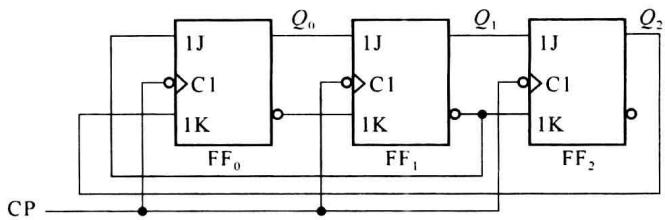

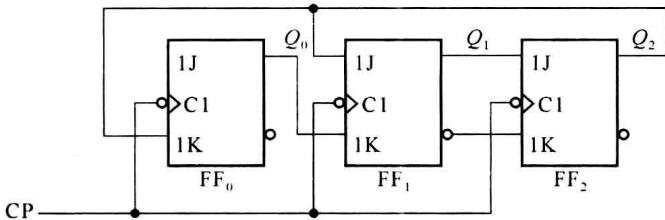  

题图5.2
</Exercise>

<Exercise title="习题 5-5">
分析题图 5.3 所示时序电路的逻辑功能, 写出电路的激励方程、状态转移方程和输出方程。画出状态转移图, 说明电路是否具有自启动特性。

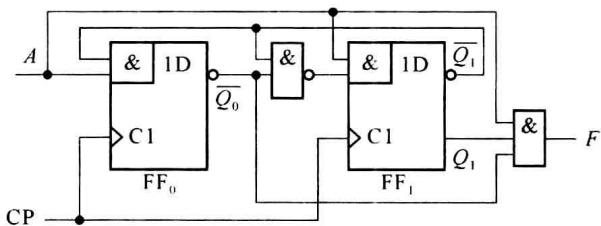  

题图5.3
</Exercise>

<Exercise title="习题 5-6">
分析题图 5.4 所示的同步计数电路,作出状态转移表和状态转移图,并分析能否自启动。通过分析找出这种结构的计数电路状态变化的规律,设初始状态为全 0。

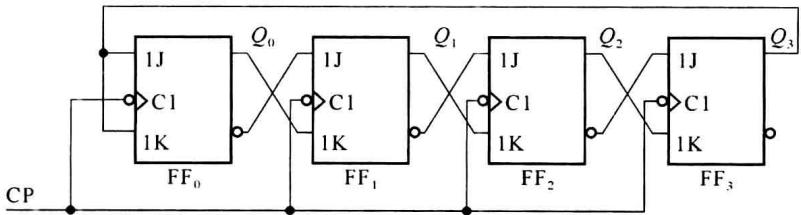  

题图5.4
</Exercise>

<Exercise title="习题 5-7">
题图 5.5 是一序列信号发生器电路, 它由一个计数器和一个 4 选 1 数据选择器构成。

(1) 分析计数器的工作原理, 确定其模值和状态转换关系;

(2) 确定数据选择器的输出序列。

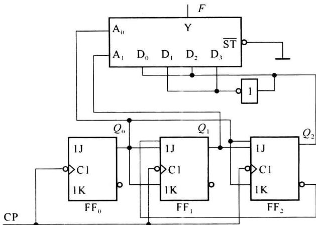  

题图5.5
</Exercise>

<Exercise title="习题 5-8">
分析题图 5.6 所示时序电路, 写出激励方程、状态转移方程和输出方程, 画出状态转移图。

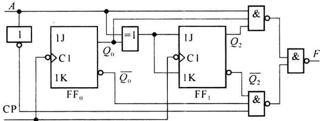  

题图5.6
</Exercise>

<Exercise title="习题 5-9">
分析题图 5.7 所示时序电路, 写出激励方程、状态转移方程和输出方程, 画出状态转移图及在时钟 CP 作用下 $Q_{0}Q_{1}Q_{2}Q_{3}$ 和 F 的工作波形。

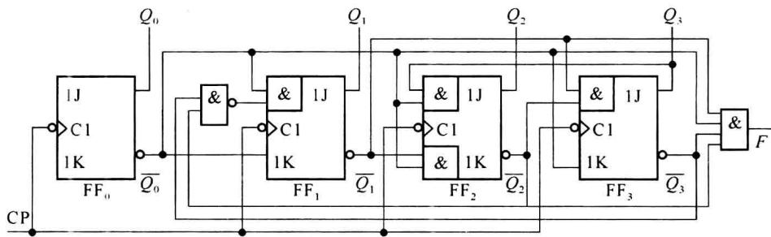  

题图5.7
</Exercise>

<Exercise title="习题 5-10">
分析题图 5.8 所示移存型计数器, 画出状态转移图。

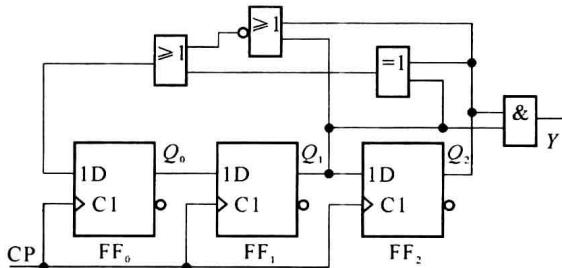  

题图5.8
</Exercise>

<Exercise title="习题 5-11">
题图 5.9 所示为序列信号发生器逻辑图, 试作出状态转移表和状态转移图, 确定其输出序列。

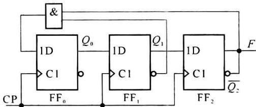  

题图5.9
</Exercise>

<Exercise title="习题 5-12">
分析题图 5.10 所示时序电路, 画出状态转移图, 并说明该电路的逻辑功能。

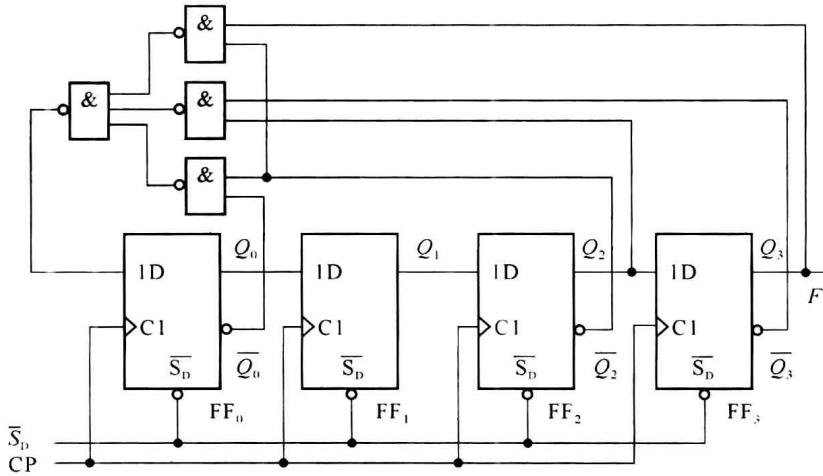  

题图5.10
</Exercise>

<Exercise title="习题 5-13">
分析题图 5.11 所示的异步时序电路的逻辑功能, 写出电路激励方程、状态转移方程和输出方程, 画出状态转移图, 说明电路是否具有自启动特性。

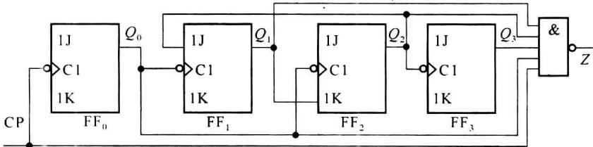  

题图5.11
</Exercise>

<Exercise title="习题 5-14">
分析题图 5.12 所示的异步时序电路, 并画出在时钟 CP 的作用下 $Q_{1}$ 的输出波形 (设初始为全 0 状态), 并说明 $Q_{1}$ 输出与时钟 CP 之间的关系。

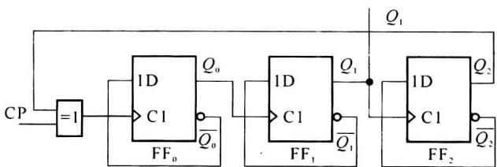  

题图5.12
</Exercise>

<Exercise title="习题 5-15">
分析题图 5.13 所示异步时序电路, 写出状态转移方程, 并画出在时钟 CP 的作用下输出 a、b、c、d、e、f 及 F 的各点波形。说明该电路完成什么逻辑功能。

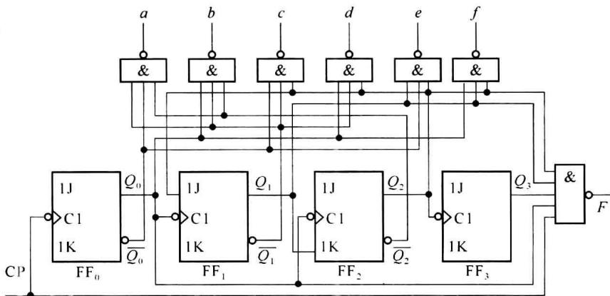  

题图5.13
</Exercise>

<Exercise title="习题 5-16">
分析如题图 5.14 所示的时序电路, 画出图中 A、B、C、D、E 和 F 各点的波形。一共画 12 个时钟周期。

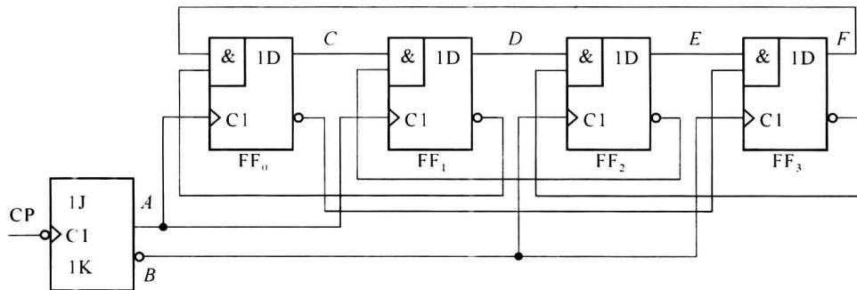  

题图5.14
</Exercise>

<Exercise title="习题 5-17">
分析题图 5.15 所示的异步计数器,作出其状态转移表和状态图,说明各是几进制计数器。

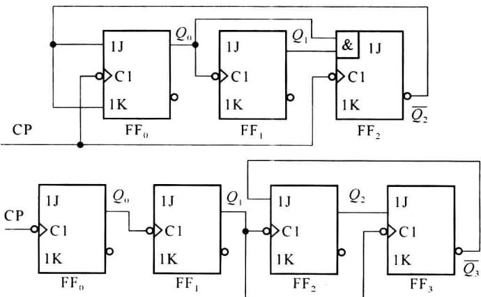  

题图5.15
</Exercise>

<Exercise title="习题 5-18">
用 $JK$ 触发器设计一个模7同步计数器。
</Exercise>

<Exercise title="习题 5-19">
已知一触发器的特征方程为 $Q^{n + 1} = M \oplus N \oplus Q^n$ ，要求：

(1) 用 JK 触发器实现该触发器的功能;

(2) 用该触发器构成模 4 同步计数器。
</Exercise>

<Exercise title="习题 5-20">
按下列给定状态转移表,设计同步计数器。

<table><tr><td>序号</td><td>A</td><td>B</td><td>C</td><td>D</td></tr><tr><td>0</td><td>0</td><td>0</td><td>0</td><td>0</td></tr><tr><td>1</td><td>0</td><td>0</td><td>0</td><td>1</td></tr><tr><td>2</td><td>0</td><td>0</td><td>1</td><td>0</td></tr><tr><td>3</td><td>0</td><td>0</td><td>1</td><td>1</td></tr><tr><td>4</td><td>0</td><td>1</td><td>0</td><td>0</td></tr><tr><td>5</td><td>0</td><td>1</td><td>0</td><td>1</td></tr><tr><td>6</td><td>0</td><td>1</td><td>1</td><td>0</td></tr><tr><td>7</td><td>1</td><td>0</td><td>0</td><td>0</td></tr><tr><td>8</td><td>1</td><td>0</td><td>0</td><td>1</td></tr><tr><td>9</td><td>1</td><td>0</td><td>1</td><td>0</td></tr></table>

(a)

<table><tr><td>序号</td><td>A</td><td>B</td><td>C</td><td>D</td></tr><tr><td>0</td><td>0</td><td>0</td><td>0</td><td>0</td></tr><tr><td>1</td><td>0</td><td>0</td><td>0</td><td>1</td></tr><tr><td>2</td><td>0</td><td>1</td><td>0</td><td>0</td></tr><tr><td>3</td><td>0</td><td>1</td><td>0</td><td>1</td></tr><tr><td>4</td><td>0</td><td>1</td><td>1</td><td>0</td></tr><tr><td>5</td><td>0</td><td>1</td><td>1</td><td>1</td></tr><tr><td>6</td><td>1</td><td>0</td><td>0</td><td>0</td></tr><tr><td>7</td><td>1</td><td>0</td><td>0</td><td>1</td></tr><tr><td>8</td><td>1</td><td>1</td><td>0</td><td>0</td></tr><tr><td>9</td><td>1</td><td>1</td><td>0</td><td>1</td></tr><tr><td>10</td><td>1</td><td>1</td><td>1</td><td>0</td></tr><tr><td>11</td><td>1</td><td>1</td><td>1</td><td>1</td></tr></table>

(b)

<table><tr><td>序号</td><td>A</td><td>B</td><td>C</td><td>D</td></tr><tr><td>0</td><td>0</td><td>0</td><td>0</td><td>0</td></tr><tr><td>1</td><td>0</td><td>0</td><td>0</td><td>1</td></tr><tr><td>2</td><td>0</td><td>0</td><td>1</td><td>1</td></tr><tr><td>3</td><td>0</td><td>0</td><td>1</td><td>0</td></tr><tr><td>4</td><td>0</td><td>1</td><td>1</td><td>0</td></tr><tr><td>5</td><td>0</td><td>1</td><td>1</td><td>1</td></tr><tr><td>6</td><td>0</td><td>1</td><td>0</td><td>1</td></tr><tr><td>7</td><td>0</td><td>1</td><td>0</td><td>0</td></tr><tr><td>8</td><td>1</td><td>1</td><td>0</td><td>0</td></tr><tr><td>9</td><td>1</td><td>0</td><td>0</td><td>0</td></tr></table>

(c)
</Exercise>

<Exercise title="习题 5-21">
采用 JK 触发器设计具有自启动特性的同步五进制计数器, 状态转移表如下表示, 画出计数器逻辑图。

<table><tr><td></td><td>(1)</td><td>(2)</td><td>(3)</td></tr><tr><td>1</td><td>110</td><td>110</td><td>011</td></tr><tr><td>2</td><td>101</td><td>011</td><td>110</td></tr><tr><td>3</td><td>011</td><td>100</td><td>001</td></tr><tr><td>4</td><td>100</td><td>001</td><td>010</td></tr><tr><td>5</td><td>001</td><td>101</td><td>101</td></tr></table>
</Exercise>

<Exercise title="习题 5-22">
用 D 触发器构成按循环码规律工作的六进制同步计数器。
</Exercise>

<Exercise title="习题 5-23">
用 $D$ 触发器及与非门构成计数型序列信号发生器来产生题图5.16所示的序列信号。画出相应的逻辑图。

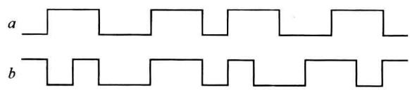  

题图5.16
</Exercise>

<Exercise title="习题 5-24">
用题图 5.17 所示的电路结构来构成五路脉冲分配器,请具体设计其中的译码电路。试用最简与非门电路及 74LS138 集成译码器来分别构成这个译码器,分别画出连接图。

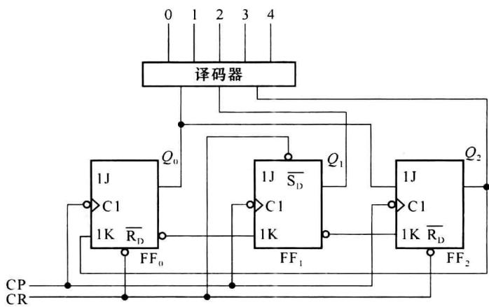  

题图5.17
</Exercise>

<Exercise title="习题 5-25">
设计产生下列的计数型序列信号发生器。

(1) 11110000, …

(2) 1111001000, …
</Exercise>

<Exercise title="习题 5-26">
设计一个可控同步计数器, $M_{1}$ 、 $M_{2}$ 为控制信号,要求:

(1) $M_{1}M_{2}=00$ 时,维持原状态;

(2) $M_{1}M_{2}=01$ 时,实现模2计数;

(3) $M_{1}M_{2}=10$ 时,实现模4计数;

(4) $M_{1}M_{2}=11$ 时,实现模8计数。
</Exercise>

<Exercise title="习题 5-27">
设计一个具有两种功能的五进制计数器: 当控制信号 E=0 时, 每输入一个时钟脉冲加 1, 即 $0000 \rightarrow 0001 \rightarrow 0010 \rightarrow 0011 \rightarrow 0100 \rightarrow 0000$ 。而当控制信号 = 1 时, 每输入一个时钟脉冲加 2, 也就是状态变化为 $0000 \rightarrow 0010 \rightarrow 0100 \rightarrow 0110 \rightarrow 1000 \rightarrow 0000$ 。触发器使用 JK 触发器。
</Exercise>

<Exercise title="习题 5-28">
用 $JK$ 触发器设计具有以下特点的计数器：

（1）计数器有两个控制输入 $C_{1}$ 和 $C_{2}, C_{1}$ 用以控制计数器的模数， $C_{2}$ 用以控制计数的增减。

(2) 若 $C_{1}=0$ 计数器的 M=3; 如果 $C_{1}=1$ , 则计数器为 M=4。

（3）若 $C_{2}=0$ ，则为加法计数，若 $C_{2}=1$ ，则为减法计数。作出状态表，并画出计数器逻辑图。
</Exercise>

<Exercise title="习题 5-29">
采用 $D$ 触发器设计移存型具有自启动特性的同步计数器：

(1) 模 5;

(2) 模 12。
</Exercise>

<Exercise title="习题 5-30">
若用移位寄存器构成的序列信号生器产生序列 0100101, (1) 需要几个触发器? 作出状态转移表。(2) 画出实现的逻辑图。
</Exercise>

<Exercise title="习题 5-31">
采用4级 $D$ 触发器构成移存型序列信号发生器，要求：

(1) 当初始状态预置为 $Q_{3}Q_{2}Q_{1}Q_{0}=0110$ 时, 产生序列信号 011, 011…

(2) 当初始状态顶置为 $Q_{3}Q_{2}Q_{1}Q_{0}=1111$ 时，产生序列信号 1111000, 1111000…

(3) 当初始状态预置为 $Q_{3}Q_{2}Q_{1}Q_{0}=1000$ 时，产生序列信号 100010, 100010…

(4) 当初始状态预置为 $Q_{3}Q_{2}Q_{1}Q_{0}=0000$ 时，产生全 0 序列信号。
</Exercise>

<Exercise title="习题 5-32">
设计产生循环长度为 N 的序列信号发生器：

(1) N=12;

(2) $N = 21$ 。
</Exercise>

<Exercise title="习题 5-33">
分析题图 5.18 所示的同步时序电路,作出状态转移表和状态图,说明这个电路能对何种输入序列进行检测?

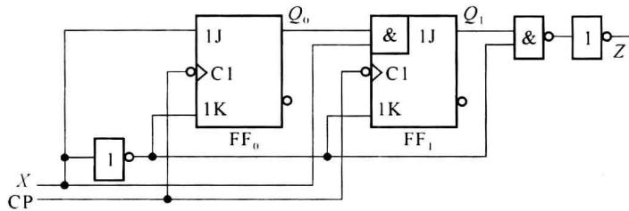  

题图5.18
</Exercise>

<Exercise title="习题 5-34">
分析题图 5.19 所示同步时序电路,作出状态转移表和状态图。当输入序列 X 为 01011010 时,画出相应的输出序列。设初始状态为 000。

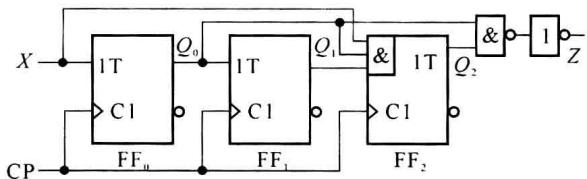  

题图5.19
</Exercise>

<Exercise title="习题 5-35">
作出‘101’序列信号检测器的状态表,凡收到输入序列101时,输出就为1,并规定检测的101序列不重迭,例如:

X:010101101

Z:000100001
</Exercise>

<Exercise title="习题 5-36">
作出序列信号检测器的状态表,凡收到输入序列为‘001’或‘011’时输出就为1,规定被检测的序列不重迭,例如:

X: 10011011

Z: 00010001
</Exercise>

<Exercise title="习题 5-37">
同步时序电路有一个输入端和一个输出端, 输入为二进制序列 $X_{0}X_{1}X_{2}\cdots$ 当输入序列中 1 的数目为奇数时输出为 1, 作出这个时序奇偶校验电路的状态图和状态表。
</Exercise>

<Exercise title="习题 5-38">
同步时序电路用来对串行二进制输入进行奇偶校验,每检测 5 位输入,输出一个结果;当 5 位输入中 1 的数目为奇数时,在最后一位的时刻输出 1。作出状态图和状态表。
</Exercise>

<Exercise title="习题 5-39">
设计一个时序电路, 只有在连续两个或两个以上时钟作用期间, 两个输入信号 $X_{1}$ 和 $X_{0}$ 一致时, 输出信号才是 1, 其余情况输出为 0。
</Exercise>

<Exercise title="习题 5-40">
对下列原始状态表进行简化，并设计其时序逻辑电路（如不能简化，直接设计电路）。

<table><tr><td rowspan="2"> $S^n$ </td><td colspan="2"> $S^{n+1}$ </td><td colspan="2">Z</td></tr><tr><td>X=0</td><td>X=1</td><td>X=0</td><td>X=1</td></tr><tr><td>A</td><td>A</td><td>B</td><td>0</td><td>0</td></tr><tr><td>B</td><td>C</td><td>A</td><td>0</td><td>1</td></tr><tr><td>C</td><td>B</td><td>D</td><td>0</td><td>1</td></tr><tr><td>D</td><td>D</td><td>C</td><td>0</td><td>0</td></tr></table>

<table><tr><td rowspan="2"> $S^n$ </td><td colspan="2"> $S^{n+1}$ </td><td colspan="2">Z</td></tr><tr><td>X=0</td><td>X=1</td><td>X=0</td><td>X=1</td></tr><tr><td>A</td><td>B</td><td>H</td><td>0</td><td>0</td></tr><tr><td>B</td><td>E</td><td>C</td><td>0</td><td>1</td></tr><tr><td>C</td><td>D</td><td>F</td><td>0</td><td>0</td></tr><tr><td>D</td><td>G</td><td>A</td><td>0</td><td>1</td></tr><tr><td>E</td><td>A</td><td>H</td><td>0</td><td>0</td></tr><tr><td>F</td><td>E</td><td>B</td><td>1</td><td>1</td></tr><tr><td>G</td><td>C</td><td>F</td><td>0</td><td>0</td></tr><tr><td>H</td><td>G</td><td>D</td><td>1</td><td>1</td></tr></table>

5.41 按下列给定的状态转移表设计异步计数器。  

(a)

<table><tr><td>序号</td><td>A</td><td>B</td><td>C</td><td>D</td></tr><tr><td>0</td><td>0</td><td>0</td><td>0</td><td>0</td></tr><tr><td>1</td><td>0</td><td>0</td><td>0</td><td>1</td></tr><tr><td>2</td><td>0</td><td>0</td><td>1</td><td>0</td></tr><tr><td>3</td><td>0</td><td>0</td><td>1</td><td>1</td></tr><tr><td>4</td><td>0</td><td>1</td><td>0</td><td>0</td></tr><tr><td>5</td><td>0</td><td>1</td><td>0</td><td>1</td></tr><tr><td>6</td><td>0</td><td>1</td><td>1</td><td>0</td></tr><tr><td>7</td><td>1</td><td>0</td><td>0</td><td>0</td></tr><tr><td>8</td><td>1</td><td>0</td><td>0</td><td>1</td></tr><tr><td>9</td><td>1</td><td>0</td><td>1</td><td>0</td></tr></table>

(a)

(b)

<table><tr><td>序号</td><td>A</td><td>B</td><td>C</td><td>D</td></tr><tr><td>0</td><td>0</td><td>0</td><td>0</td><td>0</td></tr><tr><td>1</td><td>1</td><td>1</td><td>1</td><td>1</td></tr><tr><td>2</td><td>1</td><td>1</td><td>1</td><td>0</td></tr><tr><td>3</td><td>1</td><td>1</td><td>0</td><td>1</td></tr><tr><td>4</td><td>1</td><td>1</td><td>0</td><td>0</td></tr><tr><td>5</td><td>0</td><td>1</td><td>1</td><td>1</td></tr><tr><td>6</td><td>0</td><td>1</td><td>1</td><td>0</td></tr><tr><td>7</td><td>0</td><td>0</td><td>1</td><td>1</td></tr><tr><td>8</td><td>0</td><td>0</td><td>1</td><td>0</td></tr><tr><td>9</td><td>0</td><td>0</td><td>0</td><td>1</td></tr></table>

(b)

## 第6章 中规模时序集成电路及应用

本章介绍中规模时序集成电路的功能及应用,主要介绍中规模集成计数器及移位寄存器等应用电路。

中规模计数器主要分为异步计数器和同步计数器。无论异步计数器还是同步计数器都具有多功能的特点。即经过外部简单的连接或增加少数门电路，一片计数器芯片可以完成不同的功能。

移位寄存器在第 5 章已经介绍过,中规模移位寄存器除可以有串入串出、串入并出、并入串出和并入并出 4 种工作方式外,还可以实现许多其他功能。
</Exercise>
