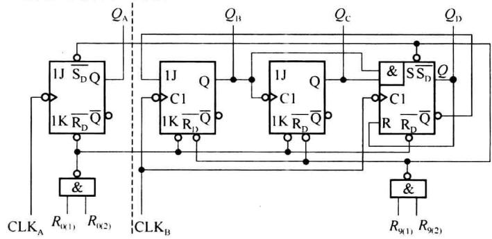
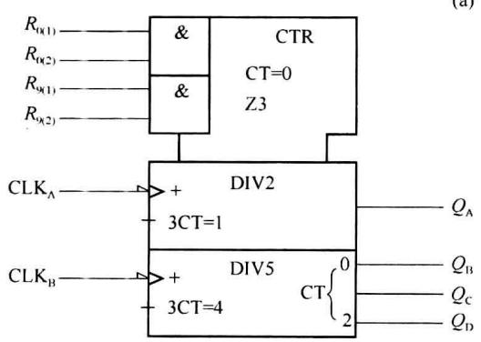
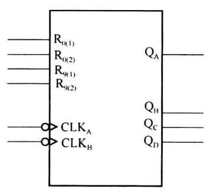

import Guide from '@/components/Guide.astro';
import Knowledge from '@/components/Knowledge.astro';
import Example from '@/components/Example.astro';
import Analysis from '@/components/Analysis.astro';
import Solution from '@/components/Solution.astro';
import Variant from '@/components/Variant.astro';
import Note from '@/components/Note.astro';
import Block from '@/components/Block.astro';
import Method from '@/components/Method.astro';
import Exercise from '@/components/Exercise.astro';

## 第6章 中规模时序集成电路及应用

本章介绍中规模时序集成电路的功能及应用,主要介绍中规模集成计数器及移位寄存器等应用电路。

中规模计数器主要分为异步计数器和同步计数器。无论异步计数器还是同步计数器都具有多功能的特点。即经过外部简单的连接或增加少数门电路，一片计数器芯片可以完成不同的功能。

移位寄存器在第 5 章已经介绍过,中规模移位寄存器除可以有串入串出、串入并出、并入串出和并入并出 4 种工作方式外,还可以实现许多其他功能。

为了适应不同用途的需要,达到多功能的目的,中规模异步计数器通常采用组合式的结构形式,即由两个独立的计数器来构成整个的计数器芯片。

以 74LS90 为例, 图 6.1.1(a) 是 74LS90 计数器的逻辑图, 图 (b) 是 74LS90 的符号, 图 (c) 为简化的符号, 也是习惯的画法。

  

(b)

  

(c)  

图6.1.1 74LS90的逻辑图和逻辑符号

从图 6.1.1(a)74LS90 计数器的逻辑图可以看到它的结构和功能特性如下。

74LS90 由一个模 2 计数器( $Q_{A}$ 端输出)和一个模 5 计数器(输出端为 $Q_{D}Q_{C}Q_{B}$ )构成,两个计数器分别有自己的时钟输入端: $CLK_{A}$ 和 $CLK_{B}$ 。

从 $CLK_{A}$ 输入外部时钟， $Q_{A}$ 端输出，实现模 2 计数；从 $CLK_{B}$ 输入外部时钟，输出端为 $Q_{D}Q_{C}Q_{B}$ 时，实现模 5 计数；从 $CLK_{A}$ 输入外部时钟，且 $Q_{A}$ 接到 $CLK_{B}$ （用 $Q_{A}$ 作为 $CLK_{B}$ 的时钟），实现 8421 码十进制计数；从 $CLK_{B}$ 输入外部时钟，且 $Q_{D}$ 接到 $CLK_{A}$ ，实现 5421 码十进制计数。

74LS90有两个置0输入端： $R_{0(1)}$ 和 $R_{0(2)}$ ，当两个置0输入端都是高电平时，计数器进入0000的状态（异步置0，此时要求 $R_{9(1)}$ 和 $R_{9(2)}$ 中至少应有一个为0）。

74LS90 还有两个置 9 输入端: $R_{9(1)}$ 和 $R_{9(2)}$ , 当两个置 9 输入端都是高电位时, 计数器进入 1001 的状态 (此时要求 $R_{0(1)}$ 和 $R_{0(2)}$ 中至少应有一个为 0)。

74LS90 的置 0 和置 9 都是异步输入。

74LS90 计数器的逻辑符号如图 6.1.2(b) 所示, 这样的符号属于标准符号, 由于这类标准符号在绘制时不是很方便, 所以在许多书籍和资料中, 还常用一种简化的符号, 如图 6.1.1(c) 所示。

74LS90 计数器设置两个置 0 端和两个置 9 端，目的是构成其他模值的计数器时比较方便。只要充分利用这几个输入端，74LS90 可以构成从 2～10 所有模值的计数器，而不需要添加任何外部的逻辑电路。

数字逻辑集成电路的使用手册中通常给出内部结构图,除对功能进行文字描述外,还会给出功能表,通过功能表,我们可以比较清楚地了解逻辑器件的功能。表 6.1.1 给出了 74LS90 的逻辑功能。

表 6.1.1 74LS90 的逻辑功能表

<table><tr><td> ${R}_{0\left( 1\right) }$ </td><td> ${R}_{0\left( 2\right) }$ </td><td> ${R}_{9\left( 1\right) }$ </td><td> ${R}_{9\left( 2\right) }$ </td><td> ${\mathrm{{CLK}}}_{\mathrm{A}}$ </td><td> ${\mathrm{{CLK}}}_{\mathrm{B}}$ </td><td> ${Q}_{\mathrm{D}}$ </td><td> ${Q}_{\mathrm{C}}$ </td><td> ${Q}_{\mathrm{B}}$ </td><td> ${Q}_{\mathrm{A}}$ </td></tr><tr><td>1</td><td>1</td><td>0</td><td>×</td><td>×</td><td>×</td><td>0</td><td>0</td><td>0</td><td>0</td></tr><tr><td>1</td><td>1</td><td>×</td><td>0</td><td>×</td><td>×</td><td>0</td><td>0</td><td>0</td><td>0</td></tr><tr><td>0</td><td>×</td><td>1</td><td>1</td><td>×</td><td>×</td><td>1</td><td>0</td><td>0</td><td>1</td></tr><tr><td>×</td><td>0</td><td>1</td><td>1</td><td>×</td><td>×</td><td>1</td><td>0</td><td>0</td><td>1</td></tr><tr><td>×</td><td>0</td><td>×</td><td>0</td><td>↓</td><td>0</td><td colspan="4">二进制计数</td></tr><tr><td>×</td><td>0</td><td>0</td><td>×</td><td>0</td><td>↓</td><td colspan="4">五进制计数</td></tr><tr><td>0</td><td>×</td><td>×</td><td>0</td><td>↓</td><td> ${Q}_{\mathrm{A}}$ </td><td colspan="4">8421十进制计数</td></tr><tr><td>0</td><td>×</td><td>0</td><td>×</td><td> ${Q}_{\mathrm{D}}$ </td><td>↓</td><td colspan="4">5421十进制计数</td></tr></table>

类似的异步计数器还有 74LS92，由模 2 和模 6 计数器组成；74LS93 由模 2 和模 8 计数器组成。此外，还有 4 位二进制异步计数器 74LS197, 74LS293，双 4 位二进制异步计数器 74LS393, 7 位二进制异步计数器 CC4024, 12 位二进制异步计数器 CC4040 等。
