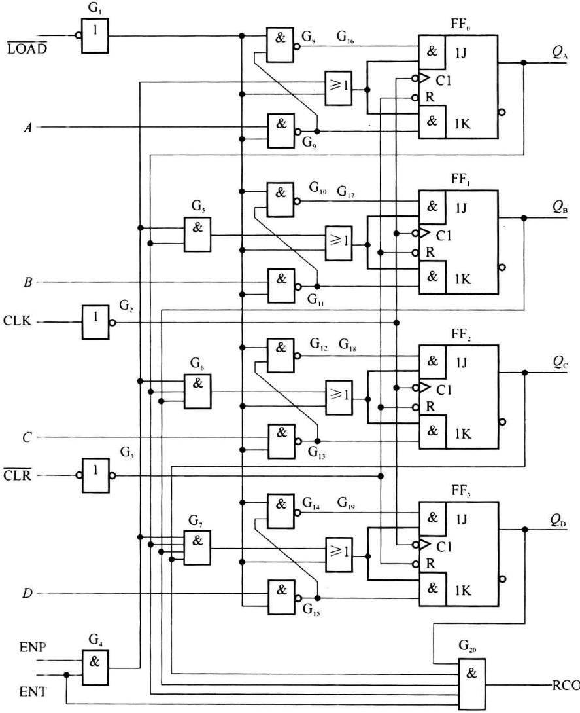
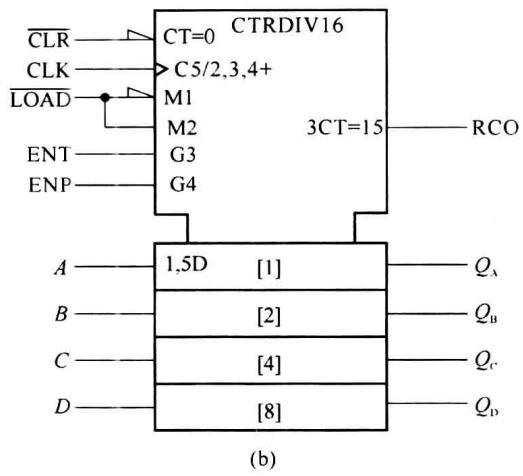
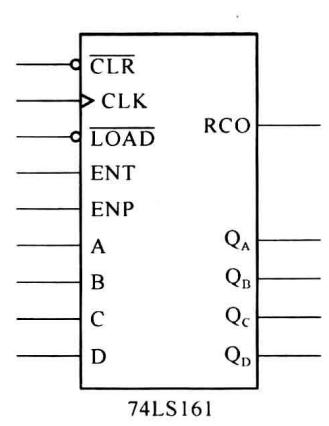
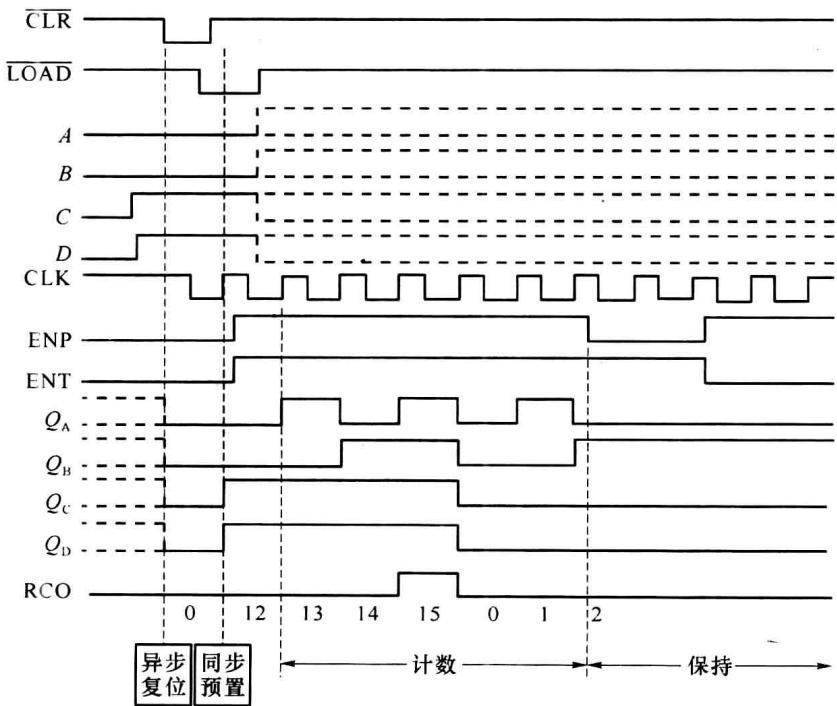
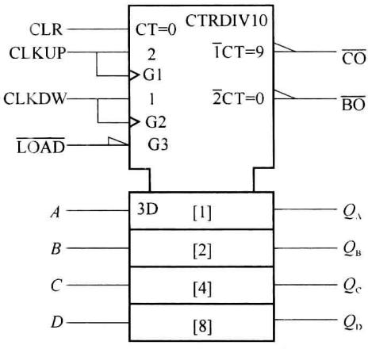
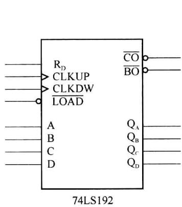
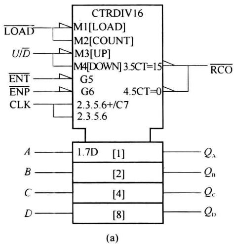
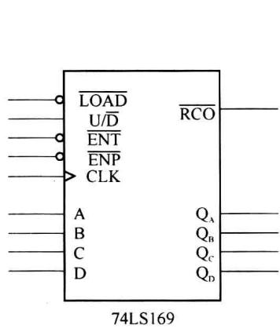
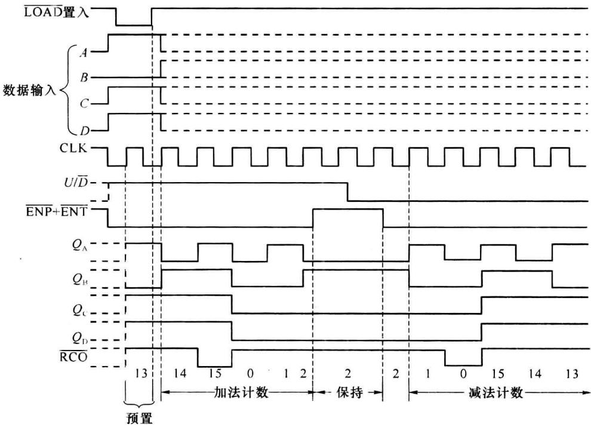

import Guide from '@/components/Guide.astro';
import Knowledge from '@/components/Knowledge.astro';
import Example from '@/components/Example.astro';
import Analysis from '@/components/Analysis.astro';
import Solution from '@/components/Solution.astro';
import Variant from '@/components/Variant.astro';
import Note from '@/components/Note.astro';
import Block from '@/components/Block.astro';
import Method from '@/components/Method.astro';
import Exercise from '@/components/Exercise.astro';

## 6.2.1 同步计数器的分类

同步计数器种类较多,每种计数器的功能各不相同,它们的多功能特性主要表现在以下几个方面。

### 1. 计数方式

通过选择不同时钟输入端或在控制加减的输入端加不同的信号,实现加计数方式或减计数方式。这样的计数器称为可逆计数器。也可称为加/减计数器。

实现可逆计数的方法有两种:加减控制输入方式和双时钟输入方式。加减控制输入方式需要一个控制信号来控制计数方式。控制信号端是 $U/\overline{D}$ ，当 $U/\overline{D}=1$ 时进行加计数方式，当 $U/\overline{D}=0$ 时进行减计数。

另一种实现可逆计数的方式是双时钟输入方式。这样的计数器有两个外部时钟输入端：CLKUP(或 $\mathrm{CLK}_{+}$ )和CLKDW(或 $\mathrm{CLK}_{-}$ )，当外部时钟从CLKUP端输入时，作加法计数；当外部时钟从CLKDW输入时，作减法计数。没有接外部时钟的时钟端，应该根据器件的要求接0或者接1，使得这个输入端不起作用。

### 2. 预置功能

许多计数器都具有预置功能。计数器有一个预制控制端，一般多用 $\overline{LOAD}$ （或LD）表示，低电平有效。当 $\overline{LOAD}=0$ 时，计数器将预置信号送到每个触发器的输出。预置方式有同步预置和异步预置两种。

异步预置: 异步预置类似于触发器的异步复位/置位, 只要预置控制信号有效, 就立即实现预置, 与时钟无关。这时每个触发器的输出等于它的预置值。

同步预置: 同步预置要求预置控制信号必须有效, 但是预置信号有效后, 并不立即实现预置, 而是要到下一次有效时钟边沿到来时, 才实现预置功能。即: 所谓的同步预置, 就是预置要和时钟同步。

### 3. 复位功能

复位也称为“清零”或“置零”，就是将计数器的状态复位到全0状态。复位是由复位控制端来控制。同样，复位也分异步复位和同步复位，异步复位与时钟无关，只要复位信号到达就立即复位。而同步复位除需要复位信号有效外，还必须在时钟的有效边沿到来才能实现复位。

### 4. 进位、借位功能

同步计数器还可以有进位(借位)信号输出功能。当加法计数器进入最大状态(例如输出全1)，会产生一个进位输出信号；或者当减法计数进入最小状态(输出全0)，会产生一个借位输出信号。进位/借位输出一般都是宽度等于一个周期的脉冲，但是，脉冲的极性(正脉冲或负脉冲)则要取决于具体的芯片，可从手册中的描述或功能表中获得。

### 5. 计数控制(使能控制)

中规模同步计数器一般都有两个计数控制输入: ENP 和 ENT(或 $\overline{\mathrm{ENP}}$ 、 $\overline{\mathrm{ENT}}$ ), 可以通过这两个输入来控制计数是否进行。另外，ENT 或 $\overline{\mathrm{ENT}}$ 还可以控制是否产生进位，只有当其有效时，计数器才能在一定状态下产生进位信号。

## 6.2.2 同步集成计数器简介

下面通过几个芯片说明同步计数器的功能。

### 1. 同步 4 位二进制(十六进制)计数器 74161

图 6.2.1 为中规模集成的同步 4 位二进制计数器 74161 的逻辑图和符号。74161 除了具有二进制加法计数外，还具有预置数、保持和异步复位等功能。图中 $\overline{LOAD}$ 为预置数控制端；A～D 为数据输入端，RCO 为进位输出端， $\overline{CLR}$ 为异步复位（清零）端，ENP 和 ENT 为计数控制端。

(a)  

  

(c)  

图 6.2.1 同步 4 位二进制计数器 74161 的逻辑图及符号  

表 6.2.1 是 74161 的功能表, 图 6.2.2 给出的是 74161 的时序图。

表 6.2.1 74161 的功能表

<table><tr><td>CLK</td><td> $\overline{CLR}$ </td><td> $\overline{LOAD}$ </td><td>ENP</td><td>ENT</td><td>工作状态</td></tr><tr><td>×</td><td>0</td><td>×</td><td>×</td><td>×</td><td>复位</td></tr><tr><td>↑</td><td>1</td><td>0</td><td>×</td><td>×</td><td>预置数</td></tr><tr><td>×</td><td>1</td><td>1</td><td>0</td><td>1</td><td>保持</td></tr><tr><td>×</td><td>1</td><td>1</td><td>×</td><td>0</td><td>保持(但RCO=0)</td></tr><tr><td>↑</td><td>1</td><td>1</td><td>1</td><td>1</td><td>十六进制计数</td></tr></table>

  

图6.2.2 芯片74161的时序图

由表 6.2.1 和图 6.2.2 可见, 当 $\overline{CLR}=0$ 时所有内部触发器将同时被复位, $Q_{D}Q_{C}Q_{B}Q_{A}=0000$ , 而且复位操作不受其他输入端状态的影响, 与时钟的边沿有否无关, 计数器为异步复位, 且优先级最高。

当 $\overline{\mathrm{CLR}} = 1$ 而 $\overline{\mathrm{LOAD}} = 0$ 时，电路工作在预置状态，并在下一个上升沿出现时实现数据预置，由于 $DCBA = 1100$ ，所以 $\mathbf{Q}_{\mathrm{D}}\mathbf{Q}_{\mathrm{C}}\mathbf{Q}_{\mathrm{B}}\mathbf{Q}_{\mathrm{A}} = 1100$ ，显然该计数器实现的是同步预置。

当 $\overline{CLR}=\overline{LOAD}=1$ ，且ENP=ENT=1时，电路工作在计数状态，当电路出现1111状态时RCO=1，电路从1111状态返回0000状态，RCO端从高电平跳变至低电平。可以利用RCO端输出的高电平、上升沿或下降沿等作为进位输出信号。

当 $\overline{\mathrm{CLR}} = \overline{\mathrm{LOAD}} = 1$ ，而 $\mathrm{ENP} = 0, \mathrm{ENT} = 1$ 时，无论有无时钟，它们保持原来的状态不变，同时RCO的状态也得到保持。如果 $\mathrm{ENT} = 0$ ，则ENP不论为何状态，计数器的状态也将保持不变，但这时进位无论在什么输出状态下，RCO都等于0。

与 74LS161 相似的器件有 74LS160, 它是十进制计数器, 在内部电路结构形式上与 74161 有些区别, 但引脚排列和各控制端功能均相同。

### 2. 74LS192 可预置十进制可逆计数器

74LS192 是十进制计数器, 计数的编码采用 8421 码, 计数循环是 0000 \~ 1001。74LS192 是采用双时钟方式的可逆计数器, 时钟输入端为 CLKUP 和 CLKDW。当外部时钟接到 CLKUP 时进行加计数, 接到 CLKDW 时进行减计数。

图 6.2.3(a) 是 74LS192 的逻辑符号, 图 6.2.3(b) 是其简化的逻辑符号。

  

图 6.2.3 74LS192 的逻辑符号和简化的逻辑符号

表 6.2.2 给出了 74LS192 的逻辑功能。通过功能表可以看出 74LS192 具有预置功能，当预置控制输入 LOAD 有效时，将预置的数据输入 A、B、C、D 置位到 4 个触发器。74LS192 的预置控制属于异步预置，低电平有效。

表 6.2.2 74LS192 的逻辑功能

<table><tr><td>CLKUP</td><td>CLKDW</td><td> $\overline{LOAD}$ </td><td>CLR</td><td>D</td><td>C</td><td>B</td><td>A</td><td> $Q_D$ </td><td> $Q_C$ </td><td> $Q_B$ </td><td> $Q_A$ </td></tr><tr><td>×</td><td>×</td><td>×</td><td>1</td><td>×</td><td>×</td><td>×</td><td>×</td><td>0</td><td>0</td><td>0</td><td>0</td></tr><tr><td>×</td><td>×</td><td>0</td><td>0</td><td>d</td><td>c</td><td>b</td><td>a</td><td>d</td><td>c</td><td>b</td><td>a</td></tr><tr><td>↑</td><td>1</td><td>1</td><td>0</td><td>×</td><td>×</td><td>×</td><td>×</td><td colspan="4">十进制加计数</td></tr><tr><td>1</td><td>↑</td><td>1</td><td>0</td><td>×</td><td>×</td><td>×</td><td>×</td><td colspan="4">十进制减计数</td></tr><tr><td>1</td><td>1</td><td>1</td><td>0</td><td>×</td><td>×</td><td>×</td><td>×</td><td colspan="4">保持原状态</td></tr></table>

74LS192 复位输入是 CLR, 为异步控制, 高电平产生复位, 优先级最高; 预置为异步预置。

74LS192 的进位/借位输出是分开的, 进位输出是 $\overline{CO}$ , 加法计数进入状态 1001 时产生一个周期宽度的负脉冲输出。借位输出是 $\overline{BO}$ , 减法计数进入状态 0000 时产生一个周期宽度的负脉冲输出。

74LS192 没有计数控制输入, 即: 没有 ENP 和 ENT(或 $\overline{\mathrm{ENP}}$ 、 $\overline{\mathrm{ENT}}$ ) 控制输入端。

表 6.2.2 比较简洁地给出了 74LS192 的大多数功能,但是进位、借位的特性还是不能通过功能表来表示,因此许多手册中还需要对这部分功能进行文字性的描述。

### 3. 74LS169 可预置 4 位二进制可逆计数器

74LS169 是 4 位二进制计数器，计数循环从 0000 到 1111，共 16 个状态。74LS169 采用加/减控制方式实现可逆计数，当控制端 $U / \overline{D} = 1$ 时为加计数， $U / \overline{D} = 0$ 时为减计数。图 6.2.4(a) 为 74LS169 的逻辑符号，图 6.2.4(b) 为其简化的逻辑符号。表 6.2.3 是 74LS169 的功能表，图 6.2.5 是 74LS169 的时序图。

  

(b)  

图6.2.4 74LS169的逻辑符号和简化符号

从时序图和功能表可以看出,预置功能是由 $\overline{LOAD}$ 端控制,低电平有效,是同步预置,必须在 $\overline{LOAD}$ 有效后的下一个时钟有效边沿到来时,才能实现预置。

表 6.2.3 74LS169 的功能表

<table><tr><td> $\overline{ENT}+\overline{ENP}$ </td><td>U/ $\overline{D}$ </td><td> $\overline{LOAD}$ </td><td>CLK</td><td> $Q_D$ </td><td> $Q_C$ </td><td> $Q_B$ </td><td> $Q_A$ </td></tr><tr><td>1</td><td>×</td><td>1</td><td>×</td><td></td><td></td><td colspan="2">保持原状态</td></tr><tr><td>0</td><td>×</td><td>0</td><td>↑</td><td></td><td></td><td colspan="2">预置</td></tr><tr><td>0</td><td>1</td><td>1</td><td>↑</td><td></td><td></td><td colspan="2">加计数</td></tr><tr><td>0</td><td>0</td><td>1</td><td>↑</td><td></td><td></td><td colspan="2">减计数</td></tr></table>

  

图6.2.5 芯片74LS169的时序图

74LS169 的进位和借位输出使用同一个输出端，为 $\overline{RCO}$ 。当加计数状态为 1111 时，或减计数达到 0000 状态， $\overline{RCO}$ 端输出宽度为一个时钟周期的负脉冲。

74LS169 没有复位输入, 只能通过预置的方式使得计数器回到计数的初始状态 0000 或者 1111。

74LS169有两个计数控制输入： $\overline{\mathrm{ENP}}$ 和 $\overline{\mathrm{ENT}}$ 。这两个输入都是低电平时，计数器才可以进行正常计数。 $\overline{\mathrm{ENT}}$ 还会影响进位的保持，当计数器在1111状态时 $\overline{\mathrm{ENT}} = 1$ ，计数器的输出状态得到保持，但进位脉冲输出不被保持。这一点与74161类似。
