import Guide from '@/components/Guide.astro';
import Knowledge from '@/components/Knowledge.astro';
import Example from '@/components/Example.astro';
import Analysis from '@/components/Analysis.astro';
import Solution from '@/components/Solution.astro';
import Variant from '@/components/Variant.astro';
import Note from '@/components/Note.astro';
import Block from '@/components/Block.astro';
import Method from '@/components/Method.astro';
import Exercise from '@/components/Exercise.astro';

## 6.3.1 中规模计数器构成任意进制计数器

从前面对几种中规模计数器的介绍中可以知道,多数计数器有预置功能和复位功能。充分利用预置和复位控制端、通过适当的连接或加入简单的门电路,几乎所有的中规模计数器都可以构成小于其最大计数周期的任意进制计数器。

### 1. 复位法

复位法的基本思想是计数器从被复位后的初始状态开始计数,到达满足模值等于 M 的终止状态时,产生复位信号,将此复位信号加到计数器的复位输入,使计数器回到初始状态,然后重复进行,实现模值为 M 的计数。

复位法的前提是计数器本身具有复位控制端。复位法又有异步复位和同步复位之分，两种复位方法应用时有一些差别。例如，如果计数器是异步复位，只要复位端出现有效电平，就能使计数器复位到初始状态，而若计数器是同步复位，复位端出现有效电平后还需等到有效沿到达时才能使计数器复位到初始状态。

### (1) 异步复位

如果计数器最大模值为 N、具有异步复位功能的计数器，要求设计一个计数模值是 M (M &lt; N) 的计数器时，可设初始状态是第一个状态（通常是 0000，如果使用 74LS90，也可使用 1001 作为初始状态），当计数到第 $M+1$ （对应加计数时，对应状态 M）个状态时产生复位信号。由于复位是异步的，复位信号将立即起作用，第 $M+1$ 个状态只会存在非常短的时间，然后就回到初始状态，也就是初始状态和第 $M+1$ 状态在一个时钟周期中。所以计数循环只有 M 个状态。

<Example title="例 6.3.1">
用 74LS90 异步计数器构成模 6 计数器。

<Solution title="解">
由于 74LS90 为模 2+模 5 计数器,所以首先要将它连接成一个十进制计数器:即将 $Q_{A}$ 连接到 $CLK_{B}$ , $CLK_{A}$ 作为时钟输入端。

74LS90 计数器是异步复位，复位信号是高电平有效。现在要实现模 6 计数，应该从 0000 加计数到 0110（状态 6，也就是从 0000 算起的第 $M+1$ 个状态）状态产生复位信号。复位信号一般可以通过外部逻辑电路来产生，也就是对 0110 进行译码，当出现 0110 时产生译码输出“1”。由于 74LS90 本身有两个“相与”的复位输入端，可以直接将触发器 $Q_{B}$ 和 $Q_{C}$ 的输出连接到复位输入端 $R_{0(1)}$ 和 $R_{0(2)}$ ，计数进入状态 0110 时，就可以直接用 $Q_{B}$ 和 $Q_{C}$ 输出的高电位实现复位。图 6.3.1 是用 74LS90 连接为模 6 计数器的逻辑图。这种非全译码的方式在使用时，要求在使用的有效计数循环过程中（除需要复位的时刻），不能再出现 $Q_{B}$ 和 $Q_{C}$ 同时输出高电平的状态组合，否则所设计的循环计数周期将小于 M。

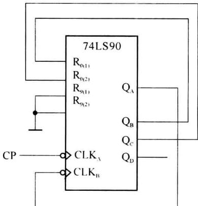  

图6.3.1 用74LS90连接为模6计数器的逻辑图

使用 74LS90 计数器的置 9 输入端, 也可以连接任意进制计数器, 此时的初始状态为 1001。利用上述介绍的方法也可实现模 6 的计数器。
</Solution>
</Example>

<Example title="例 6.3.2">
用 74LS192 和复位法实现 M=6 的计数器。

<Solution title="解">
74LS192 是高电平异步复位,所以计数从 0000 状态开始,在进入状态 0110 时产生复位信号。74LS192 只有一个复位端,外部需要增加一个与门,逻辑图如图 6.3.2(a) 所示。

使用这种简单的异步复位方式可能会面临一个问题,由于复位信号随着计数器中触发器置零而立即消失,所以复位信号持续时间极短,如果计数器中触发器的复位速度有快有慢,则可能动作慢的触发器还未来得及复位,复位信号已经消失,导致计数器发生错误。为了克服这个缺点,经常采用图6.3.2(b)所示的改进电路。

(b)  

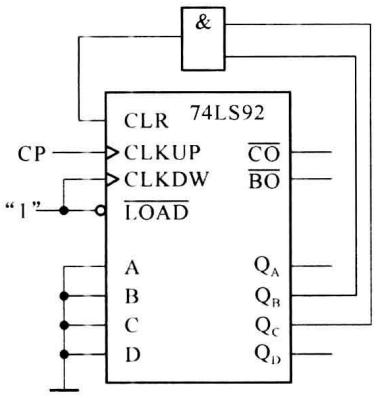  

(a)

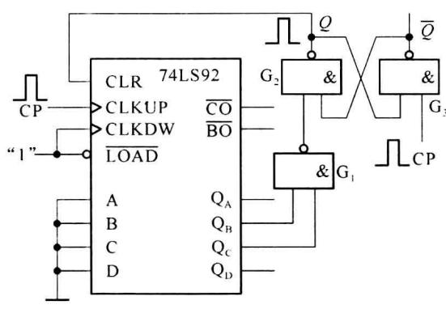  

图 6.3.2 用 74LS192 和异步复位法实现的 M=6 的计数器

图(b)中的与非门 $\mathbf{G}_1$ 起译码器的作用, 当电路进入 0110 状态时, 它输出低电平信号。与非门 $\mathbf{G}_2$ 和 $\mathbf{G}_3$ 组成了基本 $RS$ 触发器, 以它 $Q$ 端输出的高电平作为计数器的复位信号。若计数器从 0000 状态开始计数, 则第 6 个计数输入脉冲上升沿到达时计数器进入 0110 状态, $\mathbf{G}_1$ 输出低电平, 将基本 $RS$ 触发器置 1, $Q$ 端的高电平立刻将计数器复位。一旦计数器中有触发器被复位 (如某个触发器从高电平变为低电平), $\mathbf{G}_1$ 输出的低电平信号随之变为高电平, 但在 CP 为高电平期间基本 $RS$ 触发器的输入为 11, 输出状态仍保持不变, 因此计数器的复位信号得以维持, 直到计数脉冲 CP 回到低电平。时钟出现下降沿后, 基本 $RS$ 触发器被复位, $Q$ 端的高电平信号才消失。可见, 加到计数器复位端的复位信号宽度与输入计数脉冲 CP 高电平持续时间相等。

利用触发器展宽复位信号的宽度以增加电路的可靠性,这种方法可以用在所有异步复位计数器的设计中。
</Solution>
</Example>

### (2) 同步复位

如果计数器是同步复位,要求计数模值是 M,则要求从初始状态开始,计数到第 M 个状态产生复位信号。这个复位信号产生后,只是为复位准备了复位的条件,要到下一次时钟有效边沿到来时,才能实现复位。也就是第 M 个状态也占一个时钟周期。例如,74LS162(可自行查看数据手册了解其功能)是同步复位的计数器,如果也要实现模 6 计数,加计数从 0000 状态开始,则应该在状态 0101 产生复位控制信号。

### 2. 预置法

预置法的设计方式与复位法基本相同。首先是根据计数模值确定预置值(状态)，从预置值开始计数到所需模值时产生预置控制信号，将预置控制信号加到预置输入端，使得计数又从预置值重新开始计数。从而实现模值为 M 的计数器。

预置法构成任意进制计数器与预置控制端是异步预置还是同步预置有关。如果是异步预置，预置状态作为第一个状态，则应该在第 $M+1$ 个状态产生预置控制信号，并连接到预置输入端，实现模M计数。如果是同步预置，则应该在第M个状态产生预置控制信号。

使用预置法实现任意进制计数器时,选择预置信号可以很灵活。例如当加计数时,可以利用进位脉冲作为预置信号,即当计数到达最大值时,利用芯片提供的进位输出实现预置;也可以在减计数时利用借位脉冲信号实现预置;还可以利用组合逻辑电路对输出的某一状态译码后作为预置信号。

例如,用 74LS192(异步预置)通过预置法实现模 8 计数,若选预置状态是 0001,则应该在状态 1001 产生预置控制信号。从而实现状态从 0001 到 1000 的 8 个状态的循环。1001 状态仅仅为一个极为短暂的状态。

同样,如果是同步预置,选定预置状态后,则应该在第 M 个状态产生预置信号。例如,用 74LS169 通过预置法实现模 8 计数,若预置状态也是 0001,则应在状态 1000 产生预置控制信号。实现的也是从 0001 到 1000 的 8 个状态的循环。

为了简化设计,如果不要求确定使用哪几个状态时,在按预置法构成模 M 计数器时,可以充分利用计数器的进位/借位信号,将计数的终止状态定为加计数时的最大状态,或者减计数时的最小状态。在这些状态时,计数器会自动产生一个进位脉冲或借位脉冲,用这个进位或借位脉冲可以作为预置的控制信号,也就不再需要通过组合逻辑电路来产生预置控制信号了。

这种情况下预置状态可以按以下的方法来确定:假设计数器的最大计数值是 N, 要求的计数模值是 M, 则预置状态是:

$$

\begin{array}{l l} \text {异步预置:} & \text {加计数} \quad \text {预置值} = N - M - 1 \\ & \text {减计数} \quad \text {预置值} = M \\ \text {同步预置:} & \text {加计数} \quad \text {预置值} = N - M \\ & \text {减计数} \quad \text {预置值} = M - 1 \end{array}

$$

例如，十进制计数器的最大计数值是 N=10，要构成模 M=6 的计数器，对于异步预置的计数器，预置值为

$$

1 0 - 6 - 1 = 3

$$

计数的过程是：

$$

3 \rightarrow 4 \rightarrow 5 \rightarrow 6 \rightarrow 7 \rightarrow 8 \rightarrow 9 (3)

$$

计数过程中的状态 9 只是一个极短的过程, 状态 9 和状态 3 存在于同一个时钟周期, 所以, 计数的循环还是 6 个时钟周期, 使用的状态是 3、4、5、6、7、8。

对于同步预置的十进制计数器,要实现模6计数,预置值=10-6=4,也就是预置值应该为4。使用的状态为4、5、6、7、8、9这6个状态。

如果用减法计数器,预置值的确定就更加简单,如果要实现模6数器。

异步预置: 预置值 = 6, 使用的状态为 1、2、3、4、5、6。0 状态为一个瞬时脉冲。

同步预置: 预置值 = 5, 使用的状态为 0、1、2、3、4、5。

<Example title="例 6.3.3">
使用同步十进制计数器 74160 构成模值 M=6 的计数器(要求使用预置法)。

74160 为十进制同步计数器, 其他功能与 74161 相同, 功能表参见 74161 的功能表 (见表 6.2.1)。

<Solution title="解">
同步预置方法一:如没有规定使用哪几个状态,可任意选取一个预置值,例如1000。由于74160的预置为同步预置,因此从1000开始的第6个状态就是所要检测并产生预置控制信号的状态,所使用的状态为 8,9,0,1,2,3。在 0011 状态下产生预置信号,使用了一个正负混合逻辑的与非门 G 来检测 0011,当该与非门的输入为 0011 时 G 输出低电平。图 6.3.3(a)为方法一构成六进制计数器的逻辑图。

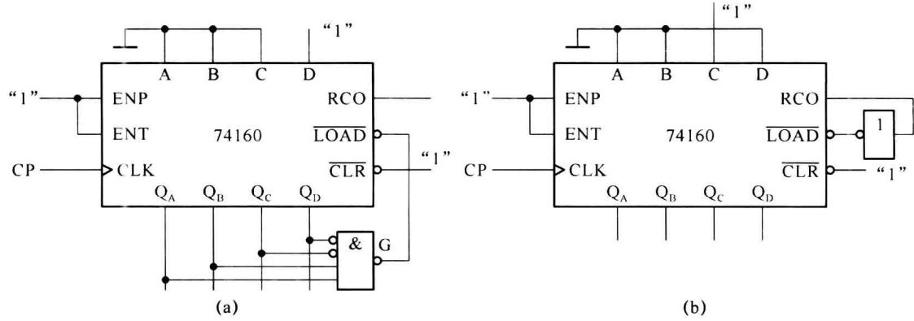  

图 6.3.3 用 74160 同步预置法构成六进制计数器

同步预置方法二:使用进位输出端 RCO 进行预置。74160 是十进制计数器,且在状态 1001 时 RCO=1,所以预置值=N-M=10-6=4。使用状态为 4,5,6,7,8,9。由于 RCO 进位输出为高电平,需要使用一个非门。图 6.3.3(b)为方法二构成六进制计数器的逻辑图。
</Solution>
</Example>

<Example title="例 6.3.4">
用 4LS169 计数器实现 10 分频，并且要求分频后的输出是方波。

10 分频是指每输入 10 个时钟脉冲, 输出一个脉冲, 本题要求输出的脉冲是方波。74LS169 是同步预置的 4 位二进制计数器, 如果使用加计数, 从 0000 到 1111 的 16 个状态中, 最高位的前 8 个状态为 0, 后 8 个状态为 1。因此去掉前 3 个和最后 3 个状态时刚好是 10 个状态, 且最高位作为输出时形成方波。因此应检测 1100 状态产生预置脉冲, 预置值为 0011。

图 6.3.4 是用 74LS169(同步预置)构成的 10 分频电路。其中的与非门用来检出状态 1100，并产生一个低电平的预置控制信号（由于 $Q_{D}Q_{C}$ 同时为 11 的状态只在最后一个状态出现，所以使用两输入端的与非门即可），加到预置输入端 LOAD，并将预置值 0011 置位到计数器的各个触发器，重新从 0011 状态开始计数。从而在 $Q_{D}$ 端实现输出 10 分频方波的要求。

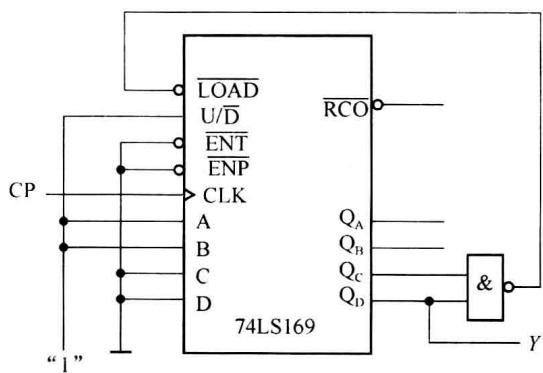  

图6.3.4 用74LS169构成的10分频电路
</Example>

## 6.3.2 中规模计数器的级联

如果我们要得到大于单片中规模计数器的最大计数周期的计数值时,可通过多片计数器级联获得。

(1) 根据在级联时使用时钟的方式不同,有同步级联和异步级联。

## ① 异步级联

异步级联是用前级计数器的输出作为后一级计数器的时钟信号。前级计数器的输出可以是触发器的输出，也可以是前级的进位、借位输出。

图 6.3.5 是用两片 74LS90 级联构成最大模值等于 100 的异步计数器。74LS90 计数器本身连接为十进制计数器，从触发器 $Q_{D}$ 的输出连接到下一级的时钟输入，当计数器的状态从 1001 转换为 0000 时， $Q_{D}$ 输出一个负跳变，作为下一级时钟的有效输入，使第 2 级计数器的 JK 触发器翻转一次状态。从而实现了计数器的级联。第 1 片 74LS90 每次状态从 1001 到 0000 变化时， $Q_{D}$ 给第 2 片一个有效时钟下降沿。

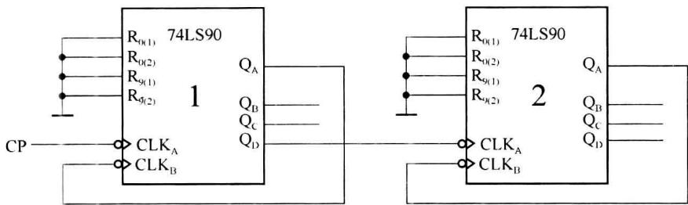  

图 6.3.5 两片 74LS90 构成模值为 100 的异步计数器

74160 是同步的十进制计数器, 它也可以通过前级的输出作为后级的时钟, 从而整体构成异步计数器。图 6.3.6 所示的级联电路是使用进位输出端给第 2 片提供时钟的级联方式, 实现的计数周期为 100 的计数器。两片 74160 的 ENP 和 ENT 恒为 1, 都工作在计数状态。第 1 片每计数到 9(1001) 时 RCO 端输出变为高电平, 经反相器后使第 2 片在第 1 片最后一个状态 (1001) 结束的时刻获得有效时钟 (上升沿)。

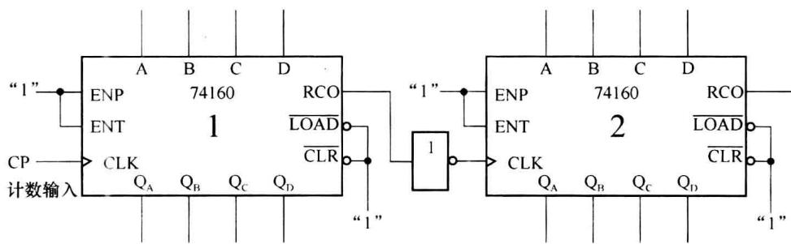  

图6.3.6 74160构成的计数周期为100的异步计数器

异步级联必须保证连接到后一级的时钟输入可以使后级有效的工作。异步计数器的主要缺点是延迟比较大。对于异步中规模计数器和没有 $\overline{\mathrm{ENP}}$ 和 $\overline{\mathrm{ENT}}$ （或ENP和ENT)的中规模同步计数器，只能采用异步级联。

## ② 同步级联

同步级联,是将外部时钟同时连接到各片计数器的时钟输入端,使得各级计数器可以同步的工作。

为了正确的实现级联,必须在前级加计数器达到最大计数状态(或减计数器达到最小计数状态)后,后一级计数器才可以在外部时钟作用下改变状态。在这种情况下,必须使用计数控制端 $\overline{ENP}$ 和 $\overline{ENT}$ (或者是ENP和ENT)。

图 6.3.7 是用 3 片 74LS169 级联构成的周期为 4096 的同步计数器。除了第 1 级计数器的 ENP 和 ENT 固定接地，始终处于有效计数状态外，后两级计数器的 ENP 和 ENT 都是连接到前级计数器的进位输出。只有前级计数器进入 1111 状态时，进位输出才是低电平，后级计数器的 ENP 和 ENT 才能进入计数工作状态，下一次时钟到来时，后级计数器改变一次状态,也就是前级计数器计数16次,后一级计数器计数一次。3片74LS169级联实现了最大模值等于4096的计数器。

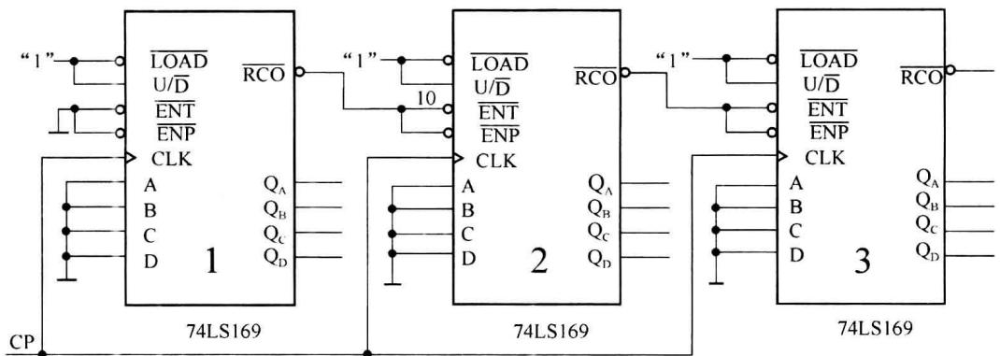  

图 6.3.7 3 片 74LS169 构成的周期为 4096 的同步计数器

(2) 当所需计数模值大于单片计数器的最大模值时, 构成方式有两种:

① 如果所需计数模值不是质数, 可以拆分, 例如, $M = 54 = 6 \times 9$ , 可以先构成 $M = 6$ 和 $M = 9$ 的两个计数器, 然后进行级联, 得到所需要的模值。

② 通过计数器的级联先得到一个较大的计数周期的计数器,然后再通过复位或预置方法实现所需要的计数周期。

当所需计数模值为质数不能拆分时, 只能使用第 2 种方法获得。

<Example title="例 6.3.5">
用两片 74LS169 计数器，并使用预置法构成模值为 101 的计数器。

<Solution title="解">
因为模值 101 不能被分解, 只能采用先级联, 然后通过预置的方法(或复位法)实现。采用加计数先将两片 74LS169 直按级联, 构成模值等于 256 的计数器。采用 $\overline{\mathrm{RCO}}$ 作为预置信号, 可以算出预置值 $= 256 - 101 = 155$ (74LS169 是同步预置)。

将预置值 155 变为等值的二进制数。155 的等值二进制数是 10011011，注意高位的预置值要接入到第 2 级计数器的预置输入端，即第 1 片的预置值 = 1011，第 2 片的预置值 = 1001。预置后，片 2 状态为 1001 时，片 1 的状态是 1011～1111，共 5 个状态；对应片 2 的状态 1010～1111，片 1 都是 16 个状态，共 101 个状态。

模值为 101 的计数器逻辑图如图 6.3.8 所示。

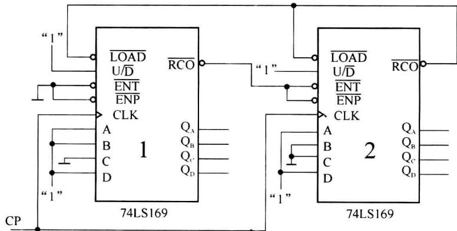  

图6.3.8 两片74LS169构成模值为101的计数器
</Solution>
</Example>

<Example title="例 6.3.6">
用两片同步十进制计数器 74160 构成二十一进制计数器。

<Solution title="解">
因为 M=21 是一个合数, 除可以先构成一百进制计数器再利用预置法或复位法进行设计外, 也可以先构成一个三进制计数器和一个七进制计数器后进行级联获得。

第 1 片 74160 使用了同步预置法得到模值为 3 的计数器(使用状态为 7,8,9)，第 2 片 74160 使用了异步复位法实现模值为 7 的计数器(使用状态为 0,1,2,3,4,5,6)。两个计数器使用同步级联模式得到总计数模值为 21 的计数器。这里需要注意，由于要使用第 1 片的 RCO 作为第 2 片的使能控制信号，所以第 1 片使用的状态中必须包含状态 9(1001) 来获得进位信号。逻辑图如图 6.3.9 所示。

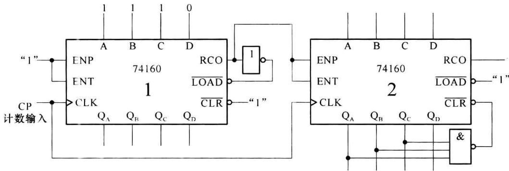  

图6.3.9 两片74160构成二十一进制计数器
</Solution>
</Example>

## 6.3.3 中规模计数器构成的常用功能电路

中规模计数器可以和其他逻辑器件一起构成在计算机及通信系统中的一些常用功能电路，包括脉冲分配器、序列信号发生器等。

### 1. 计数器用于脉冲分配器

脉冲分配器是将输入时钟脉冲按一定的规律周期性地分配到各路输出、用于控制被控对象的一种逻辑部件。脉冲分配器有多个输出，在任一时刻，只有一路输出出现有效的输出脉冲。脉冲分配器常用于控制系统，使各路的输出脉冲依次控制多个部件轮流工作。脉冲分配器由计数器和译码器组成。计数器的计数周期决定产生几路输出脉冲，输出脉冲由译码器的各个输出分别产生。

<Example title="例 6.3.7">
用 74LS161 计数器和译码器构成 8 路输出的脉冲分配器。

<Solution title="解">
因为要产生 8 路输出脉冲, 计数器应该设计成为模 8 计数器。74LS161 为十六进制计数器, 当仅使用 $Q_{C}Q_{B}Q_{A}$ 作为输出时, 就是一个八进制计数器。译码器可采用 3 线-8 线译码器 74LS138, 它的输入是 3 位二进制代码 000～111, 与计数器的输出一一对应, 可在 8 个输出端分别输出译码结果。

如果输出少于8路信号，则需要对计数器进行设计，例如，如果只需要6路输出，可设计计数器的使用状态为 $000\sim 101$ ，对应译码器用 $\overline{Y_0}\sim \overline{Y_5}$ 进行输出，实现6路输出的脉冲分配器。

图 6.3.10 所示电路是用 74LS161 和 3 线-8 线译码器 74LS138 构成脉冲分配器。其中非门的作用是使输出的脉冲宽度为时钟周期的一半，如果 74LS138 的 $S_{A}$ 端接“1”，输出的脉冲宽度将增加一倍。

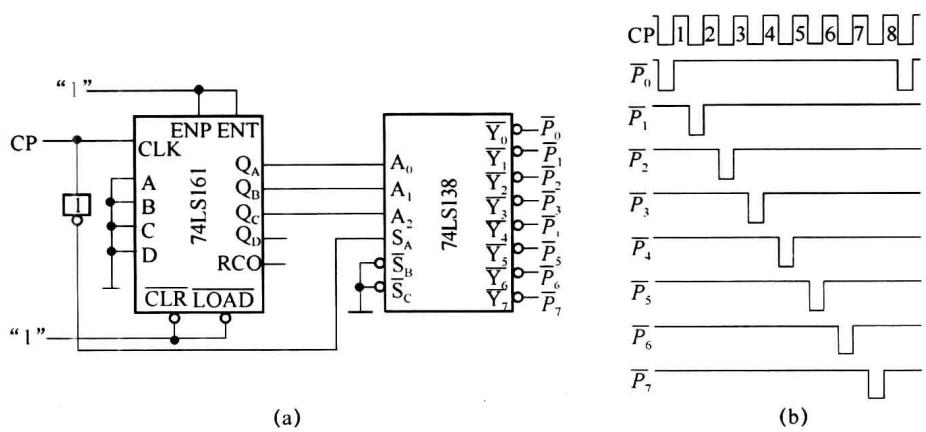  

图 6.3.10 用 74LS161 和 74LS138 构成的脉冲分配器
</Solution>
</Example>

<Example title="例 6.3.8">
串行通信总线 ST-BUS 时隙分配时序逻辑。

图 6.3.11 是一种串行通信总线 ST-BUS 的时隙分配电路,读者若设计实用的数字通信系统时可参考应用。ST-BUS 是一种在数字通信设备中常用的串行通信总线。通常语音信号采用 8 kHz 的采样速率,每个采样编码为 8 bit。当时钟为 2.048 MHz 时,可分配 32 路信号在总线上串行传输,每路信号占用一个“时隙(time-slot)”,一个时隙为 8 bit。每 125 μs 为一帧(frame)(32 路×8 bit),1 秒共 8000 个帧。一般需要一组时隙分配信号,借助时隙分配信号,将需要传输的语音编码(或其他数据)插入到总线中,或从总线上读取所需的数据。

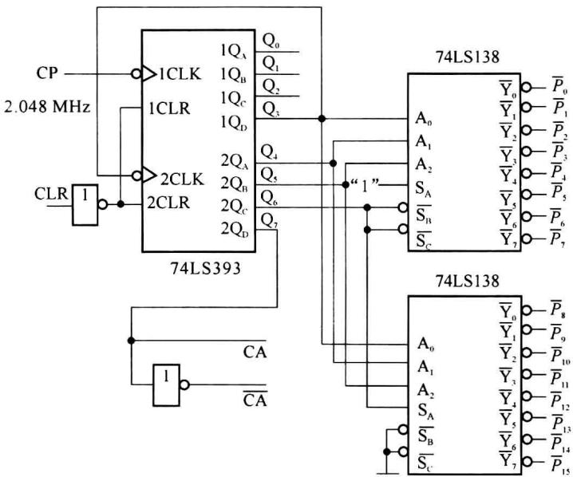  

图 6.3.11 串行通信总线 ST-BUS 的时隙分配电路

图 6.3.11 中 74LS393 是双 4 位二进制异步加法计数器, 通过外部连接(将第 1 个计数器的最高位 $1Q_{D}$ 作为第 2 个计数器的时钟) 构成计数周期为 256 的异步计数器。两个 74LS138 译码器构成 4 线-16 线译码电路。整个电路的时钟 CP 的频率为 2.048 MHz。CLR 为复位信号(在总线中称为帧定位信号), 当 CLR 为低电平时, 74LS393 被复位, 作为

一个循环(帧)的开始。

由于4线-16线译码电路的输入为74LS393输出的 $Q_{6} \sim Q_{3}$ ，所以 $\overline{P_0} \sim \overline{P_{15}}$ 每个输出低电平的持续时间为8个时钟周期，也就是8bit（如 $\overline{P_0}$ 在计数器为00000000到00000111间为低电平），因此其译码输出为128bit（时钟周期）为一个周期。当以256个时钟周期作为一帧时， $\overline{P_0}$ 对应在第0时隙和第16时隙时为低电平， $\overline{P_1}$ 在第1时隙和第17时隙时为低电平，……， $\overline{P_{15}}$ 在第15时隙和第31时隙时为低电平。其输出波形如图6.3.12所示。

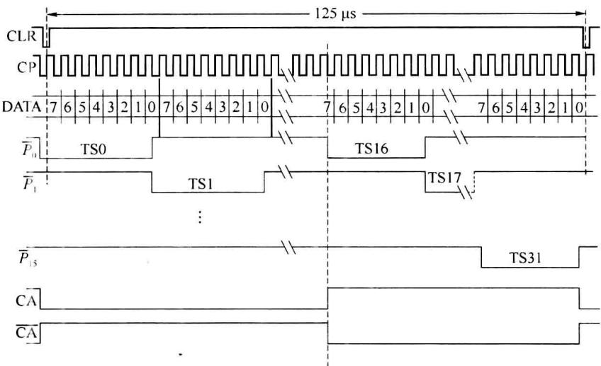  

图 6.3.12 ST-BUS 时隙分配电路的输出波形图

为能使每个时隙有一个时隙分配信号，可使用 $\overline{P_0} \sim \overline{P_{15}}$ 和半帧信号CA和 $\overline{\mathrm{CA}}$ 来获得，半帧信号是一帧内，CA为前半帧为0，后半帧为1； $\overline{\mathrm{CA}}$ 为前半帧为1，后半帧为0。利用 $\overline{P_0} \sim \overline{P_{15}}$ 与CA相或，可以唯一确定对应时隙0到时隙15的时隙分配信号（例如 $\mathrm{TS0} = \overline{P_0} +\mathrm{CA}$ 仅在时隙0为低电平），利用 $\overline{P_0} \sim \overline{P_{15}}$ 与 $\overline{\mathrm{CA}}$ 相或，可以唯一确定对应时隙16到时隙31的时隙分配信号（例如， $\mathrm{TS16} = \overline{P_0} +\overline{\mathrm{CA}}$ ，仅在时隙16为低电平）。实际应用时的时隙分配信号时序图如图6.3.13所示。

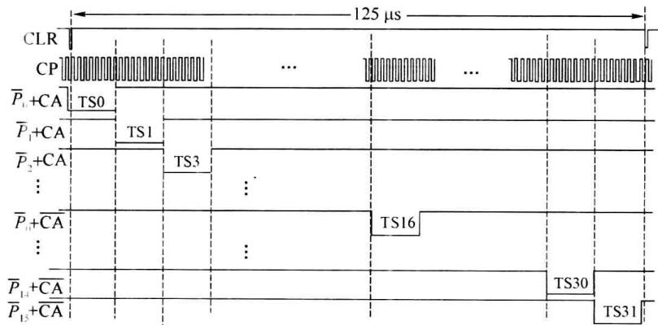  

图 6.3.13 实际应用时的时隙分配信号时序图
</Example>

### 2. 计数器用于序列信号发生器

<Example title="例 6.3.9">
用中规模计数器74LS169和双4选1数据选择器74LS153产生两个序列信号：

(1) 10100, 10100, …

(2) 11011, 11011, …

<Solution title="解">
使用进位位实现预置，预置值 $= 16 - 5 = 11$ ，即：二进制数1011。计数状态是：1011、1100、1101、1110、1111。

（2）作序列信号发生器的真值表。观察所使用的状态，由于最高位都是1，所以取3个触发器的输出就可以，即：以 $Q_{C}Q_{B}Q_{A}$ 作为真值表的输入，对应的真值表如表6.3.1所示。

表 6.3.1 序列信号发生器的真值表

<table><tr><td> $Q_C$ </td><td> $Q_B$ </td><td> $Q_A$ </td><td> $Y_1$ </td><td> $Y_2$ </td></tr><tr><td>0</td><td>1</td><td>1</td><td>1</td><td>1</td></tr><tr><td>1</td><td>0</td><td>0</td><td>0</td><td>1</td></tr><tr><td>1</td><td>0</td><td>1</td><td>1</td><td>0</td></tr><tr><td>1</td><td>1</td><td>0</td><td>0</td><td>1</td></tr><tr><td>1</td><td>1</td><td>1</td><td>0</td><td>1</td></tr></table>

(3) 作卡诺图, 如图 6.3.14 所示。

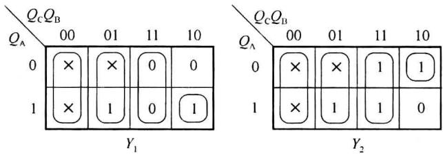  

图6.3.14 例6.3.9的卡诺图

选择 $Q_{\mathrm{C}}$ 和 $Q_{\mathrm{B}}$ 作为数据选择器的地址输入，两个数据选择器的数据端的连接应该是： $1D_0 = 0$ $1D_{1} = 1$ $1D_{2} = Q_{\mathrm{A}}$ $1D_{3} = 0$ $2D_0 = 0$ $2D_{1} = 1$ $2D_{2} = \overline{Q_{\mathrm{A}}}$ $2D_{3} = 1$

(4) 作序列发生器逻辑图, 如图 6.3.15 所示。

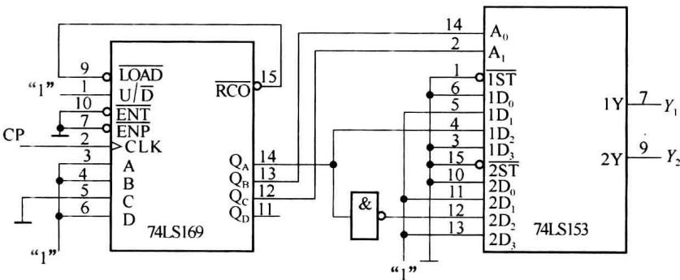  

图 6.3.15 例 6.3.9 序列发生器逻辑图
</Solution>
</Example>
