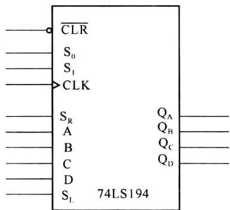
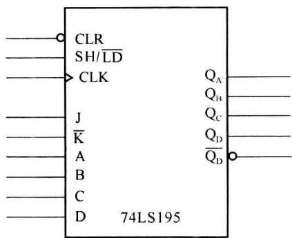
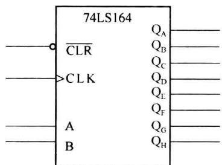
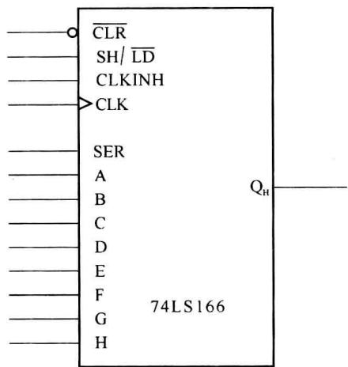

import Guide from '@/components/Guide.astro';
import Knowledge from '@/components/Knowledge.astro';
import Example from '@/components/Example.astro';
import Analysis from '@/components/Analysis.astro';
import Solution from '@/components/Solution.astro';
import Variant from '@/components/Variant.astro';
import Note from '@/components/Note.astro';
import Block from '@/components/Block.astro';
import Method from '@/components/Method.astro';
import Exercise from '@/components/Exercise.astro';

中规模移位寄存器也是一类常用的中规模时序电路。关于移位寄存器的工作原理，在第5章已经介绍过，移位寄存器可以有4种工作方式，串入串出、串入并出、并入串出和并入并出。

其中的“串入串出”和“串入并出”是所有的移位寄存器都具有的工作方式。另外两种工作方式，则不一定是所有的移位寄存器都有。

## 6.4.1 中规模移位寄存器的功能

为了使中规模移位寄存器能够适用于不同场合,实现多种功能,多数中规模移位寄存器都有一些功能选择和控制端。

### 1. 移位方式的选择

移位寄存器的移位方式有两种:左移方式和右移方式。根据定义:逻辑图中最低有效位(LSB)到最高有效位(MSB)的电路排列顺序应为从上到下、从左到右,因此低位到高位的数据移存为右移,高位到低位的移动为左移。若用D触发器构成移位寄存器,右移位寄存器的各级触发器的输入方程是:

$$

\begin{array}{l} D _ {0} = S _ {\mathrm{R}} \\ D _ {i} = Q _ {i - 1} ^ {n} \end{array} \quad (i = 1, 2, \dots , N - 1)

$$

其中， $S_{R}$ 是右移输入，N 是移位寄存器的位数。

同样,左移位寄存器的触发器输入方程是:

$$

\begin{array}{l} {D _ {n - 1} = S _ {\mathrm{L}}} \\ {D _ {i} = Q _ {i + 1} ^ {n}} \end{array} \qquad (i = 0, 1, 2, \dots , N - 2)

$$

其中， $S_{L}$ 是左移输入， $D_{n-1}$ 是最高位触发器的输入。

中规模移位寄存器有单方向移位的芯片,也有通过移位控制端控制实现双方向移位芯片。

### 2. 并行预置

并行预置不是所有移位寄存器芯片都具有的功能, 只有具有并行预置功能的移位寄存器才有并入串出和并入并出的工作方式。

### 3. 串行输入方式的选择

串行输入有 D 触发器的方式输入,也有 JK 触发器的方式输入。有的移位寄存器的串行输入端有两个,两个输入作用到一个内部的与门,与门的输出才是移位寄存器的串行输入。

### 4. 复位功能

多数的移位寄存器都具有复位(置零)功能,移位寄存器的复位功能一般都是异步复位,也有个别的移位寄存器是同步复位。

## 6.4.2 中规模移位寄存器介绍

### 1. 通用移位寄存器 74LS194

74LS194 是一片具有多种功能的移位寄存器, 功能表如表 6.4.1 所示。

74LS194 用 $S_{0}$ 、 $S_{1}$ 作为移位寄存器的功能控制端。两个控制信号有 4 种组合，控制 74LS194 的 4 种不同的工作方式。

① $S_{1}$ $S_{0}$ 为 00 时: 寄存器保持原来状态。

② $S_{1}$ $S_{0}$ 为 01 时: 实现右移位。

③ $S_{1}$ $S_{0}$ 为 10 时: 实现左移位。

④ $S_{1}$ $S_{0}$ 为 11 时: 进行并行预置, 预置是同步方式的。

⑤ $\overline{\mathrm{CLR}}$ 是74LS194的清零输入，清零是异步清零。

表 6.4.1 74LS194 移位寄存器功能表

<table><tr><td> $\overline{CLR}$ </td><td> $S_1$ </td><td> $S_0$ </td><td>CLK</td><td> $S_L$ </td><td> $S_R$ </td><td> $Q_A$ </td><td> $Q_B$ </td><td> $Q_C$ </td><td> $Q_D$ </td></tr><tr><td>0</td><td>×</td><td>×</td><td>×</td><td>×</td><td>×</td><td>0</td><td>0</td><td>0</td><td>0</td></tr><tr><td>1</td><td>1</td><td>1</td><td>↑</td><td>×</td><td>×</td><td>A</td><td>B</td><td>C</td><td>D</td></tr><tr><td>1</td><td>0</td><td>1</td><td>↑</td><td>×</td><td> $S_R$ </td><td> $S_R$ </td><td> $Q_A$ </td><td> $Q_B$ </td><td> $Q_C$ </td></tr><tr><td>1</td><td>1</td><td>0</td><td>↑</td><td> $S_L$ </td><td>×</td><td> $Q_B$ </td><td> $Q_C$ </td><td> $Q_D$ </td><td> $S_L$ </td></tr><tr><td>1</td><td>0</td><td>0</td><td>×</td><td>×</td><td>×</td><td> $Q_A$ </td><td> $Q_B$ </td><td> $Q_C$ </td><td> $Q_D$ </td></tr></table>

<Note title="注">
表中 A、B、C、D 为 4 个数据并行置入端。

图 6.4.1 是 74LS194 的逻辑符号。

  

图 6.4.1 74LS194 的逻辑符号
</Note>

### 2. JK 输入的移位寄存器 74LS195

74LS195 实现的是单向移位, 只能右移。它也有并行同步预置和异步复位功能。

表 6.4.2 74LS195 移位寄存器功能表

<table><tr><td> $\overline{CLR}$ </td><td>SH/LD</td><td>CLK</td><td>J</td><td> $\overline{K}$ </td><td> $Q_A$ </td><td> $Q_B$ </td><td> $Q_C$ </td><td> $Q_D$ </td></tr><tr><td>0</td><td>×</td><td>×</td><td>×</td><td>×</td><td>0</td><td>0</td><td>0</td><td>0</td></tr><tr><td>1</td><td>0</td><td>↑</td><td>×</td><td>×</td><td>A</td><td>B</td><td>C</td><td>D</td></tr><tr><td>1</td><td>1</td><td>↑</td><td>0</td><td>1</td><td> $Q_A$ </td><td> $Q_A$ </td><td> $Q_B$ </td><td> $Q_C$ </td></tr><tr><td>1</td><td>1</td><td>↑</td><td>0</td><td>0</td><td>0</td><td> $Q_A$ </td><td> $Q_B$ </td><td> $Q_C$ </td></tr><tr><td>1</td><td>1</td><td>↑</td><td>1</td><td>1</td><td>1</td><td> $Q_A$ </td><td> $Q_B$ </td><td> $Q_C$ </td></tr><tr><td>1</td><td>1</td><td>↑</td><td>1</td><td>0</td><td> $\overline{Q}_A$ </td><td> $Q_A$ </td><td> $Q_B$ </td><td> $Q_C$ </td></tr></table>

74LS195 是由 $JK$ 触发器构成的移位寄存器, 它有两个移位信号的输入端: $J$ 和 $\overline{K}$ 。使用 $J, \overline{K}$ 的输入方式主要是便于构成 $D$ 触发器的输入方式: 只要将 $J$ 和 $\overline{K}$ 连接在一起, 就可以作为 $D$ 触发器的输入端来使用。74LS195的功能表如表6.4.2所示。其中 $A, B, C, D$ 是并行输入端。

74LS195 的 SH/LD 为移位和数据置入控制端, 低电平是为数据置入。74LS195 有两个串行输出端: $Q_{D}$ 和 $\overline{Q}_{D}$ , 即提供最后一级触发器的反相输出, 这对于构成反馈移位寄存器的应用方式是很有用的, 例如无须增加外部元件实现 M 序列信号发生器等。

图 6.4.2 是 74LS195 的逻辑符号。

  

图 6.4.2 74LS195 的逻辑符号

3. 具有与门输入的 8 位移位寄存器 74LS164

74LS164 就是一种 8 位移位寄存器芯片。功能表如表 6.4.3 所示。

表 6.4.3 74LS164 移位寄存器功能表

<table><tr><td> $\overline{CLR}$ </td><td>CLK</td><td>A</td><td>B</td><td> $Q_A$ </td><td> $Q_B$ </td><td> $Q_C$ </td><td> $Q_D$ </td><td> $Q_E$ </td><td> $Q_F$ </td><td> $Q_G$ </td><td> $Q_H$ </td></tr><tr><td>0</td><td>×</td><td>×</td><td>×</td><td>0</td><td>0</td><td>0</td><td>0</td><td>0</td><td>0</td><td>0</td><td>0</td></tr><tr><td>1</td><td>↑</td><td>1</td><td>1</td><td>1</td><td> $Q_A$ </td><td> $Q_B$ </td><td> $Q_C$ </td><td> $Q_D$ </td><td> $Q_E$ </td><td> $Q_F$ </td><td> $Q_G$ </td></tr><tr><td>1</td><td>↑</td><td>1</td><td>0</td><td>0</td><td> $Q_A$ </td><td> $Q_B$ </td><td> $Q_C$ </td><td> $Q_D$ </td><td> $Q_E$ </td><td> $Q_F$ </td><td> $Q_G$ </td></tr><tr><td>1</td><td>↑</td><td>0</td><td>×</td><td>0</td><td> $Q_A$ </td><td> $Q_B$ </td><td> $Q_C$ </td><td> $Q_D$ </td><td> $Q_E$ </td><td> $Q_F$ </td><td> $Q_G$ </td></tr></table>

74LS164 的功能比较简单, 只有单向右移。74LS164 有异步复位的输入端。它是由 D 触发器构成的移位寄存器。74LS164 有两个移位输入 A 和 B, 两个输入加到一个内部的与门再输出到移位寄存器的输入。这可以在构成反馈移位寄存器时减少外部逻辑器件的使用。

图 6.4.3 是 74LS164 的逻辑符号。

  

图 6.4.3 74LS164 的逻辑符号

### 4. 具有预置功能的 8 位移位寄存器 74LS166

74LS166 是具有并行预置功能的 8 位移位寄存器。使用 SH/LD 端控制移位寄存器进行移位或预置操作，CLR 端进行复位，串行输入端为 $S_{R}$ 。74LS166 有两个和时钟有关的输入端，CLK 和 CLKINH，CLK 是时钟输入，CLKINH 是“时钟禁止”输入，当 CLKINH = 0 时，允许时钟输入，而 CLKINH = 1 时，不允许时钟输入。另外 74LS166 只有一个输出端，因此只能实现数据的串入串出和并入串出。图 6.4.4 是移位寄存器 74LS166 的逻辑符号。

  

图6.4.4 移位寄存器74LS166的逻辑符号
