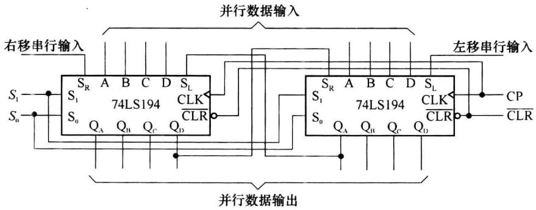
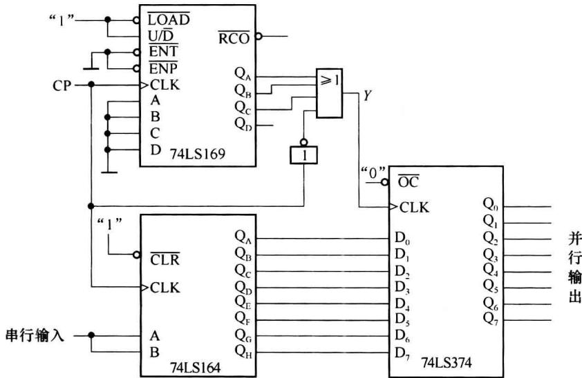
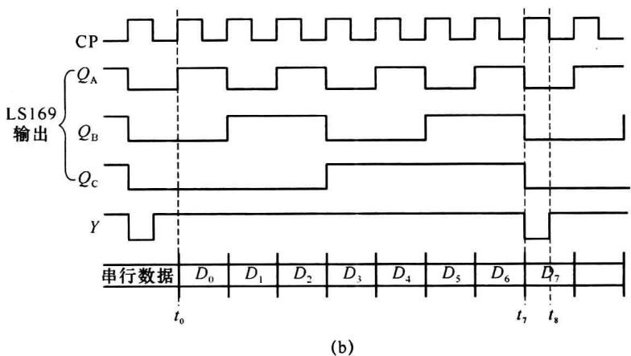
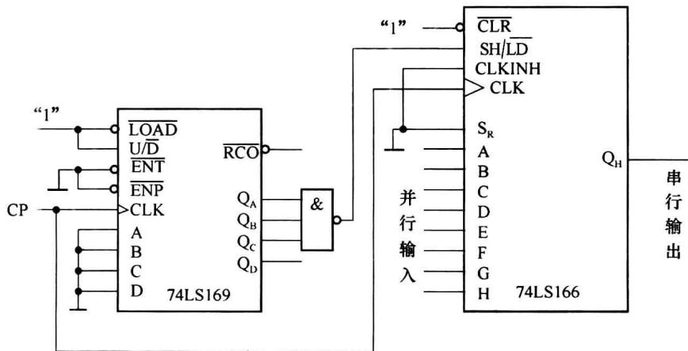
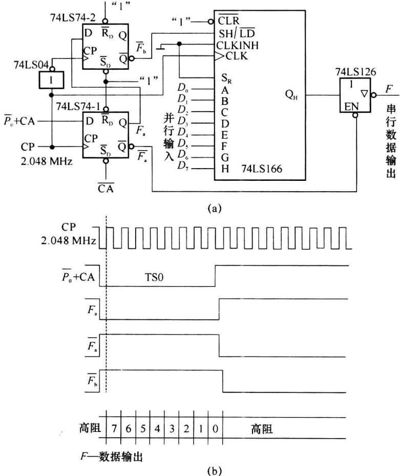
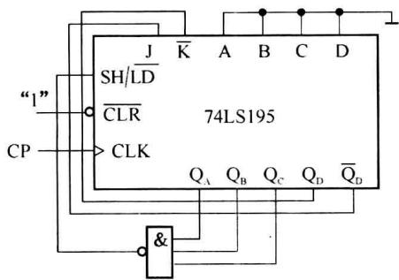
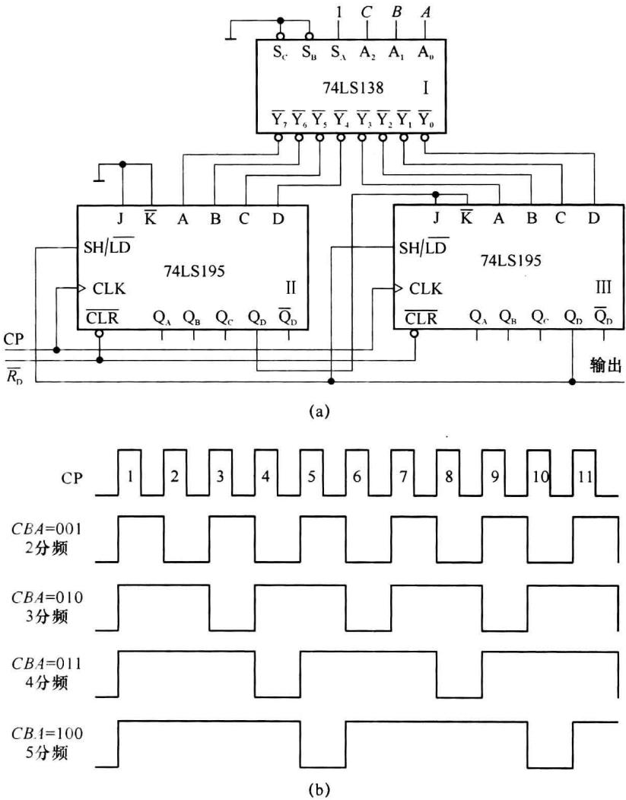
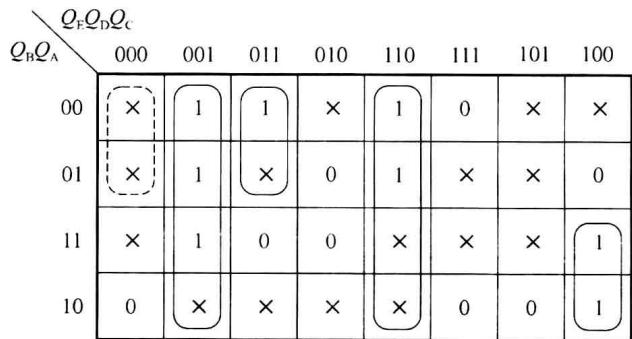
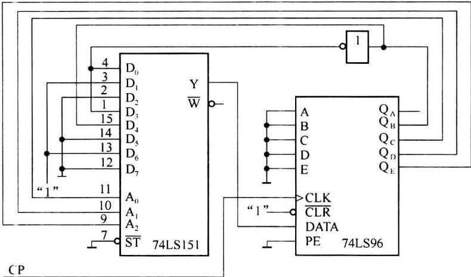

import Guide from '@/components/Guide.astro';
import Knowledge from '@/components/Knowledge.astro';
import Example from '@/components/Example.astro';
import Analysis from '@/components/Analysis.astro';
import Solution from '@/components/Solution.astro';
import Variant from '@/components/Variant.astro';
import Note from '@/components/Note.astro';
import Block from '@/components/Block.astro';
import Method from '@/components/Method.astro';
import Exercise from '@/components/Exercise.astro';

## 6.5.1 中规模移存器的扩展

<Example title="例 6.5.1">
用 74LS194 构成 8 位双向移存器。

图 6.5.1 是用两片 74LS194 构成 8 位双向移位寄存器的连接图。设计时只需将第 1 片的高位输出接至第 2 片的右移输入，将第 2 片的低位输出接至第 1 片的左移输入，同时将两片的对应控制端（功能选择端 $S_{1}$ 、 $S_{0}$ ；时钟等）接到一起即可。

  

图 6.5.1 两片 74LS194 接成 8 位双向移位寄存器
</Example>

## 6.5.2 中规模移存器构成串-并变换器

一般情况下串行输入并行输出是多数移存器都具有的功能。完成数据的串行-并行转换的关键在于控制信号的产生，即保证能够在所需的数据都移入移存器时实现并行输出。例如，数据的长度是8位，控制信号应该保证8位数据全部串行移入移位寄存器后，产生一个并行输出控制信号，将已经移入移位寄存器的8位数据并行输出到一个外部的锁存器，供其他设备读取。

图 6.5.2(a) 是实现 8 位串行数据转换为并行数据的一种控制方式, 由数据寄存器 74LS374、移位寄存器 74LS164 及计数器 74LS169 构成。

8 位数据寄存器 74LS374 来存放并行的输出数据。74LS374 是上升沿触发的数据寄存器， $\overline{OC}=0$ 时输出数据， $\overline{OC}=1$ 时输出为高阻。因此应该在 8 位数据全部串行移入移位寄存器后，为 74LS374 提供一个时钟的上升沿，将 74LS374 输入端的数据写入数据寄存器并保持到下一个有效时钟到达。

计数器 74LS169 是用来产生并行输出的控制信号, 当计数器低 3 位为状态 000 且 CP=1 时, 或门输出 Y=0 (持续半个时钟周期), 当或门的输出 Y 由 0 变为 1 时为 74LS474 提供一个上升沿, 将并行数据写入数据寄存器, 其他时刻数据寄存器的输出不变。

当系统复位后，74LS169、74LS164、74LS374的输出都为“0”。此时或门的输出为“0”，74LS374被写入全“0”状态。参见图6.5.2(b)所示的时序图，在 $t_{0}$ 时刻，第1个时钟脉冲到达后，串行数据的第1位进到74LS164，在 $t_{7}$ 时刻，第8个时钟脉冲到达后，8位数据全部进入74LS164，此时计数器74LS169的输出为全“0”，时钟CP=1,Y=0，随后CP=0时，Y=1，产生一个上升沿，数据再次写入74LS374。

  

(a)

  

图6.5.2 8位串行数据转换为并行数据

## 6.5.3 中规模移存器构成并-串变换器

由于在计算机和通信设备中,对数据的处理时通常是并行操作,而在设备之间,数据通常是通过串行方式传输。实现数据的并-串变换可以通过对移存器并行数据置入,并在时钟的作用下逐位移出即可。

并-串数据变换的控制方式可以有很多种,主要是通过逻辑电路控制并行数据的置入时机,当前一组数据全部移出时开始置入第2组数据。图6.5.3所示电路可实现并入串出的功能。选用具有预置功能的8位移位寄存器74LS166,因为只是用于数据的并入串出,所以,串行输入 $S_{R}$ 和时钟禁止端CLKINH都接地。

电路中用计数器 74LS169 产生移位/预置的控制信号。当计数器低 3 位处于 111 状态时，与非门的输出等于 Y=0，在下一个时钟上升沿到达时实现并行预置，此时数据的最高位已经在输出端输出。当计数器的低 3 位不是处于 111 状态时，与非门输出端 Y=1，移位寄存器进行移位操作。每当 8 位数据中的最后一位移位到输出端时，Y 再次为 0，下一个时钟沿到来时，再次实现并行预置。

  

图 6.5.3 用 74LS169 和 74LS166 实现并入串出的功能

前面提到在通信系统中的串行数据总线 ST-BUS, 我们可以将通信设备中采集的一些并行数据(例如电话交换机的摘挂机信息)变为串行数据, 通过串行数据总线 ST-BUS 传送给处理器进行处理, 数据插入到 ST-BUS 时, 只在指定的时隙插入需要传输的串行数据, 并保证在其他时隙时电路的输出为高阻状态。

图 6.5.4(a) 所示的电路可将采集的并行数据变为串行数据，通过串行通信总线 ST-BUS 送到数据处理系统进行处理。电路中时钟 CP 为 2.048 MHz，并假设使用时隙 TS0 传输串行数据。因此，使用 $\overline{P_{0}} + CA$ 为第 0 时隙的时隙分配信号，即由 $\overline{P_{0}} + CA$ 确定将数据送到 ST-BUS 的第 0 时隙（如果将数据送到其他时隙，可选其他时隙的时隙分配信号，如 $\overline{P_{5}} + CA$ 对应时隙 5, $\overline{P_{5}} + \overline{CA}$ 对应时隙 21 等）。 $\overline{P_{0}} + CA$ 经 74LS74-1（双 D 触发器 74LS74 中的一个）延迟半个时钟周期后，其输出 $\overline{F_{a}}$ 送到 74LS126（三态缓冲门）的使能端，使 74LS126 的输出为低阻状态（输出信号），同时 $F_{a}$ 送到 74LS74-2 的输入端。经 74LS74-2 再延迟半个周期且反相后 ( $\overline{F_{b}}$ )，送到 74LS166 的移存/预置 (SH/LD) 输入端。在 $\overline{F_{b}}$ 变为高电平之前的一个时钟上升沿（图 6.5.4(b) 的虚线处）使 74LS166 实现并行预置，并在 ST-BUS 上输出第一个数据 ( $D_{7}$ )，在 $\overline{F_{b}}$ 上升沿之后（高电平持续期间）实现移位。移位完成后，串行数据总线在 $\overline{F_{a}}$ 的控制下再次进入高阻状态。串行通信总线 ST-BUS 并串变换电路的时序图如图 6.5.4(b) 所示。

  

图 6.5.4 ST-BUS 的并-串变换电路

图 6.5.4 电路及例 6.3.8 所示电路均可供在实际应用 ST-BUS 设计电路时进行参考。

## 6.5.4 中规模移存器构成计数器

应用移位寄存器 SH/LD 控制端,选择合适的并行输入数据值和适当的反馈网络,可以实现任意模值 M 的同步计数器。

  

图6.5.5 74LS195构成的模12计数器

在第5章的表5.3.5中给出了伪随机码发生器(M序列信号发生器)的反馈函数,这些反馈函数均为异或,所构成的M序列信号中不包括状态0000。若使用同或,也能构成伪随机码发生器,序列状态中不包含状态1111。图6.5.5所示由74LS195构成的计数器电路中,若去掉与非门,并令SH/LD=1时,就是由同或反馈构成的伪随机码发生器。由于 $Q_{D}$ 与串行数据输入K连接, $\overline{Q_{D}}$ 作为J输入,构成了反馈函数为 $Q_{A}^{n+1}=\overline{Q_{D}}\overline{Q_{A}}+Q_{D}Q_{A}=Q_{D}\odot Q_{A}$ 的伪随机码发生器,序列信号长度为15,对应4个输出端有15个状态,也就是说为M=15的计数器(不含1111状态)。若我们希望构成一个模值为M(M&lt;15)的计数器,可任选一个初始预置状态,例如0000状态,从0000开始找到所需模值对应的状态,通过译码电路产生预置信号预置0000即可。选择不同的状态产生预置信号以及改变预置值都可以改变计数周期。图6.5.5使用SH/LD= $\overline{Q_{C}Q_{B}Q_{A}}$ ,预置值为0000,实现模12的计数器。在时钟CP作用下,其状态转移如表6.5.1所示。

表 6.5.1 模 12 的计数器的状态转移表

<table><tr><td> ${Q}_{\mathrm{D}}^{n}$ </td><td> ${Q}_{\mathrm{C}}^{n}$ </td><td> ${Q}_{\mathrm{B}}^{n}$ </td><td> ${Q}_{\mathrm{A}}^{n}$ </td><td>SH/LD</td><td> ${Q}_{\mathrm{D}}^{n + 1}$ </td><td> ${Q}_{\mathrm{C}}^{n + 1}$ </td><td> ${Q}_{\mathrm{B}}^{n + 1}$ </td><td> ${Q}_{\mathrm{A}}^{n + 1}$ </td></tr><tr><td>0</td><td>0</td><td>0</td><td>0</td><td>1</td><td>0</td><td>0</td><td>0</td><td>1</td></tr><tr><td>0</td><td>0</td><td>0</td><td>1</td><td>1</td><td>0</td><td>0</td><td>1</td><td>0</td></tr><tr><td>0</td><td>0</td><td>1</td><td>0</td><td>1</td><td>0</td><td>1</td><td>0</td><td>1</td></tr><tr><td>0</td><td>1</td><td>0</td><td>1</td><td>1</td><td>1</td><td>0</td><td>1</td><td>0</td></tr><tr><td>1</td><td>0</td><td>1</td><td>0</td><td>1</td><td>0</td><td>1</td><td>0</td><td>0</td></tr><tr><td>0</td><td>1</td><td>0</td><td>0</td><td>1</td><td>1</td><td>0</td><td>0</td><td>1</td></tr><tr><td>1</td><td>0</td><td>0</td><td>1</td><td>1</td><td>0</td><td>0</td><td>1</td><td>1</td></tr><tr><td>0</td><td>0</td><td>1</td><td>1</td><td>1</td><td>0</td><td>1</td><td>1</td><td>0</td></tr><tr><td>0</td><td>1</td><td>1</td><td>0</td><td>1</td><td>1</td><td>1</td><td>0</td><td>1</td></tr><tr><td>1</td><td>1</td><td>0</td><td>1</td><td>1</td><td>1</td><td>0</td><td>1</td><td>1</td></tr><tr><td>1</td><td>0</td><td>1</td><td>1</td><td>1</td><td>0</td><td>1</td><td>1</td><td>1</td></tr><tr><td>0</td><td>1</td><td>1</td><td>1</td><td>0</td><td>0</td><td>0</td><td>0</td><td>0</td></tr></table>

  

图6.5.6 由74LS138译码器和74LS195构成的可控分频器

## 6.5.5 中规模移存器构成分频器

图 6.5.6 所示为由 3 线-8 线译码器和两片 74LS195 构成的可控分频器。图中芯片 I 为 3 线-8 线译码器，当选择不同的输入值 CBA 时，可用来控制改变分频比（2-8 分频）。芯片 II、芯片 III 为移位寄存器 74LS195。

## 6.5.6 中规模移存器构成序列信号发生器

移位寄存器可以和数据选择器一起来构成序列信号发生器。一般构成序列信号发生器时，需要将各级触发器的输出连接到反馈电路，通过反馈电路为第一级触发器提供反馈信号。在很多情况下会需要从某些触发器的 $\overline{Q}$ 端取得信号。然而中规模移位寄存器一般都不提供 $\overline{Q}$ 端的输出信号。若使用数据选择器作为反馈电路，在输入数据变量等于数据选择器的地址端时不需要使用 $\overline{Q}$ ，在输入数据变量大于数据选择器的地址端时，数据选择器的数据输入部分还可能需要一些反相信号，但是数量较少。

利用中规模移位寄存器和数据选择器设计序列信号发生器的步骤和以前介绍过的设计方法相同。

<Example title="例 6.5.2">
用中规模移位寄存器和数据选择器设计一个序列信号发生器, 输出序列为 0110011110001001。

<Solution title="解">
(1)由于序列的长度是16,先选寄存器最小位数,选择4。将序列信号分4个一组,共16组,检查是否有重复组合:

16 组代码中有些代码组合出现了两次,例如 1100,所以再用位数等于 5 来试验,新写出的 16 组 5 位代码组合,由于没有重复,可以用 5 位的移位寄存器。

选用 5 位移位寄存器 74LS96(芯片功能可查阅相关技术手册)，它是可以并行预置的移位寄存器。74LS96 的信号输入控制端 PE 来实现移位和预置的控制。即，PE=0 时为串行移位，PE=1 时为并行预置。由于本题要求中不需要并行预置，PE 端可以固定接地。

（2）列出状态转移表，如表 6.5.2 所示。DATA 是 74LS96 的串行数据输入端，由数据选择器输出的反馈信号应接于该端。

表 6.5.2 例 6.5.2 的状态转移表

<table><tr><td> ${Q}_{\mathrm{E}}$ </td><td> ${Q}_{\mathrm{D}}$ </td><td> ${Q}_{\mathrm{C}}$ </td><td> ${Q}_{\mathrm{B}}$ </td><td> ${Q}_{\mathrm{A}}$ </td><td>DATA</td></tr><tr><td>0</td><td>1</td><td>1</td><td>0</td><td>0</td><td>1</td></tr><tr><td>1</td><td>1</td><td>0</td><td>0</td><td>1</td><td>1</td></tr><tr><td>1</td><td>0</td><td>0</td><td>1</td><td>1</td><td>1</td></tr><tr><td>0</td><td>0</td><td>1</td><td>1</td><td>1</td><td>1</td></tr><tr><td>0</td><td>1</td><td>1</td><td>1</td><td>1</td><td>0</td></tr><tr><td>1</td><td>1</td><td>1</td><td>1</td><td>0</td><td>0</td></tr><tr><td>1</td><td>1</td><td>1</td><td>0</td><td>0</td><td>0</td></tr><tr><td>1</td><td>1</td><td>0</td><td>0</td><td>0</td><td>1</td></tr><tr><td>1</td><td>0</td><td>0</td><td>0</td><td>1</td><td>0</td></tr><tr><td>0</td><td>0</td><td>0</td><td>1</td><td>0</td><td>0</td></tr><tr><td>0</td><td>0</td><td>1</td><td>0</td><td>0</td><td>1</td></tr><tr><td>0</td><td>1</td><td>0</td><td>0</td><td>1</td><td>0</td></tr><tr><td>1</td><td>0</td><td>0</td><td>1</td><td>0</td><td>1</td></tr><tr><td>0</td><td>0</td><td>1</td><td>0</td><td>1</td><td>1</td></tr><tr><td>0</td><td>1</td><td>0</td><td>1</td><td>1</td><td>0</td></tr><tr><td>1</td><td>0</td><td>1</td><td>1</td><td>0</td><td>0</td></tr></table>

（3）画出 DATA 的卡诺图，如图 6.5.7 所示，由于是用数据选择器来实现组合逻辑电路，首先要选择数据选择器的地址输入。现选择 $Q_{E}Q_{D}Q_{C}$ 作为地址输入。

  

图6.5.7 例6.5.2 DATA的卡诺图

在卡诺图上, 按照 $Q_{E}Q_{D}Q_{C}$ 的 8 种组合, 分为 8 个子图, 然后可以确定数据选择器的 8 个数据输入:

$$

D _ {0} = 0 \quad D _ {1} = 1 \quad D _ {2} = 0 \quad D _ {3} = \overline {{{Q _ {\mathrm{B}}}}} \quad D _ {4} = Q _ {\mathrm{B}} \quad D _ {5} = 0 \quad D _ {6} = 1 \quad D _ {7} = 0

$$

检查自启动,发现在 00000 时为死循环,修改 $D_{0}$ 中的任意项:令 $D_{0}=\overline{Q_{B}}$ 即可。

(4) 画出逻辑图: 如图 6.5.8 所示。

  

图6.5.8 例6.5.2的逻辑图
</Solution>
</Example>
