import Guide from '@/components/Guide.astro';
import Knowledge from '@/components/Knowledge.astro';
import Example from '@/components/Example.astro';
import Analysis from '@/components/Analysis.astro';
import Solution from '@/components/Solution.astro';
import Variant from '@/components/Variant.astro';
import Note from '@/components/Note.astro';
import Block from '@/components/Block.astro';
import Method from '@/components/Method.astro';
import Exercise from '@/components/Exercise.astro';

## 习题

<Exercise title="习题 6-1">
74LS90 异步十进制计数器除了作为二进制、五进制、十进制计数器之外，可以在不加门电路的情况下构成从二到十的各种模值计数器，而且有多种方案。若要构成模为 3、6、9 的各种计数器，应如何连接才能实现？画出相应连接图。
</Exercise>

<Exercise title="习题 6-2">
中规模计数器 74LS92 的示意图和符号如题图 6.1 所示。其内部有一个模 2 计数器和一个模 6 计数器 (000～101)，有两个置 0 端，当 $R_{0(1)} = R_{0(2)} = 1$ 时，DCBA = 0000。

(1) 试用该计数器连接成 M=5 和 M=10 的计数器, 分别画出连接图。

(2) 用该计数器连接成 M=11 的计数器,采用尽可能少的外接门电路,画出连接图。

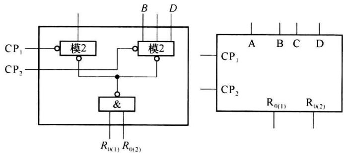  

题图6.1
</Exercise>

<Exercise title="习题 6-3">
题图 6.2 是一种构成任意模值计数器的方式。试问改变预置值一共可以连接成几种不同模值的计数器？分别是什么模值？要连接成十二进制加法计数器，预置值应为多少？画出状态图和输出波形图，注意 $Q_{D}$ 的波形有什么特点。

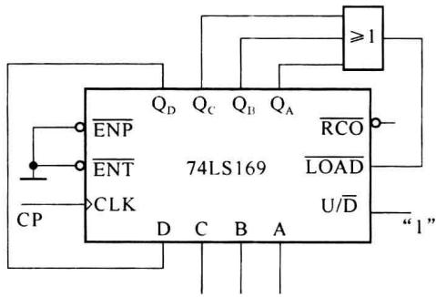  

题图6.2
</Exercise>

<Exercise title="习题 6-4">
分析题图 6.3 所示计数器电路,说明是多少进制计数器,列出状态转移表。
</Exercise>

<Exercise title="习题 6-5">
分析题图 6.4 所示计数器电路,说明当 M=0 和 M=1 时是多少进制计数器,列出状态转移表。

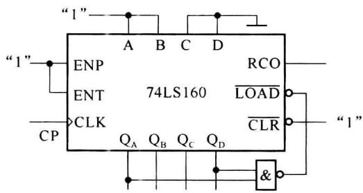  

题图6.3

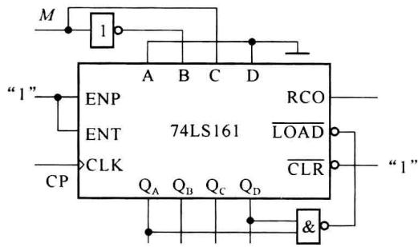  

题图6.4
</Exercise>

<Exercise title="习题 6-6">
题图 6.5 所示是可变进制计数器, 试分析当控制信号 A 为 1 和 0 时, 各为几进制计数器。列出状态转移表。

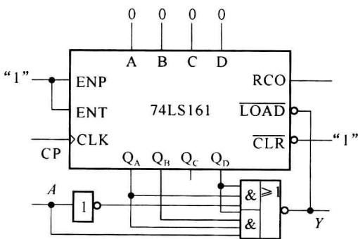  

题图6.5
</Exercise>

<Exercise title="习题 6-7">
分析题图 6.6 所示电路,请画出在 CP 作用下 $f_{0}$ 的输出波形。并说明 $f_{0}$ 与时钟 CP 之间的关系。

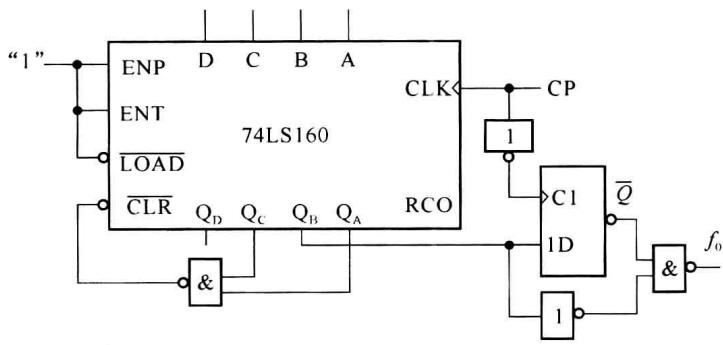  

题图6.6
</Exercise>

<Exercise title="习题 6-8">
用计数器的输出去控制预置端,使计数和预置交替进行改变计数器的模值:试求出题图6.7中各计数器的模值和状态转换表。

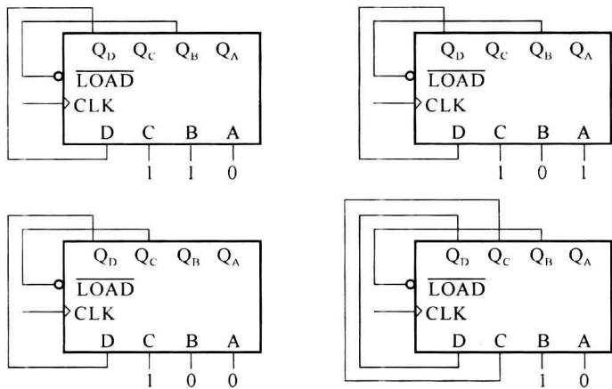  

题图6.7
</Exercise>

<Exercise title="习题 6-9">
题图 6.8 是一种中规模计数器的级联方式, 改变预置值。能改变级联计数器的模值。

(1) 请分析题图 6.8 所示是几进制计数器, 说出理由。

(2) 若要两个计数器级联后的 M=55，预置值应如何确定？

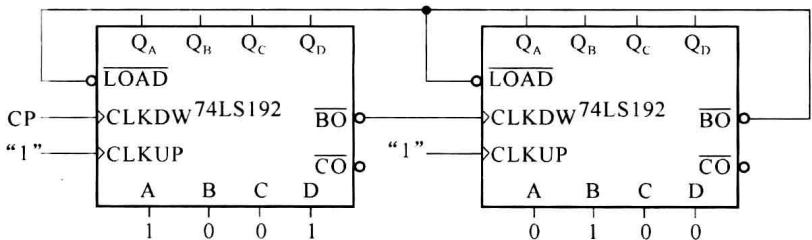  

题图6.8
</Exercise>

<Exercise title="习题 6-10">
题图 6.9 所示是两片 74161 中规模集成电路组成的计数器电路, 试分析该计数器的模值是多少, 列出其状态转移表。

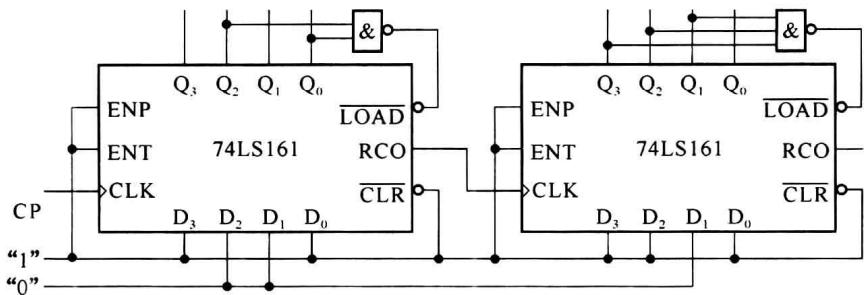  

题图6.9
</Exercise>

<Exercise title="习题 6-11">
试分析题图 6.10 所示计数器电路的最大分频比。

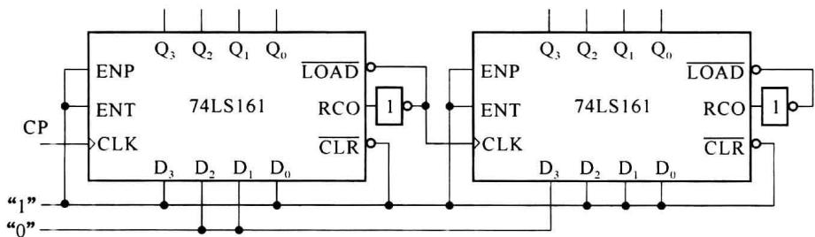  

题图6.10
</Exercise>

<Exercise title="习题 6-12">
题图 6.11 所示为由二-十进制编码器 74147 和同步十进制计数器 74160 组成的可控分频器。试说明当输入控制信号 A, B, C, D, E, F, G, H, I 每个为低电平时由 F 端输出的脉冲频率是多少，假定 CP 的频率为 10 kHz。

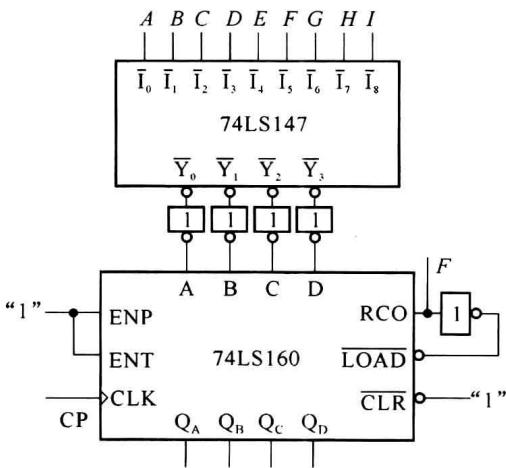  

题图6.11
</Exercise>

<Exercise title="习题 6-13">
题图 6.12 所示为由一个 8 位串入-并出移位寄存器和或非门组成的正弦波发生器的原理图。当移位寄存器的输出端与权电阻网络连接时，由分压器产生输出信号。试画出在 CP 时钟作用下 $D, Q_{0} \sim Q_{7}$ 及输出 $v_{0}$ 的波形。

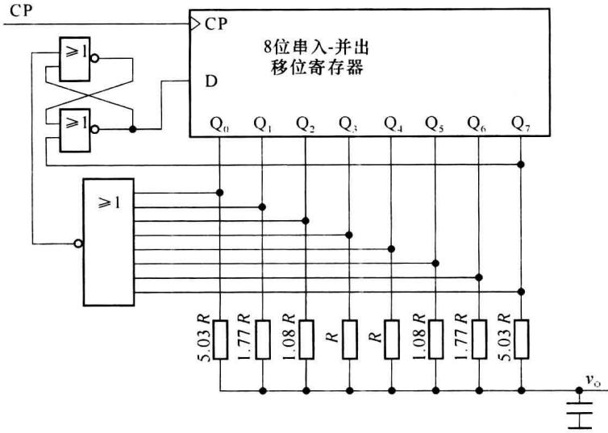  

题图6.12
</Exercise>

<Exercise title="习题 6-14">
试用中规模集成十六进制同步计数器74161接成一个十三进制计数器，可以附加必要的门电路。
</Exercise>

<Exercise title="习题 6-15">
试用中规模集成十进制同步计数器74160设计一个三百六十五进制的计数器，可以附加必要的门电路。
</Exercise>

<Exercise title="习题 6-16">
74LS561 是一种功能较为齐全的同步计数器。其内部是 4 位二进制计数器。功能表和引脚示意图如题图 6.13 所示 ( $Q_{D}$ 为高位输出)。其中 $\overline{OC}$ 为输出高阻控制端，OOC 是与时钟同步的进位输出，其他各输入端的功能可由功能表得知。

(1) 叙述这个计数器的清零和预置有几种方式。

(2) 若要用这个计数器来构成十进制计数器,有几种连接方式?画出它们的连接图。

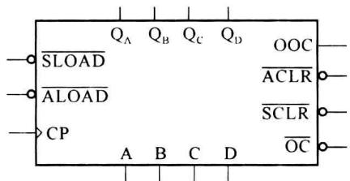

<table><tr><td> $\overline{OC}$ </td><td> $\overline{SLOAD}$ </td><td> $\overline{ALOAD}$ </td><td> $\overline{SCLR}$ </td><td> $\overline{ACLR}$ </td><td>CP</td><td> $D$ </td><td> $C$ </td><td> $B$ </td><td> $A$ </td><td> $Q_{D}$ </td><td> $Q_{C}$ </td><td> $Q_{B}$ </td><td> $Q_{A}$ </td></tr><tr><td>1</td><td>×</td><td>×</td><td>×</td><td>×</td><td>×</td><td>×</td><td>×</td><td>×</td><td>×</td><td colspan="4">高阻</td></tr><tr><td>0</td><td>0</td><td>1</td><td>1</td><td>1</td><td>↑</td><td>d</td><td>c</td><td>b</td><td>a</td><td>d</td><td>c</td><td>b</td><td>a</td></tr><tr><td>0</td><td>×</td><td>0</td><td>1</td><td>1</td><td>×</td><td>d</td><td>c</td><td>b</td><td>a</td><td>d</td><td>c</td><td>b</td><td>a</td></tr><tr><td>0</td><td>×</td><td>×</td><td>0</td><td>1</td><td>↑</td><td>×</td><td>×</td><td>×</td><td>×</td><td>0</td><td>0</td><td>0</td><td>0</td></tr><tr><td>0</td><td>×</td><td>×</td><td>×</td><td>0</td><td>×</td><td>×</td><td>×</td><td>×</td><td>×</td><td>0</td><td>0</td><td>0</td><td>0</td></tr><tr><td>0</td><td>1</td><td>1</td><td>1</td><td>1</td><td>↑</td><td>×</td><td>×</td><td>×</td><td>×</td><td colspan="4">加法计算</td></tr></table>

题图6.13
</Exercise>

<Exercise title="习题 6-17">
用 74LS169 中规模计数器构成可逆十进制计数器。加计数时，状态由 0000 递增到 1001；减计数时，状态由 1001 递减到 0000。外加的加/减控制信号为 P, P=1 时作加法，P=0 时作减法。用一片 74LS169 和少量与非门完成这个设计，画出逻辑图。
</Exercise>

<Exercise title="习题 6-18">
使用一片 74LS169 计数器和一个 3 输入或门构成十进制加法计数器。4 个预置端都不和输出端直接相连。问改变这个或门跟输出端的连接以及 DCBA 预置值，共有几种方式可构成十进制加计数器？画出各自的连接图，并写出相应的状态转移关系。
</Exercise>

<Exercise title="习题 6-19">
一种高速 ECL 同步计数器 MC10136 的功能表和引线示意图如题图 6.14 所示。 $\overline{Q_{out}}$ 为进位/借位输出，加计数时，在状态 1111 时输出低电平，减计数时，在 0000 状态时为低电平。

（1）在加计数和减计数时，如何连接就可成为可编程计数器（即可变模数计数器）？画出连接图。

(2) 要构成 M=10 的计数器, 有几种连接方式? 画出连接图。

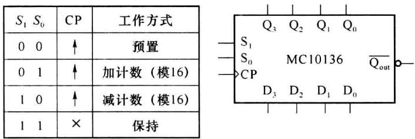  

题图6.14
</Exercise>

<Exercise title="习题 6-20">
试用两片 74LS169 计数器级联构成模值为 60 的计数器；这种计数器可以用多种方式来构成。举出两种连接方式，画出连接图，并说明它们的状态变化过程。
</Exercise>

<Exercise title="习题 6-21">
还是用两片 74LS169 构成模 60 计数器,但要求计数器状态按两位 8421BCD 码的规律变化,即从 0000 0000 变到 0101 1001。分别用同步级联和异步级联的方式来构成这种计数器。画出连接图。
</Exercise>

<Exercise title="习题 6-22">
用一片同步计数器 74LS169 和一片 8 选 1 数据选择器, 设计一个输出序列为 01001100010111 的序列信号发生器, 画出逻辑图。
</Exercise>

<Exercise title="习题 6-23">
若要用一片4位寄存器74LS194和一片8选1数据选择器，实现01001100010111的序列信号发生器是否可能？若不可能，还需什么器件？画出逻辑图（若认为可能，则可直接设计出逻辑图）。
</Exercise>

<Exercise title="习题 6-24">
用一片中规模移位寄存器 74LS195 和一片 8 选 1 数据选择器, 设计一个移存型计数器, 要求状态转移规律为: $1 \rightarrow 2 \rightarrow 4 \rightarrow 9 \rightarrow 3 \rightarrow 6 \rightarrow 12 \rightarrow 8 \rightarrow 1 \rightarrow 2 \rightarrow \cdots$ 设计时要求自启动, 画出逻辑图。
</Exercise>

<Exercise title="习题 6-25">
用1片74LS169计数器和2片74LS138译码器构成一个具有12路脉冲输出的数据分配器。画出连接图，在图上应标明第1路到第12路输出的位置。
</Exercise>

<Exercise title="习题 6-26">
用1片74LS195移存器和2片74LS138译码器构成一个具有12路脉冲输出的数据分配器。画出连接图，在图上应标明第1路到第12路输出的位置。

## 第7章 可编程逻辑器件

早期的数字逻辑系统由通用中小规模集成电路芯片连接而实现。这种形式的电路在可靠性、工作速度、功耗及体积方面都难以满足大规模、高性能信息处理系统的要求。随着集成电路的发展，专用集成电路（Application Specific Integrated Circuits, ASIC）可以将整个（子）系统集成在一块芯片上。由于芯片内集成度高、连线短，ASIC 可给出通用中小规模集成电路的系统难以达到的性能指标。但 ASIC 需要由半导体生产厂家去制造完成，设计周期较长。现代信息处理的快速发展要求集成电路的设计、调测及生产的过程周期应尽可能短，因而希望专用集成电路具有可编程实现的特点，这促进了可编程逻辑器件（Programmable Logic Device, PLD）的发展。

PLD 主要由逻辑单元、互连线单元、输入/输出单元组成，各单元的功能及相互连接关系都可经编程设置。借助 EDA(Electronic Design Automation) 工具软件，用户自己可设计、修改 PLD 所完成的逻辑功能。

PLD 从早期的小规模 PLD(PROM, PLA, PAL, GAL) 发展起, 现已发展成功能强大而灵活的大规模的 PLD(CPLD/FPGA), 其逻辑单元可多达数千个、等效逻辑门数百万个、片内信号延时在 ns 数量级。快速发展的微电子技术已可将 CPU(中央处理器)、存储器、逻辑单元等部件集成在一块芯片中, 构成系统级 PLD(SoPC), 使用用户通过编程可实现更综合、更大规模的系统。

本章主要从可编程逻辑的角度介绍几类 PLD 器件的构造和应用。
</Exercise>
