import Guide from '@/components/Guide.astro';
import Knowledge from '@/components/Knowledge.astro';
import Example from '@/components/Example.astro';
import Analysis from '@/components/Analysis.astro';
import Solution from '@/components/Solution.astro';
import Variant from '@/components/Variant.astro';
import Note from '@/components/Note.astro';
import Block from '@/components/Block.astro';
import Method from '@/components/Method.astro';
import Exercise from '@/components/Exercise.astro';

## 第7章 可编程逻辑器件

早期的数字逻辑系统由通用中小规模集成电路芯片连接而实现。这种形式的电路在可靠性、工作速度、功耗及体积方面都难以满足大规模、高性能信息处理系统的要求。随着集成电路的发展，专用集成电路（Application Specific Integrated Circuits, ASIC）可以将整个（子）系统集成在一块芯片上。由于芯片内集成度高、连线短，ASIC 可给出通用中小规模集成电路的系统难以达到的性能指标。但 ASIC 需要由半导体生产厂家去制造完成，设计周期较长。现代信息处理的快速发展要求集成电路的设计、调测及生产的过程周期应尽可能短，因而希望专用集成电路具有可编程实现的特点，这促进了可编程逻辑器件（Programmable Logic Device, PLD）的发展。

PLD 主要由逻辑单元、互连线单元、输入/输出单元组成，各单元的功能及相互连接关系都可经编程设置。借助 EDA(Electronic Design Automation) 工具软件，用户自己可设计、修改 PLD 所完成的逻辑功能。

PLD 从早期的小规模 PLD(PROM, PLA, PAL, GAL) 发展起, 现已发展成功能强大而灵活的大规模的 PLD(CPLD/FPGA), 其逻辑单元可多达数千个、等效逻辑门数百万个、片内信号延时在 ns 数量级。快速发展的微电子技术已可将 CPU(中央处理器)、存储器、逻辑单元等部件集成在一块芯片中, 构成系统级 PLD(SoPC), 使用用户通过编程可实现更综合、更大规模的系统。

本章主要从可编程逻辑的角度介绍几类 PLD 器件的构造和应用。

存储器是计算机中的重要部件,用于二进制数据信息的保存和管理。但存储器的结构和功能也使其可用于逻辑函数的可编程实现。

## 7.1.1 只读存储器

只读存储器(Read Only Memory, ROM)用于存储固定信息。ROM中的存储数据在芯片掉电后能继续保存。存储的数据在ROM工作时只能被读出，不能被改写。ROM所存储的0、1数据内容可由制造厂家一次性制作进去，也可由用户写入，后者称为PROM（Programmable ROM）。

ROM 由若干存储单元(字)组成,每一单元存储了 m 个二进制位。输入 ROM 的为 n条地址线 $(A_{i})$ ，地址线经地址译码器给出 $2^{n}$ 条字线，每条字线 $(W_{k})$ 寻址一个存储单元。被寻址的存储单元通过m条位线 $(D_{j})$ 将存储的0、1信息送出ROM。

图 7.1.1 表达了一个 n=2、m=4 的 MOS-ROM 的结构。ROM 有 $2^{n}=4$ 个存储单元，每个存储单元有 m=4 个存储位。从图中可见各存储位存储的 1、0 信息和 MOS 管的“有”、“无”的对应关系。

ROM 中的地址译码器输出 $2^{n}$ 条字线，每条字线 $(W_{k})$ 对应 n 位地址变量的一个最小项（n 位地址变量的与运算乘积项），如式(7.1.1)所示。

$$

\left. \begin{array}{l} W _ {0} = \overline {{A _ {1}}} \cdot \overline {{A _ {0}}} \\ W _ {1} = \overline {{A _ {1}}} \cdot A _ {0} \\ W _ {2} = A _ {1} \cdot \overline {{A _ {0}}} \\ W _ {3} = A _ {1} \cdot A _ {0} \end{array} \right\}\tag{7.1.1}

$$

由式(7.1.1)可见，ROM的地址译码器是一个与运算阵列，这个与运算阵列在ROM中是固定制备的，因而说，ROM中隐含地完成了地址变量的与运算，固定地得出了 $n$ 位地址变量的全部最小项 $W_{k}(k = 0\sim 2^{n} - 1)$ 。在任何时刻，各 $W_{k}$ 中必有一个且只有一个有效。

由图 7.1.1 可见, 各存储单元中具有相同位权的 MOS 存储管的漏极输出连接在同一条输出数据线(位线 $D_{j}$ ) 上。由于同一时刻只可能有一条字线 ( $W_{k}$ ) 有效, 因而同一位线上的各存储位呈线或关系, 即每条数据线 $D_{j}$ 完成存储位所对应的各相关最小项 $W_{k}$ 的逻辑或运算。由于存储位的 0、1 数据是根据需要制作进入或由用户写入, 因而各 $D_{j}$ 完成的或运算是可编程的或运算, 存储单元阵列是可编程或运算阵列。在图 7.1.1 ROM 中的各数据线 $D_{j}$ 完成的可编程或运算如式 (7.1.2) 所示。

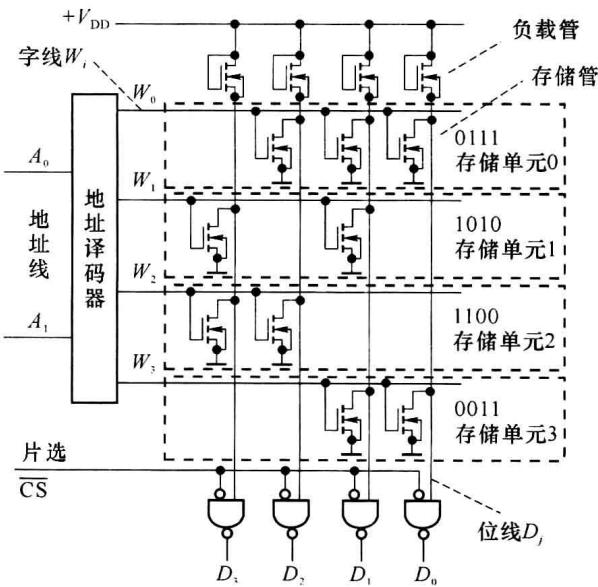  

图7.1.1 MOS-ROM的结构示例

$$

\left. \begin{array}{l} D _ {0} = W _ {0} \cdot 1 + W _ {1} \cdot 0 + W _ {2} \cdot 0 + W _ {3} \cdot 1 = \overline {{A _ {1}}} \cdot \overline {{A _ {0}}} + A _ {1} \cdot A _ {0} \\ D _ {1} = W _ {0} \cdot 1 + W _ {1} \cdot 1 + W _ {2} \cdot 0 + W _ {3} \cdot 1 = \overline {{A _ {1}}} \cdot \overline {{A _ {0}}} + \overline {{A _ {1}}} \cdot A _ {0} + A _ {1} \cdot A _ {0} \\ D _ {2} = W _ {0} \cdot 1 + W _ {1} \cdot 0 + W _ {2} \cdot 1 + W _ {3} \cdot 0 = \overline {{A _ {1}}} \cdot \overline {{A _ {0}}} + A _ {1} \cdot \overline {{A _ {0}}} \\ D _ {3} = W _ {0} \cdot 0 + W _ {1} \cdot 1 + W _ {2} \cdot 1 + W _ {3} \cdot 0 = \overline {{A _ {1}}} \cdot A _ {0} + A _ {1} \cdot \overline {{A _ {0}}} \end{array} \right\}\tag{7.1.2}

$$

从以上分析可见,ROM 虽然是二进制数据的存储器件,但从逻辑运算的角度看,ROM 是一种与运算固定,或运算可编程的器件。ROM 可作为 PLD 实现 n 个变量的多输出(最多 m 个)组合逻辑函数。

在用 ROM 实现组合函数时, 需将函数的 $n$ 个变量输入到 ROM 的对应地址线 $A_{i}$ 上, 由 ROM 的每条输出数据线 $D_{j}$ 得到一个组合逻辑函数的输出。应写入 ROM 中各存储单元的数据由函数表达式(最小项表达式)决定。

通常用“容量”表述存储器的存储能力。容量被定义为存储器中存储位的数目并写为“存储单元数×每单元位数”的形式。例如容量为256×8的ROM中有256个存储单元，每单元有8个数据位，共有2048个存储位，该ROM有8条地址线、8条数据线。

## 7.1.2 PROM 的种类

依据结构和编程写入方式的不同,ROM 有多个种类。本节重点介绍几种 PROM。

### (1) 熔丝型和反熔丝型 PROM

熔丝型和反熔丝型 PROM 是一次编程性 ROM, 数据一经写入便不能更改。图 7.1.2 为双极型晶体管熔丝 PROM 的结构示意。在 PROM 出厂时, 多发射极晶体管的各发射极所连的熔丝呈连接状态, 相当于各存储位存储数据“1”。在写入信息时, 对需要写“0”的位控制其晶体管发射极电流, 使其足够大到将发射极连接的熔断丝烧断。

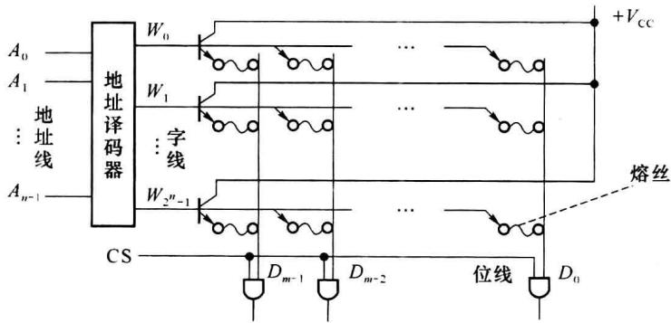  

图 7.1.2 双极型晶体管熔丝型 PROM

图 7.1.3 为反熔丝的结构示意。反熔丝相当于生长在 $N^{+}$ 扩散层和多晶硅(两个导电材料层)之间的介质层, 这一介质层在器件出厂时呈现很高的电阻, 使两个导电层间绝缘。当编程需要连接两个导电层时, 在介质层施加高脉冲电压使介质层被击穿将两个导电层连通。连通电阻小于 $1 \, k\Omega$ 。反熔丝占用的硅片面积较小, 适宜制做高集成度可编程器件中的编程位单元。

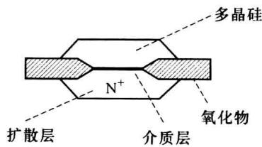  

图 7.1.3 反熔丝的结构示意

### (2) EPROM

可改写 PROM(Erasable PROM, EPROM) 可经紫外线照射擦除所存储的数据，擦除后可再次写入，又被称为 UV-EPROM(UltraViolet EPROM)。EPROM 中的关键器件是浮栅 MOS 晶体管，图 7.1.4 为叠栅式浮栅 MOS 管示意图。浮栅 MOS 管中的栅极 $G_{1}$ 埋在 $SiO_{2}$ 绝缘层中没有引出线，称之为浮栅。第二栅极 $G_{2}$ 有引出线。图 7.1.5 为 EPROM 中的存储位单元，其中的 $VT_{2}$ 为浮栅管，当读取该存储位时，字线 x、y 由地址译码器置高电平。

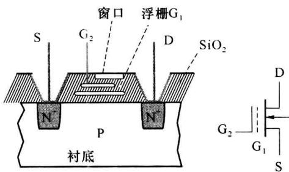  

图 7.1.4 EPROM 中的浮栅 MOS 管

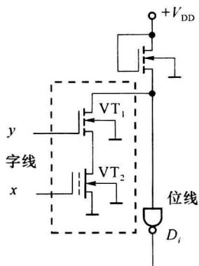  

图7.1.5 EPROM中的位存储单元

编程写入时，在 D、S 加施足够大的脉冲正电压，使 PN 结出现雪崩击穿而产生许多高能量的电子，同时在 $G_{2}$ 加正电压，使沟道中的电子在电场的作用下穿过绝缘层注入到浮栅 $G_{1}$ 。由于 $G_{1}$ 埋在绝缘层中没有放电通路，在脉冲正电压结束后，积累在 $G_{1}$ 浮栅的负电荷可长期保留。 $G_{1}$ 上积累的负电荷使浮栅 MOS 管的开启电压 ( $V_{TH}$ ) 变得较高，使得在 $G_{2}$ 加高电平时，管也不能导通，这一状态相当于在存储位中存储了数据“0”。而当 $G_{1}$ 上没有电子积累时，浮栅管的开启电压相对较低，在 $G_{2}$ 施加高电平时，管可以导通，相当于在存储位存储数据“1”。

当需要改写 EPROM 中的存储内容时, 需要先擦除原存储内容。用紫外线透过芯片表面的透明窗照射浮栅 $G_{1}$ (照射需数分钟), 使浮栅上的负电荷获得足够的能量穿过绝缘层回到衬底, 使 EPROM 中所有存储位回到存“1”状态。此后就可对 EPROM 再次写入。

### (3) EEPROM

可电擦除 PROM(Electrical Erasable PROM, EEPROM)使用电信号完成擦改工作, 无须紫外线照射, 这给使用者带来了方便。也开始为在系统编程(In System Programmability, ISP)建立基础。EEPROM 的结构可类比 EPROM。EEPROM 的浮栅 MOS 晶体管如图 7.1.6 所示。管中的浮栅 $G_{1}$ 有一区域与衬底间的氧化层极薄, 在所施加的电场足够强时可产生隧道效应。在编程注入时, 在 $G_{2}$ 栅极加脉冲正电压时, 隧道效应使电子由衬底注入浮栅 $G_{1}$ 。脉冲正电压结束后, 注入 $G_{1}$ 的负电荷由于没有放电通路而保留在浮栅上, 使 MOS 管的开启电压变高。图 7.1.7 为 EEPROM 中的一个位存储单元。当浮栅管 $VT_{2}$ 的 $G_{1}$ 有负电荷积累时, $VT_{2}$ 管不导通, 位存储单元相当于存储了数据“1”。当需要在某位写“0”(擦除)时, 使该存储位的浮栅管的 $G_{2}$ 接地, 在漏极施加脉冲正电压使浮栅上的负电荷通过隧道效应回到衬底。

目前的 EEPROM 的存储容量可有数 kb 到数 Mb 的多种规格。数据读取时间在几十ns 数量级,页写入时间约在 10 ms 数量级。擦除/写入次数可多达 10 万次。写入的数据一般可保持 10 年。接口方式有并行和串行两种。

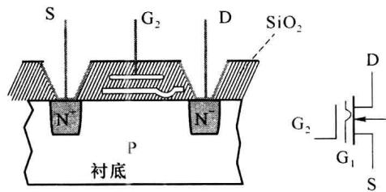  

图 7.1.6 EEPROM 中的浮栅 MOS 管

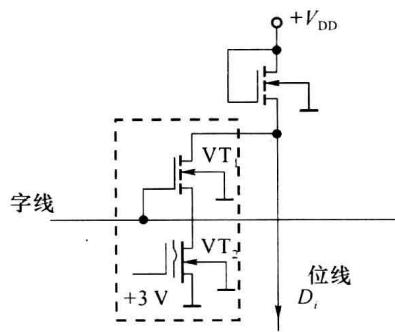  

图7.1.7 EEPROM中的位存储单元

### (4) Flash Memory (闪速存储器)

闪速存储器的位存储单元与 EEPROM 相似，也为双栅极 MOS 管结构。两个栅极为控制栅和浮置栅。与 EEPROM 相比，闪速存储器的隧道区域面积更小、氧化物层更薄。

闪速存储器的擦除与 EEPROM 类似, 利用“隧道效应”(FN 隧道效应)。而编程写入方法有 FN 隧道效应法和 CHE 法两类, 后者与 EPROM 类似, 为一种基于雪崩击穿的电子注入技术。

闪存有 NOR 和 NAND 两种类型。NOR 闪存的地址线和数据线分开，对存储数据可以字节为单位随机读取，所存储的程序代码可直接运行，如同内存一样。因而 NOR 闪存常用做系统的上电启动芯片。

NAND 闪存的地址线和数据线共用,存储空间分为块、页两级,每页 512 B,每块 2 KB、4 KB 或 16 KB。在读取单个字节时,NAND 闪存需多级寻址,因而它的随机读取速率低于 NOR 闪存。但 NAND 闪存的块擦除、块写入速率远高于 NOR 闪存。因而 NAND 闪存常用于大容量数据的存储。

### (5) FRAM(铁电存储器)

FRAM 的核心技术是铁电晶体材料。当铁电晶体材料置于电场中，晶阵中的每个自由浮动的中心原子会沿着电场方向移动并稳定在一种低能量状态，这种稳定状态在电场撤销后可长时间保留。在正向、反向电场的作用下，这种低能量稳态只有两个，状态之间转换的速率很快。这些特性特别适用于 ROM。

由于铁电晶体单元在存储状态改变时的物理过程中没有任何原子碰撞,FRAM 的写入速率可比 EPROM 类(EPROM、EEPROM、Flash Memory)快得多,在 ns\~μs 数量级。而后者通常在 ms 数量级。另一方面,FRAM 写入功耗也比 EPROM 类的低得多,约为 EEPROM 的千分之一。FRAM 的写入次数寿命也比 EPROM 类的高得多,一般 EEPROM 类的写入次数寿命在十万到百万次之间,而 FRAM 的可高达百亿次。

在芯片掉电后, FRAM 的存储内容可长时间(10 年)保存, 因而可将 FRAM 归属 ROM 类, 但在工作中, FRAM 可以相同的速率对存储器中任一单元读出或写入, 这一点上 FRAM 又表现出随机存储器的特征。

存储器的接口(地址线、数据线)形式有两类:并行和串行。图 7.1.8 为一个串行接口存储器的典型电路。图中的 FM25P16 为 FRAM 串行存储器芯片,容量为 2044 B。存储器以 SPI(Serial Peripheral Interface)协议进行数据写入或读出,频率可达1 MHz。 $\overline{CS}$ 为片选信号,低电平使能本芯片,高电平使芯片进入低功耗等待状态。 $\overline{WP}$ 为写保护信号,低电平时屏蔽对片内状态寄存器的写入。 $\overline{HOLD}$ 为保持信号,低电平时中断芯片的工作。

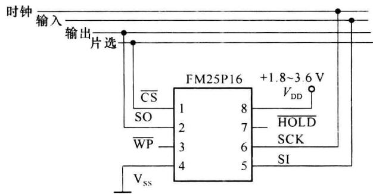  

图7.1.8 串行存储器例

## 7.1.3 随机存储器

随机存储器(Random Access Memory, RAM)在工作时可对任一存储单元读取或写入，也称为随机存取存储器。RAM常用于对数据有频繁快速暂存和选择读取的场合。

RAM 和 ROM 的逻辑结构类似, 主要由地址译码器和存储单元阵列构成, 如图 7.1.9 所示。地址译码器给出 n 位地址变量的全部最小项 $W_{k}(k=0 \sim 2^{n}-1)$ , 存储单元阵列完成可编程或运算。因而, RAM 也可被认为是一种与运算固定、或运算可编程的逻辑器件。

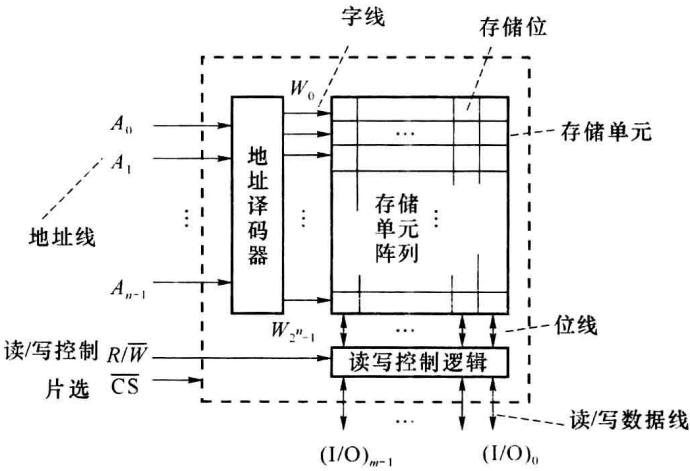  

图7.1.9 RAM的逻辑结构

RAM 分为静态 RAM(Static RAM, SRAM) 和动态 RAM(Dynamic RAM, DRAM)。SRAM 的存储数据在写入后可一直保存(不掉电的情况下)。DRAM 的存储数据的保存时间有限, 工作中需定时进行刷新操作。在同等材料和工艺情况下, SRAM 的存取速率一般相对较快, 而 DRAM 的集成度会相对较高。

与 ROM 不同, RAM 是易失性存储器件, 存储数据在器件掉电后丢失。这是由 RAM 存储位的性质决定的。

### (1) 静态随机存储器中的存储位

图 7.1.10 中的 VT $_{1}$ ～VT $_{6}$ 构成 CMOS-SRAM 中的一个存储位，VT $_{7}$ 、VT $_{8}$ 由该位线所连的各存储位所共用。管 VT $_{1}$ ～VT $_{4}$ 构成 RS 触发器，从 Q、 $\overline{Q}$ 位置可读出 RS 触发器保存的 0/1 状态，在 Q、 $\overline{Q}$ 位置施加高、低电平也可改变触发器的状态（写入）。管 VT $_{5}$ 、VT $_{6}$ 和 VT $_{7}$ 、VT $_{8}$ 为门控管，可完成信号的双向传输，相当于模拟开关。A $_{1}$ 、A $_{2}$ 、A $_{3}$ 为三态缓冲门。

当对该存储位读出或写入时，片选信号 $\overline{\mathrm{CS}}$ 有效，字线 $W_{k}$ 使 $\mathrm{VT}_{5},\mathrm{VT}_{6}$ 和 $\mathrm{VT}_7,\mathrm{VT}_8$ 导通，位线 $D_{j},\overline{D_{j}}$ 分别和 $Q,\overline{Q}$ 连通，如果是读出， $R / \overline{W} = 1,\mathrm{A}_1,\mathrm{A}_3$ 输出呈高阻， $\mathbf{A}_2$ 导通，使 $Q$ 的电平状态被送到数据线 $(\mathrm{I} / \mathrm{O})_j$ 。如果是写入， $R / \overline{W} = 0,\mathrm{A}_1,\mathrm{A}_3$ 导通， $\mathbf{A}_2$ 输出呈高阻，数据线 $(\mathrm{I} / \mathrm{O})_j$ 来的电平信号作用到 $Q,\overline{Q}$ 位置，使RS触发器的状态随之决定。

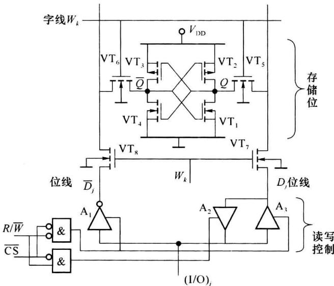  

图 7.1.10 SRAM 的六管存储位电路

### (2) 动态随机存储器中的存储位

动态 RAM 中的存储位利用 MOS 管栅极电容上的充电电荷作为对数据信息的存储。图 7.1.11 为 DRAM 的一种位存储电路。C 是存储管 $VT_{2}$ 的栅极电容。字线分为读字线、写字线，位线也同样分为读、写位线。 $VT_{3}$ 、 $VT_{1}$ 分别是读、写控制管。

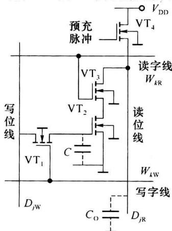  

图 7.1.11 DRAM 的三管存储位电路

在进行写操作时,写字线 $W_{kw}$ 高电平使 $VT_{1}$ 导通,写位线 $D_{jw}$ 上来的电平信号通过 $VT_{1}$ 对 C 充电/放电。如果写入的是 1/0,则写操作结束后的 C 上电压 $v_{c}$ 应高于/低于管 $VT_{2}$ 的开启电压。

在读操作时,首先预充脉冲使 $VT_{4}$ 导通对电容 $C_{0}$ 充电,随后读字线 $W_{kR}$ 变高电平使 $VT_{3}$ 导通,如果存储管 $VT_{2}$ 栅极电容上保存的是1,则 $C_{0}$ 上的预充电荷经 $VT_{3}$ 、 $VT_{2}$ 释放,在读位线 $D_{jR}$ 上读出的是0,如果 $VT_{2}$ 保存的是0,则 $VT_{2}$ 截止、 $C_{0}$ 无放电通路,在 $D_{jR}$ 上读出1。 $D_{jR}$ 经反相器后送至读/写数据线。

由于栅极的漏电,栅极电容 C 保存电荷的时间有限,因而 DRAM 在工作中需总进行刷新的操作,即按一定的频率将存储位上的信息读出、再写回。

DRAM 中的控制电路部分相对复杂,但其位存储电路可做得简单(可做到单管存储),因而 DRAM 的集成度可以较高,这是 DRAM 的优点。

SDRAM(Synchronous Dynamic Random Access Memory)为同步动态随机存储器,它的写入、读出、刷新操作都须与外部时钟(上升沿)同步。

DDR 是双倍速率同步动态随机存储器 (Double Data Rate SDRAM) 的简称。在 SDRAM 的基础上, DDR 的改进主要是将时钟发展为差分式, 在时钟的上升沿和下降沿都执行操作, 因而它的数据传输速率较 SDRAM 增加了一倍。另外, 使用 DLL (Delay Locked LOOP, 延时锁相环路) 保证本地时钟和系统时钟的同步。随后发展的 DDR2、DDR3 在核心模块数量、刷新控制、工作电压等多方面都继续改进, 使动态随机存储器向着更高的数据传输速率、更大的集成度规模、更低的能耗方面不断进步。

## 7.1.4 用存储器实现逻辑处理

存储器主要用于二进制数据信息的保存和管理。但根据前面的介绍，从逻辑运算的角度可认为存储器是一种与运算固定、或运算可编程的逻辑器件。存储器中隐含地产生地址变量的全部最小项，对存储单元写入的数据决定了逻辑函数的构成。

### (1) 存储器实现组合逻辑

根据 7.1.1 小节的分析, 当用存储器(并行接口)实现 n 个逻辑变量、m 个输出的组合逻辑函数时有以下几个要点:

\- 需要用 $n$ 位地址、 $2^n$ 个存储单元、每单元 $m$ 位的 ROM 或 RAM。

\- 存储器的各地址线 $A_{i} (i = n - 1 \sim 0)$ 由各变量依次（按各变量在它们的最小项中高位至低位的排序）连接。

\- 由存储器的输出数据线 $D_{j}$ 得到第 $j$ 个逻辑函数 $(j = m - 1 \sim 0)$ 。

\- 应将各逻辑函数写成最小项表达式。写入存储器中的第 $k(k=0 \sim 2^n - 1)$ 个存储单元的第 $j$ 位 ( $j=m-1 \sim 0$ ) 的 $1/0$ 应根据最小项 $W_k$ 在第 $j$ 个函数表达式中的有/无来决定。例如实现式 (7.1.2) 的存储器的各存储单元应存入的数据为: 0111 (单元 0)、1010 (单元 1)、1100 (单元 2)、0011 (单元 3)。

<Example title="例 7.1.1">
用 ROM 实现 4 位自然二进制码与循环码的转换电路。

<Solution title="解">
设 4 位二进制码为 DCBA, 循环码为 WXYZ。DCBA 到 WXYZ 的转换真值表如表 7.1.1 所示。由转换真值表可得出由 DCBA 的最小项序号表达的 W、X、Y、Z 的逻辑关系式如式 (7.1.3)。

$$

\left. \begin{array}{l} Z = \sum m (1, 2, 5, 6, 9, 1 0, 1 3, 1 4) \\ Y = \sum m (2, 3, 4, 5, 1 0, 1 1, 1 2, 1 3) \\ X = \sum m (4, 5, 6, 7, 8, 9, 1 0, 1 1) \\ W = \sum m (8, 9, 1 0, 1 1, 1 2, 1 3, 1 4, 1 5) \end{array} \right\}\tag{7.1.3}

$$

可用4位地址、4位数据的ROM(容量为 $16\times 4$ )实现此转换的电路。将二进制码DCBA连接到ROM的地址线 $A_{3}A_{2}A_{1}A_{0}$ ，由ROM的输出数据线 $D_{3},D_{2},D_{1},D_{0}$ 分别得到循环码W、X、Y、Z，如图7.1.12所示。根据式(7.1.3)可得到ROM各存储单元的存储信息，如表7.1.1所示。

修改存储单元的数据可使此 4 地址线、4 数据线的 ROM 实现 4 变量的任一 4 输出的组合逻辑函数。

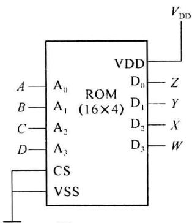  

图7.1.12  

用 $16 \times 4$ ROM 实现 4 变量(ABCD)、4 输出(WXYZ)的任一组合逻辑的电路

表 7.1.1 4 位二进制码与循环码转换真值表

<table><tr><td colspan="4">二进制码</td><td colspan="4">循环码</td><td rowspan="2"></td></tr><tr><td>D</td><td>C</td><td>B</td><td>A</td><td>W</td><td>X</td><td>Y</td><td>Z</td></tr><tr><td>0</td><td>0</td><td>0</td><td>0</td><td>0</td><td>0</td><td>0</td><td>0</td><td>0</td></tr><tr><td>0</td><td>0</td><td>0</td><td>1</td><td>0</td><td>0</td><td>0</td><td>1</td><td>1</td></tr><tr><td>0</td><td>0</td><td>1</td><td>0</td><td>0</td><td>0</td><td>1</td><td>1</td><td>3</td></tr><tr><td>0</td><td>0</td><td>1</td><td>1</td><td>0</td><td>0</td><td>1</td><td>0</td><td>2</td></tr><tr><td>0</td><td>1</td><td>0</td><td>0</td><td>0</td><td>1</td><td>1</td><td>0</td><td>6</td></tr><tr><td>0</td><td>1</td><td>0</td><td>1</td><td>0</td><td>1</td><td>1</td><td>1</td><td>7</td></tr><tr><td>0</td><td>1</td><td>1</td><td>0</td><td>0</td><td>1</td><td>0</td><td>1</td><td>5</td></tr><tr><td>0</td><td>1</td><td>1</td><td>1</td><td>0</td><td>1</td><td>0</td><td>0</td><td>4</td></tr><tr><td>1</td><td>0</td><td>0</td><td>0</td><td>1</td><td>1</td><td>0</td><td>0</td><td>Ch</td></tr><tr><td>1</td><td>0</td><td>0</td><td>1</td><td>1</td><td>1</td><td>0</td><td>1</td><td>Dh</td></tr><tr><td>1</td><td>0</td><td>1</td><td>0</td><td>1</td><td>1</td><td>1</td><td>1</td><td>Fh</td></tr><tr><td>1</td><td>0</td><td>1</td><td>1</td><td>1</td><td>1</td><td>1</td><td>0</td><td>Eh</td></tr><tr><td>1</td><td>1</td><td>0</td><td>0</td><td>1</td><td>0</td><td>1</td><td>0</td><td>Ah</td></tr><tr><td>1</td><td>1</td><td>0</td><td>1</td><td>1</td><td>0</td><td>1</td><td>1</td><td>.Bh</td></tr><tr><td>1</td><td>1</td><td>1</td><td>0</td><td>1</td><td>0</td><td>0</td><td>1</td><td>9</td></tr><tr><td>1</td><td>1</td><td>1</td><td>1</td><td>1</td><td>0</td><td>0</td><td>0</td><td>8</td></tr><tr><td rowspan="2"> $A_3$ </td><td> $A_2$ </td><td> $A_1$ </td><td> $A_0$ </td><td> $D_3$ </td><td> $D_2$ </td><td> $D_1$ </td><td> $D_0$ </td><td rowspan="2">ROM存储单元的内容</td></tr><tr><td colspan="3">ROM的地址线</td><td colspan="4">ROM的数据线</td></tr></table>

上述介绍是从与运算、或运算的角度说明存储器对多输出组合逻辑函数的实现。存储器的对外基本行为功能可描述为：保存数据，根据多位输入决定多位输出。基于这种行为功能，很容易理解存储器对由真值表(如表7.1.1)给出的编码转换或逻辑函数的实现，也很容易得出各存储单元应存储的数据了。

ROM 的行为也可更简单地归为: 查表。在基于查表方法实现算法或处理的系统中, ROM 都有着应用潜力。

由存储器实现的组合逻辑电路不会出现逻辑冒险,因为不存在信号的多路传输。存储器内部的电路设计可保证输出信号的稳定性。但功能冒险仍有可能出现,因为功能冒险是由于多个输入信号的不同步而产生。当多位地址变量出现变化的时刻偏差大于存储器的读取时间,功能冒险就存在,输出信号上可能出现毛刺噪声。
</Solution>
</Example>

### (2) 存储器实现时序逻辑

根据 5.1 节的介绍,时序逻辑的激励函数 Y、下一状态 $Q^{n+1}$ 、输出函数 Z 都是输入信号 X 和当前状态 $Q^{n}$ 的组合逻辑函数。这意味着利用存储器也可实现同步时序逻辑。特别是在实现状态转移规律确定、无须直接存储输入信号的时序电路,如计数器、序列信号发生器等。利用 ROM 可简化设计过程,实现电路也简单。

图 7.1.13 为利用 ROM 和寄存器实现计数器或序列信号发生器的一般性电路。寄存器是为了使状态变化和时钟 CP 的有效边沿同步，如果 ROM 能做到边沿使能，就可不用寄存器。

当前状态码 $Q_{i}^{n}(i=0\sim k-1)$ 送入 ROM 的地址，当前 ROM 地址所寻址的存储单元内总存放下一状态的状态码 $Q_{i}^{n+1}(i=0\sim k-1)$ ，决定 $Q_{i}^{n+1}$ 数据的下一状态函数 $Q^{n+1}=h(X,Q^{n})$ 及输出函数 $Z=g(X,Q^{n})$ 均由 ROM 实现。实现的方法就是根据 $Q^{n+1}$ 和 Z 的真值表将数据写入以当前状态码为地址的存储单元。

在每个时钟的有效沿,寄存器输出更新,上一状态被作为了当前状态 $Q^{n}$ 。ROM 以当前输入 X 和 $Q^{n}$ 作为地址去寻址,输出 Z 和 $Q^{n+1}$ 。Z 作为时序电路的当前处理结果, $Q^{n+1}$ 作为对处理阶段的记忆保存到下一时钟有效沿时刻。

图 7.1.13 既可作为米里(Mealy)型时序电路,也可作为摩尔(Moore)型时序电路。如果各存储单元中对应 Z 的位是根据 $Z=g(X,Q^{n})$ 类型的方程的真值表决定的,则实现的是米里型时序电路,X 改变时,Z 立即有响应。而如果 Z 是根据 $Z=g(Q^{n})$ 类型的方程决定的,则实现的是摩尔型电路。

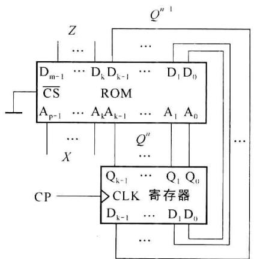  

图 7.1.13 利用 ROM 实现时序电路

<Example title="例 7.1.2">
用图 7.1.3 实现 8421 码模 10 加法计数器，有 1 位输出 Z。Z 在状态为 1001 时输出 1，其他状态时输出 0。

<Solution title="解">
由于计数模值为 10,需要 4 位状态码,故图中的 k=4。由于没有输入变量 X,ROM 仅需 4 条地址线,故 p=4。每存储单元需 5 个存储位(1 位输出码+4 位状态码),故 m=5。需用 10 个存储单元保存 10 个状态值,设 ROM 有 16 个存储单元。

将 ROM 输出数据线的 $D_{3}D_{2}D_{1}D_{0}$ 经寄存器依次连接输入地址线 $A_{3}A_{2}A_{1}A_{0}$ 。ROM 输出的 $D_{4}$ 作为 Z 。根据 8421 码的规律，从状态 0000 开始，将下一状态的码型存入以当前状态码为地址的存储单元内。结果如表 7.1.2 所示。

在用多级分立触发器实现计数器时，需做多个卡诺图化简，过程繁杂、电路复杂，还需考虑自启动问题。而用 ROM 实现时，只需根据状态码型和输出方程向 ROM 预存数据，同一电路可实现多种码型的计数器。输出信号 Z 也不存在冒险问题。自启动问题的解决也很简单，只需向未使用到的存储单元存入任一状态码，如表 7.1.2 所示。

表 7.1.2 例 7.1.2 中 ROM 的存储数据

<table><tr><td colspan="4">ROM 地址</td><td colspan="5">存储数据</td></tr><tr><td> $A_3$ </td><td> $A_2$ </td><td> $A_1$ </td><td> $A_0$ </td><td> $D_4$ </td><td> $D_3$ </td><td> $D_2$ </td><td> $D_1$ </td><td> $D_0$ </td></tr><tr><td>0</td><td>0</td><td>0</td><td>0</td><td>0</td><td>0</td><td>0</td><td>0</td><td>1</td></tr><tr><td>0</td><td>0</td><td>0</td><td>1</td><td>0</td><td>0</td><td>0</td><td>1</td><td>0</td></tr><tr><td>0</td><td>0</td><td>1</td><td>0</td><td>0</td><td>0</td><td>0</td><td>1</td><td>1</td></tr><tr><td>0</td><td>0</td><td>1</td><td>1</td><td>0</td><td>0</td><td>1</td><td>0</td><td>0</td></tr><tr><td>0</td><td>1</td><td>0</td><td>0</td><td>0</td><td>0</td><td>1</td><td>0</td><td>1</td></tr><tr><td>0</td><td>1</td><td>0</td><td>1</td><td>0</td><td>0</td><td>1</td><td>1</td><td>0</td></tr><tr><td>0</td><td>1</td><td>1</td><td>0</td><td>0</td><td>0</td><td>1</td><td>1</td><td>1</td></tr><tr><td>0</td><td>1</td><td>1</td><td>1</td><td>0</td><td>1</td><td>0</td><td>0</td><td>0</td></tr><tr><td>1</td><td>0</td><td>0</td><td>0</td><td>0</td><td>1</td><td>0</td><td>0</td><td>1</td></tr><tr><td>1</td><td>0</td><td>0</td><td>1</td><td>1</td><td>0</td><td>0</td><td>0</td><td>0</td></tr><tr><td>1</td><td>0</td><td>1</td><td>0</td><td>0</td><td>0</td><td>0</td><td>0</td><td>1</td></tr><tr><td>1</td><td>0</td><td>1</td><td>1</td><td>0</td><td>0</td><td>0</td><td>0</td><td>1</td></tr><tr><td>1</td><td>1</td><td>0</td><td>0</td><td>0</td><td>0</td><td>0</td><td>0</td><td>1</td></tr><tr><td>1</td><td>1</td><td>0</td><td>1</td><td>0</td><td>0</td><td>0</td><td>0</td><td>1</td></tr><tr><td>1</td><td>1</td><td>1</td><td>0</td><td>0</td><td>0</td><td>0</td><td>0</td><td>1</td></tr><tr><td>1</td><td>1</td><td>1</td><td>1</td><td>0</td><td>0</td><td>0</td><td>0</td><td>1</td></tr><tr><td rowspan="2"> $Q_3^n$ </td><td rowspan="2"> $Q_2^n$ </td><td rowspan="2"> $Q_1^n$ </td><td rowspan="2"> $Q_0^n$ </td><td rowspan="2">Z输出</td><td rowspan="2"> $Q_3^{n+1}$ </td><td> $Q_2^{n+1}$ </td><td> $Q_1^{n+1}$ </td><td> $Q_0^{n+1}$ </td></tr><tr><td colspan="3">下一状态</td></tr></table>

用 ROM 实现序列信号发生器时, 图 7.1.13 的电路模板既可实现移存型, 也可实现计数组合型。设计移存型序列发生器时, 首先要确定所需的存储位的数目 k 和状态移存码表, 方法过程如 5.3.3 小节所述。在保证各移存状态不出现重复码型后就得出了 k 值和状态移存码表。根据状态移存码表, 依次将下一状态码填入以当前状态码为地址的存储单元。ROM 存储单元的数目应等于或大于序列码长 M。无须 Z 输出位和 X 输入位。由 k 位数据输出的任一位可顺序得到所要求的序列信号。

在设计计数组合型序列信号发生器时，首先由序列码长 $M$ 根据 $2^{k - 1} < M \leqslant 2^k$ 确定地址位数目 $k$ ，随后设计模值为 $M$ 的计数器，计数器的码型可任选（例如可选最简单直观的自然二进制码）。然后依次将序列信号值和下一状态码值写入以当前状态为地址的存储单元。例如在实现 $M = 10$ 的单一序列(0110100011)时，可用与例7.1.2相同的电路，将序列码值由前至后依次填入表7.1.2的 $D_{4}$ 存储位。工作时，由 $D_{4}$ 的输出可得到所要求的序列。增加存储位宽的数目就可同时得到码长相同的多个序列信号。
</Solution>
</Example>

<Example title="例 7.1.3">
基于 ROM 实现图 7.1.14 所示的状态图。

<Solution title="解">
状态图中的状态是由符号给出的。在实现时需首先对状态符号进行编码。5.4.1小节介绍了几种分配状态编码的方法。在用分立触发器实现时，状态编码的目的是追求触发器级数少、外围电路简单。而在使用ROM时，这样的编码追求的意义不大，因而为状态符号分配编码的方法就可简单又多样了。

在本例中,为使存储位数目少、列表简单,可采用自然二进制编码,对状态 $A 、 B 、 C 、 D 、 E$ 分别分配000、001、010、011、100。根据图7.1.14的状态图得到状态转移表,如表7.1.3所示。实现电路仍基于图7.1.13的电路模板。以当前状态 $Q_{2}^{n} Q_{1}^{n} Q_{0}^{n}$ 和输入 $X$ 作为地址 $A_{3}^{n} A_{2}^{n} A_{1}^{n} A_{0}^{n}$ ,在对应的存储单元 $(D_{3}^{n} D_{2}^{n} D_{1}^{n} D_{0}^{n})$ 存进输出信号 $Z$ 和下一状态 $Q_{2}^{n+1} Q_{1}^{n+1} Q_{0}^{n+1}$ 。实现电路如图7.1.15所示。

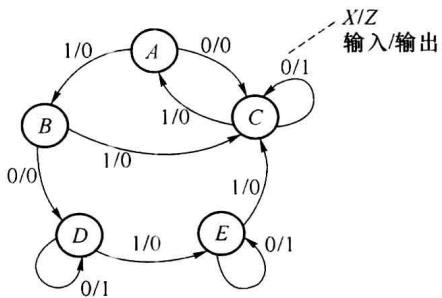  

图7.1.14 例7.1.3的状态图

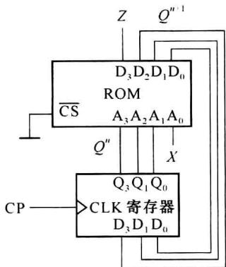  

图7.1.15 例7.1.3的实现电路

表 7.1.3 例 7.1.3 的状态转移表和 ROM 存储数据

<table><tr><td rowspan="2">状态符号</td><td colspan="3">当前状态</td><td rowspan="2">输入X</td><td rowspan="2">输出Z</td><td colspan="3">下一状态</td><td rowspan="2">状态符号</td></tr><tr><td> $Q_2^n$ </td><td> $Q_1^n$ </td><td> $Q_0^n$ </td><td> $Q_2^{n+1}$ </td><td> $Q_1^{n+1}$ </td><td> $Q_0^{n+1}$ </td></tr><tr><td rowspan="2">A</td><td>0</td><td>0</td><td>0</td><td>0</td><td>0</td><td>0</td><td>1·</td><td>0</td><td>C</td></tr><tr><td>0</td><td>0</td><td>0</td><td>1</td><td>0</td><td>0</td><td>0</td><td>1</td><td>B</td></tr><tr><td rowspan="2">B</td><td>0</td><td>0</td><td>1</td><td>0</td><td>0</td><td>0</td><td>1</td><td>1</td><td>D</td></tr><tr><td>0</td><td>0</td><td>1</td><td>1</td><td>0</td><td>0</td><td>1</td><td>0</td><td>C</td></tr><tr><td rowspan="2">C</td><td>0</td><td>1</td><td>0</td><td>0</td><td>1</td><td>0</td><td>1</td><td>0</td><td>C</td></tr><tr><td>0</td><td>1</td><td>0</td><td>1</td><td>0</td><td>0</td><td>0</td><td>0</td><td>A</td></tr><tr><td rowspan="2">D</td><td>0</td><td>1</td><td>1</td><td>0</td><td>1</td><td>0</td><td>1</td><td>1</td><td>D</td></tr><tr><td>0</td><td>1</td><td>1</td><td>1</td><td>0</td><td>1</td><td>0</td><td>0</td><td>E</td></tr><tr><td rowspan="2">E</td><td>1</td><td>0</td><td>0</td><td>0</td><td>1</td><td>1</td><td>0</td><td>0</td><td>E</td></tr><tr><td>1</td><td>0</td><td>0</td><td>1</td><td>0</td><td>0</td><td>1</td><td>0</td><td>C</td></tr><tr><td rowspan="6"></td><td>1</td><td>0</td><td>1</td><td>0</td><td>0</td><td>0</td><td>0</td><td>0</td><td>A</td></tr><tr><td>1</td><td>0</td><td>1</td><td>1</td><td>0</td><td>0</td><td>0</td><td>0</td><td>A</td></tr><tr><td>1</td><td>1</td><td>0</td><td>0</td><td>0</td><td>0</td><td>0</td><td>0</td><td>A</td></tr><tr><td>1</td><td>1</td><td>0</td><td>1</td><td>0</td><td>0</td><td>0</td><td>0</td><td>A</td></tr><tr><td>1</td><td>1</td><td>1</td><td>0</td><td>0</td><td>0</td><td>0</td><td>0</td><td>A</td></tr><tr><td>1</td><td>1</td><td>1</td><td>1</td><td>0</td><td>0</td><td>0</td><td>0</td><td>A</td></tr><tr><td rowspan="2"></td><td> $A_3$ </td><td> $A_2$ </td><td> $A_1$ </td><td> $A_0$ </td><td> $D_3$ </td><td> $D_2$ </td><td> $D_1$ </td><td> $D_0$ </td><td rowspan="2"></td></tr><tr><td colspan="4">ROM地址</td><td colspan="4">存储数据</td></tr></table>

同步时序逻辑电路是一种有限状态机,其状态转移规律都可用状态图描述。状态及其转移关系代表着对输入信号 X 处理的阶段及步骤,输出信号 Z 是各阶段的处理结果。状态转移总发生在时钟的有效边沿,计数器是实现状态转移关系的电路形式,状态的编码决定着电路的复杂程度。

基于随机存储器 RAM 可实现移位寄存器、串/并转换等时序电路。读者可自己尝试设计。

存储器的通用集成电路通常是多输出位(例如8位)、多存储单元 $(2^{k}$ 个, k>10)。如果用存储器芯片实现单个逻辑函数, 芯片面积的使用效率一般是较低的。但用存储器实现同步逻辑处理是一种能力强而又简单的方法。在可编程逻辑器件中, 存储器有着多方面的应用。
</Solution>
</Example>
